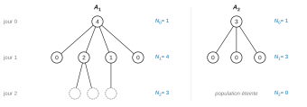
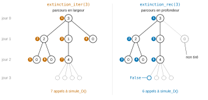
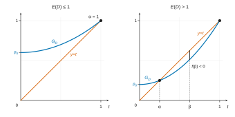
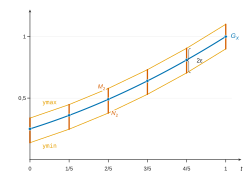

# Agro-Véto BCPST — Modélisation mathématique et informatique 2026 · Corrigé guidé

*Corrigé rédigé par IA, non officiel. Signalez toute erreur.*

## Présentation du sujet

**Cadre.** Épreuve de 3 heures, sans calculatrice ni document. Un problème unique, en quatre parties, consacré à la **fonction génératrice** d'une variable aléatoire $X$ à valeurs dans $\mathbb N$ :

$$G_X(t)=\sum_{n\in\mathbb N}P(X=n)\,t^n .$$

Une annexe rappelle trois commandes Python : `rd.binomial(n, p)` (module `numpy.random`), `plt.plot(x, y)` et `plt.show()` (module `matplotlib.pyplot`). On compte **81 questions élémentaires**.

**Découpage.**

- **Partie I (Q 1 à 4)** : la boîte à outils. Définition de $G_X$ sur $[0,1]$, valeurs aux bornes, croissance, lien avec l'espérance de $t^X$ et sa variance, loi binomiale. Puis la caractérisation des variables presque sûrement bornées par le caractère polynomial de $G_X$, la formule $E(X)=G_X'(1)$, et surtout le fait que **$G_X$ caractérise la loi** (Q 4). Tout le reste du sujet s'appuie sur ces résultats.
- **Partie II (Q 5 à 12)** : jacinthes soumises à deux filtres successifs (hauteur puis floraison). On obtient **trois fois** la loi $\mathcal B(n,p_1p_2)$ du nombre $J_2$ de plantes retenues. D'abord par la formule des probabilités totales et un calcul de coefficients binomiaux, puis par la composition $G_{J_2}=G_{J_1}\circ G_{X_1}$, enfin directement. Trois programmes Python simulent $J_2$.
- **Partie III (Q 13 à 30)** : un **processus de branchement** (modèle de Galton-Watson) pour une population d'euglènes. Croissance moyenne $E(N_j)=E(D)^j$, exemples, puis le résultat central : la probabilité d'extinction est **le plus petit point fixe** de $G_D$ sur l'intervalle des probabilités. Elle vaut $1$ si la moyenne $E(D)$ est au plus $1$, et elle est strictement inférieure à $1$ sinon. Une dichotomie en Python la calcule.
- **Partie IV (Q 31 à 33)** : estimation de $G_X$ par une moyenne empirique (inégalité de Bienaymé-Tchebychev), lecture d'un programme de tracé avec bande de confiance, puis tracé exact quand la loi est connue.

Les parties II, III et IV sont indépendantes entre elles. La sous-partie III.C utilise un résultat admis qui n'est démontré qu'en III.D.

**Notions du programme mobilisées.** Séries à termes positifs (comparaison, équivalents), théorème de transfert, variance et König-Huygens, formule du binôme, polynômes (nombre de racines), système complet d'événements et probabilités totales, lois de Bernoulli et binomiale, indépendance et lemme des coalitions, $\sigma$-additivité, suites récurrentes $u_{n+1}=f(u_n)$, étude de fonctions et théorème de la bijection, inégalité de Bienaymé-Tchebychev. En Python : boucles, listes, récursivité, dichotomie, parcours d'arbre.

**Ce qu'en dit le jury (rapport 2026).** Moyenne $9{,}54/20$, médiane $9{,}30$, écart type $4{,}00$ ; la moitié des copies est entre $6{,}70$ et $12{,}40$. Le rapport juge le sujet long et précise : « traiter convenablement un grand nombre des questions 1 à 22 permettait d’obtenir une très bonne note ». La partie II « a été la mieux réussie de l’épreuve ».

Les questions **discriminantes** relevées par le jury :

- Q 1.1, où la convergence de la série est rarement justifiée ;
- Q 20, « très rarement réussie », faute de maîtriser le conditionnement ;
- Q 22.3, où largeur et profondeur sont souvent confondues ;
- Q 23.4, « très rarement traitée correctement » ;
- Q 27, qui « n’a ainsi que très rarement rapporté des points », faute d'avoir vu que $(H_4)$ rend $G_D$ polynomiale ;
- Q 30, où la valeur approchée par excès a souvent posé problème.

**Difficulté et gestion du temps.** Le sujet est long mais très guidé. Les questions les plus délicates sont Q 3.1 (sens réciproque), Q 10.1 (réindexation), Q 18.1-18.2 (indépendance), Q 20 et Q 25.2 (propriété de branchement), Q 22.3 (parcours d'arbre) et Q 23.4 (récursivité).

À ne pas laisser passer : Q 1.1 à 1.6, Q 2, Q 5, Q 6, Q 7.1, Q 8.1, Q 8.4, Q 11, Q 14 à 17, Q 21, Q 23.1-23.2, Q 24, Q 25.3 à 25.6, Q 26 à 29, Q 30, Q 31, Q 33.

Les questions de code (7.1, 7.2, 9, 12, 22.1 à 22.3, 23.4, 30, 32.1 à 32.4, 33) sont nombreuses et rapides : ne pas les garder pour la fin. Le jury note qu'aborder des questions isolées de la partie III sans les résultats intermédiaires « s’est souvent révélé inefficace », et qu'il pouvait être plus judicieux de passer à la partie IV.

Compter environ 30 minutes pour la partie I, 40 minutes pour la partie II, 1 h 20 pour la partie III et 30 minutes pour la partie IV.

Convention utilisée partout : $t^0=1$ pour tout réel $t$, y compris $t=0$ (en Python, `0**0` vaut `1`).

## Partie I — Notion de fonction génératrice

On installe les propriétés de $G_X$ avec les seuls outils des séries numériques à termes positifs (les séries entières ne sont pas au programme de BCPST), puis on fait le lien avec l'espérance.

### Question 1.1

> [!INDICATION]
> Pour $t\in[0,1]$, encadrez le terme général $P(X=n)t^n$.

> [!INDICATION]
> Que vaut $\sum_{n\ge0}P(X=n)$, et pourquoi cette série converge-t-elle ? Quel théorème de comparaison s'applique à des séries à termes positifs ?

#### Solution

Soit $t\in[0,1]$. Pour tout $n\in\mathbb N$, $0\le t^n\le1$ et $P(X=n)\ge0$, donc

$$\begin{aligned}
0&\le P(X=n)\,t^n\\
&\le P(X=n).
\end{aligned}$$

Les événements $(X=n)_{n\in\mathbb N}$ sont deux à deux incompatibles, de réunion $\Omega$. Par $\sigma$-additivité, la série à termes positifs $\sum P(X=n)$ converge et vaut $1$.

Par le théorème de comparaison des séries à termes positifs, $\sum P(X=n)t^n$ converge. **$G_X$ est définie en tout point de $[0,1]$.**

> [!JURY]
> Le rapport 2026 relève que la convergence de cette série « n’a que trop rarement été correctement justifiée ». Il ajoute : « La nécessité même d’étudier la convergence de cette série ne semble d’ailleurs souvent pas avoir été perçue. » Écrire la majoration, la positivité, et dire pourquoi $\sum P(X=n)$ converge.

> [!PIEGE]
> Le théorème « $u_n\le v_n$ et $\sum v_n$ converge, donc $\sum u_n$ converge » exige $u_n\ge0$. Il faut écrire la minoration par $0$.

### Question 1.2

> [!INDICATION]
> Évaluez chaque terme de la série en $t=0$ en tenant compte de la convention $0^0=1$, puis en $t=1$.

#### Solution

En $t=0$ : $0^0=1$ et $0^n=0$ pour $n\ge1$, donc seul le terme $n=0$ subsiste.

En $t=1$ : on somme les $P(X=n)$, ce qui donne $1$ (Q 1.1).

$$\boxed{G_X(0)=P(X=0)}$$

$$\boxed{G_X(1)=1}$$

> [!PIEGE]
> Écrire $G_X(0)=0$ en oubliant que $0^0=1$. Or $G_X(0)=P(X=0)$ servira à la question 26.

### Question 1.3

> [!INDICATION]
> Prenez $0\le s\le t\le1$ et comparez les termes généraux des deux séries.

> [!INDICATION]
> Une inégalité entre sommes partielles se conserve par passage à la limite.

#### Solution

Soient $0\le s\le t\le1$. Pour tout $n$, $u\mapsto u^n$ est croissante sur $\mathbb R_+$, donc $s^n\le t^n$.

Comme $P(X=n)\ge0$, on multiplie, puis on somme pour $n$ de $0$ à $N$ :

$$\begin{aligned}
P(X=n)\,s^n&\le P(X=n)\,t^n,\\
\sum_{n=0}^NP(X=n)\,s^n&\le\sum_{n=0}^NP(X=n)\,t^n .
\end{aligned}$$

Les deux séries convergent (Q 1.1), et une inégalité large passe à la limite quand $N\to+\infty$ : $G_X(s)\le G_X(t)$. **$G_X$ est croissante sur $[0,1]$.**

> [!JURY]
> Le rapport 2026 note qu'il est fréquent « de voir dériver spontanément la fonction génératrice sans s’interroger sur la validité de cette opération ». Il rappelle que pour établir la croissance d’une fonction, « revenir directement à la définition peut parfois constituer une stratégie plus efficace ». C'est le cas ici : dériver une série terme à terme n'est pas au programme.

### Question 1.4

> [!INDICATION]
> Utilisez les deux questions précédentes plutôt qu'une nouvelle majoration.

#### Solution

$G_X(t)$ est la somme d'une série à termes positifs, donc $G_X(t)\ge0$. Par croissance (Q 1.3) et Q 1.2, $G_X(t)\le G_X(1)=1$.

$$\boxed{\forall t\in[0,1],\ G_X(t)\in[0,1]}$$

> [!METHODE]
> Dans un sujet construit en escalier, une réponse courte qui cite les questions précédentes est attendue. Ce résultat fait de $G_X$ une application de $[0,1]$ dans $[0,1]$, ce qui permettra d'itérer $G_D$ en partie III.

### Question 1.5

> [!INDICATION]
> $t^X$ est l'image de $X$ par une fonction ; quel théorème donne l'espérance d'une telle variable ?

> [!INDICATION]
> La condition d'existence du théorème de transfert est une convergence absolue : la question 1.1 la fournit.

#### Solution

Soit $t\in[0,1]$. La variable $t^X$ est $\varphi(X)$ avec $\varphi:n\mapsto t^n$.

D'après le théorème de transfert, elle admet une espérance si et seulement si la série $\sum|\varphi(n)|P(X=n)$ converge. Cette série est $\sum t^nP(X=n)$, qui converge (Q 1.1, termes positifs). Le théorème donne alors :

$$\begin{aligned}
E\big(t^X\big)&=\sum_{n=0}^{+\infty}t^nP(X=n)\\
&=G_X(t).
\end{aligned}$$

$$\boxed{E\big(t^X\big)=G_X(t)}$$


> [!JURY]
> Le rapport 2026 constate que le théorème de transfert et la formule de König-Huygens sont souvent cités, mais que « leurs hypothèses comme leurs conclusions demeurent insuffisamment maîtrisées ». Le transfert a deux conclusions : l'existence de l'espérance, sous la condition de convergence absolue, et sa valeur.

> [!PIEGE]
> $E(t^X)$ n'est pas $t^{E(X)}$ : l'espérance ne commute pas avec une fonction non affine.

### Question 1.6

> [!INDICATION]
> Écrivez $\big(t^X\big)^2$ comme une puissance d'un autre réel de $[0,1]$.

> [!INDICATION]
> Appliquez Q 1.5 à ce réel, puis la formule de König-Huygens ; pour la majoration, servez-vous de Q 1.4.

#### Solution

Soit $t\in[0,1]$. Pour tout $\omega$, $\big(t^{X(\omega)}\big)^2=(t^2)^{X(\omega)}$, et $t^2\in[0,1]$.

D'après Q 1.5, $(t^X)^2=(t^2)^X$ admet une espérance égale à $G_X(t^2)$. Donc $t^X$ admet un moment d'ordre 2, donc une variance, et par König-Huygens :

$$\begin{aligned}
V\big(t^X\big)&=E\big((t^X)^2\big)-E\big(t^X\big)^2\\
&=G_X(t^2)-G_X(t)^2 .
\end{aligned}$$

$$\boxed{V\big(t^X\big)=G_X(t^2)-G_X(t)^2}$$

Comme $G_X(t)^2\ge0$ et $G_X(t^2)\le1$ (Q 1.4), $V(t^X)\le1$.

> [!PIEGE]
> König-Huygens suppose que la variable admet un moment d'ordre 2 : il faut l'établir avant d'écrire la formule, et non l'en déduire.

> [!METHODE]
> Cette majoration grossière est **universelle** (indépendante de la loi de $X$) : c'est elle qui permettra en partie IV de dimensionner un échantillon sans connaître $G_X$.

### Question 2

> [!INDICATION]
> La série se réduit à une somme finie ; reconnaissez une formule classique.

#### Solution

$X$ est à valeurs dans $\{0,\dots,n\}$, donc $P(X=k)=0$ pour $k>n$. Pour $t\in[0,1]$, par la formule du binôme de Newton :

$$\begin{aligned}
G_X(t)&=\sum_{k=0}^n\binom nkp^k(1-p)^{n-k}t^k\\
&=\sum_{k=0}^n\binom nk(pt)^k(1-p)^{n-k}\\
&=(pt+1-p)^n .
\end{aligned}$$

$$\boxed{G_X(t)=(pt+1-p)^n}$$

> [!PIEGE]
> L'énoncé fixe déjà $n$ : la somme doit être indexée par une autre lettre ($k$). Le rapport 2026 le rappelle : « il convient de ne pas réutiliser une lettre déjà fixée dans l’énoncé pour indexer une somme ».

> [!METHODE]
> Contrôle gratuit : $G_X(1)=1$ et $G_X(0)=(1-p)^n=P(X=0)$. Le cas $n=1$ donne la loi de Bernoulli, $G(t)=pt+1-p$, utile en Q 10.2.

### Question 3.1

> [!INDICATION]
> Sens direct : montrez que $P(X=n)=0$ pour tout $n>m$, à l'aide de l'inclusion $(X=n)\subset(X>m)$.

> [!INDICATION]
> Sens réciproque : raisonnez par l'absurde, en supposant $P(X=n_0)>0$ pour un $n_0$ strictement supérieur au degré du polynôme, et regardez le comportement quand $t\to+\infty$.

> [!INDICATION]
> Pour $t>1$, une somme de termes positifs est supérieure à chacun de ses termes. Comparez à $t^d$ où $d$ est le degré.

#### Solution

**(i) ⇒ (ii).** Supposons $P(X\le m)=1$. Pour tout entier $n>m$, $(X=n)\subset(X>m)$, donc

$$\begin{aligned}
P(X=n)&\le P(X>m)\\
&=0 .
\end{aligned}$$

Ainsi $P(X=n)=0$ pour $n>m$. Pour tout $t\in\mathbb R$, la série définissant $G_X(t)$ n'a qu'un nombre fini de termes non nuls.

$G_X$ est donc définie sur $\mathbb R$, et $G_X(t)=\sum_{n=0}^mP(X=n)t^n$ est polynomiale.

**(ii) ⇒ (i).** Supposons $G_X$ définie sur $\mathbb R$ et égale sur $\mathbb R$ à une fonction polynomiale $Q$.

Comme $Q(1)=1$, $Q$ n'est pas nul ; soit $d$ son degré et $c\ne0$ son coefficient dominant.

Supposons qu'il existe $n_0>d$ tel que $P(X=n_0)>0$. Pour $t>1$, tous les termes de la série sont positifs, donc

$$\frac{Q(t)}{t^d}\ge P(X=n_0)\,t^{\,n_0-d}.$$

Le membre de droite tend vers $+\infty$ quand $t\to+\infty$, alors que $Q(t)/t^d\to c$ : contradiction.

Ainsi $P(X=n)=0$ pour tout $n>d$. Par $\sigma$-additivité, $P(X>d)=0$, donc $P(X\le d)=1$ : $m=d$ convient.

**(i) et (ii) sont équivalentes.**

> [!PIEGE]
> Invoquer « l'unicité des coefficients d'une série entière » : ce résultat n'est pas au programme de BCPST. L'argument de croissance comparée suffit.

> [!JURY]
> Le rapport 2026 signale des copies qui annoncent une double implication mais écrivent des « ⇔ » dans le sens direct : « outre que ceci n’a aucun sens, cette rédaction conduit souvent à oublier de démontrer le sens réciproque ». Deux sens séparés, annoncés, chacun conclu sur l'assertion visée.

### Question 3.2

> [!INDICATION]
> Sous ces hypothèses, toutes les sommes sont finies : il n'y a plus de difficulté de convergence.

#### Solution

D'après Q 3.1, $P(X=n)=0$ pour $n>m$. La série $\sum nP(X=n)$ n'a qu'un nombre fini de termes non nuls : $X$ admet une espérance, et $E(X)=\sum_{n=1}^mnP(X=n)$.

Par ailleurs, $G_X$ coïncide sur $\mathbb R$ avec le polynôme $\sum_{n=0}^mP(X=n)t^n$, donc est dérivable en $1$, et

$$\begin{aligned}
(G_X)'(1)&=\sum_{n=1}^mnP(X=n)\\
&=E(X).
\end{aligned}$$

$$\boxed{E(X)=(G_X)'(1)}$$

> [!METHODE]
> Dériver « terme à terme » n'est licite ici que parce que la somme est finie ; c'est ce qu'il faut dire.

### Question 4

> [!INDICATION]
> Un sens est immédiat. Pour l'autre, écrivez $G_X$ et $G_Y$ comme des polynômes (pourquoi est-ce possible ?).

> [!INDICATION]
> Combien de racines peut avoir un polynôme non nul de degré au plus $m$ ?

#### Solution

**(i) ⇒ (ii)** : si $X$ et $Y$ ont même loi, les séries définissant $G_X(t)$ et $G_Y(t)$ ont les mêmes termes.

**(ii) ⇒ (i)** : $X$ et $Y$ sont à valeurs dans $\{0,\dots,m\}$. Pour $t\in[0,1]$ :

$$\begin{aligned}
G_X(t)-G_Y(t)&=\sum_{n=0}^mP(X=n)\,t^n-\sum_{n=0}^mP(Y=n)\,t^n\\
&=\sum_{n=0}^m\big(P(X=n)-P(Y=n)\big)t^n .
\end{aligned}$$

Ce polynôme, de degré au plus $m$, s'annule sur $[0,1]$, ensemble infini : c'est le polynôme nul.

Donc $P(X=n)=P(Y=n)$ pour $0\le n\le m$ ; pour $n>m$, les deux probabilités sont nulles. **$X$ et $Y$ ont même loi.**

> [!METHODE]
> « La fonction génératrice caractérise la loi » : pour identifier une loi, il suffit de reconnaître sa fonction génératrice (Q 10.3). Penser à vérifier que les deux variables sont à valeurs dans un même $\{0,\dots,m\}$.

## Partie II — Sommes aléatoires : un premier modèle

On détermine de trois façons la loi du nombre $J_2$ de jacinthes qui franchissent deux filtres successifs. L'enjeu est de citer précisément les hypothèses $(A_1)$ à $(A_4)$ et de lire des programmes de simulation. C'est la partie la mieux réussie selon le rapport 2026 : il ne faut pas y perdre de points.

### Question 5

> [!INDICATION]
> Introduisez, pour chaque plante, l'indicatrice de l'événement « elle atteint vingt centimètres ».

> [!INDICATION]
> Reconnaissez un schéma de Bernoulli : quelles hypothèses donnent le paramètre, lesquelles donnent l'indépendance ?

#### Solution

Soit $H_i$ l'indicatrice de « la jacinthe $i$ atteint le seuil ». D'après $(A_1)$, $H_i\hookrightarrow\mathcal B(p_1)$ ; d'après $(A_3)$, $H_1,\dots,H_n$ sont indépendantes.

$J_1=\sum_{i=1}^nH_i$ compte les succès de $n$ épreuves de Bernoulli indépendantes de même paramètre $p_1$ :

$$\boxed{J_1\hookrightarrow\mathcal B(n,p_1)}$$

Hypothèses utilisées : $(A_1)$ et $(A_3)$ (la floraison n'intervient pas).

> [!JURY]
> Le rapport 2026 attend exactement ces deux hypothèses, $(A_1)$ et $(A_3)$. Les nommer une à une, et seulement celles qui servent.

### Question 6

> [!INDICATION]
> Conditionnez par la valeur de $J_1$ ; sachant $(J_1=i)$, quelle est la loi du nombre de plantes qui fleurissent ?

> [!INDICATION]
> Formule des probabilités totales sur un système complet à trois événements, de probabilités non nulles ; vérifiez que la somme fait $1$.

#### Solution

D'après Q 5, $J_1\hookrightarrow\mathcal B(2,\frac23)$ :

$$\begin{aligned}
P(J_1=0)&=\tfrac19,\\
P(J_1=1)&=\tfrac49,\\
P(J_1=2)&=\tfrac49 .
\end{aligned}$$

Sachant $(J_1=i)$, chacune des $i$ plantes retenues fleurit avec probabilité $\frac34$, indépendamment $(A_2,A_3,A_4)$. La loi conditionnelle de $J_2$ est donc $\mathcal B(i,\frac34)$.

Les trois événements $(J_1=i)$ forment un système complet de probabilités non nulles. Par la formule des probabilités totales :

$$\begin{aligned}
P(J_2=0)&=\tfrac19\cdot1+\tfrac49\cdot\tfrac14+\tfrac49\cdot\tfrac1{16}\\
&=\tfrac14,\\[1mm]
P(J_2=1)&=\tfrac49\cdot\tfrac34+\tfrac49\cdot2\cdot\tfrac34\cdot\tfrac14\\
&=\tfrac12,\\[1mm]
P(J_2=2)&=\tfrac49\cdot\tfrac9{16}\\
&=\tfrac14.
\end{aligned}$$

**$J_2\hookrightarrow\mathcal B(2,\frac12)$**, et l'on remarque que $\frac12=\frac23\cdot\frac34=p_1p_2$.

> [!METHODE]
> Le rapport 2026 propose aussi une preuve directe : chaque bulbe a la probabilité $p_1p_2=\frac12$ de franchir le seuil et de fleurir, indépendamment de l'autre, donc $J_2$ suit $\mathcal B(2,\frac12)$. C'est l'idée de la question 11.

> [!PIEGE]
> Oublier le terme $i=0$ dans $P(J_2=0)$, ou le coefficient $\binom21=2$.

### Question 7.1

> [!INDICATION]
> Que renvoie `rd.binomial(1, p)` ? Relisez l'annexe : c'est une épreuve de Bernoulli.

> [!INDICATION]
> La liste `l` doit marquer les plantes retenues à l'issue de la première phase ; la seconde boucle ne considère que celles-là.

#### Solution

```python
def J2(n, p1, p2):
    aux = 0
    l = [0 for i in range(n)]
    for i in range(n):
        if rd.binomial(1, p1) == 1:
            l[i] = 1
    for i in range(n):
        if l[i] == 1:
            if rd.binomial(1, p2) == 1:
                aux = aux + 1
    return aux
```

> [!PIEGE]
> Le rapport 2026 rappelle que « la commande rd.binomial(1, p) renvoie 0 ou 1 ». Il relève des instructions telles que « if rd.binomial(1, p) == p », qui confondent l'entrée et la sortie de la commande : le test est presque toujours faux.

### Question 7.2

> [!INDICATION]
> Associez chaque boucle à une phase de l'expérience et à une variable aléatoire du modèle.

#### Solution

La boucle des lignes 4 à 6 simule la **phase de croissance**. Pour chaque jacinthe, un tirage de Bernoulli de paramètre $p_1$ décide si elle atteint vingt centimètres. `l[i]` vaut alors $1$ (c'est $H_i$), et le nombre de $1$ dans `l` est une réalisation de $J_1$.

La boucle des lignes 7 à 10 simule la **phase de floraison** des seules plantes retenues. Pour chaque `i` tel que `l[i] == 1`, un tirage de Bernoulli de paramètre $p_2$ décide si la plante fleurit, et `aux` compte ces plantes. La valeur renvoyée est une réalisation de $J_2$.

> [!JURY]
> Le rapport 2026 regrette que les explications de programmes se réduisent « trop souvent à de la paraphrase ou à une description ligne par ligne du code ». Il attend « une prise de recul sur le fonctionnement global du programme » : nommer la phase biologique et la variable simulée.

### Question 8.1

> [!INDICATION]
> Revenez à la définition : incompatibilité deux à deux, réunion égale à $\Omega$.

#### Solution

$J_1$ est à valeurs dans $\{0,\dots,n\}$.

- Pour $i\ne i'$, $(J_1=i)\cap(J_1=i')=\varnothing$.
- Pour tout $\omega$, $J_1(\omega)\in\{0,\dots,n\}$, donc $\bigcup_{i=0}^n(J_1=i)=\Omega$.

**$(J_1=i)_{0\le i\le n}$ est un système complet d'événements.**

> [!JURY]
> « La définition d’un système complet d’événements est trop rarement connue avec précision » (rapport 2026). Les deux conditions, incompatibilité deux à deux et réunion égale à $\Omega$, doivent apparaître.

### Question 8.2

> [!INDICATION]
> Pour la positivité, utilisez la loi de $J_1$ et le fait que $p_1\in\,]0,1[$.

> [!INDICATION]
> Sachant $(J_1=i)$, combien de plantes peuvent fleurir, avec quelle probabilité chacune, et pourquoi le conditionnement par les hauteurs ne change-t-il rien ?

#### Solution

D'après Q 5, et comme $p_1\in\,]0,1[$, $P(J_1=i)=\binom nip_1^i(1-p_1)^{n-i}>0$.

Sachant $(J_1=i)$, exactement $i$ plantes sont retenues. Chacune fleurit avec probabilité $p_2$ $(A_2)$, indépendamment des autres $(A_3)$.

$(A_4)$ assure que la floraison est indépendante de la croissance. L'information « $i$ plantes ont franchi le seuil » ne modifie donc pas la loi des floraisons. Ainsi :

$$\begin{aligned}
P_{(J_1=i)}(J_2=\ell)&=\binom i\ell p_2^\ell(1-p_2)^{i-\ell}&&\text{si }0\le\ell\le i,\\
P_{(J_1=i)}(J_2=\ell)&=0&&\text{si }\ell>i.
\end{aligned}$$

**La loi conditionnelle de $J_2$ sachant $(J_1=i)$ est $\mathcal B(i,p_2)$** (variable nulle si $i=0$).

> [!METHODE]
> C'est $(A_4)$ qui justifie le conditionnement : sans elle, savoir qu'une plante est haute pourrait renseigner sur son aptitude à fleurir. Le rapport 2026 cite les trois hypothèses $(A_2)$, $(A_3)$ et $(A_4)$.

### Question 8.3

> [!INDICATION]
> Formule des probabilités totales avec le système complet de Q 8.1 ; pourquoi la somme peut-elle commencer à $i=\ell$ ?

#### Solution

Les événements $(J_1=i)$ forment un système complet de probabilités non nulles (Q 8.1, Q 8.2), donc

$$\begin{aligned}
P(J_2=\ell)&=\sum_{i=0}^nP(J_1=i)\,P_{(J_1=i)}(J_2=\ell)\\
&=\sum_{i=\ell}^nP(J_1=i)\,P_{(J_1=i)}(J_2=\ell).
\end{aligned}$$

Les termes $i<\ell$ sont nuls, car $J_2\le J_1$ : on ne peut avoir plus de plantes fleuries que de plantes retenues. Avec Q 5 et Q 8.2 :

$$\boxed{\begin{aligned}
P(J_2=\ell)=\sum_{i=\ell}^n&\binom i\ell(p_2)^\ell(1-p_2)^{i-\ell}\\
&\times\binom ni(p_1)^i(1-p_1)^{n-i}
\end{aligned}}$$

### Question 8.4

> [!INDICATION]
> Écrivez les quatre coefficients binomiaux avec des factorielles.

#### Solution

Pour $0\le\ell\le i\le n$ :

$$\begin{aligned}
\binom i\ell\binom ni&=\frac{i!}{\ell!\,(i-\ell)!}\cdot\frac{n!}{i!\,(n-i)!}\\
&=\frac{n!}{\ell!\,(i-\ell)!\,(n-i)!}
\end{aligned}$$

et

$$\begin{aligned}
\binom n\ell\binom{n-\ell}{i-\ell}&=\frac{n!}{\ell!\,(n-\ell)!}\cdot\frac{(n-\ell)!}{(i-\ell)!\,(n-i)!}\\
&=\frac{n!}{\ell!\,(i-\ell)!\,(n-i)!}.
\end{aligned}$$

$$\boxed{\binom i\ell\binom ni=\binom n\ell\binom{n-\ell}{i-\ell}}$$

> [!METHODE]
> Lecture combinatoire : choisir $i$ plantes parmi $n$, puis $\ell$ parmi ces $i$.
>
> C'est choisir d'abord les $\ell$ plantes, puis compléter par $i-\ell$ plantes parmi les $n-\ell$ autres.

### Question 8.5

> [!INDICATION]
> Remplacez le produit de coefficients binomiaux grâce à Q 8.4 et sortez de la somme tout ce qui ne dépend pas de $i$.

> [!INDICATION]
> Écrivez $p_1^i=p_1^\ell p_1^{i-\ell}$, posez $k=i-\ell$ et reconnaissez un binôme de Newton.

#### Solution

D'après Q 8.3 et Q 8.4, on sort de la somme les facteurs indépendants de $i$. Avec $k=i-\ell$, qui décrit $\{0,\dots,n-\ell\}$, et $n-i=(n-\ell)-k$ :

$$\begin{aligned}
P(J_2=\ell)&=\binom n\ell(p_1p_2)^\ell\sum_{i=\ell}^n\binom{n-\ell}{i-\ell}\big(p_1(1-p_2)\big)^{i-\ell}(1-p_1)^{n-i}\\
&=\binom n\ell(p_1p_2)^\ell\sum_{k=0}^{n-\ell}\binom{n-\ell}k\big(p_1(1-p_2)\big)^k(1-p_1)^{n-\ell-k}\\
&=\binom n\ell(p_1p_2)^\ell\big(p_1(1-p_2)+1-p_1\big)^{n-\ell}\\
&=\binom n\ell(p_1p_2)^\ell(1-p_1p_2)^{n-\ell}.
\end{aligned}$$

$$\boxed{P(J_2=\ell)=\binom n\ell(p_1p_2)^\ell(1-p_1p_2)^{n-\ell}}$$

**$J_2$ suit la loi binomiale $\mathcal B(n,p_1p_2)$.**

> [!PIEGE]
> Laisser $p_1(1-p_2)+1-p_1$ sans le simplifier en $1-p_1p_2$ empêche de reconnaître la loi.

### Question 9

> [!INDICATION]
> Que représente la variable `i` tirée à la ligne 2 dans le modèle ?

> [!INDICATION]
> La ligne 3 tire une binomiale dont le premier paramètre est aléatoire : rapprochez-la de Q 8.2, puis concluez par les probabilités totales.

#### Solution

La ligne 2 simule une variable de loi $\mathcal B(n,p_1)$, c'est-à-dire le nombre $J_1$ de plantes ayant atteint le seuil (Q 5) : c'est la phase de croissance.

Sachant que `i` vaut $i$, la ligne 3 renvoie une réalisation de $\mathcal B(i,p_2)$, la loi conditionnelle de $J_2$ sachant $(J_1=i)$ (Q 8.2) : c'est la phase de floraison.

Soit $M$ la valeur renvoyée. La formule des probabilités totales sur le système $(\texttt i=i)_{0\le i\le n}$ redonne exactement l'expression de Q 8.3 : $M$ a la loi de $J_2$.

**`mystere1(n, p1, p2)` simule la variable aléatoire $J_2$ en deux étapes et renvoie une réalisation de $J_2$, de loi $\mathcal B(n,p_1p_2)$.**

> [!PIEGE]
> Le rapport 2026 relève que plusieurs candidats « indiquent simuler une probabilité ou un événement alors que les commandes Python proposées simulent en réalité des variables aléatoires ». Ici, on simule $J_2$, pas $P(J_2=\ell)$.

### Question 10.1

> [!INDICATION]
> Modélisez chaque plante par deux variables de Bernoulli, l'une pour la hauteur, l'autre pour la floraison, et écrivez $J_1$ et $J_2$ à l'aide de ces variables.

> [!INDICATION]
> Renumérotez les plantes en plaçant d'abord celles qui franchissent le seuil ; cette renumérotation ne dépend que des hauteurs.

> [!INDICATION]
> Pour l'indépendance, calculez $P(J_1=i,X_1=x_1,\dots,X_n=x_n)$ en conditionnant par le vecteur des hauteurs.

#### Solution

Soient $H_1,\dots,H_n,F_1,\dots,F_n$ indépendantes, avec $H_i\hookrightarrow\mathcal B(p_1)$ (hauteur, $A_1$) et $F_i\hookrightarrow\mathcal B(p_2)$ (floraison, $A_2$).

L'indépendance entre plantes traduit $(A_3)$, celle entre hauteurs et floraisons $(A_4)$. Alors $J_1=\sum_iH_i$ et $J_2=\sum_iH_iF_i$.

Pour $h\in\{0,1\}^n$, soit $\sigma_h$ la permutation de $\{1,\dots,n\}$ qui range d'abord, par ordre croissant, les indices $i$ tels que $h_i=1$, puis les autres.

Posons $X_k=F_{\sigma_H(k)}$, où $H=(H_1,\dots,H_n)$.

Les indices $\sigma_H(1),\dots,\sigma_H(J_1)$ sont exactement ceux des plantes retenues, donc

$$\begin{aligned}
J_2&=\sum_{i:\,H_i=1}F_i\\
&=\sum_{k=1}^{J_1}X_k,
\end{aligned}$$

la somme étant nulle si $J_1=0$.

Soient $(x_1,\dots,x_n)\in\{0,1\}^n$ et $i\in\{0,\dots,n\}$. On somme sur les $h$ tels que $h_1+\dots+h_n=i$, et on utilise l'indépendance de $H$ et de $(F_1,\dots,F_n)$ :

$$\begin{aligned}
P(J_1=i,X_1=x_1,\dots,X_n=x_n)&=\sum_hP(H=h)P\big(F_{\sigma_h(1)}=x_1,\dots,F_{\sigma_h(n)}=x_n\big)\\
&=P(J_1=i)\prod_{k=1}^np_2^{x_k}(1-p_2)^{1-x_k}.
\end{aligned}$$

En effet, $h$ étant fixé, $(F_{\sigma_h(1)},\dots,F_{\sigma_h(n)})$ est une permutation fixe de variables indépendantes de loi $\mathcal B(p_2)$.

**Les $X_k$ suivent la loi $\mathcal B(p_2)$, $X_1,\dots,X_n,J_1$ sont indépendantes, et $J_2=\sum_{k=1}^{J_1}X_k$.**

> [!METHODE]
> Le rapport 2026 se contente de l'idée : noter $X_k$ l'indicatrice de floraison de la $k$-ième plante après avoir listé en premier celles qui ont atteint le seuil, et invoquer les hypothèses du modèle pour la loi et l'indépendance. Le calcul ci-dessus en est la version complète.

> [!PIEGE]
> Poser simplement $X_k=F_k$ : alors $\sum_{k\le J_1}F_k$ compte les floraisons des $J_1$ **premières** plantes, qui ne sont pas forcément celles qui ont franchi le seuil.

### Question 10.2

> [!INDICATION]
> Les deux fonctions génératrices à composer sont celles de lois binomiales : la question 2 les donne.

#### Solution

D'après Q 2, $G_{X_1}(t)=p_2t+1-p_2$ (avec $n=1$) et $G_{J_1}(u)=(p_1u+1-p_1)^n$. Comme $G_{X_1}(t)\in[0,1]$ pour $t\in[0,1]$, la composée a un sens :

$$\begin{aligned}
G_{J_2}(t)&=G_{J_1}\big(G_{X_1}(t)\big)\\
&=\big(p_1(p_2t+1-p_2)+1-p_1\big)^n\\
&=(p_1p_2\,t+1-p_1p_2)^n .
\end{aligned}$$

$$\boxed{G_{J_2}(t)=(p_1p_2\,t+1-p_1p_2)^n}$$

> [!PIEGE]
> « Dans la question 10.2, la composition et le produit de fonctions sont fréquemment confondus » (rapport 2026). $G_{J_1}\circ G_{X_1}$ n'est pas $G_{J_1}\times G_{X_1}$ : on remplace $u$ par $G_{X_1}(t)$ dans $G_{J_1}(u)$.

> [!METHODE]
> Vérifier $G_{J_2}(1)=1$ détecte immédiatement une erreur de calcul.

### Question 10.3

> [!INDICATION]
> Reconnaissez la fonction génératrice d'une loi connue et vérifiez les hypothèses de la question 4.

#### Solution

Soit $Z\hookrightarrow\mathcal B(n,p_1p_2)$. D'après Q 2 et Q 10.2, $G_Z(t)=(p_1p_2t+1-p_1p_2)^n=G_{J_2}(t)$ pour tout $t\in[0,1]$.

Les variables $J_2$ et $Z$ sont à valeurs dans $\{0,\dots,n\}$. Le sens réciproque de la question 4, avec $m=n$, donne **$J_2\hookrightarrow\mathcal B(n,p_1p_2)$**.

### Question 11.1

> [!INDICATION]
> Une plante est retenue si deux événements sont réalisés : lesquels, et quelle hypothèse les rend indépendants ?

#### Solution

La plante est retenue si et seulement si elle atteint le seuil (probabilité $p_1$, $A_1$) et fleurit (probabilité $p_2$, $A_2$). Ces événements sont indépendants $(A_4)$, donc

$$\boxed{P(\text{plante retenue})=p_1p_2}$$

> [!PIEGE]
> Le rapport 2026 relève que les notions d'événements incompatibles et indépendants « sont fréquemment confondues ». Ici, les deux événements sont indépendants, et on multiplie. S'ils étaient incompatibles, leur intersection serait vide.

### Question 11.2

> [!INDICATION]
> Nouveau schéma de Bernoulli, avec $n$ épreuves.

#### Solution

Soit $R_i$ l'indicatrice de « la plante $i$ est retenue ». D'après Q 11.1, $R_i\hookrightarrow\mathcal B(p_1p_2)$, et les $R_i$ sont indépendantes $(A_3)$.

$J_2=\sum_{i=1}^nR_i$ compte les succès de $n$ épreuves indépendantes de paramètre $p_1p_2$ : **$J_2\hookrightarrow\mathcal B(n,p_1p_2)$**.

> [!METHODE]
> Morale de la partie : deux filtres indépendants successifs équivalent à un filtre unique de probabilité égale au produit des probabilités.

### Question 12

> [!INDICATION]
> Que représentent `hauteur_i` et `floraison_i` ? Quand `aux` est-il incrémenté ?

> [!INDICATION]
> Rapprochez le programme de la question 11 plutôt que de la question 7.

#### Solution

Chaque tour de boucle traite une plante :

- `hauteur_i` simule $\mathcal B(p_1)$ (seuil atteint, $A_1$) ;
- `floraison_i` simule $\mathcal B(p_2)$ (floraison, $A_2$) ;
- les deux tirages sont indépendants $(A_4)$.

`aux` est incrémenté si et seulement si les deux valent $1$, c'est-à-dire si la plante est finalement retenue, ce qui arrive avec probabilité $p_1p_2$ (Q 11.1). Les tours de boucle sont indépendants $(A_3)$. La valeur renvoyée est $\sum_iR_i$.

**`mystere2(n, p1, p2)` simule l'expérience de la question 11 et renvoie une réalisation de la variable aléatoire $J_2$, de loi $\mathcal B(n,p_1p_2)$.** La floraison est tirée même pour une plante non retenue, ce qui ne change rien à la loi grâce à $(A_4)$.

> [!METHODE]
> Les trois programmes `J2`, `mystere1` et `mystere2` simulent la même loi : le premier suit la chronologie, le deuxième le conditionnement (Q 8-9), le troisième le filtre unique (Q 11). `mystere1` n'appelle que deux fois `rd.binomial`.

## Partie III — Sommes aléatoires : un second modèle

Le nombre d'euglènes au jour $j+1$ est une somme aléatoire, dont le nombre de termes est la population du jour $j$. On étudie d'abord la moyenne (III.B), puis la probabilité d'extinction sur des exemples (III.C), en général (III.D) et numériquement (III.E). Les outils : indépendance et lemme des coalitions, $\sigma$-additivité, suites récurrentes, étude de fonctions.

### Question 13

> [!INDICATION]
> Pour chaque hypothèse, dites quel phénomène biologique elle suppose ou exclut.

#### Solution

- $(H_3)$ : toutes les euglènes, quel que soit le jour, ont la **même loi de reproduction**, celle de $D$. Les individus sont interchangeables (reproduction asexuée, donc clonale), et les conditions de milieu stables au cours du temps.
- $(H_5)$ : une euglène engendre **au plus $m$ descendants** en une journée : fécondité bornée.
- $(H_6)$ : les nombres de descendants de toutes les euglènes, le même jour ou des jours différents, sont **indépendants**. Aucune interaction (pas de compétition pour la lumière ou la nourriture, pas de régulation par la densité), aucune influence de la lignée.

> [!JURY]
> « Le jury rappelle qu’une réponse concise mais précise est attendue » ; il trouve que beaucoup de candidats « restent trop vagues dans leurs interprétations des modèles étudiés » (rapport 2026). Une phrase par hypothèse, qui dit ce qu'elle impose aux euglènes.

> [!PIEGE]
> Paraphraser (« $(H_6)$ signifie que les variables sont indépendantes ») ne rapporte rien : il faut une traduction biologique.

### Question 14

> [!INDICATION]
> Écrivez la relation de récurrence pour $j=0$.

#### Solution

Comme $N_0=1$, $N_1=\sum_{k=1}^1D_{0,k}=D_{0,1}$, qui suit la loi de $D$ d'après $(H_3)$. **$N_1$ et $D$ suivent la même loi.**

> [!PIEGE]
> Même loi ne veut pas dire égalité. Le rapport 2026 cite l'affirmation erronée « $N$ et $D$ ont même loi donc $N=D$ » parmi les confusions fréquentes entre événements, variables aléatoires et lois.

### Question 15

> [!INDICATION]
> Récurrence sur $j$ : majorez chacun des termes de la somme.

#### Solution

$N_0=1\in\{0,\dots,m^0\}$. Supposons $N_j$ à valeurs dans $\{0,\dots,m^j\}$ et soit $\omega\in\Omega$.

$N_{j+1}(\omega)$ est une somme de $N_j(\omega)$ entiers compris entre $0$ et $m$ $(H_5)$, nulle si $N_j(\omega)=0$. C'est un entier, et

$$\begin{aligned}
0\le N_{j+1}(\omega)&\le mN_j(\omega)\\
&\le m^{j+1}.
\end{aligned}$$

**Pour tout $j$, $N_j$ est à valeurs dans $\{0,\dots,m^j\}$.**

> [!METHODE]
> Ce résultat rend finis tous les systèmes complets et toutes les sommes de la sous-partie III.B : les interversions de sommes seront licites sans théorème supplémentaire.

### Question 16

> [!INDICATION]
> Traduisez $(H_4)$ en termes de $p_n$.

#### Solution

D'après $(H_4)$, $D$ est à valeurs dans $\{0,\dots,m\}$, donc $p_n=0$ pour $n>m$ : **$S\subset\{0,\dots,m\}$**.

De plus, $p_m=P(D=m)>0$ : **$m\in S$**.

### Question 17.1

> [!INDICATION]
> $D_{0,1}$ est l'étiquette de la racine ; $D_{1,k}$ celle du $k$-ième nœud du jour 1.

#### Solution



Les nœuds du jour 1 sont rangés de gauche à droite selon l'indice $k$ de $D_{1,k}$. Sur $A_1$, il y a $2+1=3$ euglènes au jour 2, dont la descendance n'est pas précisée ; sur $A_2$, la population est éteinte au jour 2.

### Question 17.2

> [!INDICATION]
> $A_1$ et $A_2$ sont des intersections d'événements portant sur des variables distinctes de la famille $(D_{j,k})$.

#### Solution

Les variables concernées sont indépendantes $(H_6)$ et suivent la loi de $D$ $(H_3)$ :

$$\begin{aligned}
P(A_1)&=p_4\,p_0\,p_2\,p_1\,p_0\\
&=p_0^2p_1p_2p_4,\\[1mm]
P(A_2)&=p_3\,p_0^3 .
\end{aligned}$$

$$\boxed{P(A_1)=p_0^2p_1p_2p_4}$$

$$\boxed{P(A_2)=p_0^3p_3}$$

### Question 17.3

> [!INDICATION]
> Que signifie $\{0,1,2,3,4\}\subset S$ ?

#### Solution

Par définition de $S$, $p_0,p_1,p_2,p_3,p_4>0$, et un produit de réels strictement positifs est strictement positif : **$P(A_1)>0$ et $P(A_2)>0$.**

> [!PIEGE]
> « Une confusion entre inégalité stricte et inégalité au sens large apparaît souvent » (rapport 2026). Ici, la stricte positivité vient de celle de chaque facteur ; $p_n\ge0$ ne suffirait pas.

### Question 17.4

> [!INDICATION]
> Calculez $N_1$ puis $N_2$ pour $\omega\in A_1$.

> [!INDICATION]
> Pour l'unicité, que dire d'un événement inclus dans deux événements $(N_2=n)$ et $(N_2=n')$ distincts ?

#### Solution

Pour $\omega\in A_1$, $N_1(\omega)=D_{0,1}(\omega)=4$, puis

$$\begin{aligned}
N_2(\omega)&=D_{1,1}(\omega)+D_{1,2}(\omega)+D_{1,3}(\omega)+D_{1,4}(\omega)\\
&=0+2+1+0\\
&=3 .
\end{aligned}$$

Donc $A_1\subset(N_2=3)$.

Si l'on avait aussi $A_1\subset(N_2=n')$ avec $n'\ne3$, on aurait $A_1\subset(N_2=3)\cap(N_2=n')$, qui est vide. Cela contredit $P(A_1)>0$. **L'unique entier est $n=3$.**

### Question 17.5

> [!INDICATION]
> L'inclusion de Q 17.4 ne donne qu'une inégalité large. Cherchez une autre configuration d'arbre menant à trois euglènes au jour 2.

> [!INDICATION]
> Il faut un événement de probabilité strictement positive, inclus dans $(N_2=3)$ et disjoint de $A_1$.

#### Solution

Soit $B=(D_{0,1}=3,\ D_{1,1}=1,\ D_{1,2}=1,\ D_{1,3}=1)$.

- Sur $B$, $N_1=3$ et $N_2=3$, donc $B\subset(N_2=3)$.
- $B$ et $A_1$ sont incompatibles : $D_{0,1}$ vaut $3$ sur l'un et $4$ sur l'autre.
- $P(B)=p_3p_1^3>0$.

Donc

$$\begin{aligned}
P(N_2=3)&\ge P(A_1\cup B)\\
&=P(A_1)+P(B)\\
&>P(A_1).
\end{aligned}$$

**$P(A_1)<P(N_2=3)$.**

> [!METHODE]
> Le rapport 2026 utilise un autre témoin, en permutant les descendances du jour 1 : $(D_{0,1}=4,D_{1,1}=2,D_{1,2}=0,D_{1,3}=1,D_{1,4}=0)$, de même probabilité que $A_1$. Tout événement de probabilité non nulle, inclus dans $(N_2=3)$ et disjoint de $A_1$, convient.

> [!PIEGE]
> « L'inclusion est stricte donc l'inégalité est stricte » est faux : la différence pourrait être de probabilité nulle. Il faut exhiber un témoin de probabilité non nulle.

### Question 18.1

> [!INDICATION]
> Montrez d'abord que $N_j$ ne dépend que des variables $D_{i,k}$ avec $i\le j-1$.

> [!INDICATION]
> Pour écrire $N_{j+1}$ comme une fonction d'un nombre fixe de variables, utilisez la borne $N_j\le m^j$ et des indicatrices.

> [!INDICATION]
> Concluez par le lemme des coalitions.

#### Solution

Montrons par récurrence que $N_j$ est une fonction de la famille finie $(D_{i,k})_{0\le i\le j-1,\,1\le k\le m^i}$. C'est vrai pour $j=0$, car $N_0=1$. Si c'est vrai au rang $j$, comme $N_j\le m^j$ (Q 15),

$$\begin{aligned}
N_{j+1}&=\sum_{k=1}^{N_j}D_{j,k}\\
&=\sum_{k=1}^{m^j}\mathbf 1_{\{k\le N_j\}}D_{j,k}
\end{aligned}$$

est une fonction de $N_j$ et de $D_{j,1},\dots,D_{j,m^j}$, donc des $D_{i,k}$ avec $i\le j$ et $k\le m^i$.

La famille finie $(D_{i,k})_{0\le i\le j,\,1\le k\le m^i}$ est indépendante $(H_6)$. Par le lemme des coalitions, une fonction des variables d'indice $i\le j-1$ (ici $N_j$) est indépendante des variables $D_{j,1},\dots,D_{j,m^j}$, qui ne figurent pas dans ce paquet.

**$D_{j,1},\dots,D_{j,m^j},N_j$ sont indépendantes.**

> [!JURY]
> Le rapport 2026 conclut lui aussi « d’après le lemme des coalitions et l’hypothèse $(H_6)$ ». Nommer le lemme et préciser à quels paquets disjoints de variables il s'applique est indispensable ; « par indépendance » ne suffit pas.

### Question 18.2

> [!INDICATION]
> Formule des probabilités totales avec le système complet $(N_j=\ell)_{0\le\ell\le m^j}$.

> [!INDICATION]
> Sur $(N_j=\ell)$, $N_{j+1}$ est une somme d'un nombre **fixe** de termes ; utilisez Q 18.1 pour séparer les deux événements.

#### Solution

Soit $n\in\{0,\dots,m^{j+1}\}$. D'après Q 15, $(N_j=\ell)_{0\le\ell\le m^j}$ est un système complet. Sur $(N_j=\ell)$, $N_{j+1}=\sum_{k=1}^\ell D_{j,k}$. Donc

$$\begin{aligned}
P(N_{j+1}=n)&=\sum_{\ell=0}^{m^j}P\big((N_j=\ell)\cap(N_{j+1}=n)\big)\\
&=\sum_{\ell=0}^{m^j}P\Big((N_j=\ell)\cap\Big(\sum_{k=1}^\ell D_{j,k}=n\Big)\Big).
\end{aligned}$$

Comme $\ell\le m^j$, $\sum_{k=1}^\ell D_{j,k}$ est une fonction de $D_{j,1},\dots,D_{j,m^j}$. Elle est donc indépendante de $N_j$ (Q 18.1, lemme des coalitions) :

$$\boxed{\begin{aligned}
P(N_{j+1}=n)=\sum_{\ell=0}^{m^j}&P(N_j=\ell)\\
&\times P\Big(\sum_{k=1}^\ell D_{j,k}=n\Big)
\end{aligned}}$$

Pour $\ell=0$, la somme est vide et vaut $0$.

> [!PIEGE]
> On ne peut pas écrire directement $P(N_j=\ell)P(N_{j+1}=n)$ : $N_j$ et $N_{j+1}$ ne sont pas indépendantes. C'est le remplacement de $N_{j+1}$ par une somme d'un nombre fixe de termes qui permet de séparer.

### Question 18.3

> [!INDICATION]
> L'existence des espérances est immédiate : pourquoi ?

> [!INDICATION]
> Multipliez la relation de Q 18.2 par $n$, sommez, intervertissez les sommes finies et reconnaissez l'espérance d'une somme de $\ell$ variables.

#### Solution

$D$, $N_j$ et $N_{j+1}$ sont à valeurs dans des ensembles finis ($(H_4)$, Q 15) : elles admettent une espérance.

Soit $T_\ell=\sum_{k=1}^\ell D_{j,k}$, à valeurs dans $\{0,\dots,\ell m\}\subset\{0,\dots,m^{j+1}\}$. Par linéarité et $(H_3)$, $E(T_\ell)=\ell E(D)$. Alors

$$\begin{aligned}
E(N_{j+1})&=\sum_{n=0}^{m^{j+1}}n\sum_{\ell=0}^{m^j}P(N_j=\ell)P(T_\ell=n)\\
&=\sum_{\ell=0}^{m^j}P(N_j=\ell)E(T_\ell)\\
&=E(D)\sum_{\ell=0}^{m^j}\ell P(N_j=\ell)\\
&=E(D)\,E(N_j).
\end{aligned}$$

$$\boxed{E(N_{j+1})=E(D)\,E(N_j)}$$

> [!PIEGE]
> La linéarité de l'espérance ne demande aucune indépendance ; l'indépendance a servi en 18.2.

### Question 18.4

> [!INDICATION]
> Suite géométrique.

#### Solution

$E(N_0)=1=E(D)^0$ et, par récurrence avec Q 18.3, pour tout $j\in\mathbb N$ :

$$\boxed{E(N_j)=E(D)^j}$$

### Question 19

> [!INDICATION]
> Que devient $E(N_j)$ quand $j\to+\infty$ si $E(D)>1$ ? Est-ce réaliste ?

> [!INDICATION]
> Quelle hypothèse interdit toute régulation de la population par sa propre taille ? Laquelle fige la loi de reproduction, quelle que soit la taille de la population ?

#### Solution

Si $E(D)>1$, $E(N_j)=E(D)^j\to+\infty$, de façon géométrique : la population moyenne croît sans limite. Avec $E(D)=2$, elle dépasse $10^9$ en un mois. C'est irréaliste dans un milieu fini, où la lumière, la matière organique et l'espace sont limités.

Or $(H_6)$ impose que le nombre de descendants d'une euglène soit indépendant de ceux des autres, donc de la taille de la population : le modèle ignore toute compétition et toute régulation par la densité. De même, $(H_3)$ garde la même loi de reproduction quand la population est très grande qu'au début de l'expérience.

**Le modèle n'est pertinent que tant que la population reste petite (phase initiale) ; à long terme, $(H_6)$ cesse d'être réaliste.** Il faudrait une fécondité qui décroît avec la densité (modèle de type logistique).

> [!JURY]
> Le rapport 2026 met en cause les deux hypothèses. Pour $(H_3)$, il écrit qu'avec une population très importante, « il est peu réaliste d’observer la même loi de reproduction journalière que celle du début de l’expérience, lorsque très peu d’euglènes étaient présentes ». Pour $(H_6)$, il souligne qu'en réalité, « la taille de la population influe sur le nombre de descendants par euglène ».

> [!METHODE]
> Une question de critique de modèle attend trois éléments : la conséquence mathématique, le phénomène réel ignoré, l'hypothèse responsable.

> [!PIEGE]
> $E(N_j)\to+\infty$ n'entraîne pas que la population survit à coup sûr : on verra (Q 26, Q 29) que l'extinction garde une probabilité $\alpha>0$ dès que $p_0>0$.

### Question 20

> [!INDICATION]
> Combien d'euglènes vivent au jour 2 sur $A_1$ ? sur $A_2$ ?

> [!INDICATION]
> Chaque euglène vivante au jour 2 est à l'origine d'une lignée qui évolue comme le processus initial : avec quelle probabilité s'éteint-elle, et les lignées sont-elles indépendantes ?

#### Solution

Sur $A_2$, $N_2=0$, donc $A_2\subset(N_2=0)\subset E_0$ et $P(E_0\mid A_2)=1$.

Sur $A_1$, $N_2=3$ (Q 17.4). Chacune des trois euglènes présentes au jour 2 engendre une lignée. D'après $(H_3)$ et $(H_6)$, chaque lignée évolue comme le processus initial issu d'une seule euglène. Elle est indépendante des deux autres lignées et des variables $D_{0,1},D_{1,1},\dots,D_{1,4}$ qui définissent $A_1$.

La population s'éteint si et seulement si les trois lignées s'éteignent, chacune avec probabilité $\alpha$ :

$$\boxed{P(E_0\mid A_1)=\alpha^3}$$

$$\boxed{P(E_0\mid A_2)=1}$$

> [!JURY]
> Selon le rapport 2026, cette question « n’a ainsi été que très rarement réussie », alors qu'une lecture attentive du modèle et une compréhension correcte du conditionnement suffisaient. Il ajoute : « Trop de candidates et de candidats semblent avoir le réflexe d’utiliser la formule de Bayes dès qu’apparaît un conditionnement, ce qui n’était pas pertinent ici. »

> [!PIEGE]
> Répondre $\alpha^4$ pour $A_1$ : on connaît déjà les descendants des quatre euglènes du jour 1, il faut repartir des trois euglènes du jour 2.

### Question 21.1

> [!INDICATION]
> Quelles sont les valeurs prises par $D$ ? Quel $m$ choisir ?

#### Solution

$p_0+p_2=1$, donc $p_n=0$ pour $n\notin\{0,2\}$ : $D$ est à valeurs dans $\{0,2\}\subset\{0,1,2\}$.

Avec $m=2\ge2$, $P(D=m)=p>0$. **$(H_4)$ est satisfaite avec $m=2$.**

### Question 21.2

> [!INDICATION]
> Écrivez $G_D$, puis l'équation $G_D(t)=t$ : elle a une racine évidente (pourquoi est-ce toujours le cas ?).

> [!INDICATION]
> Discutez selon la position de la seconde racine par rapport à $1$.

#### Solution

$G_D(t)=1-p+pt^2$, et l'équation $G_D(t)=t$ s'écrit

$$pt^2-t+1-p=0 .$$

La racine $1$ est évidente, car $G_D(1)=1$. Le produit des racines vaut $\frac{1-p}p$, donc l'autre racine est $\frac{1-p}p$. Or $\frac{1-p}p\le1$ si et seulement si $p\ge\frac12$.

D'après le résultat admis ($\alpha$ est la plus petite solution dans $[0,1]$) :

- si $0<p\le\frac12$, $\alpha_p=1$ ;
- si $\frac12\le p\le1$, $\alpha_p=\frac{1-p}p$.

$$\boxed{\alpha_p=\min\Big(1,\ \frac{1-p}p\Big)}$$

> [!METHODE]
> Variante du rapport 2026 : le discriminant vaut $1-4p(1-p)=(2p-1)^2$, ce qui donne directement les deux racines $1$ et $\frac{1-p}p$.

> [!PIEGE]
> Répondre $\alpha_p=\frac{1-p}p$ sans discussion : pour $p<\frac12$, cette valeur dépasse $1$.

### Question 21.3

> [!INDICATION]
> Étudiez chacun des deux morceaux, puis reliez le seuil à $E(D)$.

#### Solution

Sur $]0,\frac12]$, $\alpha_p=1$ est constante.

Sur $[\frac12,1]$, $\alpha_p=\frac1p-1$ a pour dérivée $-\frac1{p^2}<0$ : elle décroît strictement de $1$ à $\alpha_1=0$.

La fonction est continue en $\frac12$, donc décroissante au sens large sur $]0,1]$.

| $p$ | $0$ | | $\frac12$ | | $1$ |
|---|---|---|---|---|---|
| $\alpha_p$ | | $1$ (constante) | $1$ | décroissante | $0$ |

**Interprétation** : $E(D)=2p$. Tant que $E(D)\le1$, l'extinction est certaine. Au-delà du seuil $p=\frac12$, plus les divisions sont probables, plus l'extinction est improbable ; elle est impossible pour $p=1$ (chaque euglène a toujours deux descendants).

### Question 22.1

> [!INDICATION]
> Que contient `N` au début de chaque tour de la boucle externe ? Que calcule `aux` ?

#### Solution

Au début du tour `i`, `N` contient $N_i$. Les lignes 4 à 6 ajoutent à `aux`, pour chacune des `N` euglènes vivantes, une réalisation indépendante de $D$ : son nombre de descendants $D_{i,k}$.

En fin de boucle, `aux` contient $\sum_{k=1}^{N_i}D_{i,k}=N_{i+1}$, que la ligne 7 range dans `N`. **Ces lignes simulent le passage d'un jour au suivant** ; si $N_i=0$, la boucle ne s'exécute pas et `aux` reste nul.

### Question 22.2

> [!INDICATION]
> Rapprochez la ligne 16 de la question 14.

#### Solution

`N1` est le nombre de descendants de l'euglène initiale de l'appel courant : **c'est une réalisation de $N_1=D_{0,1}$, le nombre d'euglènes au jour 1**, de même loi que $D$ (Q 14). Chacune de ces `N1` euglènes est ensuite traitée par un appel récursif, comme une nouvelle racine.

### Question 22.3

> [!INDICATION]
> Dans quel ordre chaque fonction visite-t-elle les euglènes de l'arbre ? Niveau par niveau, ou branche par branche ? Repérez la boucle qui pilote chaque parcours.

> [!INDICATION]
> Pour l'efficacité, comparez le nombre d'appels à `simule_D` et la mémoire utilisée, en distinguant extinction et survie.

#### Solution

**`extinction_iter` : parcours en largeur.** La boucle `for i in range(j)` de la ligne 3 traite toute une génération (toutes les euglènes du jour $i$) avant de passer à la suivante. Seul l'effectif `N` est conservé.

**`extinction_rec` : parcours en profondeur.** Après avoir tiré le nombre `N1` d'enfants de la racine, la boucle `for k in range(N1)` de la ligne 17 appelle `extinction_rec(j-1)` sur le premier enfant. Cet appel suit une lignée et explore entièrement le sous-arbre de cet enfant, jusqu'au jour $j$, avant de passer au deuxième enfant. La pile des appels récursifs joue le rôle de la pile d'un parcours en profondeur.



**Comparaison.** Les deux fonctions renvoient une variable de même loi (l'indicatrice de $N_j=0$).

- `extinction_iter` fait $N_0+N_1+\dots+N_{j-1}$ appels à `simule_D`, moins si l'extinction survient avant : en moyenne de l'ordre de $E(D)^j$ si $E(D)>1$. Sa mémoire est constante.
- `extinction_rec` visite au plus les mêmes euglènes, mais s'arrête dès qu'elle a trouvé une euglène vivante au jour $j$ (lignes 18-19). En cas de survie, elle peut conclure après peu d'appels : elle est alors bien plus efficace.
- En cas d'extinction au jour $j$, les deux visitent tout l'arbre et sont aussi rapides. La version récursive utilise en revanche une pile de profondeur $j$ (risque de dépasser la limite de récursion de Python) et un surcoût par appel.

> [!JURY]
> « Dans la question 22.3, les parcours en profondeur et en largeur sont souvent confondus. Une réponse avec justification était par ailleurs attendue » (rapport 2026). La justification du rapport s'appuie sur la boucle de la ligne 3 (une génération après l'autre) et sur celle de la ligne 17 (une lignée jusqu'au jour $j$).

> [!METHODE]
> Parcours en largeur : on traite une génération entière à la fois (file ou, ici, simple compteur). Parcours en profondeur : on descend une branche jusqu'au bout avant de passer à la suivante (pile, ou récursivité).

### Question 23.1

> [!INDICATION]
> Même vérification qu'à la question 21.1.

#### Solution

$p_0=p_2=\frac12$, donc $D$ est à valeurs dans $\{0,2\}\subset\{0,1,2\}$.

Avec $m=2\ge2$, $P(D=2)=\frac12>0$ : **$(H_4)$ est satisfaite.** C'est le cas $p=\frac12$ de la question 21, avec $E(D)=1$.

### Question 23.2

> [!INDICATION]
> Résolvez $G_D(t)=t$ : le discriminant est remarquable.

> [!INDICATION]
> Exprimez l'événement $(J=0)$ à l'aide de $E_0$, en vous servant de $N_0=1$.

#### Solution

$G_D(t)=\frac12+\frac12t^2$, et pour $t\in[0,1]$ :

$$G_D(t)-t=\frac{(t-1)^2}2 .$$

Ainsi $G_D(t)=t$ si et seulement si $t=1$, et $\boxed{\alpha=1}$.

Comme $N_0=1\neq0$, $E_0=\bigcup_{j\ge1}(N_j=0)=(\mathcal E\neq\varnothing)$, et sur cet événement $J=\min\mathcal E\ge1$. Donc $(J=0)=(\mathcal E=\varnothing)$, soit $(J=0)=\overline{E_0}$, et

$$\begin{aligned}
P(J=0)&=1-\alpha\\
&=0 .
\end{aligned}$$

$$\boxed{P(J=0)=0}$$

### Question 23.3

> [!INDICATION]
> À quelle condition une variable à valeurs dans $\mathbb N$ admet-elle une espérance ?

> [!INDICATION]
> Utilisez l'équivalent fourni et un théorème de comparaison de séries à termes positifs.

#### Solution

$J$, à valeurs dans $\mathbb N$, admet une espérance si et seulement si $\sum jP(J=j)$ converge.

Or $jP(J=j)\sim\frac2j$, terme général positif d'une série divergente (série harmonique). Par comparaison par équivalents des séries à termes positifs, $\sum jP(J=j)$ diverge. **$J$ n'admet pas d'espérance.**

> [!METHODE]
> Dans le cas critique $E(D)=1$, l'extinction est certaine mais son temps d'attente n'a pas d'espérance finie. Le rapport 2026 justifie l'équivalent admis : $P(J=j)=a_j-a_{j-1}$ et $a_{j+1}=\frac{1+a_j^2}2$, d'où $\frac1{1-a_{j+1}}-\frac1{1-a_j}=\frac1{1+a_j}\to\frac12$. Le lemme de Cesàro, hors programme en BCPST, donne alors $1-a_j\sim\frac2j$.

### Question 23.4

> [!INDICATION]
> Distinguez selon que l'euglène initiale a $0$ ou $2$ descendants. Dans le second cas, chaque descendant lance une copie indépendante du processus.

> [!INDICATION]
> La population est éteinte quand la **dernière** des deux lignées l'est ; n'oubliez pas le décalage d'un jour.

#### Solution

Si l'euglène initiale n'a pas de descendant (probabilité $\frac12$), la population a disparu au jour 1.

Sinon, elle a deux descendants, dont les lignées s'éteignent en `t1` et `t2` jours comptés à partir du jour 1. La population est éteinte au jour $1+\max(\texttt{t1},\texttt{t2})$.

```python
def temps_extinction():
    if rd.binomial(1, 1/2) == 0:
        return 1
    else:
        t1 = temps_extinction()
        t2 = temps_extinction()
        return 1 + max(t1, t2)
```

(Si l'on dispose de `simule_D` de la question 22, la ligne 2 peut s'écrire `if simule_D() == 0:`.)

> [!JURY]
> Le rapport 2026, après avoir noté que les questions mêlant informatique et probabilités ont souvent été bien réussies : « La question 23.4 constitue toutefois une exception notable et a été très rarement traitée correctement. » Sa solution est celle-ci, avec `rd.binomial(1, 0.5) == 0` et `1 + max(t1,t2)`.

> [!PIEGE]
> `1 + t1 + t2` ou `1 + min(t1, t2)` sont faux : les deux lignées vivent en parallèle et la population ne disparaît qu'avec la dernière.

## Partie III.D — Calcul de la probabilité d'extinction : étude générale

On démontre le résultat admis en III.C. La suite $a_j=P(N_j=0)$ croît vers $\alpha$ et vérifie $a_{j+1}=G_D(a_j)$.

On en déduit que $\alpha$ est le plus petit point fixe de $G_D$. Puis l'étude de $f=G_D-\mathrm{id}$ départage les cas $E(D)\le1$ et $E(D)>1$.

Remarque préliminaire, utile partout : si $N_j(\omega)=0$, la somme définissant $N_{j+1}(\omega)$ est vide, donc $N_{j+1}(\omega)=0$.

Par récurrence, $N_{j'}(\omega)=0$ pour tout $j'\ge j$. Ainsi $(N_j=0)\subset(N_{j+1}=0)$, et $a_0=0$.

### Question 24.1

> [!INDICATION]
> Double inclusion. Pour la plus difficile, considérez le premier jour où la population est nulle.

#### Solution

Si $\omega\in(N_{j+1}=0,N_j\ne0)$ pour un $j$, alors $\omega\in(N_{j+1}=0)\subset E_0$.

Réciproquement, si $\omega\in E_0$, $\{k\in\mathbb N:N_k(\omega)=0\}$
 est une partie non vide de $\mathbb N$, qui admet un plus petit élément $j_0$.

On a $j_0\ge1$ car $N_0=1$, et par minimalité $N_{j_0-1}(\omega)\ne0$. Donc $\omega$ appartient au terme d'indice $j_0-1$.

$$\boxed{E_0=\bigcup_{j\in\mathbb N}(N_{j+1}=0,\ N_j\ne0)}$$

De plus, ces événements sont deux à deux incompatibles : si $j<j'$ et $N_{j+1}(\omega)=0$, alors $N_{j'}(\omega)=0$.

> [!METHODE]
> Le « premier instant » transforme une réunion croissante en réunion disjointe, ce qui ouvre la voie à la $\sigma$-additivité.

### Question 24.2

> [!INDICATION]
> Découpez $(N_{j+1}=0)$ selon que $N_j$ est nul ou non, et utilisez la remarque préliminaire.

#### Solution

Comme $(N_j=0)\subset(N_{j+1}=0)$, l'événement $(N_{j+1}=0,N_j=0)$ est égal à $(N_j=0)$. Donc

$$\begin{aligned}
(N_{j+1}=0)&=(N_{j+1}=0,\ N_j\ne0)\cup(N_{j+1}=0,\ N_j=0)\\
&=(N_{j+1}=0,\ N_j\ne0)\cup(N_j=0).
\end{aligned}$$

**On obtient l'égalité demandée, et c'est une réunion de deux événements incompatibles.**

### Question 24.3

> [!INDICATION]
> Appliquez la $\sigma$-additivité à la réunion de Q 24.1, puis l'additivité à celle de Q 24.2.

#### Solution

D'après Q 24.2 (réunion disjointe), $a_{j+1}=P(N_{j+1}=0,N_j\ne0)+a_j$. D'après Q 24.1 (réunion disjointe) et la $\sigma$-additivité :

$$\begin{aligned}
\alpha&=\sum_{j=0}^{+\infty}P(N_{j+1}=0,\ N_j\ne0)\\
&=\sum_{j=0}^{+\infty}(a_{j+1}-a_j).
\end{aligned}$$

$$\boxed{\alpha=\sum_{j=0}^{+\infty}(a_{j+1}-a_j)}$$

> [!PIEGE]
> La $\sigma$-additivité exige des événements deux à deux incompatibles : il faut l'avoir établi.

### Question 24.4

> [!INDICATION]
> Série télescopique : calculez ses sommes partielles.

#### Solution

Pour $r\in\mathbb N^*$ :

$$\begin{aligned}
\sum_{j=0}^{r-1}(a_{j+1}-a_j)&=a_r-a_0\\
&=a_r .
\end{aligned}$$

Ces sommes partielles convergent vers $\alpha$ (Q 24.3) :

$$\boxed{\lim_{j\to+\infty}a_j=\alpha}$$

> [!PIEGE]
> Nommer la borne de la somme partielle $J$ : cette lettre désigne déjà une variable aléatoire en Q 23. Le rapport 2026 demande de ne pas réutiliser une lettre déjà fixée dans l'énoncé.

### Question 25.1

> [!INDICATION]
> Probabilités totales en conditionnant par la valeur de $N_1$ ; quelle est sa loi ?

#### Solution

D'après Q 14, $P(N_1=n)=p_n$, et $(N_1=n)_{0\le n\le m}$ est un système complet. Les événements de probabilité nulle ($n\notin S$) ne contribuent pas ; pour $n\in S$, la probabilité conditionnelle a un sens. Donc

$$\boxed{\begin{aligned}
a_{j+1}&=P(N_{j+1}=0)\\
&=\sum_{n\in S}p_n\,P(N_{j+1}=0\mid N_1=n)
\end{aligned}}$$

> [!METHODE]
> Le rapport 2026 parle de système « quasi-complet » d'événements non négligeables : $(N_1=n)_{n\in S}$ a une réunion de probabilité $1$, ce qui suffit pour la formule des probabilités totales.

### Question 25.2

> [!INDICATION]
> Sachant $N_1=n$, la population du jour $j+1$ est formée des descendants des $n$ euglènes du jour 1.

> [!INDICATION]
> Chaque lignée est une copie du processus initial décalée d'un jour ; quelles hypothèses donnent la même loi, lesquelles l'indépendance ?

#### Solution

Soit $n\in S$. Sur $(N_1=n)$, la population au jour $j+1$ est la réunion des descendances, au jour $j+1$, des $n$ euglènes du jour 1.

D'après $(H_3)$ (même loi de reproduction pour tous) et $(H_6)$ (indépendance de toutes les reproductions), ces $n$ lignées évoluent comme $n$ copies indépendantes du processus initial, décalées d'un jour, et indépendantes de $N_1=D_{0,1}$.

La population est éteinte au jour $j+1$ si et seulement si chaque lignée est éteinte $j$ jours après son départ, ce qui arrive pour chacune avec probabilité $P(N_j=0)=a_j$. Par indépendance :

$$\boxed{\begin{aligned}
P(N_{j+1}=0\mid N_1=n)&=\prod_{k=1}^nP(N_j=0)\\
&=(a_j)^n
\end{aligned}}$$

Pour $n=0$, on trouve $1$ : la population est déjà éteinte.

> [!JURY]
> Le rapport 2026 rédige cet argument au même niveau : conditionnellement à $(N_1=n)$, les populations issues des $n$ euglènes sont indépendantes, et chacune suit la même loi que le processus initial, « avec toutefois un décalage d’un jour ». Le décalage d'indice doit apparaître : $N_{j+1}$ pour la population totale correspond à $N_j$ pour chaque lignée.

### Question 25.3

> [!INDICATION]
> Reportez Q 25.2 dans Q 25.1 et complétez la somme par des termes nuls.

#### Solution

D'après Q 25.1 et Q 25.2, on ajoute des termes nuls ($p_n=0$ hors de $S$) :

$$\begin{aligned}
a_{j+1}&=\sum_{n\in S}p_na_j^n\\
&=\sum_{n=0}^mp_na_j^n .
\end{aligned}$$

Comme $a_j\in[0,1]$, on reconnaît $G_D(a_j)$ :

$$\boxed{a_{j+1}=G_D(a_j)}$$

> [!METHODE]
> $a_j=G_D\circ\dots\circ G_D(0)$ : c'est la version itérée de la composition $G_{J_2}=G_{J_1}\circ G_{X_1}$ de la partie II.

### Question 25.4

> [!INDICATION]
> Passez à la limite dans la relation de récurrence ; quelle propriété de $G_D$ faut-il justifier ?

#### Solution

D'après $(H_4)$, $P(D\le m)=1$. D'après Q 3.1, $G_D$ est donc polynomiale, donc continue.

Comme $a_j\in[0,1]$ et $a_j\to\alpha$, on a $\alpha\in[0,1]$. En passant à la limite dans $a_{j+1}=G_D(a_j)$ :

$$\boxed{\alpha=G_D(\alpha)}$$

> [!JURY]
> Le rapport 2026 observe que peu de candidats « ont identifié dans la partie III que l’hypothèse $(H_4)$ garantissait le caractère polynomial de la fonction génératrice ».
 C'est pourtant ce qui justifie ici la continuité, et en Q 27-29 la dérivabilité.

### Question 25.5

> [!INDICATION]
> Récurrence sur $j$ ; utilisez la croissance de $G_D$ (partie I).

#### Solution

Soit $t\in\mathcal F$. On a $a_0=0\le t$. Si $a_j\le t$, alors, $G_D$ étant croissante sur $[0,1]$ (Q 1.3), $a_{j+1}=G_D(a_j)\le G_D(t)=t$.

**Pour tous $t\in\mathcal F$ et $j\in\mathbb N$, $a_j\le t$.**

### Question 25.6

> [!INDICATION]
> Un plus petit élément doit appartenir à l'ensemble et le minorer.

#### Solution

$\alpha\in[0,1]$ et $G_D(\alpha)=\alpha$ (Q 25.4) : $\alpha\in\mathcal F$.

Pour $t\in\mathcal F$, $a_j\le t$ pour tout $j$ (Q 25.5), donc $\alpha\le t$ par passage à la limite (Q 24.4). **$\alpha=\min\mathcal F$.**

### Question 26

> [!INDICATION]
> Que vaut $G_D(0)$ ? Utilisez la caractérisation de $\alpha$.

#### Solution

Si $p_0=0$, $G_D(0)=p_0=0$ (Q 1.2), donc $0\in\mathcal F$ et $\alpha=\min\mathcal F=0$.

Si $\alpha=0$, $G_D(0)=0$ (Q 25.4), donc $p_0=0$.

**Ainsi $\alpha=0$ si et seulement si $p_0=0$.**

> [!METHODE]
> Contrôle intuitif, qui est aussi la preuve du sens direct dans le rapport 2026 : $(N_1=0)\subset E_0$, donc $\alpha\ge P(N_1=0)=p_0$, et $p_0>0$ interdit $\alpha=0$.

### Question 27.1

> [!INDICATION]
> $G_D$ est un polynôme : pourquoi ? Quelle hypothèse, et quelle question de la partie I ?

#### Solution

D'après $(H_4)$, $P(D\le m)=1$. D'après Q 3.1, $G_D(t)=\sum_{n=0}^mp_nt^n$ est polynomiale. $f$ est donc polynomiale, donc deux fois dérivable, avec

$$f'(t)=\sum_{n=1}^mnp_nt^{n-1}-1$$

$$f''(t)=\sum_{n=2}^mn(n-1)p_nt^{n-2}$$

> [!JURY]
> Le rapport 2026 : « La question 27, souvent abordée sans avoir traité les questions précédentes, n’a ainsi que très rarement rapporté des points. » Le lien $(H_4)$, puis Q 3.1, puis $G_D$ polynomiale, est la clé de toute la fin de la partie III.

### Question 27.2

> [!INDICATION]
> Étudiez le signe de $f''$ ; quel terme est strictement positif, et où ?

> [!INDICATION]
> Une fonction dont la dérivée est positive et ne s'annule qu'en un point est strictement monotone.

#### Solution

Pour $t\in[0,1]$, $f''(t)$ est une somme de termes positifs. Le terme d'indice $m$ vaut $m(m-1)p_mt^{m-2}$.

Comme $m\ge2$ et $p_m>0$, ce terme est strictement positif pour $t>0$.

Donc $f''\ge0$ sur $[0,1]$ et $f''>0$ sur $]0,1]$.

**$f'$ est donc strictement croissante sur $[0,1]$** : sa dérivée ne s'annule au plus qu'en $0$.

> [!PIEGE]
> « $f''\ge0$ donc $f'$ strictement croissante » est faux en général ; il faut la stricte positivité sauf en des points isolés. Sans $m\ge2$ et $p_m>0$, on pourrait avoir $f''$ identiquement nulle (cas $D\in\{0,1\}$).

### Question 27.3

> [!INDICATION]
> Calculez $f'(0)$, puis majorez $p_1$ à l'aide de $p_m$.

#### Solution

En $t=0$, les termes $np_nt^{n-1}$ avec $n\ge2$ sont nuls : $f'(0)=p_1-1$.

Comme $\sum p_n=1$ et $p_m>0$ avec $m\ne1$, $p_1\le1-p_m<1$.

$$\boxed{f'(0)=p_1-1<0}$$

### Question 28.1

> [!INDICATION]
> Partie I : quelle question relie la dérivée de $G$ en $1$ à l'espérance ?

#### Solution

D'après Q 3.2, applicable car $P(D\le m)=1$ $(H_4)$, $(G_D)'(1)=E(D)$. Donc

$$\boxed{f'(1)=E(D)-1\le0}$$

### Question 28.2

> [!INDICATION]
> Combinez la stricte croissance de $f'$ et le signe de $f'(1)$.

#### Solution

Pour $t\in[0,1[$, $f'(t)<f'(1)\le0$ : **$f$ est strictement décroissante sur $[0,1]$**, de $f(0)=p_0$ à $f(1)=0$.

| $t$ | $0$ | | $1$ |
|---|---|---|---|
| $f'(t)$ | | $-$ | $\le0$ |
| $f$ | $p_0$ | décroissante | $0$ |

### Question 28.3

> [!INDICATION]
> Une fonction strictement monotone s'annule au plus une fois.

#### Solution

$f$ est strictement décroissante et $f(1)=0$, donc $f>0$ sur $[0,1[$.

Ainsi $\mathcal F=\{1\}$, et $\alpha=\min\mathcal F=1$ (Q 25.6).

$$\boxed{\mathcal F=\{1\}}$$

$$\boxed{\alpha=1}$$

**Interprétation** : si une euglène a en moyenne au plus un descendant, la population s'éteint presque sûrement. C'est vrai même dans le cas $E(D)=1$, où $E(N_j)=1$ pour tout $j$ : la probabilité que la population soit encore présente au jour $j$ tend vers $0$, et, quand elle l'est, elle est en moyenne grande.

### Question 29.1

> [!INDICATION]
> Même calcul qu'en 28.1.

#### Solution

D'après $(H_4)$ et Q 3.2, $(G_D)'(1)=E(D)$, donc

$$\boxed{f'(1)=E(D)-1>0}$$

### Question 29.2

> [!INDICATION]
> $f'$ change de signe sur $[0,1]$ et elle est strictement monotone : quel théorème ?

#### Solution

$f'$ est continue (polynomiale) et strictement croissante sur $[0,1]$, avec $f'(0)<0<f'(1)$ (Q 27.3, Q 29.1). Par le théorème de la bijection, **il existe un unique $\beta\in\,]0,1[$ tel que $f'(\beta)=0$.**

### Question 29.3

> [!INDICATION]
> Le signe de $f'$ se déduit de sa monotonie et de son zéro $\beta$ ; évaluez $f$ aux bornes et comparez $f(\beta)$ à $f(1)$.

#### Solution

$f'<0$ sur $[0,\beta[$ et $f'>0$ sur $]\beta,1]$.

Donc $f$ est strictement décroissante sur $[0,\beta]$ et strictement croissante sur $[\beta,1]$.

De plus, $f(0)=p_0\ge0$, $f(1)=0$ et $f(\beta)<f(1)=0$.

| $t$ | $0$ | | $\beta$ | | $1$ |
|---|---|---|---|---|---|
| $f'(t)$ | $<0$ | $-$ | $0$ | $+$ | $>0$ |
| $f$ | $p_0\ge0$ | décroissante | $f(\beta)<0$ | croissante | $0$ |

### Question 29.4

> [!INDICATION]
> Cherchez les zéros de $f$ séparément sur chacun des deux intervalles de monotonie.

> [!INDICATION]
> Sur $[0,\beta]$, n'oubliez pas le cas $p_0=0$.

#### Solution

Sur $[\beta,1]$, $f$ est strictement croissante et $f(1)=0$ : son seul zéro est $1$.

Sur $[0,\beta]$, $f$ est continue et strictement décroissante, avec $f(0)=p_0\ge0>f(\beta)$. Elle a donc un unique zéro $\gamma\in[0,\beta[$, égal à $0$ si $p_0=0$.

Donc $\mathcal F=\{\gamma,1\}$ et $\alpha=\min\mathcal F=\gamma<1$.

$$\boxed{\mathcal F=\{\alpha,1\}}$$

$$\boxed{\alpha<1}$$



**Interprétation** : si une euglène a en moyenne strictement plus d'un descendant, la population survit indéfiniment avec la probabilité $1-\alpha>0$. L'extinction garde la probabilité $\alpha>0$ dès que $p_0>0$ (accident des premières générations).

> [!METHODE]
> Pour dénombrer exactement les zéros, appliquer le théorème de la bijection sur chaque intervalle de stricte monotonie.

## Partie III.E — Une application : calcul numérique de la probabilité d'extinction

### Question 30

> [!INDICATION]
> D'après les études de 28 et 29, quel est le signe de $G_D(b)-b$ selon que $b<\alpha$ ou $b\ge\alpha$ ?

> [!INDICATION]
> Maintenez l'invariant $a\le\alpha\le c$ ; laquelle des deux bornes est une approximation par excès ?

#### Solution

D'après Q 28 et Q 29, pour $b\in[0,1]$, $G_D(b)-b>0$ si et seulement si $b<\alpha$. On maintient l'invariant $a\le\alpha\le c$ ; la longueur $c-a$ est divisée par $2$ à chaque tour.

À la sortie, $c-a\le\varepsilon$, donc $\alpha\le c\le\alpha+\varepsilon$ : on renvoie `c`.

```python
def proba_extinction(epsilon):
    a = 0
    c = 1
    while c - a > epsilon:
        b = (a+c)/2
        if G_D(b) - b > 0:
            a = b
        else:
            c = b
    return c
```

La boucle effectue $\lceil\log_2(1/\varepsilon)\rceil$ tours. Exemple : pour $G_D(t)=0{,}2+0{,}8t^2$, on obtient $\alpha=0{,}25$.

> [!JURY]
> Le rapport 2026 note que « la notion de « valeur approchée par excès » ne semble pas toujours avoir été bien comprise ». Il précise : « Renvoyer b ne pouvait pas être une bonne idée puisque cette variable était définie à l’intérieur de la boucle while, dans laquelle le programme pouvait ne jamais entrer. »

> [!PIEGE]
> Renvoyer `b` : pour `epsilon = 1`, la boucle n'est jamais exécutée et `b` n'existe pas ; sinon, `b` peut être inférieur à $\alpha$. Renvoyer `a` ou `(a+c)/2` ne garantit pas non plus une approximation **par excès**.

## Partie IV — Tracés de graphes

On estime $G_X(t)=E(t^X)$ par une moyenne empirique, on contrôle l'erreur par l'inégalité de Bienaymé-Tchebychev, puis on lit et on écrit des programmes de tracé. Le rapport 2026 suggère d'y venir sans attendre si la partie III résiste : elle ne dépend que de la partie I.

### Question 31.1

> [!INDICATION]
> Posez $Y_j=t^{X_j}$ et calculez l'espérance et la variance de leur moyenne.

> [!INDICATION]
> Quelle inégalité majore $P(|M-E(M)|\ge\varepsilon)$ à l'aide de la variance ?

#### Solution

Soit $t\in[0,1]$ et $Y_j=t^{X_j}$. Les $Y_j$ sont indépendantes (fonctions des $X_j$ indépendantes) et de même loi que $t^X$.

D'après Q 1.5 et Q 1.6, $E(Y_j)=G_X(t)$ et $V(Y_j)\le1$.

Soit $M=\frac1n\sum_{j=0}^{n-1}Y_j$. Par linéarité, $E(M)=G_X(t)$. Par indépendance :

$$\begin{aligned}
V(M)&=\frac1{n^2}\sum_{j=0}^{n-1}V(Y_j)\\
&\le\frac1n .
\end{aligned}$$

L'inégalité de Bienaymé-Tchebychev donne

$$\begin{aligned}
P\left(\left|\frac1n\sum_{j=0}^{n-1}t^{X_j}-G_X(t)\right|\ge\varepsilon\right)&\le\frac{V(M)}{\varepsilon^2}\\
&\le\frac1{n\varepsilon^2}.
\end{aligned}$$

> [!PIEGE]
> Oublier le facteur $\frac1{n^2}$ dans la variance de la moyenne, ou additionner les variances sans invoquer l'indépendance.

### Question 31.2

> [!INDICATION]
> Passez au complémentaire et majorez la probabilité d'une réunion.

#### Solution

Soit $t_i=\frac ip\in[0,1]$. Le complémentaire $\overline{A_i}$ est l'événement $\left(\left|\frac1n\sum_jt_i^{X_j}-G_X(t_i)\right|\ge\varepsilon\right)$, donc $P(\overline{A_i})\le\frac1{n\varepsilon^2}$ (Q 31.1). Par sous-additivité :

$$\begin{aligned}
P\Big(\bigcap_{i=0}^pA_i\Big)&=1-P\Big(\bigcup_{i=0}^p\overline{A_i}\Big)\\
&\ge1-\sum_{i=0}^pP(\overline{A_i})\\
&\ge1-\frac{p+1}{n\varepsilon^2}.
\end{aligned}$$

> [!PIEGE]
> Les $A_i$ portent sur le même échantillon : ils ne sont pas indépendants, on ne peut pas multiplier les probabilités. Il y a $p+1$ indices, pas $p$.

### Question 31.3

> [!INDICATION]
> Rendez le terme $\frac{p+1}{n\varepsilon^2}$ inférieur à $\eta$.

#### Solution

Il suffit que $\frac{p+1}{n\varepsilon^2}\le\eta$, c'est-à-dire

$$\boxed{n\ge\frac{p+1}{\eta\,\varepsilon^2}}$$

### Question 32.1

> [!INDICATION]
> Que fait `int` sur un réel positif ? Comparez la valeur obtenue à la condition de Q 31.3.

#### Solution

Avec $q=\frac{p+1}{\eta\varepsilon^2}>0$, `int(q)` est la partie entière de $q$, donc $n=\lfloor q\rfloor+1>q$.

**La ligne 4 choisit la taille $n$ de l'échantillon (le plus petit entier strictement supérieur à $q$) qui vérifie la condition de Q 31.3.** Ainsi les $p+1$ encadrements sont simultanément vrais avec probabilité au moins $1-\eta$.

### Question 32.2

> [!INDICATION]
> Que contient `y_empir[i]` à la fin de la boucle sur `j` ? Comparez à la définition de $A_i$.

#### Solution

La ligne 5 fournit $n$ réalisations indépendantes $X_0,\dots,X_{n-1}$ de $X$. Pour chaque `i`, les lignes 7 et 8 accumulent dans `y_empir[i]` (initialisé à $0$) les termes $x_i^{X_j}/n$ ; à la fin,

$$\texttt{y\_empir[i]}=\frac1n\sum_{j=0}^{n-1}\Big(\frac ip\Big)^{X_j}.$$

C'est **la moyenne empirique qui estime $G_X(i/p)$**. Pour $i=0$, `0**0` vaut `1` et l'on estime $P(X=0)=G_X(0)$.

> [!JURY]
> Ici encore, le rapport 2026 attend « une prise de recul sur le fonctionnement global du programme » : dire ce que contient `y_empir[i]` à la fin, et non décrire chaque passage dans la boucle.

### Question 32.3

> [!INDICATION]
> Rapprochez `ymin[i]` et `ymax[i]` des inégalités qui définissent $A_i$.

#### Solution

`ymax[i]` vaut `y_empir[i]` $+\varepsilon$ et `ymin[i]` vaut `y_empir[i]` $-\varepsilon$. Ce sont les bornes de l'intervalle qui, sur l'événement $A_i$, contient $G_X(i/p)$.

Les lignes 11 à 13 tracent les deux lignes brisées correspondantes : **elles encadrent les $p+1$ valeurs $G_X(i/p)$ simultanément avec probabilité au moins $1-\eta$** (Q 31.2, Q 32.1).

> [!PIEGE]
> La garantie porte sur les $p+1$ abscisses $i/p$, pas sur tout le graphe entre deux abscisses.

### Question 32.4

> [!INDICATION]
> Les points $M_i$ et $N_i$ ont la même abscisse. Quand la courbe de $G_X$ rencontre-t-elle le segment ?

#### Solution

$M_i$ et $N_i$ ont même abscisse `x[i]` : le segment $[M_i,N_i]$ est vertical, de longueur $\texttt{ymax[i]}-\texttt{ymin[i]}=2\varepsilon$.

La courbe de $G_X$ rencontre ce segment si et seulement si $\texttt{ymin[i]}\le G_X(i/p)\le\texttt{ymax[i]}$, ce qui est réalisé sur $A_i$. Donc l'événement « la courbe coupe les $p+1$ segments » contient $\bigcap_iA_i$. Comme $n\ge\frac{p+1}{\eta\varepsilon^2}$ :

$$\begin{aligned}
P\big(\text{la courbe de }G_X\text{ coupe les }p+1\text{ segments}\big)&\ge P\Big(\bigcap_{i=0}^pA_i\Big)\\
&\ge1-\eta .
\end{aligned}$$



> [!PIEGE]
> L'événement « la courbe coupe les segments » contient $\bigcap_iA_i$, mais ne lui est pas égal : les segments sont fermés, alors que $A_i$ impose des inégalités strictes. Seule l'inclusion sert, et elle suffit.

### Question 33

> [!INDICATION]
> La loi est connue : $G_X$ est un polynôme dont les coefficients sont les éléments de `liste`.

> [!INDICATION]
> Deux boucles imbriquées : sur les $p+1$ abscisses, puis sur les $m+1$ coefficients ; n'oubliez pas d'initialiser `y`.

#### Solution

Comme $P(X\le m)=1$, $G_X(t)=\sum_{n=0}^m\texttt{liste[n]}\,t^n$ (Q 3.1).

```python
def trace2(p, liste):
    x = [i/p for i in range(p+1)]
    y = [0 for i in range(p+1)]
    m = len(liste)-1
    for i in range(p+1):
        for n in range(m+1):
            y[i] = y[i] + liste[n]*x[i]**n
    plt.plot(x, y)
    plt.show()
```

Pour `trace2(10, [0.4, 0.6])`, on obtient les onze points $\big(\frac i{10},\ 0{,}4+0{,}6\cdot\frac i{10}\big)$, alignés de $(0;0{,}4)$ à $(1;1)$. C'est conforme à $G_X(t)=0{,}4+0{,}6t$ pour $X\hookrightarrow\mathcal B(3/5)$.

> [!PIEGE]
> `range(p)` au lieu de `range(p+1)` (il faut $p+1$ points), ou `range(m)` au lieu de `range(m+1)` (on perd le terme de plus haut degré) ; `y = []` rendrait `y[i]` invalide. Le rapport 2026 rappelle que plusieurs erreurs « auraient pu être évitées par une lecture attentive de l’annexe Python » : `plt.plot` puis `plt.show`.

## Bilan

**Méthodes à retenir.**

- $G_X(t)=E(t^X)$ : une fonction génératrice est une espérance (théorème de transfert), ce qui ouvre la porte à Bienaymé-Tchebychev et à Monte-Carlo.
- Pour une variable presque sûrement bornée, $G_X$ est un polynôme : on dérive sans précaution ($E(X)=G_X'(1)$), et la loi est caractérisée par $G_X$ (polynôme ayant une infinité de racines). Identifier une loi par sa fonction génératrice est souvent plus rapide qu'un calcul direct (Q 8.5 contre Q 10.3).
- Somme aléatoire : formule des probabilités totales sur la valeur du nombre de termes, puis indépendance (lemme des coalitions) pour « oublier » le conditionnement.
- Processus de branchement : la relation $a_{j+1}=G_D(a_j)$ fait de la probabilité d'extinction le plus petit point fixe de $G_D$. Le seuil critique se lit sur la pente de $G_D$ en $1$, qui vaut $E(D)$.


- Premier instant de réalisation d'un événement pour transformer une réunion croissante en réunion disjointe ($\sigma$-additivité, série télescopique).
- Suite $u_{n+1}=f(u_n)$ avec $f$ croissante : majoration par un point fixe par récurrence, passage à la limite par continuité.
- Dichotomie : écrire l'invariant avant le code ; il dicte les affectations et la valeur renvoyée.

**Ce que le rapport 2026 met en avant.** La justification des convergences (Q 1.1) et des théorèmes cités (transfert, König-Huygens, avec leurs hypothèses). La rédaction des équivalences en deux sens séparés. La définition exacte d'un système complet, la distinction entre incompatibles et indépendants, entre égalité et égalité en loi. Le conditionnement lu sur le modèle plutôt que par la formule de Bayes (Q 20). Le rôle de $(H_4)$, qui rend $G_D$ polynomiale (Q 25, Q 27). Côté informatique : la sortie de `rd.binomial(1, p)`, l'explication globale d'un programme plutôt que sa paraphrase, les parcours d'arbre justifiés (Q 22.3), la récursivité (Q 23.4) et la valeur renvoyée par une dichotomie (Q 30).

**Prérequis à revoir.** Comparaison des séries à termes positifs (y compris par équivalents) ; théorème de transfert, König-Huygens ; lois binomiales et formule du binôme ; lemme des coalitions ; théorème de la bijection ; inégalité de Bienaymé-Tchebychev ; parcours en largeur et en profondeur, récursivité en Python.

**Questions classiques transposables.** Montrer qu'une loi est binomiale par un schéma de Bernoulli en citant les hypothèses ; interpréter un programme de simulation à l'aune du modèle ; établir $P(A)<P(B)$ en exhibant un témoin de probabilité non nulle ; critiquer une hypothèse d'indépendance dans un modèle de population ; dimensionner un échantillon par Bienaymé-Tchebychev ; compléter une dichotomie.
