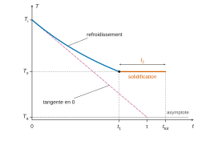
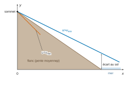

# Agro-Véto BCPST — Physique 2026 · Corrigé brut

*Corrigé rédigé par IA, non officiel. Signalez toute erreur.*

Épreuve de 3 heures, calculatrice autorisée. Données utilisées :

- lave : $T_i = 1450$ °C, $T_s = 700$ °C, $\eta = 2{,}5$ Pa·s ;
- lave : $\gamma = 0{,}5$ N·m⁻¹, $\rho = 2{,}3\times10^3$ kg·m⁻³ ;
- lave : $\ell_{fus} = 4{,}0\times10^5$ J·kg⁻¹, $c = 1{,}5\times10^3$ J·kg⁻¹·K⁻¹, $D_{th} = 3\times10^{-6}$ m²·s⁻¹ ;
- air : $u = 20$ m·s⁻¹, $T_a = 40$ °C, $\rho_a = 1{,}3$ kg·m⁻³ ;
- air : $C_D \simeq 1$, $h = 100$ W·m⁻²·K⁻¹, $\eta_a = 2\times10^{-5}$ Pa·s.

## I. Formation d'un cheveu

### I.A. Volume des gouttes

### Question 1

On raisonne sur les **dimensions** (M masse, L longueur, T temps), sans les mélanger avec les unités.

La tension de surface est une force par unité de longueur. Une force a la dimension $\mathrm{M\,L\,T^{-2}}$, donc :

$$\begin{aligned}
[\gamma] &= \mathrm{M\,L\,T^{-2}}\cdot\mathrm{L^{-1}} = \mathrm{M\,T^{-2}} \\
[\rho_a] &= \mathrm{M\,L^{-3}} \\
[u] &= \mathrm{L\,T^{-1}}
\end{aligned}$$

En unités SI, $\gamma$ s'exprime en N·m⁻¹, c'est-à-dire en kg·s⁻² ; $\rho_a$ en kg·m⁻³ et $u$ en m·s⁻¹.

On cherche $r_0 = K\,\gamma^{\alpha}\rho_a^{\beta}u^{\delta}$, avec $K$ sans dimension, homogène à une longueur :

$$\mathrm{M}^{\alpha+\beta}\,\mathrm{L}^{-3\beta+\delta}\,\mathrm{T}^{-2\alpha-\delta} = \mathrm{L}$$

En identifiant les exposants :

$$\begin{aligned}
\alpha+\beta &= 0 \\
-3\beta+\delta &= 1 \\
-2\alpha-\delta &= 0
\end{aligned}$$

La première ligne donne $\beta = -\alpha$, la troisième $\delta = -2\alpha$. La deuxième devient alors $3\alpha - 2\alpha = 1$. Ainsi $\alpha = 1$, $\beta = -1$, $\delta = -2$.

La seule longueur constructible avec $\gamma$, $\rho_a$ et $u$ est donc, à un facteur numérique près,

$$\boxed{r_0 = \frac{\gamma}{\rho_a u^2}}$$

Interprétation : $r_0$ égale la pression capillaire $\gamma/r_0$ à la pression dynamique du vent $\rho_a u^2$.

### Question 2

$$\begin{aligned}
r_0 &= \frac{0{,}5}{1{,}3\times 20^2} \\
&= 9{,}6\times10^{-4}\ \mathrm{m} \approx 0{,}96\ \mathrm{mm}
\end{aligned}$$

$$\begin{aligned}
V_0 &= \frac43\pi r_0^3 \\
&= \frac43\pi\,(0{,}96\ \mathrm{mm})^3
\end{aligned}$$

$$\boxed{V_0 \approx 3{,}7\ \mathrm{mm^3} = 3{,}7\times10^{-9}\ \mathrm{m^3}}$$

Valeur un peu inférieure aux $10$ mm³ retenus ensuite (facteur 2,7 sur le volume, 1,4 sur le rayon) : l'ordre de grandeur est correct.

### I.B. Accélération d'un cylindre qui s'étire

### Question 3

Le cylindre n'échange pas de matière avec l'extérieur : c'est un système **fermé**, de masse $m$ constante. Sa masse volumique $\rho$ est supposée constante : la lave est **incompressible**. Son volume $V = m/\rho$ est donc constant et égal au volume initial de la goutte :

$$\boxed{S(t)\,L(t) = V_0 \quad\text{pour tout } t}$$

### Question 4

La tranche comprise entre $x$ et $x+\mathrm{d}x$ a pour volume $S\,\mathrm{d}x$, avec $S = V_0/L$ (question 3) :

$$\boxed{\mathrm{d}m = \rho S\,\mathrm{d}x = \frac{\rho V_0}{L}\,\mathrm{d}x}$$

À $t$ fixé, $L$ et $v(L)$ ne dépendent pas de $x$ et sortent de l'intégrale :

$$\begin{aligned}
p &= \int_0^L \frac{x}{L}\,v(L)\,\frac{\rho V_0}{L}\,\mathrm{d}x \\
&= \frac{\rho V_0\,v(L)}{L^2}\int_0^L x\,\mathrm{d}x \\
&= \frac{\rho V_0\,v(L)}{L^2}\cdot\frac{L^2}{2}
\end{aligned}$$

$$\boxed{p = \frac{\rho V_0}{2}\,v(L)}$$

(On reconnaît $p = m\,v_G$ avec $m = \rho V_0$ et $v_G = v(L/2) = v(L)/2$.)

### Question 5

La face gauche est fixe en $x = 0$ et la face droite, matérielle, est en $x = L(t)$. Sa vitesse est donc $v(L) = \dfrac{\mathrm{d}L}{\mathrm{d}t}$. Comme $\rho$ et $V_0$ sont constants :

$$\begin{aligned}
m\,a(t) &= \frac{\mathrm{d}p}{\mathrm{d}t} \\
&= \frac{\rho V_0}{2}\,\frac{\mathrm{d}v(L)}{\mathrm{d}t}
\end{aligned}$$

$$\boxed{m\,a(t) = \frac{\rho V_0}{2}\,\frac{\mathrm{d}^2L}{\mathrm{d}t^2}(t)}$$

### I.C. Équation différentielle et temps caractéristiques

### Question 6

On ne garde que le terme de vent dans (1) :

$$\frac{\rho V_0}{2}\frac{\mathrm{d}^2L}{\mathrm{d}t^2} \simeq \frac12\rho_a C_D \frac{V_0}{L}u^2 .$$

Loi d'échelle : à temps courts, $L \sim 2r_0$. Pour le temps caractéristique $\tau_a$, on estime $\dfrac{\mathrm{d}^2L}{\mathrm{d}t^2} \sim \dfrac{2r_0}{\tau_a^2}$. Avec $C_D \simeq 1$ :

$$\begin{aligned}
\frac{\rho V_0}{2}\cdot\frac{2r_0}{\tau_a^2} &\sim \frac12\rho_a\frac{V_0}{2r_0}u^2 \\
\tau_a^2 &\sim \frac{4r_0^2}{u^2}\,\frac{\rho}{\rho_a}
\end{aligned}$$

$$\boxed{\tau_a = \frac{2r_0}{u}\sqrt{\frac{\rho}{\rho_a}}}$$

Contrôle : $\tau_a = \dfrac{2\times 9{,}6\times10^{-4}}{20}\sqrt{\dfrac{2300}{1{,}3}} \approx 4{,}0\times10^{-3}$ s.

### Question 7

Conversion : $1\ \mathrm{mm^3} = (10^{-3}\ \mathrm{m})^3 = 10^{-9}\ \mathrm{m^3}$, donc $V_0 = 10\ \mathrm{mm^3} = 1{,}0\times10^{-8}\ \mathrm{m^3}$.

$$\begin{aligned}
\tau_c &= \sqrt{\frac{\rho V_0}{\gamma}} \\
&= \sqrt{\frac{2{,}3\times10^3\times1{,}0\times10^{-8}}{0{,}5}}\ \mathrm{s}
\end{aligned}$$

$$\boxed{\tau_c \approx 6{,}8\times10^{-3}\ \mathrm{s}}$$

Commentaire : $\tau_c/\tau_a \approx 1{,}7$. Les deux temps sont du même ordre de grandeur, quelques millisecondes : l'étirement par le vent et le rappel capillaire sont en compétition, aucun ne domine nettement.

Conséquence physique : le vent agit un peu plus vite que la capillarité. La goutte a donc le temps d'être déformée et allongée avant que la tension de surface ne la ramène vers la forme sphérique, ce qui justifie le passage de la goutte au cylindre (partie I.B). La mise en forme est quasi instantanée, de l'ordre de quelques millisecondes.

### Question 8

À l'équilibre, $\dfrac{\mathrm{d}^2L}{\mathrm{d}t^2} = 0$ et l'équation (1) donne :

$$\frac12\rho_a C_D \frac{V_0}{L_{eq}}u^2 = \gamma\left(\frac{V_0}{L_{eq}}\right)^{1/2}$$

On divise par $\left(V_0/L_{eq}\right)^{1/2} > 0$ :

$$\left(\frac{V_0}{L_{eq}}\right)^{1/2} = \frac{2\gamma}{\rho_a C_D u^2}$$

$$\boxed{L_{eq} = V_0\left(\frac{\rho_a C_D u^2}{2\gamma}\right)^2 = \frac{\rho_a^2 C_D^2 u^4 V_0}{4\gamma^2}}$$

Application numérique ($C_D = 1$) : $\dfrac{\rho_a u^2}{2\gamma} = \dfrac{1{,}3\times400}{1} = 520\ \mathrm{m^{-1}}$, d'où

$$L_{eq} = 1{,}0\times10^{-8}\times 520^2\ \mathrm{m}$$

$$\boxed{L_{eq} \approx 2{,}7\times10^{-3}\ \mathrm{m} = 2{,}7\ \mathrm{mm}}$$

Avec $r_0 = \gamma/(\rho_a u^2)$, on a aussi $L_{eq} = V_0/(4r_0^2)$ : la section d'équilibre vaut $(2r_0)^2$.

### Question 9

- **Confrontation aux figures.** $L_{eq} \approx 2{,}7$ mm est à peine supérieur au diamètre de la goutte de départ (sphère de 10 mm³ : diamètre 2,7 mm). L'échantillon de la figure 1 mesure déjà 9 mm, soit plus de trois fois $L_{eq}$, et l'introduction parle de cheveux de plusieurs centimètres, au moins dix fois plus. **Le modèle n'est pas crédible quantitativement** : il donne seulement l'échelle millimétrique et le bon sens de variation ($L_{eq}$ croît avec $u$, décroît avec $\gamma$).
- **Pas de dissipation.** L'équation (1) ne contient aucun terme dissipatif. L'équilibre est stable : pour $L < L_{eq}$ la force résultante allonge, pour $L > L_{eq}$ elle raccourcit. Mais le système oscille autour de $L_{eq}$ sans s'y arrêter : $L_{eq}$ n'est pas une longueur finale.
- **Viscosité absente.** La viscosité $\eta$, pourtant donnée et élevée, n'intervient pas. La force notée « force de viscosité » $F_c = -\gamma S^{1/2}$ ne contient que $\gamma$ : c'est une force capillaire. La solidification, qui fige la forme, est aussi absente.
- **Sensibilité au vent.** $L_{eq} \propto u^4$ : $u = 40$ m·s⁻¹ donnerait $4{,}3$ cm. Une rafale suffit à changer l'ordre de grandeur, ce qui rend la prédiction peu robuste.
- **Traînée.** Elle est écrite avec la section droite $S$. Pour un cylindre placé en travers du vent, l'aire exposée est plutôt $2RL$, qui croît avec $L$.

### I.D. Viscosité

### Question 10

- **Eau (figure 3).** Le pont liquide s'étrangle et s'amincit en un filament qui se rompt en quelques dizaines de millisecondes (images espacées de $8{,}3$ ms ; rupture entre la 4ᵉ et la 5ᵉ image). Il se fragmente ensuite en gouttelettes sous l'effet de la tension de surface, qui tend à minimiser l'aire de l'interface.
- **Huile siliconée (figure 4).** Même tension de surface, viscosité 100 fois plus grande : le filament s'amincit beaucoup plus lentement, reste continu, long et régulier. Le temps de rupture ($\sim 1$ s) est bien plus long que la durée de l'étirement.
- **Rôle de la viscosité.** La tension de surface est le moteur de la rupture et de la mise en gouttes. La viscosité s'oppose aux déformations rapides du fluide et ralentit donc l'écoulement du liquide hors de l'étranglement. À tension de surface égale, un fluide visqueux peut être étiré en un long filament sans se fragmenter.
- **Application à la lave.** Elle est 2500 fois plus visqueuse que l'eau : nombre d'Ohnesorge $\eta/\sqrt{\rho\gamma R} \approx 3$, régime visqueux comme l'huile. Sa viscosité augmente en outre très fortement quand elle refroidit, ce qui fige le filament étiré par le vent.
- **Conséquence.** Le vent étire, la viscosité empêche la fragmentation pendant l'étirement : on obtient des filaments, les cheveux. Là où la capillarité l'emporte, la matière se rassemble en gouttes solidifiées, les larmes de Pélé (figures 1 et 5), souvent attachées à la base des cheveux.

## II. Solidification des cheveux de Pélé

Cylindre de longueur $L = 1{,}0$ cm et de rayon $R = 0{,}56$ mm, de température uniforme $T(t)$. On vérifie que $\pi R^2 L \approx 9{,}9\times10^{-9}$ m³ $\approx V_0$.

### II.A. Étape de refroidissement

### Question 11

Loi de Newton, flux algébriquement **reçu** par le cylindre :

$$\boxed{\phi = h\,S_{tot}\,(T_a - T)}$$

Contrôle du signe : pour $T > T_a$, $\phi < 0$, le cylindre cède de l'énergie à l'air.

### Question 12

$$\begin{aligned}
\frac{S_{lat}}{S} &= \frac{2\pi RL}{\pi R^2} = \frac{2L}{R} \\
&= \frac{2\times1{,}0\times10^{-2}}{5{,}6\times10^{-4}} \approx 36
\end{aligned}$$

$S_{tot} = S_{lat} + 2S = S_{lat}(1 + R/L)$ : les deux bases représentent $5{,}6$ % de la surface latérale et sont négligées.

$$\boxed{S_{tot} \simeq S_{lat} = 2\pi RL}$$

$$\boxed{\phi \simeq 2\pi R L\,h\,(T_a - T)}$$

### Question 13

**Système** : le cylindre de lave, fermé, de masse $m = \rho\pi R^2 L$. C'est une phase condensée, considérée comme incompressible, de capacité thermique massique $c$ et de température uniforme $T(t)$.

**Premier principe** entre $t$ et $t+\mathrm{d}t$ :

$$\mathrm{d}U = \delta W + \delta Q$$

- Phase condensée incompressible : le travail des forces de pression est nul, $\delta W = 0$, et $\mathrm{d}U = m\,c\,\mathrm{d}T$.
- Le transfert thermique reçu pendant $\mathrm{d}t$ est $\delta Q = \phi\,\mathrm{d}t$, avec $\phi$ de la question 12.

Il s'agit d'un bilan global sur tout le cylindre, à température uniforme : ce n'est pas un problème de diffusion thermique à l'intérieur de la lave.

$$\rho\pi R^2 L\,c\,\mathrm{d}T = 2\pi RL\,h\,(T_a - T)\,\mathrm{d}t$$

En divisant par $2\pi R L h\,\mathrm{d}t$ :

$$\boxed{\frac{\rho R c}{2h}\,\frac{\mathrm{d}T}{\mathrm{d}t}(t) + T(t) = T_a} \qquad (2)$$

### Question 14

Par identification avec la forme canonique $\tau\,\dfrac{\mathrm{d}T}{\mathrm{d}t} + T = T_a$ :

$$\boxed{\tau = \frac{\rho R c}{2h}}$$

$$\tau = \frac{2{,}3\times10^3\times5{,}6\times10^{-4}\times1{,}5\times10^3}{2\times100}\ \mathrm{s} \approx 9{,}7\ \mathrm{s}$$

### Question 15

Solution particulière constante $T_a$, solution homogène $A\,e^{-t/\tau}$. La condition initiale $T(0) = T_i$ donne $A = T_i - T_a$ :

$$\boxed{T(t) = T_a + (T_i - T_a)\,e^{-t/\tau}}$$

### Question 16

$T(t_1) = T_s$ équivaut à $e^{-t_1/\tau} = \dfrac{T_s - T_a}{T_i - T_a}$, d'où

$$\boxed{t_1 = \tau\,\ln\frac{T_i - T_a}{T_s - T_a}}$$

Les écarts de température s'expriment indifféremment en °C ou en K :

$$t_1 = 9{,}66\times\ln\frac{1410}{660}\ \mathrm{s} = 9{,}66\times0{,}759\ \mathrm{s}$$

$$\boxed{t_1 \approx 7{,}3\ \mathrm{s}}$$

### II.B. Étape de changement d'état

### Question 17

**Système** : le cylindre, fermé, de masse $m = \rho\pi R^2 L$, à pression constante (atmosphère). Pendant la solidification, $T = T_s$ reste constante, donc le flux reçu est constant :

$$\phi = 2\pi RL\,h\,(T_a - T_s) < 0$$

**Premier principe** (transformation monobare, sans autre travail que celui des forces de pression) sur la durée $t_2$ : $\Delta H = Q$.

- La solidification complète de la masse $m$ fait varier l'enthalpie de $\Delta H = -m\,\ell_{fus}$ (la fusion absorbe $\ell_{fus}$ par kilogramme, la solidification le restitue).
- Le transfert thermique reçu est $Q = \phi\,t_2$.

$$\begin{aligned}
-\rho\pi R^2 L\,\ell_{fus} &= \phi\,t_2 \\
&= -2\pi RL\,h\,(T_s - T_a)\,t_2
\end{aligned}$$

$$\boxed{t_2 = \frac{\rho R\,\ell_{fus}}{2h\,(T_s - T_a)}}$$

$$t_2 = \frac{2{,}3\times10^3\times5{,}6\times10^{-4}\times4{,}0\times10^5}{2\times100\times660}\ \mathrm{s}$$

$$\boxed{t_2 \approx 3{,}9\ \mathrm{s}}$$

On retrouve $t_{tot} = t_1 + t_2 \approx 11{,}2$ s.

### Question 18



- Repères en temps : $t_1 \approx 7{,}3$ s, $\tau \approx 9{,}7$ s, $t_{tot} \approx 11{,}2$ s.
- Repères en température : $T_a = 40$ °C, $T_s = 700$ °C, $T_i = 1450$ °C.
- Sur $[0\,;t_1]$ : exponentielle décroissante et convexe, issue de $T_i$, qui tendrait vers l'asymptote horizontale $T = T_a$ (tracée en pointillés).
- Construction de $\tau$ : la tangente à l'origine, de pente $-(T_i - T_a)/\tau$, coupe l'asymptote $T = T_a$ en $t = \tau$. Comme $\tau > t_1$, elle est prolongée au-delà de la fin du refroidissement.
- En $t_1$, la pente vaut $-(T_s - T_a)/\tau \approx -68$ °C·s⁻¹. Le palier qui suit est horizontal à $T_s$ jusqu'à $t_{tot}$ : point anguleux en $t_1$.

| $t$ (s) | 0 | 2 | 4 | 6 | 7,3 | 7,3 → 11,2 |
|---|---|---|---|---|---|---|
| $T$ (°C) | 1450 | 1186 | 972 | 798 | 700 | 700 (palier) |

### II.C. Résultats et discussion sur le modèle

### Question 19

$$\frac{t_{tot}}{\tau_a} \approx \frac{11{,}2}{4\times10^{-3}} \approx 3\times10^3$$

$$\frac{t_{tot}}{\tau_c} \approx \frac{11{,}2}{6{,}8\times10^{-3}} \approx 2\times10^3$$

Les parties I et II ne sont pas deux modèles concurrents du même phénomène : elles décrivent deux étapes successives, la mise en forme puis la solidification. On a $t_{tot} \gg \tau_a$ et $t_{tot} \gg \tau_c$ : la solidification est environ mille fois plus lente que la mise en forme mécanique.

Les cheveux de Pélé ont donc le temps de se déformer avant de se solidifier. L'étirement se fait pendant que la lave est entièrement liquide, et la forme du cheveu est fixée par la mécanique bien avant que la lave ne fige. On peut ainsi traiter séparément formation et solidification, et considérer la géométrie comme fixée pendant le refroidissement.

En contrepartie, la capillarité dispose de nombreux temps $\tau_c$ pour fragmenter le filament avant qu'il ne fige : ce sont la viscosité, et son augmentation au refroidissement (Q10), qui permettent au cheveu de survivre.

### Question 20

La loi d'échelle de la diffusion relie une distance $\ell$ et un temps par $\ell^2 \sim D_{th}\,t$. La chaleur s'évacue par la surface latérale (Q12) : la distance pertinente, du cœur à la surface d'échange, est le rayon $R$.

$$\boxed{\tau_{diff} \sim \frac{R^2}{D_{th}}}$$

$$\tau_{diff} = \frac{(5{,}6\times10^{-4})^2}{3\times10^{-6}}\ \mathrm{s} \approx 0{,}10\ \mathrm{s}$$

$\tau_{diff}/\tau \approx 0{,}01 \ll 1$ : la température s'homogénéise dans le cylindre environ cent fois plus vite qu'elle ne varie par les échanges avec l'air. **L'hypothèse de température uniforme est justifiée.** Avec $L$ comme distance, on obtiendrait $33$ s, mais ce n'est pas la distance pertinente : le flux est radial.

### Question 21

- **Rayonnement négligé.** À 1450 °C la lave est incandescente : le rayonnement thermique est un mode d'échange important. Ordre de grandeur (loi de Stefan, émissivité $\approx 0{,}9$) : $\varepsilon\sigma T_i^4 \approx 4\times10^5$ W·m⁻², supérieur au flux conducto-convectif $h(T_i - T_a) \approx 1{,}4\times10^5$ W·m⁻². En le prenant en compte, $t_{tot}$ serait environ deux fois plus court (de l'ordre de 5 s).
- **Forme idéalisée.** Le solide n'est pas un cylindre de section uniforme : la figure 1 montre une larme renflée à la base d'un filament effilé. Les parties fines ($\tau \propto R$) se figent bien plus vite que la larme.
- **Géométrie fixe.** Le cylindre continue de s'étirer et de s'affiner pendant le refroidissement. Les vrais cheveux, de largeur une fraction de millimètre, se solidifient donc plus vite que prévu.
- **$h$ constant.** Le coefficient conducto-convectif dépend de la vitesse relative de l'air et du rayon ; il varie pendant le vol.
- **Changement d'état idéalisé.** La lave est un mélange de silicates : pas de température de solidification unique mais un intervalle. Les cheveux de Pélé sont des verres (solidification amorphe), sans palier net ni chaleur latente bien définie.
- **Propriétés constantes.** $c$, $\rho$ et surtout la viscosité varient avec la température sur un intervalle de 750 °C. La solidification commence en surface (croûte) avant le cœur.
- **Environnement.** Près de l'éruption, l'air et les gaz volcaniques sont bien plus chauds que 40 °C.

## III. Mécanique : transport des cheveux de Pélé

Cylindre solidifié de masse $m = 2{,}3\times10^{-5}$ kg ; $g = 10$ m·s⁻² ; $\|\vec v_0\| = v_0 = 10$ m·s⁻¹.

### III.A. Vent et frottements négligés

### Question 22

**Système** : le cheveu, assimilé à un point matériel de masse $m$. **Référentiel** terrestre, galiléen. **Force** : le poids $m\vec g = -mg\,\vec e_y$ seul (vent et frottements négligés).

Le PFD $m\vec a = m\vec g$, projeté sur $\vec e_x$ puis sur $\vec e_y$, donne :

$$\begin{aligned}
\ddot x &= 0 \\
\ddot y &= -g
\end{aligned}$$

Conditions initiales : $x(0) = y(0) = 0$, $\dot x(0) = v_0\cos\alpha$, $\dot y(0) = v_0\sin\alpha$. Une première intégration donne les vitesses, une seconde les positions :

$$\begin{aligned}
\dot x(t) &= v_0\cos\alpha \\
\dot y(t) &= -g t + v_0\sin\alpha
\end{aligned}$$

$$\boxed{\begin{aligned}
x(t) &= v_0\cos\alpha\;t \\
y(t) &= -\frac12 g t^2 + v_0\sin\alpha\;t
\end{aligned}}$$

### Question 23

Pour $\cos\alpha \neq 0$, on élimine le temps avec $t = x/(v_0\cos\alpha)$ :

$$\boxed{y(x) = x\tan\alpha - \frac{g\,x^2}{2v_0^2\cos^2\alpha}}$$

C'est une parabole tournée vers le bas (homogène : $g x^2/v_0^2$ est une longueur).

### Question 24

$y(D) = 0$ avec $D \neq 0$ : $\tan\alpha = \dfrac{gD}{2v_0^2\cos^2\alpha}$, soit

$$\boxed{D = \frac{2v_0^2\sin\alpha\cos\alpha}{g} = \frac{v_0^2\sin 2\alpha}{g}}$$

$D$ est maximale pour $\sin 2\alpha = 1$, soit $\boxed{\alpha = \pi/4}$. Alors :

$$\boxed{D_{max} = \frac{v_0^2}{g} = 10\ \mathrm{m}}$$

Une telle portée ne présente **aucun risque sanitaire** : les retombées restent à une dizaine de mètres du cratère, dans une zone déjà dangereuse et sans cultures, alors que les cheveux sont observés à plusieurs kilomètres. Le modèle sans vent ne rend pas compte du transport.

### Question 25

$y(\tau_{vol}) = 0$ avec $\tau_{vol} \neq 0$ :

$$\boxed{\tau_{vol} = \frac{2v_0\sin\alpha}{g}}$$

Pour $\alpha = \pi/4$ :

$$\tau_{vol} = \frac{2\times10\times\frac{\sqrt2}{2}}{10}\ \mathrm{s} = \sqrt2\ \mathrm{s} \approx 1{,}4\ \mathrm{s}$$

Commentaire : ce vol est très court. Il est bien plus court que la durée de solidification $t_{tot} \approx 11$ s : sans vent, la particule retomberait encore liquide, en contradiction avec l'hypothèse « cylindre déjà solidifié ». Un vol si bref ne peut pas transporter les cheveux à des kilomètres.

Il faut donc tenir compte du vent et des frottements de l'air. Leur temps caractéristique de freinage est $1/(kv) \sim 0{,}1$ s avec $k \simeq 1$ m⁻¹ et $v \sim 10$ m·s⁻¹, bien inférieur à $\tau_{vol}$ : les négliger n'est pas justifié.

### III.B. En présence de vent

### Question 26

$$Re = \frac{\rho_a\,V\,d}{\eta_a}$$

- $\rho_a$ et $\eta_a$ sont la masse volumique et la viscosité dynamique de l'**air**, le fluide qui s'écoule (et non celles de la lave).
- $V$ est la vitesse de l'air par rapport au cylindre, $V \sim u$.
- $d$ est la dimension transverse du cylindre, son diamètre $2R$.

$$Re = \frac{1{,}3\times20\times1{,}12\times10^{-3}}{2\times10^{-5}}$$

$$\boxed{Re \approx 1{,}5\times10^3}$$

### Question 27

$Re \approx 1{,}5\times10^3 \gg Re_c \approx 100$, le nombre critique donné pour cette géométrie : la convection l'emporte sur la viscosité.

**Les frottements sont quadratiques** en la vitesse relative, de la forme

$$\vec F = -\frac12\rho_a C_D S_{ref}\,\|\vec v - \vec u\|\,(\vec v - \vec u)$$

C'est bien la forme des équations (3). Le choix de la longueur ($R$ ou $L$ au lieu de $2R$, qui donnent $7\times10^2$ ou $1{,}3\times10^4$) ne change pas la conclusion.

### Question 28

Schéma d'Euler explicite : $X_{n+1} = X_n + \dot X_n\,\mathrm{d}t$. Ici $\dot y = v_y$ et $\dot v_y = -g - k\|\vec v - \vec u\|\,v_y$ :

```python
    y_new = y+vy*dt
    vy_new = vy+(-g-k*np.sqrt((vx-u)**2+vy**2)*vy)*dt
```

### Question 29

**Interprétation.** La boucle se poursuit tant que $y \geq 0$, c'est-à-dire tant que le cheveu est au-dessus de l'altitude de son point de lancement, le sommet du volcan. Elle s'arrête au premier point calculé d'altitude négative (le test précède le calcul du pas suivant). Le sol est ainsi modélisé par le plan horizontal passant par le sommet.

**Commentaire.** Ce choix est discutable, car le projectile part du sommet du volcan et le terrain descend autour de lui :

```text
  y ^
    |    .  .
    |  .      .
  0 O-----------*------------------- plan y = 0 : arrêt de la boucle
    |\              .
    | \  flanc           .     trajectoire réelle (se poursuit)
    |  \                     .
    |   \______________________ niveau de la mer
    +-----------------------------------> x
   O : sommet du volcan, point de départ
```

Un cheveu qui passe sous $y = 0$ n'a pas atterri : il survole encore le flanc du volcan. La simulation s'arrête trop tôt et sous-estime fortement la portée. Il faudrait comparer $y$ à l'altitude du terrain à l'abscisse $x$ (profil du document 3). C'est ce que font les questions suivantes, en prolongeant la résolution au-delà de $y = 0$.

### Question 30

- **Allure.** Après une courte phase de montée sur quelques mètres, chaque trajectoire devient une **droite** descendante. L'altitude maximale reste inférieure à 1 m, contre 2,5 m sans frottement. La pente de la droite est d'autant plus faible que $u$ est grand : pour une même descente de 2,35 m, le cheveu parcourt environ 20 m pour $u = 15$ m·s⁻¹ et 37 m pour $u = 30$ m·s⁻¹.
- **Transport kilométrique : argument physique.** La traînée, proportionnelle à la surface exposée, est grande devant le poids pour un objet aussi fin ($k \simeq 1$ m⁻¹). En régime établi, le cheveu est donc entraîné horizontalement à la vitesse du vent et tombe lentement, à vitesse constante $\sqrt{g/k} \approx 3$ m·s⁻¹. Pour $u = 20$ m·s⁻¹, il ne perd que $160$ m d'altitude par kilomètre parcouru.
- **Ordre de grandeur.** Lancé du sommet, à plus de $2{,}6$ km d'altitude, le cheveu met environ $2600/3{,}2 \approx 8\times10^2$ s à descendre au niveau de la mer. Pendant ce temps le vent le transporte sur environ $20\times 8\times10^2$ m, soit plus de 15 km : des kilomètres, d'autant que le relief descend lui aussi.
- **Dispersion.** La distance parcourue pour une dénivelée donnée croît comme $u\sqrt{k}$. Elle dépend donc de $u$, qui fluctue (rafales), et de la taille de chaque cheveu : $k \propto 1/R$, les plus fins vont plus loin. La direction du vent varie aussi (étalement en azimut : une distance devient une surface), comme les points d'émission et les conditions initiales. Les retombées s'étalent donc sur de grandes surfaces.

### Question 31

Pour $t$ suffisamment grand, on admet que les vitesses tendent vers des limites finies $v_{x,\infty}$ et $v_{y,\infty}$ ; les dérivées tendent alors vers $0$. On note

$$\begin{aligned}
N &= \|\vec v_\infty - \vec u\| \\
&= \sqrt{(v_{x,\infty} - u)^2 + v_{y,\infty}^2}
\end{aligned}$$

Le système (3) donne alors :

$$\begin{aligned}
0 &= -kN\,(v_{x,\infty} - u) \\
0 &= -g - kN\,v_{y,\infty}
\end{aligned}$$

- La seconde équation impose $kN\,v_{y,\infty} = -g \neq 0$. Donc $N \neq 0$, c'est-à-dire $\|\vec v_\infty - \vec u\| \neq 0$, et $v_{y,\infty} < 0$ puisque $k > 0$ et $N > 0$.
- Comme $kN \neq 0$, la première équation donne $v_{x,\infty} = u$.
- Par suite $N = |v_{y,\infty}| = -v_{y,\infty}$ (une norme est positive, la coordonnée est négative). La seconde devient $k\,v_{y,\infty}^2 = g$, avec $v_{y,\infty} < 0$.

$$\boxed{\begin{aligned}
v_{x,\infty} &= u \\
v_{y,\infty} &= -\sqrt{\frac{g}{k}}
\end{aligned}}$$

C'est un **régime permanent** (régime de vitesse limite) : le cheveu suit le vent horizontalement et tombe à vitesse constante, son poids étant compensé par la traînée. Numériquement $v_{y,\infty} = -\sqrt{10}$ m·s⁻¹ $\approx -3{,}2$ m·s⁻¹.

### Question 32

La pente de la trajectoire est $\dfrac{\mathrm{d}y}{\mathrm{d}x} = \dfrac{v_y}{v_x}$, avec $v_x \to u \neq 0$. Aux temps longs :

$$\boxed{\left(\frac{\mathrm{d}y}{\mathrm{d}x}\right)_\infty = -\frac{1}{u}\sqrt{\frac{g}{k}}}$$

La trajectoire tend vers une droite, de pente constante :

| $u$ (m·s⁻¹) | 15 | 20 | 25 | 30 |
|---|---|---|---|---|
| pente $-\sqrt{g/k}/u$ | −0,21 | −0,16 | −0,13 | −0,11 |

Ces valeurs sont en accord avec les parties rectilignes du document 2.

### Question 33

**Pente du flanc.** Sur la figure 8, l'altitude passe de $2{,}6$ km au sommet ($x = 0$) à $0$ (niveau de la mer) pour $x \approx 11{,}8$ km :

$$p \approx \frac{2{,}6}{11{,}8} \approx 0{,}22 \quad (\text{environ } 12^\circ).$$

**Condition.** Partant du sommet, le cheveu s'éloigne durablement du sol si sa trajectoire descend moins vite que le flanc :

$$\frac{1}{u}\sqrt{\frac{g}{k}} < p$$

$$\boxed{u > u_{min} = \frac{1}{p}\sqrt{\frac{g}{k}}}$$

$$u_{min} \approx \frac{3{,}16}{0{,}22}\ \mathrm{m\cdot s^{-1}} \approx 14\ \mathrm{m\cdot s^{-1}} \approx 50\ \mathrm{km\cdot h^{-1}}$$



Pour $u = 20$ m·s⁻¹ (pente $0{,}16 < 0{,}22$), le cheveu survole le flanc et atteint la côte, à plus de 12 km du cratère : il peut contaminer les zones agricoles. Pour un vent plus faible que 14 m·s⁻¹ environ, il retombe sur les pentes du volcan. Le profil n'étant pas de pente uniforme (replat sommital jusqu'à 1,4 km, tronçon plus raide entre 6 et 8 km, pente douce près de la côte), ce seuil n'est qu'un ordre de grandeur.
