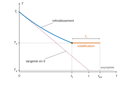
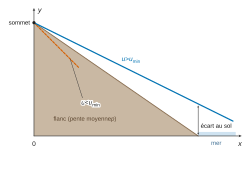

# Agro-Véto BCPST — Physique 2026 · Corrigé guidé

*Corrigé rédigé par IA, non officiel. Signalez toute erreur.*

## Présentation du sujet

**Thème.** « Les cheveux de Pélé » : ces fibres de verre volcanique naissent quand une goutte de lave projetée est étirée par le vent, puis figée par le refroidissement, avant d'être transportée parfois à des kilomètres. Épreuve de 3 heures, calculatrice autorisée, 11 pages, 33 questions. Les données numériques sont regroupées en page 3 ; trois documents (photographies, simulations, profil topographique) sont à exploiter.

**Découpage.**

| Partie | Questions | Contenu | Notions du programme |
|---|---|---|---|
| I.A | Q1–Q2 | Taille d'une goutte arrachée par le vent | analyse dimensionnelle, volume d'une sphère |
| I.B | Q3–Q5 | Quantité de mouvement d'un cylindre qui s'étire | conservation de la masse, intégrale sur un système continu |
| I.C | Q6–Q9 | Équation (1) : temps caractéristiques et longueur d'équilibre | lois d'échelle, équilibre mécanique, esprit critique |
| I.D | Q10 | Rôle de la viscosité | exploitation de photographies, tension de surface, viscosité |
| II.A–B | Q11–Q18 | Refroidissement puis solidification d'un cylindre | loi de Newton, premier principe, équation du premier ordre, changement d'état |
| II.C | Q19–Q21 | Discussion du modèle thermique | comparaison de temps, diffusion thermique, critique |
| III.A | Q22–Q25 | Tir balistique sans vent | PFD, trajectoire, portée, temps de vol |
| III.B | Q26–Q33 | Tir dans le vent | nombre de Reynolds, frottement quadratique, méthode d'Euler, régime permanent, lecture de document |

**Difficulté et longueur.** Le sujet n'a pas de difficulté calculatoire : il teste surtout la modélisation et la discussion. Selon le rapport 2026, il était d'une longueur adaptée à la durée de l'épreuve, et les meilleurs candidats l'ont traité en entier. La première partie, originale mais très progressive, a été très souvent abordée ; les deux suivantes étaient plus classiques. Moyenne 9,93/20, médiane 9,70/20, écart type 4,39 : toute l'échelle de notes a été utilisée.

**Questions abordables à ne pas laisser passer.** Le rapport signale Q2, Q15 et Q16 comme sans difficulté notable, et Q10 comme particulièrement bien traitée. Q3, Q11, Q12, Q14, Q22 à Q26 sont des questions de cours, où les points se perdent surtout par manque de rigueur (signe, inversion, conversion).

**Questions discriminantes (rapport 2026).** Les lois d'échelle (Q6, Q20) ; le premier principe bien posé (Q13) et le bilan pendant le changement d'état (Q17) ; le tracé de Q18, « fortement valorisée dans le barème » mais rarement complet ; la ligne 10 du code (Q28) ; la rédaction rigoureuse de Q31 ; la condition sur le vent en Q33, presque jamais obtenue. Les commentaires (Q7, Q9, Q19, Q21, Q25, Q29, Q30) départagent aussi : un commentaire chiffré et argumenté vaut plus qu'une reformulation.

**Gestion du temps.** L'énoncé conseille de répartir le temps de manière équilibrée : une heure par partie environ. Les valeurs nécessaires à la suite sont toujours redonnées ($V_0 = 10$ mm³, $\tau_a \simeq 4$ ms, $t_{tot} \simeq 11{,}2$ s, $k \simeq 1$ m⁻¹, $Re_c \simeq 100$) : une erreur en amont ne bloque jamais l'aval.

---

## Partie I — Formation d'un cheveu

On construit les ordres de grandeur de la formation d'un filament : la taille d'une goutte (analyse dimensionnelle), la dynamique de l'étirement (quantité de mouvement d'un cylindre déformable), puis les temps caractéristiques lus sur une équation non linéaire qu'on ne résout pas. La partie se termine par une question qualitative sur la viscosité.

### I.A. Volume des gouttes

### Question 1

> [!INDICATION]
> Exprimer les dimensions de $\gamma$, $\rho_a$ et $u$ dans les dimensions de base (masse, longueur, temps).

> [!INDICATION]
> Chercher $r_0 = \gamma^\alpha\rho_a^\beta u^\delta$ et identifier les exposants de M, L et T.

#### Solution

On raisonne sur les **dimensions** (M, L, T), sans les mélanger avec les unités. La tension de surface est une force par unité de longueur, et une force a la dimension $\mathrm{M\,L\,T^{-2}}$ :

$$\begin{aligned}
[\gamma] &= \mathrm{M\,L\,T^{-2}}\cdot\mathrm{L^{-1}} = \mathrm{M\,T^{-2}} \\
[\rho_a] &= \mathrm{M\,L^{-3}} \\
[u] &= \mathrm{L\,T^{-1}}
\end{aligned}$$

En unités SI, $\gamma$ s'exprime en N·m⁻¹, c'est-à-dire en kg·s⁻².

On cherche $r_0 = K\gamma^\alpha\rho_a^\beta u^\delta$, avec $K$ sans dimension :

$$\mathrm{M}^{\alpha+\beta}\,\mathrm{L}^{-3\beta+\delta}\,\mathrm{T}^{-2\alpha-\delta} = \mathrm{L}$$

$$\begin{aligned}
\alpha+\beta &= 0 \\
-3\beta+\delta &= 1 \\
-2\alpha-\delta &= 0
\end{aligned}$$

D'où $\beta = -\alpha$ et $\delta = -2\alpha$, puis $3\alpha - 2\alpha = 1$. La solution est unique, $\alpha = 1$, $\beta = -1$, $\delta = -2$ : à un facteur numérique près,

$$\boxed{r_0 = \frac{\gamma}{\rho_a u^2}}$$

Lecture physique : $\gamma/r_0$ est la surpression capillaire qui maintient la goutte, $\rho_a u^2$ la pression dynamique du vent qui la déchire ; $r_0$ est la taille pour laquelle elles s'équilibrent.

> [!METHODE]
> Pour « vérifier » une formule par analyse dimensionnelle, il suffit de calculer la dimension du second membre. Chercher les exposants est un peu plus long mais prouve en plus que c'est la seule combinaison possible.

> [!PIEGE]
> Écrire « $[\gamma] = \mathrm{N\cdot m^{-1}}$ » mélange dimension et unité. On écrit soit la dimension ($\mathrm{M\,T^{-2}}$), soit l'unité SI (kg·s⁻²), en détaillant le passage par la force. Autre piège : $\rho_a$ est la masse volumique de l'**air**, pas celle de la lave.

> [!JURY]
> Rapport 2026 : « L'unité SI ou la dimension de la tension de surface était à détailler. Les rédactions trop succinctes ou mélangeant dimensions et unités SI ont été pénalisées. »

### Question 2

> [!INDICATION]
> Calculer $r_0$, puis le volume d'une sphère de ce rayon.

> [!INDICATION]
> Convertir $r_0$ en millimètres avant de l'élever au cube limite les erreurs de puissances de 10.

#### Solution

$$\begin{aligned}
r_0 &= \frac{0{,}5}{1{,}3\times 20^2} = \frac{0{,}5}{520} \\
&= 9{,}6\times10^{-4}\ \mathrm{m} \approx 0{,}96\ \mathrm{mm}
\end{aligned}$$

$$\begin{aligned}
V_0 &= \frac43\pi r_0^3 \\
&= \frac43\pi\,(0{,}96\ \mathrm{mm})^3
\end{aligned}$$

$$\boxed{V_0 \approx 3{,}7\ \mathrm{mm^3} = 3{,}7\times10^{-9}\ \mathrm{m^3}}$$

C'est bien « légèrement trop faible » devant les 10 mm³ retenus ensuite : facteur 2,7 sur le volume, soit seulement 1,4 sur le rayon.

### I.B. Accélération d'un cylindre qui s'étire

On passe de la goutte au cylindre. Les trois questions établissent le membre de gauche de l'équation (1).

### Question 3

> [!INDICATION]
> Deux hypothèses de l'énoncé suffisent : l'une porte sur la masse, l'autre sur la masse volumique.

#### Solution

Il n'y a pas d'échange de matière avec l'extérieur : le cylindre est un système **fermé**, de masse $m$ constante. La masse volumique $\rho$ de la lave est supposée constante : elle est **incompressible**. Le volume $V = m/\rho$ est donc constant, égal au volume initial :

$$\boxed{S(t)\,L(t) = V_0}$$

> [!PIEGE]
> La conservation de la masse seule ne suffit pas : un gaz enfermé conserve sa masse mais pas son volume. Il faut citer aussi l'incompressibilité. Inutile en revanche de passer par un système ouvert et un bilan de masse : selon le rapport 2026, ces rédactions ont souvent été très confuses et n'ont pas été valorisées.

> [!JURY]
> Rapport 2026 : « Il suffisait d'invoquer le caractère fermé et incompressible du système pour répondre correctement. »

### Question 4

> [!INDICATION]
> Exprimer le volume de la tranche entre $x$ et $x+\mathrm{d}x$, puis utiliser la question 3 pour éliminer $S$.

> [!INDICATION]
> À instant fixé, $L$ ne dépend pas de $x$ : on peut le sortir de l'intégrale.

#### Solution

La tranche a pour volume $S\,\mathrm{d}x$ avec $S = V_0/L$ :

$$\boxed{\mathrm{d}m = \frac{\rho V_0}{L}\,\mathrm{d}x}$$

$$\begin{aligned}
p &= \int_0^L \frac{x}{L}\,v(L)\,\frac{\rho V_0}{L}\,\mathrm{d}x \\
&= \frac{\rho V_0\,v(L)}{L^2}\int_0^L x\,\mathrm{d}x \\
&= \frac{\rho V_0\,v(L)}{L^2}\cdot\frac{L^2}{2}
\end{aligned}$$

$$\boxed{p = \frac{\rho V_0}{2}\,v(L)}$$

Contrôle : avec $m = \rho V_0$, on a $p = m\,v(L)/2 = m\,v_G$. Ici $v_G = v(L/2)$ est la vitesse du centre de masse, situé au milieu du cylindre.

> [!METHODE]
> Pour un système continu, on découpe en éléments de masse $\mathrm{d}m$, on exprime $\mathrm{d}m$ avec la variable d'intégration, puis on intègre. Le contrôle $p = m\,v_G$ permet de vérifier le résultat.

> [!PIEGE]
> Deviner $p$ par homogénéité, ou le déduire du résultat donné en Q5, ne rapporte presque rien : le calcul de l'intégrale est attendu. Le rapport 2026 le dit : « Ces démarches ne constituent pas des raisonnements et ne récoltent donc qu'une faible proportion des points du barème. »

### Question 5

> [!INDICATION]
> Que représente $v(L)$ pour la longueur $L(t)$ du cylindre, sachant que la face gauche est fixe ?

#### Solution

La face gauche est fixe en $x = 0$ et la face droite, matérielle, se trouve en $x = L(t)$ : sa vitesse est $v(L) = \mathrm{d}L/\mathrm{d}t$. Avec $\rho$ et $V_0$ constants :

$$\begin{aligned}
m\,a(t) &= \frac{\mathrm{d}p}{\mathrm{d}t} \\
&= \frac{\rho V_0}{2}\,\frac{\mathrm{d}}{\mathrm{d}t}\left(\frac{\mathrm{d}L}{\mathrm{d}t}\right)
\end{aligned}$$

$$\boxed{m\,a(t) = \frac{\rho V_0}{2}\,\frac{\mathrm{d}^2L}{\mathrm{d}t^2}(t)}$$

Comme $m = \rho V_0$, cela s'écrit $a = \frac12\ddot L$ : le centre de masse, au milieu, accélère deux fois moins que l'extrémité libre.

> [!PIEGE]
> L'identification $v(L) = \mathrm{d}L/\mathrm{d}t$ n'est pas donnée par l'énoncé : elle se justifie par le fait que la face gauche est fixe.

### I.C. Équation différentielle et temps caractéristiques

L'équation (1) n'a pas de solution analytique simple. On en extrait des ordres de grandeur en comparant ses termes deux à deux.

### Question 6

> [!INDICATION]
> Ne garder dans (1) que le terme d'inertie et le terme de vent.

> [!INDICATION]
> Loi d'échelle : remplacer chaque grandeur par son ordre de grandeur, $L$ par une longueur typique et $\mathrm{d}^2L/\mathrm{d}t^2$ par une longueur divisée par le carré d'un temps.

#### Solution

Sans le terme capillaire, (1) devient

$$\frac{\rho V_0}{2}\frac{\mathrm{d}^2L}{\mathrm{d}t^2} \simeq \frac12\rho_a C_D \frac{V_0}{L}u^2 .$$

À temps courts $L \sim 2r_0$. Pour le temps caractéristique $\tau_a$, on estime $\dfrac{\mathrm{d}^2L}{\mathrm{d}t^2} \sim \dfrac{2r_0}{\tau_a^2}$. Avec $C_D \simeq 1$ :

$$\begin{aligned}
\frac{\rho V_0}{2}\cdot\frac{2r_0}{\tau_a^2} &\sim \frac12\rho_a\frac{V_0}{2r_0}u^2 \\
\tau_a^2 &\sim \frac{4r_0^2}{u^2}\,\frac{\rho}{\rho_a}
\end{aligned}$$

$$\boxed{\tau_a = \frac{2r_0}{u}\sqrt{\frac{\rho}{\rho_a}}}$$

Contrôle numérique, avec $r_0 = 9{,}6\times10^{-4}$ m :

$$\begin{aligned}
\tau_a &= \frac{2\times9{,}6\times10^{-4}}{20}\times\sqrt{\frac{2300}{1{,}3}}\ \mathrm{s} \\
&\approx 9{,}6\times10^{-5}\times42\ \mathrm{s} \\
&\approx 4{,}0\times10^{-3}\ \mathrm{s}
\end{aligned}$$

C'est la valeur annoncée en Q7.

Interprétation : $2r_0/u$ est le temps que met l'air pour passer devant la goutte ; le facteur $\sqrt{\rho/\rho_a} \approx 42$ traduit l'inertie de la lave, bien plus dense que l'air.

> [!METHODE]
> Raisonner par loi d'échelle, c'est écrire explicitement les substitutions ($L \to 2r_0$, $\ddot L \to 2r_0/\tau^2$) avant de calculer. On obtient ainsi une relation entre ordres de grandeur, sans résoudre l'équation.

> [!PIEGE]
> Il faut remplacer **les deux** occurrences de $L$ (dans $\ddot L$ et dans $V_0/L$) par $2r_0$ pour retrouver exactement la formule imposée.

> [!JURY]
> Rapport 2026 : « Cette question a illustré que les raisonnements par loi d'échelle ne sont absolument pas maîtrisés par les candidats. » C'est une question discriminante : les substitutions doivent apparaître sur la copie.

### Question 7

> [!INDICATION]
> Attention à la conversion des mm³ en m³.

> [!INDICATION]
> Pour commenter, comparer les deux temps et dire ce que leur rapport implique pour l'étirement.

#### Solution

$$\begin{aligned}
V_0 &= 10\ \mathrm{mm^3} = 10\times(10^{-3}\ \mathrm{m})^3 \\
&= 1{,}0\times10^{-8}\ \mathrm{m^3}
\end{aligned}$$

$$\begin{aligned}
\tau_c &= \sqrt{\frac{\rho V_0}{\gamma}} \\
&= \sqrt{\frac{2{,}3\times10^3\times1{,}0\times10^{-8}}{0{,}5}}\ \mathrm{s}
\end{aligned}$$

$$\boxed{\tau_c \approx 6{,}8\times10^{-3}\ \mathrm{s}}$$

Commentaire : $\tau_c/\tau_a \approx 1{,}7$. Les deux temps sont du même ordre de grandeur, quelques millisecondes : l'étirement par le vent et le rappel capillaire sont en compétition.

Ce que cela implique : le vent agit un peu plus vite. La goutte a donc le temps d'être déformée et allongée avant que la tension de surface ne la ramène vers la sphère, ce qui justifie le modèle du cylindre (I.B). Si l'on avait $\tau_a \gg \tau_c$, la goutte resterait sphérique ; si l'on avait $\tau_a \ll \tau_c$, le vent l'étirerait sans résistance.

> [!PIEGE]
> $1\ \mathrm{mm^3} = 10^{-9}\ \mathrm{m^3}$, pas $10^{-3}$ ni $10^{-6}$ : le rapport 2026 note que cette conversion a trop souvent été mal faite.

> [!PIEGE]
> Commenter « $\tau_c$ est plus long que $\tau_a$ » ne fait que relire l'inégalité. Pour le jury, c'est « une simple reformulation de l'inégalité » et non un commentaire pertinent : il faut en tirer une conséquence physique.

### Question 8

> [!INDICATION]
> Que vaut l'accélération à l'équilibre ?

> [!INDICATION]
> Poser $X = V_0/L_{eq}$ : l'équation devient $aX = bX^{1/2}$, qu'on simplifie par $X^{1/2} > 0$.

#### Solution

À l'équilibre, $\ddot L = 0$ :

$$\frac12\rho_a C_D \frac{V_0}{L_{eq}}u^2 = \gamma\left(\frac{V_0}{L_{eq}}\right)^{1/2}$$

On divise par $\left(V_0/L_{eq}\right)^{1/2} > 0$ :

$$\left(\frac{V_0}{L_{eq}}\right)^{1/2} = \frac{2\gamma}{\rho_a C_D u^2}$$

$$\boxed{L_{eq} = V_0\left(\frac{\rho_a C_D u^2}{2\gamma}\right)^2 = \frac{\rho_a^2 C_D^2 u^4 V_0}{4\gamma^2}}$$

Application numérique ($C_D = 1$) : $\dfrac{\rho_a u^2}{2\gamma} = \dfrac{1{,}3\times400}{2\times0{,}5} = 520\ \mathrm{m^{-1}}$, donc

$$L_{eq} = 1{,}0\times10^{-8}\times520^2\ \mathrm{m}$$

$$\boxed{L_{eq} \approx 2{,}7\times10^{-3}\ \mathrm{m} = 2{,}7\ \mathrm{mm}}$$

Avec $\rho_a u^2 = \gamma/r_0$, on obtient la forme compacte $L_{eq} = V_0/(4r_0^2)$ : la section d'équilibre est $(2r_0)^2$.

> [!PIEGE]
> $u^4 = 20^4 = 1{,}6\times10^5$ : l'erreur de puissance est fréquente. Une mauvaise conversion de $V_0$ donne ici une longueur absurde (des mètres ou des micromètres) ; le rapport 2026 regrette que ces valeurs aberrantes n'aient pas été détectées.

### Question 9

> [!INDICATION]
> Comparer $L_{eq}$ à la taille de la goutte de départ, à l'échantillon de la figure 1 et à la longueur des cheveux donnée en introduction.

> [!INDICATION]
> Regarder la structure de l'équation (1) : y a-t-il un terme qui dissipe l'énergie ? quelles données de l'énoncé n'y figurent pas ?

#### Solution

- **Confrontation aux figures.** Une sphère de 10 mm³ a un diamètre de 2,7 mm : $L_{eq}$ est à peine supérieur à la taille de la goutte d'origine. L'échantillon de la figure 1 mesure 9 mm, plus de trois fois $L_{eq}$, et l'introduction parle de cheveux de plusieurs centimètres, au moins dix fois plus. **Le modèle n'est pas crédible quantitativement.** Il donne seulement l'échelle millimétrique et le bon sens de variation ($L_{eq}$ croît avec $u$, décroît avec $\gamma$).
- **Pas de dissipation.** L'équilibre est stable : si $L < L_{eq}$ le vent l'emporte et allonge, si $L > L_{eq}$ la capillarité l'emporte et raccourcit. Mais (1) ne contient aucun terme d'amortissement : le système oscille autour de $L_{eq}$ sans s'y arrêter. $L_{eq}$ n'est pas une longueur finale.
- **Forces incomplètes.** La force appelée « force de viscosité », $F_c = -\gamma S^{1/2}$, ne contient que la tension de surface : c'est une force capillaire. La viscosité $\eta$, donnée et très élevée, n'apparaît nulle part ; la solidification, qui fige la forme, non plus.
- **Sensibilité.** $L_{eq} \propto u^4$ : $u = 40$ m·s⁻¹ donnerait 4,3 cm. Une rafale change l'ordre de grandeur, ce qui rend la prédiction peu robuste.
- **Traînée.** Elle est écrite avec la section droite $S$ ; pour un cylindre en travers du vent, l'aire exposée serait plutôt $2RL$.

> [!METHODE]
> Discuter la crédibilité d'un modèle : (1) comparer chiffres à l'appui à une observation donnée dans l'énoncé ; (2) repérer ce qui manque dans l'équation (dissipation, données non utilisées) ; (3) dire dans quel sens va l'erreur.

> [!JURY]
> Rapport 2026 : « Lorsqu'une discussion sur la crédibilité d'un modèle est demandée, une réponse argumentée est attendue ». Le jury conseillait d'utiliser les figures du sujet et ajoute : « Les candidats ne doivent pas hésiter à remettre en cause certains aspects de la modélisation. »

### I.D. Viscosité

### Question 10

> [!INDICATION]
> Les deux expériences ne diffèrent que par un paramètre : lequel ? Décrire ce qui change sur les photographies.

> [!INDICATION]
> Distinguer le phénomène moteur de la rupture du filament et celui qui la freine.

> [!INDICATION]
> Transposer à la lave : sa viscosité vaut 2500 fois celle de l'eau, et elle augmente quand la lave refroidit.

#### Solution

- **Eau (figure 3).** Le pont liquide s'étrangle et s'amincit en un filament qui se rompt en quelques dizaines de millisecondes (images espacées de 8,3 ms, rupture entre la 4ᵉ et la 5ᵉ). Le filament se fragmente ensuite en gouttelettes : la tension de surface tend à minimiser l'aire de l'interface, et une sphère a moins de surface qu'un long cylindre de même volume.
- **Huile siliconée (figure 4).** Même tension de surface, viscosité 100 fois plus grande : le filament s'amincit beaucoup plus lentement et reste continu, long et régulier. Le temps de rupture ($\sim 1$ s) dépasse largement la durée de l'expérience.
- **Rôle de la viscosité.** La tension de surface est le moteur de la rupture ; la viscosité s'oppose aux déformations rapides et ralentit l'écoulement du liquide hors de l'étranglement. À tension de surface égale, un fluide plus visqueux peut donc être étiré en un long filament sans se fragmenter.
- **Application à la lave.** La lave est 2500 fois plus visqueuse que l'eau : elle se comporte comme l'huile, pas comme l'eau. Sa viscosité augmente en outre très fortement quand elle refroidit, ce qui finit par figer le filament étiré par le vent. Là où la capillarité l'emporte, la matière se rassemble en gouttes qui se solidifient : ce sont les larmes de Pélé (figures 1 et 5), souvent attachées à la base des cheveux.

> [!PIEGE]
> La viscosité n'étire pas le filament : c'est le vent qui l'étire. La viscosité l'empêche de se fragmenter pendant l'étirement.

> [!JURY]
> Le rapport 2026 juge cette question d'analyse de document « particulièrement bien traitée » : c'est un point à ne pas perdre. La démarche attendue est la suivante : ce que l'on observe (avec les échelles de temps des légendes), le mécanisme physique, puis la transposition à la lave.

---

## Partie II — Solidification des cheveux de Pélé

Modèle thermique d'un cylindre de rayon $R = 0{,}56$ mm et de longueur $L = 1$ cm, à température uniforme : refroidissement par conducto-convection (équation du premier ordre), puis palier de solidification. On discute ensuite les hypothèses.

### II.A. Étape de refroidissement

### Question 11

> [!INDICATION]
> Loi de Newton : le flux est proportionnel à la surface et à l'écart de température. Choisir le signe pour un flux **reçu**.

#### Solution

$$\boxed{\phi = h\,S_{tot}\,(T_a - T)}$$

Contrôle du signe : pour $T > T_a$, $\phi < 0$, le cylindre perd de l'énergie, ce qui est bien le cas.

> [!PIEGE]
> Écrire $\phi = hS_{tot}(T - T_a)$ pour un flux reçu conduirait en Q13 à une température qui croît indéfiniment. Le rapport 2026 constate que la loi est en général homogène mais que « le signe est trop souvent incorrect » : l'énoncé impose la convention du flux algébriquement **reçu**.

### Question 12

> [!INDICATION]
> Exprimer $S_{lat}$ et $S$ en fonction de $R$ et $L$, puis calculer le rapport avec les valeurs de l'énoncé.

#### Solution

$$\begin{aligned}
\frac{S_{lat}}{S} &= \frac{2\pi RL}{\pi R^2} = \frac{2L}{R} \\
&= \frac{2\times1{,}0\times10^{-2}}{5{,}6\times10^{-4}} \approx 36
\end{aligned}$$

$S_{tot} = S_{lat} + 2S = S_{lat}(1 + R/L)$ : les deux bases ne comptent que pour 5,6 %. On les néglige :

$$\boxed{S_{tot} \simeq S_{lat} = 2\pi RL}$$

$$\boxed{\phi \simeq 2\pi RL\,h\,(T_a - T)}$$

> [!PIEGE]
> La valeur numérique du rapport est explicitement demandée : ne pas l'oublier. Ne pas inverser non plus les deux surfaces : $S$ est la section droite (un disque), $S_{lat}$ la surface latérale. Le rapport 2026 relève ces deux défauts.

### Question 13

> [!INDICATION]
> Définir le système, puis appliquer le premier principe entre $t$ et $t+\mathrm{d}t$ à une phase condensée.

> [!INDICATION]
> Exprimer la masse en fonction de $\rho$, $R$ et $L$, puis simplifier.

#### Solution

**Système** : le cylindre de lave, fermé, de masse $m = \rho\pi R^2 L$. C'est une phase condensée incompressible, de capacité thermique massique $c$, à température uniforme $T(t)$.

**Premier principe** entre $t$ et $t+\mathrm{d}t$ :

$$\mathrm{d}U = \delta W + \delta Q$$

- Phase condensée incompressible : $\delta W = 0$ et $\mathrm{d}U = m\,c\,\mathrm{d}T$.
- Transfert thermique reçu : $\delta Q = \phi\,\mathrm{d}t$, avec $\phi$ de Q12.

$$\rho\pi R^2L\,c\,\mathrm{d}T = 2\pi RL\,h\,(T_a - T)\,\mathrm{d}t$$

En divisant par $2\pi RLh\,\mathrm{d}t$ :

$$\boxed{\frac{\rho R c}{2h}\,\frac{\mathrm{d}T}{\mathrm{d}t}(t) + T(t) = T_a}$$

$L$ disparaît : seul compte le rapport volume/surface, $R/2$. Un cheveu plus fin refroidit plus vite.

> [!METHODE]
> Bilan thermique : système nommé et fermé, premier principe infinitésimal $\mathrm{d}U = \delta W + \delta Q$, $\mathrm{d}U = mc\,\mathrm{d}T$ pour une phase condensée, transfert $\phi\,\mathrm{d}t$, puis mise sous forme canonique.

> [!PIEGE]
> Il ne s'agit pas d'un problème de diffusion thermique : la température est uniforme, on fait un bilan global sur tout le cylindre. L'équation de la chaleur n'a rien à faire ici.

> [!JURY]
> Rapport 2026 : « Le premier principe infinitésimal appliqué à un système explicité n'est que rarement bien formulé. De trop nombreux candidats confondent la situation avec un problème de diffusion thermique. » Le jury ajoute que l'équation donnée ne justifie pas une rédaction hasardeuse : toutes les étapes doivent figurer.

### Question 14

> [!INDICATION]
> Comparer à la forme canonique $\tau\,\mathrm{d}T/\mathrm{d}t + T = T_{\infty}$.

#### Solution

$$\boxed{\tau = \frac{\rho R c}{2h}}$$

$$\tau = \frac{2{,}3\times10^3\times5{,}6\times10^{-4}\times1{,}5\times10^3}{2\times100}\ \mathrm{s} \approx 9{,}7\ \mathrm{s}$$

Unité : $\dfrac{\mathrm{kg\,m^{-3}\cdot m\cdot J\,kg^{-1}K^{-1}}}{\mathrm{W\,m^{-2}K^{-1}}} = \dfrac{\mathrm{J}}{\mathrm{W}} = \mathrm{s}$.

> [!PIEGE]
> Le temps caractéristique est le coefficient de $\mathrm{d}T/\mathrm{d}t$ quand celui de $T$ vaut 1, pas son inverse. Le rapport 2026 : « Trop de candidats n'arrivent pas à identifier le temps caractéristique, répondant son inverse. » Le contrôle d'unité (en secondes) détecte l'erreur.

### Question 15

> [!INDICATION]
> Solution générale = solution particulière constante + solution de l'équation homogène ; la constante se fixe avec $T(0)$.

#### Solution

Solution particulière : $T = T_a$. Solution homogène : $A\,e^{-t/\tau}$. Avec $T(0) = T_i$, on obtient $A = T_i - T_a$ :

$$\boxed{T(t) = T_a + (T_i - T_a)\,e^{-t/\tau}}$$

Contrôles : $T(0) = T_i$, $T \to T_a$ quand $t \to \infty$, décroissance puisque $T_i > T_a$.

> [!PIEGE]
> L'exponentielle porte sur l'écart $T - T_a$, pas sur $T$ : $T(t) = T_i\,e^{-t/\tau}$ est faux.

### Question 16

> [!INDICATION]
> Isoler l'exponentielle dans $T(t_1) = T_s$, puis prendre le logarithme.

#### Solution

$$e^{-t_1/\tau} = \frac{T_s - T_a}{T_i - T_a}$$

$$\boxed{t_1 = \tau\,\ln\frac{T_i - T_a}{T_s - T_a}}$$

Seuls des écarts de température interviennent, on peut rester en °C :

$$t_1 = 9{,}66\times\ln\frac{1410}{660}\ \mathrm{s} = 9{,}66\times0{,}759\ \mathrm{s}$$

$$\boxed{t_1 \approx 7{,}3\ \mathrm{s}}$$

> [!PIEGE]
> Un $t_1$ négatif signale une fraction retournée dans le logarithme.

### II.B. Étape de changement d'état

### Question 17

> [!INDICATION]
> Pendant le changement d'état, la température est fixée : que dire du flux échangé ?

> [!INDICATION]
> Appliquer le premier principe au cylindre sur toute la durée $t_2$, à pression constante : quelle est la variation d'enthalpie d'une masse $m$ qui se solidifie ?

#### Solution

**Système** : le cylindre, fermé, de masse $m = \rho\pi R^2L$, à pression constante. À $T = T_s$ constante, le flux reçu est constant :

$$\phi = 2\pi RL\,h\,(T_a - T_s) < 0$$

**Premier principe** (transformation monobare, sans autre travail que celui des forces de pression) sur la durée $t_2$ : $\Delta H = Q$.

- La solidification complète fait varier l'enthalpie de $\Delta H = -m\,\ell_{fus}$, opposé de l'enthalpie de fusion.
- Le transfert thermique reçu est $Q = \phi\,t_2$.

$$\begin{aligned}
-\rho\pi R^2L\,\ell_{fus} &= \phi\,t_2 \\
&= -2\pi RL\,h\,(T_s - T_a)\,t_2
\end{aligned}$$

$$\boxed{t_2 = \frac{\rho R\,\ell_{fus}}{2h\,(T_s - T_a)}}$$

$$t_2 = \frac{2{,}3\times10^3\times5{,}6\times10^{-4}\times4{,}0\times10^5}{2\times100\times660}\ \mathrm{s}$$

$$\boxed{t_2 \approx 3{,}9\ \mathrm{s}}$$

On retrouve $t_{tot} = t_1 + t_2 \approx 11{,}2$ s, la valeur de Q19. Forme équivalente :

$$t_2 = \tau\,\frac{\ell_{fus}}{c\,(T_s - T_a)} \approx 9{,}7\times0{,}40\ \mathrm{s}$$

> [!PIEGE]
> L'équation (2) ne s'applique plus pendant le palier (l'énoncé précise « avant que celui-ci ne change d'état ») : le bilan est ici un simple produit puissance × durée. Attention aussi aux signes : la solidification **libère** de l'énergie, $\Delta H < 0$, et $\phi < 0$.

> [!JURY]
> Rapport 2026 : « Le bilan d'énergie (ou le premier principe) lors du changement d'état n'a pas été bien traité par la plupart des candidats. » Question discriminante : poser le système, le principe et les deux termes du bilan avant de calculer.

### Question 18

> [!INDICATION]
> Deux morceaux : une portion d'exponentielle, puis un palier.

> [!INDICATION]
> Pour faire apparaître $\tau$ : la tangente à l'origine d'une exponentielle coupe son asymptote au bout d'une durée $\tau$. Pour faire apparaître $T_a$ : tracer l'asymptote, même si la courbe ne l'atteint pas.

#### Solution



- Repères en température : $T_i = 1450$ °C, $T_s = 700$ °C, $T_a = 40$ °C.
- Repères en temps : $t_1 \approx 7{,}3$ s, $\tau \approx 9{,}7$ s, $t_{tot} \approx 11{,}2$ s.
- Sur $[0\,;t_1]$ : exponentielle décroissante et convexe, qui tendrait vers l'asymptote horizontale $T = T_a$, tracée en pointillés.
- Construction de $\tau$ : la tangente à l'origine, de pente $-(T_i - T_a)/\tau$, coupe l'asymptote en $t = \tau$. Comme $\tau > t_1$, elle se prolonge au-delà de la fin du refroidissement.
- En $t_1$, la pente vaut environ $-68$ °C·s⁻¹, puis le palier est horizontal jusqu'à $t_{tot}$ : point anguleux.

| $t$ (s) | 0 | 2 | 4 | 6 | 7,3 | 7,3 → 11,2 |
|---|---|---|---|---|---|---|
| $T$ (°C) | 1450 | 1186 | 972 | 798 | 700 | 700 (palier) |

> [!PIEGE]
> Le palier est rigoureusement horizontal, et $\tau$ ne se lit pas en $t_1$ : il faut prolonger la tangente jusqu'à l'asymptote $T = T_a$, qu'il faut donc dessiner.

> [!JURY]
> Rapport 2026 : « Cette question de représentation graphique était fortement valorisée dans le barème. » Elle a pourtant rarement été traitée en entier ; « en particulier les constructions de $\tau$ et de $T_a$ ont souvent posé problème ».

### II.C. Résultats et discussion sur le modèle

### Question 19

> [!INDICATION]
> Calculer les rapports de $t_{tot}$ aux deux temps de la partie I.

> [!INDICATION]
> Les parties I et II décrivent-elles le même phénomène ? Que signifie une séparation de plusieurs ordres de grandeur entre mise en forme et solidification ?

#### Solution

$$\frac{t_{tot}}{\tau_a} \approx \frac{11{,}2}{4\times10^{-3}} \approx 3\times10^3$$

$$\frac{t_{tot}}{\tau_c} \approx \frac{11{,}2}{6{,}8\times10^{-3}} \approx 2\times10^3$$

- Les parties I et II ne sont pas deux modèles concurrents : elles décrivent deux étapes successives. Comme $t_{tot} \gg \tau_a$ et $t_{tot} \gg \tau_c$, la solidification est environ mille fois plus lente que la mise en forme.
- Les cheveux de Pélé ont donc le temps de se déformer avant de se solidifier. La forme est déterminée par la mécanique pendant que la lave est liquide. On peut traiter séparément formation et solidification et, comme dans la partie II, considérer la géométrie fixée pendant le refroidissement.
- En contrepartie, la capillarité dispose de plusieurs milliers de temps $\tau_c$ pour fragmenter le filament avant qu'il ne fige. Si les cheveux existent, c'est grâce à la viscosité de la lave et à sa forte augmentation au refroidissement (Q10).

> [!METHODE]
> Comparer deux temps caractéristiques très différents permet de découpler les phénomènes : pendant le processus lent, le rapide est terminé (ou en équilibre).

> [!PIEGE]
> Comparer les temps comme s'il s'agissait de deux modèles du même phénomène mène à des phrases du type « le nouveau modèle est plus satisfaisant ». Le rapport 2026 y voit un manque d'appropriation du sujet ; il valorise au contraire la conclusion : les cheveux ont le temps de se déformer avant de se solidifier.

### Question 20

> [!INDICATION]
> La diffusion relie une distance et un temps par une loi en $\ell^2 \sim D\,t$.

> [!INDICATION]
> Quelle distance la chaleur doit-elle parcourir pour atteindre la surface d'échange principale ?

#### Solution

La chaleur sort par la surface latérale (Q12) : la distance à parcourir du cœur à la surface est le rayon $R$.

$$\boxed{\tau_{diff} \sim \frac{R^2}{D_{th}}}$$

$$\tau_{diff} = \frac{(5{,}6\times10^{-4})^2}{3\times10^{-6}}\ \mathrm{s} \approx 0{,}10\ \mathrm{s}$$

$\tau_{diff}/\tau \approx 0{,}01$ : la température s'homogénéise environ cent fois plus vite qu'elle ne varie par les échanges avec l'air. **L'hypothèse de température uniforme est justifiée.**

Remarque (hors exigence) : on retrouve ce résultat avec le nombre de Biot $hR/\lambda$, où $\lambda = \rho c D_{th} \approx 10$ W·m⁻¹·K⁻¹. On trouve $Bi \approx 5\times10^{-3} \ll 1$.

> [!PIEGE]
> Avec $L = 1$ cm comme distance, on trouverait 33 s et la conclusion inverse. Le rapport 2026 note que les lois proposées étaient souvent homogènes, mais que « la longueur caractéristique n'était souvent pas pertinente » : le choix de $R$ se justifie par la géométrie du flux.

### Question 21

> [!INDICATION]
> Reprendre une à une les hypothèses du modèle : modes de transfert, géométrie, coefficients, nature du changement d'état.

> [!INDICATION]
> À 1450 °C, la lave est incandescente. Quel mode de transfert le modèle oublie-t-il ?

#### Solution

- **Rayonnement négligé.** C'est la critique la plus forte : la lave incandescente rayonne. Avec la loi de Stefan (émissivité $\approx 0{,}9$), $\varepsilon\sigma T_i^4 \approx 4\times10^5$ W·m⁻² à 1450 °C, contre $h(T_i - T_a) \approx 1{,}4\times10^5$ W·m⁻² pour la conducto-convection. Le rayonnement diminue fortement en refroidissant ($T^4$), mais en le prenant en compte $t_{tot}$ serait environ deux fois plus court (de l'ordre de 5 s).
- **Forme idéalisée.** Le solide n'est pas un cylindre de section uniforme : la figure 1 montre une larme renflée à la base d'un filament effilé. Comme $\tau \propto R$, les parties fines se figent bien avant la larme.
- **Géométrie fixe.** Le cylindre continue de s'étirer et de s'affiner ; un vrai cheveu (largeur d'une fraction de millimètre) se solidifie donc plus vite.
- **$h$ constant.** Il dépend de la vitesse relative de l'air et du rayon, qui varient pendant le vol.
- **Changement d'état idéalisé.** La lave est un mélange de silicates : elle se solidifie sur un intervalle de températures. Les cheveux sont des verres (solide amorphe) : pas de palier net ni de chaleur latente bien définie.
- **Propriétés constantes.** $c$, $\rho$ et surtout la viscosité varient sur 750 °C ; la solidification commence en surface avant le cœur.
- **Air à 40 °C.** Près de l'éruption, l'air et les gaz volcaniques sont bien plus chauds.

> [!JURY]
> Rapport 2026 : « Lorsque les critiques formulées par les candidats sont trop vagues, elles ne peuvent pas être valorisées. » Le jury cite comme critiques pertinentes la non-prise en compte du rayonnement et la forme du solide, qui n'est pas toujours un cylindre idéalisé. Une critique vaut d'autant plus qu'elle est chiffrée et donne le sens de l'erreur (ici : le modèle surestime $t_{tot}$). Inutile de critiquer l'hypothèse de température uniforme, validée en Q20.

---

## Partie III — Mécanique : transport des cheveux de Pélé

D'abord le tir balistique classique (sans vent, sans frottement), qui montre qu'on ne peut pas expliquer le transport. Puis le vent : nombre de Reynolds, frottement quadratique, résolution numérique par la méthode d'Euler, régime permanent, et confrontation au relief du Piton de la Fournaise.

### III.A. Vent et frottements négligés

### Question 22

> [!INDICATION]
> Système, référentiel, bilan des forces, PFD, projection sur les deux axes.

> [!INDICATION]
> Intégrer deux fois en utilisant les conditions initiales sur la vitesse puis sur la position.

#### Solution

Système : le cheveu, point matériel de masse $m$. Référentiel terrestre galiléen. Seule force : le poids $-mg\,\vec e_y$. Le PFD, projeté sur les deux axes, donne

$$\begin{aligned}
\frac{\mathrm{d}^2x}{\mathrm{d}t^2} &= 0 \\
\frac{\mathrm{d}^2y}{\mathrm{d}t^2} &= -g
\end{aligned}$$

Avec $\dot x(0) = v_0\cos\alpha$ et $\dot y(0) = v_0\sin\alpha$ :

$$\begin{aligned}
\dot x(t) &= v_0\cos\alpha \\
\dot y(t) &= -gt + v_0\sin\alpha
\end{aligned}$$

Puis avec $x(0) = y(0) = 0$ :

$$\boxed{\begin{aligned}
x(t) &= v_0\cos\alpha\;t \\
y(t) &= -\frac12 g t^2 + v_0\sin\alpha\;t
\end{aligned}}$$

> [!PIEGE]
> $\vec v_0$ est une condition initiale, pas une force : il n'y a pas de « force de poussée » après le lancement. Le rapport 2026 relève ces erreurs lourdes, ainsi que des projections aberrantes.

### Question 23

> [!INDICATION]
> Éliminer le temps entre $x(t)$ et $y(t)$.

#### Solution

Pour $\cos\alpha \neq 0$, $t = x/(v_0\cos\alpha)$ :

$$\boxed{y(x) = x\tan\alpha - \frac{g\,x^2}{2v_0^2\cos^2\alpha}}$$

Parabole tournée vers le bas. Pour $\alpha = \pi/4$ et les valeurs de l'énoncé : $y = x - 0{,}1\,x^2$ (en m).

> [!PIEGE]
> Une équation non homogène, ou une trajectoire où $y$ croît sans cesse avec $x$, signale une erreur en Q22 : le rapport 2026 invite à ce contrôle immédiat.

### Question 24

> [!INDICATION]
> La portée est la racine non nulle de $y(x) = 0$.

> [!INDICATION]
> Faire apparaître $\sin 2\alpha$.

#### Solution

$y(D) = 0$ avec $D \neq 0$ donne $D = \dfrac{2v_0^2\cos^2\alpha\tan\alpha}{g}$, soit

$$\boxed{D = \frac{v_0^2\sin 2\alpha}{g}}$$

$D$ est maximale pour $\sin 2\alpha = 1$, soit $\boxed{\alpha = \pi/4}$. Alors :

$$\boxed{D_{max} = \frac{v_0^2}{g} = 10\ \mathrm{m}}$$

**Pas de risque sanitaire** : les retombées restent à une dizaine de mètres du cratère, dans une zone déjà dangereuse et sans cultures, alors que l'introduction parle de kilomètres. Le modèle sans vent ne peut pas expliquer la catastrophe décrite.

> [!PIEGE]
> La question contient quatre demandes : l'expression de $D$, l'angle optimal, la valeur de $D_{max}$ et la discussion sanitaire. La dernière est facile à oublier.

### Question 25

> [!INDICATION]
> Le temps de vol est la racine non nulle de $y(t) = 0$.

> [!INDICATION]
> Pour commenter, comparer à un autre temps du sujet, par exemple celui de la partie II.

#### Solution

$$\boxed{\tau_{vol} = \frac{2v_0\sin\alpha}{g}}$$

Pour $\alpha = \pi/4$ :

$$\tau_{vol} = \frac{2\times10\times\frac{\sqrt2}{2}}{10}\ \mathrm{s} = \sqrt2\ \mathrm{s} \approx 1{,}4\ \mathrm{s}$$

Commentaire : le vol est très court, bien plus court que la durée de solidification $t_{tot} \approx 11$ s. Sans vent, la particule retomberait encore liquide, ce qui contredit l'hypothèse « déjà solidifié ». Un vol d'une seconde ne peut pas transporter un cheveu à des kilomètres.

De plus, avec $k \simeq 1$ m⁻¹ et $v \sim 10$ m·s⁻¹, le temps caractéristique du freinage par l'air est $1/(kv) \sim 0{,}1$ s, bien inférieur à $\tau_{vol}$ : négliger l'air n'est pas justifié.

> [!JURY]
> Rapport 2026 : le temps de vol et son application numérique sont souvent corrects, « mais le commentaire est régulièrement inexistant ou non pertinent ». Un commentaire comparatif (à $t_{tot}$, à la distance observée) rapporte les points.

### III.B. En présence de vent

### Question 26

> [!INDICATION]
> Le nombre de Reynolds se construit avec les propriétés du fluide qui s'écoule, une vitesse et une longueur.

> [!INDICATION]
> L'air contourne le cylindre perpendiculairement à son axe : quelle dimension « voit »-il ?

#### Solution

$$Re = \frac{\rho_a\,V\,d}{\eta_a}$$

- $\rho_a$, $\eta_a$ : masse volumique et viscosité dynamique de l'air ;
- $V \sim u$ : vitesse de l'air par rapport au cylindre ;
- $d = 2R$ : diamètre, dimension transverse à l'écoulement.

$$Re = \frac{1{,}3\times20\times1{,}12\times10^{-3}}{2\times10^{-5}}$$

$$\boxed{Re \approx 1{,}5\times10^3}$$

> [!PIEGE]
> Utiliser $\rho$ et $\eta$ de la lave n'a pas de sens : le Reynolds caractérise l'écoulement de l'air autour du solide.

> [!JURY]
> Rapport 2026 : « La masse volumique et la viscosité dynamique à considérer sont celles de l'air (et non celles de la lave). » Le jury a accepté $R$, $2R$ ou $L$ comme longueur caractéristique, mais pas une conclusion incohérente avec la valeur trouvée.

### Question 27

> [!INDICATION]
> Comparer $Re$ au Reynolds critique et utiliser le rappel de l'énoncé.

#### Solution

$Re \approx 1{,}5\times10^3 \gg Re_c \approx 100$ : la convection l'emporte sur la viscosité, **les frottements sont quadratiques** en la vitesse relative :

$$\vec F = -\frac12\rho_a C_D S_{ref}\,\|\vec v - \vec u\|\,(\vec v - \vec u)$$

C'est bien la forme des équations (3). Avec $R$ ou $L$ comme longueur, $Re$ vaut $7\times10^2$ ou $1{,}3\times10^4$ : la conclusion ne change pas.

> [!PIEGE]
> Le seuil à utiliser est celui que donne l'énoncé pour cette géométrie, $Re_c \simeq 100$, et non la valeur 2000 de l'écoulement en conduite. Le rapport 2026 constate que la comparaison à 2000 est fréquente. Par ailleurs, un grand nombre de Reynolds signifie que la viscosité est négligeable devant l'inertie, et non que le fluide est très visqueux.

### Question 28

> [!INDICATION]
> Méthode d'Euler explicite : nouvelle valeur = ancienne valeur + dérivée × pas. Quelle est la dérivée de $y$ ? celle de $v_y$ ?

> [!INDICATION]
> S'inspirer des lignes 7 et 9, déjà écrites.

#### Solution

On a $\dot y = v_y$ et $\dot v_y = -g - k\|\vec v - \vec u\|\,v_y$, avec $\|\vec v - \vec u\| = \sqrt{(v_x - u)^2 + v_y^2}$ :

```python
    y_new = y+vy*dt
    vy_new = vy+(-g-k*np.sqrt((vx-u)**2+vy**2)*vy)*dt
```

> [!PIEGE]
> Le pas `dt` multiplie **toute** la dérivée, pesanteur comprise. Dans la ligne 10, le facteur final est `vy` (vent horizontal), alors que la norme contient `vx-u`.

> [!JURY]
> Rapport 2026 : la ligne 8 est souvent juste, par mimétisme avec la ligne 7, mais « l'écriture de la ligne 10 est très souvent fausse puisqu'il fallait avoir assimilé la méthode d'Euler pour pouvoir répondre correctement ».

### Question 29

> [!INDICATION]
> Où se trouve l'origine du repère ? À quelle surface correspond $y = 0$ ?

> [!INDICATION]
> Le terrain autour d'un volcan est-il horizontal ? Faire un schéma.

#### Solution

**Interprétation.** La boucle se poursuit tant que $y \geq 0$, c'est-à-dire tant que le cheveu est au-dessus de l'altitude de son point de lancement, le sommet. Elle s'arrête au premier point calculé d'altitude négative : le sol est modélisé par le plan horizontal passant par le sommet.

**Commentaire.** Ce choix est discutable, car le projectile part du sommet et le terrain descend autour de lui :

```text
  y ^
    |    .  .
    |  .      .
  0 O-----------*------------------- plan y = 0 : arrêt de la boucle
    |\              .
    | \  flanc           .     trajectoire réelle (se poursuit)
    |  \                     .
    |   \______________________ niveau de la mer
    +-----------------------------------> x
   O : sommet du volcan, point de départ
```

Un cheveu qui passe sous $y = 0$ n'a pas atterri, il survole encore le flanc. La simulation s'arrête trop tôt et sous-estime fortement la portée. Il faudrait comparer $y$ à l'altitude du terrain sous le cheveu (profil du document 3), par exemple avec une condition `while y >= profil(x)`. C'est ce que préparent les questions suivantes, en prolongeant la résolution au-delà de $y = 0$.

> [!JURY]
> Rapport 2026 : la condition est en général bien expliquée, mais sa remise en question, puisque le projectile part du sommet du volcan, n'est pas toujours évoquée. « Un schéma permettait ici de répondre de manière efficace et claire. »

### Question 30

> [!INDICATION]
> Décrire les deux phases de chaque courbe et l'effet de $u$ sur la seconde.

> [!INDICATION]
> En fin de trajectoire, à quelle vitesse le cheveu descend-il, et à quelle vitesse avance-t-il ? Combien de temps met-il à descendre de l'altitude du sommet ?

> [!INDICATION]
> Pour la dispersion, lister ce qui varie d'un cheveu à l'autre ou d'un instant à l'autre.

#### Solution

- **Allure.** Une courte phase de montée, étendue sur quelques mètres, puis une **droite** descendante. L'altitude maximale reste inférieure à 1 m, contre 2,5 m sans frottement. La pente de la droite diminue quand $u$ augmente : pour une même descente de 2,35 m, le cheveu parcourt environ 20 m pour $u = 15$ m·s⁻¹ et 37 m pour $u = 30$ m·s⁻¹. Les conditions initiales sont vite oubliées.
- **Transport kilométrique : argument physique.** Pour un objet aussi fin, la traînée de l'air est grande devant le poids ($k \simeq 1$ m⁻¹). En régime établi, le cheveu avance donc à la vitesse du vent et tombe lentement, à vitesse constante (environ 3 m·s⁻¹). Il ne perd que 160 m d'altitude par kilomètre parcouru pour $u = 20$ m·s⁻¹.
- **Ordre de grandeur.** Lancé du sommet, à plus de 2,6 km d'altitude, il met environ $2600/3{,}2 \approx 8\times10^2$ s à descendre au niveau de la mer. Pendant ce temps, le vent le porte sur plus de 15 km.
- **Dispersion.** La distance parcourue pour une dénivelée $\Delta y$ vaut $\Delta y\cdot u\sqrt{k/g}$. Elle est proportionnelle à $u$, qui fluctue (rafales), et croît comme $\sqrt{k}$ avec $k \propto 1/R$ : les cheveux les plus fins vont plus loin. La direction du vent varie aussi (étalement en azimut : une distance devient une surface), ainsi que les points d'émission et les conditions initiales. Les retombées couvrent donc de grandes surfaces.

> [!PIEGE]
> Les trajectoires ne sont pas des paraboles plus ou moins étalées : leur partie finale est rectiligne, ce que les questions 31 et 32 vont expliquer.

> [!JURY]
> Rapport 2026 : le transport sur plusieurs kilomètres est souvent justifié sans argument physique ; une réponse du type « les cheveux sont légers donc ils sont transportés par le vent » n'est pas satisfaisante. Il faut invoquer la vitesse limite de chute, faible devant $u$, et le temps de vol qui en résulte.

### Question 31

> [!INDICATION]
> Si les vitesses tendent vers des limites, que deviennent leurs dérivées ?

> [!INDICATION]
> Exploiter d'abord l'équation verticale pour montrer que la vitesse relative ne s'annule pas, puis l'équation horizontale.

#### Solution

On admet que $v_x$ et $v_y$ tendent vers des limites finies $v_{x,\infty}$ et $v_{y,\infty}$ ; les dérivées tendent vers $0$. On note

$$\begin{aligned}
N &= \|\vec v_\infty - \vec u\| \\
&= \sqrt{(v_{x,\infty} - u)^2 + v_{y,\infty}^2}
\end{aligned}$$

Le système (3) donne :

$$\begin{aligned}
0 &= -kN\,(v_{x,\infty} - u) \\
0 &= -g - kN\,v_{y,\infty}
\end{aligned}$$

- La seconde impose $kN\,v_{y,\infty} = -g \neq 0$ : donc $N \neq 0$, c'est-à-dire $\|\vec v_\infty - \vec u\| \neq 0$, et $v_{y,\infty} < 0$.
- Comme $kN \neq 0$, la première donne alors $v_{x,\infty} = u$.
- Par suite $N = |v_{y,\infty}| = -v_{y,\infty}$ (norme positive, coordonnée négative), et la seconde s'écrit $k\,v_{y,\infty}^2 = g$.

$$\boxed{\begin{aligned}
v_{x,\infty} &= u \\
v_{y,\infty} &= -\sqrt{\frac{g}{k}}
\end{aligned}}$$

C'est un **régime permanent** (de vitesse limite) : le cheveu suit le vent horizontalement et tombe à vitesse constante, son poids étant compensé par la traînée. Numériquement $v_{y,\infty} \approx -3{,}2$ m·s⁻¹. Le temps d'établissement est de l'ordre de $1/\sqrt{gk} \approx 0{,}3$ s, ce qui explique la brièveté du transitoire du document 2.

> [!PIEGE]
> Oublier la valeur absolue dans $N = |v_{y,\infty}|$ conduit à $v_{y,\infty}^2 = -g/k$, nécessairement faux. En tirer quand même $v_{y,\infty} = -\sqrt{g/k}$ n'est pas accepté par le jury.

> [!JURY]
> Rapport 2026 : « Les résultats étant donnés, une rédaction rigoureuse était indispensable. » Le jury attendait en particulier que l'on justifie que la vitesse relative $\|\vec v - \vec u\|$ ne s'annule pas avant de conclure sur $v_{x,\infty}$.

### Question 32

> [!INDICATION]
> La pente d'une courbe paramétrée par le temps est le rapport des dérivées $\dot y/\dot x$.

#### Solution

La pente est $\dfrac{\mathrm{d}y}{\mathrm{d}x} = \dfrac{v_y}{v_x}$, avec $v_x \to u \neq 0$. Aux temps longs :

$$\boxed{\left(\frac{\mathrm{d}y}{\mathrm{d}x}\right)_\infty = -\frac{1}{u}\sqrt{\frac{g}{k}}}$$

La pente est constante : la trajectoire tend vers une droite, comme sur le document 2.

| $u$ (m·s⁻¹) | 15 | 20 | 25 | 30 |
|---|---|---|---|---|
| pente $-\sqrt{g/k}/u$ | −0,21 | −0,16 | −0,13 | −0,11 |

Ces valeurs coïncident avec les parties rectilignes du document 2. D'autres méthodes (élimination du temps entre $x$ et $y$ en régime permanent, lecture des asymptotes) sont acceptées : selon le rapport 2026, elles ont été notées avec le même nombre de points.

### Question 33

> [!INDICATION]
> Lire sur la figure 8 la dénivelée totale et la distance horizontale jusqu'au niveau de la mer.

> [!INDICATION]
> Le cheveu reste en l'air tant qu'il est au-dessus du terrain : comparer deux pentes.

#### Solution

**Pente du flanc.** Sur la figure 8, l'altitude passe de 2,6 km au sommet ($x = 0$) à 0 pour $x \approx 11{,}8$ km :

$$p \approx \frac{2{,}6}{11{,}8} \approx 0{,}22 \quad(\text{environ } 12^\circ).$$

**Condition.** Partant du sommet, le cheveu s'éloigne durablement du sol si sa trajectoire descend moins vite que le flanc :

$$\frac{1}{u}\sqrt{\frac{g}{k}} < p$$

$$\boxed{u > u_{min} = \frac{1}{p}\sqrt{\frac{g}{k}}}$$

$$u_{min} \approx \frac{3{,}16}{0{,}22}\ \mathrm{m\cdot s^{-1}} \approx 14\ \mathrm{m\cdot s^{-1}} \approx 50\ \mathrm{km\cdot h^{-1}}$$



Pour $u = 20$ m·s⁻¹ (pente 0,16 inférieure à 0,22), le cheveu survole le flanc jusqu'à la côte, à plus de 12 km du cratère : il atteint les zones agricoles. Sous 14 m·s⁻¹ environ, il retombe sur les pentes du volcan. Le profil n'est pas de pente uniforme (replat sommital jusqu'à 1,4 km, tronçon plus raide entre 6 et 8 km, pente douce près de la côte) : ce seuil n'est qu'un ordre de grandeur, à 10 ou 20 % près.

> [!PIEGE]
> Le sens de l'inégalité : le cheveu va loin si sa trajectoire est **moins** pentue que le sol, donc si $u$ est **grand**. Trouver $u < u_{min}$ contredirait le document 2.

> [!JURY]
> Rapport 2026 : la pente est en général bien lue sur le graphique, mais « la condition sur la vitesse du vent n'a quasiment jamais été obtenue ». C'est la dernière question discriminante du sujet : il suffit de comparer la pente de Q32 à celle du flanc.

---

## Bilan

**Méthodes à retenir.**

- Analyse dimensionnelle et lois d'échelle (Q1, Q6, Q20) : construire une longueur ou un temps avec les grandeurs pertinentes, choisir la bonne longueur, et estimer une dérivée seconde par $L/\tau^2$.
- Système continu (Q4) : découper en $\mathrm{d}m$, intégrer, contrôler par $p = m\,v_G$.
- Bilan thermique d'une phase condensée (Q13, Q17) : système explicité, premier principe entre $t$ et $t+\mathrm{d}t$, puis bilan global pendant un changement d'état.
- Équation linéaire du premier ordre (Q14 à Q16) : forme canonique, temps caractéristique, solution, durée pour atteindre une valeur.
- Comparaison de temps caractéristiques (Q7, Q19, Q20, Q25) : c'est le fil conducteur du sujet. Dès qu'un temps est calculé, le comparer à un autre et en tirer une conséquence physique.
- Méthode d'Euler (Q28) et régime permanent d'un système non linéaire (Q31) : dérivées nulles, puis résolution dans le bon ordre.

**Ce que le jury 2026 a sanctionné.** Mélange dimension/unité (Q1), conversions de $V_0$ (Q7, Q8), signe du flux reçu (Q11), inversion des surfaces (Q12), temps caractéristique inversé (Q14), confusion avec la diffusion (Q13), Reynolds calculé avec la lave ou comparé à 2000 (Q26, Q27), commentaires qui reformulent un résultat au lieu de l'interpréter (Q7, Q19, Q25, Q30). Les questions qui ont le plus départagé sont Q6, Q13, Q17, Q18, Q28 (ligne 10), Q31 et Q33.

**Prérequis à revoir.** Loi de Newton et signe d'un flux reçu ; solution de $\tau\dot T + T = T_\infty$ ; chaleur latente ; tir balistique ; nombre de Reynolds et types de frottement ; écriture d'un pas d'Euler en Python.

**Questions transposables.** Le refroidissement d'un objet par conducto-convection suivi d'un changement d'état (Q11–Q18) et la validation de l'uniformité de la température par un temps de diffusion (Q20) se retrouvent dans de nombreux sujets. La chute dans un fluide avec vitesse limite (Q31) est un classique. La lecture de la condition d'arrêt d'une boucle de simulation (Q29) est une compétence de plus en plus demandée.
