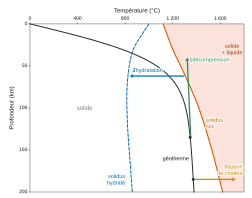
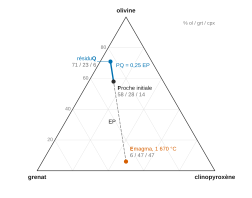
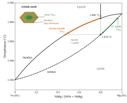
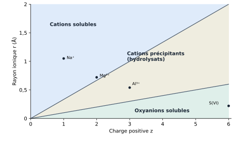

# Agro-Véto BCPST — SVT sur support de documents 2026 · Corrigé partiel brut

*Corrigé rédigé par IA, non officiel.*

**Rédaction** · modèle non renseigné · effort non renseigné · vitesse non renseignée

**Révision (tour 1)** · modèle non renseigné · effort non renseigné · vitesse non renseignée

**Révision (tour 2)** · Claude Opus 5.5 · effort non renseigné · vitesse non renseignée

**Révision (tour 3)** · modèle non renseigné · effort non renseigné · vitesse non renseignée

**Révision (tour 4)** · GPT-6.2 Astra Ultra · vitesse non renseignée

**Couverture.** Les 41 sous-questions de géologie et les questions de biologie 1a, 1b et 3a reçoivent une réponse complète. La question de biologie 8a est limitée au principe de l’immunomarquage. Les 26 autres questions de biologie, consacrées aux expériences sur les interactions hôte–symbiote, aux toxines ou à la transmission, sont hors de cette édition.

Le sujet dure 3 h 30. Les documents de géologie et la planche A3 ont été lus avec le rapport 2026. En 5.a, le profil sismique de Mars figure au document 5, malgré le renvoi imprimé au document 6.

# Partie géologie — L'olivine dans tous ses états

## Thème 1 : L'olivine, un minéral abondant sur Terre et dans le système solaire

### Question 1

**1.a** Légendes à porter sur le document 1 :

- **Roche A** entoure l’enclave. La pâte est sombre et très fine, avec quelques petites plages plus claires. Le détail de sa composition minéralogique n’est pas résolu sur la photographie.
- **Roche B** forme l’enclave grenue. Placer la légende **olivine** sur les cristaux vert clair et **pyroxènes** sur les grains vert foncé à noirs. La photographie ne permet pas d’attribuer chaque grain à une espèce de pyroxène.

**1.b** La roche A est sombre, et ses cristaux ne sont pas discernables même à l'échelle millimétrique : sa texture est **microlitique** (verre + microlites), celle d'une roche **volcanique** refroidie rapidement. Sa teinte noire traduit une richesse en minéraux ferromagnésiens, donc une composition basique. **La roche A est un basalte** (un gabbro, de même composition, aurait une texture grenue).

**1.c** La roche B est entièrement cristallisée, à cristaux jointifs et visibles à l'œil nu (**texture grenue**). Elle est dominée par l'olivine, avec des pyroxènes, sans quartz ni feldspath : elle est **ultrabasique**. **La roche B est une péridotite**. C'est une roche du manteau, pas une roche plutonique cristallisée à partir d'un magma.

**1.d** Le contact entre A et B est net, et B forme un fragment anguleux englobé par A : **B est une enclave (xénolite) de péridotite mantellique, arrachée et remontée par le magma basaltique** qui a donné A. Ce lien est aussi génétique : un basalte naît de la **fusion partielle d'une péridotite** du manteau (thème 2). Une remontée rapide du magma a préservé l'enclave sans la fondre.

**1.e** La péridotite constitue le **manteau terrestre**, principalement le **manteau supérieur** sous le Moho, à partir de ≈ 7 km sous les océans et ≈ 30 km sous les continents. On la trouve à l'affleurement en enclaves dans les basaltes et dans les ophiolites.

### Question 2

**2.a** Un **silicate** est un minéral dont l'unité structurale est le tétraèdre $[\mathrm{SiO_4}]^{4-}$ (un Si au centre, quatre O aux sommets). Les silicates se classent selon le degré de polymérisation de ces tétraèdres. Dans l'olivine $\mathrm{X_2SiO_4}$, les tétraèdres sont isolés : c'est un **nésosilicate**.

Rôle des cations $\mathrm{X^{2+}}$ (Mg²⁺, Fe²⁺…) logés entre les tétraèdres, en sites octaédriques, et non à la place du silicium :

- ils **compensent la charge** négative des tétraèdres ($2 \times (+2) = +4$) ;
- ils **lient entre eux** les tétraèdres isolés, par des liaisons ioniques, et assurent la cohésion du cristal.

Mg²⁺ et Fe²⁺, de même charge et de rayons voisins, se substituent l'un à l'autre : l'olivine est une **solution solide**.

**2.b** Sans Ca ni Mn, les deux olivines se placent **sur le côté inférieur** du triangle (joint Mg₂SiO₄–Fe₂SiO₄), gradué en % de fer :

- olivine 1 (8 % Fe) : point à 8 sur l'axe, dans le champ 0–10 %, donc **forstérite** (Fo₉₂) ;
- olivine 2 (40 % Fe) : point à 40, dans le champ 30–50 %, donc **hyalosidérite** (Fo₆₀).

### Question 3

**3.a** Le document 3 montre que les ondes S se propagent entre les zones 1 et 3 ($V_S$ ≈ 5,2 à 5,6 km/s, en augmentation). Or les ondes S ne se propagent pas dans les liquides : le milieu est **solide**. Cette tranche (≈ 410–660 km) appartient au manteau, dont la roche principale est la **péridotite**, riche en olivine (sous ses formes de haute pression, cf. document 4), avec pyroxènes et grenat.

**3.b** Les zones 1 (≈ 410 km, saut de 4,75 à 5,2 km/s), 2 (≈ 520–550 km, rupture de pente) et 3 (≈ 660 km, saut de 5,6 à 6,1 km/s) sont des **discontinuités sismiques** du manteau : la discontinuité des 410 km, celle des ≈ 520 km et celle des 660 km. Elles délimitent la **zone de transition** ; la discontinuité des 660 km marque la limite **manteau supérieur / manteau inférieur**.

### Question 4

**4.a** Un échantillon de quelques dizaines de µm est placé dans le trou d'un joint métallique, entre les pointes de deux diamants taillés. Une force modérée appliquée sur une très petite surface ($P = F/S$) produit des pressions de plusieurs dizaines de GPa, celles du manteau profond. Un chauffage laser impose la température. Le diamant, très dur, est **transparent** à la lumière et aux rayons X : on peut faire, **in situ** et sous pression, une **diffraction des rayons X**, qui identifie la **structure cristalline** de la phase stable. En répétant la mesure pour de nombreux couples $(P, T)$ et en repérant les changements de structure, on construit le **diagramme de phases**.

**4.b** Les bandes 1, 2 et 3 du document 4 (≈ 410, ≈ 520 et ≈ 670 km) coïncident avec des limites de stabilité de l'olivine :

- zone 1 : olivine α → olivine β (wadsleyite) ;
- zone 2 : β → γ (ringwoodite) ;
- zone 3 : γ → bridgmanite + magnésiowüstite.

Chaque changement de phase produit une phase plus compacte, plus dense et plus rigide, d'où l'augmentation de $V_S$. **Les discontinuités sismiques du document 3 sont la signature de ces transitions de phase**, à composition chimique constante.

**4.c** Pour chaque zone, on lit les températures auxquelles le domaine de coexistence (entre les deux pointillés) traverse la bande de pression, en s'aidant des graduations (± 30 °C environ) :

| Zone | Pression (bande) | Transition | Gamme de température |
|---|---|---|---|
| 1 | ≈ 13,8–14,3 GPa | α → β | ≈ 1 320–1 510 °C |
| 2 | ≈ 17,8–18,6 GPa | β → γ | ≈ 1 370–1 550 °C |
| 3 | ≈ 23,6–24,2 GPa | γ → Bdg + Mw | ≈ 1 300–1 700 °C |

Pour la zone 3, les limites ont une pente négative et forte : le domaine de coexistence n'entre dans la bande qu'entre ≈ 1 300 °C (bord droit de la bande) et ≈ 1 700 °C (bord gauche).

**Les trois gammes se recouvrent vers 1 400–1 500 °C.** C'est compatible avec le faible gradient adiabatique du manteau convectif (quelques dixièmes de °C/km, soit environ + 100 °C entre 410 et 660 km), que la précision de lecture ne permet pas de résoudre.

**4.d** Les limites de phase sont des droites **inclinées** dans le plan $(P,T)$ : la pression de transition dépend de la température. La sismologie fournit la profondeur, donc la pression, des discontinuités. À la composition étudiée, la bande de coexistence expérimentale borne la température compatible avec cette pression. L'olivine étant le minéral majoritaire du manteau supérieur, ses transitions produisent un signal sismique mesurable. **L'olivine sert donc de géothermomètre** à des profondeurs inaccessibles directement : chaque discontinuité est un point d'ancrage du géotherme. Les variations latérales de profondeur des discontinuités révèlent les anomalies thermiques : pente positive à 410 km et négative à 660 km, donc une zone chaude approfondit la discontinuité des 410 km et remonte celle des 660 km.

**4.e** Bilan atomique pour une olivine 100 % magnésienne :

$$\mathrm{Mg_2SiO_4 \longrightarrow MgSiO_3 + MgO}$$

$$\boxed{\text{bridgmanite} = \mathrm{MgSiO_3}}$$

### Question 5

**5.a** (Document 5.) On lit le profil depuis la surface ($r$ ≈ 3 390 km) :

- jusqu'à $r$ ≈ 3 320 km : vitesses les plus faibles du profil ($V_S$ ≈ 2,6 à 3,5 km/s), c'est la **croûte**, épaisse de quelques dizaines de km (≈ 50–70 km) ;
- de 3 320 à ≈ 1 830 km : les ondes S se propagent, c'est le **manteau solide** silicaté (≈ 1 500 km d'épaisseur), péridotitique ;
- dans sa partie supérieure, jusqu'à $r$ ≈ 2 850 km (≈ 500 km de profondeur), $V_P$ reste constante (≈ 7,7 km/s) et $V_S$ diminue légèrement (≈ 4,4 → 4,3 km/s) : ce manteau supérieur rigide forme avec la croûte une **lithosphère** épaisse, la baisse de $V_S$ étant compatible avec une température croissante ; la position exacte de la limite thermique demande un modèle complémentaire ;
- en dessous, $V_P$ croît jusqu'à ≈ 9,4 km/s et $V_S$ jusqu'à ≈ 4,9 km/s, avec deux ressauts : A ($r$ ≈ 2 350 km, soit ≈ 1 040 km de profondeur) et B ($r$ ≈ 2 100 km, soit ≈ 1 280 km), interprétés comme les transitions α → β et β → γ de l'olivine ;
- à $r$ ≈ 1 830 km, **$V_S$ s'annule** et $V_P$ chute de ≈ 9,4 à ≈ 4,8 km/s : c'est la limite manteau/noyau ;
- de 1 830 km au centre : seules les ondes P se propagent, avec $V_P$ croissant de 4,8 à 6 km/s sans discontinuité. Le profil modélise un **noyau liquide** ; aucune graine solide distincte n’y est résolue.

**Modèle : Mars est différenciée en croûte, manteau péridotitique solide (dont la partie supérieure appartient, avec la croûte, à une lithosphère épaisse d'environ 500 km, et qui présente deux transitions de phase de l'olivine) et noyau liquide de rayon ≈ 1 830 km.**

**5.b** Différences majeures avec la Terre :

- **transitions de phase bien plus profondes** (≈ 1 040 et ≈ 1 280 km au lieu de 410 et ≈ 520 km) : la gravité martienne étant plus faible, la pression ($\approx \rho g z$) augmente plus lentement avec la profondeur ;
- **pas de transition vers la bridgmanite, donc pas d'équivalent du manteau inférieur** : la pression à la base du manteau martien (≈ 20 GPa) reste inférieure aux ≈ 24 GPa nécessaires ;
- **noyau modélisé liquide**, sans graine résolue dans ce profil (alors que la Terre a une graine de 1 220 km de rayon) ;
- croûte proportionnellement épaisse (quelques dizaines de km sur une planète deux fois plus petite) ; vitesses maximales du manteau plus faibles (≈ 9,4 km/s contre ≈ 13,7 km/s pour $V_P$ à la base du manteau terrestre).

## Thème 2 : Fusion et formation de l'olivine

### Question 6

**6.a** Graphique choisi (figure 1) : plan température – profondeur portant le **solidus sec** (déshydraté) de la péridotite, le **solidus hydraté** et le **géotherme** océanique moyen, qui reste à gauche du solidus sec. La roche mère, placée sur le géotherme, est donc normalement solide. Une péridotite fond **partiellement** quand son point $(P,T)$ franchit le solidus (et non le liquidus), de trois façons :

1. **décompression adiabatique** : remontée rapide sans perte notable de chaleur ($T$ baisse de quelques dixièmes de °C/km) alors que le solidus baisse beaucoup plus vite avec la pression ; flèche verticale vers le haut qui coupe le solidus ;
2. **hydratation** : l'apport d'eau abaisse le solidus de plusieurs centaines de degrés, et la roche fond à $P$ et $T$ constantes ;
3. **apport de chaleur** (anomalie thermique d'un panache) : flèche horizontale vers la droite.

La fusion est partielle (quelques % à ≈ 25 %) ; le liquide, moins dense, se sépare du résidu et migre vers le haut.

**6.b** (10 lignes.) **Dorsales** : l'asthénosphère remonte sous l'axe d'accrétion et fond par décompression adiabatique (≈ 10–25 %), ce qui donne les basaltes (MORB) et gabbros de la croûte océanique. **Rifts continentaux** : l'amincissement lithosphérique provoque, lui aussi, une décompression. **Points chauds** (Hawaï, La Réunion) : un panache plus chaud que le manteau environnant fond par apport de chaleur, auquel s'ajoute la décompression de sa remontée ; basaltes intraplaques. **Zones de subduction** : la déshydratation de la lithosphère plongeante (vers 80–150 km) libère de l'eau qui hydrate le coin de manteau sus-jacent et en abaisse le solidus, d'où des magmas d'arc (andésites, granitoïdes). Sur le graphique de 6.a, on associe la flèche 1 aux dorsales et aux rifts, la flèche 3 aux points chauds et la flèche 2 aux subductions.

**6.c** E est le **point eutectique** du système olivine – clinopyroxène – grenat à 40 kbar : point de concours des trois lignes cotectiques, et point le plus bas de la surface du liquidus (**1 670 °C**). Sa composition est ≈ 6 % d'olivine, 47 % de grenat et 47 % de clinopyroxène. E est la **température de fusion commençante** de toute roche contenant les trois minéraux. **Le premier liquide formé a la composition de E**, quelle que soit la roche, et le reste tant que les trois phases subsistent dans le résidu.

**6.d** Lecture barycentrique de P : **≈ 58 % d'olivine, ≈ 28 % de grenat, ≈ 14 % de clinopyroxène** (± 3 %). C'est une **péridotite à grenat**. Le diagramme projette la composition sur trois pôles ; il ne permet pas de déterminer la teneur en orthopyroxène d’une roche réelle.

**6.e** Le liquide a la composition de E tant que les trois minéraux coexistent. Pour 20 % de fusion, le liquide consomme ≈ 0,47 × 20 ≈ 9,4 % de clinopyroxène, et P en contient 14 % : le clinopyroxène ne serait épuisé que vers $f \approx 14/47 \approx 30$ %. **Le magma a donc la composition de E (≈ 6 % ol, 47 % grt, 47 % cpx).**

Résidu Q : la conservation de la masse (règle des leviers) s'écrit

$$\mathrm{P} = 0{,}2\,\mathrm{E} + 0{,}8\,\mathrm{Q}$$

d'où, composante par composante :

$$\begin{aligned}
\text{ol}_{\mathrm{Q}} &\approx \frac{58 - 0{,}2 \times 6}{0{,}8} \approx 71\ \% \\
\text{grt}_{\mathrm{Q}} &\approx \frac{28 - 0{,}2 \times 47}{0{,}8} \approx 23\ \% \\
\text{cpx}_{\mathrm{Q}} &\approx \frac{14 - 0{,}2 \times 47}{0{,}8} \approx 6\ \%
\end{aligned}$$

Construction sur l'annexe : Q est sur la droite (EP), **au-delà de P** par rapport à E. Sa position est fixée par

$$\mathrm{PQ} = \frac{0{,}2}{0{,}8}\,\mathrm{EP} = 0{,}25\,\mathrm{EP}$$

$$\boxed{\begin{aligned}
\text{magma} &\approx \mathrm{E}\ (6\ \%\ \text{ol},\ 47\ \%\ \text{grt},\ 47\ \%\ \text{cpx}) \\
\mathrm{Q} &\approx 71\ \%\ \text{ol},\ 23\ \%\ \text{grt},\ 6\ \%\ \text{cpx}
\end{aligned}}$$

**6.f** Un taux de fusion de l'ordre de 20 % est typique d'une **dorsale océanique** (fusion par décompression adiabatique), et peut aussi se rencontrer à l'aplomb d'un point chaud. Dans ce cas, **P** est la péridotite asthénosphérique fertile à grenat qui remonte. **Q** est une **péridotite résiduelle appauvrie** (plus riche en olivine, pauvre en clinopyroxène), qui forme le manteau lithosphérique sous la croûte océanique ; elle évoluerait vers une harzburgite pour des taux de fusion plus élevés. Q n'est donc ni un basalte ni un gabbro : ce sont les roches issues du liquide extrait, qui forment la croûte océanique.

### Question 7

L’olivine du document 7 présente de grandes faces planes au sein d’une matrice faite de microlites et de verre. Ce phénocristal a donc poussé avant la solidification finale de la matrice. Cette chronologie est cohérente avec la cristallisation précoce de l’olivine magnésienne dans les magmas basaltiques. La lame seule ne fixe ni la vitesse de croissance ni la profondeur de cristallisation.

### Question 8

**8.a** Le cristal montre un cœur et une bordure de teintes de polarisation différentes : c'est une **zonation** (cristal zoné), d'origine chimique.

**8.b** Le document 8 décrit une **solution solide totale** : il n'y a pas d'eutectique, mais un fuseau entre le liquidus (au-dessus) et le solidus (en dessous). On refroidit un liquide de composition $x = 0{,}80$ :

- à **≈ 1 840 °C**, la verticale $x = 0{,}80$ atteint le liquidus ; le premier solide, lu sur le solidus à la même température, a pour composition **$x \approx 0{,}96$** (Fo₉₆) ;
- lorsque $T$ diminue, le liquide s'appauvrit en Mg (il suit le liquidus vers la gauche) et le solide qui se dépose aussi (il suit le solidus) : chaque couche nouvelle est plus ferreuse ;
- à l'équilibre parfait, la cristallisation s'achève à **≈ 1 670 °C** (verticale × solidus), le dernier liquide ayant $x \approx 0{,}47$, et le cristal final est homogène à $x = 0{,}80$ ;
- mais la diffusion de Fe et Mg dans le solide est **lente** devant le refroidissement : les couches déjà formées ne se rééquilibrent pas avec le liquide et gardent leur composition.

**Il en résulte un cristal zoné, à cœur magnésien et bordures de plus en plus ferreuses** (la cristallisation peut alors se poursuivre en dessous de 1 670 °C, jusqu'à des bordures plus riches en fer que Fo₄₇).

**8.c** Le cœur s'est formé en premier, à la température la plus haute, où le solide en équilibre avec le liquide est le plus proche du pôle réfractaire (Mg₂SiO₄, fusion à 1 890 °C contre 1 205 °C pour Fe₂SiO₄). **Le cœur est plus riche en magnésium** (≈ Fo₉₆) que la bordure.

**8.d** Températures impliquées dans les modèles du thème 2 :

- fusion commençante de la péridotite à 1 670 °C (eutectique E, document 6) ;
- fusion de la forstérite à 1 890 °C et cristallisation de l'olivine Fo₈₀ entre ≈ 1 840 et ≈ 1 670 °C (document 8).

Or un basalte, dont les laves contiennent des phénocristaux d'olivine (document 7), est émis en surface vers **1 100–1 250 °C**. L'écart atteint **plusieurs centaines de degrés** : l'analyse reste qualitativement juste (cœur magnésien, zonation), mais ses températures ne sont pas celles d'un magma basaltique naturel. Explications :

- **pression** : le document 6 est établi à 40 kbar (4 GPa), soit environ 120 km de profondeur ; en système sec, les températures de fusion croissent avec la pression, d'où un eutectique bien plus chaud que les laves émises en surface ;
- **nombre de constituants** : le document 6 ne retient que trois minéraux (une péridotite contient aussi de l'orthopyroxène, du spinelle…), et le document 8 deux pôles purs, alors qu'un magma basaltique contient aussi SiO₂, Al₂O₃, CaO, Na₂O… ; le liquidus dépend de la composition globale et des phases en équilibre ; un mélange peut commencer à fondre sous la température de fusion des pôles purs ;
- **volatils** : l'eau abaisse encore solidus et liquidus ;
- le document 8, établi à 0,1 MPa pour le seul binaire olivine, ne représente pas les conditions de fusion d'un magma basaltique profond : la température de 1 890 °C de la forstérite pure n'est pas celle de la cristallisation de l'olivine dans un basalte.

## Thème 3 : Altération de l'olivine

### Question 9

**9.a** Comme pour un feldspath, le processus est une **hydrolyse**, forme d'altération chimique (et non une simple dissolution) : l'eau chargée en CO₂ attaque le minéral, ses protons rompent les liaisons du réseau, les cations passent en solution et le CO₂ est converti en HCO₃⁻.

- **Solution d'attaque** (réactifs) : eau et CO₂ dissous ; en toute rigueur, le CO₂(g) de l'équation 1 se dissout d'abord en CO₂(aq).
- **Solution de lessivage** (produits) : acide silicique H₄SiO₄, ions HCO₃⁻ et Mg²⁺, exportés par les eaux.

Pour un feldspath potassique (feldspath → kaolinite) :

$$2\,\mathrm{KAlSi_3O_8} + 2\,\mathrm{CO_2} + 11\,\mathrm{H_2O} \longrightarrow \mathrm{Al_2Si_2O_5(OH)_4} + 2\,\mathrm{K^+} + 2\,\mathrm{HCO_3^-} + 4\,\mathrm{H_4SiO_4}$$

Différence : l'équation 1 ne produit **aucune phase solide**. Faute d'aluminium, il ne se forme pas d'argile : l'olivine est **entièrement mise en solution**. Le processus **consomme 4 CO₂ par Mg₂SiO₄**.

**9.b** Sur la planche A3, l’**abscisse** est la charge positive $z$ et l’**ordonnée** le rayon ionique $r$ en ångströms. Une droite issue de l’origine a pour pente $r/z$. À charge donnée, un point plus bas a donc un potentiel ionique $z/r$ plus élevé.

- **Au-dessus de la droite la plus pentue**, inscrire « cations solubles ». Le rayon est grand par rapport à la charge. Na⁺, K⁺, Ca²⁺ et Mg²⁺ peuvent être entraînés en solution.
- **Entre les deux droites**, inscrire « cations précipitants (hydrolysats) ». Al³⁺ et Fe³⁺ tendent à former des hydroxydes peu solubles.
- **Sous la droite la moins pentue**, inscrire « oxyanions solubles ». Les éléments à fort potentiel ionique sont transportés en solution combinés à l’oxygène, par exemple le soufre des sulfates.

Le silicium se situe près d’une limite. Dans l’équation d’altération fournie par le sujet, il passe en solution sous forme d’acide silicique.

**9.c** Équation 2 :

$$\mathrm{Ca^{2+}_{(aq)} + 2\,HCO_3^-{}_{(aq)} \longrightarrow CaCO_3{}_{(s)} + CO_{2\,(aq)} + H_2O_{(l)}}$$

Organismes marins qui assurent ou favorisent cette précipitation : **foraminifères**, **coccolithophoridés** (dont les plaques calcaires sont les coccolithes), **coraux**, **mollusques**, échinodermes, algues rouges calcaires ; les **cyanobactéries** la favorisent indirectement (stromatolithes).

### Question 10

**10.a** Pour une mole d'olivine, on somme (1) et 2 × (2) :

$$\mathrm{Mg_2SiO_4 + 4\,CO_2 + 4\,H_2O \to H_4SiO_4 + 4\,HCO_3^- + 2\,Mg^{2+}}$$
$$\mathrm{2\,Ca^{2+} + 4\,HCO_3^- \to 2\,CaCO_3 + 2\,CO_2 + 2\,H_2O}$$
$$\boxed{\mathrm{Mg_2SiO_4 + 2\,CO_2 + 2\,H_2O + 2\,Ca^{2+} \to 2\,CaCO_3 + H_4SiO_4 + 2\,Mg^{2+}}}$$

L'altération capte 4 CO₂, la précipitation en rend 2 : **bilan net, 2 CO₂ piégés par Mg₂SiO₄**, sous forme de carbonate solide. Ordre de grandeur, avec $M(\mathrm{Mg_2SiO_4}) \approx 141$ g/mol, pour une tonne d'olivine :

$$m(\mathrm{CO_2}) \approx \frac{10^6}{141} \times 2 \times 44 \approx 6 \times 10^5\ \text{g}$$

soit **≈ 0,6 t de CO₂** (et jusqu'à ≈ 1,25 t tant que le carbone reste dissous sous forme HCO₃⁻). Le CO₂ étant un gaz à effet de serre, son piégeage atténue le réchauffement : la démarche est donc théoriquement pertinente. Elle accélère le puits naturel « altération des silicates + sédimentation carbonatée » (régulation du climat à long terme), en augmentant la surface réactive (broyage) et en renouvelant la solution au contact des grains (vagues).

**10.b** **Diminuent** : l'**atmosphère** (CO₂ consommé) et l'**océan** (CO₂ dissous) : le carbone piégé est du CO₂(aq), et les échanges par dissolution et dégazage entre océan et atmosphère font baisser les deux réservoirs. Le HCO₃⁻ produit par l'équation 1 n'est qu'un intermédiaire, repris par l'équation 2. **Augmente** : le **réservoir carbonaté** (roches carbonatées de la lithosphère).

**10.c** **Effet à long terme.** Le carbone gagne le réservoir carbonaté, dont les flux d'entrée et de sortie sont lents : il n'en ressort que par redissolution des carbonates, ou par subduction vers le manteau puis dégazage volcanique. Son temps de résidence est de l'ordre de la dizaine à la centaine de millions d'années : le stockage est durable. La réaction elle-même est lente, même sur des grains broyés (années à décennies). Le procédé relève donc du cycle long du carbone ; il ne peut pas corriger rapidement le réchauffement actuel.

**10.d** Une **ressource géologique** est un composé naturel (minéral, roche, eau, hydrocarbure…) ou une forme d'énergie d'origine géologique, potentiellement exploitable pour satisfaire les besoins humains, même si son exploitation n'est pas encore rentable ou techniquement possible. Elle est **non renouvelable** à l'échelle humaine (sauf exceptions comme la géothermie). À distinguer de la **réserve**, partie de la ressource connue, exploitable et rentable dans le contexte technique et économique du moment ; le gisement est la concentration de la ressource en un lieu.

**10.e** Gisements continentaux d'olivine : les **péridotites mantelliques portées à l'affleurement**, en particulier les **ophiolites** obductées (Oman, Nouvelle-Calédonie, Alpes) et les massifs de péridotites (ex. dunites de Norvège), ainsi que les niveaux de dunite des complexes ultrabasiques.

**10.f** Limites :

- **bilan carbone** : extraction, broyage fin (très énergivore) et transport émettent du CO₂, qu'il faut retrancher du gain ;
- **échelle** : à ≈ 0,6 t de CO₂ par tonne d'olivine, compenser ≈ 40 Gt de CO₂ par an exigerait des dizaines de Gt de roche par an ;
- **cinétique lente** et efficacité réelle difficile à mesurer en milieu ouvert ;
- **permanence** : le CaCO₃ formé peut se redissoudre (eaux sous-saturées, en particulier sous la profondeur de compensation des carbonates), ce qui restitue le carbone ;
- **impacts environnementaux** : libération de métaux (Ni, Cr) toxiques pour les écosystèmes littoraux, apport massif de Mg²⁺ et d'acide silicique modifiant la chimie des eaux (eutrophisation possible), turbidité, destruction des milieux et des paysages à l'emplacement des mines et des plages ;
- **santé** : poussières fines, minéraux fibreux associés (amiante) ;
- risque de servir d'alibi à la non-réduction des émissions ; coût, acceptabilité.

### Question 11

**11.a** Horizons d'un sol, de haut en bas :

- **O** : litière, matière organique peu décomposée ;
- **A** : horizon organo-minéral riche en humus, siège de l'activité biologique ;
- (**E** : horizon éluvial, appauvri par lessivage, dans certains sols) ;
- **B** : horizon d'accumulation (argiles, oxydes de fer), minéral ;
- **C** : roche-mère altérée et fragmentée ;
- **R** : roche-mère saine.

Dans le dispositif, la couche de mélange correspond aux horizons supérieurs (O/A) mêlés à l'olivine.

**11.b** Document 10D :

- à **19 °C**, le Mg²⁺ lessivé passe de ≈ 3,3–4,5 u.a. les vingt premiers jours à **5–5,5 u.a.** à partir de ≈ 40 jours, puis s'y stabilise jusqu'à 120 jours ;
- à **4 °C**, il reste plus faible et irrégulier, entre **≈ 1,7 et 3 u.a.** (moyenne ≈ 2,4 u.a., hormis un premier point à 4,4).

**Le magnésium lessivé est environ deux fois plus abondant à 19 °C** (environ 5,3 contre 2,4 u.a. sur le plateau). Une hydrolyse accélérée de l’olivine à température plus élevée pourrait l’expliquer. Le sol peut lui aussi libérer du magnésium. Un témoin sans olivine et des carottes indépendantes permettraient d’évaluer ces deux effets. Le magnésium lessivé ne mesure pas directement le carbone séquestré.

**11.c** Ce qui manque :

- un **témoin sans olivine**, à chaque température : le sol libère lui-même du Mg²⁺, rien ne prouve donc que le Mg²⁺ mesuré vienne de l'olivine ;
- des **répétitions** (une seule carotte par température, aucune statistique possible) ;
- une mesure du **carbone** (alcalinité, HCO₃⁻, CO₂ du sol), puisque le Mg²⁺ n'est qu'un indicateur indirect de la séquestration, ou un essai avec une solution d'arrosage enrichie en CO₂ ;
- un contrôle direct de l'état des grains d'olivine en fin d'expérience (observation au MEB des figures d'altération) ;
- une **durée** plus longue que 120 jours, des conditions plus proches du terrain (végétation, cultures, variations saisonnières), le suivi d'autres éléments libérés (Ni, Cr) et une granulométrie contrôlée.

**11.d** **Épandre de la roche silicatée broyée (olivine, ou basalte) sur les sols agricoles** (altération forcée des sols). Côté climat, l'hydrolyse consomme du CO₂, et les HCO₃⁻ sont exportés par les eaux de drainage vers l'océan. Côté cultures, la libération de cations (Mg²⁺, Ca²⁺) agit comme un **amendement** : elle remonte le pH des sols acides (effet de chaulage) et apporte des **nutriments** (Mg, constituant de la chlorophylle ; Si, utile aux Poacées). Les rendements peuvent ainsi augmenter. Le travail du sol renouvelle en outre les surfaces réactives. Variante : épandre des **feldspaths potassiques broyés**, dont l'hydrolyse consomme aussi du CO₂ et libère du potassium, l'un des principaux engrais.

**11.e** Limites :

- **accumulation de Ni et de Cr** (métaux des péridotites) dans les sols et les récoltes ;
- **alcalinisation excessive** des sols déjà neutres ou calcaires (carences en fer et en zinc), effets sur la faune et la microflore du sol ;
- **poussières** et minéraux fibreux pour les opérateurs ;
- **bilan carbone** et **coût énergétique et économique** de l'extraction, du broyage et du transport, et quantités énormes à épandre ;
- **efficacité dépendante du climat** : le document 10 montre un lessivage du Mg plus faible à 4 °C qu’à 19 °C, donc un rendement bien moindre aux hautes latitudes et en saison froide ;
- **autolimitation** : l'hydrolyse partielle peut former des argiles et des oxydes en surface des grains, qui les isolent de la solution et ralentissent l'altération ;
- **vérification difficile** du CO₂ réellement séquestré (Mg²⁺ retenu sur le complexe argilo-humique, reprécipitation de carbonates dans le sol, dégazage en rivière) ;
- coût, et risque de détourner de la réduction des émissions.

## Biologie — Questions couvertes

### Question 1a — Reconnaître la microscopie

Les barres de 0,6 µm et de 500 nm donnent l’ordre de grandeur des objets. Les membranes et les détails intracellulaires sont bien plus fins que 0,2 µm, limite de résolution usuelle de la microscopie optique. Les clichés montrent une coupe de l’intérieur des cellules, avec des différences de densité électronique en niveaux de gris. Ces indices concordent avec la **microscopie électronique à transmission (MET)**.

### Question 1b — Argumenter la nature bactérienne

Sur le document 1A, les structures repérées *w* mesurent de l’ordre du micromètre. Leur contenu est entouré d’une enveloppe et ne montre pas de noyau délimité, alors que l’enveloppe du noyau *n* est repérable sur la même coupe. Taille et organisation interne constituent deux arguments complémentaires en faveur d’une cellule bactérienne.

### Question 3a — Distinguer ARN et protéine

La RT-PCR détecte un ARN choisi après sa conversion en ADN complémentaire et l’amplification de celui-ci. Sa variante quantitative estime l’abondance initiale de l’ARN. Le Western blot révèle une protéine donnée par reconnaissance immunologique après séparation selon la taille. La quantité de transcrit et l’abondance de la protéine peuvent évoluer différemment.

### Question 8a — Localiser un antigène — réponse partielle

Un anticorps reconnaît un antigène. Le signal associé à cet anticorps indique où se trouve l’antigène dans la préparation. Sur une coupe de muscle, par exemple, un marquage de la myosine permet de situer les zones riches en cette protéine. Seul le principe général est traité ici.
