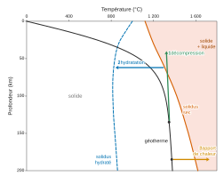
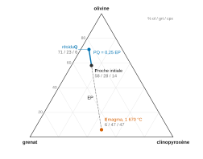
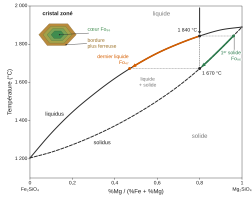
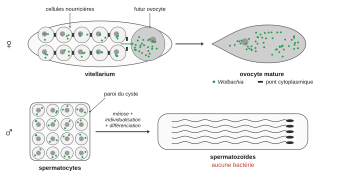
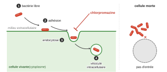
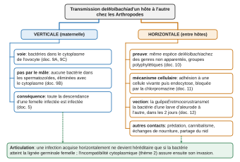

# Agro-Véto BCPST — SVT (épreuve sur support de documents) 2026 · Corrigé brut

*Corrigé rédigé par IA, non officiel. Signalez toute erreur.*

Épreuve de 3 h 30, sans calculatrice, en deux parties indépendantes (géologie, puis biologie, 1 h 45 indicatives chacune). L'annexe A3 n'étant pas reproduite, les constructions demandées sur l'annexe sont décrites en texte ou redessinées en figure. Erreur d'énoncé signalée : la question 5.a renvoie au « document 6 », mais le profil sismique de Mars est le **document 5**, que l'on utilise.

---

# Partie géologie — L'olivine dans tous ses états

## Thème 1 : L'olivine, un minéral abondant sur Terre et dans le système solaire

### Question 1

**1.a** Légendes à porter sur le document 1 :

- **Roche A** (partie sombre, en haut à gauche) : pâte (mésostase) noire à grain très fin, faite de verre et de microlites (plagioclase, pyroxène) non discernables à cette échelle ; quelques petites taches claires (petits cristaux ou vacuoles).
- **Roche B** (partie verte) : cristaux jointifs millimétriques ; **olivine** (grains vert clair à vert olive, vitreux, majoritaires) ; **pyroxènes** (grains sombres, vert foncé à noirs : orthopyroxène brun-noir, clinopyroxène vert émeraude) ; éventuellement rares grains noirs de **spinelle**.

**1.b** La roche A est sombre, et ses cristaux ne sont pas discernables même à l'échelle millimétrique : sa texture est **microlitique** (verre + microlites), celle d'une roche **volcanique** refroidie rapidement. Sa teinte noire traduit une richesse en minéraux ferromagnésiens, donc une composition basique. **La roche A est un basalte** (un gabbro, de même composition, aurait une texture grenue).

**1.c** La roche B est entièrement cristallisée, à cristaux jointifs et visibles à l'œil nu (**texture grenue**). Elle est dominée par l'olivine, avec des pyroxènes, sans quartz ni feldspath : elle est **ultrabasique**. **La roche B est une péridotite** (probablement une lherzolite : olivine + orthopyroxène + clinopyroxène). C'est une roche du manteau, pas une roche plutonique cristallisée à partir d'un magma.

**1.d** Le contact entre A et B est net, et B forme un fragment anguleux englobé par A : **B est une enclave (xénolite) de péridotite mantellique, arrachée et remontée par le magma basaltique** qui a donné A. Ce lien est aussi génétique : un basalte naît de la **fusion partielle d'une péridotite** du manteau (thème 2). Une remontée rapide du magma a préservé l'enclave sans la fondre.

**1.e** La péridotite constitue le **manteau terrestre**, principalement le **manteau supérieur** sous le Moho, à partir de ≈ 7 km sous les océans et ≈ 30 km sous les continents. On la trouve à l'affleurement en enclaves dans les basaltes et dans les ophiolites.

### Question 2

**2.a** Un **silicate** est un minéral dont l'unité structurale est le tétraèdre $[\mathrm{SiO_4}]^{4-}$ (un Si au centre, quatre O aux sommets). Les silicates se classent selon le degré de polymérisation de ces tétraèdres. Dans l'olivine $\mathrm{X_2SiO_4}$, les tétraèdres sont isolés : c'est un **nésosilicate**.

Rôle des cations $\mathrm{X^{2+}}$ (Mg²⁺, Fe²⁺…) logés entre les tétraèdres, en sites octaédriques, et non à la place du silicium :

- ils **compensent la charge** négative des tétraèdres ($2 \times (+2) = +4$) ;
- ils **lient entre eux** les tétraèdres isolés, par des liaisons ioniques, et assurent la cohésion du cristal.

Mg²⁺ et Fe²⁺, de même charge et de rayons voisins, se substituent l'un à l'autre : l'olivine est une **solution solide**.

**2.b** Sans Ca ni Mn, les deux olivines se placent **sur le côté inférieur** du triangle (joint Mg₂SiO₄–Fe₂SiO₄), gradué en % de fer :

- olivine 1 (8 % Fe) : point à 8 sur l'axe, dans le champ 0–10 %, donc **forstérite** (Fo₉₂) ;
- olivine 2 (40 % Fe) : point à 40, dans le champ 30–50 %, donc **hyalosidérite** (Fo₆₀).

### Question 3

**3.a** Le document 3 montre que les ondes S se propagent entre les zones 1 et 3 ($V_S$ ≈ 5,2 à 5,6 km/s, en augmentation). Or les ondes S ne se propagent pas dans les liquides : le milieu est **solide**. Cette tranche (≈ 410–660 km) appartient au manteau, dont la roche principale est la **péridotite**, riche en olivine (sous ses formes de haute pression, cf. document 4), avec pyroxènes et grenat.

**3.b** Les zones 1 (≈ 410 km, saut de 4,75 à 5,2 km/s), 2 (≈ 520–550 km, rupture de pente) et 3 (≈ 660 km, saut de 5,6 à 6,1 km/s) sont des **discontinuités sismiques** du manteau : la discontinuité des 410 km, celle des ≈ 520 km et celle des 660 km. Elles délimitent la **zone de transition** ; la discontinuité des 660 km marque la limite **manteau supérieur / manteau inférieur**.

### Question 4

**4.a** Un échantillon de quelques dizaines de µm est placé dans le trou d'un joint métallique, entre les pointes de deux diamants taillés. Une force modérée appliquée sur une très petite surface ($P = F/S$) produit des pressions de plusieurs dizaines de GPa, celles du manteau profond. Un chauffage laser impose la température. Le diamant, très dur, est **transparent** à la lumière et aux rayons X : on peut faire, **in situ** et sous pression, une **diffraction des rayons X**, qui identifie la **structure cristalline** de la phase stable. En répétant la mesure pour de nombreux couples $(P, T)$ et en repérant les changements de structure, on construit le **diagramme de phases**.

**4.b** Les bandes 1, 2 et 3 du document 4 (≈ 410, ≈ 520 et ≈ 670 km) coïncident avec des limites de stabilité de l'olivine :

- zone 1 : olivine α → olivine β (wadsleyite) ;
- zone 2 : β → γ (ringwoodite) ;
- zone 3 : γ → bridgmanite + magnésiowüstite.

Chaque changement de phase produit une phase plus compacte, plus dense et plus rigide, d'où l'augmentation de $V_S$. **Les discontinuités sismiques du document 3 sont la signature de ces transitions de phase**, à composition chimique constante.

**4.c** Pour chaque zone, on lit les températures auxquelles le domaine de coexistence (entre les deux pointillés) traverse la bande de pression, en s'aidant des graduations (± 30 °C environ) :

| Zone | Pression (bande) | Transition | Gamme de température |
|---|---|---|---|
| 1 | ≈ 13,8–14,3 GPa | α → β | ≈ 1 320–1 510 °C |
| 2 | ≈ 17,8–18,6 GPa | β → γ | ≈ 1 370–1 550 °C |
| 3 | ≈ 23,6–24,2 GPa | γ → Bdg + Mw | ≈ 1 300–1 700 °C |

Pour la zone 3, les limites ont une pente négative et forte : le domaine de coexistence n'entre dans la bande qu'entre ≈ 1 300 °C (bord droit de la bande) et ≈ 1 700 °C (bord gauche).

**Les trois gammes se recouvrent vers 1 400–1 500 °C.** C'est compatible avec le faible gradient adiabatique du manteau convectif (quelques dixièmes de °C/km, soit environ + 100 °C entre 410 et 660 km), que la précision de lecture ne permet pas de résoudre.

**4.d** Les limites de phase sont des droites **inclinées** dans le plan $(P,T)$ : la pression de transition dépend de la température. La sismologie fournit la profondeur, donc la pression, des discontinuités. Le diagramme expérimental donne alors la seule température compatible avec cette pression. L'olivine étant le minéral majoritaire du manteau supérieur, ses transitions produisent un signal sismique mesurable. **L'olivine sert donc de géothermomètre** à des profondeurs inaccessibles directement : chaque discontinuité est un point d'ancrage du géotherme. Les variations latérales de profondeur des discontinuités révèlent les anomalies thermiques : pente positive à 410 km et négative à 660 km, donc une zone chaude approfondit la discontinuité des 410 km et remonte celle des 660 km.

**4.e** Bilan atomique pour une olivine 100 % magnésienne :

$$\mathrm{Mg_2SiO_4 \longrightarrow MgSiO_3 + MgO}$$

$$\boxed{\text{bridgmanite} = \mathrm{MgSiO_3}}$$

### Question 5

**5.a** (Document 5.) On lit le profil depuis la surface ($r$ ≈ 3 390 km) :

- jusqu'à $r$ ≈ 3 320 km : vitesses les plus faibles du profil ($V_S$ ≈ 2,6 à 3,5 km/s), c'est la **croûte**, épaisse de quelques dizaines de km (≈ 50–70 km) ;
- de 3 320 à ≈ 1 830 km : les ondes S se propagent, c'est le **manteau solide** silicaté (≈ 1 500 km d'épaisseur), péridotitique ;
- dans sa partie supérieure, jusqu'à $r$ ≈ 2 850 km (≈ 500 km de profondeur), $V_P$ reste constante (≈ 7,7 km/s) et $V_S$ diminue légèrement (≈ 4,4 → 4,3 km/s) : ce manteau supérieur rigide forme avec la croûte une **lithosphère** épaisse, la baisse de $V_S$ traduisant une température qui croît vite dans cette couche conductive ;
- en dessous, $V_P$ croît jusqu'à ≈ 9,4 km/s et $V_S$ jusqu'à ≈ 4,9 km/s, avec deux ressauts : A ($r$ ≈ 2 350 km, soit ≈ 1 040 km de profondeur) et B ($r$ ≈ 2 100 km, soit ≈ 1 280 km), interprétés comme les transitions α → β et β → γ de l'olivine ;
- à $r$ ≈ 1 830 km, **$V_S$ s'annule** et $V_P$ chute de ≈ 9,4 à ≈ 4,8 km/s : c'est la limite manteau/noyau ;
- de 1 830 km au centre : seules les ondes P se propagent, avec $V_P$ croissant de 4,8 à 6 km/s sans discontinuité. C'est un **noyau entièrement liquide** (métallique), sans graine.

**Modèle : Mars est différenciée en croûte, manteau péridotitique solide (dont la partie supérieure appartient, avec la croûte, à une lithosphère épaisse d'environ 500 km, et qui présente deux transitions de phase de l'olivine) et noyau liquide de rayon ≈ 1 830 km.**

**5.b** Différences majeures avec la Terre :

- **transitions de phase bien plus profondes** (≈ 1 040 et ≈ 1 280 km au lieu de 410 et ≈ 520 km) : la gravité martienne étant plus faible, la pression ($\approx \rho g z$) augmente plus lentement avec la profondeur ;
- **pas de transition vers la bridgmanite, donc pas d'équivalent du manteau inférieur** : la pression à la base du manteau martien (≈ 20 GPa) reste inférieure aux ≈ 24 GPa nécessaires ;
- **noyau entièrement liquide**, sans graine solide (alors que la Terre a une graine de 1 220 km de rayon) ;
- croûte proportionnellement épaisse (quelques dizaines de km sur une planète deux fois plus petite) ; vitesses maximales du manteau plus faibles (≈ 9,4 km/s contre ≈ 13,7 km/s pour $V_P$ à la base du manteau terrestre).

## Thème 2 : Fusion et formation de l'olivine

### Question 6

**6.a** Graphique choisi (figure 1) : plan température – profondeur portant le **solidus sec** (déshydraté) de la péridotite, le **solidus hydraté** et le **géotherme** océanique moyen, qui reste à gauche du solidus sec. La roche mère, placée sur le géotherme, est donc normalement solide. Une péridotite fond **partiellement** quand son point $(P,T)$ franchit le solidus (et non le liquidus), de trois façons :

1. **décompression adiabatique** : remontée rapide sans perte notable de chaleur ($T$ baisse de quelques dixièmes de °C/km) alors que le solidus baisse beaucoup plus vite avec la pression ; flèche verticale vers le haut qui coupe le solidus ;
2. **hydratation** : l'apport d'eau abaisse le solidus de plusieurs centaines de degrés, et la roche fond à $P$ et $T$ constantes ;
3. **apport de chaleur** (anomalie thermique d'un panache) : flèche horizontale vers la droite.

La fusion est partielle (quelques % à ≈ 25 %) ; le liquide, moins dense, se sépare du résidu et migre vers le haut.

**6.b** (10 lignes.) **Dorsales** : l'asthénosphère remonte sous l'axe d'accrétion et fond par décompression adiabatique (≈ 10–25 %), ce qui donne les basaltes (MORB) et gabbros de la croûte océanique. **Rifts continentaux** : l'amincissement lithosphérique provoque, lui aussi, une décompression. **Points chauds** (Hawaï, La Réunion) : un panache plus chaud que le manteau environnant fond par apport de chaleur, auquel s'ajoute la décompression de sa remontée ; basaltes intraplaques. **Zones de subduction** : la déshydratation de la lithosphère plongeante (vers 80–150 km) libère de l'eau qui hydrate le coin de manteau sus-jacent et en abaisse le solidus, d'où des magmas d'arc (andésites, granitoïdes). Sur le graphique de 6.a, on associe la flèche 1 aux dorsales et aux rifts, la flèche 3 aux points chauds et la flèche 2 aux subductions.

**6.c** E est le **point eutectique** du système olivine – clinopyroxène – grenat à 40 kbar : point de concours des trois lignes cotectiques, et point le plus bas de la surface du liquidus (**1 670 °C**). Sa composition est ≈ 6 % d'olivine, 47 % de grenat et 47 % de clinopyroxène. E est la **température de fusion commençante** de toute roche contenant les trois minéraux. **Le premier liquide formé a la composition de E**, quelle que soit la roche, et le reste tant que les trois phases subsistent dans le résidu.

**6.d** Lecture barycentrique de P : **≈ 58 % d'olivine, ≈ 28 % de grenat, ≈ 14 % de clinopyroxène** (± 3 %). C'est une **péridotite à grenat** (lherzolite à grenat), fertile.

**6.e** Le liquide a la composition de E tant que les trois minéraux coexistent. Pour 20 % de fusion, le liquide consomme ≈ 0,47 × 20 ≈ 9,4 % de clinopyroxène, et P en contient 14 % : le clinopyroxène ne serait épuisé que vers $f \approx 14/47 \approx 30$ %. **Le magma a donc la composition de E (≈ 6 % ol, 47 % grt, 47 % cpx).**

Résidu Q : la conservation de la masse (règle des leviers) s'écrit

$$\mathrm{P} = 0{,}2\,\mathrm{E} + 0{,}8\,\mathrm{Q}$$

d'où, composante par composante :

$$\begin{aligned}
\text{ol}_{\mathrm{Q}} &\approx \frac{58 - 0{,}2 \times 6}{0{,}8} \approx 71\ \% \\
\text{grt}_{\mathrm{Q}} &\approx \frac{28 - 0{,}2 \times 47}{0{,}8} \approx 23\ \% \\
\text{cpx}_{\mathrm{Q}} &\approx \frac{14 - 0{,}2 \times 47}{0{,}8} \approx 6\ \%
\end{aligned}$$

Construction sur l'annexe : Q est sur la droite (EP), **au-delà de P** par rapport à E. Sa position est fixée par

$$\mathrm{PQ} = \frac{0{,}2}{0{,}8}\,\mathrm{EP} = 0{,}25\,\mathrm{EP}$$

$$\boxed{\begin{aligned}
\text{magma} &\approx \mathrm{E}\ (6\ \%\ \text{ol},\ 47\ \%\ \text{grt},\ 47\ \%\ \text{cpx}) \\
\mathrm{Q} &\approx 71\ \%\ \text{ol},\ 23\ \%\ \text{grt},\ 6\ \%\ \text{cpx}
\end{aligned}}$$

**6.f** Un taux de fusion de l'ordre de 20 % est typique d'une **dorsale océanique** (fusion par décompression adiabatique), et peut aussi se rencontrer à l'aplomb d'un point chaud. Dans ce cas, **P** est la péridotite asthénosphérique fertile (lherzolite à grenat) qui remonte. **Q** est une **péridotite résiduelle appauvrie** (plus riche en olivine, pauvre en clinopyroxène), qui forme le manteau lithosphérique sous la croûte océanique ; elle évoluerait vers une harzburgite pour des taux de fusion plus élevés. Q n'est donc ni un basalte ni un gabbro : ce sont les roches issues du liquide extrait, qui forment la croûte océanique.

### Question 7

Dans le document 7 (lame mince, lumière polarisée analysée), l'olivine est un **phénocristal** de plusieurs millimètres (barre de 1 mm), à contour **automorphe** (faces planes, forme losangique), au sein d'une pâte de **microlites** en baguettes et de verre (texture microlitique porphyrique). Un cristal ne développe ses faces propres que s'il croît librement dans un liquide, sans gêne par d'autres cristaux. **L'olivine fait donc partie des premiers minéraux formés.** Elle a cristallisé lentement en profondeur (chambre magmatique), avant que l'éruption ne fige le liquide restant en microlites et en verre. C'est cohérent avec la série de Bowen : l'olivine, minéral ferromagnésien le moins polymérisé, cristallise à la plus haute température.

### Question 8

**8.a** Le cristal montre un cœur et une bordure de teintes de polarisation différentes : c'est une **zonation** (cristal zoné), d'origine chimique.

**8.b** Le document 8 décrit une **solution solide totale** : il n'y a pas d'eutectique, mais un fuseau entre le liquidus (au-dessus) et le solidus (en dessous). On refroidit un liquide de composition $x = 0{,}80$ :

- à **≈ 1 840 °C**, la verticale $x = 0{,}80$ atteint le liquidus ; le premier solide, lu sur le solidus à la même température, a pour composition **$x \approx 0{,}96$** (Fo₉₆) ;
- lorsque $T$ diminue, le liquide s'appauvrit en Mg (il suit le liquidus vers la gauche) et le solide qui se dépose aussi (il suit le solidus) : chaque couche nouvelle est plus ferreuse ;
- à l'équilibre parfait, la cristallisation s'achève à **≈ 1 670 °C** (verticale × solidus), le dernier liquide ayant $x \approx 0{,}47$, et le cristal final est homogène à $x = 0{,}80$ ;
- mais la diffusion de Fe et Mg dans le solide est **lente** devant le refroidissement : les couches déjà formées ne se rééquilibrent pas avec le liquide et gardent leur composition.

**Il en résulte un cristal zoné, à cœur magnésien et bordures de plus en plus ferreuses** (la cristallisation peut alors se poursuivre en dessous de 1 670 °C, jusqu'à des bordures plus riches en fer que Fo₄₇).

**8.c** Le cœur s'est formé en premier, à la température la plus haute, où le solide en équilibre avec le liquide est le plus proche du pôle réfractaire (Mg₂SiO₄, fusion à 1 890 °C contre 1 205 °C pour Fe₂SiO₄). **Le cœur est plus riche en magnésium** (≈ Fo₉₆) que la bordure.

**8.d** Températures impliquées dans l'analyse du thème 2 :

- fusion commençante de la péridotite à 1 670 °C (eutectique E, document 6) ;
- fusion de la forstérite à 1 890 °C et cristallisation de l'olivine Fo₈₀ entre ≈ 1 840 et ≈ 1 670 °C (document 8).

Or un basalte, dont les laves contiennent des phénocristaux d'olivine (document 7), est émis en surface vers **1 100–1 250 °C**. L'écart atteint **plusieurs centaines de degrés** : l'analyse reste qualitativement juste (cœur magnésien, zonation), mais ses températures ne sont pas celles d'un magma basaltique naturel. Explications :

- **pression** : le document 6 est établi à 40 kbar (4 GPa), soit environ 120 km de profondeur ; en système sec, les températures de fusion croissent avec la pression, d'où un eutectique bien plus chaud que les laves émises en surface ;
- **nombre de constituants** : le document 6 ne retient que trois minéraux (une péridotite contient aussi de l'orthopyroxène, du spinelle…), et le document 8 deux pôles purs, alors qu'un magma basaltique contient aussi SiO₂, Al₂O₃, CaO, Na₂O… ; chaque constituant supplémentaire abaisse le liquidus, comme le montre déjà l'abaissement eutectique du document 6 ;
- **volatils** : l'eau abaisse encore solidus et liquidus ;
- le document 8, établi à 0,1 MPa pour le seul binaire olivine, ne représente pas les conditions de fusion d'un magma basaltique profond : la température de 1 890 °C de la forstérite pure n'est pas celle de la cristallisation de l'olivine dans un basalte.

## Thème 3 : Altération de l'olivine

### Question 9

**9.a** Comme pour un feldspath, le processus est une **hydrolyse**, forme d'altération chimique (et non une simple dissolution) : l'eau chargée en CO₂ attaque le minéral, ses protons rompent les liaisons du réseau, les cations passent en solution et le CO₂ est converti en HCO₃⁻.

- **Solution d'attaque** (réactifs) : eau et CO₂ dissous ; en toute rigueur, le CO₂(g) de l'équation 1 se dissout d'abord en CO₂(aq).
- **Solution de lessivage** (produits) : acide silicique H₄SiO₄, ions HCO₃⁻ et Mg²⁺, exportés par les eaux.

Pour un feldspath potassique (feldspath → kaolinite) :

$$2\,\mathrm{KAlSi_3O_8} + 2\,\mathrm{CO_2} + 11\,\mathrm{H_2O} \longrightarrow \mathrm{Al_2Si_2O_5(OH)_4} + 2\,\mathrm{K^+} + 2\,\mathrm{HCO_3^-} + 4\,\mathrm{H_4SiO_4}$$

Différence : l'équation 1 ne produit **aucune phase solide**. Faute d'aluminium, il ne se forme pas d'argile : l'olivine est **entièrement mise en solution**. Le processus **consomme 4 CO₂ par Mg₂SiO₄**.

**9.b** Légende du diagramme de Goldschmidt : abscisse **rayon ionique** $r$, ordonnée **charge** $z$ ; domaines séparés par des droites passant par l'origine, le long desquelles le potentiel ionique $z/r$ est constant ($r$ en Å) :

- potentiel ionique faible ($z/r$ inférieur à 3 environ) : **cations solubles** (Na⁺, K⁺, Ca²⁺, Mg²⁺, Fe²⁺), exportés en solution ;
- potentiel ionique intermédiaire : **cations précipitants (hydrolysats)** (Al³⁺, Fe³⁺, Ti⁴⁺ ; Si⁴⁺ en limite), qui restent sur place sous forme d'hydroxydes ou d'argiles ;
- potentiel ionique élevé ($z/r$ supérieur à 10 environ) : **oxyanions solubles** (anions complexes : C⁴⁺ → HCO₃⁻/CO₃²⁻, N⁵⁺ → NO₃⁻, S⁶⁺ → SO₄²⁻, P⁵⁺ → PO₄³⁻).

Mg²⁺ ($z/r \approx 2/0{,}72 \approx 2{,}8$) est un cation soluble, ce que confirme l'équation 1 ; Si, en limite, part ici en solution sous forme de H₄SiO₄.

**9.c** Équation 2 :

$$\mathrm{Ca^{2+}_{(aq)} + 2\,HCO_3^-{}_{(aq)} \longrightarrow CaCO_3{}_{(s)} + CO_{2\,(aq)} + H_2O_{(l)}}$$

Organismes marins qui assurent ou favorisent cette précipitation : **foraminifères**, **coccolithophoridés** (dont les plaques calcaires sont les coccolithes), **coraux**, **mollusques**, échinodermes, algues rouges calcaires ; les **cyanobactéries** la favorisent indirectement (stromatolithes).

### Question 10

**10.a** Pour une mole d'olivine, on somme (1) et 2 × (2) :

$$\mathrm{Mg_2SiO_4 + 4\,CO_2 + 4\,H_2O \to H_4SiO_4 + 4\,HCO_3^- + 2\,Mg^{2+}}$$
$$\mathrm{2\,Ca^{2+} + 4\,HCO_3^- \to 2\,CaCO_3 + 2\,CO_2 + 2\,H_2O}$$
$$\boxed{\mathrm{Mg_2SiO_4 + 2\,CO_2 + 2\,H_2O + 2\,Ca^{2+} \to 2\,CaCO_3 + H_4SiO_4 + 2\,Mg^{2+}}}$$

L'altération capte 4 CO₂, la précipitation en rend 2 : **bilan net, 2 CO₂ piégés par Mg₂SiO₄**, sous forme de carbonate solide. Ordre de grandeur, avec $M(\mathrm{Mg_2SiO_4}) \approx 141$ g/mol, pour une tonne d'olivine :

$$m(\mathrm{CO_2}) \approx \frac{10^6}{141} \times 2 \times 44 \approx 6 \times 10^5\ \text{g}$$

soit **≈ 0,6 t de CO₂** (et jusqu'à ≈ 1,25 t tant que le carbone reste dissous sous forme HCO₃⁻). Le CO₂ étant un gaz à effet de serre, son piégeage atténue le réchauffement : la démarche est donc théoriquement pertinente. Elle accélère le puits naturel « altération des silicates + sédimentation carbonatée » (régulation du climat à long terme), en augmentant la surface réactive (broyage) et en renouvelant la solution au contact des grains (vagues).

**10.b** **Diminuent** : l'**atmosphère** (CO₂ consommé) et l'**océan** (CO₂ dissous) : le carbone piégé est du CO₂(aq), et les échanges par dissolution et dégazage entre océan et atmosphère font baisser les deux réservoirs. Le HCO₃⁻ produit par l'équation 1 n'est qu'un intermédiaire, repris par l'équation 2. **Augmente** : le **réservoir carbonaté** (roches carbonatées de la lithosphère).

**10.c** **Effet à long terme.** Le carbone gagne le réservoir carbonaté, dont les flux d'entrée et de sortie sont lents : il n'en ressort que par redissolution des carbonates, ou par subduction vers le manteau puis dégazage volcanique. Son temps de résidence est de l'ordre de la dizaine à la centaine de millions d'années : le stockage est durable. La réaction elle-même est lente, même sur des grains broyés (années à décennies). Le procédé relève donc du cycle long du carbone ; il ne peut pas corriger rapidement le réchauffement actuel.

**10.d** Une **ressource géologique** est un composé naturel (minéral, roche, eau, hydrocarbure…) ou une forme d'énergie d'origine géologique, potentiellement exploitable pour satisfaire les besoins humains, même si son exploitation n'est pas encore rentable ou techniquement possible. Elle est **non renouvelable** à l'échelle humaine (sauf exceptions comme la géothermie). À distinguer de la **réserve**, partie de la ressource connue, exploitable et rentable dans le contexte technique et économique du moment ; le gisement est la concentration de la ressource en un lieu.

**10.e** Gisements continentaux d'olivine : les **péridotites mantelliques portées à l'affleurement**, en particulier les **ophiolites** obductées (Oman, Nouvelle-Calédonie, Alpes) et les massifs de péridotites (ex. dunites de Norvège), ainsi que les niveaux de dunite des complexes ultrabasiques.

**10.f** Limites :

- **bilan carbone** : extraction, broyage fin (très énergivore) et transport émettent du CO₂, qu'il faut retrancher du gain ;
- **échelle** : à ≈ 0,6 t de CO₂ par tonne d'olivine, compenser ≈ 40 Gt de CO₂ par an exigerait des dizaines de Gt de roche par an ;
- **cinétique lente** et efficacité réelle difficile à mesurer en milieu ouvert ;
- **permanence** : le CaCO₃ formé peut se redissoudre (eaux sous-saturées, en particulier sous la profondeur de compensation des carbonates), ce qui restitue le carbone ;
- **impacts environnementaux** : libération de métaux (Ni, Cr) toxiques pour les écosystèmes littoraux, apport massif de Mg²⁺ et d'acide silicique modifiant la chimie des eaux (eutrophisation possible), turbidité, destruction des milieux et des paysages à l'emplacement des mines et des plages ;
- **santé** : poussières fines, minéraux fibreux associés (amiante) ;
- risque de servir d'alibi à la non-réduction des émissions ; coût, acceptabilité.

### Question 11

**11.a** Horizons d'un sol, de haut en bas :

- **O** : litière, matière organique peu décomposée ;
- **A** : horizon organo-minéral riche en humus, siège de l'activité biologique ;
- (**E** : horizon éluvial, appauvri par lessivage, dans certains sols) ;
- **B** : horizon d'accumulation (argiles, oxydes de fer), minéral ;
- **C** : roche-mère altérée et fragmentée ;
- **R** : roche-mère saine.

Dans le dispositif, la couche de mélange correspond aux horizons supérieurs (O/A) mêlés à l'olivine.

**11.b** Document 10D :

- à **19 °C**, le Mg²⁺ lessivé passe de ≈ 3,3–4,5 u.a. les vingt premiers jours à **5–5,5 u.a.** à partir de ≈ 40 jours, puis s'y stabilise jusqu'à 120 jours ;
- à **4 °C**, il reste plus faible et irrégulier, entre **≈ 1,7 et 3 u.a.** (moyenne ≈ 2,4 u.a., hormis un premier point à 4,4).

**La solution de lessivage est environ deux fois plus riche en Mg²⁺ à 19 °C** (≈ 5,3 contre ≈ 2,4 u.a.). Le Mg²⁺ provient de l'hydrolyse de l'olivine (équation 1) : sa hausse traduit une **altération chimique plus poussée** à 19 °C, la vitesse de réaction augmentant avec la température (cinétique chimique). S'y ajoute l'activité biologique du sol (respiration des racines et des micro-organismes, qui enrichit l'eau du sol en CO₂, donc en acidité), elle aussi accrue à 19 °C.

**11.c** Ce qui manque :

- un **témoin sans olivine**, à chaque température : le sol libère lui-même du Mg²⁺, rien ne prouve donc que le Mg²⁺ mesuré vienne de l'olivine ;
- des **répétitions** (une seule carotte par température, aucune statistique possible) ;
- une mesure du **carbone** (alcalinité, HCO₃⁻, CO₂ du sol), puisque le Mg²⁺ n'est qu'un indicateur indirect de la séquestration, ou un essai avec une solution d'arrosage enrichie en CO₂ ;
- un contrôle direct de l'état des grains d'olivine en fin d'expérience (observation au MEB des figures d'altération) ;
- une **durée** plus longue que 120 jours, des conditions plus proches du terrain (végétation, cultures, variations saisonnières), le suivi d'autres éléments libérés (Ni, Cr) et une granulométrie contrôlée.

**11.d** **Épandre de la roche silicatée broyée (olivine, ou basalte) sur les sols agricoles** (altération forcée des sols). Côté climat, l'hydrolyse consomme du CO₂, et les HCO₃⁻ sont exportés par les eaux de drainage vers l'océan. Côté cultures, la libération de cations (Mg²⁺, Ca²⁺) agit comme un **amendement** : elle remonte le pH des sols acides (effet de chaulage) et apporte des **nutriments** (Mg, constituant de la chlorophylle ; Si, utile aux Poacées). Les rendements peuvent ainsi augmenter. Le travail du sol renouvelle en outre les surfaces réactives. Variante : épandre des **feldspaths potassiques broyés**, dont l'hydrolyse consomme aussi du CO₂ et libère du potassium, l'un des principaux engrais.

**11.e** Limites :

- **accumulation de Ni et de Cr** (métaux des péridotites) dans les sols et les récoltes ;
- **alcalinisation excessive** des sols déjà neutres ou calcaires (carences en fer et en zinc), effets sur la faune et la microflore du sol ;
- **poussières** et minéraux fibreux pour les opérateurs ;
- **bilan carbone** et **coût énergétique et économique** de l'extraction, du broyage et du transport, et quantités énormes à épandre ;
- **efficacité dépendante du climat** : le document 10 montre une altération deux fois plus faible à 4 °C qu'à 19 °C, donc un rendement bien moindre aux hautes latitudes et en saison froide ;
- **autolimitation** : l'hydrolyse partielle peut former des argiles et des oxydes en surface des grains, qui les isolent de la solution et ralentissent l'altération ;
- **vérification difficile** du CO₂ réellement séquestré (Mg²⁺ retenu sur le complexe argilo-humique, reprécipitation de carbonates dans le sol, dégazage en rivière) ;
- coût, et risque de détourner de la réduction des émissions.

---

# Partie biologie — *Wolbachia*

## Thème 1 : *Wolbachia*, une bactérie symbiotique

### Question 1a

Les barres d'échelle (0,6 µm ; 500 nm) montrent que les objets mesurent ≈ 0,5–1 µm, et des détails bien plus fins sont visibles (membranes, enveloppe nucléaire, vésicules). Le pouvoir séparateur du microscope optique (≈ 0,2 µm) ne le permet pas : on observe l'**ultrastructure** des cellules. Les images en niveaux de gris de **coupes** ultrafines, où le contraste vient de zones plus ou moins denses aux électrons, sont caractéristiques de la **microscopie électronique à transmission (MET)**, dont la résolution atteint le nanomètre.

### Question 1b

Deux arguments, tirés du document 1A :

- **pas de noyau** ni d'organite délimité par une membrane dans les structures *w*, alors que le noyau *n* de la cellule hôte est visible sur le même cliché : organisation **procaryote** ;
- **taille** de ≈ 0,5 à 1 µm, celle d'une bactérie (bien plus petite qu'une cellule eucaryote, plus grande qu'un virus).

### Question 1c

Après infection, *Wolbachia* est **intracellulaire**, dans le **cytoplasme** de la cellule hôte : l'une des bactéries est **enfermée dans une vésicule** (*v*), l'autre semble libre dans le cytosol (avant la co-culture, elles étaient dans le milieu extérieur, au contact de la cellule).

### Question 2a

Document 2A : sans vitamine B7, la métamorphose chute de ≈ 89 % à ≈ 65 %, soit une baisse relative d'environ un quart (différence significative) : **la B7 est nécessaire au développement**. Document 2B : après un traitement antibiotique éliminant *Wolbachia*, la teneur en B7 des punaises baisse de ≈ 2,2 à ≈ 1,5 ng/mg, soit environ un tiers de moins (significatif) : **Wolbachia fournit une part de la B7** de l'hôte. Or la punaise est hématophage, et le sang est pauvre en vitamines B. **Wolbachia fournit donc de la B7, nécessaire à la métamorphose : elle favorise le développement de la punaise** (relation mutualiste).

### Question 2b

Mesurer le **taux de métamorphose** de punaises traitées à l'antibiotique, **avec ou sans apport de vitamine B7** dans leur repas, en comparaison de punaises non traitées. Si l'apport de B7 restaure la métamorphose des punaises traitées, la chaîne *Wolbachia* → B7 → métamorphose est établie. On ajoute un lot de punaises non infectées traitées à l'antibiotique, pour vérifier que celui-ci n'est pas toxique par lui-même. Variante : réinfecter des punaises traitées par *Wolbachia* et suivre le retour à la normale.

### Question 3a

(5 lignes.) La RT-PCR comporte une rétro-transcription des ARN en ADN complémentaire, puis une amplification PCR de ce dernier avec des amorces spécifiques : elle identifie et quantifie un **ARN spécifique** (en version quantitative, la fluorescence mesure la quantité d'ARN de départ). Comme DENV-2 est un virus **à ARN**, elle quantifie directement le génome viral, donc la multiplication du virus, avec une grande sensibilité. Le Western blot, lui, identifie une **protéine spécifique** à l'aide d'anticorps : moins sensible, semi-quantitatif, mais il renseigne sur la protéine effectivement produite.

### Question 3b

Il manque un **témoin de charge** : le marquage, dans chaque piste, d'une protéine constitutive du moustique (actine par exemple), pour vérifier que la même quantité d'extrait protéique a été déposée dans chaque puits. Sans lui, l'absence de bande anti-DENV-2 en présence de *Wolbachia* pourrait venir d'un dépôt insuffisant. On peut y ajouter un **marqueur de masse moléculaire** et l'indication du nombre de répétitions.

### Question 3c

(10 lignes.) Le document 3A montre qu'après infection par DENV-2 les moustiques porteurs de *Wolbachia* contiennent ≈ 0,2 millier de copies d'ARN viral, contre ≈ 3,4 milliers chez les moustiques dépourvus de la bactérie : la charge virale est divisée par plus de 10. Le document 3B le confirme au niveau des protéines : la protéine virale n'est détectée que chez les moustiques sans *Wolbachia* ; en présence de la bactérie (bande anti-Wolb positive), la protéine virale est indétectable, bien que le moustique ait été exposé au virus. Le document 3C donne une piste d'explication : chez des moustiques porteurs de *Wolbachia* et non infectés par DENV-2, quatre gènes de l'immunité sont significativement surexprimés. *Wolbachia* stimule donc en permanence l'immunité innée de son hôte. **Conclusion : *Wolbachia* rend le moustique résistant à DENV-2** — multiplication du virus fortement réduite, pas de protéine virale produite — vraisemblablement en maintenant actives ses défenses. Protégé de l'infection, le moustique symbiotique voit sa **valeur sélective (fitness) augmentée** : c'est un nouveau bénéfice de la symbiose. Il devient en outre un mauvais vecteur du virus.

### Question 4a

**Régions test (4C, région 10).** Au premier relevé (printemps 2017, après le lâcher de janvier), ≈ 18 % des *A. aegypti* sont porteurs de *Wolbachia*. La proportion augmente ensuite rapidement : ≈ 60–75 % à l'été 2017, ≈ 88 % fin 2017, ≈ 98 % début 2018. Elle se maintient ensuite entre ≈ 90 et 100 % jusqu'à fin 2019 (≈ 81–88 % aux derniers relevés), sans nouveau lâcher. L'infection **envahit la population en moins d'un an et s'y maintient**.

**Régions contrôle (4D, région 13).** Les relevés commencent fin 2017. La proportion reste faible : quelques % en 2018, ≈ 5–15 % en 2019 avec un pic à ≈ 30 % fin 2019, ≈ 13–20 % début 2020 (d'autres régions contrôle dépassent 50 %, jusqu'à ≈ 80 % pour la région 4). Aucun lâcher n'y a été fait : la bactérie s'est **propagée** depuis les régions test voisines, par migration de moustiques infectés, les régions étant imbriquées sur la carte 4A.

**Interprétation.** Une invasion aussi rapide suppose que les moustiques infectés aient un avantage : une **fitness augmentée** (protection contre le virus, question 3), et la transmission maternelle de la bactérie (thème 2).

**Conséquence (4B).** La proportion moyenne de personnes infectées par DENV-2 est de ≈ 0,03 % dans les régions test contre ≈ 0,10 % dans les régions contrôle, soit une réduction d'un facteur ≈ 3.

### Question 4b

(4 lignes.) Piste prometteuse : un lâcher installe durablement la bactérie (≈ 90–100 % de porteurs pendant trois ans), sans insecticide, et les cas de dengue sont divisés par ≈ 3. Réserves : significativité non indiquée et forte variabilité (région test 10 ≈ région contrôle 13 en 4B) ; risque d'infection dépendant aussi des piqûres et des modes de vie, non renseignés ; témoins gagnés par la bactérie ; effets inconnus sur les autres maladies vectorielles et sur l'écosystème.

## Thème 2 : *Wolbachia*, une bactérie parasite

### Question 5

Le document 5 donne quatre croisements :

| | Femelle non infectée | Femelle infectée |
|---|---|---|
| **Mâle non infecté** | descendance viable, non infectée | descendance viable, infectée |
| **Mâle infecté** | **embryons morts** | descendance viable, infectée |

**Un parasite.** Le croisement mâle infecté × femelle non infectée tue toute la descendance : la bactérie réduit à zéro le succès reproducteur de ce couple, alors qu'elle tire profit de son hôte (elle s'y multiplie et s'y transmet). Elle est donc un **parasite** (bénéfice pour la bactérie, préjudice pour l'hôte), qui manipule la reproduction de son hôte.

**Une espèce qui se propage.** Toute la descendance d'une femelle infectée est infectée, quel que soit le mâle : la transmission maternelle est totale. De plus, une femelle infectée se reproduit avec succès avec tous les mâles, tandis qu'une femelle non infectée ne le peut qu'avec un mâle non infecté. Les femelles infectées produisent donc plus de descendants que les femelles non infectées. Quantitativement, si la moitié des individus est infectée à la génération $n$ (croisements au hasard, chacun des quatre croisements avec la probabilité $1/4$) :

$$\begin{aligned}
\text{descendants viables} &= \tfrac{3}{4} \\
\text{descendants viables infectés} &= \tfrac{2}{4} \\
\text{fréquence des infectés à la génération } n+1 &= \tfrac{2/4}{3/4} \\
&= \tfrac{2}{3}
\end{aligned}$$

**La fréquence des infectés passe de 1/2 à 2/3 en une génération** : elle augmente à chaque génération, jusqu'à envahir la population.

### Question 6a

Dans le document 6, le premier croisement (mâle infecté × femelle non infectée, sans modification) donne en moyenne ≈ 5 % d'embryons éclos (points dispersés de 0 à 20 %), alors que le dernier croisement (mâle infecté × femelle infectée) en donne ≈ 95 %. **C'est cohérent avec le document 5** : la quasi-totalité des embryons meurt dans la combinaison mâle infecté × femelle non infectée, et la descendance est viable quand la femelle est infectée. Le document 6 apporte en outre une information quantitative : la mortalité n'est pas absolue, ≈ 5 % des embryons éclosent malgré tout.

### Question 6b

Comparons les ovocytes de femelles non infectées, fécondés par des mâles infectés :

- ovocyte exprimant *cidB* seul : ≈ 5 % d'éclosion, comme sans modification → CidB n'apporte rien ;
- ovocyte exprimant *cidA* : ≈ 95 % → viabilité restaurée ;
- ovocyte exprimant *cidA* et *cidB* : ≈ 95 % → le sauvetage persiste.

**La condition suffisante est l'expression de *cidA* (présence de CidA) dans l'ovocyte** ; l'infection de la femelle elle-même n'est pas requise, seul compte le produit du gène bactérien.

### Question 7a

Document 7A : avec l'ADN seul, puis avec l'ADN et CidA, les quatre bandes (6,0 ; 5,0 ; 3,0 ; 1,5 kb) sont présentes et identiques ; avec l'ADN et CidB, **aucune bande n'est visible**. CidB dégrade donc l'ADN, quelle que soit la taille des molécules : c'est une **nucléase**, et CidA n'a aucun effet sur l'ADN.

Dans un embryon issu d'une femelle non infectée, CidB (apportée par le spermatozoïde) **dégraderait l'ADN**, en particulier celui du noyau d'origine paternelle, ce qui empêcherait le développement et expliquerait la mort des embryons des documents 5 et 6.

### Question 7b

Document 7B : la levure transformée par un plasmide vide forme des colonies (la transformation n'est pas toxique) ; avec *cidB* seul, aucune colonie (CidB est toxique) ; avec *cidB* + *cidA*, les colonies réapparaissent (CidA neutralise CidB) ; avec *cidB* + *cidA\** (CidA privée de son domaine de liaison à CidB), aucune colonie.

**Mécanisme proposé : CidA se lie directement à CidB par son domaine de liaison et forme un complexe inactif**, dans lequel le site actif de la nucléase est masqué. La neutralisation exige donc une interaction physique entre les deux protéines, et non une action indirecte. C'est un système de type toxine (CidB) – antitoxine (CidA).

### Question 7c

Ajouter la condition manquante : **ADN + CidA + CidB**. Si le modèle est exact, les quatre bandes doivent être conservées, ce qui démontrerait directement, sur l'ADN, la protection par CidA. On peut compléter par une piste ADN + CidA\* + CidB (dégradation attendue) et par une piste avec CidB dénaturée par la chaleur (contrôle de la nature enzymatique de l'effet).

### Question 8a

CidA, CidB et l'histone acétylée H4ac sont des **protéines**. L'immunomarquage par fluorescence **localise in situ** une protéine donnée, grâce à un anticorps spécifique couplé à un fluorochrome, **sans détruire la structure du tissu et de la cellule** (une hybridation in situ de type FISH, avec des sondes nucléotidiques, détecterait des séquences d'ADN ou d'ARN, non les protéines). C'est indispensable ici : la question n'est pas de savoir si CidA et CidB existent, mais **où** elles se trouvent — dans quelles cellules du testicule, à quel stade de la différenciation, et dans lequel des deux pronucléus de l'œuf fécondé. L'utilisation de fluorochromes différents permet de superposer les marquages (ADN, CidA, CidB, H4ac) sur la même préparation.

### Question 8b

Le croisement porte sur un mâle **infecté** et une femelle **non infectée** : c'est donc dans les cellules du mâle (8A) qu'il faut chercher l'effet de l'infection. *cidA* et *cidB* sont des gènes **bactériens** : ils ne peuvent être exprimés que dans un individu infecté.

- Dans le testicule du mâle infecté, CidA et CidB sont toutes deux détectées dans les spermatides en cours de différenciation (flèche entière).
- En fin de différenciation, dans les spermatozoïdes (tête de flèche, sans H4ac), seule CidB est encore détectée.

**L'infection par *Wolbachia* entraîne l'expression de CidA et de CidB dans la lignée germinale mâle.** La femelle non infectée, elle, ne possède pas ces gènes et ne peut pas les exprimer : un faible signal sur son pronucléus (8B) n'est qu'un bruit de fond.

### Question 8c

**Dans le testicule (8A).** Les spermatides en cours de différenciation (flèche entière) présentent un marquage pour l'ADN, CidA, CidB et H4ac. Les spermatozoïdes différenciés (tête de flèche) ne présentent plus ni H4ac — ce qui confirme, d'après la légende, qu'il s'agit bien des cellules les plus avancées — ni CidA, alors que **CidB** y est encore présente.

**Dans l'ovocyte fécondé (8B).** Le pronucléus mâle montre un marquage CidB intense et concentré ; aucun marquage CidA n'est visible, ni sur le pronucléus mâle ni sur le pronucléus femelle.

**Seule CidB est transmise** : elle persiste dans les spermatozoïdes différenciés, puis se retrouve dans l'ovocyte, associée au pronucléus mâle. CidA, elle, disparaît en fin de différenciation et n'est pas transmise. Ce sont les protéines, et non les bactéries, qui passent par le spermatozoïde.

### Question 8d

Le croisement réalisé est mâle infecté × femelle non infectée. L'ovocyte reçoit CidB (8c) mais ne contient pas CidA, puisque la femelle n'est pas infectée (8b). Or le document 6 montre que, dans ces conditions, seuls ≈ 5 % des embryons éclosent. **L'embryon n'a donc quasiment aucune chance de survivre.**

**Rôles.** CidB est une **toxine** (nucléase) déposée dans le spermatozoïde au cours de la spermatogenèse d'un mâle infecté : dans l'œuf, elle dégrade l'ADN du pronucléus mâle. CidA est l'**antitoxine**, fournie par le cytoplasme de l'ovocyte d'une femelle infectée, qui se lie à CidB et la neutralise. La survie de l'embryon suppose donc que la femelle soit infectée : c'est le mécanisme de l'**incompatibilité cytoplasmique**, qui rend compte des quatre cases du document 5 et explique la propagation de la bactérie.

## Thème 3 : *Wolbachia*, une bactérie transmise

### Question 9a

Observations. Document 9A : la fluorescence verte des *Wolbachia* est présente dans le vitellarium, et en particulier dans le cytoplasme de l'ovocyte. Document 9B : au stade spermatocyte (1), de nombreuses bactéries (points jaunes) sont présentes dans le cyste, associées aux cellules germinales ; au stade spermatozoïde (2), il n'y en a plus au niveau des spermatozoïdes différenciés.

Report sur le schéma 9C :

### Question 9b

**Voie femelle.** Les bactéries sont présentes dans le cytoplasme de l'ovocyte (9A). Or le zygote reçoit la quasi-totalité de son cytoplasme de l'ovocyte : toutes les cellules de l'embryon en hériteront. Ceci rend compte du document 5, où toute la descendance d'une femelle infectée est infectée.

**Voie mâle.** Les bactéries, présentes au stade spermatocyte, ne sont plus associées aux spermatozoïdes différenciés (9B) : le gamète mâle n'en transmet pas. La transmission est donc **strictement maternelle**.

**Explication chez les mâles.** Lors de la différenciation des spermatozoïdes, chaque spermatide élimine la quasi-totalité de son cytoplasme et de ses organites ; les *Wolbachia*, bactéries cytoplasmiques, sont évacuées avec ce cytoplasme résiduel. Même si quelques-unes subsistaient, le spermatozoïde n'apporte presque pas de cytoplasme à l'ovocyte. Le mâle infecté ne transmet donc que des **protéines** déjà déposées (CidB, thème 2), et non les bactéries. Ce mode de transmission est analogue à celui des mitochondries.

### Question 10a

Les genres porteurs d'une même espèce de *Wolbachia* sont dispersés dans l'arbre. L'espèce 2 (magenta) est présente chez *Wasmannia*, *Sericomyrmex*, *Trachymyrmex*, *Atta* et *Pheidole*, mais aussi chez *Azteka*, genre d'une sous-famille distincte ; entre ces genres s'intercalent de nombreux genres dépourvus de cette espèce. De même, l'espèce 4 (noir) est présente chez *Crematogaster*, *Metapone*, *Pheidole* et *Aenictus*, ce dernier très éloigné des autres.

Si la présence d'une espèce donnée de *Wolbachia* était une innovation **héritée**, elle serait apparue une fois chez un ancêtre commun et tous ses descendants la porteraient : les porteurs formeraient un groupe **monophylétique**. Ce n'est pas le cas. **Les genres porteurs d'une même espèce de *Wolbachia* forment un groupe polyphylétique** : le caractère a été acquis plusieurs fois indépendamment (homoplasie, par convergence), et il ne peut pas être une innovation évolutive héritée d'un ancêtre commun.

### Question 10b

Puisque la répartition ne suit pas les relations de parenté, la bactérie n'a pas été transmise de l'ancêtre à ses descendants : elle est passée **directement d'une lignée à une autre**. C'est une **transmission horizontale** (interspécifique), par contact écologique : partage d'un milieu, prédation ou cannibalisme, échanges de nourriture entre individus, ou vection par un parasite commun.

### Question 10c

L'espèce 3 (vert) est observée chez *Apterostigma* et *Pheidole*. En transmission strictement verticale, elle aurait été héritée de leur ancêtre commun le plus récent, et serait présente chez **tous** les descendants de cet ancêtre. Sur le document 10, il faudrait donc placer un point vert en face de *Apterostigma*, *Myrmicocrypta*, *Cyphomyrmex*, *Sericomyrmex*, *Trachymyrmex*, *Acromyrmex*, *Atta* et *Pheidole* — c'est-à-dire sur tout le clade issu de cet ancêtre, et sur aucun autre genre.

### Question 11a

Lecture préalable. Document 11A : au contact de cellules de drosophile vivantes (*live*), les bactéries (rouges), d'abord extérieures, sont progressivement retrouvées **à l'intérieur** de la cellule (0 h, 2 h, 4 h) ; au contact de cellules mortes (*dead*), elles restent agglomérées à l'extérieur. L'entrée exige donc une cellule vivante, donc un processus actif de la cellule hôte. Document 11B : la proportion de cellules infectées est de ≈ 0,26 / 0,22 / 0,27 dans les témoins à 1, 2 et 3 jours, et chute significativement en présence de chlorpromazine (≈ 0,12 / 0,09 / 0,06). La chlorpromazine inhibant l'endocytose, **l'entrée des bactéries est facilitée par l'endocytose** ; l'infection n'est cependant pas abolie (baisse d'environ 55 à 80 %), donc l'entrée peut aussi se faire, plus rarement, par une autre voie.

Schéma fonctionnel attendu (l'inhibition par la chlorpromazine y est partielle) :

### Question 11b

Le document 10 impose une transmission horizontale entre lignées de fourmis ; le document 11 en donne le **mécanisme cellulaire** : une bactérie présente dans le milieu extérieur peut entrer, par endocytose, dans une cellule vivante d'un nouvel hôte, et l'énoncé indique que ce résultat peut être étendu à tous les Arthropodes.

Il reste à amener la bactérie au contact des cellules d'une autre fourmi. Les occasions sont nombreuses chez des insectes sociaux : échanges de nourriture entre ouvrières, toilettage, consommation de proies ou de cadavres infectés, bactéries libérées dans le milieu par la mort ou la blessure d'un individu, partage du nid, parasites communs. Les bactéries ingérées ou introduites peuvent alors coloniser les cellules du nouvel hôte selon le cycle précédent. Si elles atteignent la lignée germinale d'une femelle, la transmission verticale prend le relais et l'infection se fixe dans la nouvelle lignée, ce qui explique la distribution en mosaïque du document 10.

### Question 12a

*Wolbachia* est une bactérie **intracellulaire**, présente en très faible quantité chez la guêpe après qu'elle a consommé une larve, et non cultivable sur milieu usuel. La PCR amplifie de façon exponentielle une séquence choisie, grâce à des amorces **spécifiques** de l'ADN de *Wolbachia* : elle permet de détecter spécifiquement l'ADN bactérien, donc de savoir si chaque guêpe est infectée, avec une grande **sensibilité** et une grande **spécificité**, au milieu de l'ADN de la guêpe, sur un simple broyat et pour un grand nombre d'individus. L'intensité des bandes donne de plus une indication semi-quantitative de la charge bactérienne.

### Question 12b

**Document 12B.** Après consommation de larves contaminées, l'ADN de *Wolbachia* est détecté dès le premier jour, avec une bande intense, puis les bandes s'affaiblissent progressivement et disparaissent à la dernière piste : la bactérie ne se multiplie pas chez la guêpe et n'y persiste que quelques jours. La guêpe n'est donc pas un hôte durable.

**Document 12C.** La capacité de la guêpe à contaminer des aleurodes sains dépend du délai : ≈ 60 % d'aleurodes infectés en moyenne si le contact a lieu un jour après la contamination, ≈ 30 % à deux jours, et **0 % à partir du troisième jour**.

**Conclusion.** Bien que la bactérie survive mal chez la guêpe, celle-ci est contaminante pendant environ deux jours ; comme elle se nourrit de nombreuses larves et pond à l'intérieur de celles-ci, elle peut, pendant cette fenêtre, contaminer plusieurs larves successives, et la bactérie se propage de proche en proche dans la population d'aleurodes. La guêpe est un **vecteur transitoire** et non un hôte. **Conditions de transmission :** des bactéries encore vivantes (l'ADN reste détectable plus longtemps que les bactéries ne restent infectieuses), un contact dans les **deux jours** suivant la contamination de la guêpe, et un contact intime avec les tissus de la larve (alimentation, et surtout ponte à l'intérieur de la larve, l'ovipositeur jouant le rôle d'un instrument contaminé).

### Question 13

Carte mentale de la transmission de *Wolbachia* d'un hôte à l'autre chez les Arthropodes :

