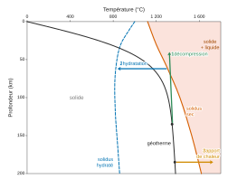
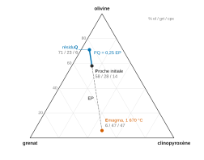
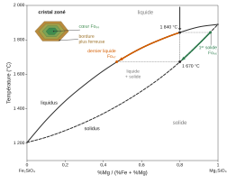
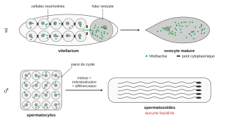
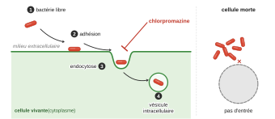
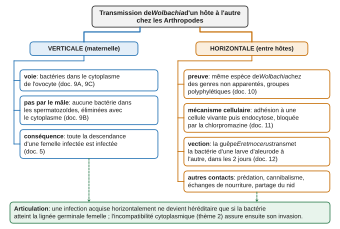

# Agro-Véto BCPST — SVT (épreuve sur support de documents) 2026 · Corrigé guidé

*Corrigé rédigé par IA, non officiel. Signalez toute erreur.*

## Présentation du sujet

**Nature et contraintes de l'épreuve.** SVT, épreuve sur support de documents, **3 h 30**, en deux parties strictement indépendantes : **géologie** (7 pages, 1 h 45 indicatives) et **biologie** (9 pages, 1 h 45 indicatives). Calculatrice, tables, abaques et tout instrument électronique sont **interdits** : toutes les exploitations chiffrées sont des lectures graphiques et des calculs de tête ou à la main. Une **annexe A3**, commune aux deux parties, est à rendre avec la copie : sept questions demandent d'y porter une légende, un point ou une construction (géologie 1.a, 2.b, 6.e, 8.b, 9.b ; biologie 9a, 10c).

Trois consignes transversales, répétées par l'énoncé, valent autant que les connaissances : s'appuyer **essentiellement sur l'analyse des documents**, ne pas dérouler de long développement de cours indépendant des questions, et **exploiter les documents sans les paraphraser**. En biologie, l'énoncé précise en outre qu'aucune introduction ni conclusion n'est attendue, qu'il faut indiquer clairement les numéros des questions et des documents, et respecter les limites de longueur (5, 10 et 4 lignes pour les questions 3a, 3c et 4b ; 10 lignes pour la question 6.b de géologie).

**Découpage.**

*Géologie — « L'olivine dans tous ses états » (41 sous-questions).*

- **Thème 1 (Q1 à Q5)** : l'olivine comme minéral et comme sonde planétaire. On part de l'échantillon macroscopique (basalte et enclave de péridotite), on passe à la cristallochimie (nésosilicate, solution solide Mg–Fe), puis à la sismologie terrestre (zone de transition, discontinuités des 410, 520 et 660 km), à l'expérimentation haute pression (cellule à enclume de diamant, polymorphes α, β, γ), et enfin à Mars.
- **Thème 2 (Q6 à Q8)** : l'olivine comme minéral magmatique. Fusion partielle du manteau (diagramme ternaire olivine – clinopyroxène – grenat, eutectique, règle des leviers), puis cristallisation (diagramme binaire forstérite – fayalite à solution solide totale, zonation des cristaux).
- **Thème 3 (Q9 à Q11)** : l'olivine comme minéral instable en surface. Hydrolyse consommatrice de CO₂, diagramme de Goldschmidt, précipitation des carbonates, puis discussion argumentée de deux projets de géo-ingénierie (plages d'olivine, épandage agricole) et critique d'un dispositif expérimental.

*Biologie — « *Wolbachia* » (30 sous-questions).*

- **Thème 1 (Q1 à Q4)** : la bactérie symbiotique. Identification en microscopie électronique, apport de vitamine B7 à la punaise de lit, protection du moustique contre la dengue, application à la lutte antivectorielle en Indonésie.
- **Thème 2 (Q5 à Q8)** : la bactérie parasite. Incompatibilité cytoplasmique, puis décortication moléculaire du couple CidA/CidB (gel d'électrophorèse, test de survie de levures, immunomarquages).
- **Thème 3 (Q9 à Q13)** : la bactérie transmise. Transmission verticale maternelle, phylogénie des fourmis, endocytose, vection par une guêpe parasitoïde, et synthèse sous forme de carte mentale.

**Notions du programme mobilisées.** Géologie : minéraux et roches magmatiques, textures, structure interne du globe et ondes sismiques, fusion partielle et contextes géodynamiques, diagrammes de phases binaires et ternaires, altération chimique, sols, cycle du carbone et climat, ressources géologiques. Biologie : techniques d'étude (MET, immunofluorescence, PCR et RT-PCR, Western blot, électrophorèse), cellule procaryote, symbiose et parasitisme, immunité innée des Arthropodes, reproduction sexuée et gamétogenèse, génétique et sélection naturelle, phylogénie et homoplasie, endocytose.

**Difficulté et longueur.** Le sujet n'est pas difficile conceptuellement, mais il est **long** : 71 sous-questions en 3 h 30, soit environ trois minutes par question. Les questions les plus coûteuses sont, en géologie, Q6 (six sous-questions dont deux constructions et un développement de 10 lignes) et Q8.d, et, en biologie, Q3c, Q8c–d, Q11a et Q13. Le reste se traite en quelques lignes.

**Questions abordables à ne pas laisser passer.** 1.b, 1.c, 2.a, 3.a, 4.e, 7, 8.a, 9.c, 10.d, 11.a en géologie ; 1a, 1b, 1c, 3a, 5, 7a, 12a en biologie. Ce sont des questions de cours ou de lecture immédiate, qui rapportent autant que les autres. Le rapport 2026 juge bien réussies, dans l'ensemble, 2.b, 4.b, 4.c, 4.e, 6.d, 10.d et 11.a en géologie, et le premier volet des questions 2 et 4 ainsi que la question 9 en biologie.

**Ce que dit le rapport 2026.** La distribution des notes culmine vers 9–10/20, et les moyennes des deux parties ne diffèrent que de 0,5 point. Les questions qui ont départagé les candidats sont surtout les questions de diagramme et d'esprit critique, rarement traitées ou mal réussies : 6.a–6.b (graphique de fusion partielle), 6.e–6.f (règle des leviers, nature de Q), 8.a (nom du motif), 8.d (critique des températures), 10.b (réservoirs), 10.f et 11.e (limites, au pluriel), 11.b (analyse quantifiée) et 11.c–11.d en géologie ; 2b, 3a–3b (techniques), 11a, 12b et 13 en biologie. Le jury signale aussi des confusions récurrentes entre minéral et roche (question 2.a), et rappelle que les verbes « justifier », « indiquer », « nommer », « rappeler » et « discuter » n'appellent pas la même réponse, et qu'un pluriel (« quelques organismes », « des limites ») exige plusieurs éléments.

**Gestion du temps.** Traiter les deux parties dans l'ordre et respecter la répartition 1 h 45 / 1 h 45 : les deux parties pèsent le même poids, et abandonner la seconde coûte la moitié de la note. Le jury rappelle que les questions de synthèse sont fortement coefficientées : garder du temps pour 6.a–6.b, 8.d, 10.f, 11.e et la carte mentale de la question 13. À l'intérieur d'une partie, les thèmes sont indépendants : une impasse sur un document ne condamne pas la suite. En revanche, les questions d'un même thème s'enchaînent (Q4 suppose Q3, Q6.e suppose Q6.c et Q6.d, Q10 suppose Q9, Q8d suppose Q6 et Q7). Faire d'abord au brouillon les constructions destinées à l'annexe, les reporter ensuite au propre : elles rapportent vite et une annexe vide se voit.

---

## Partie géologie — Thème 1 : l'olivine, un minéral abondant sur Terre et dans le système solaire

Le fil de ce thème est un changement d'échelle continu : de l'échantillon de main au cristal, du cristal aux ondes sismiques, et de la Terre à Mars. Les outils sont la reconnaissance des textures magmatiques, la cristallochimie des silicates, et la lecture couplée de deux documents (profil sismique et diagramme de phases).

### Question 1.a

> [!INDICATION]
> Comparer les deux clichés : ils ne sont pas à la même échelle (1 cm à gauche, 1 mm à droite). Ce que l'on peut légender diffère donc d'une image à l'autre.

> [!INDICATION]
> Pour chaque roche, identifier d'abord la **texture** (voit-on tous les cristaux ? y a-t-il une pâte ?), puis les minéraux visibles. Les couleurs sont ici informatives : vert olive, vert sombre, noir.

#### Solution

Sur l'annexe, porter les légendes suivantes.

Roche A (partie sombre) : pâte sombre à grain très fin, où aucun cristal n'est individualisable à cette échelle (verre + microlites de plagioclase et de pyroxène) ; quelques petites taches claires (petits cristaux ou vacuoles).

Roche B (partie verte) : cristaux jointifs de taille millimétrique — **olivine** (grains vert olive, vitreux, les plus abondants), **pyroxènes** (grains sombres, vert foncé à brun-noir), et éventuellement de rares grains noirs opaques (**spinelle**).

> [!METHODE]
> Une légende de photographie de roche se construit toujours en deux temps : la texture d'abord (elle décide de la famille de roche), les minéraux ensuite. Inverser l'ordre fait écrire des noms de minéraux non justifiés.

> [!JURY]
> Le rapport 2026 relève de nombreuses légendes incompatibles avec les roches étudiées (quartz, biotite, feldspath potassique, voire « ophiolite », qui n'est pas un minéral). Distinguer orthopyroxène et clinopyroxène n'était pas exigé ; reconnaître les minéraux constitutifs d'un basalte et d'une péridotite l'était.

### Question 1.b

> [!INDICATION]
> Deux caractères suffisent : la texture, qui donne le mode de mise en place, et la couleur, qui renseigne sur la composition chimique.

#### Solution

La roche A ne laisse pas voir ses cristaux, même à l'échelle du millimètre : sa texture est **microlitique** (verre, microlites, parfois quelques phénocristaux), celle d'une roche **volcanique**, refroidie rapidement au contact de la surface. Sa couleur très sombre traduit une forte proportion de minéraux ferromagnésiens, donc une roche **basique**.

**La roche A est un basalte** (un gabbro, de même composition, aurait une texture grenue).

> [!PIEGE]
> Écrire seulement que la roche est sombre, donc un basalte, n'est pas une justification : beaucoup de roches sont sombres. C'est l'association texture microlitique (donc volcanique) + couleur sombre (donc basique) qui identifie le basalte. Le rapport 2026 précise que les identifications fondées sur la seule couleur, ou par exclusion (« ni sédimentaire ni métamorphique donc magmatique »), n'ont pas été valorisées, et que la confusion entre texture microlitique et texture grenue, donc entre basalte et gabbro, reste fréquente.

### Question 1.c

> [!INDICATION]
> Même méthode : texture, puis minéralogie. Quels minéraux sont présents, et surtout lesquels sont **absents** ?

#### Solution

La roche B est entièrement cristallisée, sans verre, tous les cristaux étant visibles et jointifs : **texture grenue**. Sa minéralogie est dominée par l'olivine, accompagnée de pyroxènes ; il n'y a ni quartz ni feldspath. C'est donc une roche **ultrabasique**.

**La roche B est une péridotite** (une lherzolite si olivine, orthopyroxène et clinopyroxène coexistent).

> [!PIEGE]
> La texture grenue n'implique pas ici « roche plutonique issue d'un magma » : la péridotite est la roche du **manteau**, et non un magma cristallisé en profondeur. La question 1.d confirme ce sens de lecture.

### Question 1.d

> [!INDICATION]
> Observer la nature du contact sur le cliché de droite : net ou progressif ? Y a-t-il une auréole de réaction ?

> [!INDICATION]
> Deux liens sont à envisager, et tous deux sont vrais : un lien mécanique (lequel des deux morceaux contient l'autre ?) et un lien génétique (d'où vient un basalte ?).

#### Solution

Le contact entre A et B est **net**, sans zone de réaction : B forme un fragment anguleux englobé dans A. La roche B est donc une **enclave (xénolite) de péridotite**, arrachée au manteau et remontée par le magma basaltique qui a donné A.

Ce lien est aussi génétique : un basalte résulte de la **fusion partielle d'une péridotite mantellique**. La roche A est donc issue de la fusion d'une roche du type de la roche B. La rapidité de l'ascension du magma explique que l'enclave n'ait eu le temps ni de fondre ni de se rééquilibrer.

> [!METHODE]
> Devant deux roches en contact, trois relations possibles : l'une recoupe l'autre (filon), l'une contient l'autre (enclave), ou l'une dérive de l'autre (filiation magmatique ou métamorphique). Le caractère net ou progressif du contact tranche presque toujours.

> [!PIEGE]
> Faire intervenir le métamorphisme est l'erreur que le rapport 2026 signale le plus souvent ici. Il note aussi que les liens géométrique (enclave) et génétique (fusion partielle) ne sont souvent compris que partiellement : il faut donner les deux.

### Question 1.e

> [!INDICATION]
> « Localisation **principale** sur Terre » : la question ne porte pas sur les affleurements, mais sur l'endroit où se trouve l'essentiel de cette roche.

#### Solution

Les péridotites constituent le **manteau terrestre**, et en particulier le **manteau supérieur**, sous la discontinuité de Mohorovičić — à partir d'environ 7 km de profondeur sous les océans et 30 km sous les continents. Le manteau représente l'essentiel du volume du globe. On n'observe de péridotites en surface qu'à titre exceptionnel : enclaves dans les laves (comme ici) et massifs ophiolitiques obductés.

### Question 2.a

> [!INDICATION]
> La définition d'un silicate tient dans un motif élémentaire. Pensez à sa charge.

> [!INDICATION]
> Pour le rôle des cations, raisonner en deux temps : l'électroneutralité d'une part, la cohésion mécanique d'autre part — en se demandant ce qui relie entre eux des tétraèdres qui ne partagent aucun oxygène.

#### Solution

Un **silicate** est un minéral dont l'unité structurale de base est le **tétraèdre $[\mathrm{SiO_4}]^{4-}$** : un atome de silicium au centre, quatre atomes d'oxygène aux sommets. Les silicates se classent selon le degré de polymérisation de ces tétraèdres (isolés, en chaînes, en feuillets, en charpente). Dans l'olivine $\mathrm{X_2SiO_4}$, les tétraèdres sont **isolés** : c'est un **nésosilicate**.

Les cations divalents $\mathrm{X^{2+}}$, logés dans les sites octaédriques entre les tétraèdres (et non à la place du silicium), jouent deux rôles :

- ils assurent la **neutralité électrique** du cristal : deux charges $+2$ compensent exactement la charge $-4$ d'un tétraèdre ;
- ils assurent la **cohésion** de l'édifice, en reliant par des liaisons ioniques des tétraèdres qui ne partagent aucun oxygène.

Comme $\mathrm{Mg^{2+}}$ et $\mathrm{Fe^{2+}}$ ont la même charge et des rayons voisins, ils se substituent librement : l'olivine forme une **solution solide** continue entre forstérite et fayalite.

> [!METHODE]
> Le rapport entre la charge du motif et la charge des cations est le moyen le plus rapide de vérifier qu'une formule de silicate est cohérente : ici $2 \times (+2) - 4 = 0$.

> [!JURY]
> Le rapport 2026 : « Le jury attendait clairement la formule des tétraèdres de silice. » Il valorise les copies qui explicitent le rôle des cations dans la compensation des charges, et non un vague « rôle de stabilisation ».

> [!PIEGE]
> Le rapport 2026 relève de fréquentes confusions entre silice, silicium et silicate (un silicate est un minéral, pas une roche), des cations décrits comme remplaçant le silicium au centre des tétraèdres, et une confusion entre silicates et phyllosilicates.

### Question 2.b

> [!INDICATION]
> Lire attentivement la légende du document 2 : l'axe gradué en bas donne la teneur en **fer**, alors que l'énoncé donne d'abord la teneur en magnésium.

> [!INDICATION]
> Ces olivines contiennent-elles du calcium ? Si non, où se placent-elles nécessairement dans le triangle ?

#### Solution

Ni l'olivine 1 ni l'olivine 2 ne contiennent de calcium : elles se placent donc **sur le côté inférieur** du triangle, le joint $\mathrm{Mg_2SiO_4}$–$\mathrm{Fe_2SiO_4}$, gradué en pourcentage de fer (0 à gauche, 100 à droite).

- Olivine 1 : 8 % de Fe, donc un point à l'abscisse 8, dans le champ 0–10 % : c'est une **forstérite** (notation Fo₉₂).
- Olivine 2 : 40 % de Fe, donc un point à l'abscisse 40, dans le champ 30–50 % : c'est une **hyalosidérite** (Fo₆₀).

> [!PIEGE]
> Placer l'olivine 1 à l'abscisse 92 (du côté de la fayalite) est l'erreur type : l'axe est gradué en fer, pas en magnésium. Toujours relire la légende d'un axe avant de reporter une valeur. Le rapport 2026 signale aussi des olivines placées hors de l'axe binaire Mg–Fe, comme si elles contenaient du calcium.

### Question 3.a

> [!INDICATION]
> Quelle information l'énoncé donne-t-il gratuitement en choisissant de représenter les ondes **S** plutôt que les ondes P ?

#### Solution

Le document 3 montre des ondes S qui se propagent entre les zones 1 et 3, avec $V_S$ croissant de ≈ 5,2 à ≈ 5,6 km·s⁻¹. Or les ondes S sont des ondes de cisaillement : elles ne se propagent que dans les milieux solides. **Le milieu est donc solide** sur toute cette tranche.

Les profondeurs concernées (≈ 410 à ≈ 660 km) appartiennent au manteau, dont la roche principale est la **péridotite**, riche en olivine, avec pyroxènes et grenat. À ces profondeurs, l'olivine est présente sous ses formes de haute pression (wadsleyite, puis ringwoodite, cf. document 4).

> [!JURY]
> D'après le rapport 2026, beaucoup de candidats n'écrivent pas le mot « péridotite », le jugeant sans doute implicite : il faut le donner, avec l'état solide. Les termes « rigide » ou « ductile » ont été acceptés lorsqu'ils étaient employés à bon escient.

### Question 3.b

> [!INDICATION]
> Décrire d'abord la **forme** de la courbe au niveau de chaque zone : s'agit-il d'un saut, d'une rupture de pente, d'une extinction ?

#### Solution

Les trois zones correspondent à des changements brusques de $V_S$ à profondeur quasi constante : un saut de ≈ 4,75 à ≈ 5,2 km·s⁻¹ vers 410 km (zone 1), une rupture de pente vers 520–550 km (zone 2), et un saut de ≈ 5,6 à ≈ 6,1 km·s⁻¹ vers 660 km (zone 3). Ce sont des **discontinuités sismiques** du manteau : la discontinuité des **410 km**, celle des **≈ 520 km**, et celle des **660 km**, cette dernière marquant la limite entre manteau supérieur et manteau inférieur. L'intervalle 410–660 km constitue la **zone de transition**.

> [!PIEGE]
> Ne pas confondre ces discontinuités avec le Moho (quelques dizaines de kilomètres), la LVZ ou la discontinuité de Gutenberg (2 900 km), où $V_S$ s'annule : le rapport 2026 cite ces deux dernières parmi les réponses incohérentes avec les profondeurs. Ici les ondes S continuent de se propager : le milieu reste solide de part et d'autre. Les mots « d'un point de vue sismique » excluent aussi une réponse en termes de transitions de phase (c'est l'objet de la question 4) ou d'opposition rigide/ductile, qui confond propriétés mécaniques et sismiques.

### Question 4.a

> [!INDICATION]
> Deux propriétés du diamant sont utilisées, l'une mécanique, l'autre optique.

> [!INDICATION]
> Pour relier l'outil à la structure cristalline : quelle technique, utilisant un rayonnement capable de traverser le diamant, donne accès à l'arrangement des atomes ?

#### Solution

Un échantillon de quelques dizaines de micromètres est placé dans le trou d'un joint métallique, entre les pointes de deux diamants taillés en enclume. Une force modérée appliquée sur une surface très petite engendre, par $P = F/S$, une pression de plusieurs dizaines de GPa, comparable à celle du manteau profond. Un chauffage (laser ou résistance) impose simultanément la température.

Le diamant est le plus dur des matériaux naturels — il supporte ces pressions — et il est **transparent** aux rayons X. On peut donc réaliser, **in situ** et sans décomprimer, une **diffraction des rayons X** : la position des pics diffractés donne les paramètres de la maille, donc la **structure cristalline** de la phase stable au couple $(P, T)$ imposé.

En répétant l'expérience pour de nombreux couples $(P,T)$ et en notant pour chacun quelle structure est stable, on délimite les champs de stabilité des différentes phases : c'est la construction point par point du **diagramme de phases**.

> [!JURY]
> Le rapport 2026 valorise une description rigoureuse accompagnée d'un schéma précis et légendé, et regrette des schémas imprécis, notamment sur le rôle de la température et l'utilisation des rayons X.

> [!PIEGE]
> La cellule à enclumes de diamant n'est pas une presse triaxiale destinée à étudier le comportement mécanique des roches : décrire une fracturation de l'échantillon, ou une « stimulation » des minéraux par le diamant, est un contresens relevé par le jury.

### Question 4.b

> [!INDICATION]
> Les deux documents partagent la même numérotation des zones et une échelle commune : laquelle ?

> [!INDICATION]
> Pour relier un changement de structure cristalline à une variation de vitesse sismique, penser aux deux grandeurs dont dépend la vitesse d'une onde.

#### Solution

Les trois bandes du document 4 sont situées aux mêmes profondeurs que les trois zones du document 3 (≈ 410, ≈ 520 et ≈ 670 km) et encadrent chacune une limite de champ de stabilité de l'olivine :

- zone 1 : olivine α → olivine β (wadsleyite) ;
- zone 2 : olivine β → olivine γ (ringwoodite) ;
- zone 3 : olivine γ → bridgmanite + magnésiowüstite.

À chaque transition, les mêmes atomes se réorganisent dans un arrangement **plus compact** : la masse volumique augmente, et la rigidité du matériau augmente davantage encore, de sorte que la vitesse des ondes S croît brusquement.

**Les discontinuités sismiques du document 3 sont donc la traduction sismologique des transitions de phase de l'olivine du document 4**, à composition chimique constante.

> [!METHODE]
> Un saut de vitesse sismique admet trois causes possibles : changement d'état, changement de composition chimique, changement de structure cristalline. Ici, les documents imposent la troisième, et c'est elle qui fait tout l'intérêt de l'olivine comme sonde.

### Question 4.c

> [!INDICATION]
> Chaque zone fixe un intervalle de **pression** (largeur de la bande colorée). Reporter cet intervalle sur les deux courbes en pointillés correspondantes et lire les températures d'intersection.

> [!INDICATION]
> Attention à la zone 3 : la pente de ses limites est négative, et elle est forte. L'intervalle de température lu n'est pas du tout le même que pour les zones 1 et 2.

#### Solution

| Zone | Pression (largeur de la bande) | Transition | Gamme de température |
|---|---|---|---|
| 1 | ≈ 13,8 – 14,3 GPa | α → β | ≈ 1 320 – 1 510 °C |
| 2 | ≈ 17,8 – 18,6 GPa | β → γ | ≈ 1 370 – 1 550 °C |
| 3 | ≈ 23,6 – 24,2 GPa | γ → bridgmanite + magnésiowüstite | ≈ 1 300 – 1 700 °C |

Lecture de la zone 3 : les deux limites ont une pente négative et forte. Le domaine de coexistence n'entre dans la bande qu'entre ≈ 1 300 °C (limite de gauche, au bord droit de la bande) et ≈ 1 700 °C (limite de droite, au bord gauche de la bande).

Les trois gammes se recouvrent vers **1 400 – 1 500 °C**, avec une incertitude de lecture de l'ordre de ± 30 °C et un intervalle particulièrement large pour la zone 3, dont les limites sont presque verticales.

Ce résultat est compatible avec le faible gradient de température du manteau convectif (gradient adiabatique de quelques dixièmes de degré par kilomètre, soit environ + 100 °C entre 410 et 660 km) : l'écart attendu est du même ordre que l'incertitude de lecture, et ne peut donc pas être mis en évidence ici.

> [!PIEGE]
> Pour la zone 3, une température supérieure à ≈ 1 700 °C fait sortir de la bande de pression : à 1 750 °C, la transition se produit entre ≈ 23,0 et ≈ 23,4 GPa, à gauche de la zone 3. À l'inverse, à 1 200 °C, elle se produit au-delà de 24,4 GPa, à droite. Toujours vérifier que le point lu appartient bien au rectangle imposé par les **deux** contraintes.

> [!JURY]
> Le rapport 2026 : « La gamme de température de la zone 3 a été particulièrement mal évaluée, même dans des copies par ailleurs satisfaisantes. » Une valeur moyenne au lieu d'un intervalle n'a rapporté qu'une partie des points, et des lectures « à l'œil » s'écartaient de plus d'une centaine de degrés : lire les graduations.

### Question 4.d

> [!INDICATION]
> Deux ingrédients sont nécessaires pour faire un thermomètre : une grandeur mesurable in situ, et une relation entre cette grandeur et la température.

> [!INDICATION]
> Pourquoi faut-il que le minéral choisi soit abondant ?

#### Solution

Trois arguments s'enchaînent.

1. L'olivine est le minéral **le plus abondant du manteau supérieur** : ses changements de structure modifient les propriétés élastiques moyennes de la roche, donc produisent un signal sismique détectable à l'échelle du globe.
2. Les limites de phase du document 4 sont des droites **inclinées** dans le plan $(P,T)$ : la pression de transition dépend de la température. À une profondeur de transition donnée, donc à une pression donnée, ne correspond qu'une seule température.
3. La sismologie donne précisément la profondeur des discontinuités, mais aucune température ; l'expérimentation en cellule à enclume donne la relation $P(T)$. Le croisement des deux fournit la température à la profondeur considérée.

On dispose ainsi d'une mesure de température **inaccessible autrement** : aucun forage n'atteint 410 km. Chaque discontinuité fournit un **point d'ancrage du géotherme**. Mieux encore, les variations latérales de profondeur d'une discontinuité cartographient les anomalies thermiques ; comme la transition à 410 km a une pente positive et celle à 660 km une pente négative, les deux discontinuités réagissent en sens opposé à une même anomalie chaude, ce qui permet de distinguer un effet thermique d'un effet de composition.

> [!JURY]
> Le rapport 2026 attend l'enchaînement complet : les changements de phase dépendent de la pression et de la température, la profondeur des discontinuités sismiques donne la pression, donc la température. Dire seulement que les phases de l'olivine renseignent sur la température, ou associer chaque phase à une température sans parler des transitions, est jugé très incomplet.

### Question 4.e

> [!INDICATION]
> Écrire la réaction et équilibrer les atomes, élément par élément.

#### Solution

Pour une olivine 100 % magnésienne, la transition de la zone 3 s'écrit

$$\mathrm{Mg_2SiO_4 \longrightarrow \ \text{bridgmanite} \ + \ MgO}$$

La conservation des éléments impose, pour la bridgmanite, $2 - 1 = 1$ magnésium, 1 silicium et $4 - 1 = 3$ oxygènes :

$$\boxed{\mathrm{Mg_2SiO_4 \longrightarrow MgSiO_3 + MgO}}$$

La bridgmanite a donc pour formule $\mathrm{MgSiO_3}$. C'est le minéral le plus abondant de la Terre, constituant essentiel du manteau inférieur.

> [!PIEGE]
> Le rapport 2026 signale des copies qui donnent à la bridgmanite la formule de la forstérite ($\mathrm{Mg_2SiO_4}$) : vérifier le bilan élément par élément.

### Question 5.a

> [!INDICATION]
> L'énoncé renvoie au « document 6 », mais les vitesses martiennes sont au **document 5**. Signaler l'erreur d'énoncé sur la copie et poursuivre, comme l'y invite la consigne liminaire.

> [!INDICATION]
> L'axe des ordonnées est une **distance au centre**, pas une profondeur. Commencer par chercher où $V_S$ s'annule.

> [!INDICATION]
> Sous la croûte, $V_P$ et $V_S$ n'évoluent pas de la même façon sur les 500 premiers kilomètres et plus bas : quelle enveloppe, définie par son comportement mécanique, cela suggère-t-il ?

#### Solution

Lecture du profil, depuis la surface ($r \approx 3\,390$ km) :

- jusqu'à $r \approx 3\,320$ km, les vitesses sont les plus faibles du profil ($V_S$ ≈ 2,6 à 3,5 km·s⁻¹) : c'est la **croûte**, épaisse de quelques dizaines de kilomètres (≈ 50 à 70 km) ;
- de $r \approx 3\,320$ à $r \approx 1\,830$ km, les ondes S se propagent : c'est un **manteau silicaté solide**, péridotitique, épais d'environ 1 500 km ;
- dans sa partie supérieure, jusqu'à $r \approx 2\,850$ km (≈ 500 km de profondeur), $V_P$ reste constante (≈ 7,7 km·s⁻¹) et $V_S$ diminue légèrement (≈ 4,4 → 4,3 km·s⁻¹). Ce manteau supérieur rigide forme avec la croûte une **lithosphère** épaisse ; la légère baisse de $V_S$ traduit une température qui augmente vite dans cette couche où la chaleur est transmise par conduction ;
- plus bas, $V_P$ croît jusqu'à ≈ 9,4 km·s⁻¹ et $V_S$ jusqu'à ≈ 4,9 km·s⁻¹. Deux ressauts de vitesse y sont repérés : l'étoile A à $r \approx 2\,350$ km (soit ≈ 1 040 km de profondeur) et l'étoile B à $r \approx 2\,100$ km (≈ 1 280 km), interprétés comme les transitions α → β et β → γ de l'olivine ;
- à $r \approx 1\,830$ km, **$V_S$ s'annule** et $V_P$ chute brutalement de ≈ 9,4 à ≈ 4,8 km·s⁻¹ : c'est la limite manteau / noyau ;
- de $r = 1\,830$ km au centre, seules les ondes P se propagent, avec $V_P$ croissant régulièrement de 4,8 à 6 km·s⁻¹, sans aucune discontinuité : le **noyau est entièrement liquide**, et aucune graine solide n'est détectée.

**Modèle : Mars est une planète différenciée en trois enveloppes concentriques — une croûte, un manteau péridotitique solide siège de deux transitions de phase de l'olivine, et un noyau métallique entièrement liquide de rayon ≈ 1 830 km. La croûte et le manteau supérieur forment une lithosphère épaisse d'environ 500 km.**

> [!METHODE]
> Face à un profil de vitesses, les trois réflexes sont toujours les mêmes : chercher où $V_S$ s'annule (liquide), repérer les sauts (limites d'enveloppes ou transitions de phase), puis convertir les ordonnées en profondeurs si nécessaire.

> [!JURY]
> Le rapport 2026 : « De nombreuses copies identifient uniquement une “croûte” superficielle sans mentionner la lithosphère ». Il rappelle qu'une partie de la lithosphère appartient au manteau supérieur : ne pas opposer lithosphère et manteau. Il relève aussi des contresens graves (« croûte liquide », « gabbro à 2400 km de profondeur ») et des lectures de l'axe comme une profondeur.

### Question 5.b

> [!INDICATION]
> Comparer terme à terme avec la structure de la Terre. Pour expliquer la profondeur des transitions de phase, se souvenir que ces transitions se produisent à une **pression** donnée, et écrire comment la pression varie avec la profondeur.

#### Solution

| | Mars | Terre |
|---|---|---|
| Rayon | ≈ 3 390 km | 6 371 km |
| Transition α → β | ≈ 1 040 km | 410 km |
| Transition β → γ | ≈ 1 280 km | ≈ 520 km |
| Transition γ → bridgmanite | absente | 660 km |
| Manteau inférieur | inexistant | 660 – 2 900 km |
| Noyau | entièrement liquide | liquide + graine solide ($r$ = 1 220 km) |

Trois différences majeures.

1. **Les transitions de phase sont deux à trois fois plus profondes.** Elles se produisent à pression fixée (≈ 14 et ≈ 18 GPa, document 4). Or $P \approx \rho g z$ : la pesanteur martienne étant environ 2,6 fois plus faible que la terrestre, la pression augmente d'autant plus lentement avec la profondeur, et il faut descendre beaucoup plus bas pour atteindre la même pression.
2. **Il n'y a pas de manteau inférieur.** La pression à la base du manteau martien reste inférieure à ≈ 20 GPa, donc aux ≈ 24 GPa nécessaires à la dissociation de la ringwoodite : la bridgmanite ne peut pas se former.
3. **Le noyau est entièrement liquide**, sans graine solide, alors que la Terre possède une graine. Les vitesses maximales du manteau sont aussi plus faibles (≈ 9,4 km·s⁻¹ contre ≈ 13,7 km·s⁻¹ à la base du manteau terrestre).

> [!PIEGE]
> Attribuer la plus grande profondeur des transitions à une composition différente du manteau martien n'est pas recevable : l'énoncé précise que les deux ressauts sont interprétés comme des transitions de phase **de l'olivine**, donc à chimie identique. L'explication est mécanique.

> [!JURY]
> Le rapport 2026 valorise l'absence de graine solide et le nombre plus limité de transitions de phase mantelliques (l'absence de manteau inférieur pouvant rester implicite). En revanche, l'argument d'une « taille plus petite » de Mars, avancé seul, n'a pas été retenu s'il n'était pas relié à des conséquences géophysiques précises : ici, la pesanteur plus faible et la pression plus basse en profondeur.

---

## Partie géologie — Thème 2 : fusion et formation de l'olivine

Ce thème est le cœur « diagrammes » du sujet. Deux outils différents y sont employés : un **ternaire** (trois constituants, un eutectique, règle des leviers pour la fusion partielle) et un **binaire à solution solide totale** (fuseau liquidus/solidus, compositions conjuguées, zonation). Ne pas les confondre : l'un a un eutectique, l'autre non.

### Question 6.a

> [!INDICATION]
> Un graphique « choisi judicieusement » signifie ici : le plan (température, profondeur) avec le solidus de la péridotite et le géotherme.

> [!INDICATION]
> Si le géotherme est à gauche du solidus, trois manières de franchir la courbe : déplacer le point vers la droite, vers le haut, ou déplacer la courbe elle-même.

#### Solution

Le graphique à tracer (figure 1) porte la **profondeur** en ordonnée (orientée vers le bas) et la **température** en abscisse, avec trois courbes : le **solidus sec** (déshydraté) de la péridotite, le **solidus hydraté**, fortement abaissé, et le **géotherme** moyen, qui reste à gauche du solidus sec. La roche mère, placée sur le géotherme, est donc normalement solide.

Une péridotite fond partiellement dès que son point représentatif franchit le solidus (et non le liquidus), ce qui peut se produire de trois façons :

1. **Décompression adiabatique** (flèche verticale vers le haut) : lors d'une remontée rapide, la roche n'échange pas de chaleur et sa température ne baisse que de quelques dixièmes de degré par kilomètre, alors que le solidus, lui, baisse beaucoup plus vite quand la pression diminue. Le solidus est franchi.
2. **Hydratation** (déplacement du solidus vers les basses températures) : l'ajout d'eau abaisse le solidus de plusieurs centaines de degrés, de sorte que, à pression et température inchangées, la roche se retrouve au-dessus du solidus hydraté.
3. **Apport de chaleur** (flèche horizontale vers la droite) : une anomalie thermique élève localement la température de la roche jusqu'au solidus.

Dans les trois cas, la fusion est **partielle** (de quelques pour cent à ≈ 25 %) : le liquide produit, moins dense, se sépare du résidu solide et migre vers le haut.

> [!JURY]
> Le rapport 2026 attend un graphique faisant apparaître le géotherme mantellique, la position de la roche mère, les solidus des péridotites hydratées et déshydratées et la trajectoire de décompression adiabatique. Il note que cette question a très souvent été mal traitée ou laissée de côté, y compris dans de bonnes copies : c'est l'une des plus discriminantes du sujet.

> [!PIEGE]
> Erreurs relevées par le jury : un schéma, un diagramme TAS ou un diagramme binaire à la place du graphique demandé ; la confusion entre solidus et liquidus (« la roche franchit le liquidus ») ; une décompression adiabatique mal représentée ; la fusion partielle réduite à un simple échauffement, ou attribuée à la « fonte des parois d'une chambre magmatique ».

### Question 6.b

> [!INDICATION]
> Dix lignes pour quatre contextes : une phrase par contexte, chacune associée explicitement à l'un des trois mécanismes de la question précédente.

#### Solution

Aux **dorsales océaniques**, l'asthénosphère remonte passivement sous l'axe d'accrétion : la décompression adiabatique (mécanisme 1) y produit 10 à 25 % de fusion, d'où les basaltes et gabbros de la croûte océanique. Dans les **rifts continentaux**, l'amincissement de la lithosphère permet la même remontée et la même décompression. Aux **points chauds**, un panache mantellique plus chaud que son environnement fond par apport de chaleur (mécanisme 3), auquel s'ajoute la décompression de sa remontée : le magmatisme basaltique y est abondant et indépendant des limites de plaques. Dans les **zones de subduction**, la lithosphère océanique plongeante, hydratée, voit ses minéraux hydratés se déstabiliser vers 80 à 150 km de profondeur ; l'eau libérée hydrate le coin de manteau sus-jacent et en abaisse le solidus (mécanisme 2), d'où les magmas des arcs volcaniques.

Sur le graphique de la question 6.a, on associe la flèche 1 aux dorsales et aux rifts, la flèche 2 aux subductions et la flèche 3 aux points chauds.

> [!JURY]
> Le rapport 2026 valorise les copies qui relient chaque contexte à son mécanisme : décompression adiabatique aux dorsales, abaissement du solidus par hydratation des péridotites en subduction. Citer la dorsale et la subduction sans ce lien ne suffit pas. La question portant sur la fusion d'une roche mère mantellique, elle excluait le magmatisme d'anatexie, parfois cité à tort.

> [!PIEGE]
> Deux abus de langage relevés par le jury : parler d'« hydratation du solidus » (c'est la roche qui est hydratée, le solidus qui s'abaisse), et associer l'hydratation à la fusion sous les dorsales, où le mécanisme est la décompression.

### Question 6.c

> [!INDICATION]
> Où convergent les isothermes en pointillés ? Que vaut la température en ce point par rapport à tout le reste du diagramme ?

> [!INDICATION]
> La propriété vraiment utile pour la suite n'est pas la température de E, mais la composition du **premier liquide** formé.

#### Solution

E est le **point eutectique** du système ternaire olivine – clinopyroxène – grenat à 40 kbar : c'est le point de concours des lignes cotectiques et le minimum de la surface du liquidus, à $T_E = 1\,670$ °C. Sa composition se lit ≈ 6 % d'olivine, ≈ 47 % de grenat et ≈ 47 % de clinopyroxène.

Deux propriétés :

- c'est la **température de fusion commençante** du système : aucune roche contenant les trois minéraux ne peut commencer à fondre en dessous de 1 670 °C ;
- le **premier liquide formé a la composition de E**, quelle que soit la composition de la roche de départ, et il la conserve tant que les trois minéraux subsistent dans le résidu. Seule la **quantité** de liquide augmente ; ce n'est qu'après épuisement de l'un des trois minéraux que la température remonte et que la composition du liquide quitte E.

> [!JURY]
> D'après le rapport 2026, le mot « eutectique » est très souvent cité, mais sa définition reste approximative. Est attendue une composition, ou une condition particulière, permettant l'apparition de liquide lors de la fusion d'un assemblage minéral, idéalement avec la notion de température de fusion minimale.

### Question 6.d

> [!INDICATION]
> Dans un diagramme ternaire, la proportion d'un pôle se lit sur l'axe qui lui correspond, le long des lignes parallèles au côté opposé. Vérifier que la somme des trois valeurs fait 100 %.

#### Solution

La lecture des coordonnées de P donne environ **58 % d'olivine, 28 % de grenat et 14 % de clinopyroxène** (à ± 3 % près ; la somme fait bien 100 %).

C'est la composition d'une **péridotite à grenat** (lherzolite à grenat dans un système réel, qui contiendrait aussi de l'orthopyroxène) : une roche mantellique **fertile**, typique de l'asthénosphère sous une centaine de kilomètres de profondeur.

> [!METHODE]
> Toujours contrôler une lecture barycentrique par la somme. Si elle ne fait pas 100 %, c'est qu'un des trois axes a été lu dans le mauvais sens.

> [!PIEGE]
> Ici, les graduations du côté gauche sont portées par des traits horizontaux : lire le grenat à la hauteur de P (≈ 41 %) donnerait une somme supérieure à 100 %. Le rapport 2026 relève précisément des « pourcentages dont la somme dépasse 100 % ». La teneur en grenat se lit le long d'une parallèle au côté olivine – clinopyroxène.

### Question 6.e

> [!INDICATION]
> Première étape : le liquide est-il encore à l'eutectique après 20 % de fusion ? Calculer à quel taux de fusion le minéral le plus sollicité serait épuisé.

> [!INDICATION]
> Deuxième étape : écrire la conservation de la matière. Si $f$ est le taux de fusion, P est le barycentre de E (poids $f$) et de Q (poids $1-f$). La traduction géométrique est une construction sur la droite (EP).

#### Solution

**Le magma.** Tant que les trois minéraux coexistent dans le résidu, le liquide a la composition de l'eutectique. Vérifions-le : le liquide contient ≈ 47 % de clinopyroxène, alors que P n'en contient que 14 %. Le clinopyroxène serait donc épuisé pour un taux de fusion $f$ tel que

$$\begin{aligned}
0{,}47\,f &= 0{,}14 \\
f &\approx 30\ \%
\end{aligned}$$

Comme 20 % < 30 %, les trois minéraux subsistent (le grenat ne s'épuiserait que vers 60 %). **Le magma a la composition de E : ≈ 6 % d'olivine, 47 % de grenat, 47 % de clinopyroxène.**

**Le résidu Q.** La conservation de la matière (règle des leviers) s'écrit

$$\mathrm{P} = 0{,}20\,\mathrm{E} + 0{,}80\,\mathrm{Q}$$

d'où, composante par composante :

$$\begin{aligned}
\text{olivine} &\approx \frac{58 - 0{,}20 \times 6}{0{,}80} \approx 71\ \% \\
\text{grenat} &\approx \frac{28 - 0{,}20 \times 47}{0{,}80} \approx 23\ \% \\
\text{cpx} &\approx \frac{14 - 0{,}20 \times 47}{0{,}80} \approx 6\ \%
\end{aligned}$$

La somme vaut 100 % et le clinopyroxène reste positif, ce qui confirme le premier point.

**Construction sur l'annexe.** Q se trouve sur la droite (EP), **au-delà de P** par rapport à E, à la distance

$$\mathrm{PQ} = \frac{f}{1-f}\,\mathrm{EP} = 0{,}25\,\mathrm{EP}$$

$$\boxed{\begin{aligned}
\text{magma} &\approx \mathrm{E}\ (6\ \%\ \text{ol},\ 47\ \%\ \text{grt},\ 47\ \%\ \text{cpx}) \\
\mathrm{Q} &\approx 71\ \%\ \text{ol},\ 23\ \%\ \text{grt},\ 6\ \%\ \text{cpx}
\end{aligned}}$$

> [!PIEGE]
> Le rapport 2026 juge cette question rarement traitée et plus rarement réussie. Erreurs relevées : ne donner que la composition du solide résiduel sans celle du liquide, attribuer au magma une composition incorrecte, ou se contenter d'indiquer que le liquide conserve une composition eutectique, sans placer Q. Le liquide reste en E ; c'est le **résidu** qui s'éloigne de E en passant par P.

> [!METHODE]
> La règle des leviers est toujours la même : trois points alignés (liquide, roche initiale, résidu), la roche initiale entre les deux autres, et les distances inversement proportionnelles aux masses.

### Question 6.f

> [!INDICATION]
> Quel contexte produit couramment 10 à 25 % de fusion ? Et, dans ce contexte, quels objets géologiques concrets correspondent à la roche de départ et au résidu ?

#### Solution

Un taux de fusion de 20 % est caractéristique d'une **dorsale océanique**, où la fusion se fait par décompression adiabatique (un point chaud est une réponse également défendable).

Dans ce cadre :

- **P** est la péridotite asthénosphérique **fertile** (lherzolite à grenat) qui remonte sous l'axe ;
- **Q** est le résidu **appauvri** : enrichi en olivine, très appauvri en clinopyroxène, c'est la péridotite qui, en refroidissant, constitue le **manteau lithosphérique océanique** sous la croûte. Pour des taux de fusion plus élevés, une fois le clinopyroxène épuisé (vers 30 %), le résidu évoluerait vers une harzburgite, puis une dunite ;
- le liquide extrait, de composition E, cristallise en **gabbros et basaltes**, c'est-à-dire la croûte océanique.

> [!PIEGE]
> Donner à Q le nom d'une roche issue du magma (basalte, gabbro) est l'erreur que le rapport 2026 relève dans la majorité des copies. Q est le **résidu** solide de la fusion : une péridotite appauvrie, pas une roche magmatique cristallisée.

### Question 7

> [!INDICATION]
> Deux caractères du cristal sont exploitables sur le document : sa taille relative et la forme de ses contours.

> [!INDICATION]
> À quelle condition un cristal peut-il développer des faces planes et régulières ? Puis mobiliser une connaissance : l'ordre de cristallisation des minéraux d'un magma basaltique.

#### Solution

Sur le document 7, l'olivine présente deux traits remarquables :

1. sa **taille** : plusieurs millimètres (barre d'échelle de 1 mm), alors que la pâte est faite de microlites de quelques dizaines de micromètres — c'est un **phénocristal** ;
2. sa **forme** : le cristal est **automorphe**, limité par des faces planes et des angles nets.

Or un cristal ne peut développer ses faces propres que s'il croît **librement** dans un liquide, sans gêne de ses voisins. **L'olivine fait donc partie des premiers minéraux formés** : elle a cristallisé lentement, en profondeur, dans un magma encore essentiellement liquide, avant que l'éruption ne fige le reste en une pâte microlitique.

Les connaissances le confirment : dans la **série de Bowen**, l'olivine, le silicate le moins polymérisé et le plus riche en Mg et Fe, est le premier minéral ferromagnésien à cristalliser, à la plus haute température.

> [!JURY]
> Le rapport 2026 attendait deux éléments : le caractère automorphe et la grande taille du cristal (document), et la série de Bowen (connaissances). Le terme « automorphe » a été rarement employé, et le second argument rarement utilisé. Le recours au principe d'inclusion pour justifier la cristallisation précoce de l'olivine n'a pas été valorisé.

> [!PIEGE]
> Conclure « refroidissement lent » pour toute la roche serait faux : la lame enregistre **deux** vitesses successives, lente en profondeur (phénocristal) puis rapide en surface (microlites et verre). C'est précisément la texture microlitique porphyrique.

### Question 8.a

> [!INDICATION]
> Un seul mot est attendu, celui qui décrit une organisation concentrique cœur – bordure dans un cristal.

#### Solution

Le cristal présente une distinction entre un cœur et une bordure, soulignée par des teintes de polarisation différentes et des limites concentriques qui reproduisent la forme du cristal : c'est une **zonation** (cristal zoné), de nature chimique.

> [!PIEGE]
> Le rapport 2026 juge cette sous-question globalement mal traitée : beaucoup ont répondu « couronne réactionnelle » ou « auréole », d'autres « forme en fuseau », « œil de chat », « couronne de cristallisation », « plagioclase zoné ». Une couronne réactionnelle est un autre minéral formé autour du cristal ; ici, c'est le même minéral dont la composition varie du cœur à la bordure.

### Question 8.b

> [!INDICATION]
> Repérer d'abord le type de diagramme : y a-t-il un eutectique, ou les deux pôles sont-ils miscibles en toutes proportions ?

> [!INDICATION]
> Descendre la verticale $x = 0{,}80$ et lire, à chaque température, les **deux** compositions conjuguées : celle du liquide sur le liquidus, celle du solide sur le solidus.

> [!INDICATION]
> Le diagramme décrit des états d'équilibre. Quelle hypothèse faut-il lever pour qu'un cristal **hétérogène** puisse subsister ?

#### Solution

Le document 8 est un diagramme binaire à **solution solide totale** : les deux pôles $\mathrm{Fe_2SiO_4}$ (fusion à 1 205 °C) et $\mathrm{Mg_2SiO_4}$ (1 890 °C) sont miscibles en toutes proportions, à l'état solide comme à l'état liquide. Il n'y a donc pas d'eutectique, mais un **fuseau** entre liquidus (au-dessus) et solidus (en dessous), dans lequel coexistent un liquide et un solide de compositions différentes.

Refroidissement d'un liquide de composition $x = 0{,}80$ :

1. à **≈ 1 840 °C**, la verticale coupe le liquidus : les premiers cristaux apparaissent. Leur composition se lit sur le solidus à la même température, soit $x \approx 0{,}96$ : le premier solide est nettement **plus magnésien** que le liquide dont il est issu, car le pôle magnésien est le plus réfractaire ;
2. le refroidissement se poursuivant, le liquide s'appauvrit en magnésium en suivant le liquidus vers la gauche, et le solide en équilibre suit le solidus, lui aussi vers la gauche : chaque nouvelle couche déposée est **plus ferreuse** que la précédente ;
3. à **≈ 1 670 °C**, la verticale coupe le solidus : à l'équilibre, la dernière goutte de liquide ($x \approx 0{,}47$) disparaît et le cristal final serait **homogène** à $x = 0{,}80$, la diffusion ayant rééquilibré toutes les couches ;
4. mais la **diffusion à l'état solide est très lente** dans l'olivine, et le refroidissement d'un magma est rapide devant elle. Les couches successives ne se rééquilibrent donc pas : chacune conserve la composition à laquelle elle s'est formée, et la cristallisation peut se poursuivre en dessous de 1 670 °C, avec des bordures encore plus ferreuses.

**Il en résulte un cristal zoné, à cœur magnésien et bordures de plus en plus ferreuses.**

> [!METHODE]
> C'est la cristallisation fractionnée, à l'échelle d'un seul cristal : le solide déjà formé est soustrait à l'équilibre avec le liquide.

> [!PIEGE]
> Oublier l'argument cinétique rend la réponse contradictoire avec le document 7 : à l'équilibre, le diagramme prédit un cristal homogène, donc **aucune** zonation.

> [!JURY]
> Le rapport 2026 valorise un document 8 annoté et légendé sur l'annexe, même sans explication rédigée. Les chemins sont souvent bien tracés, mais rarement légendés clairement ; certains tracent le chemin d'une fusion au lieu de celui de la cristallisation.

### Question 8.c

> [!INDICATION]
> Le cœur, c'est la partie formée en premier. À quelle température ? Et quelle composition le solidus donne-t-il à cette température ?

#### Solution

Le cœur s'est formé **en premier**, donc à la température la plus élevée. Or le solide en équilibre avec le liquide y est le plus proche du pôle le plus réfractaire : $\mathrm{Mg_2SiO_4}$ fond à 1 890 °C contre 1 205 °C pour $\mathrm{Fe_2SiO_4}$. La lecture du solidus à ≈ 1 840 °C donne $x \approx 0{,}96$.

**Le cœur est donc plus riche en magnésium** (≈ Fo₉₆) que la composition globale (Fo₈₀), et *a fortiori* que la bordure.

> [!JURY]
> Le rapport 2026 : « Le verbe d'action étant justifier et non indiquer, les candidats ne devaient pas se contenter d'écrire que le cœur était plus riche en magnésium ». Presque tous trouvent la bonne réponse, peu la justifient par le document 8 (premier solide formé plus magnésien).

### Question 8.d

> [!INDICATION]
> « L'analyse venant d'être réalisée » couvre tout le thème 2. Relever les températures qu'elle fait intervenir (documents 6 et 8), puis les confronter à la température d'émission d'un basalte.

> [!INDICATION]
> Pour expliquer l'écart, relire les conditions des deux documents : la pression de chacun, et le nombre de constituants pris en compte.

#### Solution

**L'incohérence.** L'analyse du thème 2 fait intervenir :

- une fusion commençante de la péridotite à **1 670 °C** (eutectique E, document 6) ;
- une fusion de la forstérite à **1 890 °C** et une cristallisation de l'olivine Fo₈₀ entre ≈ 1 840 et ≈ 1 670 °C (document 8).

Or un basalte, dont les laves contiennent précisément des phénocristaux d'olivine (document 7), est émis en surface vers **1 100 – 1 250 °C** (≈ 1 200 °C). **L'écart atteint plusieurs centaines de degrés.** L'analyse donne le comportement qualitatif correct (ordre de cristallisation, zonation, cœur magnésien), mais ses températures ne sont pas celles d'un magma basaltique naturel.

**Explications** (une seule, bien argumentée, suffit) :

1. **La pression du document 6.** Le ternaire est établi à 40 kbar (4 GPa), soit environ 120 km de profondeur. En système sec, les températures de fusion augmentent avec la pression : l'eutectique à 1 670 °C est une valeur profonde, logiquement bien supérieure à la température des laves en surface.
2. **Le nombre de constituants.** Le document 6 ne retient que trois minéraux, alors qu'une péridotite contient aussi de l'orthopyroxène (et du spinelle) ; le document 8 ne retient que deux pôles purs, alors qu'un magma basaltique contient en outre $\mathrm{SiO_2}$, $\mathrm{Al_2O_3}$, $\mathrm{CaO}$, $\mathrm{Na_2O}$… Chaque constituant supplémentaire abaisse la température d'apparition du liquide, comme le montre déjà l'abaissement eutectique du document 6.
3. **Le domaine du document 8.** Établi à 0,1 MPa pour le seul binaire de l'olivine, il ne représente pas les conditions de fusion d'un magma basaltique profond : les 1 890 °C de la forstérite pure ne sont pas la température de cristallisation de l'olivine dans un basalte.
4. **L'eau et les volatils** abaissent encore solidus et liquidus, comme le solidus hydraté de la question 6.a.

> [!JURY]
> Le rapport 2026 juge cette sous-question très rarement traitée. Il attendait la confrontation des 1 670 °C (document 6) et des 1 890 °C (document 8) aux ≈ 1 200 °C d'émission d'un basalte, puis « Une seule explication cohérente » : pression du document 6 (≈ 120 km), nombre limité de minéraux pris en compte, ou basse pression du document 8.

> [!PIEGE]
> Penser que la pression abaisse les températures de fusion est faux pour un système sec : la pression élève les températures de fusion. C'est précisément pourquoi le document 6, établi à 4 GPa, donne des températures plus élevées qu'en surface.

---

## Partie géologie — Thème 3 : altération de l'olivine

Ce thème relie la chimie minérale au climat. Deux équations le structurent (l'hydrolyse de l'olivine, la précipitation des carbonates) ; tout le reste — géo-ingénierie, réservoirs, limites — en découle par bilan. Les questions 10.f, 11.c et 11.e sont des questions d'argumentation ouverte, où ce qui compte est la précision des arguments et leur ancrage dans la minéralogie et le dispositif.

### Question 9.a

> [!INDICATION]
> Écrire, à côté de l'équation 1, l'équation de l'hydrolyse d'un feldspath potassique, et comparer les deux membres de droite.

> [!INDICATION]
> La différence porte sur l'existence, ou non, d'un résidu solide.

#### Solution

Dans les deux cas, l'eau chargée en $\mathrm{CO_2}$ (donc en acide carbonique, $\mathrm{CO_2 + H_2O \rightleftharpoons H^+ + HCO_3^-}$) attaque le minéral : les protons rompent les liaisons entre les tétraèdres et les cations, et libèrent ces derniers en solution. C'est une **hydrolyse**, réaction d'altération chimique, et non une simple dissolution.

- **Solution d'attaque** (réactifs) : eau et $\mathrm{CO_2}$ dissous. En toute rigueur, le $\mathrm{CO_2(g)}$ de l'équation 1 se dissout d'abord en $\mathrm{CO_2(aq)}$.
- **Solution de lessivage** (produits) : acide silicique H₄SiO₄, ions HCO₃⁻ et Mg²⁺, exportés par les eaux.

Pour un feldspath potassique :

$$2\,\mathrm{KAlSi_3O_8} + 2\,\mathrm{CO_2} + 11\,\mathrm{H_2O} \longrightarrow \underbrace{\mathrm{Al_2Si_2O_5(OH)_4}}_{\text{kaolinite}} + 2\,\mathrm{K^+} + 2\,\mathrm{HCO_3^-} + 4\,\mathrm{H_4SiO_4}$$

**Différence essentielle** : le membre de droite de l'équation 1 ne comporte **aucune phase solide**. Faute d'aluminium, il ne se forme pas d'argile : l'olivine est **entièrement mise en solution**, alors que l'hydrolyse du feldspath est partielle et laisse un résidu argileux. Le processus **consomme du $\mathrm{CO_2}$** — quatre moles par mole d'olivine.

> [!PIEGE]
> Le rapport 2026 : « De trop nombreux candidats indiquent que l'équation 1 représente une dissolution. » Les termes bisiallitisation ou allitisation, maladroits ici, n'ont pas été pénalisés ; l'explication du processus (réactifs de la solution d'attaque, produits de la solution de lessivage) a été peu souvent donnée.

### Question 9.b

> [!INDICATION]
> Les deux axes du diagramme de Goldschmidt sont deux propriétés de l'ion. Les droites qui délimitent les domaines passent par l'origine : quelle grandeur est donc constante le long de chacune ?

#### Solution

Le diagramme porte le **rayon ionique** $r$ en abscisse et la **charge** $z$ en ordonnée. Les domaines sont délimités par des droites passant par l'origine, le long desquelles le **potentiel ionique** $z/r$ est constant ($r$ en Å). Ce potentiel mesure la densité de charge de l'ion, donc son aptitude à polariser les molécules d'eau. Trois champs à légender :

- **potentiel ionique faible** (inférieur à 3 environ) : **cations solubles** (Na⁺, K⁺, Ca²⁺, Mg²⁺, Fe²⁺), qui s'entourent d'une sphère d'hydratation et sont exportés par les eaux ;
- **potentiel ionique intermédiaire** : **cations précipitants (hydrolysats)** (Al³⁺, Fe³⁺, Ti⁴⁺, et Si⁴⁺ en limite), qui précipitent sur place en hydroxydes et en argiles et forment le résidu de l'altération (sols, latérites) ;
- **potentiel ionique élevé** (supérieur à 10 environ) : **oxyanions solubles** (anions complexes), l'ion arrachant les oxygènes pour former HCO₃⁻, NO₃⁻, SO₄²⁻, PO₄³⁻.

Application à l'équation 1 : $\mathrm{Mg^{2+}}$, de potentiel ionique faible, est un cation soluble, d'où sa présence en solution ; le silicium, en limite de domaine, part ici sous forme d'acide silicique $\mathrm{H_4SiO_4}$.

> [!PIEGE]
> Ce n'est pas la charge seule qui décide, mais le **rapport** $z/r$ : un ion fortement chargé mais volumineux peut rester soluble.

> [!JURY]
> Le rapport 2026 attendait trois légendes : cations solubles, cations précipitants (hydrolysats), oxyanions solubles. Il s'étonne que ce classique de la sédimentologie, inscrit au programme, soit rarement bien légendé, et relève des confusions avec les séries magmatiques ou les étapes du cycle sédimentaire, ainsi que des légendes élément par élément (« Ca : calcium »).

### Question 9.c

> [!INDICATION]
> Bien écrire l'équation dans le sens de la **précipitation**, et vérifier le devenir du carbone : combien d'hydrogénocarbonates pour un carbonate solide ?

#### Solution

Équation 2 :

$$\boxed{\mathrm{Ca^{2+}_{(aq)} + 2\,HCO_3^-{}_{(aq)} \longrightarrow CaCO_3{}_{(s)} + CO_{2\,(aq)} + H_2O_{(l)}}}$$

Point capital pour la suite : cette précipitation **libère une molécule de $\mathrm{CO_2}$ pour deux $\mathrm{HCO_3^-}$ consommés**.

Organismes marins qui assurent ou favorisent cette précipitation : **foraminifères**, **coccolithophoridés** (dont les plaques calcaires sont les coccolithes), **coraux**, **mollusques** (bivalves, gastéropodes), échinodermes, algues rouges calcaires ; les **cyanobactéries** la favorisent indirectement (stromatolithes).

> [!JURY]
> Le rapport 2026 note que l'équation attendue a rarement été donnée ; la forme simplifiée $\mathrm{CO_3^{2-} + Ca^{2+} = CaCO_3}$ ne rapporte pas tous les points. Pour les organismes, le pluriel de l'énoncé compte : un seul type d'organisme a été pénalisé.

> [!PIEGE]
> Le rapport 2026 : « Les réponses telles que coccolithes ou encore stromatolithes n'ont pas été acceptées puisqu'il ne s'agit pas d'organismes. » Citer des organismes à test siliceux (diatomées) est une autre erreur fréquente.

### Question 10.a

> [!INDICATION]
> L'énoncé impose d'utiliser **les deux** équations : il faut donc les combiner pour obtenir un bilan net, et non se contenter de dire que l'altération consomme du $\mathrm{CO_2}$.

> [!INDICATION]
> Multiplier l'équation 2 par le coefficient qui permet d'éliminer les $\mathrm{HCO_3^-}$.

#### Solution

Pour une mole d'olivine, on somme (1) et $2 \times$ (2) :

$$\mathrm{Mg_2SiO_4 + 4\,CO_2 + 4\,H_2O \longrightarrow H_4SiO_4 + 4\,HCO_3^- + 2\,Mg^{2+}}$$
$$\mathrm{2\,Ca^{2+} + 4\,HCO_3^- \longrightarrow 2\,CaCO_3 + 2\,CO_2 + 2\,H_2O}$$
$$\boxed{\mathrm{Mg_2SiO_4 + 2\,CO_2 + 2\,H_2O + 2\,Ca^{2+} \longrightarrow 2\,CaCO_3 + H_4SiO_4 + 2\,Mg^{2+}}}$$

L'altération capte 4 $\mathrm{CO_2}$, la précipitation en restitue 2 : **le bilan net est de 2 moles de $\mathrm{CO_2}$ piégées par mole d'olivine**, stockées sous forme de carbonate solide. Le $\mathrm{CO_2}$ étant un gaz à effet de serre, ce piégeage contribue à atténuer le réchauffement climatique.

Ordre de grandeur, avec $M(\mathrm{Mg_2SiO_4}) \approx 141$ g·mol⁻¹, pour une tonne d'olivine :

$$m(\mathrm{CO_2}) \approx \frac{10^6}{141} \times 2 \times 44 \approx 6 \times 10^5\ \text{g}$$

soit **environ 0,6 tonne de $\mathrm{CO_2}$** (et jusqu'à ≈ 1,25 t tant que le carbone reste dissous sous forme $\mathrm{HCO_3^-}$).

Le mécanisme n'a rien d'artificiel : c'est celui qui régule naturellement le climat aux échelles géologiques (altération des silicates continentaux, export d'ions vers l'océan, précipitation de carbonates). La géo-ingénierie proposée ne fait qu'en **accélérer** la cinétique, en augmentant la surface réactive (broyage fin) et en renouvelant la solution au contact des grains (action des vagues).

> [!PIEGE]
> Ne compter que l'équation 1 (4 moles de $\mathrm{CO_2}$) surestime le rendement d'un facteur deux : c'est exactement l'erreur que la question cherche à écarter en imposant l'usage des deux équations. Autre erreur relevée par le jury : additionner les équations 1 et 2 sans multiplier la seconde par 2, ce qui conduit à trois molécules de $\mathrm{CO_2}$ piégées.

> [!JURY]
> Le rapport 2026 : la majorité des candidats n'a raisonné qu'à partir de l'équation 1 ; un raisonnement complet sur cette seule équation (piégeage du $\mathrm{CO_2}$, gaz à effet de serre) a rapporté la moitié des points. Le bilan combiné, très rarement proposé, était attendu.

### Question 10.b

> [!INDICATION]
> Suivre le carbone, atome par atome, dans le bilan combiné : d'où part-il, par où transite-t-il, où finit-il ?

#### Solution

- **Diminuent** : l'**atmosphère**, dont le $\mathrm{CO_2}$ est consommé, et l'**océan** : le bilan combiné piège du $\mathrm{CO_2}$ dissous, et les échanges par dissolution et dégazage entre océan et atmosphère font baisser les deux réservoirs.
- **Augmente** : le **réservoir carbonaté** de la lithosphère, par la formation de roches carbonatées.

Le $\mathrm{HCO_3^-}$ produit par l'équation 1 n'est qu'un intermédiaire, consommé par l'équation 2 : au bilan, le carbone passe de l'atmosphère et de l'océan vers les carbonates. Le stock de silicates diminue, mais il n'appartient pas au cycle du carbone.

> [!PIEGE]
> Le rapport 2026 : « une grande partie des candidats ont indiqué que le volume du réservoir océanique allait augmenter. » C'est oublier l'équation 2 : le carbone dissous ne s'accumule pas dans l'océan, il précipite en carbonates. Le jury accepte « géosphère » ou « réservoir lithosphérique » pour le réservoir qui augmente.

### Question 10.c

> [!INDICATION]
> Deux horloges à comparer : celle de la réaction elle-même, et celle du réservoir d'arrivée (son temps de résidence).

#### Solution

Il s'agit d'un effet à **long terme**, pour deux raisons convergentes.

- **Le réservoir d'arrivée est lent.** Les flux qui concernent le réservoir carbonaté sont lents : précipitation et dissolution des carbonates, et surtout **subduction**, qui recycle les carbonates vers le manteau avant que le volcanisme ne restitue le carbone. Son temps de résidence est de l'ordre du million à la centaine de millions d'années, contre quelques années dans l'atmosphère. Le stockage est donc quasi irréversible à l'échelle humaine.
- **La cinétique de la réaction est lente.** Même finement broyée, l'olivine met des années à des décennies à se dissoudre, et l'ensemble du processus (transport des ions, précipitation, sédimentation) s'étale sur des siècles.

Conséquence à mentionner : un procédé dont l'effet significatif se manifeste sur des siècles ne peut pas répondre à une crise climatique décennale ; c'est un complément, non un substitut à la réduction des émissions.

> [!JURY]
> Le rapport 2026 : « Le lien avec le recyclage des carbonates dans le manteau par subduction n'a presque jamais été évoqué. » L'effet à long terme, lui, est le plus souvent trouvé : c'est sa justification par les flux et le temps de résidence qui fait la différence.

### Question 10.d

> [!INDICATION]
> Une définition en trois éléments : une substance ou une forme d'énergie, une origine géologique, et une exploitabilité **potentielle**. Attention au mot voisin « réserve ».

#### Solution

Une **ressource géologique** est un composé naturel (minéral, roche, eau, hydrocarbure…) ou une forme d'énergie d'origine géologique, **potentiellement** exploitable et utilisable pour satisfaire les besoins humains, même si son exploitation n'est pas encore rentable ou techniquement possible. Elle est le plus souvent **non renouvelable** à l'échelle des temps humains.

On la distingue de la **réserve**, partie de la ressource identifiée, exploitable et rentable dans le contexte technique et économique du moment ; le **gisement** est le lieu où la ressource est concentrée.

> [!PIEGE]
> Définir la ressource par sa rentabilité, c'est définir la réserve : le rapport 2026 indique que les candidats qui ont confondu ressources et réserves ont été pénalisés.

### Question 10.e

> [!INDICATION]
> Il faut une roche très riche en olivine, en très grand volume, et affleurant sur un continent. Par quel mécanisme tectonique une roche du manteau peut-elle se retrouver sur un continent ?

#### Solution

Les **massifs de péridotites mantelliques portés à l'affleurement**, c'est-à-dire principalement les **complexes ophiolitiques obductés** sur les continents lors de la fermeture d'un océan (Oman, Nouvelle-Calédonie, Chypre, Alpes), ainsi que les grands massifs de péridotites (dunites de Norvège). Les niveaux de **dunite**, qui contiennent plus de 90 % d'olivine, en constituent le meilleur minerai. Le rapport 2026 attendait la mention des zones ophiolitiques, où les péridotites peuvent affleurer.

### Question 10.f

> [!INDICATION]
> Organiser la réponse en familles : le bilan carbone du procédé lui-même, l'ordre de grandeur des masses, les impacts, la vérification.

> [!INDICATION]
> Pour les impacts, se souvenir de la minéralogie d'une péridotite et des métaux qu'elle contient : c'est l'argument le plus spécifique du sujet.

#### Solution

1. **Bilan carbone du procédé.** Extraction, concassage, broyage très fin (opération très énergivore) et transport jusqu'aux littoraux émettent du $\mathrm{CO_2}$, qu'il faut retrancher des 0,6 t séquestrées par tonne : le gain net doit être démontré, non postulé.
2. **Échelle des masses.** À 0,6 t de $\mathrm{CO_2}$ par tonne d'olivine, compenser des émissions mondiales de l'ordre de 40 Gt de $\mathrm{CO_2}$ par an supposerait de mobiliser des dizaines de gigatonnes de roche par an, soit l'ordre de grandeur de toute l'industrie extractive mondiale.
3. **Risques sanitaires et écotoxicologiques.** Les péridotites contiennent du **nickel** et du **chrome**, libérés par l'altération et susceptibles de s'accumuler dans les chaînes alimentaires littorales ; les massifs ultrabasiques contiennent fréquemment des minéraux fibreux de type amiante, dont le broyage produit des poussières inhalables.
4. **Impacts écologiques.** Turbidité, modification de la granulométrie et du pH des sédiments littoraux, apport massif de Mg²⁺ et d'acide silicique pouvant favoriser une eutrophisation, perturbation des communautés benthiques (faune et flore), destruction d'écosystèmes et dégradation des paysages sur le site minier.
5. **Permanence du stockage.** Le $\mathrm{CaCO_3}$ formé peut se redissoudre s'il gagne des eaux sous-saturées, en particulier sous la profondeur de compensation des carbonates, ce qui restitue le carbone.
6. **Cinétique, vérification, gouvernance.** La dissolution reste lente et son rendement réel en mer est mal contraint ; quantifier le $\mathrm{CO_2}$ effectivement séquestré en milieu ouvert est difficile. S'y ajoutent le coût, l'acceptabilité sociale et le risque que la promesse d'un puits futur serve à différer la réduction des émissions.

> [!JURY]
> Le rapport 2026 rappelle que l'énoncé demande « des limites » : une seule ne suffit pas. Il précise que « Des réponses évasives comme “contraintes financières et environnementales” ne permettaient pas d'obtenir l'intégralité des points » : chaque limite doit être nommée et expliquée.

### Question 11.a

> [!INDICATION]
> Question de cours : énumérer les horizons de haut en bas, en précisant pour chacun ce qui le caractérise (matière organique, lessivage, accumulation, altération).

#### Solution

De haut en bas :

- **O** : litière, débris végétaux peu décomposés, matière organique ;
- **A** : horizon organo-minéral, humifère, sombre, riche en racines et en organismes du sol ;
- **E** (dans certains sols) : horizon éluvial, appauvri par lessivage en argiles, fer et matière organique, de teinte claire ;
- **B** : horizon d'accumulation (illuvial), minéral, enrichi en argiles et en oxydes de fer ;
- **C** : roche-mère fragmentée et altérée ;
- **R** : roche-mère saine.

Le dispositif du document 10 reprend cette logique : la couche de mélange correspond aux horizons supérieurs mêlés à l'olivine, puis viennent HB, HC et R.

> [!JURY]
> Le rapport 2026 attendait la nature de chaque horizon (organique, organo-minéral, roche mère altérée, roche mère ou substrat) : « Les candidats ayant seulement nommé ces horizons par les lettres correspondantes sans décrire leur nature ont été pénalisés. »

### Question 11.b

> [!INDICATION]
> Commencer par chiffrer : comparer les deux nuages de points, aux temps courts puis aux temps longs.

> [!INDICATION]
> D'où vient le $\mathrm{Mg^{2+}}$ lessivé ? Quelle propriété générale des réactions chimiques est alors en jeu ?

#### Solution

**Lecture du document 10D.**

- À 19 °C (triangles), la teneur en Mg²⁺ de la solution de lessivage passe de ≈ 3,3–4,5 u.a. les vingt premiers jours à **5–5,5 u.a.** à partir de ≈ 40 jours, puis se stabilise.
- À 4 °C (points rouges), elle reste faible et irrégulière, entre **1,7 et 3 u.a.** (moyenne ≈ 2,4 u.a., hormis un premier point à 4,4).

**La solution est donc environ deux fois plus riche en Mg²⁺ à 19 °C qu'à 4 °C** (≈ 5,3 contre ≈ 2,4 u.a.).

**Explication.** Le Mg²⁺ lessivé provient de l'hydrolyse de l'olivine (équation 1) : sa hausse traduit une **altération chimique plus poussée** à 19 °C. Comme toute réaction chimique, celle-ci est d'autant plus rapide que la température est élevée : à 19 °C, l'hydrolyse libère plus de Mg²⁺ dans le même temps. S'y ajoute l'activité biologique du sol (respiration des racines et des micro-organismes), elle aussi accrue, qui enrichit l'eau du sol en $\mathrm{CO_2}$ donc en acidité, ce qui accélère encore l'hydrolyse.

C'est la raison pour laquelle l'altération chimique est intense sous climat chaud et humide (sols épais, latérites des zones intertropicales) et faible sous climat froid, où domine la désagrégation mécanique.

> [!JURY]
> Le rapport 2026 : « Les résultats de l'expérience ont rarement été présentés avec précision, et n'ont presque jamais été quantifiés. » La plupart des candidats se sont contentés d'écrire que la température augmente la teneur en Mg²⁺, sans proposer d'explication ; le jury cite cette question comme exemple d'analyse quantifiée manquante.

### Question 11.c

> [!INDICATION]
> Avant toute autre critique, se demander à quoi l'on compare les mesures. Quelle condition expérimentale manque-t-il pour attribuer le $\mathrm{Mg^{2+}}$ mesuré à l'olivine ajoutée ?

> [!INDICATION]
> Deux autres angles : combien d'échantillons par condition ? et la grandeur mesurée est-elle bien celle que l'on veut démontrer ?

#### Solution

1. **Un témoin sans olivine**, à chaque température. C'est le manque principal : un sol libère naturellement du $\mathrm{Mg^{2+}}$ (altération des argiles et des micas, complexe adsorbant), et rien ne prouve donc que le magnésium mesuré provienne de l'olivine ajoutée.
2. **Des répétitions.** Une seule carotte par température : aucune barre d'erreur, aucun test statistique possible, et la variabilité naturelle entre carottes n'est pas évaluée.
3. **Une mesure du carbone.** Le $\mathrm{Mg^{2+}}$ n'est qu'un indicateur indirect : pour démontrer une séquestration, il faudrait mesurer l'alcalinité et le carbone inorganique dissous, et vérifier qu'aucun carbonate ne reprécipite dans le sol — ce qui relarguerait du $\mathrm{CO_2}$.
4. **Le contrôle des autres facteurs** : volume, pH et composition de la solution d'arrosage, humidité, granulométrie exacte de l'olivine, teneur initiale du sol en magnésium.
5. **La durée et le réalisme** : 120 jours seulement, en laboratoire, sur une carotte sans végétation ni racines, sans variations saisonnières. Le suivi d'autres éléments libérés (Ni, Cr) manque également.
6. **Un contrôle direct de l'altération** : observation des grains d'olivine au MEB en fin d'expérience, ou essai avec une solution d'arrosage enrichie en $\mathrm{CO_2}$.

> [!JURY]
> D'après le rapport 2026, une seule limite pertinente suffisait ici (carotte unique par condition, sol témoin sans olivine, contrôle au MEB, ajout de $\mathrm{CO_2}$…), mais la sous-question a rarement été traitée.

### Question 11.d

> [!INDICATION]
> Le verbe « concilier » impose deux mécanismes distincts : l'un climatique, l'autre agronomique. La réponse doit expliciter les deux.

> [!INDICATION]
> Que devient un sol acide auquel on apporte des cations $\mathrm{Mg^{2+}}$ et $\mathrm{Ca^{2+}}$ ?

#### Solution

La solution proposée est l'**épandage de roche silicatée finement broyée sur les sols agricoles** (olivine, ou mieux basalte), incorporée aux horizons de surface des parcelles cultivées.

- **Côté climat** : l'hydrolyse consomme du $\mathrm{CO_2}$ (équation 1) ; les $\mathrm{HCO_3^-}$ formés sont exportés par les eaux de drainage vers les rivières puis l'océan, où le carbone est stocké durablement, et peuvent précipiter en carbonates (équation 2).
- **Côté agronomie** : la libération de cations basiques ($\mathrm{Mg^{2+}}$, $\mathrm{Ca^{2+}}$) agit comme un **amendement**, qui relève le pH des sols acidifiés par les engrais azotés — ce qui améliore la disponibilité du phosphore et réduit la toxicité de l'aluminium — et qui apporte des **nutriments** (le magnésium est constituant de la chlorophylle) ainsi que de la **silice**, bénéfique aux Poacées.

Les terres cultivées sont en outre déjà accessibles et travaillées : le labour renouvelle en permanence les surfaces réactives, comme le faisaient les vagues sur la plage, et le surcoût logistique est faible. On préfère souvent le basalte à l'olivine : moins efficace par tonne, mais bien plus pauvre en nickel et en chrome.

Autre solution, citée par le rapport 2026 : broyer des **feldspaths potassiques** et les incorporer au sol. Leur hydrolyse piège aussi du $\mathrm{CO_2}$, par analogie avec l'olivine, et libère du potassium, l'un des principaux engrais.

### Question 11.e

> [!INDICATION]
> Reprendre les limites de la question 10.f et se demander lesquelles deviennent plus graves lorsque le milieu récepteur est un sol cultivé, qui produit de la nourriture.

#### Solution

1. **Contamination métallique des sols et des cultures** : le nickel et le chrome libérés s'accumulent dans les horizons de surface, peuvent être prélevés par les plantes et entrer dans la chaîne alimentaire.
2. **Effet agronomique non garanti** : la hausse du pH est bénéfique sur sol acide, mais délétère sur sol neutre ou calcaire (blocage du fer, du manganèse, du zinc) ; les communautés microbiennes et la faune du sol peuvent être modifiées.
3. **Risque professionnel** : manipulation de poussières fines, éventuellement fibreuses, par les agriculteurs.
4. **Bilan carbone, coût énergétique et économique** : broyage énergivore, transport, et quantités à épandre de l'ordre de plusieurs dizaines de tonnes par hectare.
5. **Dépendance au climat** : le document 10 montre une altération deux fois plus faible à 4 °C qu'à 19 °C ; le rendement dépend donc de la température, donc de la latitude et de la saison.
6. **Autolimitation** : l'hydrolyse partielle peut former des argiles en surface des grains, qui les isolent de la solution et limitent l'hydrolyse.
7. **Vérification et permanence** : le $\mathrm{Mg^{2+}}$ peut être retenu sur le complexe argilo-humique sans être exporté, des carbonates peuvent reprécipiter dans le sol en relarguant du $\mathrm{CO_2}$, et les $\mathrm{HCO_3^-}$ peuvent dégazer en rivière. Sans mesure fiable, le gain climatique n'est pas démontrable.
8. **Échelle et aléa moral** : le potentiel mondial reste très inférieur aux émissions, et la promesse d'un puits futur peut retarder les réductions à la source.

> [!JURY]
> Le rapport 2026 : « Deux limites étaient donc nécessaires pour obtenir la totalité des points. » Les rares candidats qui ont traité cette question n'en ont le plus souvent proposé qu'une.

---

## Partie biologie — Thème 1 : *Wolbachia*, une bactérie symbiotique

Ce thème monte progressivement en échelle : la cellule (identification de la bactérie), l'organisme (apport nutritionnel à la punaise, protection du moustique), puis la population humaine (lutte antivectorielle en Indonésie). Les techniques y sont systématiquement interrogées : chaque question « justifier la technique » attend un raisonnement sur ce que la technique permet et sur ce qu'une autre ne permettrait pas.

### Question 1a

> [!INDICATION]
> Regarder les barres d'échelle avant tout le reste, et comparer la taille des détails visibles au pouvoir séparateur du microscope optique.

#### Solution

Les barres d'échelle indiquent 0,6 µm (cliché A) et 500 nm (cliché B) : les objets observés mesurent de l'ordre de 0,5 à 1 µm, et des détails bien plus fins sont visibles (membranes, enveloppe nucléaire, paroi de la vésicule). Or le pouvoir séparateur d'un microscope photonique est limité par la diffraction à environ 0,2 µm : il ne permettrait pas d'observer ces structures.

Les images sont en outre en **niveaux de gris** — le contraste vient de zones plus ou moins denses aux électrons — et correspondent à des **coupes** très fines révélant l'**ultrastructure** des cellules. Ce sont les caractéristiques de la **microscopie électronique à transmission (MET)**, dont le pouvoir séparateur est de l'ordre du nanomètre.

> [!METHODE]
> Devant tout cliché de microscopie, le premier geste est la lecture de l'échelle : elle tranche à elle seule entre photonique (≳ 0,2 µm), électronique à balayage (surfaces, relief) et électronique à transmission (coupes, niveaux de gris).

> [!JURY]
> Le rapport 2026 : « De nombreux candidats n'ont pas tenu compte du terme “justifier” de la première sous-question ». Nommer le MET ne suffisait pas : il fallait dire ce qui permet de le reconnaître (ultrastructure, échelle inférieure au micromètre, zones plus ou moins denses aux électrons).

### Question 1b

> [!INDICATION]
> Un argument décisif est **comparatif** : que voit-on, sur le même cliché, dans la cellule hôte et dans les structures *w* ?

#### Solution

Deux arguments, lisibles sur le document 1A :

1. **Absence de noyau et d'organites.** Le contenu des structures *w* est homogène, sans enveloppe nucléaire ni compartiment interne, alors que le noyau *n* de la cellule hôte est parfaitement visible sur le même cliché : l'organisation est **procaryote**.
2. **Taille.** Les structures *w* mesurent ≈ 0,5 à 1 µm (mesurables à la barre d'échelle), ordre de grandeur d'une bactérie — bien inférieur à celui d'une cellule eucaryote (10 à 100 µm) et supérieur à celui d'un virus.

> [!PIEGE]
> Invoquer les ribosomes 70S, un chromosome circulaire, un nucléoïde ou une paroi n'est pas recevable : rien de tout cela n'est visible sur le document (et *Wolbachia* est une bactérie Gram négatif), alors que la question demande des arguments tirés du cliché. Le rapport 2026 ajoute que la simple présence dans une cellule eucaryote et le caractère unicellulaire ne prouvent rien : il existe des eucaryotes unicellulaires parasites intracellulaires, comme le plasmodium. Enfin, ne pas confondre avec la question d'un caractère parasite ou pathogène : le titre du thème parle d'une bactérie symbiotique.

### Question 1c

> [!INDICATION]
> L'énoncé précise qu'aucune justification n'est attendue : répondre en une phrase, mais ne rien omettre de ce que montre le cliché « 24 h après ».

#### Solution

Après infection, *Wolbachia* est **intracellulaire** : elle se trouve dans le **cytoplasme** de la cellule hôte. L'une des bactéries est **à l'intérieur d'une vésicule** (*v*) ; aucune vésicule n'est visible autour de la seconde, qui semble dans le cytosol. Avant la co-culture, les bactéries étaient à l'extérieur (*e*), au contact de la membrane plasmique.

> [!JURY]
> Le rapport 2026 juge « cytoplasme » trop imprécis : la vésicule (à ne pas confondre avec une vacuole) était attendue, la position dans le cytosol étant acceptée pour la seconde bactérie.

### Question 2a

> [!INDICATION]
> Le document comporte deux volets qui, séparément, ne prouvent rien. Formuler chacun comme un maillon, puis les relier.

> [!INDICATION]
> Un mot de l'énoncé est à exploiter : la punaise de lit est **hématophage**. Qu'est-ce que cela implique sur son régime vitaminique ?

#### Solution

**Document 2A.** Le taux de métamorphose des larves en adultes est d'environ 89 % lorsque le sang apporte toutes les vitamines B, et tombe à environ 65 % lorsqu'il est privé de la seule vitamine B7, soit une baisse relative d'environ un quart ; la différence est statistiquement significative. *Conclusion : la vitamine B7 est nécessaire au bon déroulement de la métamorphose.*

**Document 2B.** Chez des punaises traitées par un antibiotique, donc débarrassées de *Wolbachia*, la teneur en B7 passe de ≈ 2,2 à ≈ 1,5 ng·mg⁻¹, soit environ un tiers de moins, là encore significativement. *Conclusion : une part de la vitamine B7 de la punaise est apportée par Wolbachia.*

**Mise en relation.** *Wolbachia* fournit de la vitamine B7, et la B7 est nécessaire à la métamorphose : la bactérie favorise donc le développement de son hôte. Ce résultat prend tout son sens compte tenu du régime strictement **hématophage** de la punaise, le sang de Mammifère étant très pauvre en vitamines du groupe B : le symbiote comble une carence imposée par un régime spécialisé. La relation est **mutualiste**.

> [!JURY]
> Le rapport 2026 juge ce volet majoritairement réussi, mais regrette des réponses non appuyées sur une comparaison de valeurs chiffrées ou une quantification relative.

### Question 2b

> [!INDICATION]
> Quel maillon de la démonstration n'a jamais été mesuré directement ?

> [!INDICATION]
> Une expérience complémentaire teste une hypothèse causale. Penser à une expérience de restauration, et aux témoins qui la rendent interprétable.

#### Solution

Le maillon manquant est l'effet direct de *Wolbachia* sur la métamorphose. On propose donc une **expérience de restauration**, sur quatre lots de punaises élevées dans des conditions par ailleurs identiques :

| Lot | Antibiotique | Apport de B7 | Résultat attendu |
|---|---|---|---|
| 1 (témoin) | non | non | métamorphose élevée (≈ 89 %) |
| 2 | oui | non | métamorphose abaissée (≈ 65 %) |
| 3 | oui | oui | métamorphose **restaurée** |
| 4 (témoin de toxicité) | oui, sur punaises non infectées | non | inchangée |

Si l'apport de biotine seule restaure la métamorphose des punaises traitées (lot 3), on démontre que c'est bien **par la vitamine B7** que *Wolbachia* agit. Le lot 4 vérifie que l'antibiotique n'est pas toxique par lui-même. Variante possible : réinfecter des punaises traitées par *Wolbachia* et observer le retour à la normale.

> [!PIEGE]
> Augmenter l'effectif n'est pas une expérience complémentaire : c'est une amélioration statistique. Une expérience complémentaire teste une **hypothèse**. Le rapport 2026 juge cette sous-question rarement traitée et regrette des propositions sans protocole précis (vérifier la présence de *Wolbachia*, sans dire comment) ou hors sujet (étudier les autres vitamines B). Mesurer la métamorphose avec et sans antibiotique, ou suivre le transfert de précurseurs radioactifs de la vitamine B7 des bactéries aux punaises, a été accepté.

### Question 3a

> [!INDICATION]
> Cinq lignes : une phrase de principe pour la RT-PCR, une pour le Western blot, une pour la comparaison. Le mot-clé est donné par l'énoncé lui-même : DENV-2 est un virus **à ARN**.

#### Solution

(5 lignes.) La RT-PCR comporte une rétro-transcription des ARN en ADN complémentaire, suivie d'une amplification PCR de cet ADN avec des amorces spécifiques : elle identifie un **ARN spécifique** (en version quantitative, la fluorescence émise à chaque cycle mesure la quantité d'ARN de départ). Le Western blot, lui, sépare des **protéines** par électrophorèse et identifie une protéine spécifique grâce à des anticorps. Comme DENV-2 est un virus **à ARN**, la RT-PCR quantifie directement son génome, donc sa multiplication, avec une sensibilité bien supérieure (quelques copies suffisent) et sans nécessiter d'anticorps. Le Western blot renseigne en revanche sur la protéine effectivement produite : les deux informations sont complémentaires.

> [!JURY]
> Le rapport 2026 relève de nombreuses confusions entre RT-PCR et PCR simple, entre Western, Northern et Southern blot, et entre électrophorèse simple et blot suivi d'un immunomarquage. Il précise : « Les réponses du type “la RT-PCR est plus précise que le WB”, sans justification, n'ont pas été valorisées. »

### Question 3b

> [!INDICATION]
> Devant un Western blot, une seule question : comment savoir que les quantités déposées dans les différentes pistes sont comparables ?

#### Solution

Il manque un **témoin de charge** : le marquage, dans chaque piste, d'une protéine constitutive du moustique (actine, tubuline), qui permettrait de vérifier que la même quantité d'extrait protéique a été déposée dans chaque puits du gel. Sans lui, l'absence de bande anti-DENV-2 en présence de *Wolbachia* peut résulter d'un dépôt insuffisant et non d'une absence réelle de la protéine virale.

On peut y ajouter un **marqueur de masse moléculaire** et l'indication du nombre de répétitions.

> [!PIEGE]
> Le rapport 2026 : « De nombreux candidats ont proposé de compléter le document 3B par un témoin W-/DENV- qui ne présenterait aucun intérêt. » Le jury attendait le témoin de charge. Autre contresens relevé : parler d'anticorps anti-W ou anti-DENV-2 produits par le moustique, alors que les anticorps sont les outils de révélation du blot.

### Question 3c

> [!INDICATION]
> Dix lignes pour trois volets : A donne la quantité de génome viral, B la protéine virale, C une piste de mécanisme. Chiffrer chaque volet avant de conclure.

> [!INDICATION]
> Attention à l'axe du document 3A : il est gradué en milliers de copies. Et penser à la conséquence pour le moustique lui-même, pas seulement pour le virus.

#### Solution

(10 lignes.) Le document 3A montre qu'après infection par DENV-2 les moustiques porteurs de *Wolbachia* contiennent ≈ 0,2 millier de copies d'ARN viral, contre ≈ 3,4 milliers chez les moustiques dépourvus de la bactérie : la charge virale est divisée par plus de dix, donc la multiplication du virus est fortement réduite. Le document 3B le confirme au niveau protéique : la protéine virale n'est révélée que chez les moustiques sans *Wolbachia* ; en présence de la bactérie (bande anti-Wolb positive), aucune protéine virale n'est détectée, bien que le moustique ait été exposé au virus. Le document 3C fournit une piste de mécanisme : chez des moustiques porteurs de *Wolbachia* et non infectés par DENV-2, quatre gènes de l'immunité sont significativement surexprimés. La bactérie maintient donc les défenses de son hôte en état d'activation. **Conclusion : *Wolbachia* rend *Aedes aegypti* résistant à DENV-2** — réplication du génome viral fortement réduite, protéine virale indétectable — vraisemblablement en stimulant son immunité innée. Protégé, le moustique symbiotique voit sa **fitness augmentée** : nouveau bénéfice de la symbiose. Il devient en outre un mauvais vecteur du virus.

> [!JURY]
> Le rapport 2026 : la protection du moustique par stimulation de son immunité est souvent bien démontrée, mais « l'augmentation de la fitness des moustiques en symbiose avec la bactérie n'a que très rarement été mentionnée ». C'est elle qui relie ce document au caractère symbiotique étudié dans le thème.

> [!PIEGE]
> Deux fautes classiques : parler d'anticorps ou d'immunité acquise chez un insecte, qui ne possède qu'une immunité **innée** ; et affirmer que *Wolbachia* « tue le virus », alors que les documents montrent seulement un blocage de sa multiplication, dont le mécanisme n'est que suggéré par la corrélation du 3C.

### Question 4a

> [!INDICATION]
> « Décrire » impose des valeurs et des dates. Traiter d'abord la région test, puis la région contrôle, chacune avec ses chiffres.

> [!INDICATION]
> La hausse observée dans les régions contrôle est elle-même un résultat : comment l'expliquer, sachant qu'aucun lâcher n'y a été fait et que les régions sont imbriquées (4A) ?

#### Solution

**Régions test (4C, région 10).** Au premier relevé (printemps 2017, après le lâcher d'œufs infectés de janvier), ≈ 18 % des *A. aegypti* sont porteurs de *Wolbachia*. La proportion augmente ensuite rapidement : ≈ 60–75 % à l'été 2017, ≈ 88 % fin 2017, ≈ 98 % début 2018. Elle se maintient ensuite entre ≈ 90 et 100 % jusqu'à fin 2019 (≈ 81–88 % aux derniers relevés), sans nouveau lâcher. L'infection **envahit la population de moustiques en moins d'un an et s'y maintient**, de façon auto-entretenue.

**Régions contrôle (4D, région 13).** Les relevés ne commencent que fin 2017. La proportion reste faible : quelques % en 2018, ≈ 5–15 % en 2019 avec un pic à ≈ 30 % fin 2019, puis ≈ 13–20 % début 2020. D'autres régions contrôle montent davantage (au-delà de 50 %, jusqu'à ≈ 80 % pour la région 4). Aucun lâcher n'y a pourtant été fait : la bactérie s'est **propagée** depuis les régions test voisines, vraisemblablement par migration de moustiques infectés, les régions étant imbriquées sur la carte 4A.

**Interprétation.** Une invasion aussi rapide suppose que les moustiques infectés aient un avantage : une **fitness augmentée** (protection contre le virus, question 3), à laquelle s'ajoute la transmission maternelle de la bactérie, étudiée au thème 2.

**Conséquence sanitaire (4B).** La proportion moyenne de personnes infectées par DENV-2 est de ≈ 0,03 % dans les régions test, contre ≈ 0,10 % dans les régions contrôle, soit une réduction d'un facteur ≈ 3.

> [!JURY]
> Le rapport 2026 juge ce volet généralement réussi, mais note que la notion de fitness augmentée a trop peu été proposée pour expliquer l'invasion des zones test, et valorise l'hypothèse de migrations de moustiques vers les zones témoins.

### Question 4b

> [!INDICATION]
> Quatre lignes : une phrase pour les atouts du dispositif, une ou deux pour les réserves. Trancher, ne pas délayer.

#### Solution

(4 lignes.) Piste prometteuse : un lâcher installe durablement la bactérie (≈ 90–100 % de porteurs pendant trois ans), sans insecticide, et les cas de dengue sont divisés par ≈ 3. Réserves : significativité non indiquée et forte variabilité (région test 10 ≈ région contrôle 13 en 4B) ; risque d'infection dépendant aussi des piqûres et des modes de vie, non renseignés ; témoins gagnés par la bactérie ; effets inconnus sur les autres maladies vectorielles et sur l'écosystème.

> [!PIEGE]
> Ne pas écrire que *Wolbachia* « tue les moustiques » : les documents 4C et 4D montrent une population de moustiques qui persiste, simplement devenue majoritairement porteuse. C'est la compétence vectorielle qui est visée, pas la population.

> [!JURY]
> Le rapport 2026 : « Le terme “discuter” présent dans la consigne invite en effet les candidats à faire preuve d'esprit critique. » L'effet protecteur a très souvent été retrouvé sans nuance ; étaient pertinents les effets possibles sur d'autres maladies vectorielles ou sur l'écosystème, l'absence d'indication de significativité, et la dépendance du risque au nombre de piqûres, aux habitudes locales et au niveau de vie.

---

## Partie biologie — Thème 2 : *Wolbachia*, une bactérie parasite

Le thème construit, document après document, un modèle moléculaire complet. La progression est exemplaire : un phénotype (mortalité embryonnaire), une quantification et une dissection génétique (document 6), une caractérisation biochimique des deux protéines (document 7), enfin leur localisation (document 8). Chaque question suppose les précédentes.

### Question 5

> [!INDICATION]
> Lire le document 5 comme un tableau à double entrée : une seule case diffère des autres.

> [!INDICATION]
> Pour « se propage », raisonner en fréquences sur plusieurs générations : comparer le succès reproducteur d'une femelle infectée et celui d'une femelle non infectée, à mesure que les mâles infectés deviennent plus nombreux.

#### Solution

Les quatre croisements donnent :

| | Femelle non infectée | Femelle infectée |
|---|---|---|
| **Mâle non infecté** | descendance viable, non infectée | descendance viable, infectée |
| **Mâle infecté** | **embryons morts** | descendance viable, infectée |

**Un parasite.** Le croisement mâle infecté × femelle non infectée tue la totalité des embryons : la présence de la bactérie annule le succès reproducteur de ce couple. Or la bactérie, elle, tire profit de son hôte : elle y vit, s'y multiplie et s'y transmet. Bénéfice pour l'une, préjudice pour l'autre : c'est la définition du **parasitisme**. Le préjudice ne porte d'ailleurs pas sur l'individu qui l'héberge, mais sur son partenaire et leur descendance : c'est un parasitisme par manipulation de la reproduction.

**Une espèce qui se propage.** Deux observations se combinent :

- la transmission maternelle est **totale** : toute la descendance d'une femelle infectée est infectée, quel que soit le mâle ;
- les femelles infectées ont un **avantage relatif** : elles obtiennent une descendance viable avec tous les mâles, alors qu'une femelle non infectée n'en obtient qu'avec un mâle non infecté.

Les femelles infectées produisent donc, d'une génération à l'autre, plus de descendants que les femelles non infectées. On le chiffre en supposant que la moitié des individus est infectée à la génération $n$ et que les croisements se font au hasard (chacun des quatre croisements avec la probabilité $1/4$) :

$$\begin{aligned}
\text{descendants viables} &= \tfrac{3}{4} \\
\text{descendants viables infectés} &= \tfrac{2}{4} \\
\text{fréquence des infectés à la génération } n+1 &= \tfrac{2/4}{3/4} \\
&= \tfrac{2}{3}
\end{aligned}$$

Plus la proportion de mâles infectés augmente, plus les femelles non infectées sont pénalisées : le mécanisme est auto-amplifiant et la fréquence des individus infectés croît à chaque génération jusqu'à une quasi-fixation — exactement ce qu'observe le document 4C du thème 1.

> [!METHODE]
> La propagation ne repose pas sur un avantage **absolu** des porteuses (elles ne pondent pas plus) mais sur un désavantage **relatif** imposé aux non-porteuses. C'est ce raisonnement fréquentiel qu'il faut expliciter.

> [!JURY]
> Le rapport 2026 : dire qu'une femelle infectée transmet la bactérie à sa descendance ne justifie la propagation que si l'on précise que les femelles infectées produisent plus de descendants que les femelles non infectées. Il ajoute : « Le tableau de croisement permet de dire avec précision que 2/3 des descendants adultes seront infectés à la génération n+1 quand 1/2 des individus d'une population le sont à la génération n. »

### Question 6a

> [!INDICATION]
> Décoder d'abord la symbolique : symbole plein = individu infecté, symbole vide = non infecté. Repérer quelles lignes correspondent au croisement du document 5.

#### Solution

Dans les cinq lignes du document 6, le mâle est infecté ; la femelle est non infectée dans les quatre premières et infectée dans la dernière.

Le premier croisement (mâle infecté × femelle non infectée, sans modification génétique) donne en moyenne ≈ 5 % d'embryons éclos (points dispersés de 0 à 20 %), contre ≈ 95 % pour le croisement mâle infecté × femelle infectée. **C'est bien ce que montrait le document 5** : la quasi-totalité des embryons meurt dans la combinaison mâle infecté × femelle non infectée, alors que la descendance est viable dès que la femelle est infectée.

Le document 6 apporte en outre une information **quantitative** que le document 5, purement qualitatif, ne donnait pas : la mortalité n'est pas absolue, puisque ≈ 5 % des embryons éclosent malgré tout.

> [!JURY]
> Le rapport 2026 regrette des descriptions exhaustives du document 6, transgenèses comprises, alors que seules les lignes supérieure et inférieure répondaient à la question, et des lectures réduites à « aucun » et « tous » : « une lecture attentive de la figure montre des résultats d'éclosion moyens de 5% dans le premier cas, et de 95 % dans le second cas. »

### Question 6b

> [!INDICATION]
> Comparer les trois lignes à ovocytes modifiés entre elles et au témoin : quelle modification, à elle seule, fait passer l'éclosion de 5 % à 95 % ?

#### Solution

Tous ces croisements concernent des femelles **non infectées** fécondées par des mâles **infectés** :

- ovocyte exprimant *cidB* seul : ≈ 5 % d'éclosion, comme le témoin non modifié → CidB n'apporte rien ;
- ovocyte exprimant *cidA* seul : ≈ 95 % → la viabilité est restaurée, au niveau du croisement compatible ;
- ovocyte exprimant *cidA* et *cidB* : ≈ 95 % → le sauvetage persiste malgré la présence de CidB.

**La condition suffisante est l'expression du gène *cidA* (donc la présence de la protéine CidA) dans l'ovocyte**, que *cidB* soit ou non exprimé. L'infection de la femelle elle-même n'est donc pas requise : seul compte le produit du gène bactérien.

> [!JURY]
> Le rapport 2026 note que la réponse (expression de CidA dans l'ovocyte, par infection ou par transgenèse) est trouvée dans la grande majorité des copies, mais trop rarement appuyée sur l'analyse du document.

> [!METHODE]
> « Suffisante » est à prendre au sens strict : CidA suffit. On ne peut pas conclure qu'elle est **nécessaire** sans une expérience de suppression (ovocyte de femelle infectée privé de *cidA*), qui n'est pas dans le document.

### Question 7a

> [!INDICATION]
> Comparer les trois pistes du gel deux à deux ; l'absence totale de bande est une information, pas un raté.

> [!INDICATION]
> L'énoncé demande l'effet **dans un embryon** : il faut donc transposer, en se souvenant de qui apporte CidB et de ce qui s'y trouve.

#### Solution

Les trois pistes du document 7A contiennent le même mélange d'ADN (6,0 ; 5,0 ; 3,0 ; 1,5 kb) :

- ADN seul : les quatre bandes sont présentes et nettes (témoin, ADN intact) ;
- ADN + CidA : les bandes sont identiques au témoin → CidA n'altère pas l'ADN ;
- ADN + CidB : **aucune bande n'est visible** → l'ADN a disparu, dégradé en fragments trop petits pour être révélés.

CidB possède donc une activité de **nucléase** : c'est une enzyme qui dégrade l'ADN, quelle que soit la taille des molécules.

Transposé à un embryon issu d'une femelle non infectée, où CidB est apportée par le spermatozoïde et où rien ne la neutralise : **CidB dégraderait l'ADN**, en particulier celui du noyau d'origine paternelle, ce qui empêcherait le développement et provoquerait la mort de l'embryon — exactement ce qu'observaient les documents 5 et 6.

> [!PIEGE]
> Erreurs relevées par le rapport 2026 : un simple « effet négatif » de CidB sur l'ADN, trop imprécis ; un CidB qui empêcherait la formation, la réplication ou l'expression de l'ADN, ou qui le condenserait et bloquerait sa migration, ce qui méconnaît l'expérience in vitro ; et la confusion de cette électrophorèse d'ADN avec un Western blot. Les mots « nucléase » ou « enzyme » n'apparaissent que très rarement : ce sont eux qui étaient attendus.

### Question 7b

> [!INDICATION]
> Le document 7B comporte une piste de trop par rapport à un simple test de toxicité. Quelle information apporte la construction *cidA\** ?

#### Solution

Le document 7B utilise la levure comme système rapporteur : une protéine toxique empêche la formation de colonies.

| Levure transformée par | Colonies | Interprétation |
|---|---|---|
| plasmide vide | oui | la transformation n'est pas toxique |
| *cidB* seul | non | CidB est toxique (cohérent avec l'activité nucléase) |
| *cidB* + *cidA* | oui | CidA neutralise CidB |
| *cidB* + *cidA\** (sans domaine de liaison) | non | la neutralisation exige la liaison |

La comparaison des deux dernières lignes est décisive : privée de son seul domaine de liaison à CidB, CidA ne protège plus. La neutralisation ne peut donc pas passer par une voie indirecte (dégradation de CidB, extinction de son gène, réparation de l'ADN) : elle exige l'**interaction physique directe** des deux protéines.

**Mécanisme proposé : CidA se lie à CidB par son domaine de liaison et forme un complexe inactif**, dans lequel le site catalytique de la nucléase est masqué. C'est un système **toxine (CidB) – antitoxine (CidA)**.

> [!PIEGE]
> C'est la survie des **colonies de levures** que l'on observe, non celle des plasmides : le rapport 2026 y voit une mauvaise compréhension de la technique de transformation.

### Question 7c

> [!INDICATION]
> Dresser la table des combinaisons possibles entre ADN, CidA et CidB, et chercher celle qui manque.

#### Solution

Le document 7A explore trois des quatre combinaisons : ADN seul, ADN + CidA, ADN + CidB. Il manque **ADN + CidA + CidB**.

Résultat attendu si le modèle est exact : les quatre bandes réapparaissent intactes, ce qui démontrerait directement, sur l'ADN lui-même, la protection assurée par CidA — chaînon établi pour l'instant seulement de façon indirecte, par la survie de levures (7B).

On peut compléter par une piste ADN + CidA\* + CidB (dégradation attendue, contrôle de spécificité), par une gamme de doses ou une cinétique, ou par une piste avec CidB dénaturée par la chaleur, qui montrerait que la dégradation est bien de nature enzymatique.

> [!METHODE]
> Réflexe transposable : devant tout plan d'expérience, dresser la table complète des combinaisons de facteurs et repérer celles qui n'ont pas été réalisées.

> [!JURY]
> Le rapport 2026 : la piste ADN + CidA + CidB a été proposée par la très grande majorité, ADN + CidB + CidA\* par certains, mais l'objectif de l'expérience et les résultats attendus n'ont pas toujours été précisés. Des propositions hors programme comme la co-immunoprécipitation ont été validées quand elles étaient pertinentes.

### Question 8a

> [!INDICATION]
> Se demander quelle question précise est posée par cette étude : « ces protéines existent-elles ? » ou « où sont-elles ? ».

#### Solution

CidA, CidB et l'histone acétylée H4ac sont des **protéines**. Un immunomarquage utilise des anticorps dirigés spécifiquement contre chacune d'elles, couplés à des fluorochromes de couleurs différentes ; l'observation en microscopie à fluorescence **localise in situ** chaque protéine dans la préparation, à l'échelle de la cellule et même du pronucléus.

Or la question posée n'est pas de savoir si ces protéines existent — un Western blot y répondrait — mais **où** elles se trouvent : dans quelle catégorie de cellules du testicule, à quel stade de la différenciation, et dans lequel des deux pronucléus de l'œuf fécondé. Seule une technique **in situ**, qui conserve l'architecture du tissu et de la cellule, permet cette réponse. Le marquage simultané de l'ADN et de l'histone acétylée H4ac, avec d'autres fluorochromes, fournit de plus des repères : il identifie le stade de différenciation des cellules observées et permet de superposer la localisation des protéines à celle de leur cible supposée, l'ADN.

> [!PIEGE]
> L'immunomarquage ne détecte pas des gènes. Le rapport 2026 rappelle la différence avec la FISH, hybridation in situ de sondes nucléotidiques fluorescentes sur des séquences d'ADN ou d'ARN. Il juge partielle une réponse qui se contente de dire que l'immunomarquage localise CidA, CidB et H4ac sans rappeler leur nature protéique, qui justifie le choix de la technique.

### Question 8b

> [!INDICATION]
> À qui appartiennent les gènes *cidA* et *cidB* ? Une cellule peut-elle synthétiser une protéine dont elle n'a pas le gène ?

> [!INDICATION]
> Relire l'énoncé : lequel des deux partenaires du croisement est infecté ? C'est dans ses cellules seulement qu'il faut chercher l'effet de l'infection.

#### Solution

*cidA* et *cidB* sont des gènes de ***Wolbachia***, et non de la Drosophile : ils ne peuvent être exprimés que là où la bactérie est présente. Le croisement porte sur un mâle **infecté** et une femelle **non infectée** : seules les cellules du mâle (8A) renseignent donc sur l'effet de l'infection.

- Dans les spermatides en cours de différenciation (flèche entière), CidA et CidB sont toutes deux détectées.
- Dans les spermatozoïdes en fin de différenciation (tête de flèche, sans H4ac), seule CidB est encore détectée.

**L'infection par *Wolbachia* entraîne l'expression de CidA et de CidB dans la lignée germinale mâle**, CidB seule persistant en fin de différenciation.

La femelle non infectée, elle, ne possède pas ces gènes : elle ne peut pas les exprimer.

> [!PIEGE]
> Le rapport 2026 : « seule l'analyse de l'expression des protéines CidA et CidB dans les cellules du mâle était pertinente et attendue. » Il relève aussi qu'un léger bruit de fond sur le pronucléus femelle a parfois été lu comme une expression de CidB dans l'ovocyte : une incompréhension majeure, puisque la femelle n'est pas infectée.

### Question 8c

> [!INDICATION]
> La légende donne une clé facile à manquer : H4ac disparaît en fin de différenciation. À quoi sert cette information pour interpréter la flèche et la tête de flèche ?

> [!INDICATION]
> Dans le document 8B, comparer les deux pronucléus canal par canal.

#### Solution

**Dans le testicule (8A).** Les spermatides en cours de différenciation (flèche entière) présentent un marquage pour l'ADN, CidA, CidB et H4ac. Les spermatozoïdes différenciés (tête de flèche) ne présentent plus H4ac — ce qui confirme, d'après la légende, qu'il s'agit bien des cellules les plus avancées — ni CidA, alors que **CidB** y est toujours présente.

**Dans l'ovocyte fécondé (8B).** Le pronucléus mâle montre un marquage CidB intense et concentré ; le canal CidA est noir, tant sur le pronucléus mâle que sur le pronucléus femelle.

**Conclusion : seule CidB est transmise.** Elle persiste dans les spermatozoïdes différenciés, alors que CidA disparaît, comme H4ac, en fin de différenciation ; elle se retrouve ensuite dans l'ovocyte, associée au pronucléus mâle. Ce sont les **protéines**, et non les bactéries, qui franchissent cette étape.

> [!PIEGE]
> Écrire que le spermatozoïde transmet *Wolbachia* rendrait tout le modèle incohérent, et contredirait le thème 3, où l'on verra que les bactéries sont éliminées au cours de la différenciation des spermatozoïdes. Le rapport 2026 signale deux autres erreurs sur le document 8A : ignorer la légende des flèches et têtes de flèche (donc ne pas distinguer spermatides et spermatozoïdes), et prendre H4ac pour une donnée à analyser, alors que ce n'est qu'un marqueur de différenciation.

### Question 8d

> [!INDICATION]
> Faire l'inventaire de ce que contient l'œuf de ce croisement précis : quelle protéine y est présente, laquelle est absente, et que prévoit alors le document 6 ?

> [!INDICATION]
> Pour les rôles, revenir au document 7 : lequel des deux partenaires moléculaires agit, lequel neutralise ?

#### Solution

Le croisement réalisé est mâle infecté × femelle **non** infectée. L'ovocyte ne contient donc aucune CidA (8b) et reçoit du spermatozoïde une CidB active, concentrée sur la chromatine paternelle (8c). Or, dans cette configuration, le document 6 indique environ 5 % d'éclosion.

**L'embryon n'a donc quasiment aucune chance de survivre.**

**Rôles.** CidB est la **toxine** : nucléase déposée dans le spermatozoïde au cours de la différenciation des gamètes d'un mâle infecté, elle dégrade l'ADN du pronucléus mâle dans l'œuf fécondé. CidA est l'**antitoxine** : elle se lie à CidB et la neutralise (document 7B). On peut supposer, sans que les documents le prouvent, qu'elle est présente dans l'ovocyte lorsque la femelle est infectée. La survie de l'embryon suppose donc que la femelle soit infectée.

Ce système toxine – antitoxine rend compte des quatre cases du document 5 :

| Croisement | CidB dans l'œuf | CidA dans l'œuf | Devenir |
|---|---|---|---|
| mâle non infecté × femelle non infectée | non | non | viable |
| mâle non infecté × femelle infectée | non | oui | viable |
| mâle infecté × femelle infectée | oui | oui | viable (neutralisation) |
| mâle infecté × femelle non infectée | **oui** | **non** | **mort embryonnaire** |

C'est la base moléculaire de l'**incompatibilité cytoplasmique**, qui explique la propagation de la bactérie étudiée en question 5.

> [!JURY]
> Le rapport 2026 regrette des réponses qui se limitent à la mort des embryons sans reparler de CidA et CidB, alors que la question demande leurs rôles. L'argument attendu : le mâle infecté transmet à l'ovocyte des protéines CidB qui, en l'absence de leur inhibiteur CidA, dégradent l'ADN de l'embryon et provoquent sa mort. La protection par CidA dans les ovocytes de femelles infectées n'était pas attendue.

---

## Partie biologie — Thème 3 : *Wolbachia*, une bactérie transmise

Dernier thème, et le plus synthétique : il oppose puis articule deux modes de transmission. La voie verticale est établie par la cytologie des gonades, la voie horizontale par un raisonnement phylogénétique, un mécanisme cellulaire et un exemple de vection. La question 13 demande de tout rassembler : la garder en tête dès la question 9.

### Question 9a

> [!INDICATION]
> Repérer d'abord, sur 9A et 9B, où sont les bactéries à chaque stade, puis reporter ces observations sur le schéma 9C.

> [!INDICATION]
> Le schéma 9C comporte deux lignes (femelle, mâle) et deux étapes par ligne : il faut donc décider, pour chacune des quatre cases, s'il y a ou non des bactéries.

#### Solution

**Observations.** Document 9A (vitellarium de femelle) : la fluorescence verte des *Wolbachia* est présente dans le vitellarium, et en particulier dans le cytoplasme de l'ovocyte. Document 9B (cyste de mâle) : au stade **spermatocyte** (1), de nombreuses bactéries (points jaunes) sont visibles dans le cyste, associées aux cellules germinales ; au stade **spermatozoïde** (2), il n'y en a plus au niveau des spermatozoïdes différenciés.

**Report sur le document 9C :**

> [!JURY]
> Le rapport 2026 attendait des bactéries dans le futur ovocyte puis dans l'ovocyte mature, dans les spermatocytes, et pas dans les spermatozoïdes différenciés. Représenter des bactéries au niveau du flagelle a été accepté, tant qu'elles n'étaient pas dans la tête du spermatozoïde.

### Question 9b

> [!INDICATION]
> Démonstration en deux volets : la voie femelle (ce que montre 9A, et ce que cela implique à la fécondation), puis la voie mâle (ce que montre 9B).

> [!INDICATION]
> Pour expliquer le résultat chez les mâles, se demander ce que devient le cytoplasme d'une spermatide au cours de sa différenciation.

#### Solution

**La voie femelle est fonctionnelle.** Les bactéries sont présentes dans le cytoplasme de l'ovocyte (9A). Or, à la fécondation, c'est l'ovocyte qui apporte la quasi-totalité du cytoplasme du zygote : toutes les cellules de l'embryon en dériveront et hériteront donc des bactéries. C'est exactement ce qu'établissait le document 5 : toute la descendance d'une femelle infectée est infectée, quel que soit le mâle.

**La voie mâle ne l'est pas.** Les bactéries, présentes au stade spermatocyte, ne sont plus associées aux spermatozoïdes différenciés (9B) : le gamète mâle n'en transmet pas. La transmission est donc **strictement verticale et maternelle**.

**Explication du résultat chez les mâles.** Au cours de leur différenciation, les spermatides expulsent la quasi-totalité de leur cytoplasme et de leurs organites, qui sont ensuite éliminés ; seuls subsistent le noyau condensé, le flagelle et une mince gaine. Les *Wolbachia*, bactéries **cytoplasmiques**, sont évacuées avec ce cytoplasme résiduel. S'y ajoute un second filtre : même si une bactérie subsistait, le spermatozoïde n'apporte presque pas de cytoplasme à l'ovocyte. Seules les **protéines** déjà déposées (CidB, thème 2) franchissent cette barrière.

> [!METHODE]
> C'est le même raisonnement que pour l'hérédité mitochondriale, également strictement maternelle, et pour la même raison : la transmission d'un élément cytoplasmique suit le gamète qui apporte le cytoplasme.

> [!PIEGE]
> Ne pas conclure que « les bactéries meurent chez le mâle » : elles sont bien vivantes dans les spermatocytes, où elles produisent d'ailleurs CidA et CidB. C'est leur **transmission au gamète mature** qui est bloquée.

### Question 10a

> [!INDICATION]
> Comparer la répartition des points d'une même couleur à la topologie de l'arbre : les genres porteurs sont-ils voisins ou dispersés ?

> [!INDICATION]
> Formuler ce qu'on attendrait si le caractère était hérité d'un ancêtre commun, puis confronter cette attente à l'observation. Le vocabulaire attendu est celui des groupes monophylétique, paraphylétique et polyphylétique.

#### Solution

Les genres porteurs d'une même espèce de *Wolbachia* sont **dispersés** dans l'arbre. L'espèce 2 (magenta) est présente chez *Wasmannia*, *Sericomyrmex*, *Trachymyrmex*, *Atta* et *Pheidole*, mais aussi chez *Azteka*, genre d'une sous-famille distincte ; entre ces genres s'intercalent de nombreux genres qui en sont dépourvus. De même, l'espèce 4 (noir) se trouve chez *Crematogaster*, *Metapone*, *Pheidole* et *Aenictus*, ce dernier très éloigné des précédents.

Or, si la présence d'une espèce donnée de *Wolbachia* était une innovation évolutive **héritée**, elle serait apparue une fois chez un ancêtre commun et aurait été transmise à toute sa descendance : les genres porteurs formeraient alors un groupe **monophylétique** (un ancêtre et tous ses descendants), donc un bloc sur l'arbre. Ce n'est manifestement pas le cas.

**Les genres partageant une même espèce de *Wolbachia* forment donc un groupe polyphylétique** : le caractère a été acquis plusieurs fois indépendamment (**homoplasie**, par convergence évolutive). Il ne constitue pas une innovation évolutive héritée d'un ancêtre commun, et ne définit aucun groupe taxonomique valide.

> [!JURY]
> Le rapport 2026 : « le terme de polyphylétique est revenu régulièrement mais sans justification et des confusions avec le terme “paraphylétique” ont été observées plusieurs fois. » Un groupe paraphylétique comprend un ancêtre et une partie seulement de ses descendants ; ici, les porteurs n'ont pas d'ancêtre commun exclusif.

### Question 10b

> [!INDICATION]
> Si la répartition ne suit pas la filiation, par quelle autre voie la bactérie a-t-elle pu passer d'une lignée à l'autre ?

#### Solution

Puisque la répartition ne suit pas la phylogénie, la bactérie n'a pas été transmise d'un ancêtre à ses descendants : elle est passée **directement d'une lignée à une autre**, y compris entre lignées très éloignées. C'est une **transmission horizontale** (interspécifique), indépendante de la filiation, qui suppose un contact écologique : partage d'un même milieu ou d'une même ressource, prédation ou cannibalisme, échanges de nourriture entre individus, ou vection par un parasite commun.

Cela explique que deux genres proches puissent différer, et que deux genres très éloignés puissent héberger la même espèce de bactérie.

### Question 10c

> [!INDICATION]
> Identifier d'abord les deux genres qui portent l'espèce 3, puis remonter dans l'arbre jusqu'à leur ancêtre commun le plus récent.

> [!INDICATION]
> Redescendre ensuite sur **toutes** les feuilles issues de ce nœud, et sur aucune autre.

#### Solution

L'espèce 3 (vert) est observée chez *Apterostigma* et chez *Pheidole*. En transmission strictement verticale, ces deux genres l'auraient héritée de leur **ancêtre commun le plus récent**, et tous les descendants de cet ancêtre la porteraient.

Il faudrait donc, sur l'annexe, porter un point vert en face de ***Apterostigma*, *Myrmicocrypta*, *Cyphomyrmex*, *Sericomyrmex*, *Trachymyrmex*, *Acromyrmex*, *Atta* et *Pheidole*** — c'est-à-dire sur tout le clade issu de cet ancêtre — et sur aucun autre genre. La distribution serait alors monophylétique.

> [!PIEGE]
> En général, colorier tout ce qui se trouve entre les deux genres dans l'ordre de la liste ne suffit pas : il faut passer par le nœud. Ici, les deux méthodes coïncident (le rapport 2026 attendait la présence de *Wolbachia* pour tous les genres compris entre *Apterostigma* et *Pheidole*), mais la méthode sûre reste de partir des deux feuilles, de remonter au nœud qui les réunit, puis de redescendre sur toutes ses feuilles.

### Question 11a

> [!INDICATION]
> Dans le document 11A, comparer la rangée « live » et la rangée « dead » : dans quel cas les bactéries finissent-elles **à l'intérieur** de la cellule ?

> [!INDICATION]
> Dans le 11B, la chlorpromazine inhibe l'endocytose. Que conclure de son effet sur la proportion de cellules infectées ?

> [!INDICATION]
> L'énoncé n'attend qu'un schéma fonctionnel : des étapes reliées par des flèches orientées, avec l'effet de l'inhibiteur figuré.

#### Solution

**Lecture préalable.** Document 11A : au contact de cellules de drosophile **vivantes** (*live*), les bactéries (rouges), d'abord extérieures, sont progressivement retrouvées **à l'intérieur** de la cellule (0 h, 2 h, 4 h) ; au contact de cellules **mortes** (*dead*), elles restent agglomérées à l'extérieur. L'entrée exige donc une cellule vivante : c'est un processus **actif**, assuré par la cellule hôte. Document 11B : la proportion de cellules infectées est de ≈ 0,26 / 0,22 / 0,27 dans les témoins à 1, 2 et 3 jours, et chute significativement en présence de **chlorpromazine** (≈ 0,12 / 0,09 / 0,06). Comme celle-ci inhibe l'endocytose, **l'entrée des bactéries est facilitée par l'endocytose**. L'infection n'est pourtant pas abolie (baisse d'environ 55 % au jour 1 et 80 % au jour 3) : l'entrée peut aussi se faire, plus rarement, par une autre voie.

**Schéma fonctionnel** (l'inhibition par la chlorpromazine y est partielle) :

> [!PIEGE]
> La chlorpromazine agit sur l'endocytose **de la cellule hôte** : conclure qu'elle tue les bactéries ou qu'elle empêche leur multiplication contredit le document. Conclure que l'endocytose est la seule voie d'entrée va aussi au-delà des données : l'infection persiste sous chlorpromazine.

> [!JURY]
> Le rapport 2026 attendait un schéma montrant que les bactéries ne pénètrent que dans les cellules vivantes, et que le processus est facilité par endocytose, « bien qu'il puisse avoir lieu sans ». Une réponse sous forme de texte ou de carte mentale n'a pas été prise en compte ; schématiser seulement l'expérience, ou une endocytose théorique sans lien avec les documents, ne suffit pas.

### Question 11b

> [!INDICATION]
> Le document 11 fournit un mécanisme à l'échelle de la cellule ; le document 10 pose une question à l'échelle des populations. Il manque un maillon : comment les bactéries passent-elles d'un individu à un autre ?

> [!INDICATION]
> Penser au mode de vie des fourmis, insectes sociaux, et aux occasions de contact intime entre individus et entre espèces.

#### Solution

Le document 10 impose une transmission horizontale entre lignées de fourmis ; le document 11 en donne le **mécanisme cellulaire** : une bactérie libre dans le milieu extérieur peut adhérer à une cellule vivante d'un nouvel hôte et y pénétrer par endocytose. L'énoncé précise que ce résultat peut être étendu à tous les Arthropodes.

Reste à franchir la frontière entre individus. Chez les fourmis, insectes eusociaux, les occasions de contact sont nombreuses : échanges de nourriture entre ouvrières, toilettage mutuel, consommation de cadavres ou d'œufs, bactéries libérées dans le milieu par la mort ou la blessure d'un individu, prédation d'autres arthropodes infectés, partage d'un même nid, d'une même proie ou d'un même parasite. Les bactéries ainsi introduites peuvent coloniser les cellules du nouvel hôte selon le cycle précédent ; si elles atteignent la **lignée germinale d'une femelle**, la transmission verticale prend alors le relais et l'infection se fixe durablement dans la nouvelle lignée. C'est ce qui explique la distribution en mosaïque du document 10.

### Question 12a

> [!INDICATION]
> Deux propriétés de l'objet d'étude rendent la détection difficile : la quantité de bactéries, et leur mode de vie. En quoi la PCR y répond-elle ?

#### Solution

*Wolbachia* est une bactérie **intracellulaire**, présente en très faible quantité chez la guêpe après la consommation d'une larve, et non cultivable sur milieu usuel : les méthodes microbiologiques classiques sont donc inopérantes.

La PCR amplifie de façon exponentielle une séquence choisie, grâce à des amorces **spécifiques** de l'ADN de *Wolbachia*. Elle offre ainsi :

- une grande **sensibilité** : quelques copies du génome bactérien suffisent à produire une bande visible ;
- une grande **spécificité** : la bactérie est détectée au milieu de l'ADN de la guêpe et de tout son microbiote ;
- une mise en œuvre **simple et rapide**, sur un broyat total, sans dissection ni marquage, ce qui permet de suivre de nombreux individus jour après jour.

L'intensité relative des bandes donne de plus une indication semi-quantitative de la charge bactérienne au cours du temps.

> [!JURY]
> Le rapport 2026 : expliquer seulement que la PCR amplifie l'ADN ne répond pas à la question. « Ici, l'intérêt de la PCR est de détecter spécifiquement la présence d'ADN bactérien et donc de la bactérie Wolbachia dans les guêpes hôtes, afin de déterminer si elles sont infectées ou pas. »

### Question 12b

> [!INDICATION]
> Traiter les deux documents comme deux **fenêtres temporelles** : combien de temps l'ADN reste-t-il détectable, et combien de temps la guêpe reste-t-elle contaminante ?

> [!INDICATION]
> Les deux durées ne coïncident pas. Que détecte exactement une PCR, et qu'exige au contraire une contamination ?

> [!INDICATION]
> L'énoncé demande de « préciser les conditions de transmission » : il faut donc un délai et un mode de contact, ce dernier étant suggéré par la légende du document 12A.

#### Solution

**Document 12B — persistance chez *Eretmocerus*.** Après consommation de larves d'aleurodes contaminées, l'ADN de *Wolbachia* est détecté dès le premier jour, avec une bande intense, puis les bandes s'affaiblissent progressivement avant de disparaître à la dernière piste. La bactérie ne se multiplie donc pas chez la guêpe et n'y persiste que quelques jours : la guêpe n'est pas un hôte durable.

**Document 12C — capacité de contamination.** Le pourcentage d'aleurodes initialement sains qui deviennent infectés dépend étroitement du délai écoulé depuis la contamination de la guêpe : ≈ 60 % en moyenne (jusqu'à 80 %) si le contact a lieu au jour 1, ≈ 30 % au jour 2, et **0 % dès le jour 3**.

**Croisement des deux.** La guêpe reste porteuse d'ADN bactérien plusieurs jours, mais n'est **contaminante que pendant environ 48 heures**. L'écart s'explique simplement : la PCR détecte de l'ADN, y compris celui de bactéries mortes ou en voie de dégradation, alors qu'une contamination exige des bactéries **vivantes et infectieuses**. Or la guêpe se nourrit des larves d'aleurodes et **pond à l'intérieur** de celles-ci : son ovipositeur et ses pièces buccales peuvent transporter mécaniquement des bactéries d'une larve à l'autre. Comme elle visite plusieurs larves par jour, elle peut, dans sa fenêtre de deux jours, en contaminer plusieurs successivement ; de proche en proche, la bactérie se propage dans la population d'aleurodes **sans jamais avoir besoin de s'établir durablement chez le vecteur**.

**Conditions de transmission :** des bactéries encore vivantes, un contact dans les **deux jours** suivant la contamination de la guêpe, et un contact intime avec les tissus de la larve (nutrition, et surtout ponte à l'intérieur). La guêpe est donc un **vecteur transitoire**, et non un hôte.

> [!JURY]
> Le scénario attendu par le rapport 2026 : une guêpe consomme une larve infectée et devient porteuse ; tant que la bactérie survit chez elle, soit environ deux jours, une ponte dans une nouvelle larve d'aleurode la contamine. Cette question de fin de sujet, qui croise deux documents, a peu été traitée.

### Question 13

> [!INDICATION]
> Une carte mentale se construit autour d'un centre unique et de branches hiérarchisées. Ici, le centre est imposé par la question ; les deux branches maîtresses le sont par le thème.

> [!INDICATION]
> L'énoncé demande de s'appuyer sur « les documents du thème III » : faire figurer le numéro du document à chaque nœud.

> [!INDICATION]
> Ne pas oublier le lien entre les deux branches : une infection acquise horizontalement peut-elle devenir héréditaire ?

#### Solution

> [!METHODE]
> Une carte mentale doit être lisible d'un coup d'œil : un centre, deux branches maîtresses, des ramifications brèves. Ce qui la distingue d'une liste de connaissances, c'est le rattachement explicite de chaque nœud à un document, et la mention du lien entre les branches.

> [!JURY]
> Le rapport 2026 attendait la transmission verticale (de la mère aux descendants, drosophile) et horizontale, par endocytose depuis l'environnement (fourmis) ou par l'intermédiaire d'une espèce parasite (aleurode). Il rappelle que les questions de synthèse en fin de sujet sont généralement généreuses en points : même partielle, la carte mentale est à faire.

> [!PIEGE]
> Opposer les deux voies comme des alternatives exclusives est l'erreur conceptuelle à éviter : elles agissent à des échelles différentes — la verticale à l'intérieur d'une lignée, génération après génération ; l'horizontale entre lignées, événement rare mais décisif — et c'est leur articulation qui explique à la fois la distribution en mosaïque du document 10 et la fixation rapide observée au document 4C.

---

## Bilan

**Méthodes à retenir.**

1. **Identifier une roche magmatique** : texture d'abord (grenue, microlitique, vitreuse), minéralogie ensuite, en notant aussi les minéraux absents. La relation entre deux roches en contact se lit sur la nature du contact (net ou progressif).
2. **Lire un profil de vitesses sismiques** : chercher d'abord où $V_S$ s'annule (liquide), puis les sauts et ruptures de pente (limites d'enveloppes ou transitions de phase), enfin convertir les ordonnées (distance au centre ou profondeur). Un saut de vitesse admet trois causes : état, composition, structure cristalline.
3. **Croiser deux documents** pour obtenir une grandeur inaccessible : la sismologie donne la pression, l'expérimentation donne la relation $P(T)$, le croisement donne la température. C'est le principe de tout géothermomètre et de tout géobaromètre.
4. **Diagramme ternaire avec eutectique** : le premier liquide a la composition de l'eutectique, quelle que soit la roche de départ, tant que les trois phases coexistent ; le résidu se déplace sur la droite joignant l'eutectique à la roche initiale, au-delà de celle-ci, avec la règle des leviers.
5. **Diagramme binaire à solution solide totale** : à chaque température, deux compositions conjuguées (liquidus et solidus). La zonation d'un cristal s'explique par la lenteur de la diffusion à l'état solide, qui soustrait les couches déjà formées à l'équilibre.
6. **Critiquer un modèle** : comparer des chiffres (températures prédites contre températures observées), puis identifier les simplifications (nombre de constituants, pression du diagramme, absence de volatils). En système sec, la pression élève les températures de fusion. Un modèle simplifié n'est pas faux, il a un domaine de validité.
7. **Bilan de géo-ingénierie** : toujours combiner les équations avant de conclure (ici 2 $\mathrm{CO_2}$ piégés par olivine, et non 4), puis raisonner sur les réservoirs (atmosphère et océan diminuent, carbonates augmentent) et leurs temps de résidence.
8. **Critiquer un dispositif expérimental** : chercher d'abord le **témoin manquant**, ensuite les répétitions, ensuite l'adéquation entre la grandeur mesurée et la conclusion visée, enfin le réalisme et la durée.
9. **Justifier une technique** : partir de la question posée (quantifier ? localiser ? détecter ?) et de l'objet (taille, nature chimique, cultivabilité), et dire ce qu'une autre technique ne permettrait pas.
10. **Analyser un plan d'expérience** : dresser la table complète des combinaisons de facteurs ; la case manquante est souvent la réponse à « proposer une expérience complémentaire ».
11. **Raisonner en nécessaire / suffisant** : un sauvetage par ajout démontre la suffisance, pas la nécessité, qui exige une expérience de suppression.
12. **Lire une phylogénie** : un caractère hérité d'un ancêtre commun définit un groupe monophylétique ; une distribution dispersée signe l'homoplasie et un groupe polyphylétique. Pour la situation contrefactuelle, remonter au nœud puis redescendre sur toutes les feuilles.

**Questions discriminantes selon le rapport 2026.** En géologie, le graphique de fusion partielle (6.a), la règle des leviers et la nature du résidu (6.e–6.f), le nom du motif zoné (8.a), la critique des températures (8.d), les réservoirs du carbone (10.b) et les limites, toujours au pluriel (10.f, 11.e). En biologie, les techniques (RT-PCR, Western blot, immunomarquage), les expériences complémentaires (2b, 7c), et les questions de fin de thème (11a, 12b, 13), peu traitées alors qu'elles sont généreuses en points.

**Prérequis à revoir.** Textures et classification des roches magmatiques ; structure interne du globe et ondes sismiques ; fusion partielle et contextes géodynamiques ; lecture des diagrammes binaires et ternaires ; altération chimique, potentiel ionique et sols ; cycle du carbone et régulation du climat. Côté biologie : techniques d'étude de la cellule et des molécules (MET, immunofluorescence, PCR, RT-PCR, Western blot, électrophorèse) ; cellule procaryote ; symbiose, parasitisme et immunité innée des Arthropodes ; gamétogenèse et fécondation ; phylogénie et homoplasie ; endocytose.

**Questions classiques transposables.** La lecture couplée profil sismique / diagramme de phases se transpose à toute planète tellurique ou à toute discontinuité terrestre. La règle des leviers appliquée à la fusion partielle revient à l'identique dans tous les sujets de pétrologie magmatique. Le couple « cœur magnésien – bordure ferreuse » est la question type sur les solutions solides, quels que soient les pôles. En biologie, le trio « phénotype – quantification – dissection génétique – localisation » du thème 2 est le schéma de toute démonstration moléculaire, et le raisonnement phylogénétique du thème 3 se retrouve dans tous les sujets portant sur un caractère partagé par des taxons éloignés.
