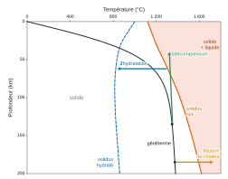
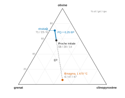
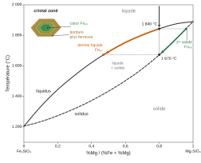
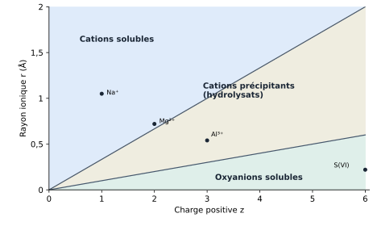

# Agro-Véto BCPST — SVT sur support de documents 2026 · Corrigé partiel guidé

*Corrigé rédigé par IA, non officiel.*

**Rédaction** · modèle non renseigné · effort non renseigné · vitesse non renseignée

**Révision (tour 1)** · modèle non renseigné · effort non renseigné · vitesse non renseignée

**Révision (tour 2)** · Claude Opus 5.5 · effort non renseigné · vitesse non renseignée

**Révision (tour 3)** · modèle non renseigné · effort non renseigné · vitesse non renseignée

**Révision (tour 4)** · GPT-6.2 Astra Ultra · vitesse non renseignée

**Couverture.** Les 41 sous-questions de géologie et les questions de biologie 1a, 1b et 3a reçoivent une réponse complète. La question de biologie 8a est limitée au principe de l’immunomarquage. Les 26 autres questions de biologie, consacrées aux expériences sur les interactions hôte–symbiote, aux toxines ou à la transmission, sont hors de cette édition.

Le sujet dure 3 h 30. Les documents de géologie et la planche A3 ont été lus avec le rapport 2026. En 5.a, le profil sismique de Mars figure au document 5, malgré le renvoi imprimé au document 6.

## Partie géologie — Thème 1 : l'olivine, un minéral abondant sur Terre et dans le système solaire

Le fil de ce thème est un changement d'échelle continu : de l'échantillon de main au cristal, du cristal aux ondes sismiques, et de la Terre à Mars. Les outils sont la reconnaissance des textures magmatiques, la cristallochimie des silicates, et la lecture couplée de deux documents (profil sismique et diagramme de phases).

### Question 1.a

> [!INDICATION]
> Comparer les deux clichés : ils ne sont pas à la même échelle (1 cm à gauche, 1 mm à droite). Ce que l'on peut légender diffère donc d'une image à l'autre.

> [!INDICATION]
> Pour chaque roche, identifier d'abord la **texture** (voit-on tous les cristaux ? y a-t-il une pâte ?), puis les minéraux visibles. Les couleurs sont ici informatives : vert olive, vert sombre, noir.

#### Solution

Sur l'annexe, porter les légendes suivantes.

Roche A (partie sombre) : pâte sombre à grain très fin, où aucun cristal n'est individualisable à cette échelle (verre + microlites de plagioclase et de pyroxène) ; quelques petites taches claires (petits cristaux ou vacuoles).

Roche B forme l’enclave grenue. L’olivine, déjà fléchée sur la planche agrandie, est vert clair. Les grains vert foncé à noirs sont des pyroxènes. La photographie ne suffit pas à attribuer chaque grain sombre à une espèce précise.

> [!METHODE]
> Une légende de photographie de roche se construit toujours en deux temps : la texture d'abord (elle décide de la famille de roche), les minéraux ensuite. Inverser l'ordre fait écrire des noms de minéraux non justifiés.

### Question 1.b

> [!INDICATION]
> Deux caractères suffisent : la texture, qui donne le mode de mise en place, et la couleur, qui renseigne sur la composition chimique.

#### Solution

La roche A ne laisse pas voir ses cristaux, même à l'échelle du millimètre : sa texture est **microlitique** (verre, microlites, parfois quelques phénocristaux), celle d'une roche **volcanique**, refroidie rapidement au contact de la surface. Sa couleur très sombre traduit une forte proportion de minéraux ferromagnésiens, donc une roche **basique**.

**La roche A est un basalte** (un gabbro, de même composition, aurait une texture grenue).

> [!PIEGE]
> Écrire seulement que la roche est sombre, donc un basalte, n'est pas une justification : beaucoup de roches sont sombres. C'est l'association texture microlitique (donc volcanique) + couleur sombre (donc basique) qui identifie le basalte. Le rapport 2026 précise que les identifications fondées sur la seule couleur, ou par exclusion (« ni sédimentaire ni métamorphique donc magmatique »), n'ont pas été valorisées, et que la confusion entre texture microlitique et texture grenue, donc entre basalte et gabbro, reste fréquente.

### Question 1.c

> [!INDICATION]
> Même méthode : texture, puis minéralogie. Quels minéraux sont présents, et surtout lesquels sont **absents** ?

#### Solution

La roche B est entièrement cristallisée, sans verre, tous les cristaux étant visibles et jointifs : **texture grenue**. Sa minéralogie est dominée par l'olivine, accompagnée de pyroxènes ; il n'y a ni quartz ni feldspath. C'est donc une roche **ultrabasique**.

**La roche B est une péridotite** (une lherzolite si olivine, orthopyroxène et clinopyroxène coexistent).

> [!PIEGE]
> La texture grenue n'implique pas ici « roche plutonique issue d'un magma » : la péridotite est la roche du **manteau**, et non un magma cristallisé en profondeur. La question 1.d confirme ce sens de lecture.

### Question 1.d

> [!INDICATION]
> Observer la nature du contact sur le cliché de droite : net ou progressif ? Y a-t-il une auréole de réaction ?

> [!INDICATION]
> Deux liens sont à envisager, et tous deux sont vrais : un lien mécanique (lequel des deux morceaux contient l'autre ?) et un lien génétique (d'où vient un basalte ?).

#### Solution

Le contact entre A et B est **net**, sans zone de réaction : B forme un fragment anguleux englobé dans A. La roche B est donc une **enclave (xénolite) de péridotite**, arrachée au manteau et remontée par le magma basaltique qui a donné A.

Ce lien est aussi génétique : un basalte résulte de la **fusion partielle d'une péridotite mantellique**. La roche A est donc issue de la fusion d'une roche du type de la roche B. La rapidité de l'ascension du magma explique que l'enclave n'ait eu le temps ni de fondre ni de se rééquilibrer.

> [!METHODE]
> Devant deux roches en contact, trois relations possibles : l'une recoupe l'autre (filon), l'une contient l'autre (enclave), ou l'une dérive de l'autre (filiation magmatique ou métamorphique). Le caractère net ou progressif du contact tranche presque toujours.

> [!PIEGE]
> Faire intervenir le métamorphisme est l'erreur que le rapport 2026 signale le plus souvent ici. Il note aussi que les liens géométrique (enclave) et génétique (fusion partielle) ne sont souvent compris que partiellement : il faut donner les deux.

### Question 1.e

> [!INDICATION]
> « Localisation **principale** sur Terre » : la question ne porte pas sur les affleurements, mais sur l'endroit où se trouve l'essentiel de cette roche.

#### Solution

Les péridotites constituent le **manteau terrestre**, et en particulier le **manteau supérieur**, sous la discontinuité de Mohorovičić — à partir d'environ 7 km de profondeur sous les océans et 30 km sous les continents. Le manteau représente l'essentiel du volume du globe. On n'observe de péridotites en surface qu'à titre exceptionnel : enclaves dans les laves (comme ici) et massifs ophiolitiques obductés.

### Question 2.a

> [!INDICATION]
> La définition d'un silicate tient dans un motif élémentaire. Pensez à sa charge.

> [!INDICATION]
> Pour le rôle des cations, raisonner en deux temps : l'électroneutralité d'une part, la cohésion mécanique d'autre part — en se demandant ce qui relie entre eux des tétraèdres qui ne partagent aucun oxygène.

#### Solution

Un **silicate** est un minéral dont l'unité structurale de base est le **tétraèdre $[\mathrm{SiO_4}]^{4-}$** : un atome de silicium au centre, quatre atomes d'oxygène aux sommets. Les silicates se classent selon le degré de polymérisation de ces tétraèdres (isolés, en chaînes, en feuillets, en charpente). Dans l'olivine $\mathrm{X_2SiO_4}$, les tétraèdres sont **isolés** : c'est un **nésosilicate**.

Les cations divalents $\mathrm{X^{2+}}$, logés dans les sites octaédriques entre les tétraèdres (et non à la place du silicium), jouent deux rôles :

- ils assurent la **neutralité électrique** du cristal : deux charges $+2$ compensent exactement la charge $-4$ d'un tétraèdre ;
- ils assurent la **cohésion** de l'édifice, en reliant par des liaisons ioniques des tétraèdres qui ne partagent aucun oxygène.

Comme $\mathrm{Mg^{2+}}$ et $\mathrm{Fe^{2+}}$ ont la même charge et des rayons voisins, ils se substituent librement : l'olivine forme une **solution solide** continue entre forstérite et fayalite.

> [!METHODE]
> Le rapport entre la charge du motif et la charge des cations est le moyen le plus rapide de vérifier qu'une formule de silicate est cohérente : ici $2 \times (+2) - 4 = 0$.

> [!PIEGE]
> Le rapport 2026 relève de fréquentes confusions entre silice, silicium et silicate (un silicate est un minéral, pas une roche), des cations décrits comme remplaçant le silicium au centre des tétraèdres, et une confusion entre silicates et phyllosilicates.

### Question 2.b

> [!INDICATION]
> Lire attentivement la légende du document 2 : l'axe gradué en bas donne la teneur en **fer**, alors que l'énoncé donne d'abord la teneur en magnésium.

> [!INDICATION]
> Ces olivines contiennent-elles du calcium ? Si non, où se placent-elles nécessairement dans le triangle ?

#### Solution

Ni l'olivine 1 ni l'olivine 2 ne contiennent de calcium : elles se placent donc **sur le côté inférieur** du triangle, le joint $\mathrm{Mg_2SiO_4}$–$\mathrm{Fe_2SiO_4}$, gradué en pourcentage de fer (0 à gauche, 100 à droite).

- Olivine 1 : 8 % de Fe, donc un point à l'abscisse 8, dans le champ 0–10 % : c'est une **forstérite** (notation Fo₉₂).
- Olivine 2 : 40 % de Fe, donc un point à l'abscisse 40, dans le champ 30–50 % : c'est une **hyalosidérite** (Fo₆₀).

> [!PIEGE]
> Placer l'olivine 1 à l'abscisse 92 (du côté de la fayalite) est l'erreur type : l'axe est gradué en fer, pas en magnésium. Toujours relire la légende d'un axe avant de reporter une valeur. Le rapport 2026 signale aussi des olivines placées hors de l'axe binaire Mg–Fe, comme si elles contenaient du calcium.

### Question 3.a

> [!INDICATION]
> Quelle information l'énoncé donne-t-il gratuitement en choisissant de représenter les ondes **S** plutôt que les ondes P ?

#### Solution

Le document 3 montre des ondes S qui se propagent entre les zones 1 et 3, avec $V_S$ croissant de ≈ 5,2 à ≈ 5,6 km·s⁻¹. Or les ondes S sont des ondes de cisaillement : elles ne se propagent que dans les milieux solides. **Le milieu est donc solide** sur toute cette tranche.

Les profondeurs concernées (≈ 410 à ≈ 660 km) appartiennent au manteau, dont la roche principale est la **péridotite**, riche en olivine, avec pyroxènes et grenat. À ces profondeurs, l'olivine est présente sous ses formes de haute pression (wadsleyite, puis ringwoodite, cf. document 4).

### Question 3.b

> [!INDICATION]
> Décrire d'abord la **forme** de la courbe au niveau de chaque zone : s'agit-il d'un saut, d'une rupture de pente, d'une extinction ?

#### Solution

Les trois zones correspondent à des changements brusques de $V_S$ à profondeur quasi constante : un saut de ≈ 4,75 à ≈ 5,2 km·s⁻¹ vers 410 km (zone 1), une rupture de pente vers 520–550 km (zone 2), et un saut de ≈ 5,6 à ≈ 6,1 km·s⁻¹ vers 660 km (zone 3). Ce sont des **discontinuités sismiques** du manteau : la discontinuité des **410 km**, celle des **≈ 520 km**, et celle des **660 km**, cette dernière marquant la limite entre manteau supérieur et manteau inférieur. L'intervalle 410–660 km constitue la **zone de transition**.

> [!PIEGE]
> Ne pas confondre ces discontinuités avec le Moho (quelques dizaines de kilomètres), la LVZ ou la discontinuité de Gutenberg (2 900 km), où $V_S$ s'annule : le rapport 2026 cite ces deux dernières parmi les réponses incohérentes avec les profondeurs. Ici les ondes S continuent de se propager : le milieu reste solide de part et d'autre. Les mots « d'un point de vue sismique » excluent aussi une réponse en termes de transitions de phase (c'est l'objet de la question 4) ou d'opposition rigide/ductile, qui confond propriétés mécaniques et sismiques.

### Question 4.a

> [!INDICATION]
> Deux propriétés du diamant sont utilisées, l'une mécanique, l'autre optique.

> [!INDICATION]
> Pour relier l'outil à la structure cristalline : quelle technique, utilisant un rayonnement capable de traverser le diamant, donne accès à l'arrangement des atomes ?

#### Solution

Un échantillon de quelques dizaines de micromètres est placé dans le trou d'un joint métallique, entre les pointes de deux diamants taillés en enclume. Une force modérée appliquée sur une surface très petite engendre, par $P = F/S$, une pression de plusieurs dizaines de GPa, comparable à celle du manteau profond. Un chauffage (laser ou résistance) impose simultanément la température.

Le diamant est le plus dur des matériaux naturels — il supporte ces pressions — et il est **transparent** aux rayons X. On peut donc réaliser, **in situ** et sans décomprimer, une **diffraction des rayons X** : la position des pics diffractés donne les paramètres de la maille, donc la **structure cristalline** de la phase stable au couple $(P, T)$ imposé.

En répétant l'expérience pour de nombreux couples $(P,T)$ et en notant pour chacun quelle structure est stable, on délimite les champs de stabilité des différentes phases : c'est la construction point par point du **diagramme de phases**.

> [!PIEGE]
> La cellule à enclumes de diamant n'est pas une presse triaxiale destinée à étudier le comportement mécanique des roches : décrire une fracturation de l'échantillon, ou une « stimulation » des minéraux par le diamant, est un contresens relevé par le jury.

### Question 4.b

> [!INDICATION]
> Les deux documents partagent la même numérotation des zones et une échelle commune : laquelle ?

> [!INDICATION]
> Pour relier un changement de structure cristalline à une variation de vitesse sismique, penser aux deux grandeurs dont dépend la vitesse d'une onde.

#### Solution

Les trois bandes du document 4 sont situées aux mêmes profondeurs que les trois zones du document 3 (≈ 410, ≈ 520 et ≈ 670 km) et encadrent chacune une limite de champ de stabilité de l'olivine :

- zone 1 : olivine α → olivine β (wadsleyite) ;
- zone 2 : olivine β → olivine γ (ringwoodite) ;
- zone 3 : olivine γ → bridgmanite + magnésiowüstite.

À chaque transition, les mêmes atomes se réorganisent dans un arrangement **plus compact** : la masse volumique augmente, et la rigidité du matériau augmente davantage encore, de sorte que la vitesse des ondes S croît brusquement.

**Les discontinuités sismiques du document 3 sont donc la traduction sismologique des transitions de phase de l'olivine du document 4**, à composition chimique constante.

> [!METHODE]
> Un saut de vitesse sismique admet trois causes possibles : changement d'état, changement de composition chimique, changement de structure cristalline. Ici, les documents imposent la troisième, et c'est elle qui fait tout l'intérêt de l'olivine comme sonde.

### Question 4.c

> [!INDICATION]
> Chaque zone fixe un intervalle de **pression** (largeur de la bande colorée). Reporter cet intervalle sur les deux courbes en pointillés correspondantes et lire les températures d'intersection.

> [!INDICATION]
> Attention à la zone 3 : la pente de ses limites est négative, et elle est forte. L'intervalle de température lu n'est pas du tout le même que pour les zones 1 et 2.

#### Solution

| Zone | Pression (largeur de la bande) | Transition | Gamme de température |
|---|---|---|---|
| 1 | ≈ 13,8 – 14,3 GPa | α → β | ≈ 1 320 – 1 510 °C |
| 2 | ≈ 17,8 – 18,6 GPa | β → γ | ≈ 1 370 – 1 550 °C |
| 3 | ≈ 23,6 – 24,2 GPa | γ → bridgmanite + magnésiowüstite | ≈ 1 300 – 1 700 °C |

Lecture de la zone 3 : les deux limites ont une pente négative et forte. Le domaine de coexistence n'entre dans la bande qu'entre ≈ 1 300 °C (limite de gauche, au bord droit de la bande) et ≈ 1 700 °C (limite de droite, au bord gauche de la bande).

Les trois gammes se recouvrent vers **1 400 – 1 500 °C**, avec une incertitude de lecture de l'ordre de ± 30 °C et un intervalle particulièrement large pour la zone 3, dont les limites sont presque verticales.

Ce résultat est compatible avec le faible gradient de température du manteau convectif (gradient adiabatique de quelques dixièmes de degré par kilomètre, soit environ + 100 °C entre 410 et 660 km) : l'écart attendu est du même ordre que l'incertitude de lecture, et ne peut donc pas être mis en évidence ici.

> [!PIEGE]
> Pour la zone 3, une température supérieure à ≈ 1 700 °C fait sortir de la bande de pression : à 1 750 °C, la transition se produit entre ≈ 23,0 et ≈ 23,4 GPa, à gauche de la zone 3. À l'inverse, à 1 200 °C, elle se produit au-delà de 24,4 GPa, à droite. Toujours vérifier que le point lu appartient bien au rectangle imposé par les **deux** contraintes.

### Question 4.d

> [!INDICATION]
> Deux ingrédients sont nécessaires pour faire un thermomètre : une grandeur mesurable in situ, et une relation entre cette grandeur et la température.

> [!INDICATION]
> Pourquoi faut-il que le minéral choisi soit abondant ?

#### Solution

Trois arguments s'enchaînent.

1. L'olivine est le minéral **le plus abondant du manteau supérieur** : ses changements de structure modifient les propriétés élastiques moyennes de la roche, donc produisent un signal sismique détectable à l'échelle du globe.
2. Les limites de phase du document 4 sont des droites **inclinées** dans le plan $(P,T)$ : la pression de transition dépend de la température. À une profondeur de transition donnée, donc à une pression donnée, correspond un intervalle de température, dont la largeur dépend de la bande de coexistence et de la précision sur la profondeur.
3. La sismologie donne précisément la profondeur des discontinuités, mais aucune température ; l'expérimentation en cellule à enclume donne la relation $P(T)$. Le croisement des deux borne la température à la profondeur considérée.

On dispose ainsi d'une mesure de température **inaccessible autrement** : aucun forage n'atteint 410 km. Chaque discontinuité fournit un **point d'ancrage du géotherme**. Mieux encore, les variations latérales de profondeur d'une discontinuité cartographient les anomalies thermiques ; comme la transition à 410 km a une pente positive et celle à 660 km une pente négative, les deux discontinuités réagissent en sens opposé à une même anomalie chaude, ce qui permet de distinguer un effet thermique d'un effet de composition.

### Question 4.e

> [!INDICATION]
> Écrire la réaction et équilibrer les atomes, élément par élément.

#### Solution

Pour une olivine 100 % magnésienne, la transition de la zone 3 s'écrit

$$\mathrm{Mg_2SiO_4 \longrightarrow \ \text{bridgmanite} \ + \ MgO}$$

La conservation des éléments impose, pour la bridgmanite, $2 - 1 = 1$ magnésium, 1 silicium et $4 - 1 = 3$ oxygènes :

$$\boxed{\mathrm{Mg_2SiO_4 \longrightarrow MgSiO_3 + MgO}}$$

La bridgmanite a donc pour formule $\mathrm{MgSiO_3}$. C'est le minéral le plus abondant de la Terre, constituant essentiel du manteau inférieur.

> [!PIEGE]
> Le rapport 2026 signale des copies qui donnent à la bridgmanite la formule de la forstérite ($\mathrm{Mg_2SiO_4}$) : vérifier le bilan élément par élément.

### Question 5.a

> [!INDICATION]
> L'énoncé renvoie au « document 6 », mais les vitesses martiennes sont au **document 5**. Signaler l'erreur d'énoncé sur la copie et poursuivre, comme l'y invite la consigne liminaire.

> [!INDICATION]
> L'axe des ordonnées est une **distance au centre**, pas une profondeur. Commencer par chercher où $V_S$ s'annule.

> [!INDICATION]
> Sous la croûte, $V_P$ et $V_S$ n'évoluent pas de la même façon sur les 500 premiers kilomètres et plus bas : quelle enveloppe, définie par son comportement mécanique, cela suggère-t-il ?

#### Solution

Lecture du profil, depuis la surface ($r \approx 3\,390$ km) :

- jusqu'à $r \approx 3\,320$ km, les vitesses sont les plus faibles du profil ($V_S$ ≈ 2,6 à 3,5 km·s⁻¹) : c'est la **croûte**, épaisse de quelques dizaines de kilomètres (≈ 50 à 70 km) ;
- de $r \approx 3\,320$ à $r \approx 1\,830$ km, les ondes S se propagent : c'est un **manteau silicaté solide**, péridotitique, épais d'environ 1 500 km ;
- dans sa partie supérieure, jusqu'à $r \approx 2\,850$ km (≈ 500 km de profondeur), $V_P$ reste constante (≈ 7,7 km·s⁻¹) et $V_S$ diminue légèrement (≈ 4,4 → 4,3 km·s⁻¹). Ce manteau supérieur rigide forme avec la croûte une **lithosphère** épaisse ; cette lecture est compatible avec une couche conductive ; les vitesses seules ne fixent pas la profondeur exacte de sa base ;
- plus bas, $V_P$ croît jusqu'à ≈ 9,4 km·s⁻¹ et $V_S$ jusqu'à ≈ 4,9 km·s⁻¹. Deux ressauts de vitesse y sont repérés : l'étoile A à $r \approx 2\,350$ km (soit ≈ 1 040 km de profondeur) et l'étoile B à $r \approx 2\,100$ km (≈ 1 280 km), interprétés comme les transitions α → β et β → γ de l'olivine ;
- à $r \approx 1\,830$ km, **$V_S$ s'annule** et $V_P$ chute brutalement de ≈ 9,4 à ≈ 4,8 km·s⁻¹ : c'est la limite manteau / noyau ;
- de $r = 1\,830$ km au centre, seules les ondes P se propagent, avec $V_P$ croissant régulièrement de 4,8 à 6 km·s⁻¹, sans aucune discontinuité : le **profil représente un noyau liquide**, sans graine distincte résolue.

**Modèle : Mars est une planète différenciée en trois enveloppes concentriques — une croûte, un manteau péridotitique solide siège de deux transitions de phase de l'olivine, et un noyau métallique modélisé liquide de rayon ≈ 1 830 km. La croûte et le manteau supérieur forment une lithosphère épaisse d'environ 500 km.**

> [!METHODE]
> Face à un profil de vitesses, les trois réflexes sont toujours les mêmes : chercher où $V_S$ s'annule (liquide), repérer les sauts (limites d'enveloppes ou transitions de phase), puis convertir les ordonnées en profondeurs si nécessaire.

### Question 5.b

> [!INDICATION]
> Comparer terme à terme avec la structure de la Terre. Pour expliquer la profondeur des transitions de phase, se souvenir que ces transitions se produisent à une **pression** donnée, et écrire comment la pression varie avec la profondeur.

#### Solution

| | Mars | Terre |
|---|---|---|
| Rayon | ≈ 3 390 km | 6 371 km |
| Transition α → β | ≈ 1 040 km | 410 km |
| Transition β → γ | ≈ 1 280 km | ≈ 520 km |
| Transition γ → bridgmanite | absente | 660 km |
| Manteau inférieur | inexistant | 660 – 2 900 km |
| Noyau | liquide dans le profil étudié | liquide + graine solide ($r$ = 1 220 km) |

Trois différences majeures.

1. **Les transitions de phase sont deux à trois fois plus profondes.** Elles se produisent à pression fixée (≈ 14 et ≈ 18 GPa, document 4). Or $P \approx \rho g z$ : la pesanteur martienne étant environ 2,6 fois plus faible que la terrestre, la pression augmente d'autant plus lentement avec la profondeur, et il faut descendre beaucoup plus bas pour atteindre la même pression.
2. **Il n'y a pas de manteau inférieur.** La pression à la base du manteau martien reste inférieure à ≈ 20 GPa, donc aux ≈ 24 GPa nécessaires à la dissociation de la ringwoodite : la bridgmanite ne peut pas se former.
3. **Le document représente un noyau liquide**, sans graine résolue, alors que la Terre possède une graine. Les vitesses maximales du manteau sont aussi plus faibles (≈ 9,4 km·s⁻¹ contre ≈ 13,7 km·s⁻¹ à la base du manteau terrestre).

> [!PIEGE]
> Attribuer la plus grande profondeur des transitions à une composition différente du manteau martien n'est pas recevable : l'énoncé précise que les deux ressauts sont interprétés comme des transitions de phase **de l'olivine**, donc à chimie identique. L'explication est mécanique.

---

## Partie géologie — Thème 2 : fusion et formation de l'olivine

Ce thème est le cœur « diagrammes » du sujet. Deux outils différents y sont employés : un **ternaire** (trois constituants, un eutectique, règle des leviers pour la fusion partielle) et un **binaire à solution solide totale** (fuseau liquidus/solidus, compositions conjuguées, zonation). Ne pas les confondre : l'un a un eutectique, l'autre non.

### Question 6.a

> [!INDICATION]
> Un graphique « choisi judicieusement » signifie ici : le plan (température, profondeur) avec le solidus de la péridotite et le géotherme.

> [!INDICATION]
> Si le géotherme est à gauche du solidus, trois manières de franchir la courbe : déplacer le point vers la droite, vers le haut, ou déplacer la courbe elle-même.

#### Solution

Le graphique à tracer (figure 1) porte la **profondeur** en ordonnée (orientée vers le bas) et la **température** en abscisse, avec trois courbes : le **solidus sec** (déshydraté) de la péridotite, le **solidus hydraté**, fortement abaissé, et le **géotherme** moyen, qui reste à gauche du solidus sec. La roche mère, placée sur le géotherme, est donc normalement solide.

Une péridotite fond partiellement dès que son point représentatif franchit le solidus (et non le liquidus), ce qui peut se produire de trois façons :

1. **Décompression adiabatique** (flèche verticale vers le haut) : lors d'une remontée rapide, la roche n'échange pas de chaleur et sa température ne baisse que de quelques dixièmes de degré par kilomètre, alors que le solidus, lui, baisse beaucoup plus vite quand la pression diminue. Le solidus est franchi.
2. **Hydratation** (déplacement du solidus vers les basses températures) : l'ajout d'eau abaisse le solidus de plusieurs centaines de degrés, de sorte que, à pression et température inchangées, la roche se retrouve au-dessus du solidus hydraté.
3. **Apport de chaleur** (flèche horizontale vers la droite) : une anomalie thermique élève localement la température de la roche jusqu'au solidus.

Dans les trois cas, la fusion est **partielle** (de quelques pour cent à ≈ 25 %) : le liquide produit, moins dense, se sépare du résidu solide et migre vers le haut.

> [!PIEGE]
> Erreurs relevées par le jury : un schéma, un diagramme TAS ou un diagramme binaire à la place du graphique demandé ; la confusion entre solidus et liquidus (« la roche franchit le liquidus ») ; une décompression adiabatique mal représentée ; la fusion partielle réduite à un simple échauffement, ou attribuée à la « fonte des parois d'une chambre magmatique ».

### Question 6.b

> [!INDICATION]
> Dix lignes pour quatre contextes : une phrase par contexte, chacune associée explicitement à l'un des trois mécanismes de la question précédente.

#### Solution

Aux **dorsales océaniques**, l'asthénosphère remonte passivement sous l'axe d'accrétion : la décompression adiabatique (mécanisme 1) y produit 10 à 25 % de fusion, d'où les basaltes et gabbros de la croûte océanique. Dans les **rifts continentaux**, l'amincissement de la lithosphère permet la même remontée et la même décompression. Aux **points chauds**, un panache mantellique plus chaud que son environnement fond par apport de chaleur (mécanisme 3), auquel s'ajoute la décompression de sa remontée : le magmatisme basaltique y est abondant et indépendant des limites de plaques. Dans les **zones de subduction**, la lithosphère océanique plongeante, hydratée, voit ses minéraux hydratés se déstabiliser vers 80 à 150 km de profondeur ; l'eau libérée hydrate le coin de manteau sus-jacent et en abaisse le solidus (mécanisme 2), d'où les magmas des arcs volcaniques.

Sur le graphique de la question 6.a, on associe la flèche 1 aux dorsales et aux rifts, la flèche 2 aux subductions et la flèche 3 aux points chauds.

> [!PIEGE]
> Deux abus de langage relevés par le jury : parler d'« hydratation du solidus » (c'est la roche qui est hydratée, le solidus qui s'abaisse), et associer l'hydratation à la fusion sous les dorsales, où le mécanisme est la décompression.

### Question 6.c

> [!INDICATION]
> Où convergent les isothermes en pointillés ? Que vaut la température en ce point par rapport à tout le reste du diagramme ?

> [!INDICATION]
> La propriété vraiment utile pour la suite n'est pas la température de E, mais la composition du **premier liquide** formé.

#### Solution

E est le **point eutectique** du système ternaire olivine – clinopyroxène – grenat à 40 kbar : c'est le point de concours des lignes cotectiques et le minimum de la surface du liquidus, à $T_E = 1\,670$ °C. Sa composition se lit ≈ 6 % d'olivine, ≈ 47 % de grenat et ≈ 47 % de clinopyroxène.

Deux propriétés :

- c'est la **température de fusion commençante** du système : aucune roche contenant les trois minéraux ne peut commencer à fondre en dessous de 1 670 °C ;
- le **premier liquide formé a la composition de E**, quelle que soit la composition de la roche de départ, et il la conserve tant que les trois minéraux subsistent dans le résidu. Seule la **quantité** de liquide augmente ; ce n'est qu'après épuisement de l'un des trois minéraux que la température remonte et que la composition du liquide quitte E.

### Question 6.d

> [!INDICATION]
> Dans un diagramme ternaire, la proportion d'un pôle se lit sur l'axe qui lui correspond, le long des lignes parallèles au côté opposé. Vérifier que la somme des trois valeurs fait 100 %.

#### Solution

La lecture des coordonnées de P donne environ **58 % d'olivine, 28 % de grenat et 14 % de clinopyroxène** (à ± 3 % près ; la somme fait bien 100 %).

C'est la composition d'une **péridotite à grenat** dans le système à trois pôles : une roche mantellique **fertile**, typique de l'asthénosphère sous une centaine de kilomètres de profondeur.

> [!METHODE]
> Toujours contrôler une lecture barycentrique par la somme. Si elle ne fait pas 100 %, c'est qu'un des trois axes a été lu dans le mauvais sens.

> [!PIEGE]
> Ici, les graduations du côté gauche sont portées par des traits horizontaux : lire le grenat à la hauteur de P (≈ 41 %) donnerait une somme supérieure à 100 %. Le rapport 2026 relève précisément des « pourcentages dont la somme dépasse 100 % ». La teneur en grenat se lit le long d'une parallèle au côté olivine – clinopyroxène.

### Question 6.e

> [!INDICATION]
> Première étape : le liquide est-il encore à l'eutectique après 20 % de fusion ? Calculer à quel taux de fusion le minéral le plus sollicité serait épuisé.

> [!INDICATION]
> Deuxième étape : écrire la conservation de la matière. Si $f$ est le taux de fusion, P est le barycentre de E (poids $f$) et de Q (poids $1-f$). La traduction géométrique est une construction sur la droite (EP).

#### Solution

**Le magma.** Tant que les trois minéraux coexistent dans le résidu, le liquide a la composition de l'eutectique. Vérifions-le : le liquide contient ≈ 47 % de clinopyroxène, alors que P n'en contient que 14 %. Le clinopyroxène serait donc épuisé pour un taux de fusion $f$ tel que

$$\begin{aligned}
0{,}47\,f &= 0{,}14 \\
f &\approx 30\ \%
\end{aligned}$$

Comme 20 % < 30 %, les trois minéraux subsistent (le grenat ne s'épuiserait que vers 60 %). **Le magma a la composition de E : ≈ 6 % d'olivine, 47 % de grenat, 47 % de clinopyroxène.**

**Le résidu Q.** La conservation de la matière (règle des leviers) s'écrit

$$\mathrm{P} = 0{,}20\,\mathrm{E} + 0{,}80\,\mathrm{Q}$$

d'où, composante par composante :

$$\begin{aligned}
\text{olivine} &\approx \frac{58 - 0{,}20 \times 6}{0{,}80} \approx 71\ \% \\
\text{grenat} &\approx \frac{28 - 0{,}20 \times 47}{0{,}80} \approx 23\ \% \\
\text{cpx} &\approx \frac{14 - 0{,}20 \times 47}{0{,}80} \approx 6\ \%
\end{aligned}$$

La somme vaut 100 % et le clinopyroxène reste positif, ce qui confirme le premier point.

**Construction sur l'annexe.** Q se trouve sur la droite (EP), **au-delà de P** par rapport à E, à la distance

$$\mathrm{PQ} = \frac{f}{1-f}\,\mathrm{EP} = 0{,}25\,\mathrm{EP}$$

$$\boxed{\begin{aligned}
\text{magma} &\approx \mathrm{E}\ (6\ \%\ \text{ol},\ 47\ \%\ \text{grt},\ 47\ \%\ \text{cpx}) \\
\mathrm{Q} &\approx 71\ \%\ \text{ol},\ 23\ \%\ \text{grt},\ 6\ \%\ \text{cpx}
\end{aligned}}$$

> [!PIEGE]
> Le rapport 2026 juge cette question rarement traitée et plus rarement réussie. Erreurs relevées : ne donner que la composition du solide résiduel sans celle du liquide, attribuer au magma une composition incorrecte, ou se contenter d'indiquer que le liquide conserve une composition eutectique, sans placer Q. Le liquide reste en E ; c'est le **résidu** qui s'éloigne de E en passant par P.

> [!METHODE]
> La règle des leviers est toujours la même : trois points alignés (liquide, roche initiale, résidu), la roche initiale entre les deux autres, et les distances inversement proportionnelles aux masses.

### Question 6.f

> [!INDICATION]
> Quel contexte produit couramment 10 à 25 % de fusion ? Et, dans ce contexte, quels objets géologiques concrets correspondent à la roche de départ et au résidu ?

#### Solution

Un taux de fusion de 20 % est caractéristique d'une **dorsale océanique**, où la fusion se fait par décompression adiabatique (un point chaud est une réponse également défendable).

Dans ce cadre :

- **P** est la péridotite asthénosphérique **fertile** à grenat qui remonte sous l'axe ;
- **Q** est le résidu **appauvri** : enrichi en olivine, très appauvri en clinopyroxène, c'est la péridotite qui, en refroidissant, constitue le **manteau lithosphérique océanique** sous la croûte. Pour des taux de fusion plus élevés, une fois le clinopyroxène épuisé (vers 30 %), le résidu évoluerait vers une harzburgite, puis une dunite ;
- le liquide extrait, de composition E, cristallise en **gabbros et basaltes**, c'est-à-dire la croûte océanique.

> [!PIEGE]
> Donner à Q le nom d'une roche issue du magma (basalte, gabbro) est l'erreur que le rapport 2026 relève dans la majorité des copies. Q est le **résidu** solide de la fusion : une péridotite appauvrie, pas une roche magmatique cristallisée.

### Question 7

> [!INDICATION]
> Deux caractères du cristal sont exploitables sur le document : sa taille relative et la forme de ses contours.

> [!INDICATION]
> À quelle condition un cristal peut-il développer des faces planes et régulières ? Puis mobiliser une connaissance : l'ordre de cristallisation des minéraux d'un magma basaltique.

#### Solution

Sur le document 7, l'olivine présente deux traits remarquables :

1. sa **taille** : plusieurs millimètres (barre d'échelle de 1 mm), alors que la pâte est faite de microlites de quelques dizaines de micromètres — c'est un **phénocristal** ;
2. sa **forme** : le cristal est **automorphe**, limité par des faces planes et des angles nets.

Les faces planes et la taille du phénocristal indiquent qu’il a eu le temps de croître avant la solidification finale de la matrice. Dans un magma basaltique, l’olivine magnésienne figure parmi les phases précoces. La lame permet de proposer cette chronologie relative ; la profondeur exacte et la vitesse de croissance ne se déduisent pas de la seule forme du cristal.

Les connaissances le confirment : dans la **série de Bowen**, l'olivine, le silicate le moins polymérisé et le plus riche en Mg et Fe, est le premier minéral ferromagnésien à cristalliser, à la plus haute température.

> [!PIEGE]
> Conclure « refroidissement lent » pour toute la roche serait faux : la lame enregistre **deux** vitesses successives, lente en profondeur (phénocristal) puis rapide en surface (microlites et verre). C'est précisément la texture microlitique porphyrique.

### Question 8.a

> [!INDICATION]
> Un seul mot est attendu, celui qui décrit une organisation concentrique cœur – bordure dans un cristal.

#### Solution

Le cristal présente une distinction entre un cœur et une bordure, soulignée par des teintes de polarisation différentes et des limites concentriques qui reproduisent la forme du cristal : c'est une **zonation** (cristal zoné), de nature chimique.

> [!PIEGE]
> Le rapport 2026 juge cette sous-question globalement mal traitée : beaucoup ont répondu « couronne réactionnelle » ou « auréole », d'autres « forme en fuseau », « œil de chat », « couronne de cristallisation », « plagioclase zoné ». Une couronne réactionnelle est un autre minéral formé autour du cristal ; ici, c'est le même minéral dont la composition varie du cœur à la bordure.

### Question 8.b

> [!INDICATION]
> Repérer d'abord le type de diagramme : y a-t-il un eutectique, ou les deux pôles sont-ils miscibles en toutes proportions ?

> [!INDICATION]
> Descendre la verticale $x = 0{,}80$ et lire, à chaque température, les **deux** compositions conjuguées : celle du liquide sur le liquidus, celle du solide sur le solidus.

> [!INDICATION]
> Le diagramme décrit des états d'équilibre. Quelle hypothèse faut-il lever pour qu'un cristal **hétérogène** puisse subsister ?

#### Solution

Le document 8 est un diagramme binaire à **solution solide totale** : les deux pôles $\mathrm{Fe_2SiO_4}$ (fusion à 1 205 °C) et $\mathrm{Mg_2SiO_4}$ (1 890 °C) sont miscibles en toutes proportions, à l'état solide comme à l'état liquide. Il n'y a donc pas d'eutectique, mais un **fuseau** entre liquidus (au-dessus) et solidus (en dessous), dans lequel coexistent un liquide et un solide de compositions différentes.

Refroidissement d'un liquide de composition $x = 0{,}80$ :

1. à **≈ 1 840 °C**, la verticale coupe le liquidus : les premiers cristaux apparaissent. Leur composition se lit sur le solidus à la même température, soit $x \approx 0{,}96$ : le premier solide est nettement **plus magnésien** que le liquide dont il est issu, car le pôle magnésien est le plus réfractaire ;
2. le refroidissement se poursuivant, le liquide s'appauvrit en magnésium en suivant le liquidus vers la gauche, et le solide en équilibre suit le solidus, lui aussi vers la gauche : chaque nouvelle couche déposée est **plus ferreuse** que la précédente ;
3. à **≈ 1 670 °C**, la verticale coupe le solidus : à l'équilibre, la dernière goutte de liquide ($x \approx 0{,}47$) disparaît et le cristal final serait **homogène** à $x = 0{,}80$, la diffusion ayant rééquilibré toutes les couches ;
4. mais la **diffusion à l'état solide est très lente** dans l'olivine, et le refroidissement d'un magma est rapide devant elle. Les couches successives ne se rééquilibrent donc pas : chacune conserve la composition à laquelle elle s'est formée, et la cristallisation peut se poursuivre en dessous de 1 670 °C, avec des bordures encore plus ferreuses.

**Il en résulte un cristal zoné, à cœur magnésien et bordures de plus en plus ferreuses.**

> [!METHODE]
> C'est la cristallisation fractionnée, à l'échelle d'un seul cristal : le solide déjà formé est soustrait à l'équilibre avec le liquide.

> [!PIEGE]
> Oublier l'argument cinétique rend la réponse contradictoire avec le document 7 : à l'équilibre, le diagramme prédit un cristal homogène, donc **aucune** zonation.

### Question 8.c

> [!INDICATION]
> Le cœur, c'est la partie formée en premier. À quelle température ? Et quelle composition le solidus donne-t-il à cette température ?

#### Solution

Le cœur s'est formé **en premier**, donc à la température la plus élevée. Or le solide en équilibre avec le liquide y est le plus proche du pôle le plus réfractaire : $\mathrm{Mg_2SiO_4}$ fond à 1 890 °C contre 1 205 °C pour $\mathrm{Fe_2SiO_4}$. La lecture du solidus à ≈ 1 840 °C donne $x \approx 0{,}96$.

**Le cœur est donc plus riche en magnésium** (≈ Fo₉₆) que la composition globale (Fo₈₀), et *a fortiori* que la bordure.

### Question 8.d

> [!INDICATION]
> « L'analyse venant d'être réalisée » couvre tout le thème 2. Relever les températures qu'elle fait intervenir (documents 6 et 8), puis les confronter à la température d'émission d'un basalte.

> [!INDICATION]
> Pour expliquer l'écart, relire les conditions des deux documents : la pression de chacun, et le nombre de constituants pris en compte.

#### Solution

**L'incohérence.** L'analyse du thème 2 fait intervenir :

- une fusion commençante de la péridotite à **1 670 °C** (eutectique E, document 6) ;
- une fusion de la forstérite à **1 890 °C** et une cristallisation de l'olivine Fo₈₀ entre ≈ 1 840 et ≈ 1 670 °C (document 8).

Or un basalte, dont les laves contiennent précisément des phénocristaux d'olivine (document 7), est émis en surface vers **1 100 – 1 250 °C** (≈ 1 200 °C). **L'écart atteint plusieurs centaines de degrés.** L'analyse donne le comportement qualitatif correct (ordre de cristallisation, zonation, cœur magnésien), mais ses températures ne sont pas celles d'un magma basaltique naturel.

**Explications** (une seule, bien argumentée, suffit) :

1. **La pression du document 6.** Le ternaire est établi à 40 kbar (4 GPa), soit environ 120 km de profondeur. En système sec, les températures de fusion augmentent avec la pression : l'eutectique à 1 670 °C est une valeur profonde, logiquement bien supérieure à la température des laves en surface.
2. **Le nombre de constituants.** Le document 6 ne retient que trois minéraux, alors qu'une péridotite contient aussi de l'orthopyroxène (et du spinelle) ; le document 8 ne retient que deux pôles purs, alors qu'un magma basaltique contient en outre $\mathrm{SiO_2}$, $\mathrm{Al_2O_3}$, $\mathrm{CaO}$, $\mathrm{Na_2O}$… Le liquidus dépend de la composition globale. L’eutectique illustre comment un mélange commence à fondre en dessous de la température de fusion de ses pôles purs.
3. **Le domaine du document 8.** Établi à 0,1 MPa pour le seul binaire de l'olivine, il ne représente pas les conditions de fusion d'un magma basaltique profond : les 1 890 °C de la forstérite pure ne sont pas la température de cristallisation de l'olivine dans un basalte.
4. **L'eau et les volatils** abaissent encore solidus et liquidus, comme le solidus hydraté de la question 6.a.

> [!PIEGE]
> Penser que la pression abaisse les températures de fusion est faux pour un système sec : la pression élève les températures de fusion. C'est précisément pourquoi le document 6, établi à 4 GPa, donne des températures plus élevées qu'en surface.

---

## Partie géologie — Thème 3 : altération de l'olivine

Ce thème relie la chimie minérale au climat. Deux équations le structurent (l'hydrolyse de l'olivine, la précipitation des carbonates) ; tout le reste — géo-ingénierie, réservoirs, limites — en découle par bilan. Les questions 10.f, 11.c et 11.e sont des questions d'argumentation ouverte, où ce qui compte est la précision des arguments et leur ancrage dans la minéralogie et le dispositif.

### Question 9.a

> [!INDICATION]
> Écrire, à côté de l'équation 1, l'équation de l'hydrolyse d'un feldspath potassique, et comparer les deux membres de droite.

> [!INDICATION]
> La différence porte sur l'existence, ou non, d'un résidu solide.

#### Solution

Dans les deux cas, l'eau chargée en $\mathrm{CO_2}$ (donc en acide carbonique, $\mathrm{CO_2 + H_2O \rightleftharpoons H^+ + HCO_3^-}$) attaque le minéral : les protons rompent les liaisons entre les tétraèdres et les cations, et libèrent ces derniers en solution. C'est une **hydrolyse**, réaction d'altération chimique, et non une simple dissolution.

- **Solution d'attaque** (réactifs) : eau et $\mathrm{CO_2}$ dissous. En toute rigueur, le $\mathrm{CO_2(g)}$ de l'équation 1 se dissout d'abord en $\mathrm{CO_2(aq)}$.
- **Solution de lessivage** (produits) : acide silicique H₄SiO₄, ions HCO₃⁻ et Mg²⁺, exportés par les eaux.

Pour un feldspath potassique :

$$2\,\mathrm{KAlSi_3O_8} + 2\,\mathrm{CO_2} + 11\,\mathrm{H_2O} \longrightarrow \underbrace{\mathrm{Al_2Si_2O_5(OH)_4}}_{\text{kaolinite}} + 2\,\mathrm{K^+} + 2\,\mathrm{HCO_3^-} + 4\,\mathrm{H_4SiO_4}$$

**Différence essentielle** : le membre de droite de l'équation 1 ne comporte **aucune phase solide**. Faute d'aluminium, il ne se forme pas d'argile : l'olivine est **entièrement mise en solution**, alors que l'hydrolyse du feldspath est partielle et laisse un résidu argileux. Le processus **consomme du $\mathrm{CO_2}$** — quatre moles par mole d'olivine.

> [!PIEGE]
> Le rapport 2026 : « De trop nombreux candidats indiquent que l'équation 1 représente une dissolution. » Les termes bisiallitisation ou allitisation, maladroits ici, n'ont pas été pénalisés ; l'explication du processus (réactifs de la solution d'attaque, produits de la solution de lessivage) a été peu souvent donnée.

### Question 9.b

> [!INDICATION]
> Les deux axes du diagramme de Goldschmidt sont deux propriétés de l'ion. Les droites qui délimitent les domaines passent par l'origine : quelle grandeur est donc constante le long de chacune ?

#### Solution

Sur la planche A3, l’**abscisse** est la charge positive $z$ et l’**ordonnée** le rayon ionique $r$ en ångströms. Une droite issue de l’origine a pour pente $r/z$. À charge donnée, un point plus bas a donc un potentiel ionique $z/r$ plus élevé.

- **Au-dessus de la droite la plus pentue**, inscrire « cations solubles ». Le rayon est grand par rapport à la charge. Na⁺, K⁺, Ca²⁺ et Mg²⁺ peuvent être entraînés en solution.
- **Entre les deux droites**, inscrire « cations précipitants (hydrolysats) ». Al³⁺ et Fe³⁺ tendent à former des hydroxydes peu solubles.
- **Sous la droite la moins pentue**, inscrire « oxyanions solubles ». Les éléments à fort potentiel ionique sont transportés en solution combinés à l’oxygène, par exemple le soufre des sulfates.

Le silicium se situe près d’une limite. Dans l’équation d’altération fournie par le sujet, il passe en solution sous forme d’acide silicique.

> [!JURY]
> Le rapport demande une légende par domaine. Traduire les symboles chimiques en noms d’éléments laisse sans réponse la question sur leur comportement lors de l’altération.

### Question 9.c

> [!INDICATION]
> Bien écrire l'équation dans le sens de la **précipitation**, et vérifier le devenir du carbone : combien d'hydrogénocarbonates pour un carbonate solide ?

#### Solution

Équation 2 :

$$\boxed{\mathrm{Ca^{2+}_{(aq)} + 2\,HCO_3^-{}_{(aq)} \longrightarrow CaCO_3{}_{(s)} + CO_{2\,(aq)} + H_2O_{(l)}}}$$

Point capital pour la suite : cette précipitation **libère une molécule de $\mathrm{CO_2}$ pour deux $\mathrm{HCO_3^-}$ consommés**.

Organismes marins qui assurent ou favorisent cette précipitation : **foraminifères**, **coccolithophoridés** (dont les plaques calcaires sont les coccolithes), **coraux**, **mollusques** (bivalves, gastéropodes), échinodermes, algues rouges calcaires ; les **cyanobactéries** la favorisent indirectement (stromatolithes).

> [!PIEGE]
> Le rapport 2026 : « Les réponses telles que coccolithes ou encore stromatolithes n'ont pas été acceptées puisqu'il ne s'agit pas d'organismes. » Citer des organismes à test siliceux (diatomées) est une autre erreur fréquente.

### Question 10.a

> [!INDICATION]
> L'énoncé impose d'utiliser **les deux** équations : il faut donc les combiner pour obtenir un bilan net, et non se contenter de dire que l'altération consomme du $\mathrm{CO_2}$.

> [!INDICATION]
> Multiplier l'équation 2 par le coefficient qui permet d'éliminer les $\mathrm{HCO_3^-}$.

#### Solution

Pour une mole d'olivine, on somme (1) et $2 \times$ (2) :

$$\mathrm{Mg_2SiO_4 + 4\,CO_2 + 4\,H_2O \longrightarrow H_4SiO_4 + 4\,HCO_3^- + 2\,Mg^{2+}}$$
$$\mathrm{2\,Ca^{2+} + 4\,HCO_3^- \longrightarrow 2\,CaCO_3 + 2\,CO_2 + 2\,H_2O}$$
$$\boxed{\mathrm{Mg_2SiO_4 + 2\,CO_2 + 2\,H_2O + 2\,Ca^{2+} \longrightarrow 2\,CaCO_3 + H_4SiO_4 + 2\,Mg^{2+}}}$$

L'altération capte 4 $\mathrm{CO_2}$, la précipitation en restitue 2 : **le bilan net est de 2 moles de $\mathrm{CO_2}$ piégées par mole d'olivine**, stockées sous forme de carbonate solide. Le $\mathrm{CO_2}$ étant un gaz à effet de serre, ce piégeage contribue à atténuer le réchauffement climatique.

Ordre de grandeur, avec $M(\mathrm{Mg_2SiO_4}) \approx 141$ g·mol⁻¹, pour une tonne d'olivine :

$$m(\mathrm{CO_2}) \approx \frac{10^6}{141} \times 2 \times 44 \approx 6 \times 10^5\ \text{g}$$

soit **environ 0,6 tonne de $\mathrm{CO_2}$** (et jusqu'à ≈ 1,25 t tant que le carbone reste dissous sous forme $\mathrm{HCO_3^-}$).

Le mécanisme n'a rien d'artificiel : c'est celui qui régule naturellement le climat aux échelles géologiques (altération des silicates continentaux, export d'ions vers l'océan, précipitation de carbonates). La géo-ingénierie proposée ne fait qu'en **accélérer** la cinétique, en augmentant la surface réactive (broyage fin) et en renouvelant la solution au contact des grains (action des vagues).

> [!PIEGE]
> Ne compter que l'équation 1 (4 moles de $\mathrm{CO_2}$) surestime le rendement d'un facteur deux : c'est exactement l'erreur que la question cherche à écarter en imposant l'usage des deux équations. Autre erreur relevée par le jury : additionner les équations 1 et 2 sans multiplier la seconde par 2, ce qui conduit à trois molécules de $\mathrm{CO_2}$ piégées.

### Question 10.b

> [!INDICATION]
> Suivre le carbone, atome par atome, dans le bilan combiné : d'où part-il, par où transite-t-il, où finit-il ?

#### Solution

- **Diminuent** : l'**atmosphère**, dont le $\mathrm{CO_2}$ est consommé, et l'**océan** : le bilan combiné piège du $\mathrm{CO_2}$ dissous, et les échanges par dissolution et dégazage entre océan et atmosphère font baisser les deux réservoirs.
- **Augmente** : le **réservoir carbonaté** de la lithosphère, par la formation de roches carbonatées.

Le $\mathrm{HCO_3^-}$ produit par l'équation 1 n'est qu'un intermédiaire, consommé par l'équation 2 : au bilan, le carbone passe de l'atmosphère et de l'océan vers les carbonates. Le stock de silicates diminue, mais il n'appartient pas au cycle du carbone.

> [!PIEGE]
> Le rapport 2026 : « une grande partie des candidats ont indiqué que le volume du réservoir océanique allait augmenter. » C'est oublier l'équation 2 : le carbone dissous ne s'accumule pas dans l'océan, il précipite en carbonates. Le jury accepte « géosphère » ou « réservoir lithosphérique » pour le réservoir qui augmente.

### Question 10.c

> [!INDICATION]
> Deux horloges à comparer : celle de la réaction elle-même, et celle du réservoir d'arrivée (son temps de résidence).

#### Solution

Il s'agit d'un effet à **long terme**, pour deux raisons convergentes.

- **Le réservoir d'arrivée est lent.** Les flux qui concernent le réservoir carbonaté sont lents : précipitation et dissolution des carbonates, et surtout **subduction**, qui recycle les carbonates vers le manteau avant que le volcanisme ne restitue le carbone. Son temps de résidence est de l'ordre du million à la centaine de millions d'années, contre quelques années dans l'atmosphère. Le stockage est donc quasi irréversible à l'échelle humaine.
- **La cinétique de la réaction est lente.** Même finement broyée, l'olivine met des années à des décennies à se dissoudre, et l'ensemble du processus (transport des ions, précipitation, sédimentation) s'étale sur des siècles.

Conséquence à mentionner : un procédé dont l'effet significatif se manifeste sur des siècles ne peut pas répondre à une crise climatique décennale ; c'est un complément, non un substitut à la réduction des émissions.

### Question 10.d

> [!INDICATION]
> Une définition en trois éléments : une substance ou une forme d'énergie, une origine géologique, et une exploitabilité **potentielle**. Attention au mot voisin « réserve ».

#### Solution

Une **ressource géologique** est un composé naturel (minéral, roche, eau, hydrocarbure…) ou une forme d'énergie d'origine géologique, **potentiellement** exploitable et utilisable pour satisfaire les besoins humains, même si son exploitation n'est pas encore rentable ou techniquement possible. Elle est le plus souvent **non renouvelable** à l'échelle des temps humains.

On la distingue de la **réserve**, partie de la ressource identifiée, exploitable et rentable dans le contexte technique et économique du moment ; le **gisement** est le lieu où la ressource est concentrée.

> [!PIEGE]
> Définir la ressource par sa rentabilité, c'est définir la réserve : le rapport 2026 indique que les candidats qui ont confondu ressources et réserves ont été pénalisés.

### Question 10.e

> [!INDICATION]
> Il faut une roche très riche en olivine, en très grand volume, et affleurant sur un continent. Par quel mécanisme tectonique une roche du manteau peut-elle se retrouver sur un continent ?

#### Solution

Les **massifs de péridotites mantelliques portés à l'affleurement**, c'est-à-dire principalement les **complexes ophiolitiques obductés** sur les continents lors de la fermeture d'un océan (Oman, Nouvelle-Calédonie, Chypre, Alpes), ainsi que les grands massifs de péridotites (dunites de Norvège). Les niveaux de **dunite**, qui contiennent plus de 90 % d'olivine, en constituent le meilleur minerai. Le rapport 2026 attendait la mention des zones ophiolitiques, où les péridotites peuvent affleurer.

### Question 10.f

> [!INDICATION]
> Organiser la réponse en familles : le bilan carbone du procédé lui-même, l'ordre de grandeur des masses, les impacts, la vérification.

> [!INDICATION]
> Pour les impacts, se souvenir de la minéralogie d'une péridotite et des métaux qu'elle contient : c'est l'argument le plus spécifique du sujet.

#### Solution

1. **Bilan carbone du procédé.** Extraction, concassage, broyage très fin (opération très énergivore) et transport jusqu'aux littoraux émettent du $\mathrm{CO_2}$, qu'il faut retrancher des 0,6 t séquestrées par tonne : le gain net doit être démontré, non postulé.
2. **Échelle des masses.** À 0,6 t de $\mathrm{CO_2}$ par tonne d'olivine, compenser des émissions mondiales de l'ordre de 40 Gt de $\mathrm{CO_2}$ par an supposerait de mobiliser des dizaines de gigatonnes de roche par an, soit l'ordre de grandeur de toute l'industrie extractive mondiale.
3. **Risques sanitaires et écotoxicologiques.** Les péridotites contiennent du **nickel** et du **chrome**, libérés par l'altération et susceptibles de s'accumuler dans les chaînes alimentaires littorales ; les massifs ultrabasiques contiennent fréquemment des minéraux fibreux de type amiante, dont le broyage produit des poussières inhalables.
4. **Impacts écologiques.** Turbidité, modification de la granulométrie et du pH des sédiments littoraux, apport massif de Mg²⁺ et d'acide silicique pouvant favoriser une eutrophisation, perturbation des communautés benthiques (faune et flore), destruction d'écosystèmes et dégradation des paysages sur le site minier.
5. **Permanence du stockage.** Le $\mathrm{CaCO_3}$ formé peut se redissoudre s'il gagne des eaux sous-saturées, en particulier sous la profondeur de compensation des carbonates, ce qui restitue le carbone.
6. **Cinétique, vérification, gouvernance.** La dissolution reste lente et son rendement réel en mer est mal contraint ; quantifier le $\mathrm{CO_2}$ effectivement séquestré en milieu ouvert est difficile. S'y ajoutent le coût, l'acceptabilité sociale et le risque que la promesse d'un puits futur serve à différer la réduction des émissions.

### Question 11.a

> [!INDICATION]
> Question de cours : énumérer les horizons de haut en bas, en précisant pour chacun ce qui le caractérise (matière organique, lessivage, accumulation, altération).

#### Solution

De haut en bas :

- **O** : litière, débris végétaux peu décomposés, matière organique ;
- **A** : horizon organo-minéral, humifère, sombre, riche en racines et en organismes du sol ;
- **E** (dans certains sols) : horizon éluvial, appauvri par lessivage en argiles, fer et matière organique, de teinte claire ;
- **B** : horizon d'accumulation (illuvial), minéral, enrichi en argiles et en oxydes de fer ;
- **C** : roche-mère fragmentée et altérée ;
- **R** : roche-mère saine.

Le dispositif du document 10 reprend cette logique : la couche de mélange correspond aux horizons supérieurs mêlés à l'olivine, puis viennent HB, HC et R.

### Question 11.b

> [!INDICATION]
> Commencer par chiffrer : comparer les deux nuages de points, aux temps courts puis aux temps longs.

> [!INDICATION]
> D'où vient le $\mathrm{Mg^{2+}}$ lessivé ? Quelle propriété générale des réactions chimiques est alors en jeu ?

#### Solution

**Lecture du document 10D.**

- À 19 °C (triangles), la teneur en Mg²⁺ de la solution de lessivage passe de ≈ 3,3–4,5 u.a. les vingt premiers jours à **5–5,5 u.a.** à partir de ≈ 40 jours, puis se stabilise.
- À 4 °C (points rouges), elle reste faible et irrégulière, entre **1,7 et 3 u.a.** (moyenne ≈ 2,4 u.a., hormis un premier point à 4,4).

**La solution est donc environ deux fois plus riche en Mg²⁺ à 19 °C qu'à 4 °C** (≈ 5,3 contre ≈ 2,4 u.a.).

**Interprétation.** Une hydrolyse plus rapide de l’olivine à 19 °C expliquerait cette hausse. Une variation de l’activité biologique ou une autre source de Mg dans le sol peuvent aussi contribuer au résultat. Sans témoin sans olivine ni répétition, la part de chaque cause demeure inconnue. Le magnésium lessivé ne mesure pas directement le carbone séquestré.

C'est la raison pour laquelle l'altération chimique est intense sous climat chaud et humide (sols épais, latérites des zones intertropicales) et faible sous climat froid, où domine la désagrégation mécanique.

### Question 11.c

> [!INDICATION]
> Avant toute autre critique, se demander à quoi l'on compare les mesures. Quelle condition expérimentale manque-t-il pour attribuer le $\mathrm{Mg^{2+}}$ mesuré à l'olivine ajoutée ?

> [!INDICATION]
> Deux autres angles : combien d'échantillons par condition ? et la grandeur mesurée est-elle bien celle que l'on veut démontrer ?

#### Solution

1. **Un témoin sans olivine**, à chaque température. C'est le manque principal : un sol libère naturellement du $\mathrm{Mg^{2+}}$ (altération des argiles et des micas, complexe adsorbant), et rien ne prouve donc que le magnésium mesuré provienne de l'olivine ajoutée.
2. **Des répétitions.** Une seule carotte par température : aucune barre d'erreur, aucun test statistique possible, et la variabilité naturelle entre carottes n'est pas évaluée.
3. **Une mesure du carbone.** Le $\mathrm{Mg^{2+}}$ n'est qu'un indicateur indirect : pour démontrer une séquestration, il faudrait mesurer l'alcalinité et le carbone inorganique dissous, et vérifier qu'aucun carbonate ne reprécipite dans le sol — ce qui relarguerait du $\mathrm{CO_2}$.
4. **Le contrôle des autres facteurs** : volume, pH et composition de la solution d'arrosage, humidité, granulométrie exacte de l'olivine, teneur initiale du sol en magnésium.
5. **La durée et le réalisme** : 120 jours seulement, en laboratoire, sur une carotte sans végétation ni racines, sans variations saisonnières. Le suivi d'autres éléments libérés (Ni, Cr) manque également.
6. **Un contrôle direct de l'altération** : observation des grains d'olivine au MEB en fin d'expérience, ou essai avec une solution d'arrosage enrichie en $\mathrm{CO_2}$.

### Question 11.d

> [!INDICATION]
> Le verbe « concilier » impose deux mécanismes distincts : l'un climatique, l'autre agronomique. La réponse doit expliciter les deux.

> [!INDICATION]
> Que devient un sol acide auquel on apporte des cations $\mathrm{Mg^{2+}}$ et $\mathrm{Ca^{2+}}$ ?

#### Solution

La solution proposée est l'**épandage de roche silicatée finement broyée sur les sols agricoles** (olivine, ou mieux basalte), incorporée aux horizons de surface des parcelles cultivées.

- **Côté climat** : l'hydrolyse consomme du $\mathrm{CO_2}$ (équation 1) ; les $\mathrm{HCO_3^-}$ formés sont exportés par les eaux de drainage vers les rivières puis l'océan, où le carbone est stocké durablement, et peuvent précipiter en carbonates (équation 2).
- **Côté agronomie** : la libération de cations basiques ($\mathrm{Mg^{2+}}$, $\mathrm{Ca^{2+}}$) agit comme un **amendement**, qui relève le pH des sols acidifiés par les engrais azotés — ce qui améliore la disponibilité du phosphore et réduit la toxicité de l'aluminium — et qui apporte des **nutriments** (le magnésium est constituant de la chlorophylle) ainsi que de la **silice**, bénéfique aux Poacées.

Les terres cultivées sont en outre déjà accessibles et travaillées : le labour renouvelle en permanence les surfaces réactives, comme le faisaient les vagues sur la plage, et le surcoût logistique est faible. On préfère souvent le basalte à l'olivine : moins efficace par tonne, mais bien plus pauvre en nickel et en chrome.

Autre solution, citée par le rapport 2026 : broyer des **feldspaths potassiques** et les incorporer au sol. Leur hydrolyse piège aussi du $\mathrm{CO_2}$, par analogie avec l'olivine, et libère du potassium, l'un des principaux engrais.

### Question 11.e

> [!INDICATION]
> Reprendre les limites de la question 10.f et se demander lesquelles deviennent plus graves lorsque le milieu récepteur est un sol cultivé, qui produit de la nourriture.

#### Solution

1. **Contamination métallique des sols et des cultures** : le nickel et le chrome libérés s'accumulent dans les horizons de surface, peuvent être prélevés par les plantes et entrer dans la chaîne alimentaire.
2. **Effet agronomique non garanti** : la hausse du pH est bénéfique sur sol acide, mais délétère sur sol neutre ou calcaire (blocage du fer, du manganèse, du zinc) ; les communautés microbiennes et la faune du sol peuvent être modifiées.
3. **Risque professionnel** : manipulation de poussières fines, éventuellement fibreuses, par les agriculteurs.
4. **Bilan carbone, coût énergétique et économique** : broyage énergivore, transport, et quantités à épandre de l'ordre de plusieurs dizaines de tonnes par hectare.
5. **Dépendance au climat** : le document 10 montre un lessivage du Mg plus faible à 4 °C qu’à 19 °C ; le rendement dépend donc de la température, donc de la latitude et de la saison.
6. **Autolimitation** : l'hydrolyse partielle peut former des argiles en surface des grains, qui les isolent de la solution et limitent l'hydrolyse.
7. **Vérification et permanence** : le $\mathrm{Mg^{2+}}$ peut être retenu sur le complexe argilo-humique sans être exporté, des carbonates peuvent reprécipiter dans le sol en relarguant du $\mathrm{CO_2}$, et du carbone dissous peut retourner à l’atmosphère sous forme de CO₂ en rivière. Sans mesure fiable, le gain climatique n'est pas démontrable.
8. **Échelle et aléa moral** : le potentiel mondial reste très inférieur aux émissions, et la promesse d'un puits futur peut retarder les réductions à la source.

## Biologie — Questions couvertes

### Question 1a — Reconnaître la microscopie

> [!INDICATION]
> Repérer une coupe de l’intérieur de la cellule. Examiner ensuite quels détails sont séparés à l’échelle indiquée.

#### Solution

Les barres de 0,6 µm et de 500 nm donnent l’ordre de grandeur des objets. Les membranes et les détails intracellulaires sont bien plus fins que 0,2 µm, limite de résolution usuelle de la microscopie optique. Les clichés montrent une coupe de l’intérieur des cellules, avec des différences de densité électronique en niveaux de gris. Ces indices concordent avec la **microscopie électronique à transmission (MET)**.

### Question 1b — Argumenter la nature bactérienne

> [!INDICATION]
> Comparer une structure repérée w au noyau visible dans la cellule voisine. Appuyer le second argument sur la barre d’échelle.

#### Solution

Sur le document 1A, les structures repérées *w* mesurent de l’ordre du micromètre. Leur contenu est entouré d’une enveloppe et ne montre pas de noyau délimité, alors que l’enveloppe du noyau *n* est repérable sur la même coupe. Taille et organisation interne constituent deux arguments complémentaires en faveur d’une cellule bactérienne.

### Question 3a — Distinguer ARN et protéine

> [!INDICATION]
> Pour un même gène, quelle molécule indique que le gène est transcrit et laquelle renseigne sur le produit protéique présent ?

#### Solution

La RT-PCR détecte un ARN choisi après sa conversion en ADN complémentaire et l’amplification de celui-ci. Sa variante quantitative estime l’abondance initiale de l’ARN. Le Western blot révèle une protéine donnée par reconnaissance immunologique après séparation selon la taille. La quantité de transcrit et l’abondance de la protéine peuvent évoluer différemment.

### Question 8a — Localiser un antigène — réponse partielle

> [!INDICATION]
> Distinguer la détection d’une molécule et le repérage de sa position sur une image.

#### Solution

Un anticorps reconnaît un antigène. Le signal associé à cet anticorps indique où se trouve l’antigène dans la préparation. Sur une coupe de muscle, par exemple, un marquage de la myosine permet de situer les zones riches en cette protéine. Seul le principe général est traité ici.
