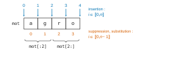
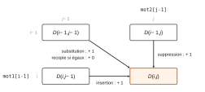
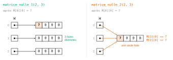
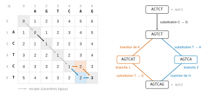

# Agro-Véto TB — Algorithmique et informatique 2026 · Corrigé brut

*Corrigé rédigé par IA, non officiel. Signalez toute erreur.*

Notations : `mot1` est de longueur $n$, `mot2` de longueur $p$. Tous les codes sont en Python.

## Partie I — Implémentation des opérations

### Question 1 a)

Supprimer le caractère d'indice $i\in[\![0,n-1]\!]$, c'est concaténer le préfixe de longueur $i$ et le suffixe qui commence juste après ce caractère :

```python
def suppression(mot, i):
    return mot[:i] + mot[i+1:]
```

Contrôle : `suppression('agro',0)`, `suppression('agro',2)`, `suppression('agro',3)` donnent `'gro'`, `'ago'`, `'agr'`.

### Question 1 b)

Insérer `c` à l'indice $i\in[\![0,n]\!]$, c'est placer `c` entre le préfixe de longueur $i$ et le suffixe commençant à l'indice $i$. Aucun caractère n'est perdu : la longueur passe à $n+1$.

```python
def insertion(mot, i, c):
    return mot[:i] + c + mot[i:]
```

Contrôle : avec `c = '*'` et `mot = 'agro'`, les indices 0, 2, 4 donnent `'*agro'`, `'ag*ro'`, `'agro*'`.



## Partie II — Résolution naïve par force brute

### Question 2

On n'ajoute un caractère que s'il n'a pas encore été rencontré, c'est-à-dire s'il n'est pas déjà dans `L` :

```python
def lettres(mot):
    L = []
    for car in mot:
        if car not in L:       # ligne 4
            L.append(car)      # ligne 5
    return L
```

À chaque tour, `L` contient sans répétition, dans l'ordre de première apparition, les caractères déjà parcourus. Pour `'concours'`, les seconds `c` et `o` sont écartés : on obtient `['c','o','n','u','r','s']`.

### Question 3

Notons $m$ = `len(mot)`. La boucle `for i in range(len(mot))` décrit les indices $0$ à $m-1$ : elle sert aux suppressions (ligne 10, sans caractère), aux substitutions et aux insertions à l'indice $i$ (lignes 12 et 13, pour chaque caractère de `mot2`). La boucle de la ligne 14 est hors de la boucle sur `i` : elle traite la position d'insertion manquante $m$ (ajout en fin de chaîne).

```python
def force_brute(mot1, mot2):
    Dict = {0: [mot1]}
    d = 0
    lettres_mot2 = lettres(mot2)
    while True:
        d += 1
        Dict[d] = []
        for mot in Dict[d-1]:
            for i in range(len(mot)):
                Dict[d].append(suppression(mot, i))                 # ligne 10
                for car in lettres_mot2:
                    Dict[d].append(substitution(mot, i, car))       # ligne 12
                    Dict[d].append(insertion(mot, i, car))          # ligne 13
            for car in lettres_mot2:
                Dict[d].append(insertion(mot, len(mot), car))       # ligne 15
        if mot2 in Dict[d]:
            return d
```

(Les lignes 12 et 13 peuvent être échangées.) Ainsi `Dict[d]` contient toutes les chaînes obtenues de `mot1` par $d$ opérations n'insérant ou ne substituant que des caractères de `mot2` ; une suite minimale d'opérations peut toujours être choisie ainsi, et toute chaîne de `Dict[d]` est à distance au plus $d$ de `mot1`. Le premier $d$ tel que `mot2` figure dans `Dict[d]` est donc la distance d'édition.

### Question 4 a)

Ici `lettres('AGCTT') = ['A','G','C','T']`, donc $k=4$ caractères. Pour un mot de longueur $m$ traité dans la boucle de la ligne 8, les `append` exécutés sont :

- ligne 10 : $m$ suppressions (chaînes de longueur $m-1$) ;
- ligne 12 : $km$ substitutions (longueur $m$) ;
- ligne 13 : $km$ insertions avant l'un des caractères (longueur $m+1$) ;
- ligne 15 : $k$ insertions en fin de chaîne (longueur $m+1$).

Un mot de longueur $m$ fournit donc $N(m)$ éléments, les doublons étant comptés (`append` ajoute sans test) :

$$\begin{aligned}
N(m) &= m+2km+k\\
&= 9m+4.
\end{aligned}$$

`Dict[0]` ne contient que `'ACG'`, de longueur 3 :

$$\begin{aligned}
|\texttt{Dict[1]}| &= N(3)\\
&= 9\times 3+4
\end{aligned}$$

$$\boxed{|\texttt{Dict[1]}| = 31}$$

### Question 4 b)

Avec $m=3$ et $k=4$ :

| longueur | 2 (suppressions) | 3 (substitutions) | 4 (insertions) |
|---|---|---|---|
| nombre d'éléments | $m=3$ | $km=12$ | $k(m+1)=16$ |

**`Dict[1]` contient 3 chaînes de longueur 2, 12 de longueur 3 et 16 de longueur 4** ($3+12+16=31$).

### Question 4 c)

`mot2 = 'AGCTT'` est de longueur 5, donc n'est pas dans `Dict[1]` : la boucle continue et `Dict[2]` est construit à partir de chacun des 31 éléments de `Dict[1]`, doublons compris. Avec $N(2)=22$, $N(3)=31$, $N(4)=40$ :

$$\begin{aligned}
|\texttt{Dict[2]}| &= 3\,N(2)+12\,N(3)+16\,N(4)\\
&= 66+372+640
\end{aligned}$$

$$\boxed{|\texttt{Dict[2]}| = 1078}$$

## Partie III — Résolution par programmation dynamique

### Question 5

`mot1 = 'ACTCT'` ($n=5$) indexe les lignes, `mot2 = 'AGTCAG'` ($p=6$) les colonnes. La première ligne vaut $0,\dots,6$ et la première colonne $0,\dots,5$.

On remplit ensuite ligne par ligne. Si `mot1[i-1] == mot2[j-1]`, on recopie la case diagonale $D(i-1,j-1)$. Sinon, on prend 1 plus le minimum des trois voisines (gauche, haut, diagonale).



Cases à égalité de caractères :

- `A` : cases (1,1) et (1,5) ;
- `C` : cases (2,4) et (4,4) ;
- `T` : cases (3,3) et (5,3).

Quelques cases :

| case | caractères | calcul | valeur |
|---|---|---|---|
| (1,5) | `A` = `A` | $D(0,4)$ | 4 |
| (4,4) | `C` = `C` | $D(3,3)$ | 1 |
| (5,3) | `T` = `T` | $D(4,2)$ | 3 |
| (5,6) | `T` ≠ `G` | $1+\min(2,3,2)$ | 3 |

Pour la dernière case, les trois voisines sont $D(5,5)=2$, $D(4,6)=3$ et $D(4,5)=2$.

| | | A | G | T | C | A | G |
|---|---|---|---|---|---|---|---|
| | **0** | 1 | 2 | 3 | 4 | 5 | 6 |
| **A** | 1 | 0 | 1 | 2 | 3 | 4 | 5 |
| **C** | 2 | 1 | 1 | 2 | 2 | 3 | 4 |
| **T** | 3 | 2 | 2 | 1 | 2 | 3 | 4 |
| **C** | 4 | 3 | 3 | 2 | 1 | 2 | 3 |
| **T** | 5 | 4 | 4 | 3 | 2 | 2 | **3** |

$$\boxed{D(5,6)=3}$$

### Question 6

**Les fonctions `matrice_nulle_1` et `matrice_nulle_4`.**

(La fonction 2 crée $n+1$ références vers une même liste : modifier une case modifie toute la colonne. La fonction 3 crée $p+1$ lignes de $n+1$ éléments, c'est-à-dire la transposée.)



### Question 7

```python
def matrice_levenshtein(mot1, mot2):
    n, p = len(mot1), len(mot2)
    D = matrice_nulle(n, p)                                         # ligne 3
    for j in range(p+1):
        D[0][j] = j                                                 # ligne 5
    for i in range(n+1):
        D[i][0] = i                                                 # ligne 7
    for i in range(1, n+1):
        for j in range(1, p+1):
            if mot1[i-1] == mot2[j-1]:
                D[i][j] = D[i-1][j-1]                               # ligne 11
            else:
                D[i][j] = 1 + min(D[i][j-1], D[i-1][j], D[i-1][j-1])  # ligne 13
    return D
```

Le parcours par lignes puis colonnes croissantes garantit que les trois cases voisines (gauche, haut, diagonale) sont déjà calculées lorsqu'on calcule $D(i,j)$. Coût en temps et en mémoire : $O(np)$.

### Question 8

D'après l'énoncé, la distance d'édition de `mot1` à `mot2` est $D(n,p)$, case en bas à droite de la matrice :

```python
def distance(mot1, mot2):
    D = matrice_levenshtein(mot1, mot2)
    return D[len(mot1)][len(mot2)]
```

Ainsi `distance('ACT','AGTC')` vaut 2 et `distance('ACTCT','AGTCAG')` vaut 3.

## Partie IV — Application : correcteur orthographique

### Question 9

```python
def correcteur_orthographique(mot):
    n = len(mot)
    dmin = n+1
    M = []
    for chaine in Mots_Francais:
        d = distance(mot, chaine)       # ligne 6
        if d < dmin:
            dmin = d
            M = [chaine]                # ligne 9
        elif d == dmin:
            M.append(chaine)            # ligne 11
    return M
```

Invariant : après chaque tour, `dmin` est la plus petite distance de `mot` aux mots déjà examinés et `M` la liste de ces mots réalisant `dmin`. Un mot strictement plus proche invalide les précédents (ligne 9 : on repart d'une liste à un élément) ; un mot à égalité s'ajoute (ligne 11). L'initialisation `dmin = n+1` convient : le mot `'a'` est à distance au plus $\max(n,1)\le n+1$ de `mot`, donc `M` n'est jamais vide en fin de parcours.

## Partie V — Obtention d'une suite d'opérations minimale

### Question 10

On remonte depuis la case (5,6) de la matrice de la question 5, avec la chaîne courante $\texttt{mot}(i,j)$. À chaque étape, on vérifie l'invariant :

$$\texttt{mot}(i,j)=\texttt{mot2[:j]}+\texttt{mot1[i:]}$$

Le tableau donne, pour chaque case visitée, la valeur des trois voisines ; une voisine est retenue (« oui ») si elle vaut $D(i,j)-1$. Aux cases d'égalité, la méthode impose la diagonale sans opération.

| case | $D$ | chaîne courante | caractères | diagonale | gauche | haut | pas effectué |
|---|---|---|---|---|---|---|---|
| (5,6) | 3 | `AGTCAG` | `T` ≠ `G` | 2, oui | 2, oui | 3, non | deux branches |
| (4,5) | 2 | `AGTCAT` | `C` ≠ `A` | 2, non | 1, oui | 3, non | suppression de l'indice 4 |
| (5,5) | 2 | `AGTCA` | `T` ≠ `A` | 1, oui | 2, non | 2, non | substitution de l'indice 4 par `T` |
| (4,4) | 1 | `AGTCT` | `C` = `C` | | | | diagonale, sans opération |
| (3,3) | 1 | `AGTCT` | `T` = `T` | | | | diagonale, sans opération |
| (2,2) | 1 | `AGTCT` | `C` ≠ `G` | 0, oui | 1, non | 1, non | substitution de l'indice 1 par `C` |
| (1,1) | 0 | `ACTCT` | `A` = `A` | | | | diagonale vers (0,0) |

- **Branche 1** : en (5,6), substitution à l'indice 5 par `mot1[4] = 'T'`, d'où `AGTCAT` en (4,5) ; puis suppression de l'indice 4, d'où `AGTCT` en (4,4).
- **Branche 2** : en (5,6), suppression de l'indice 5, d'où `AGTCA` en (5,5) ; puis substitution de l'indice 4 par `mot1[4] = 'T'`, d'où `AGTCT` en (4,4).
- **Partie commune** depuis (4,4) : deux remontées diagonales sans opération, puis en (2,2) substitution de l'indice 1 par `mot1[1] = 'C'`, d'où `ACTCT` en (1,1), et une dernière diagonale vers (0,0).

Il y a donc **exactement deux suites minimales** (3 opérations chacune, conformément à $D(5,6)=3$) :

$$\boxed{\begin{aligned}
&\texttt{ACTCT}\longrightarrow\texttt{AGTCT}\longrightarrow\texttt{AGTCAT}\longrightarrow\texttt{AGTCAG}\\
&\texttt{ACTCT}\longrightarrow\texttt{AGTCT}\longrightarrow\texttt{AGTCA}\longrightarrow\texttt{AGTCAG}
\end{aligned}}$$

Lues dans le sens direct : la première substitue `C`→`G` à l'indice 1, insère `A` à l'indice 4, substitue `T`→`G` à l'indice 5 ; la seconde substitue `C`→`G` à l'indice 1, substitue `T`→`A` à l'indice 4, insère `G` à l'indice 5.



### Question 11

On applique à `mot` les opérations décrites dans la partie V avec les fonctions de la partie I :

```python
def suite_operations(mot1, mot2):
    D = matrice_levenshtein(mot1, mot2)                 # ligne 2
    Suite_chgt = [mot2]
    mot = mot2
    i, j = len(mot1), len(mot2)
    while i > 0 or j > 0:
        if i>0 and j>0 and mot1[i-1] == mot2[j-1]:
            i, j = i-1, j-1
        elif i>0 and j>0 and D[i-1][j-1] == D[i][j]-1:
            mot = substitution(mot, j-1, mot1[i-1])     # ligne 10
            i, j = i-1, j-1
            Suite_chgt = [mot] + Suite_chgt
        elif j > 0 and D[i][j-1] == D[i][j] -1:
            mot = suppression(mot, j-1)                 # ligne 14
            j = j-1
            Suite_chgt = [mot] + Suite_chgt
        elif i > 0 and D[i-1][j] == D[i][j]-1:
            mot = insertion(mot, j, mot1[i-1])          # ligne 18
            Suite_chgt = [mot] + Suite_chgt
            i = i-1
    return Suite_chgt
```

Invariant en entrée de chaque tour :

$$\texttt{mot}=\texttt{mot2[:j]}+\texttt{mot1[i:]}$$

Chacune des trois opérations le rétablit pour la nouvelle case ; en (0,0), `mot` vaut donc `mot1`.

La boucle termine car $i+j$ décroît strictement. Elle ne se bloque jamais : hors des bords, la relation de récurrence garantit qu'une voisine vaut $D(i,j)-1$ ; sur les bords, les valeurs initiales $D(0,j)=j$ et $D(i,0)=i$ le garantissent aussi.

La liste renvoyée contient $D(n,p)+1$ chaînes : la suite est minimale. Sur l'exemple de la question 10, la fonction renvoie `['ACTCT', 'AGTCT', 'AGTCAT', 'AGTCAG']` (la diagonale est testée avant la gauche).
