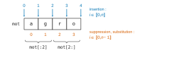
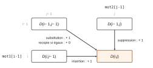
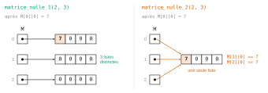
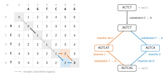

# Agro-Véto TB — Algorithmique et informatique 2026 · Corrigé guidé

*Corrigé rédigé par IA, non officiel. Signalez toute erreur.*

## Présentation du sujet

**Thème.** Le sujet étudie la **distance d'édition** (distance de Levenshtein) entre deux chaînes de caractères : le nombre minimal d'insertions, de suppressions et de substitutions nécessaires pour passer de l'une à l'autre. Les exemples sont pris dans l'ADN (`'ACTCT'`, `'AGTCAG'`) et dans l'orthographe (`'mason'`).

**Format.** Épreuve courte : **45 minutes**, sans calculatrice ni document, 11 questions numérotées (14 questions élémentaires en comptant les sous-questions de Q 1 et Q 4). Le langage est Python. Presque toutes les questions de code sont des **textes à trous** : il faut compléter des lignes précises d'un squelette fourni, en respectant les noms de variables imposés.

**Découpage.**

- **Partie I** (Q 1) : écrire `suppression` et `insertion` sur le modèle de `substitution`, par découpage (*slicing*) et concaténation, puisque les chaînes Python ne sont pas modifiables.
- **Partie II** (Q 2 à Q 4) : un algorithme naïf qui engendre par vagues toutes les chaînes à 1, 2, 3… opérations de `mot1` jusqu'à rencontrer `mot2`. On écrit la fonction auxiliaire `lettres`, on complète `force_brute`, puis on **dénombre** les éléments des premières vagues pour constater l'explosion combinatoire.
- **Partie III** (Q 5 à Q 8) : la solution efficace par **programmation dynamique**. La relation de récurrence est entièrement donnée ; il faut la faire tourner à la main (Q 5), repérer les bonnes fonctions d'initialisation d'une matrice (Q 6), compléter le remplissage (Q 7) et en déduire la distance (Q 8).
- **Partie IV** (Q 9) : un correcteur orthographique, qui renvoie tous les mots du dictionnaire à distance minimale : schéma « minimum et tous les éléments qui le réalisent ».
- **Partie V** (Q 10, Q 11) : reconstruire, à partir de la matrice, les suites minimales d'opérations, à la main puis en code.

**Notions du programme mobilisées.** Chaînes de caractères (indices, tranches, concaténation, non-mutabilité), listes (`append`, test `in`, listes de listes), dictionnaires, boucles imbriquées, recherche de minimum, programmation dynamique (tableau rempli dans un ordre qui garantit la disponibilité des sous-problèmes), dénombrement élémentaire, complexité.

**Difficulté et gestion du temps.** Rien n'est conceptuellement difficile, mais le temps est très court. Les questions 1, 2, 6, 7, 8, 9 se traitent en quelques lignes et ne doivent pas être laissées de côté. Les deux questions « à la main », Q 4 (dénombrement) et Q 5 / Q 10 (matrice puis remontée), demandent plus de soin : une erreur dans la matrice de Q 5 se répercute sur Q 10. La question 3 conditionne la bonne lecture de Q 4. La partie V (Q 10, Q 11) vient en dernier : le jury la réservait aux meilleurs candidats (voir ci-dessous). On ne s'y engage qu'une fois les parties I à IV rédigées proprement ; Q 11 reste alors courte si l'on a bien compris la méthode.

**Ce qu'en dit le rapport 2026.** Le rapport est bref et général : il ne commente aucune question en particulier et ne donne pas de taux de réussite par question. Il retient surtout la longueur du sujet : « Le sujet était long ; il était clairement très difficile à traiter dans toute son intégralité durant les 45 minutes imparties. » Le barème en tenait compte : « le barème brut sur 28 estimait que 8 points seraient hors barème ».

Les résultats confirment la difficulté. « Sur 28, la moyenne se situait entre 6 et 7. » Après harmonisation, sur 143 copies, la moyenne est de 9,98/20, la médiane de 9,40/20, et les notes vont de 1 à 20 ; selon le rapport, aucun candidat n'a traité parfaitement tout le sujet.

Le seul reproche explicite vise les candidats faibles, environ un tiers, qui semblent « répondre un peu au hasard ou ‘au feeling’ aux questions ; ce qui s'avère assez contre-productif ». C'est un risque réel ici : Q 6 (sans justification demandée) et les textes à trous invitent à deviner. Mieux vaut une réponse contrôlée sur un petit exemple qu'une réponse tentée au jugé.

**Questions discriminantes.** Le rapport n'en désigne aucune nommément. Il dit seulement que le sujet a permis de classer les candidats sur leur niveau informatique, et qu'il réservait la partie V aux candidats de niveau exceptionnel.

## Partie I — Implémentation des opérations

On fabrique une nouvelle chaîne à partir de morceaux de l'ancienne. Toute la difficulté est l'indice où reprend le suffixe.

### Question 1 a)

> [!INDICATION]
> Partez de `substitution` : préfixe, nouveau caractère, suffixe. Que faut-il retirer pour supprimer au lieu de remplacer ?

> [!INDICATION]
> Le caractère d'indice `i` ne doit apparaître ni dans le préfixe ni dans le suffixe : identifiez la tranche qui commence juste après lui.

#### Solution

Supprimer le caractère d'indice $i\in[\![0,n-1]\!]$, c'est concaténer le préfixe de longueur $i$ et le suffixe qui commence à l'indice $i+1$ :

```python
def suppression(mot, i):
    return mot[:i] + mot[i+1:]
```

Contrôle sur `'agro'` : indices 0, 2, 3 donnent `'' + 'gro'`, `'ag' + 'o'`, `'agr' + ''`, soit `'gro'`, `'ago'`, `'agr'`, comme dans l'énoncé.

### Question 1 b)

> [!INDICATION]
> Une insertion ne fait disparaître aucun caractère : la chaîne obtenue a un caractère de plus.

> [!INDICATION]
> Le nouveau caractère se place entre le préfixe de longueur `i` et le reste de la chaîne. Où commence ce reste ?

#### Solution

Insérer `c` à l'indice $i\in[\![0,n]\!]$, c'est placer `c` entre `mot[:i]` et le suffixe `mot[i:]`, qui commence à l'indice $i$ inclus :

```python
def insertion(mot, i, c):
    return mot[:i] + c + mot[i:]
```

Contrôle : `insertion('agro',0,'*')`, `insertion('agro',2,'*')`, `insertion('agro',4,'*')` valent `'*agro'`, `'ag*ro'`, `'agro*'`. Pour $i=n$, `mot[n:]` est la chaîne vide : on ajoute en fin de chaîne.



> [!PIEGE]
> Écrire `mot[:i] + c + mot[i+1:]` pour l'insertion redonne exactement `substitution`. Le code tourne sans erreur, d'où l'intérêt d'un contrôle par les longueurs : $n-1$ pour une suppression, $n$ pour une substitution, $n+1$ pour une insertion.

> [!METHODE]
> Les tranches Python ne lèvent jamais d'erreur, même hors bornes (`'agro'[10:]` vaut `''`). Un indice faux donne un résultat silencieusement faux : vérifiez toujours une fonction de découpage sur un petit exemple, aux deux extrémités.

## Partie II — Résolution naïve par force brute

On engendre toutes les chaînes à 1 opération de `mot1`, puis à 2, etc. La partie montre pourquoi cette idée simple est inutilisable : la taille des listes explose.

### Question 2

> [!INDICATION]
> La liste `L` est construite au fur et à mesure : à quel moment faut-il ajouter `car`, et à quel moment faut-il s'abstenir ?

> [!INDICATION]
> Le test d'appartenance `in` fonctionne sur une liste. Sur quelle liste doit-il porter ?

#### Solution

```python
def lettres(mot):
    L = []
    for car in mot:
        if car not in L:       # ligne 4
            L.append(car)      # ligne 5
    return L
```

Invariant : avant chaque tour, `L` contient, sans répétition et dans l'ordre de première apparition, les caractères déjà parcourus. Pour `'concours'`, les caractères `c, o, n, c, o, u, r, s` sont lus, les seconds `c` et `o` sont écartés, d'où `['c','o','n','u','r','s']`, conforme à l'énoncé.

> [!PIEGE]
> Écrire `if car not in mot` : chaque caractère lu appartient évidemment à `mot`, le test est toujours faux, et la fonction renvoie la liste vide. Le test porte sur la liste en construction `L`.

### Question 3

> [!INDICATION]
> Lisez d'abord l'indentation : quels `append` sont dans la boucle sur `car`, lesquels n'y sont pas, et lesquels sont dans la boucle sur `i` ?

> [!INDICATION]
> La boucle sur `i` ne parcourt que $0,\dots,m-1$ où $m$ est la longueur de `mot`. Combien de positions d'insertion y a-t-il, et laquelle n'est pas couverte par cette boucle ?

> [!INDICATION]
> Un `append` sans variable `car` disponible ne peut correspondre qu'à une opération qui n'utilise aucun caractère.

#### Solution

- Ligne 10 : dans la boucle sur `i`, hors de la boucle sur `car` : c'est la suppression à l'indice `i`.
- Lignes 12 et 13 : dans la boucle sur `car` : substitution et insertion à l'indice `i` par le caractère `car`.
- Ligne 15 : dans une boucle sur `car` placée **hors** de la boucle sur `i` : c'est l'insertion à la position $m$, que la boucle sur `i` ne couvre pas.

```python
def force_brute(mot1, mot2):
    Dict = {0: [mot1]}
    d = 0
    lettres_mot2 = lettres(mot2)
    while True:
        d += 1
        Dict[d] = []
        for mot in Dict[d-1]:
            for i in range(len(mot)):
                Dict[d].append(suppression(mot, i))                 # ligne 10
                for car in lettres_mot2:
                    Dict[d].append(substitution(mot, i, car))       # ligne 12
                    Dict[d].append(insertion(mot, i, car))          # ligne 13
            for car in lettres_mot2:
                Dict[d].append(insertion(mot, len(mot), car))       # ligne 15
        if mot2 in Dict[d]:
            return d
```

Les lignes 12 et 13 peuvent être échangées. Pourquoi l'algorithme renvoie la distance : `Dict[d]` contient toutes les chaînes obtenues de `mot1` par $d$ opérations dont les caractères insérés ou substitués sont des lettres de `mot2`. Une suite minimale de `mot1` à `mot2` peut toujours être choisie de cette façon (un caractère inséré ou substitué qui n'est pas dans `mot2` devrait être à nouveau modifié, ce qui ne serait pas minimal), donc `mot2` est dans `Dict[d]` pour $d$ égal à la distance ; et toute chaîne de `Dict[d]` est à distance au plus $d$ de `mot1`, donc `mot2` n'apparaît dans aucune vague antérieure.

> [!PIEGE]
> Mettre `insertion(mot, i, car)` en ligne 15 : après la boucle, `i` vaut $m-1$ et l'on n'insère jamais en fin de chaîne. Le programme ne plante pas (sauf si `mot1` est vide : `i` n'existe pas), mais il peut renvoyer une distance trop grande : de `'A'` à `'AB'`, il renvoie 2 au lieu de 1.

### Question 4 a)

> [!INDICATION]
> Commencez par calculer `lettres('AGCTT')` : combien de caractères distincts ?

> [!INDICATION]
> Comptez les `append` exécutés pour un mot de longueur $m$, ligne par ligne, en fonction de $m$ et du nombre $k$ de caractères distincts de `mot2`.

> [!INDICATION]
> La question porte sur le nombre d'éléments de la **liste** : un `append` ajoute toujours, même si la chaîne est déjà présente.

#### Solution

`lettres('AGCTT') = ['A','G','C','T']`, donc $k=4$ (le `T` doublé n'est compté qu'une fois). Pour un mot de longueur $m$ :

| ligne | opération | nombre d'`append` | longueur produite |
|---|---|---|---|
| 10 | suppression | $m$ | $m-1$ |
| 12 | substitution | $km$ | $m$ |
| 13 | insertion aux indices $0..m-1$ | $km$ | $m+1$ |
| 15 | insertion en fin | $k$ | $m+1$ |

Un mot de longueur $m$ fournit donc $N(m)$ éléments :

$$\begin{aligned}
N(m) &= m+2km+k\\
&= (2k+1)m+k\\
&= 9m+4.
\end{aligned}$$

`Dict[0] = ['ACG']`, de longueur 3 :

$$\begin{aligned}
|\texttt{Dict[1]}| &= N(3)\\
&= 9\times 3+4
\end{aligned}$$

$$\boxed{|\texttt{Dict[1]}| = 31}$$

Ces 31 éléments ne sont pas tous distincts : `'ACG'` apparaît par exemple trois fois (substitution de chaque caractère par lui-même). Il n'y a que 26 chaînes distinctes, mais la question porte sur la liste.

> [!PIEGE]
> Prendre $k=5$ (la longueur de `mot2`) au lieu du nombre de caractères **distincts**, ou oublier les $k$ insertions de la ligne 15 : on obtient 38 ou 27.

### Question 4 b)

> [!INDICATION]
> Le tableau précédent donne directement la longueur produite par chaque ligne du code.

#### Solution

Avec $m=3$ et $k=4$ :

- les suppressions donnent $m=3$ chaînes de longueur 2 ;
- les substitutions donnent $km=12$ chaînes de longueur 3 ;
- les insertions (lignes 13 et 15) donnent $k(m+1)=16$ chaînes de longueur 4.

**3 éléments de longueur 2, 12 de longueur 3, 16 de longueur 4** ; on retrouve bien $3+12+16=31$.

### Question 4 c)

> [!INDICATION]
> La boucle `while` s'arrête-t-elle après la première vague ? Regardez la longueur de `mot2`.

> [!INDICATION]
> Chaque élément de `Dict[1]` est traité comme `mot1` l'a été, mais le nombre d'éléments qu'il fournit dépend de **sa** longueur.

#### Solution

`mot2 = 'AGCTT'` est de longueur 5 alors que `Dict[1]` ne contient que des chaînes de longueurs 2 à 4 : le test de la ligne 16 échoue et `Dict[2]` est construit. Chacun des 31 éléments de `Dict[1]` (doublons compris) fournit $N(m)$ éléments. On a $N(2)=22$, $N(3)=31$ et $N(4)=40$ :

$$\begin{aligned}
|\texttt{Dict[2]}| &= 3\times 22+12\times 31+16\times 40\\
&= 66+372+640
\end{aligned}$$

$$\boxed{|\texttt{Dict[2]}| = 1078}$$

Contrôle : la somme des longueurs des 31 éléments vaut $6+36+64=106$, donc

$$\begin{aligned}
|\texttt{Dict[2]}| &= 9\times 106+4\times 31\\
&= 954+124\\
&= 1078.
\end{aligned}$$

> [!METHODE]
> Pour compter ce que produit un programme, comptez les instructions exécutées en fonction des paramètres (ici $m$ et $k$), puis sommez en regroupant les entrées par paramètre : c'est exactement le rôle de la question b). En poursuivant ainsi, on trouve $42\,562$ éléments dans `Dict[3]`, vague où `'AGCTT'` apparaît enfin (la distance vaut 3) : la croissance est exponentielle en $d$.

> [!PIEGE]
> Écrire $|\texttt{Dict[2]}|=31\times 31=961$, comme si tous les éléments de `Dict[1]` avaient la longueur de `mot1`.

## Partie III — Résolution par programmation dynamique

La relation de récurrence est donnée : $D(i,j)$ ne dépend que des trois cases voisines au-dessus, à gauche et en diagonale. Il suffit de remplir le tableau dans un ordre où ces cases sont toujours déjà calculées.

### Question 5

> [!INDICATION]
> Écrivez les caractères de `mot2` au-dessus des colonnes et ceux de `mot1` à gauche des lignes, décalés d'une case comme dans l'exemple : la case $(i,j)$ compare le caractère de la ligne $i$ et celui de la colonne $j$.

> [!INDICATION]
> Repérez d'abord les cases où les caractères sont égaux : elles recopient la case diagonale **sans** ajouter 1. Les autres valent 1 plus le minimum des trois voisines.

#### Solution



`mot1 = 'ACTCT'` indexe les lignes, `mot2 = 'AGTCAG'` les colonnes. Les cases d'égalité sont :

- `A` : cases (1,1) et (1,5) ;
- `C` : cases (2,4) et (4,4) ;
- `T` : cases (3,3) et (5,3).

Détail de quelques cases (dans le cas général, les trois nombres du minimum sont, dans l'ordre, les voisines gauche, haut et diagonale) :

| case | caractères | calcul | valeur |
|---|---|---|---|
| (1,1) | `A` = `A` | $D(0,0)$ | 0 |
| (1,2) | `A` ≠ `G` | $1+\min(0,2,1)$ | 1 |
| (1,5) | `A` = `A` | $D(0,4)$ | 4 |
| (2,1) | `C` ≠ `A` | $1+\min(2,0,1)$ | 1 |
| (2,4) | `C` = `C` | $D(1,3)$ | 2 |
| (3,3) | `T` = `T` | $D(2,2)$ | 1 |
| (3,4) | `T` ≠ `C` | $1+\min(1,2,2)$ | 2 |
| (4,4) | `C` = `C` | $D(3,3)$ | 1 |
| (4,5) | `C` ≠ `A` | $1+\min(1,3,2)$ | 2 |
| (4,6) | `C` ≠ `G` | $1+\min(2,4,3)$ | 3 |
| (5,3) | `T` = `T` | $D(4,2)$ | 3 |
| (5,5) | `T` ≠ `A` | $1+\min(2,2,1)$ | 2 |
| (5,6) | `T` ≠ `G` | $1+\min(2,3,2)$ | 3 |

| | | A | G | T | C | A | G |
|---|---|---|---|---|---|---|---|
| | **0** | 1 | 2 | 3 | 4 | 5 | 6 |
| **A** | 1 | 0 | 1 | 2 | 3 | 4 | 5 |
| **C** | 2 | 1 | 1 | 2 | 2 | 3 | 4 |
| **T** | 3 | 2 | 2 | 1 | 2 | 3 | 4 |
| **C** | 4 | 3 | 3 | 2 | 1 | 2 | 3 |
| **T** | 5 | 4 | 4 | 3 | 2 | 2 | **3** |

$$\boxed{D(5,6)=3}$$

> [!METHODE]
> Deux contrôles gratuits : deux cases voisines (horizontalement, verticalement ou en diagonale descendante) diffèrent d'au plus 1, et $|i-j|\le D(i,j)\le\max(i,j)$. Ici $1\le 3\le 6$.

> [!PIEGE]
> Ajouter 1 dans le cas d'égalité : le tableau n'a plus aucun « creux » diagonal et l'on trouve $D(5,6)=6$.

### Question 6

> [!INDICATION]
> Deux critères : les dimensions ($n+1$ lignes de $p+1$ éléments) et l'indépendance des lignes, puisqu'on va modifier les cases une par une.

> [!INDICATION]
> Que se passe-t-il en mémoire lorsqu'on multiplie par un entier une liste dont l'élément est lui-même une liste ?

#### Solution

**`matrice_nulle_1` et `matrice_nulle_4`.**

Justification (non demandée) :

- `matrice_nulle_1` : l'expression `[0]*(p+1)` est réévaluée à chaque tour de la compréhension : $n+1$ listes distinctes de $p+1$ zéros. Convient.
- `matrice_nulle_2` : `[0]*(p+1)` est évaluée une seule fois, et `* (n+1)` recopie $n+1$ fois la **référence** à cette même liste. Après `M[0][0] = 7`, toute la colonne 0 vaut 7. Ne convient pas.
- `matrice_nulle_3` : $p+1$ lignes de $n+1$ éléments, c'est la transposée ; dès que $n\neq p$, l'accès `D[n][p]` sort des bornes. Ne convient pas.
- `matrice_nulle_4` : $n+1$ lignes indépendantes (une nouvelle liste `L` à chaque tour) de $p+1$ zéros. Convient.



> [!PIEGE]
> `[0]*(p+1)` est sans danger car l'entier 0 n'est pas modifiable ; c'est la répétition d'un objet **modifiable** (une liste) qui crée des alias. Pour s'en convaincre, simuler `M[0][0] = 1` sur une matrice $2\times 2$.

### Question 7

> [!INDICATION]
> Chaque ligne à compléter correspond à une ligne de la relation de récurrence encadrée de l'énoncé, dans l'ordre : création du tableau, bord $i=0$, bord $j=0$, cas d'égalité, cas général.

> [!INDICATION]
> Pour la ligne 3, utilisez la fonction de la question 6 avec les arguments dans le bon ordre (lignes d'abord).

#### Solution

```python
def matrice_levenshtein(mot1, mot2):
    n, p = len(mot1), len(mot2)
    D = matrice_nulle(n, p)                                         # ligne 3
    for j in range(p+1):
        D[0][j] = j                                                 # ligne 5
    for i in range(n+1):
        D[i][0] = i                                                 # ligne 7
    for i in range(1, n+1):
        for j in range(1, p+1):
            if mot1[i-1] == mot2[j-1]:
                D[i][j] = D[i-1][j-1]                               # ligne 11
            else:
                D[i][j] = 1 + min(D[i][j-1], D[i-1][j], D[i-1][j-1])  # ligne 13
    return D
```

Le parcours par lignes croissantes puis colonnes croissantes garantit que les trois cases voisines (gauche, haut, diagonale) sont déjà remplies quand on calcule la case $(i,j)$. La fonction effectue $np$ tours de la double boucle : temps et mémoire en $O(np)$, à comparer à la croissance exponentielle de `force_brute`.

> [!PIEGE]
> Mettre le `+1` à l'intérieur d'un seul terme du minimum, ou oublier le terme diagonal $D(i-1,j-1)$ (on interdirait alors les substitutions).

> [!JURY]
> Dans un texte à trous, on recopie le squelette avec ses numéros de ligne et l'on complète exactement les lignes demandées, sans réorganiser le code ni renommer les variables.

### Question 8

> [!INDICATION]
> L'énoncé dit quelle case de la matrice contient la distance d'édition de `mot1` à `mot2`.

#### Solution

La distance cherchée est $D(n,p)$, case en bas à droite :

```python
def distance(mot1, mot2):
    D = matrice_levenshtein(mot1, mot2)
    return D[len(mot1)][len(mot2)]
```

(`return D[-1][-1]` est équivalent.) Sur les exemples : `distance('ACT','AGTC')` vaut 2, `distance('ACTCT','AGTCAG')` vaut 3, et `distance('CAGTA','AGGTC')` vaut 3, ce qui confirme la valeur annoncée dans l'introduction.

> [!PIEGE]
> Écrire `D[len(mot2)][len(mot1)]` : les lignes sont indexées par `mot1`. Avec `'ACTCT'` et `'AGTCAG'`, cela lit `D[6]`, qui n'existe pas.

## Partie IV — Application : correcteur orthographique

On parcourt une seule fois le dictionnaire en tenant à jour à la fois la meilleure distance et la liste des mots qui la réalisent.

### Question 9

> [!INDICATION]
> Ligne 6 : quelle fonction déjà écrite renvoie un **entier** comparable à `dmin` ?

> [!INDICATION]
> Lorsqu'on trouve un mot strictement plus proche que tous les précédents, que deviennent les mots déjà retenus dans `M` ? Et en cas d'égalité ?

#### Solution

```python
def correcteur_orthographique(mot):
    n = len(mot)
    dmin = n+1
    M = []
    for chaine in Mots_Francais:
        d = distance(mot, chaine)       # ligne 6
        if d < dmin:
            dmin = d
            M = [chaine]                # ligne 9
        elif d == dmin:
            M.append(chaine)            # ligne 11
    return M
```

Invariant : après chaque tour, `dmin` est la plus petite distance de `mot` aux mots déjà examinés et `M` la liste de ces mots qui la réalisent. Un nouveau record invalide tous les mots précédents (ligne 9 : on repart d'une liste réduite à `chaine`) ; une égalité ajoute `chaine` (ligne 11). L'initialisation `dmin = n+1` est sûre : le mot `'a'` est à distance au plus $\max(n,1)\le n+1$ de `mot`, donc au moins un mot est retenu.

Pour `'mason'`, `'macon'`, `'maçon'`, `'maton'` sont à distance 1 (une substitution), `'maison'` aussi (une insertion), et aucun mot n'est à distance 0 : on obtient bien `['macon','maçon','maison','maton']`, dans l'ordre du dictionnaire.

> [!PIEGE]
> Écrire `M.append(chaine)` en ligne 9 : la liste contiendrait tous les records successifs (`'a'`, à distance 4, en tête). Autre erreur : remplacer `elif` par un second `if`, ce qui ajoute deux fois le mot qui vient d'établir le record.

> [!METHODE]
> Le schéma « minimum et liste des éléments qui le réalisent » en un seul parcours est très classique : réinitialiser la liste sur une amélioration stricte, la compléter sur une égalité.

## Partie V — Obtention d'une suite d'opérations minimale

On lit la matrice à l'envers, de $(n,p)$ vers $(0,0)$, en transformant progressivement `mot2` en `mot1`. Un bon fil conducteur est la chaîne associée à la case $(i,j)$ :

$$\texttt{mot}(i,j)=\texttt{mot2[:j]}+\texttt{mot1[i:]}$$

Son début est déjà conforme à la cible, sa fin est encore celle de la source. Le jury considérait cette partie comme largement hors barème (voir l'encadré de Q 10).

### Question 10

> [!INDICATION]
> Appliquez les règles de l'énoncé case par case, en partant de $(5,6)$ ; lorsque les caractères diffèrent, testez **les trois** provenances, chacune pouvant ouvrir une branche.

> [!INDICATION]
> Quand les caractères sont égaux, l'énoncé impose la remontée en diagonale sans opération : pas de branche à ouvrir.

> [!INDICATION]
> Pour contrôler chaque chaîne intermédiaire, vérifiez qu'elle commence par les $j$ premiers caractères de `mot2` et finit par les caractères de `mot1` à partir de l'indice $i$.

#### Solution

On utilise la matrice de la question 5. Le tableau donne, pour chaque case visitée, la valeur des trois voisines ; une voisine est retenue (« oui ») si elle vaut $D(i,j)-1$. Aux cases d'égalité, la méthode impose la diagonale sans opération.

| case | $D$ | chaîne courante | caractères | diagonale | gauche | haut | pas effectué |
|---|---|---|---|---|---|---|---|
| (5,6) | 3 | `AGTCAG` | `T` ≠ `G` | 2, oui | 2, oui | 3, non | deux branches |
| (4,5) | 2 | `AGTCAT` | `C` ≠ `A` | 2, non | 1, oui | 3, non | suppression de l'indice 4 |
| (5,5) | 2 | `AGTCA` | `T` ≠ `A` | 1, oui | 2, non | 2, non | substitution de l'indice 4 par `T` |
| (4,4) | 1 | `AGTCT` | `C` = `C` | | | | diagonale, sans opération |
| (3,3) | 1 | `AGTCT` | `T` = `T` | | | | diagonale, sans opération |
| (2,2) | 1 | `AGTCT` | `C` ≠ `G` | 0, oui | 1, non | 1, non | substitution de l'indice 1 par `C` |
| (1,1) | 0 | `ACTCT` | `A` = `A` | | | | diagonale vers (0,0) |

- **Branche 1**, par (4,5) : en (5,6), substitution à l'indice $j-1=5$ par `mot1[4] = 'T'`, d'où `AGTCAT` ; puis suppression de l'indice 4, d'où `AGTCT` en (4,4).
- **Branche 2**, par (5,5) : en (5,6), suppression de l'indice 5, d'où `AGTCA` ; puis substitution de l'indice 4 par `mot1[4] = 'T'`, d'où `AGTCT` en (4,4).
- **Tronc commun** depuis (4,4) : deux diagonales sans opération jusqu'en (2,2) ; là, substitution de l'indice 1 par `mot1[1] = 'C'`, d'où `ACTCT` en (1,1) ; enfin une diagonale vers (0,0).

Aucune autre bifurcation : il y a **exactement deux suites minimales**, de 3 opérations chacune :

$$\boxed{\begin{aligned}
&\texttt{ACTCT}\longrightarrow\texttt{AGTCT}\longrightarrow\texttt{AGTCAT}\longrightarrow\texttt{AGTCAG}\\
&\texttt{ACTCT}\longrightarrow\texttt{AGTCT}\longrightarrow\texttt{AGTCA}\longrightarrow\texttt{AGTCAG}
\end{aligned}}$$

Dans le sens direct, la première substitue `C`→`G` (indice 1), insère `A` (indice 4) puis substitue `T`→`G` (indice 5) ; la seconde substitue `C`→`G` (indice 1), substitue `T`→`A` (indice 4) puis insère `G` (indice 5). Les chemins correspondants dans la matrice se séparent en $(4,4)$ : la branche 1 passe par $(4,5)$, la branche 2 par $(5,5)$.



> [!PIEGE]
> Les opérations lues pendant la remontée sont les **inverses** de celles de la suite : quand la remontée supprime un caractère, la suite lue de `mot1` vers `mot2` l'insère. Il faut présenter les suites de `mot1` vers `mot2`.

> [!METHODE]
> Pour trouver **toutes** les solutions, faites l'arbre des choix : à chaque case, testez systématiquement les trois provenances et notez chaque bifurcation, puis vérifiez si les branches se rejoignent.

> [!JURY]
> Le rapport 2026 situe la partie V à part : « Cette dernière partie était estimée un peu hors-barème, destinée aux seuls candidats de niveau exceptionnel, s'il en est. » Il ne la commente pas davantage. En 45 minutes, Q 10 et Q 11 ne se traitent donc qu'après avoir sécurisé les parties I à IV ; une remontée bâclée rapporte peu.

### Question 11

> [!INDICATION]
> Ligne 2 : les lignes 9, 13 et 17 lisent des cases de `D` ; il faut donc la matrice entière, pas seulement la distance.

> [!INDICATION]
> Les lignes 10, 14 et 18 traduisent mot pour mot les trois règles de la partie V, avec les fonctions de la partie I. Relisez à quel indice et avec quel caractère chaque opération se fait.

> [!INDICATION]
> Les indices dans la chaîne courante sont donnés par $j$ (position dans la cible déjà construite) ; le caractère utilisé vient de `mot1`.

#### Solution

```python
def suite_operations(mot1, mot2):
    D = matrice_levenshtein(mot1, mot2)                 # ligne 2
    Suite_chgt = [mot2]
    mot = mot2
    i, j = len(mot1), len(mot2)
    while i > 0 or j > 0:
        if i>0 and j>0 and mot1[i-1] == mot2[j-1]:
            i, j = i-1, j-1
        elif i>0 and j>0 and D[i-1][j-1] == D[i][j]-1:
            mot = substitution(mot, j-1, mot1[i-1])     # ligne 10
            i, j = i-1, j-1
            Suite_chgt = [mot] + Suite_chgt
        elif j > 0 and D[i][j-1] == D[i][j] -1:
            mot = suppression(mot, j-1)                 # ligne 14
            j = j-1
            Suite_chgt = [mot] + Suite_chgt
        elif i > 0 and D[i-1][j] == D[i][j]-1:
            mot = insertion(mot, j, mot1[i-1])          # ligne 18
            Suite_chgt = [mot] + Suite_chgt
            i = i-1
    return Suite_chgt
```

Justification par l'invariant $\texttt{mot}=\texttt{mot2[:j]}+\texttt{mot1[i:]}$, vrai au départ ($\texttt{mot2}+\texttt{''}$) :

- substitution vers $(i-1,j-1)$ : on remplace le caractère d'indice $j-1$ (qui est `mot2[j-1]`) par `mot1[i-1]`, et l'on obtient $\texttt{mot2[:j-1]}+\texttt{mot1[i-1:]}$ ;
- suppression vers $(i,j-1)$ : on retire le caractère d'indice $j-1$, d'où $\texttt{mot2[:j-1]}+\texttt{mot1[i:]}$ ;
- insertion vers $(i-1,j)$ : on insère `mot1[i-1]` à l'indice $j$, juste après `mot2[:j]`, d'où $\texttt{mot2[:j]}+\texttt{mot1[i-1:]}$ ;
- cas d'égalité : $\texttt{mot2[:j-1]}+\texttt{mot1[i-1:]}$ est la même chaîne, rien à faire.

En (0,0), `mot` vaut donc `mot1`. La boucle termine, car $i+j$ décroît strictement.

Elle ne se bloque jamais : hors des bords, la relation de récurrence garantit qu'une voisine vaut $D(i,j)-1$ ; sur les bords, les valeurs initiales $D(0,j)=j$ et $D(i,0)=i$ le garantissent aussi.

La liste renvoyée contient $D(n,p)+1$ chaînes : la suite est minimale. Sur l'exemple de Q 10, la diagonale étant testée avant la gauche, la fonction renvoie `['ACTCT', 'AGTCT', 'AGTCAT', 'AGTCAG']`.

> [!PIEGE]
> Écrire `substitution(mot, i-1, mot1[i-1])` : c'est juste tant que $i=j$, faux dès que le chemin quitte la diagonale principale. Autre confusion : insérer à l'indice $j-1$ au lieu de $j$.

> [!METHODE]
> Pour compléter un code de reconstruction, écrivez l'invariant qui relie la variable courante aux indices de boucle et vérifiez qu'il est préservé par chaque branche : il donne les indices sans hésitation.

## Bilan

**Méthodes à retenir.**

- Manipuler des chaînes non modifiables par tranches et concaténation ; contrôler par les longueurs et sur les cas extrêmes ($i=0$, $i=n$).
- Lire l'indentation d'un squelette avant de compléter : elle dit quelles variables sont disponibles à chaque ligne.
- Dénombrer les opérations d'un programme en fonction de ses paramètres, puis regrouper par paramètre (ici la longueur des mots).
- Programmation dynamique : une récurrence sur des sous-problèmes (préfixes), un tableau, un ordre de remplissage qui rend disponibles les cases dont on a besoin, puis éventuellement une **remontée** dans le tableau pour reconstruire une solution optimale.
- Schéma « minimum et tous ses réalisateurs » en un seul parcours.

**Prérequis à revoir.** Tranches et concaténation de chaînes ; test `in` ; listes de listes et piège de `[[0]*p]*n` ; dictionnaires indexés par des entiers ; boucles imbriquées et invariants.

**Leçons du rapport 2026.** Le sujet était volontairement trop long pour 45 minutes, avec 8 points sur 28 hors barème, et la partie V réservée aux meilleurs. Il faut donc d'abord rédiger juste et vite les parties I à IV, et contrôler chaque réponse sur un exemple plutôt que de répondre au jugé.

**Questions classiques transposables.** Initialisation correcte d'une matrice en Python (aliasing) ; remplissage d'un tableau de programmation dynamique (plus longue sous-séquence commune, rendu de monnaie, sac à dos) ; reconstruction d'une solution optimale à partir du tableau ; comparaison d'une méthode exhaustive exponentielle et d'une méthode en $O(np)$.
