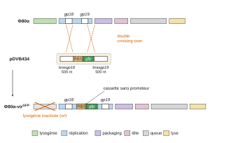
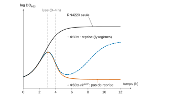
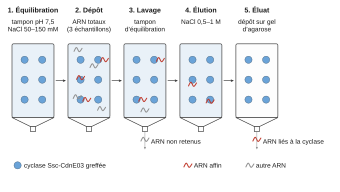
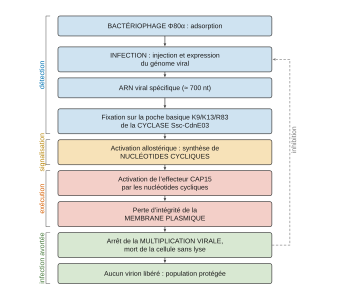

# Agro-Véto TB — Biotechnologies 2026 · Corrigé guidé

*Corrigé rédigé par IA, non officiel. Signalez toute erreur.*

## Présentation du sujet

**Nature de l'épreuve.** Épreuve de **Biotechnologies** de la banque Agro-Véto, filière **TB**, session 2026. Durée **3 heures**. L'usage d'abaques, de tables, de calculatrice et de tout instrument électronique est **interdit** : tous les calculs se mènent de tête ou à la main, ce que le sujet a prévu (les applications numériques ne demandent que des puissances de dix et des produits simples). Le sujet compte 13 pages, dont **10 documents** répartis des pages 6 à 13, et **29 questions numérotées Q1 à Q29**. L'énoncé précise que la plupart des questions sont indépendantes ou regroupées en parties indépendantes, et que la **question rédactionnelle Q12** est clairement identifiée.

**Thème.** Le sujet raconte une seule histoire, celle d'un système immunitaire bactérien récemment découvert, le **CBASS** (*Cyclic oligonucleotide Based Antiphagic Signal System*), et il la raconte dans l'ordre où un laboratoire la construit. Le contexte est industriel : les bactériophages ruinent des bio-productions, notamment en industrie laitière, et comprendre les défenses antiphagiques est une stratégie d'amélioration des souches. Le couple d'étude est *Staphylococcus aureus* RN4220 / bactériophage Φ80α et ses dérivés. Le système repose sur deux acteurs : une **nucléotidyl transférase cyclique**, la cyclase Ssc-CdnE03, qui génère des nucléotides cycliques, et une **protéine effectrice**, CAP15, activée par ces nucléotides.

**Découpage et rôle de chaque partie.**

- **Partie 1 — Préparation d'outils** (Q1 à Q12). Caractérisation du phage par sa carte génétique (Q1), production et titrage (Q2 à Q4), construction d'un phage rapporteur strictement lytique par recombinaison homologue et contre-sélection CRISPR (Q5 à Q7), milieu de culture et souches modifiées (Q8 à Q11), enfin la question rédactionnelle de virologie générale (Q12).
- **Partie 2 — Étude du système CBASS** (Q13 à Q29). Détection : structure électrostatique de la cyclase (Q13, Q14), identification de l'ARN activateur par chromatographie d'affinité et électrophorèse (Q15 à Q18). Outils de lecture : la GFP (Q19 à Q22) et l'iodure de propidium (Q23). Résultats : comparaison des deux souches modifiées en survie de population et en imagerie de cellules uniques (Q24 à Q27). Conclusion : logigramme de la cascade (Q28) et ouverture vers l'apoptose (Q29).

Le fil directeur tient en quatre verbes : **détecter** l'infection, **amplifier** l'alerte par un second messager, **exécuter** en perméabilisant la membrane, **sacrifier** la cellule infectée pour sauver la population.

**Notions du programme mobilisées.** Microbiologie et virologie (structure des virus, cycles lytique et lysogénique, titrage en plages de lyse, multiplicité d'infection, courbes de croissance, milieux de culture, antibiotiques et résistances) ; génie génétique (recombinaison homologue, vecteurs, gène rapporteur, site de fixation du ribosome, CRISPR-Cas9, intégration chromosomique contre plasmide) ; biochimie structurale (acides aminés et leurs propriétés ionisables, structures secondaires des protéines, acides nucléiques, interactions non covalentes) ; techniques séparatives et spectrales (chromatographie d'affinité, électrophorèse en gel d'agarose, fluorescence, spectres d'excitation et d'émission) ; et surtout **analyse de résultats expérimentaux**, qui est la compétence la plus sollicitée de l'épreuve.

**Difficulté et longueur.** Le sujet est long mais régulier : aucune question n'est vraiment difficile isolément, mais vingt-neuf questions en trois heures imposent une moyenne de six minutes par question, question rédactionnelle comprise. La difficulté réelle est donc la **gestion du temps** et la **discipline de forme** : plusieurs questions imposent un format (tableau en Q8, schéma légendé et explicité en Q15, schéma simple en Q5, logigramme en Q28), et répondre en prose à ces questions coûte des points indépendamment de la justesse du fond.

**Barème et résultats de la session.** Le rapport 2026 indique que « chaque partie est notée sur 10 points » et que les deux parties sont indépendantes, l'ordre de traitement étant laissé au candidat. Les statistiques publiées, exprimées sur 10, donnent une moyenne de 5,24, une médiane de 5,10, un écart type de 1,67, pour des notes allant de 1,60 à 9,00 (quartiles 4,00 et 6,30) : l'épreuve classe donc nettement, et les points se gagnent surtout sur les questions que beaucoup de candidats laissent de côté.

**Questions discriminantes.** Le rapport 2026 les désigne sans ambiguïté : les deux questions calculatoires **Q3 et Q4** « n'ont été que très peu abordées » (Q3 n'a été « entièrement traitée » que par six candidats) ; la question rédactionnelle **Q12** n'a pas été traitée par six candidats et reste souvent inachevée ; **Q8** (analyse du milieu) et **Q6** (CRISPR-Cas9) révèlent des lacunes théoriques ; **Q16** touche à une notion « non maîtrisé[e] par 30 % des candidats », le couple anode/cathode ; **Q25** n'a été comprise que par « environ 40% des candidats ». Ce sont les six endroits où une copie se détache.

**Gestion du temps conseillée.** Le jury recommande 90 minutes par partie, chacune valant 10 points, et environ 30 minutes pour la seule Q12. Les questions étant largement indépendantes, il est inutile — et même déconseillé — de commencer par Q1, qui est une question d'analyse lourde pour un rendement moyen. Un ordre de traitement efficace :

1. le bloc technique **Q2 à Q4** et **Q8 à Q9** (calculs de dilution, tableau d'analyse fonctionnelle, sélection par antibiotique) : points sûrs, rapidement acquis ;
2. le bloc biochimie **Q13, Q14** et **Q19 à Q23** : du cours appliqué aux documents, très rentable ;
3. le bloc d'analyse de résultats **Q16 à Q18** et **Q24 à Q26**, cœur scientifique du sujet ;
4. **Q1, Q5 à Q7, Q10, Q11**, plus coûteux en réflexion ;
5. **Q27 à Q29**, qui synthétisent ce qui précède ;
6. **Q12 en dernier**, en lui réservant impérativement une **demi-heure** — le rapport 2026 conseille « environ 30 minutes » pour cette question, à prélever sur les 90 minutes de la partie 1.

**Dépendances réelles**, peu nombreuses mais à connaître : Q5 prépare Q6, qui prépare Q7 ; Q9 suppose d'avoir lu le génotype des souches du document 4 ; Q14 fonde Q15, Q17 et Q18 ; Q22 et Q23 conditionnent la lecture correcte de Q25 ; Q24, Q25 et Q26 s'enchaînent strictement ; Q28 récapitule tout et ne peut pas être traité avant Q26.

**Questions à ne pas laisser passer.** Q3 et Q4 (calcul de dilution et titrage, techniques de base, et pourtant presque désertées en 2026), Q8 (tableau d'analyse fonctionnelle, intégralement guidé par le document), Q9 (une lecture de génotype et une justification de cours), Q13 (connaissance pure), Q16 (deux lignes de raisonnement), Q19 et Q20 (lecture de document). Ces sept questions représentent un quart du sujet et ne demandent aucune idée nouvelle.

## Partie 1. Préparation d'outils pour l'étude du système immunitaire via le système CBASS

Cette première partie n'est pas encore de la biologie du CBASS : elle outille l'étude. On y caractérise le virus modèle à partir de sa carte génétique, on le produit et on le titre, on en fabrique une version rapporteuse strictement lytique, et on construit les souches bactériennes modifiées. Les compétences mobilisées sont celles d'un technicien supérieur — dénombrement, dilutions, purification, analyse fonctionnelle d'un milieu, choix d'un support de modification génétique — appliquées à un support de recherche.

### 1. Bactériophage Φ80α

### Question 1 — Caractéristiques structurales et mode de multiplication du phage Φ80α

> [!INDICATION]
> L'énoncé prévient que la signification des gènes n'est pas fournie : renoncez à décoder les sigles un à un et regardez d'abord comment la carte est découpée.

> [!INDICATION]
> Chaque groupe de gènes renseigne soit sur une pièce du virion, soit sur une étape du cycle. Traitez séparément ce qui relève de la structure et ce qui relève du mode de multiplication.

> [!INDICATION]
> Un seul module tranche la question du cycle : demandez-vous quelles fonctions sont indispensables pour qu'un génome viral puisse rester silencieux à l'intérieur d'un chromosome bactérien, puis en ressortir.

#### Solution

Le document 1 présente une carte génétique linéaire de **73 gènes** organisés en **six modules fonctionnels contigus** : lysogénie, réplication, encapsidation (*packaging*), tête (*head*), queue (*tail*) et lyse. C'est cette organisation modulaire, et non le détail des gènes, qui doit être exploitée.

**a. Caractéristiques structurales.**

- **Génome d'ADN double brin.** Les gènes de réplication nommés *Initiator*, *DnaC* et *SSB* (protéine de liaison à l'ADN simple brin, qui n'a de sens que lors de l'ouverture d'un duplex) et la présence d'une intégrase imposent un génome d'**ADN bicaténaire**. La carte est linéaire et bornée, ce qui est cohérent avec un ADN linéaire dans le virion, encapsidé par translocation à travers un portail. Un génome de 73 gènes correspond, pour un phage caudé, à quelques dizaines de kilopaires de bases (donnée extérieure au document).
- **Virion à symétrie mixte, de type « têtard ».** Le module « tête » (protéine d'échafaudage *Scaf*, protéine majeure de capside, protéase de maturation) impose une **capside icosaédrique** ; le module « queue », très développé (une douzaine de gènes dont *TMP*, *Tape Measure Protein*, *STP*, *TFiber*, une hydrolase associée), impose une **queue** munie de **fibres**. La longueur du gène *TMP* fixant la longueur de la queue, celle-ci est **longue** ; l'**absence**, sur la carte, de tout gène de gaine contractile ou de plaque basale oriente vers une **queue non contractile** (morphotype siphovirus) — conclusion probable, non certaine.
- **Virion nu.** Aucun gène de glycoprotéine ni de protéine d'enveloppe n'apparaît, et l'architecture tête-queue est celle d'un virion **non enveloppé**. La stabilité du lysat à 4 °C et sa filtrabilité (document 2) sont cohérentes avec cette conclusion.
- **Encapsidation active.** Les terminases *TerS*/*TerL* et la protéine du *portal* signent une translocation de l'ADN dans une procapside préformée.

La **nucléocapside** est donc formée de l'ADN bicaténaire linéaire condensé dans une capside protéique icosaédrique, l'ensemble prolongé par la queue : c'est l'organisation canonique d'un phage caudé.

**b. Mode de multiplication.** Le **module de lysogénie** placé en tête de carte contient une **intégrase** (*Int*), une **excisionase** (*Xis*), un **répresseur CI** et son antagoniste **Cro**. Ce quatuor est la signature d'un **phage tempéré**, capable des deux cycles :

- **cycle lysogénique** : intégration site-spécifique du génome viral dans le chromosome de l'hôte par *Int*, état de **prophage**, répression des gènes lytiques par CI, immunité de superinfection, transmission verticale ;
- **cycle lytique** : bascule CI → Cro, réplication de l'ADN (module de réplication), expression tardive des gènes de morphogenèse, encapsidation, puis **lyse**. Le module terminal associe une **holine** (perméabilisation de la membrane plasmique) et une **endolysine** (hydrolyse du peptidoglycane) : la libération se fait par **lyse** de l'hôte, non par bourgeonnement.

$$\boxed{\text{Φ80α : virus nu, ADN double brin linéaire, capside icosaédrique + queue longue à fibres ; phage } \textbf{tempéré} \text{ ; libération par lyse holine/endolysine.}}$$

> [!METHODE]
> Devant une carte génétique, on lit toujours dans cet ordre : nombre et sens des gènes, puis découpage en modules fonctionnels, puis conclusions structurales (ce que codent les modules de morphogenèse) et fonctionnelles (ce que codent les modules de régulation). Chaque conclusion doit pouvoir être rattachée à un gène ou à un module nommé.

> [!PIEGE]
> Conclure que le phage est strictement lytique parce que le document 2 décrit une lyse totale de la culture en 3 à 4 heures. Une lyse massive à l'échelle de la population n'exclut pas que des cellules individuelles soient entrées en lysogénie — et c'est précisément pour cela que les auteurs devront construire un dérivé strictement lytique (Q7).

> [!JURY]
> Le rapport 2026 énumère les éléments attendus : « nature de la nucléocapside et organisation, mode de multiplication par cycle lytique et lysogénique ». Il ajoute que « les meilleures copies se focalisent sur ces éléments clefs » sans se disperser dans les autres modules fonctionnels, et « prennent le temps de décrire, illustrer et expliciter les données ». Chaque affirmation doit donc être adossée à un élément nommé de la carte, et rien de plus n'est demandé.

### Question 2 — Étapes de purification du phage à partir du lysat

> [!INDICATION]
> Relisez le document 2 en ne retenant que les opérations qui séparent le phage de ce qui l'entoure, et dressez d'abord la liste de ce que contient le lysat.

> [!INDICATION]
> Pour chaque opération, nommez la propriété physique qui diffère entre le virion et ce que l'on élimine : c'est elle qui constitue l'argument.

#### Solution

Après lyse totale, le lysat contient les virions recherchés, des bactéries non lysées, des débris de paroi et de membrane, des macromolécules solubles et le milieu de culture. Trois opérations successives, chacune fondée sur une **propriété différentielle** entre le virion et ce dont on le sépare.

**1. Centrifugation 4 300 g, 10 min — séparation par coefficient de sédimentation.** Une bactérie entière (≈ 1 µm) et les gros débris sédimentent à cette accélération modérée ; un virion (≈ 50–200 nm) reste en suspension, son culottage exigerait une ultracentrifugation (≳ 25 000 g). **Le produit recherché est donc le surnageant**, enrichi en phages et débarrassé des cellules et des débris grossiers. L'accélération est volontairement faible : plus élevée, elle entraînerait des phages dans le culot.

**2. Filtration sur membrane 0,45 µm — séparation par taille.** Le seuil de 0,45 µm est très inférieur au diamètre d'un coque de *S. aureus* (0,8–1,0 µm) et très supérieur à celui d'un virion : les bactéries résiduelles sont retenues, les phages traversent. La filtration est **clarifiante et débactérisante** vis-à-vis de *S. aureus* — elle n'est pas stérilisante au sens strict, seuil qui serait 0,22 µm. Le choix de 0,45 µm se justifie doublement : moindre colmatage sur un lysat chargé, et surtout moindre rétention non spécifique des phages à longue queue.

**3. Conservation à 4 °C — stabilisation.** Ce n'est pas une étape de séparation, mais elle est indissociable des précédentes : le froid ralentit les protéases et les nucléases résiduelles et limite la dénaturation des protéines de capside, donc la perte de titre infectieux. On évite la congélation, dont les cycles gel/dégel décrochent les queues.

Cette purification est **fonctionnelle et non absolue** : elle élimine cellules et débris, non les macromolécules solubles. Une purification poussée exigerait une ultracentrifugation en gradient de densité de chlorure de césium.

$$\boxed{\text{centrifugation } 4\,300\,g \ (\text{cellules, débris}) \rightarrow \text{filtration } 0{,}45\ \mu\text{m} \ (\text{bactéries résiduelles}) \rightarrow 4\ ^\circ\text{C} \ (\text{stabilité du titre})}$$

> [!PIEGE]
> Se tromper de fraction après la centrifugation. Le produit recherché est le surnageant, non le culot : une copie qui récupère le culot perd l'ensemble de la question, même si la justification physique est juste.

> [!JURY]
> Question « bien traitée » en 2026, « avec parfois des schémas efficaces et de bonnes explications quant aux principes physiques mis en œuvre » : c'est bien la propriété physique différentielle qui porte la note. Le rapport prévient en revanche que « la description des étapes du protocole de production des phages n'était pas demandée » — recopier le document 2 avant de répondre ne rapporte rien et coûte du temps.

### Question 3 — Préparation de la suspension phagique à utiliser (argumentation par le calcul)

> [!INDICATION]
> Partez de ce que le support impose : un volume déposé par spot, un nombre maximal de plages comptables, un nombre de spots.

> [!INDICATION]
> Traduisez la contrainte de comptage en une contrainte sur la concentration de la suspension effectivement déposée. Surveillez les unités de volume.

> [!INDICATION]
> Le titre de la suspension à vérifier n'est pas totalement inconnu : le document 2 le donne indirectement, par la concentration bactérienne et la multiplicité d'infection.

#### Solution

**Fenêtre de comptage imposée par le support.** Chaque spot dépose $V = 5\ \mu\text{L} = 5\times10^{-3}$ mL. Si $C$ est la concentration en phages infectieux de la suspension déposée, le nombre de plages attendues est $N = C\,V$. La contrainte « au plus 50 PFU comptables » s'écrit

$$\begin{aligned}
N = C\,V &\le 50 \\
C &\le \frac{50}{5\times10^{-3}} \\
C &\le 1{,}0\times10^{4}\ \text{PFU}\cdot\text{mL}^{-1}
\end{aligned}$$

Un comptage n'est en outre fiable qu'au-dessus d'une dizaine d'unités, l'incertitude relative d'un comptage poissonien valant $1/\sqrt{N}$ : ± 45 % pour $N = 5$, ± 14 % pour $N = 50$. D'où la fenêtre utile

$$\boxed{2\times10^{3}\ \text{PFU}\cdot\text{mL}^{-1} \le C_{\text{spot}} \le 1{,}0\times10^{4}\ \text{PFU}\cdot\text{mL}^{-1}}$$

c'est-à-dire une fenêtre **étroite, inférieure à une unité logarithmique** : les dilutions étant décimales, **une seule** dilution de la gamme y tombera.

**Facteur de dilution requis.** La suspension à vérifier est la **suspension phagique initiale infectieuse**, celle qui sert à infecter à MOI = 0,1 une culture à ≈ 1 × 10⁸ UFC·mL⁻¹ : le document 2 lui attribue $T \approx 1\times10^{7}$ PFU·mL⁻¹. Avec une dilution $10^{-n}$, il faut

$$\begin{aligned}
T\times10^{-n} &\le 10^{4} \\
n &\ge \log_{10} T - 4 \\
n &\ge 7 - 4 \\
n &\ge 3
\end{aligned}$$

- dilution $10^{-3}$ : $C = 10^{4}$ PFU·mL⁻¹, soit $N = 50$ plages — borne haute de la fenêtre ;
- dilution $10^{-4}$ : $C = 10^{3}$ PFU·mL⁻¹, soit $N = 5$ plages — comptable mais statistiquement médiocre.

**Plan de dilution retenu pour les 12 spots.** Le titre annoncé étant justement ce que l'on veut vérifier, on encadre largement : gamme décimale de $10^{-1}$ à $10^{-5}$ **en duplicat** (10 spots), plus un spot de **témoin diluant** (stérilité) et un spot de suspension pure (lyse confluente attendue, témoin positif) : $10 + 1 + 1 = 12$ spots exactement. Le duplicat divise par $\sqrt{2}$ l'incertitude de comptage et révèle une erreur de pipetage. Si le titre réel s'écartait beaucoup de $10^{7}$, la lecture resterait possible sur l'une des bornes et l'on ajusterait la gamme au second essai.

**Préparation matérielle.** Chaque dilution décimale se prépare en portant 100 µL de la dilution précédente dans 900 µL de diluant (BHI + 5 mM CaCl₂) : facteur 10, volume final 1 mL par tube, très supérieur aux 5 µL prélevés.

La concentration déposée doit rester au plus égale à $1{,}0\times10^{4}$ PFU·mL⁻¹, d'où la dilution minimale à appliquer à la suspension initiale :

$$\boxed{\text{dilution} \ge 10^{-3}}$$

Gamme retenue : de $10^{-1}$ à $10^{-5}$, en duplicat, plus deux témoins.

> [!METHODE]
> Tout problème de dénombrement se pose à l'envers : on part de la fenêtre de comptage imposée par le support (ici 10 à 50 unités par spot), on la traduit en concentration à l'aide du volume déposé, puis en facteur de dilution à l'aide du titre attendu. La borne basse se justifie par l'incertitude relative d'un comptage aléatoire, en 1/√N.

> [!PIEGE]
> Oublier que 5 µL valent 5 × 10⁻³ mL. L'erreur décale le résultat de trois décades : une copie qui annonce une dilution 10⁻⁶ pour une suspension à 10⁷ PFU·mL⁻¹ a presque toujours commis cette faute.

> [!JURY]
> C'est la question la plus rentable du sujet : selon le rapport 2026, « cette question calculatoire a été entièrement traitée par 6 candidats qui ont déterminé les dilutions de la suspension phagique, en posant correctement le contexte et les calculs ». Le jury signale par ailleurs, pour l'ensemble de l'épreuve, que « certaines compétences fondamentales restent à renforcer (calculs simples de dilution ou de quantités) ». Poser le contexte — volume déposé, nombre de plages comptables, titre attendu — fait donc partie de la réponse, et une réponse purement descriptive ne vaut rien ici.

### Question 4 — Réalisation pratique et choix réalisés

> [!INDICATION]
> Déroulez la manipulation dans l'ordre chronologique et, à chaque geste, demandez-vous ce qui arriverait si vous l'omettiez : c'est ainsi qu'on justifie un choix.

> [!INDICATION]
> Trois détails conditionnent la lisibilité des spots : la nature de la gélose coulée en surface, un additif du milieu déjà rencontré au document 2, et un geste à faire avant tout dépôt.

> [!INDICATION]
> N'oubliez pas de dire comment on exploite la lecture : la question du titre se règle par une relation littérale entre le nombre de plages, le volume déposé et la dilution.

#### Solution

**1. Préparation du tapis bactérien.** Dans une boîte de Petri Ø = 90 mm contenant une gélose BHI, on coule une couche de **gélose molle** (0,5 à 0,7 % d'agar) BHI additionnée de **5 mM CaCl₂** et ensemencée avec *S. aureus* RN4220 en phase exponentielle (≈ 10⁸ UFC·mL⁻¹). Trois choix sont décisifs :

- **gélose molle** : sa faible teneur en agar autorise la diffusion latérale des virions libérés, sans laquelle aucune plage de lyse ne deviendrait visible ;
- **CaCl₂** : les ions Ca²⁺ sont indispensables à l'**adsorption** du phage sur son récepteur pariétal ; les omettre effondre le titre apparent ;
- **hôte en phase exponentielle** : seules des bactéries en croissance active sont pleinement permissives.

La boîte est **séchée** 15 à 20 min, couvercle entrouvert : sans cela, les gouttes de 5 µL s'étalent et les spots fusionnent.

**2. Repérage.** On trace au marqueur, **sous** la boîte, une grille de 12 secteurs identifiés (3 × 4). La surface utile vaut $S = \pi\times(45)^2 \approx 6{,}4\times10^{3}$ mm², soit ≈ 530 mm² par secteur, c'est-à-dire un disque de ≈ 25 mm de diamètre : largement suffisant pour une goutte de 5 µL, qui s'étale sur 4 à 6 mm.

**3. Réalisation de la gamme.** Douze tubes stériles contenant 900 µL de diluant (BHI + 5 mM CaCl₂) sont alignés et identifiés. On porte 100 µL de la suspension mère dans le premier, on **homogénéise au vortex** 5 s, puis on reporte 100 µL dans le suivant, et ainsi de suite. **On change de cône à chaque transfert** : conserver le même cône reporte des virions adsorbés sur sa paroi et fausse la gamme par le haut.

**4. Dépôt.** On dépose 5 µL au centre de chaque secteur, en **commençant par la suspension la plus diluée** et en terminant par la plus concentrée, de façon qu'un report accidentel reste sans conséquence. Le cône est tenu à quelques millimètres de la gélose sans la toucher (une piqûre créerait un puits et une plage aberrante). On laisse la boîte à plat, couvercle entrouvert, 10 à 15 min, jusqu'à absorption complète des gouttes.

**5. Incubation.** 18 h à 37 °C, **boîte non retournée** tant que les gouttes ne sont pas absorbées — exception à la règle de l'incubation en position inversée, destinée ici à éviter la coulure.

**6. Lecture et calcul du titre.** On repère le secteur présentant entre 10 et 50 plages individualisées. Si $N$ plages sont comptées à la dilution $10^{-n}$ :

$$\begin{aligned}
T &= \frac{N}{V\times10^{-n}} \\
&= \frac{N}{5\times10^{-3}\times10^{-n}} \\
&= N\times 2\times10^{2}\times10^{n}\ \text{PFU}\cdot\text{mL}^{-1}
\end{aligned}$$

Exemple, pour $N = 35$ plages à la dilution $10^{-4}$ :

$$T = 35\times2\times10^{2}\times10^{4} = 7{,}0\times10^{7}\ \text{PFU}\cdot\text{mL}^{-1}.$$

**Asepsie.** Travail sous poste de sécurité microbiologique ou à proximité du bec Bunsen, cônes à filtre stériles, élimination des déchets contaminés en sac d'autoclavage.

$$\boxed{T = \frac{N}{V\cdot10^{-n}}}$$

> [!PIEGE]
> Écrire que l'on incube « boîte retournée, comme toujours ». La technique des spots l'interdit tant que les gouttes ne sont pas absorbées : la règle générale cède ici devant la contrainte expérimentale.

> [!JURY]
> Le rapport 2026 rappelle que « cette question pouvait être traitée indépendamment de la précédente » : un blocage sur le calcul de Q3 n'interdit pas de présenter les étapes du dénombrement, et pourtant « de nombreuses copies ne l'ont pas traitée ». Il précise aussi que « de bonnes copies se sont appuyées sur des schémas annotés et explicités » : un schéma de la gamme de dilution et du dépôt des spots vaut mieux qu'un paragraphe. L'asepsie et l'élimination des déchets contaminés restent, elles, implicitement exigées dans une épreuve de biotechnologies.

### 2. Bactériophage Φ80α-virGFP

Trois questions enchaînées : comprendre la construction (Q5), comprendre le tri qui la rend exploitable (Q6), puis transposer la stratégie à un autre objectif (Q7). Les outils sont la recombinaison homologue et le système CRISPR-Cas9.

### Question 5 — Rôle des éléments apportés par pDVB434 et organisation du génome recombinant

> [!INDICATION]
> Le document 3 énumère trois éléments pour pDVB434 : attribuez à chacun une fonction, et une seule.

> [!INDICATION]
> Demandez-vous surtout ce que le plasmide ne contient pas, et ce que cette absence implique pour le contrôle de l'expression de la GFP.

> [!INDICATION]
> Pour le schéma, deux informations sont indispensables : les bornes de l'insertion, et le fait que l'énoncé qualifie ce phage d'exclusivement lytique.

#### Solution

**Rôle des trois éléments.**

- **Les deux bras d'homologie de 500 nt**, correspondant aux séquences *gp18* et *gp19* du phage, sont les **adresses** de la construction. Lorsqu'une bactérie transformée par pDVB434 est infectée par Φ80α-vir (étape 2), le génome viral et le plasmide coexistent dans le cytoplasme : la machinerie de **recombinaison homologue** de l'hôte (voie RecA) apparie ces bras aux régions correspondantes du génome viral et réalise un **double crossing-over**. Une longueur de 500 nt est le compromis usuel : assez longue pour une recombinaison efficace, assez courte pour un plasmide maniable.
- **La séquence codante *gfp*** est le **cargo** : c'est elle qui est transférée entre *gp18* et *gp19* lors du double crossing-over. C'est le **gène rapporteur** dont l'expression signalera l'infection.
- **La séquence RBS** (*Ribosome Binding Site*, Shine-Dalgarno) est indispensable à la **traduction** : elle recrute la petite sous-unité du ribosome en amont du codon initiateur AUG. Sans elle, l'ARN messager porteur de *gfp* serait transcrit mais non traduit, et aucune fluorescence n'apparaîtrait.

**Conséquence importante : pDVB434 n'apporte pas de promoteur.** La cassette est donc insérée en **fusion transcriptionnelle** : *gfp* est transcrit sous le contrôle du promoteur phagique qui gouverne déjà la région *gp18*–*gp19*. La GFP n'est par conséquent produite **que dans une cellule effectivement infectée et engagée dans le cycle**, ce qui fait d'elle un rapporteur de l'infection et non un marqueur constitutif. La lecture de la carte du document 1 place *gp18* et *gp19* dans la région précoce, en amont des modules de morphogenèse ; si cette lecture est exacte, la fluorescence apparaît tôt après l'infection — mais la conclusion précédente n'en dépend pas.



La cassette **RBS-*gfp*** est insérée entre *gp18* et *gp19*, sans promoteur propre ; le module de lysogénie (*cI*, *int*) est rendu non fonctionnel par la mutation *vir*, d'où un phage **exclusivement lytique**, comme l'annonce l'énoncé.

$$\boxed{\text{pDVB434 = matrice de recombinaison : 2 bras de 500 nt (adressage) + RBS (traduction) + }\textit{gfp}\text{ (rapporteur), sans promoteur.}}$$

> [!PIEGE]
> Confondre site de fixation du ribosome et promoteur. Le premier est un site traductionnel porté par l'ARN messager, le second un site transcriptionnel porté par l'ADN. L'erreur est fréquente et, ici, elle fait manquer le point le plus intéressant de la question.

> [!METHODE]
> Devant une construction génétique, demandez-vous toujours ce qui manque autant que ce qui est présent : l'absence de promoteur est ce qui transforme la GFP en rapporteur de l'infection plutôt qu'en marqueur permanent.

> [!JURY]
> Deux reproches précis en 2026. D'abord, le mécanisme doit être nommé : « le mécanisme d'une recombinaison homologue n'est pas nommé » dans les copies, alors que le principe de la construction était compris. Ensuite, « les erreurs sont trouvées quant au rôle de la séquence RBS confondue avec la séquence codante de la protéine GFP » : écrire « recombinaison homologue par double crossing-over » et distinguer explicitement le site de fixation du ribosome de la séquence codante suffit à se placer au-dessus de la moyenne.

### Question 6 — Fonctionnement de CRISPR-Cas9 et élimination des phages non recombinants

> [!INDICATION]
> Deux temps bien séparés : le système en lui-même (ses acteurs, ce qu'il reconnaît, ce qu'il fait), puis son emploi comme filtre dans le protocole.

> [!INDICATION]
> Quelle différence de séquence existe-t-il, au point d'insertion, entre un phage recombinant et un phage parental ? C'est de là que vient la sélection.

> [!INDICATION]
> Demandez-vous enfin ce qu'il advient d'une cassure double brin dans un génome phagique en cours de réplication, et pourquoi cela décide de son sort.

#### Solution

**a. Fonctionnement du système.** Le système CRISPR-Cas de type II est, dans son contexte naturel, un **système immunitaire adaptatif bactérien** dirigé contre les acides nucléiques étrangers, phages compris. Il repose sur deux composants :

- une **endonucléase Cas9**, protéine bilobée à deux domaines catalytiques (RuvC et HNH), chacun coupant un brin ;
- un **ARN guide**, chimère du crRNA — dont une vingtaine de nucléotides sont complémentaires de la cible — et du tracrRNA, qui assure le repliement et l'ancrage sur Cas9.

Le complexe Cas9–ARN guide balaie l'ADN à la recherche d'un motif court adjacent à la cible, le **PAM** (*Protospacer Adjacent Motif*), dont la séquence est propre à chaque orthologue de Cas9 (5′-NGG-3′ pour celui de *Streptococcus pyogenes*, 5′-NNGRRT-3′ pour celui de ***S. aureus***, qui est le système porté par pDVB435). En présence d'un PAM, l'ADN est localement déroulé, le guide s'apparie au brin complémentaire et, si l'appariement est correct, les deux domaines catalytiques coupent : il en résulte une **cassure double brin à bouts francs**, trois paires de bases en amont du PAM.

**b. Élimination des phages non recombinants.** À l'issue de l'étape 2, la descendance phagique est une population **mixte** : une minorité de recombinants ayant intégré la cassette RBS-*gfp*, et une écrasante majorité de parentaux Φ80α-vir n'ayant pas recombiné, la recombinaison homologue étant un événement rare (de l'ordre de 10⁻⁴ à 10⁻⁶). Un criblage individuel par fluorescence serait hors de portée.

Le plasmide pDVB435 porte un système CRISPR-Cas9 ciblant « uniquement une séquence spécifique du bactériophage Φ80α », en l'occurrence la séquence du point d'insertion. Lorsque, à l'**étape 3**, ces phages infectent *S. aureus*-pDVB435 :

- chez un **phage non recombinant**, la séquence cible est intacte : Cas9 la reconnaît, coupe le génome viral en double brin, et le cycle avorte. Le phage ne se multiplie pas et ne forme pas de plage ;
- chez un **phage recombinant**, l'insertion de la cassette a détruit ou déplacé la séquence cible et son PAM : le guide ne trouve plus d'appariement, Cas9 ne coupe pas, le génome est répliqué et encapsidé normalement.

La coupure est **létale pour le phage** parce que, dans ce contexte, elle n'est pas réparée : *S. aureus* ne possède pas de voie de jonction d'extrémités non homologues, et le génome viral coupé ne dispose d'aucune matrice homologue utilisable. (La recombinaison homologue bactérienne, elle, existe bel et bien : c'est elle qui a réalisé l'insertion à l'étape 2.)

Le système réalise donc une **contre-sélection** : il n'avantage pas les recombinants, il élimine tout le reste. Le tri s'opère à l'étape 3, de sorte que les phages **récupérés et concentrés à l'étape 4 sont pratiquement tous des Φ80α-virGFP**, sans criblage individuel.

$$\boxed{\text{Cas9 coupe le génome des phages ayant conservé la cible ; seuls les recombinants, dont la cible est remplacée par RBS-}\textit{gfp}\text{, se multiplient.}}$$

> [!PIEGE]
> Présenter CRISPR-Cas9 comme l'outil qui insère la GFP. Ici, il n'insère rien : c'est la recombinaison homologue guidée par pDVB434 qui insère, à l'étape 2, et le système CRISPR qui trie, à l'étape 3. Confondre les deux rôles, c'est manquer toute l'architecture du protocole.

> [!METHODE]
> Une contre-sélection ne favorise pas ce que l'on cherche : elle supprime tout le reste. C'est la stratégie de choix lorsque l'événement recherché est trop rare pour un criblage individuel — ordre de grandeur à citer, car c'est lui qui justifie l'existence de l'étape.

> [!JURY]
> Question signalée comme mal maîtrisée : « la description du système CRISPRCas n'est globalement pas très bien maîtrisée par les candidats ». Le rapport 2026 indique ce qui distingue les bonnes copies — elles « contextualisent son principe en s'appuyant sur l'objectif d'éliminer des phages non recombinés, avec des schémas de qualité pour compléter l'argumentation ». Exposer le système dans l'abstrait, sans le rapporter au tri de l'étape 3, ne suffit donc pas.

### Question 7 — Obtenir des phages lytiques Φ80α-vir à partir de Φ80α

> [!INDICATION]
> La question 1 a déjà identifié ce qui, dans ce génome, rend la lysogénie possible : la cible est là.

> [!INDICATION]
> L'énoncé signale que la procédure d'obtention de ce phage n'est pas décrite : c'est une invitation à transposer la stratégie en deux temps déjà exposée dans le document 3.

> [!INDICATION]
> Une méthode n'est complète que si l'on dit comment on contrôle qu'elle a réussi : pensez à un critère visible sur boîte.

#### Solution

**Cible moléculaire.** Le caractère tempéré de Φ80α repose sur le module de lysogénie identifié en Q1 ; la bascule lyse/lysogénie est gouvernée par le **répresseur CI**, qui occupe les opérateurs et réprime les gènes lytiques précoces. Un mutant *vir* est un mutant **insensible à la répression**. Rendre le phage strictement lytique revient donc à **supprimer la fonction CI** et, pour être complet, à supprimer également l'**intégrase** *int*, ce qui interdit physiquement l'intégration au chromosome.

**Méthode proposée — remplacement allélique par recombinaison homologue, puis contre-sélection CRISPR** (transposition de la stratégie du document 3) :

1. **Construire un plasmide** portant deux bras d'homologie d'environ 500 nt correspondant aux régions flanquant *cI*–*int*, encadrant une délétion ou une courte séquence de substitution (codons stop dans les trois cadres).
2. **Transformer** *S. aureus* RN4220 par ce plasmide.
3. **Infecter** cette souche par Φ80α sauvage : pendant le cycle lytique, une fraction rare des génomes viraux subit un double crossing-over et perd *cI* (et *int*).
4. **Récupérer la descendance** et en **infecter une seconde souche** transformée par un plasmide CRISPR-Cas9 dont le guide cible la séquence *cI* sauvage : les phages ayant conservé *cI* sont coupés et éliminés, seuls les phages délétés se multiplient.
5. **Vérifier** le phénotype par trois critères indépendants : plages de lyse **claires** et non troubles, absence de formation de lysogènes sur boîte, et incapacité à être bloqué par une souche lysogène pour Φ80α.

**Variante par enzymes de restriction.** Le même objectif — supprimer les séquences codant la lysogénie — s'atteint par digestion du génome viral purifié au moyen d'enzymes de restriction encadrant le module *cI*–*int*, religature du génome délété, puis transfection de la souche hôte. La méthode est plus grossière (elle dépend de la présence de sites uniques bien placés) mais elle ne demande ni plasmide de recombinaison ni système CRISPR.

**Méthode alternative, sans génie génétique.** Historiquement, les mutants *vir* s'obtiennent par **sélection de mutants spontanés** : on étale une forte quantité de phages sauvages sur un tapis d'une souche **lysogène** pour Φ80α, immunisée par le CI qu'elle produit. Seuls les rares mutants insensibles à CI (mutations des opérateurs) forment des plages, que l'on repique. Rendement faible et mutation non contrôlée, mais aucun outil moléculaire requis ; une mutagenèse préalable (UV, agent alkylant) augmente la fréquence au prix de mutations secondaires.

$$\boxed{\text{Inactiver } \textit{cI} \text{ (et } \textit{int}\text{) par recombinaison homologue plasmidique, puis contre-sélectionner par CRISPR-Cas9 ciblant } \textit{cI}.}$$

> [!JURY]
> Le rapport 2026 résume l'attendu : la question « aborde l'élimination des séquences codantes pour la lysogénie afin de générer des phages lytiques », et il valide plusieurs voies — « nécessité de supprimer les séquences lysogènes par exemple, par l'utilisation du système CRISPRCas ou d'enzymes de restriction ». Toute stratégie cohérente est donc acceptée, à condition de nommer la cible moléculaire ; un critère de vérification (plages claires) achève de distinguer la réponse.

### 3. *Staphylococcus aureus* RN4220 et souches modifiées

On passe du virus à l'hôte : analyse du milieu de culture (Q8), adaptation sélective pour les souches modifiées (Q9), prévision de courbes de croissance (Q10), choix du support génétique (Q11), puis la question rédactionnelle (Q12), qui sort du dossier documentaire et mobilise le cours de virologie.

### Question 8 — Analyse fonctionnelle du milieu BHI Broth

> [!INDICATION]
> La forme est imposée. Choisissez trois colonnes, et une ligne par ligne du document, sans en sauter.

> [!INDICATION]
> Cherchez le constituant qui joue deux rôles à la fois, et n'oubliez ni le solvant ni le pH final, qui figurent eux aussi dans la formule.

#### Solution

Le bouillon BHI (*Brain Heart Infusion*) est un milieu **liquide, complexe (non synthétique), riche, tamponné et non sélectif**.

| Constituant (pour 1 L) | Nature / apport chimique | Rôle fonctionnel |
|---|---|---|
| Peptone — 10,0 g | Hydrolysat enzymatique de protéines : peptides courts, acides aminés libres | Source d'**azote** organique et de **carbone** directement assimilable ; fournit les acides aminés que *S. aureus*, auxotrophe pour plusieurs d'entre eux, ne sait pas synthétiser |
| Infusion de cervelle de veau — 12,5 g | Extrait tissulaire : peptides, acides aminés, lipides, vitamines du groupe B, bases azotées, oligo-éléments | Apport de **facteurs de croissance** non substituables ; permet la culture de bactéries exigeantes |
| Infusion de cœur de bœuf — 5,0 g | Extrait tissulaire complémentaire (nucléotides, minéraux, hème) | Même rôle ; la combinaison des deux infusions élargit le spectre des facteurs apportés |
| Chlorure de sodium — 5,0 g | Sels minéraux : Na⁺, Cl⁻ (≈ 86 mmol·L⁻¹) | Maintien de la **pression osmotique** et de l'**équilibre ionique** ; à 0,5 %, cette concentration n'a aucun effet sélectif |
| Hydrogénophosphate disodique anhydre — 2,5 g | Couple tampon HPO₄²⁻/H₂PO₄⁻ (p$K_{a2} \approx 7{,}2$), ≈ 18 mmol·L⁻¹ | **Double rôle** : pouvoir tampon limitant l'acidification due à la fermentation du glucose, et source de **phosphore** (acides nucléiques, ATP, phospholipides) |
| Glucose — 2,0 g | Ose simple, ≈ 11 mmol·L⁻¹ | **Source de carbone et d'énergie** rapidement métabolisable (glycolyse) ; soutient la croissance exponentielle rapide exigée par le protocole (phase exponentielle en ≈ 90 min) |
| Eau distillée — q.s.p. 1 000 mL | Solvant purifié, exempt d'ions parasites | **Solvant** de tous les constituants ; assure l'activité de l'eau et le transport des solutés |
| pH final 7,4 ± 0,2 à 25 °C | Paramètre physico-chimique | pH **neutre**, optimal pour *S. aureus* (neutrophile) et compatible avec la stabilité des virions |

**Conclusion.** Aucun constituant n'est inhibiteur ni indicateur : le BHI est un milieu **d'enrichissement non sélectif et non différentiel**, adapté à la production d'une forte biomasse en phase exponentielle, c'est-à-dire de cellules hôtes métaboliquement actives — exactement ce qu'exige la production de phages. Le complément de **5 mM CaCl₂** du document 2 n'appartient pas à la formule de base et n'a pas de rôle nutritionnel : il sert à l'**adsorption phagique**.

> [!PIEGE]
> Attribuer au chlorure de sodium un rôle sélectif. C'est exact dans un milieu de Chapman, où il atteint 7,5 %, et faux ici, où il n'est qu'à 0,5 % : à cette concentration, il n'assure que l'équilibre osmotique.

> [!JURY]
> « Cette question classique n'a pas été bien traitée et a montré des confusions sur le rôle des éléments du milieu ou des réponses stéréotypées sans argumentation construite », note le rapport 2026, qui parle ailleurs d'une analyse « superficielle avec parfois des erreurs notables sur les rôles des composants ». Le tableau demandé doit donc argumenter chaque ligne — nature chimique, puis rôle pour la bactérie — et non réciter « source de carbone, source d'azote, équilibre osmotique ».

### Question 9 — Adaptation du milieu pour les souches OGM

> [!INDICATION]
> Le génotype des souches, au document 4, contient déjà le marqueur de sélection : lisez-le en entier.

> [!INDICATION]
> Justifiez dans les deux sens — pourquoi les souches modifiées poussent, pourquoi la sauvage ne pousse pas — et pensez à la contrainte technique propre à cet antibiotique lors de la préparation du milieu.

> [!INDICATION]
> Le verbe « garantir » de l'énoncé mérite un commentaire : tous les antibiotiques ne tuent pas.

#### Solution

Le document 4 indique que les deux souches modifiées, RN4220::*Ssc*-CBASS-cmᴿ et RN4220::*Ssc*-CdnE03-cmᴿ, portent toutes deux, intégrée au chromosome, une séquence **cmᴿ** codant la **résistance au chloramphénicol**. La souche sauvage en est dépourvue : le marqueur de sélection est donc fourni par l'énoncé.

**Adaptation proposée.** Ajouter au bouillon BHI du **chloramphénicol** à concentration sélective, soit environ **10 µg·mL⁻¹** pour *S. aureus* (usuellement 5 à 15 µg·mL⁻¹). L'antibiotique étant **thermolabile**, il ne doit pas être autoclavé : on prépare une solution mère concentrée dans l'éthanol, on la **stérilise par filtration à 0,22 µm** et on l'ajoute au milieu **après** autoclavage et refroidissement en dessous de 50 °C.

**Justification du couple mécanisme / sélection.** Le chloramphénicol est un inhibiteur de la **traduction** : il se fixe sur le centre peptidyl-transférase de la sous-unité **50S** du ribosome bactérien et bloque la formation de la liaison peptidique ; il est **bactériostatique**, à large spectre. Le gène cmᴿ code une **chloramphénicol acétyltransférase**, qui acétyle l'antibiotique et l'empêche de se fixer au ribosome.

- **Souches OGM** : elles produisent l'acétyltransférase, inactivent l'antibiotique et **croissent normalement**.
- **Souche sauvage** : dépourvue de cmᴿ, sa traduction est bloquée et sa **croissance est empêchée**, ce qu'exige l'énoncé.

**Deux réserves.** D'abord, le chloramphénicol étant **bactériostatique** et non bactéricide, il inhibe la souche sauvage sans la tuer : des cellules sauvages viables peuvent persister. Pour une élimination stricte, il faudrait augmenter la concentration, enchaîner des repiquages sélectifs ou choisir un marqueur bactéricide. Ensuite, ce milieu ne convient qu'à la **culture des souches** : le chloramphénicol bloquerait aussi la traduction des protéines virales et fausserait l'étude du CBASS. Il faut donc cultiver les OGM en BHI + chloramphénicol, puis **laver et transférer** les cellules en BHI sans antibiotique avant toute infection — c'est bien ce que fait le document 10, où seul du BHI + CaCl₂ est ajouté.

$$\boxed{\text{BHI Broth} + \text{chloramphénicol} \approx 10\ \mu\text{g}\cdot\text{mL}^{-1},\ \text{filtré à } 0{,}22\ \mu\text{m et ajouté après autoclavage.}}$$

> [!METHODE]
> Opposer systématiquement bactériostatique et bactéricide lorsqu'un énoncé emploie un verbe fort comme « garantir ». Un agent bactériostatique empêche la croissance sans tuer : la souche sauvage reste présente, viable, et peut repartir si l'antibiotique est dilué.

> [!PIEGE]
> Proposer d'ajouter l'antibiotique au milieu d'infection. Un inhibiteur de la traduction bloquerait aussi la synthèse des protéines virales et détruirait l'expérience : milieu de culture et milieu d'expérience ne se confondent pas.

### Question 10 — Allure des courbes de croissance dans les trois cas

> [!INDICATION]
> Commencez par la courbe témoin : c'est elle qui fixe l'échelle et le vocabulaire des phases.

> [!INDICATION]
> La différence entre les deux cultures infectées ne se joue pas dans la chute de densité optique, mais dans ce qui se passe après.

> [!INDICATION]
> Pensez à justifier le délai qui précède la chute : à une multiplicité d'infection de 0,1, toutes les bactéries ne sont pas infectées d'emblée.

#### Solution

Les trois cultures sont conduites en BHI Broth, à 37 °C, la densité optique à 600 nm étant portée en échelle logarithmique en fonction du temps. L'infection est réalisée à MOI = 0,1.



**Cas 1 — RN4220 sauvage seule (témoin).** Courbe de croissance canonique en milieu non renouvelé : **phase de latence** courte (milieu riche, inoculum issu d'une préculture, adaptation enzymatique minimale), **phase exponentielle** de pente maximale (temps de génération de *S. aureus* en BHI à 37 °C : ≈ 25–30 min), **ralentissement** puis **phase stationnaire** lorsque le glucose s'épuise et que les produits acides s'accumulent, enfin déclin lent.

**Cas 2 — RN4220 + Φ80α (phage tempéré).** Jusqu'à ≈ 2 h, la courbe est superposable au témoin : à MOI = 0,1, une bactérie sur dix seulement est initialement infectée et la croissance des non infectées masque la lyse. Après deux à trois cycles infectieux successifs (cycle de ≈ 30–45 min), la lyse devient synchrone à l'échelle de la population et la **densité optique s'effondre** — c'est la « perte totale de turbidité » observée à 3–4 h dans le document 2. **Mais la chute n'est pas définitive** : Φ80α étant **tempéré**, une fraction des cellules infectées est entrée en lysogénie. Ces lysogènes portent le prophage, expriment CI et bénéficient de l'**immunité de superinfection** : insensibles aux virions libres, ils repartent en croissance et la DO **remonte** après quelques heures. S'y ajoutent les mutants d'adsorption (récepteur pariétal altéré) sélectionnés par la pression phagique.

**Cas 3 — RN4220 + Φ80α-virGFP (phage strictement lytique).** Le début et la chute sont identiques (même hôte, même MOI, même cycle lytique). **La différence est en aval** : ce phage étant exclusivement lytique (module de lysogénie inactivé, Q5 et Q7), **aucun lysogène ne peut se former**. Aucune sous-population immunisée ne subsiste et la **DO reste basse durablement**. Seule une repousse tardive de mutants d'adsorption pourrait apparaître, plus lente et plus rare.

| | RN4220 seule | + Φ80α | + Φ80α-virGFP |
|---|---|---|---|
| Croissance initiale (0–2 h) | normale | normale | normale |
| Chute de DO | absente | marquée, vers 3–4 h | marquée, vers 3–4 h |
| Reprise ultérieure | — | **oui** (lysogènes immunisés) | **non** (sauf mutants rares, tardifs) |
| DO finale | maximale | intermédiaire | minimale |

**Précision indispensable.** La densité optique mesure une **turbidité**, donc la biomasse totale, cellules vivantes *et* cellules mortes non lysées : elle ne se confond pas avec un dénombrement de bactéries viables.

$$\boxed{\text{Témoin : croissance complète. Φ80α : lyse puis }\textbf{reprise}\text{ (lysogènes). Φ80α-virGFP : lyse }\textbf{sans reprise}\text{ (phage }\textit{vir}\text{).}}$$

> [!PIEGE]
> Assimiler la densité optique à un nombre de bactéries vivantes. Elle mesure une turbidité, donc la biomasse totale : une cellule tuée mais non lysée continue de diffuser la lumière. C'est ce qui explique qu'une mort cellulaire sans lyse ne fasse pas chuter la densité optique.

> [!JURY]
> Le rapport 2026 attend exactement la distinction faite ici : « souche sauvage du phage présentant des cycles lysogène et lytique, souche recombinée du phage uniquement lytique ». Il est sévère sur la forme : « les représentations graphiques ne sont pas toujours très correctes : axes non identifiés, absorbance comme grandeur en abscisse, pas de titres ». La densité optique va donc en ordonnée, le temps en abscisse, les trois courbes sur un même graphique titré — et « les candidats doivent systématiquement expliciter et argumenter les courbes présentées ».

### Question 11 — Intégration chromosomique plutôt que plasmide recombinant

> [!INDICATION]
> La réponse commence par une lecture : la colonne « Origin » du document 4 indique le support de la modification.

> [!INDICATION]
> Comparez les deux supports sur les mêmes critères — stabilité, nombre de copies, charge pour la cellule, facilité de construction — puis reliez l'argument décisif aux conditions du document 10 (durée de l'expérience, composition du milieu).

#### Solution

Le document 4 porte la mention « *chromosomal integration* » : les séquences *Ssc*-CdnE03 ou *Ssc*-CBASS ont été insérées dans le chromosome bactérien.

**Avantages de l'intégration chromosomique.**

- **Stabilité génétique.** Le chromosome est répliqué et ségrégé fidèlement à chaque division, alors qu'un plasmide se perd par ségrégation aléatoire en l'absence de pression de sélection. C'est l'argument **décisif ici** : les expériences du document 10 durent 12 h, sans antibiotique dans le milieu (qui fausserait l'infection) ; seule l'intégration chromosomique garantit que toutes les bactéries observées portent encore le système.
- **Nombre de copies unique et défini.** Une copie par chromosome donne un niveau d'expression **physiologique**, comparable à celui du système natif. Un plasmide à 5, 20 ou 200 copies surexprimerait le système d'autant, au risque de créer artificiellement une immunité que la bactérie sauvage n'a pas : le phénotype observé ne serait plus qu'un artefact de dosage génique, inacceptable pour l'étude d'un mécanisme physiologique de défense.
- **Pas de charge métabolique ni de dissémination.** Pas de réplication plasmidique à financer, donc pas de biais de croissance ; et pas de transfert horizontal possible du système ou du marqueur de résistance.

**Inconvénients.**

- **Construction lourde et lente** : vecteur suicide ou recombinaison site-spécifique, sélection des intégrants, vérification du site par PCR et séquençage — là où une transformation plasmidique est affaire de quelques heures.
- **Faible niveau d'expression** : la copie unique peut rendre difficile la détection biochimique de la protéine ou sa purification, que facilite un plasmide multicopie.
- **Modification peu réversible et non transférable** : on ne « cure » pas une insertion chromosomique comme on perd un plasmide, et on ne la transfère pas telle quelle à une autre souche.
- **Effet de position** : l'insertion peut interrompre un gène ou perturber l'expression des gènes voisins ; il faut vérifier que le phénotype vient bien de la construction et non de la lésion créée.

$$\boxed{\text{Stabilité sans antibiotique + copie unique (expression physiologique) ; mais construction lourde, expression faible, effet de position.}}$$

> [!JURY]
> « Au moins un avantage et un inconvénient » est un plancher, pas un objectif. Ce qui distingue, c'est de relier l'argument au protocole du sujet : douze heures d'expérience sans antibiotique rendent la stabilité non pas préférable, mais indispensable.

### Question 12 (rédactionnelle) — Diversité structurale des virus, cycle viral, mise en évidence et quantification

> [!INDICATION]
> L'énoncé impose trois blocs : repérez-les, et prévoyez un temps pour chacun avant d'écrire la première ligne.

> [!INDICATION]
> La diversité ne se montre pas en alignant des exemples : choisissez des critères, et placez sous chacun deux ou trois exemples contrastés.

> [!INDICATION]
> Dans le troisième bloc, le mot « spécifique » est contraignant : il écarte toutes les méthodes qui voient un virus sans dire lequel.

#### Solution

**Introduction.** Un virus est une **entité biologique acellulaire**, **parasite intracellulaire obligatoire**, dépourvue de métabolisme propre et de machinerie de traduction. Il se réduit à un génome — un seul type d'acide nucléique, ADN **ou** ARN — protégé par une coque protéique, la capside, l'ensemble formant la **nucléocapside**, parfois entourée d'une enveloppe lipidique empruntée aux membranes de l'hôte. Le bactériophage Φ80α étudié ici en est un représentant, mais il n'illustre qu'une des morphologies possibles. Nous montrerons d'abord l'ampleur de la diversité structurale des virus, puis que cette diversité recouvre un schéma fonctionnel commun, le cycle viral, et nous proposerons enfin une méthode permettant de détecter et de quantifier spécifiquement un virus au cours d'une infection.

**I. Une diversité structurale considérable, organisée par quatre critères**

*1. Nature et topologie du génome.* C'est le critère fondateur de la classification de Baltimore. Le génome peut être de l'**ADN double brin** (Φ80α, Adénovirus, virus de l'herpès), de l'**ADN simple brin** (Parvovirus B19, phage M13), de l'**ARN double brin** (Rotavirus), de l'**ARN simple brin de polarité positive**, directement traduisible comme un ARN messager (Poliovirus, SARS-CoV-2), ou de l'**ARN simple brin de polarité négative**, qui impose au virus d'emporter sa propre ARN polymérase ARN-dépendante dans le virion (virus de la grippe, de la rage, Ebola). Les **rétrovirus** (VIH) ont un ARN positif rétrotranscrit en ADN par une transcriptase inverse. La topologie varie aussi : génome **linéaire** (Φ80α, Adénovirus) ou **circulaire** (phage φX174) ; **monopartite** ou **segmenté** — les huit segments du virus de la grippe A autorisent des réassortiments entre souches, à l'origine des pandémies.

*2. Symétrie de la capside.*

- **Symétrie icosaédrique** : polyèdre régulier à 20 faces triangulaires, construit par autoassemblage de capsomères identiques — l'architecture la plus économe en information génétique (Adénovirus, Poliovirus, Papillomavirus).
- **Symétrie hélicoïdale** : les protomères s'enroulent autour du génome en une hélice dont la longueur est fixée par celle de l'acide nucléique. Exemple canonique : le virus de la mosaïque du tabac, bâtonnet rigide de 300 nm ; les virus de la grippe et de la rage ont une nucléocapside hélicoïdale souple, repliée dans une enveloppe.
- **Symétrie complexe ou mixte** : les **phages caudés** comme Φ80α associent une tête icosaédrique et une queue hélicoïdale à fibres ; les Poxvirus (variole) sont des briques de 300 nm sans symétrie régulière.

*3. Présence ou absence d'enveloppe.* Les virus **nus** (Φ80α, Poliovirus, Adénovirus, Norovirus) n'ont pas de bicouche lipidique : ils résistent à la dessiccation, aux solvants organiques et aux détergents, d'où leur transmission féco-orale et leur persistance dans l'environnement — et, dans ce sujet, la possibilité de conserver le lysat à 4 °C après filtration. Les virus **enveloppés** (VIH, grippe, SARS-CoV-2, herpès) portent une membrane dérivée de l'hôte, hérissée de glycoprotéines : fragiles hors de l'organisme, mais capables d'entrer par fusion membranaire et partiellement camouflés vis-à-vis de l'immunité.

*4. Taille.* De ≈ 20 nm (Parvovirus) à ≈ 300 nm (Poxvirus) et jusqu'à ≈ 700 nm pour le Mimivirus, plus gros qu'une petite bactérie ; 30 nm pour un Poliovirus, 100 nm pour le VIH, 60–200 nm pour un phage caudé. Presque tous restent en deçà du pouvoir de résolution du microscope optique, d'où le recours à la microscopie électronique pour les observer.

```text
Quatre morphotypes
  (a) icosaédrique nu : capside polyédrique, pas d'enveloppe        (Adénovirus)
  (b) hélicoïdal nu   : bâtonnet rigide, protomères en hélice        (TMV)
  (c) enveloppé       : nucléocapside + bicouche + spicules          (SARS-CoV-2)
  (d) complexe caudé  : tête icosaédrique + queue + fibres           (Φ80α)
```

**II. Une unité fonctionnelle : les grandes étapes du cycle viral**

Quelle que soit sa structure, tout virus, incapable de produire son ATP et de traduire ses ARN, doit détourner une cellule. Le cycle se décompose universellement en six étapes.

1. **Attachement (adsorption).** Une protéine de surface du virion — fibres caudales chez Φ80α, protéine Spike chez le SARS-CoV-2, gp120 chez le VIH — reconnaît spécifiquement un **récepteur** de la cellule cible : acide teichoïque de la paroi staphylococcique, enzyme de conversion de l'angiotensine 2, molécule CD4. Cette reconnaissance détermine le **tropisme**. Chez les phages, l'adsorption exige souvent des cations divalents, d'où les 5 mM de CaCl₂ du document 2.
2. **Pénétration et décapsidation.** Un phage caudé **injecte** son seul ADN à travers la paroi et la membrane, la capside vide restant à l'extérieur ; un virus nu animal entre par **endocytose** ; un virus enveloppé entre par **fusion** de son enveloppe avec la membrane plasmique ou endosomale. Dans les deux derniers cas, une **décapsidation** libère ensuite le génome.
3. **Expression précoce et détournement de la cellule.** Sont produites les protéines non structurales : polymérases, protéines de réplication, protéines d'inhibition des défenses de l'hôte. Chez Φ80α, c'est le moment de la bascule CI/Cro qui décide de la lyse ou de la lysogénie, et c'est aussi celui où s'exprime la cassette *gfp* du phage rapporteur.
4. **Réplication du génome**, selon une stratégie propre à chaque classe de Baltimore : réplication semi-conservative pour les virus à ADN, ARN polymérase ARN-dépendante virale pour les virus à ARN, transcription inverse puis intégration pour les rétrovirus. Elle est massivement amplificatrice.
5. **Assemblage et maturation.** L'**expression tardive** fournit les protéines de structure ; les capsides s'autoassemblent, puis le génome est encapsidé — chez Φ80α, par translocation active à travers le portail sous l'action de la terminase TerS/TerL, avant fixation de la queue préassemblée. Des **clivages protéolytiques** de maturation rendent le virion infectieux.
6. **Libération.** Soit la **lyse**, brutale et létale — chez Φ80α, l'holine perméabilise la membrane et l'endolysine hydrolyse le peptidoglycane, libérant d'un coup une centaine de virions ; soit le **bourgeonnement**, progressif, qui laisse la cellule survivre un temps (VIH, grippe). Une voie particulière est le **cycle lysogénique** des phages tempérés, où le génome s'intègre au chromosome et se transmet verticalement jusqu'à une induction ultérieure.

**III. Détecter et quantifier spécifiquement un virus : la RT-qPCR**

Deux logiques coexistent. La **quantification du pouvoir infectieux** repose sur des méthodes biologiques : **dénombrement sur gélose avec plages de lyse** pour un phage (PFU·mL⁻¹, questions Q3–Q4), dose infectieuse 50 % en culture cellulaire pour un virus animal ; spécifiques d'une activité, mais lentes et inapplicables à un virus non cultivable. La **quantification des particules ou des génomes** repose sur des méthodes moléculaires ou immunologiques, plus rapides et plus sensibles : **qPCR** ou **RT-qPCR**, **hybridation par sonde moléculaire**, **ELISA** dirigé contre une protéine de capside, **microscopie** électronique ou à immunofluorescence pour un comptage direct de particules. C'est la seconde famille que nous détaillons, en retenant la méthode la plus spécifique et la plus quantitative.

*Principe.* La **RT-qPCR** (transcription inverse suivie d'une PCR quantitative en temps réel) détecte et dénombre les génomes viraux. Sa **spécificité** repose sur trois reconnaissances moléculaires : le couple d'**amorces**, choisi dans une région du génome propre au virus recherché et absente de l'hôte ; la **sonde d'hydrolyse** interne, marquée par un fluorochrome émetteur et un extincteur ; et la **température d'hybridation**, ajustée au $T_m$ des amorces.

*Déroulement.* Extraction des acides nucléiques de l'échantillon ; **transcription inverse** de l'ARN viral en ADN complémentaire (étape omise pour un virus à ADN, on parle alors de qPCR) ; **amplification** sur une quarantaine de cycles de dénaturation (95 °C), hybridation (≈ 60 °C) et élongation. À chaque élongation, l'activité exonucléasique 5′→3′ de la polymérase hydrolyse la sonde : l'émetteur, séparé de l'extincteur, **émet**. La fluorescence croît donc avec le nombre d'amplicons.

*Quantification.* On définit le **$C_t$**, numéro du cycle auquel la fluorescence franchit un seuil fixé au-dessus du bruit de fond. En régime exponentiel, $Q_n = Q_0 (1+E)^n$ avec $E$ l'efficacité, d'où une relation **affine** entre $C_t$ et $\log_{10} Q_0$ :

$$C_t = -\frac{1}{\log_{10}(1+E)}\ \log_{10}(Q_0) + \text{constante}.$$

La quantification est **absolue** si l'on établit une gamme d'étalonnage à partir de dilutions décimales d'un standard de concentration connue : la droite $C_t = f(\log_{10} Q_0)$ a une pente de $-3{,}32$ pour une efficacité de 100 % (car $\log_2 10 \approx 3{,}32$ cycles par décade), et l'on y reporte le $C_t$ de l'échantillon. Elle est **relative** si l'on compare l'échantillon à un calibrateur.

*Témoins obligatoires.* Témoin négatif d'extraction et témoin sans matrice (contamination), témoin positif, et **contrôle interne d'amplification** validant l'absence d'inhibiteurs de PCR.

*Limites et méthodes complémentaires.* La RT-qPCR quantifie des **génomes**, non des **virions infectieux** : elle reste positive alors qu'il ne subsiste que des débris génomiques. Pour conclure à une infection productive, on l'associe à une méthode fonctionnelle (culture, plages de lyse) ou à la détection de protéines virales par **ELISA**. La **sérologie**, elle, témoigne d'un contact avec le virus mais ne quantifie pas le virus lui-même.

**Conclusion.** La diversité structurale des virus — nature du génome, symétrie, enveloppe, taille — masque une remarquable unité de fonction : tous suivent la même séquence attachement – pénétration – expression – réplication – assemblage – libération, et tous imposent à l'hôte de fournir énergie et ribosomes. C'est cette unité qui rend les méthodes de détection transposables d'un virus à l'autre, et c'est elle aussi qui explique que les hôtes aient développé des défenses ciblant des étapes communes du cycle — le système CBASS étudié ici en est un exemple, qui interrompt le cycle entre la réplication et la libération.

> [!METHODE]
> Dans une question rédactionnelle, le plan doit être visible et calqué sur les demandes de l'énoncé. Une introduction qui définit l'objet et annonce le plan, des titres de parties, des transitions, une conclusion qui relie au sujet : cette architecture est notée pour elle-même.

> [!PIEGE]
> Deux accidents classiques : escamoter le troisième bloc, faute de temps, alors qu'il pèse autant que les deux autres ; et décrire un cycle viral particulier — celui du phage ou celui du VIH — au lieu des étapes générales illustrées par des exemples variés.

> [!JURY]
> Le rapport 2026 décrit précisément la copie attendue : « les meilleures réponses présentent une introduction contextualisée avec une annonce du plan, un titre pour chacune des 3 parties », développant « l'organisation structurale (capside, génome, enveloppe, base de la classification), les cycles de multiplication (lytique, lysogène) et la mise en évidence et quantification des virus (Elisa, qPCR, dénombrement sur gélose avec plages de lyse, sonde moléculaire, microscopie…) », le tout « développés, explicités et illustrés » ; « la conclusion reprend les éléments clefs développés et propose une ouverture ». Le jury signale enfin que « la gestion du temps pour cette question rédactionnelle est généralement le problème majeur » : six candidats ne l'ont pas traitée. Réutiliser les documents comme réservoir d'exemples — calcium de l'adsorption, holine et endolysine de la libération — reste très valorisé.

## Partie 2. Étude du système immunitaire CBASS

La seconde partie démonte le mécanisme dans l'ordre de la causalité moléculaire : comment le système détecte l'infection, avec quels outils on lit ce qui se passe dans la cellule, ce que ces outils révèlent, et quelle conclusion générale en tirer.

### 1. Étude de la structure de la cyclase Ssc-CdnE03

Deux questions de biochimie structurale appuyées sur les documents 5 et 6 : identifier des résidus, puis argumenter une interaction macromoléculaire à partir de leurs propriétés.

### Question 13 — Nature et caractéristiques ioniques de K9, K13 et R83

> [!INDICATION]
> Décodez d'abord la nomenclature : une lettre, un nombre. Le document 6 fournit la table complète, servez-vous-en.

> [!INDICATION]
> Le mot « ioniques » engage à donner, pour chaque résidu, le groupement concerné, son comportement acido-basique et son état de charge — ce dernier n'ayant de sens qu'à un pH précisé.

#### Solution

Dans la nomenclature employée, la lettre est le code à une lettre de l'acide aminé et le nombre sa position dans la chaîne polypeptidique.

- **K9 et K13 : deux lysines** (Lys). Chaîne latérale $-(\mathrm{CH_2})_4-\mathrm{NH_3^+}$ : quatre carbones aliphatiques terminés par une **amine primaire** en position ε.
- **R83 : une arginine** (Arg). Chaîne latérale $-(\mathrm{CH_2})_3-\mathrm{NH}-\mathrm{C}(\mathrm{NH_2})_2^+$ : trois carbones terminés par un groupement **guanidinium**.

Ces trois résidus appartiennent à la famille des acides aminés **basiques**, à chaîne latérale chargée positivement.

| Résidu | Code 3 lettres | Groupement ionisable | p$K_R$ | Charge à pH 7,4 |
|---|---|---|---|---|
| Lysine (K9, K13) | Lys | ε-ammonium $-\mathrm{NH_3^+}$ | ≈ 10,5 | $+1$ |
| Arginine (R83) | Arg | guanidinium | ≈ 12,5 | $+1$ |

**Justification quantitative.** La relation de Henderson-Hasselbalch, $\mathrm{pH} = \mathrm{p}K_a + \log_{10}\big([\mathrm{A^-}]/[\mathrm{AH}]\big)$, donne pour la lysine à pH 7,4 :

$$\begin{aligned}
\log_{10}\frac{[\mathrm{NH_2}]}{[\mathrm{NH_3^+}]} &= 7{,}4 - 10{,}5 \\
&= -3{,}1 \\
\frac{[\mathrm{NH_3^+}]}{[\mathrm{NH_2}]} &\approx 1{,}3\times10^{3}
\end{aligned}$$

soit **plus de 99,9 % de forme protonée**. Pour l'arginine, l'écart de 5,1 unités porte ce rapport à ≈ 10⁵ : la protonation est totale. Le guanidinium est en outre exceptionnellement stable, sa charge positive étant **délocalisée par résonance** sur ses trois azotes — d'où son p$K_a$ très élevé et sa charge permanente dans toutes les conditions physiologiques.

$$\boxed{\text{K9 et K13 = lysines (ε-NH}_3^+\text{, p}K_R \approx 10{,}5\text{) ; R83 = arginine (guanidinium, p}K_R \approx 12{,}5\text{) ; charge } +1 \text{ chacun à pH 7,4.}}$$

> [!PIEGE]
> Les codes à une lettre K (lysine) et R (arginine) sont parmi les moins intuitifs : ni l'initiale, ni la deuxième lettre. Le document 6 donne la table, ne pas s'en servir est une faute de méthode.

> [!JURY]
> Aucune excuse ici : « la détermination des acides aminés et leur ionisation au pH physiologique a été correctement traitée par la quasi-totalité des candidats » en 2026. Ne pas la traiter, ou s'en tenir à l'étiquette « acide aminé basique » sans pKa ni pH explicite, c'est perdre des points que tout le monde prend.

### Question 14 — Argumentation de la liaison ARN – cyclase

> [!INDICATION]
> Le raisonnement doit être symétrique : caractérisez électriquement l'ARN, puis la zone d'interaction, avant de les confronter.

> [!INDICATION]
> Pour l'ARN, cherchez le groupement qui se répète tout au long du squelette et demandez-vous dans quel état il se trouve à pH physiologique.

> [!INDICATION]
> L'énoncé donne la convention des couleurs du document 5 : lisez-la avant d'interpréter, puis demandez-vous ce qu'une interaction de ce type peut, ou ne peut pas, expliquer.

#### Solution

**Propriétés physico-chimiques de l'ARN.** Un ARN est un polymère de ribonucléotides unis par des **liaisons phosphodiester** 3′–5′. Chaque phosphate intercalé entre deux riboses porte une fonction acide de p$K_{a} \approx 1$ : à pH physiologique, il est **totalement déprotoné** et porte une **charge négative**. Un ARN de $n$ nucléotides porte donc environ $n$ charges négatives régulièrement réparties : c'est un **polyanion linéaire de forte densité de charge**, et cette charge est **indépendante de la séquence**. Les bases azotées, aromatiques et globalement non chargées à ce pH, offrent en revanche des donneurs et accepteurs de liaison hydrogène et peuvent s'empiler. Le ribose porte un hydroxyle 2′, absent de l'ADN, qui impose la conformation A aux hélices et constitue un point de reconnaissance propre à l'ARN.

**Propriétés de la zone d'interaction (document 5).** La cartographie du potentiel électrostatique de surface montre une protéine globalement **acide** — les zones rouges, de potentiel négatif, dominent — à l'exception d'une **poche nettement bleue**, donc de potentiel **positif**, encadrée et désignée comme « zone d'interaction ARN-cyclase ». L'agrandissement attribue ce potentiel positif à la convergence spatiale des chaînes latérales de **K9, K13 et R83**, trois résidus éloignés dans la séquence primaire mais rapprochés par le repliement : le site est **discontinu**, créé par la structure tertiaire.

**Argumentation de la liaison.** Elle repose sur une **complémentarité électrostatique**.

- **Liaisons ioniques (ponts salins)** entre les ammoniums des lysines, le guanidinium de l'arginine et les oxygènes phosphate du squelette de l'ARN. Individuellement de l'ordre de quelques dizaines de kJ·mol⁻¹, leur multiplicité assure une forte affinité globale.
- **Liaisons hydrogène** : le guanidinium est un donneur **bidentate**, capable de former deux liaisons hydrogène simultanées avec les deux oxygènes non pontants d'un même phosphate — géométrie idéale, qui explique la fréquence des arginines dans les sites de liaison aux acides nucléiques.
- **Contribution entropique** : la formation de chaque pont salin libère des molécules d'eau et des contre-ions auparavant ordonnés autour des deux partenaires.

**Deux corollaires.** D'une part, ces interactions portent sur le **squelette** et sont donc *a priori* **non spécifiques de séquence** : la sélectivité observée plus loin (Q18) ne peut venir du seul contact électrostatique, mais de la **structure secondaire et tertiaire** de l'ARN ligand, qui doit s'ajuster géométriquement à la poche. D'autre part, la liaison est **sensible à la force ionique** : une forte concentration en sel écrante les charges et dissocie le complexe — propriété que l'on exploitera pour **éluer** l'ARN de la colonne d'affinité (Q15).

$$\boxed{\text{ARN polyanionique (phosphates déprotonés)} \longleftrightarrow \text{poche basique (K9, K13, R83) : ponts salins et liaisons hydrogène, non spécifiques de séquence.}}$$

> [!PIEGE]
> Inverser la convention des couleurs du document 5 par automatisme (« rouge = chaud = positif »). L'énoncé l'explicite : rouge pour le potentiel négatif, bleu pour le potentiel positif. L'inversion ruine toute la question.

> [!METHODE]
> Pour argumenter une interaction entre deux macromolécules, caractérisez toujours les deux partenaires séparément, puis confrontez-les. Une démonstration qui ne parle que de l'un des deux ne démontre rien.

> [!JURY]
> Le rapport 2026 détaille l'attendu : « la connaissance de la structure des ARN était attendue, avec l'explicitation de l'origine des charges négatives portée par le groupement phosphate. Le type de liaison impliquée entre l'ARN et la cyclase était aussi attendu. Des confusions ont été fréquentes. » Il faut donc remonter à la fonction acide du phosphate du squelette, et nommer la liaison : une liaison ionique (pont salin), et non une liaison hydrogène seule, encore moins une liaison covalente.

### 2. Étude de l'affinité de la cyclase Ssc-CdnE03

Une technique séparative (Q15), une question de principe sur l'électrophorèse (Q16), un raisonnement sur les témoins (Q17) et l'analyse du résultat (Q18), qui livre le premier maillon du mécanisme.

### Question 15 — Étapes de la chromatographie d'affinité (schéma légendé et explicité)

> [!INDICATION]
> La forme est imposée : un schéma légendé, et une explicitation étape par étape.

> [!INDICATION]
> Avant de dessiner, identifiez qui est greffé sur la phase stationnaire et qui est purifié : l'usage habituel est ici inversé.

> [!INDICATION]
> L'énoncé demande d'expliciter les étapes qui permettent d'obtenir les ARN liés : une seule étape fournit réellement le produit recherché, et le choix de son mode opératoire doit découler de la nature de l'interaction établie précédemment.

#### Solution

La chromatographie d'affinité est une méthode séparative fondée sur une **interaction biospécifique et réversible** entre un **ligand** greffé sur la phase stationnaire et l'espèce à purifier. Ici, l'objet purifié n'est pas la protéine mais son **partenaire** : le ligand immobilisé est la **cyclase Ssc-CdnE03**, et l'on recherche les **ARN** capables de s'y fixer.



**1. Préparation et équilibration.** La cyclase, produite par voie recombinante (le plus souvent avec une étiquette polyhistidine), est immobilisée sur la matrice — couplage covalent sur résine activée, ou chélation par Ni²⁺-NTA. La colonne est rincée par le **tampon d'équilibration**, dont le pH et la force ionique rendent l'interaction possible : pH ≈ 7,5, où lysines et arginine sont protonées (Q13), et force ionique **faible** (50 à 150 mM NaCl), un excès de sel écrantant les charges et empêchant la fixation.

**2. Dépôt de l'échantillon.** On charge l'extrait d'**ARN totaux** de la condition testée (« – », « RN4220 » ou « Φ80α »), à débit lent pour laisser l'équilibre de liaison s'établir. Les ARN reconnus par la poche basique s'y fixent, les autres traversent.

**3. Lavage.** Plusieurs volumes de colonne de tampon d'équilibration **éliminent les ARN non retenus et les interactions faibles ou non spécifiques**. Cette étape conditionne la pureté du résultat : un lavage insuffisant laisse un bruit de fond sur le gel, un lavage trop agressif décroche le ligand recherché.

**4. Élution.** On rompt volontairement l'interaction. Trois voies : **augmentation de la force ionique** (NaCl 0,5 à 1 M), qui écrante les interactions électrostatiques — la voie la plus logique ici, compte tenu de la nature ionique de la liaison établie en Q14 ; **élution compétitive** par un excès de ligand libre ; ou **élution du complexe entier** par l'imidazole si le système repose sur une étiquette histidine, la protéine sortant alors avec son ARN. **C'est cette étape, et elle seule, qui fournit les ARN liés à la cyclase** demandés par l'énoncé.

**5. Récupération et analyse.** Les fractions d'élution sont collectées, éventuellement déprotéinisées et concentrées, puis déposées sur gel d'agarose : c'est le contenu du document 7.

$$\boxed{\text{équilibration} \rightarrow \text{dépôt} \rightarrow \text{lavage} \rightarrow \textbf{élution (force ionique)} \rightarrow \text{éluat = ARN liés à la cyclase}}$$

> [!PIEGE]
> Décrire la purification de la cyclase. Dans l'usage courant, on greffe un ligand pour purifier une protéine ; ici, on greffe la protéine pour purifier ses partenaires ARN. Le candidat qui inverse les rôles répond à une autre question.

> [!METHODE]
> Le mode d'élution se choisit toujours en fonction de la nature de l'interaction : une liaison électrostatique se rompt par augmentation de la force ionique, une liaison spécifique par compétition avec le ligand libre. C'est ce lien qui distingue une réponse comprise d'un protocole récité.

> [!JURY]
> « Le schéma adapté aux molécules étudiées dans le sujet et en présence de cyclase est attendu. Le principe général, avec des schémas trop petits a été insuffisant. » Le rapport 2026 accepte en revanche, « du fait du temps contraint, les schémas légendés, de bonne qualité graphique, résumés à une structure pertinente suivie sur l'ensemble des étapes nécessaires » : on dessine donc la cyclase greffée et les ARN du sujet, en grand, et l'on suit la même figure d'une étape à l'autre.

### Question 16 — Polarité et nom des électrodes E1 et E2

> [!INDICATION]
> Tout part de la charge portée par un acide nucléique dans le tampon d'une électrophorèse.

> [!INDICATION]
> Pour savoir où sont les puits, il suffit de regarder dans quel sens décroît l'échelle de tailles portée à droite du gel.

#### Solution

**Charge de l'échantillon.** Comme établi en Q14, un ARN est un **polyanion** : dans le tampon d'électrophorèse (pH ≈ 8), tous ses phosphates sont déprotonés. La charge est proportionnelle à la longueur, donc le rapport charge/masse est **constant** : la migration ne dépend que de l'effet tamis de l'agarose, et **les molécules courtes migrent plus loin** que les longues.

**Sens de migration.** Un ion migre vers l'électrode de signe opposé au sien : les ARN, négatifs, migrent vers l'**anode**, pôle **positif** (en électrophorèse, régime imposé, l'anode est le pôle +, siège de l'oxydation).

**Lecture du document 7.** L'échelle de tailles décroît du haut vers le bas (2 000, 1 000, 500, 400, 200, 100, 50 nt) : les molécules les plus courtes sont donc les plus basses, la migration s'est faite **du haut vers le bas**, les puits de dépôt sont en haut, du côté de E1, et le front de migration en bas, du côté de E2.

| Électrode | Position | Polarité | Nom |
|---|---|---|---|
| E1 | haut, côté des puits | $\ominus$ (négatif) | **cathode** |
| E2 | bas, côté du front | $\oplus$ (positif) | **anode** |

$$\boxed{\text{E1 = cathode, pôle négatif ; E2 = anode, pôle positif.}}$$

> [!PIEGE]
> Intervertir cathode et anode. Les deux électrodes sont définies par la réaction qui s'y déroule — réduction à la cathode, oxydation à l'anode — et non par leur signe, lequel s'inverse entre une pile et une électrolyse. En électrophorèse, on est en régime imposé : l'anode est le pôle positif.

> [!JURY]
> Question courte mais très discriminante : « le positionnement et les charges respectives des cathode et anode ne sont pas maîtrisés par tous les candidats », et le rapport 2026 chiffre la lacune dans son bilan de la partie 2 — « le concept d'anode et de cathode ainsi que leur charge non maîtrisé par 30 % des candidats ». Deux lignes de raisonnement suffisent pourtant : charge de l'ARN, sens de migration, donc position des puits.

### Question 17 — Intérêt de l'échantillon d'ARN de cellules non infectées « RN4220 »

> [!INDICATION]
> Posez-vous la question du contrefactuel : que conclurait-on, et que ne pourrait-on pas conclure, si cet échantillon n'avait pas été testé ?

> [!INDICATION]
> L'interaction établie à la question précédente rend une hypothèse concurrente très plausible : c'est elle que ce témoin doit permettre d'écarter.

#### Solution

L'échantillon « RN4220 » contient l'ARN total de bactéries **non infectées** : ARN ribosomiques (80 à 85 % de l'ARN total), ARN de transfert, ARN messagers, petits ARN régulateurs. C'est un **témoin négatif biologique**, à distinguer du témoin « – », qui est un témoin *technique* sans aucun ARN.

Il permet de tester une hypothèse alternative précise : **la cyclase retient-elle n'importe quel ARN ?** La question est légitime, puisque l'interaction établie en Q14 est électrostatique et porte sur le squelette phosphate, commun à tous les ARN. Si la fixation n'était due qu'à la charge, les ARN bactériens abondants — ARN ribosomiques 16S (≈ 1 540 nt) et 23S (≈ 2 900 nt) en tête — seraient retenus et apparaîtraient sur le gel. Le témoin tranche donc entre deux interprétations :

- **si une bande apparaissait** dans cette piste, la fixation serait **non spécifique**, la colonne se comporterait comme un simple échangeur d'ions et la bande de la piste « Φ80α » n'aurait aucune signification biologique ;
- **si aucune bande n'apparaît**, la cyclase ne retient pas les ARN de l'hôte non infecté, et toute bande observée en piste « Φ80α » est nécessairement liée à l'**infection**.

Ce témoin remplit donc trois fonctions : il contrôle la **spécificité** du ligand, il valide la **qualité du lavage**, et il fournit la **ligne de base biologique** de la comparaison. Il documente accessoirement l'absence d'**auto-immunité** du système : une cyclase qui se fixerait aux ARN de sa propre bactérie déclencherait en permanence la mort de celle-ci.

$$\boxed{\text{Témoin négatif biologique : il vérifie que la cyclase ne fixe pas les ARN de l'hôte, donc que toute fixation observée est spécifique de l'infection.}}$$

> [!METHODE]
> Pour analyser un témoin, formulez toujours le contrefactuel : « si une bande était apparue ici, alors… ». C'est cette phrase, et non l'étiquette « témoin négatif », qui démontre que l'on a compris le dispositif.

> [!JURY]
> « La notion de spécificité était attendue en complément de l'explicitation du résultat attendu », indique le rapport 2026 : il ne suffit pas d'annoncer qu'aucune bande n'apparaîtra, il faut dire ce que cette absence démontre. On attend donc une distinction nette entre les deux témoins du gel — l'échantillon sans ARN contrôle la colonne elle-même, l'échantillon de cellules non infectées contrôle la spécificité biologique du ligand.

### Question 18 — Analyse du gel et conclusion sur l'activation de la cyclase

> [!INDICATION]
> Deux verbes dans l'énoncé, donc deux temps : ce que l'on voit, piste par piste, puis ce que l'on en déduit.

> [!INDICATION]
> Le sujet fournit une échelle de tailles : servez-vous-en pour situer la bande, et n'oubliez pas que l'absence de bande est, elle aussi, un résultat.

> [!INDICATION]
> Pour conclure sur l'activation, demandez-vous ce que la cyclase « sait » de l'état de la cellule, et par quel intermédiaire elle l'apprend.

#### Solution

**Analyse, piste par piste.**

- **Piste « – » (sans ARN)** : aucune bande. La colonne ne libère par elle-même aucun acide nucléique : ni contamination, ni ARN coélué avec la protéine recombinante. Le contrôle technique est validé.
- **Piste « RN4220 » (cellules non infectées)** : aucune bande visible. Bien que l'échantillon chargé contînt la totalité des ARN d'une bactérie, donc une immense majorité d'ARN ribosomiques, **aucun** n'a été retenu assez stablement pour se retrouver dans l'éluat.
- **Piste « Φ80α » (cellules infectées)** : une bande **unique, fine et bien définie**, située entre les repères 500 et 1 000 nt et plus proche de 1 000, soit une taille d'environ **700 nt** (l'échelle étant logarithmique et la lecture graphique, on retiendra l'ordre de grandeur 600–800 nt). Le caractère unique et net de la bande est aussi informatif que sa présence : il exclut un mélange hétérogène et désigne **une seule espèce d'ARN**.

**Interprétation.** Les pistes 2 et 3 ne diffèrent que par un paramètre, la présence ou l'absence d'infection : l'ARN retenu est donc **apparu avec l'infection**. Deux origines restent possibles — un **transcrit viral**, hypothèse la plus directe et celle des auteurs de l'étude, ou un ARN bactérien dont la transcription serait induite par l'infection. Le gel seul ne permet pas de trancher : il faudrait séquencer la bande. La conclusion mécanistique est la même dans les deux cas.

**Conclusion sur l'activation.** La cyclase Ssc-CdnE03 est une enzyme **dont l'activateur est un ARN spécifique produit lors de l'infection**. Elle fonctionne donc comme un **senseur moléculaire de l'infection** : en l'absence de phage, l'ARN activateur n'existe pas, la poche basique reste vide, l'enzyme est inactive et aucun nucléotide cyclique n'est produit ; dès l'infection, cet ARN s'accumule, se fixe dans la poche K9/K13/R83 et provoque le changement conformationnel **allostérique** qui organise le site catalytique. C'est le **premier maillon** de la cascade CBASS, celui de la **détection du non-soi**.

La sélectivité impose enfin une précision : le contact électrostatique de Q14 n'étant pas spécifique de séquence, elle provient nécessairement de la **structure secondaire et tertiaire** de cet ARN, que seul l'ARN viral adopte. La charge fournit l'énergie de liaison, la forme fournit la sélectivité.

$$\boxed{\text{Un seul ARN, d'environ 700 nt, présent uniquement lors de l'infection, se fixe à la cyclase : la cyclase est un senseur activé par un ARN viral spécifique.}}$$

> [!PIEGE]
> Affirmer sans réserve que la bande est un ARN viral. Le gel démontre qu'elle est liée à l'infection, rien de plus : un ARN bactérien induit par l'infection reste possible, et seul un séquençage trancherait. Signaler cette limite est attendu.

> [!METHODE]
> Un résultat négatif informatif vaut autant qu'un résultat positif : c'est l'absence de bande dans la piste des cellules non infectées, et non la présence d'une bande dans celle des cellules infectées, qui établit la spécificité.

> [!JURY]
> Le rapport 2026 est explicite sur le second temps de la réponse : « une conclusion sur la spécificité de la cyclase vis-à-vis des ARN, au regard des témoins de l'expérience était attendue. La description seule ne suffisait pas. » Décrire les trois pistes sans conclure, c'est répondre à la moitié de la question.

### 3. Suivi de l'infection virale et de la réponse bactérienne par microscopie à fluorescence

Cinq questions consacrées aux deux rapporteurs de fluorescence employés au document 10 : la GFP (structure, chromophore, maturation, spectres) et l'iodure de propidium. C'est le bloc le plus rentable du sujet : il ne demande que du cours appliqué aux documents.

### Question 19 — Structures secondaires de la GFP (document 8a)

> [!INDICATION]
> Le modèle en rubans code les structures par des formes et des couleurs : associez chaque forme à un type de structure.

> [!INDICATION]
> Le pluriel entre parenthèses de l'énoncé est un indice : il y a plus d'un type de structure secondaire, et l'une d'elles est au centre.

> [!INDICATION]
> Attention au vocabulaire : l'architecture d'ensemble que vous reconnaissez n'appartient pas au même niveau d'organisation que les éléments qui la composent.

#### Solution

Le modèle tridimensionnel en rubans, présenté sous deux angles, code chaque type de structure par une forme et une couleur. On en identifie **trois**, qu'il faut nommer avec leur couleur.

- **Des feuillets β (en jaune)**, figurés par de larges flèches plates : **très majoritaires**, ils constituent l'ossature de la protéine. Les flèches voisines pointent en sens opposés : les brins sont **antiparallèles**, et ils sont **enroulés en cylindre fermé** — les **11 brins β** du **tonneau β** de la GFP. Un feuillet β est stabilisé par des liaisons hydrogène *inter-brins* entre le C=O d'un résidu et le N–H d'un résidu du brin voisin, la chaîne étant en conformation étendue (≈ 0,34 nm par résidu).
- **Des hélices α (en violet)**, figurées par des rubans en spirale : peu nombreuses et courtes. **L'une d'elles traverse l'axe du tonneau et porte le chromophore**, visible au centre en représentation « boules et bâtonnets » ; les autres referment les extrémités du cylindre. Une hélice α est stabilisée par des liaisons hydrogène *intra-chaîne* entre le C=O du résidu $i$ et le N–H du résidu $i+4$, avec 3,6 résidus et 0,54 nm par tour.
- **Des coudes et boucles (en vert)**, non répétitifs, assurant les changements de direction entre brins consécutifs : ce ne sont pas des structures secondaires régulières.

**Précision de vocabulaire.** Le **tonneau β** n'est pas une structure secondaire mais un **motif de structure tertiaire**, résultant de l'agencement spatial de brins β. Les structures secondaires présentes sont donc les **feuillets β antiparallèles** et les **hélices α**.

**Signification fonctionnelle.** Le tonneau forme une **cage rigide** qui isole le chromophore du solvant, empêche sa désexcitation non radiative par collision avec les molécules d'eau, et confère à la GFP son rendement quantique élevé (≈ 0,8) comme sa grande stabilité.

$$\boxed{\text{Feuillets β antiparallèles en jaune (11 brins, motif en tonneau β), hélices α en violet (dont l'hélice axiale portant le chromophore), coudes et boucles en vert.}}$$

> [!PIEGE]
> Qualifier le tonneau β de structure secondaire. C'est un motif de structure tertiaire : il résulte de l'agencement spatial d'éléments de structure secondaire, les brins β. La question, elle, porte sur les structures secondaires.

> [!JURY]
> Le format de la réponse est fixé par le rapport 2026 : « dans cette question descriptive, le candidat devait donner les 3 structures et leur couleur dans la structure proposée sur le schéma ». On cite donc les feuillets β (jaune), les hélices α (violet) et les coudes et boucles (vert) : la couleur fait partie de la réponse, parce qu'elle prouve la lecture du document.

### Question 20 — Nature et nombre des composants du chromophore

> [!INDICATION]
> « Le nombre précis » : la réponse comporte un chiffre, et il est petit.

> [!INDICATION]
> Le document 8b nomme explicitement les résidus concernés ; dites ensuite ce que chacun apporte, et ce qui rend la GFP si particulière parmi les protéines colorées.

#### Solution

Le document 8b montre l'état « pré-cyclisation » et identifie explicitement les trois résidus en cause : **Ser65**, **Tyr66** et **Gly67**.

**Nombre.** Le chromophore est formé de **trois acides aminés**, et de trois seulement : un **tripeptide contigu** de la chaîne polypeptidique, aux positions 65, 66 et 67. C'est le fait remarquable de la GFP : le chromophore n'est pas un cofacteur importé (contrairement à l'hème d'une hémoglobine ou au rétinal d'une rhodopsine), il est **intrinsèque à la séquence protéique**.

| Position | Résidu | Chaîne latérale | Rôle dans le chromophore |
|---|---|---|---|
| 65 | **Sérine** (Ser, S) | $-\mathrm{CH_2OH}$, polaire non chargée | Fournit le carbonyle du squelette attaqué lors de la cyclisation |
| 66 | **Tyrosine** (Tyr, Y) | $-\mathrm{CH_2}-\mathrm{C_6H_4}-\mathrm{OH}$, aromatique polaire | Apporte le **cycle phénolique**, cœur du système conjugué |
| 67 | **Glycine** (Gly, G) | $-\mathrm{H}$, la plus petite, achirale | Fournit l'azote nucléophile ; sa petitesse rend la cyclisation géométriquement possible |

**Nature chimique du chromophore mature.** Après maturation (Q21), ces trois résidus forment le **4-(p-hydroxybenzylidène)-5-imidazolinone** : un cycle **imidazolinone** à cinq sommets, issu de la cyclisation Ser65–Gly67, relié par un **pont méthylidène** $=\mathrm{CH}-$ au **cycle phénolique** de la tyrosine. L'ensemble constitue un système de **doubles liaisons conjuguées** étendu sur les deux cycles, responsable de l'absorption dans le visible.

$$\boxed{\text{Trois acides aminés contigus : Ser65 – Tyr66 – Gly67, formant après maturation le p-hydroxybenzylidène-imidazolinone.}}$$

> [!JURY]
> La mention « le nombre précis » porte sur les acides aminés, non sur les atomes : « les candidats ont souvent bien cité les 3 acides aminés impliqués. Cependant, certains candidats ont plutôt choisi de compter les atomes présents dans la molécule sans nommer les acides aminés impliqués », relève le rapport 2026. Nommer Ser65, Tyr66 et Gly67 est l'essentiel de la réponse.

### Question 21 — Modifications nécessaires à l'obtention du chromophore mature

> [!INDICATION]
> Le document 8b est un schéma réactionnel : lisez les trois états, mais surtout ce qui est écrit sur les flèches.

> [!INDICATION]
> Il s'agit de nommer des types de réactions, pas de paraphraser le dessin ; la plus discrète des trois est souvent oubliée.

> [!INDICATION]
> Pour expliquer pourquoi la protéine devient fluorescente, raisonnez sur le système de liaisons créé et sur l'énergie des transitions électroniques.

#### Solution

Le tripeptide Ser65-Tyr66-Gly67 subit, une fois la protéine repliée en tonneau, une **maturation post-traductionnelle autocatalytique** en trois modifications successives.

```text
Ser65-Tyr66-Gly67            Intermédiaire cyclisé            Chromophore mature
(état pré-cyclisation)  -->  (hémiaminal)              -->    (système conjugué)
        1. cyclisation             2. déshydratation (- H2O)
        (N de Gly67 sur            3. oxydation (+ O2 -> H2O2)
         le C=O de Ser65)
```

**1. Cyclisation intramoléculaire.** L'**azote amide de Gly67**, nucléophile, attaque le **carbone du carbonyle de Ser65**, électrophile. Il se forme un **hétérocycle à cinq sommets** de type imidazolinone, à l'état d'**hémiaminal** — le document 8b montre bien un carbone portant simultanément $-$OH et $-$NH dans l'intermédiaire. Cette réaction n'est possible que parce que le repliement en tonneau a rapproché et contraint les trois résidus : c'est la structure tertiaire qui rend la chimie possible.

**2. Déshydratation.** L'élimination d'une molécule d'eau à partir de l'hémiaminal installe une double liaison C=N dans l'imidazolinone.

**3. Oxydation par le dioxygène.** C'est l'étape décisive, et la seule à exiger un réactif extérieur. Le **dioxygène** oxyde la liaison $\mathrm{C}_\alpha-\mathrm{C}_\beta$ de la **tyrosine 66** et crée la **double liaison exocyclique** entre le cycle imidazolinone et le cycle phénolique ; le document 8b indique la production concomitante de **peroxyde d'hydrogène** et d'eau. C'est cette double liaison qui **met les deux cycles en conjugaison** : le système $\pi$ délocalisé s'étend sur tout le chromophore, l'écart énergétique entre orbitales frontalières diminue, et l'absorption se déplace vers le proche UV et le visible. **Avant cette oxydation, la protéine n'est pas fluorescente ; après, elle l'est.**

**Conséquences pratiques.**

- La maturation est **autocatalytique** : ni enzyme accessoire ni cofacteur, ce qui explique que le seul gène *gfp* suffise à rendre fluorescent n'importe quel organisme.
- Elle **exige du dioxygène** : en anaérobiose stricte, la GFP est produite mais reste non fluorescente.
- Elle est **lente** : de quelques minutes à quelques dizaines de minutes, d'où un **délai** entre la traduction et l'apparition du signal, à prendre en compte dans l'interprétation cinétique du document 10.
- Le chromophore mature existe sous deux formes en équilibre acido-basique, **phénol** (neutre) et **phénolate** (anionique), toutes deux représentées sur le document 8b — ce qui expliquera les deux bandes d'excitation du document 8c.

$$\boxed{\text{(1) cyclisation} \rightarrow \text{(2) déshydratation} \rightarrow \text{(3) oxydation par O}_2 \text{ (avec production de H}_2\mathrm{O}_2\text{).}}$$

> [!METHODE]
> Devant un schéma réactionnel, ce qui est écrit sur les flèches vaut autant que les structures : un réactif consommé et un produit formé y désignent toujours une étape qu'il faut nommer.

> [!PIEGE]
> Oublier la déshydratation, coincée entre deux étapes plus spectaculaires. C'est la modification la plus souvent omise, alors qu'elle installe la première double liaison du cycle.

> [!JURY]
> Le niveau de détail attendu par le rapport 2026 est modeste : « les candidats devaient donner les réactions impliquées. Les détails moléculaires n'étaient pas attendus ». Nommer les trois réactions — cyclisation, déshydratation, oxydation par le dioxygène — suffit donc ; le mécanisme nucléophile détaillé plus haut est un bonus, pas une exigence, et le temps gagné ici vaut mieux employé en Q12.

### Question 22 — Choix des longueurs d'onde et lien avec le mécanisme de fluorescence

> [!INDICATION]
> Commencez par relever les maxima, sans oublier que l'une des deux courbes présente deux bandes — et rappelez-vous l'équilibre mis en évidence à la question précédente.

> [!INDICATION]
> Justifiez votre choix d'excitation en pensant à ce que l'on observe réellement dans le document 10 : des bactéries vivantes, suivies pendant douze heures.

> [!INDICATION]
> Pour le mécanisme, le diagramme des niveaux d'énergie suffit : il faut expliquer pourquoi le photon réémis est moins énergétique que le photon absorbé.

#### Solution

**Lecture des spectres (document 8c).**

- Le **spectre d'excitation** présente un **maximum principal vers 395 nm** et un **épaulement secondaire vers 475 nm**, d'amplitude relative ≈ 0,25. Ces deux bandes correspondent aux deux formes du chromophore en équilibre (Q21) : la forme **phénol** neutre absorbe vers 395 nm, la forme **phénolate**, plus conjuguée donc plus basse en énergie, vers 475 nm.
- Le **spectre d'émission** présente un **maximum unique vers 508 nm**, avec une décroissance étalée vers 550–570 nm. Qu'une seule bande d'émission réponde à deux bandes d'excitation traduit une déprotonation à l'état excité : quelle que soit la forme excitée, l'émission part du même état.

**Choix retenus.**

- **Excitation** : $\lambda_{\mathrm{exc}} = 395$ nm donne le signal maximal. En pratique, sur un microscope à épifluorescence ou un cytomètre, on excite plutôt sur le pic secondaire, à **475–488 nm** : le rendement est moindre, mais l'excitation bleue est bien moins phototoxique et provoque moins d'autofluorescence cellulaire — argument décisif ici, où l'on observe des bactéries **vivantes** pendant 12 h.
- **Émission** : on collecte autour de $\lambda_{\mathrm{em}} = 508$ nm, au moyen d'un filtre passe-bande centré vers 510 nm et large d'une trentaine de nanomètres, qui recueille le maximum du signal en excluant la lumière d'excitation.

**Lien avec le mécanisme.** Le phénomène s'explique par le diagramme de Perrin-Jablonski, en trois temps : **absorption** (≈ 10⁻¹⁵ s) d'un photon d'énergie $E = hc/\lambda_{\mathrm{exc}}$, qui porte le chromophore de S₀ à un niveau vibrationnel excité de S₁ ; **relaxation vibrationnelle et conversion interne** (10⁻¹²–10⁻¹⁰ s), qui dissipent l'excédent d'énergie **sans émission de lumière** jusqu'au bas de S₁ ; **émission de fluorescence** (≈ 10⁻⁹ s), retour à S₀ avec émission d'un photon d'énergie $E' = hc/\lambda_{\mathrm{em}} < E$. Comme $E' < E$, nécessairement $\lambda_{\mathrm{em}} > \lambda_{\mathrm{exc}}$ : c'est le **déplacement de Stokes**.

$$\Delta\lambda_{\mathrm{Stokes}} = 508 - 395 = 113\ \text{nm}.$$

Vérification énergétique, avec $hc = 1240$ eV·nm :

$$\begin{aligned}
E &= \frac{1240}{395} \approx 3{,}14\ \text{eV} \\
E' &= \frac{1240}{508} \approx 2{,}44\ \text{eV} \\
E - E' &\approx 0{,}70\ \text{eV}
\end{aligned}$$

soit **environ 22 % de l'énergie de chaque photon absorbé perdue par relaxation vibrationnelle**. Cette perte d'énergie *par photon* ne doit pas être confondue avec le **rendement quantique de fluorescence**, qui est le *rapport du nombre de photons émis au nombre de photons absorbés* : il vaut ≈ 0,8 pour la GFP, et s'explique séparément par la protection du chromophore dans le tonneau β (Q19), qui ferme les voies de désexcitation non radiative.

Enfin, c'est le déplacement de Stokes qui rend la séparation optique possible — et qui permettra de distinguer dans une même cellule la GFP (verte, 508 nm) de l'iodure de propidium (rouge, 617 nm).

$$\boxed{\lambda_{\mathrm{exc}} \approx 395\ \text{nm (ou 488 nm en imagerie du vivant)},\qquad \lambda_{\mathrm{em}} \approx 508\ \text{nm},\qquad \Delta\lambda_{\mathrm{Stokes}} \approx 113\ \text{nm}}$$

> [!PIEGE]
> Confondre deux grandeurs distinctes : la perte d'énergie par photon, qui mesure le déplacement de Stokes et vaut ici environ 22 %, et le rendement quantique de fluorescence, qui est un rapport de nombres de photons et vaut environ 0,8 pour la GFP. Un fluorophore peut parfaitement perdre peu d'énergie par photon et n'émettre presque pas de lumière.

> [!METHODE]
> Choisir un couple de longueurs d'onde, c'est arbitrer : intensité du signal d'un côté, phototoxicité et autofluorescence de l'autre. Dans une expérience d'imagerie de cellules vivantes suivies plusieurs heures, le second critère l'emporte souvent sur le premier.

> [!JURY]
> « Les 2 longueurs d'onde ont été choisies correctement par la grande majorité des candidats. Une courte justification de ces choix était nécessaire. Le lien entre les 2 longueurs, leur différence n'a été que très peu traité par les candidats. » C'est donc le déplacement de Stokes, et l'explication énergétique de l'écart entre excitation et émission, qui faisaient la différence en 2026 — et une justification courte suffisait.

### Question 23 — L'iodure de propidium, marqueur de l'intégrité membranaire

> [!INDICATION]
> Regardez d'abord les charges portées par la molécule du document 9, et demandez-vous si elles dépendent du pH.

> [!INDICATION]
> Le milieu extérieur contient 10 µM de ce marqueur et n'est pourtant pas rouge : cette observation vous indique une seconde propriété, indispensable à la méthode.

#### Solution

**Structure et propriétés.** Le document 9 montre un noyau **phénanthridinium** plan et aromatique, portant deux amines primaires et un substituant phényle, relié par une chaîne propylène à un **ammonium quaternaire triéthylé**. Les charges sont décisives :

- l'azote du cycle phénanthridinium porte une **charge positive permanente** ;
- l'ammonium quaternaire porte une **seconde charge positive permanente**, non titrable, indépendante du pH : un azote quaternaire n'a pas de doublet libre à protoner ou à déprotoner.

L'iodure de propidium est donc un **dication permanent**, associé à deux iodures ; molécule **très polaire, hydrosoluble**, de masse molaire élevée (≈ 668 g·mol⁻¹).

**Cellule à membrane intacte : exclusion.** Le cœur de la bicouche lipidique est un milieu **hydrophobe** de très faible constante diélectrique : le coefficient de partage d'une espèce doublement chargée y est extrêmement défavorable, la traversée coûterait une énergie de désolvatation considérable, et aucun transporteur bactérien ne prend cette molécule en charge. L'iodure de propidium reste donc **intégralement à l'extérieur** d'une cellule à membrane intacte. Or il est **très peu fluorescent à l'état libre** en solution : une cellule vivante **n'émet aucun signal rouge**.

**Cellule à membrane lésée : entrée et exaltation.** Si l'intégrité membranaire est compromise — pores, perte de la barrière de perméabilité, lyse —, le marqueur diffuse dans le cytoplasme et **s'intercale** entre les paires de bases empilées de l'ADN double brin (et des régions structurées de l'ARN), ce que permet la **planéité** du noyau phénanthridinium, tandis que ses charges positives sont attirées par les phosphates du squelette. Une fois intercalé, le fluorophore est **rigidifié et soustrait au solvant** : les voies de désexcitation non radiative sont bloquées et sa fluorescence est **exaltée d'un facteur 20 à 30**. La cellule devient **intensément rouge** ($\lambda_{\mathrm{exc}} = 535$ nm, $\lambda_{\mathrm{em}} = 617$ nm d'après le document 9).

| | Membrane intacte | Membrane lésée |
|---|---|---|
| Entrée du marqueur | non (dication exclu) | oui |
| Intercalation à l'ADN | — | oui |
| Fluorescence rouge (617 nm) | **nulle** | **intense** |
| Interprétation | cellule vivante | cellule morte ou perméabilisée |

**Exploitation.** L'iodure de propidium est un **marqueur d'exclusion** : la fluorescence rouge rapporte directement, en temps réel et à l'échelle de la cellule unique, la **perte d'intégrité de la membrane plasmique**. Son ajout **avant** l'infection (document 10 : 10 µM dès le début) permet de dater précisément le moment où chaque cellule perd son étanchéité, sans manipuler l'échantillon en cours d'expérience. Le critère rapporté est bien l'**intégrité membranaire** : une cellule métaboliquement morte mais à membrane étanche resterait non marquée.

$$\boxed{\text{Dication permanent, imperméant : il n'entre que si la membrane est lésée, s'intercale à l'ADN et devient alors fortement fluorescent (rouge, 617 nm).}}$$

> [!PIEGE]
> Expliquer l'exclusion membranaire par la seule taille de la molécule. De très petites espèces chargées ne franchissent pas davantage le cœur hydrophobe d'une bicouche : c'est la charge permanente, et le coût de désolvatation qu'elle impose, qui est l'argument.

> [!METHODE]
> Un marqueur d'exclusion n'est exploitable que si son signal change en entrant : sans exaltation de fluorescence à la fixation sur l'ADN, le milieu extérieur serait lui aussi fluorescent et le marquage illisible. Pensez toujours au rapport signal sur bruit.

> [!JURY]
> La réponse attendue tient en trois temps, selon le rapport 2026 : « le candidat devait discuter à la fois le caractère perméant de l'iodure de propidium et sa fluorescence au contact de l'ADN. Le candidat devait alors montrer l'utilité de la molécule pour suivre les modifications subies par la cellule. » Omettre le troisième — l'usage expérimental — est l'oubli le plus coûteux.

### 4. Étude de l'immunité bactérienne

Le cœur scientifique du sujet : deux documents complémentaires, une courbe de survie de population et une imagerie de cellules uniques, dont la confrontation livre le mécanisme. Les questions s'enchaînent strictement.

### Question 24 — Survie des deux souches en présence de Φ80α-virGFP (document 10a)

> [!INDICATION]
> « Discuter » impose de chiffrer : relevez au moins trois couples (temps, survie) par courbe avant d'interpréter.

> [!INDICATION]
> Les deux souches ne diffèrent que par un gène : l'écart entre les courbes ne peut donc être imputé qu'à une seule chose.

> [!INDICATION]
> Prenez garde à ce que mesure exactement l'axe des ordonnées : une population, ou une cellule ?

#### Solution

Les deux souches ne diffèrent que par un gène : « *Ssc*-CBASS » possède l'opéron complet (cyclase **et** effecteur CAP15), « *Ssc*-CdnE03 » ne possède que la cyclase. La comparaison est donc une expérience de **perte de fonction** ciblée sur l'effecteur : tout écart entre les deux courbes lui est imputable.

| Temps | *Ssc*-CdnE03 (cyclase seule) | *Ssc*-CBASS (cyclase + CAP15) | Écart |
|---|---|---|---|
| 0 h | 100 % | 100 % | 0 |
| 2 h | ≈ 97 % | 100 % | ≈ 3 points |
| 6 h | ≈ 50 % | ≈ 98 % | ≈ 48 points |
| 12 h | ≈ 5 % | ≈ 92 % | ≈ 87 points |

- **Souche *Ssc*-CdnE03** : survie proche de 100 % jusqu'à 2 h, puis chute régulière, approximativement linéaire entre 2 et 12 h (≈ 9 points de pourcentage par heure), avec un temps de demi-survie d'environ 6 h. La population est **presque intégralement détruite** en douze heures.
- **Souche *Ssc*-CBASS** : survie **quasi constante**, la perte totale restant inférieure à 10 points en douze heures. La population est **protégée**.

**Conclusion.** À 12 h, la souche complète survit **18 fois mieux** que la souche à cyclase seule. Il s'ensuit que :

1. la **cyclase seule ne confère aucune protection** : la souche *Ssc*-CdnE03 se comporte comme une souche sensible ;
2. l'**opéron CBASS complet confère une immunité quasi totale** à l'échelle de la population ;
3. par différence, l'**effecteur CAP15 est nécessaire** à cette immunité. La production de nucléotides cycliques n'est donc pas une fin en soi : c'est un **signal**, sans effet si aucun effecteur ne le lit et ne l'exécute. La cyclase détecte, l'effecteur agit.

**Précision indispensable.** La protection mesurée ici est **populationnelle** : le document 10a donne un pourcentage de survie *de la population*, et non le devenir d'une cellule infectée. Une survie de 92 % est parfaitement compatible avec la mort des quelques pour cent de cellules effectivement infectées.

$$\boxed{\text{Cyclase seule : } 100 \rightarrow 5\ \%\text{ en 12 h. Opéron complet : } \ge 92\ \%. \text{ CAP15 est indispensable à la protection.}}$$

> [!PIEGE]
> Conclure dès cette question que l'effecteur tue les cellules infectées. Le document 10a ne montre rien de tel : il mesure une survie de population. Le sort d'une cellule infectée ne se lit qu'au document 10b.

> [!METHODE]
> Deux souches qui ne diffèrent que par un gène constituent une expérience de perte de fonction : tout écart de phénotype est imputable à ce gène, et à lui seul. Expliciter cette structure logique vaut autant que la description des courbes.

> [!JURY]
> « La description des 2 courbes a toujours été faite, mais parfois sans liaison entre les 2 conditions », constate le rapport 2026 ; « le candidat devait apporter une conclusion qui évoquait a minima que le système étudié protège de l'infection phagique ». Une phrase de conclusion explicite est donc le minimum exigible, et elle doit confronter les deux courbes, non les décrire l'une après l'autre.

### Question 25 — Analyse des résultats de fluorescence (document 10b) et évolution de l'iodure de propidium

> [!INDICATION]
> Construisez mentalement un tableau à six cases : deux souches, trois temps — et dans chaque case, deux canaux de fluorescence.

> [!INDICATION]
> Traduisez chaque couleur par son sens biologique avant toute interprétation : l'un des canaux rapporte l'infection, l'autre l'état de la membrane.

> [!INDICATION]
> À douze heures, comparez non pas les couleurs mais la présence ou l'absence de cellules dans le champ : c'est là que se joue la conclusion.

#### Solution

**Grille de lecture.** Chaque image superpose le contraste de phase (cellules), le canal **vert** (GFP portée par le phage, donc **marqueur d'infection productive**) et le canal **rouge** (iodure de propidium, donc **marqueur de perte d'intégrité membranaire**). Une cellule orangée porte les deux signaux.

| Souche | 2 h | 6 h | 12 h |
|---|---|---|---|
| *Ssc*-CBASS (cyclase + CAP15) | Amas de cellules **vertes** intenses, aucun signal rouge | Cellules individualisées, vert en baisse, **rouge apparaissant** (teintes orangées) | Cellules **rouges**, vert quasi éteint ; **cellules toujours présentes et individualisées** |
| *Ssc*-CdnE03 (cyclase seule) | Cellules **vertes**, aucun signal rouge | Cellules **vertes**, signal maintenu, pas de rouge notable | **Plus de cellules** : champ vide, mention « lyse des bactéries » |

**Souche *Ssc*-CdnE03.** L'infection est productive : la GFP, exprimée à partir du génome viral, s'accumule et le signal vert persiste de 2 à 6 h ; l'iodure de propidium n'entre pas tant que la membrane est intacte. À 12 h, il n'y a plus de cellules : elles ont été **lysées** en fin de cycle lytique, libérant leur contenu — d'où la disparition simultanée des deux signaux. C'est le scénario d'une infection non contrariée, cohérent avec les 5 % de survie du document 10a.

**Souche *Ssc*-CBASS, et discussion de l'iodure de propidium.**

- **À 2 h** : vert intense, rouge **nul**. Le phage a donc bien infecté ces cellules et exprimé son génome : le CBASS ne bloque **ni** l'entrée du phage **ni** l'expression précoce. La membrane est encore parfaitement étanche : les cellules sont **vivantes et infectées**.
- **À 6 h** : l'iodure de propidium commence à pénétrer, les cellules virent à l'orangé, le signal vert plafonne puis décline. La membrane a donc **perdu son étanchéité** entre 2 et 6 h, et la production de nouvelles protéines virales s'interrompt : le cycle viral est **avorté**.
- **À 12 h** : toutes les cellules observées sont franchement rouges et la GFP a disparu. **Mais les cellules sont toujours là**, individualisées et morphologiquement reconnaissables : **il n'y a pas eu de lyse**.

**Ce que démontre l'évolution de l'iodure de propidium.** Dans la souche protégée, **la membrane plasmique des cellules infectées est activement perméabilisée**, et cette perméabilisation n'est pas la conséquence de la lyse virale, puisque précisément les cellules ne sont pas lysées et que la souche dépourvue de CAP15 ne devient jamais rouge avant de disparaître. La perméabilisation est donc l'œuvre de la bactérie elle-même, par l'effecteur **CAP15**, dont l'énoncé indique qu'il « perturbe l'intégrité de la membrane plasmique ».

**Cohérence avec le document 10a.** Il n'y a pas de contradiction entre « toutes les cellules observées deviennent rouges » et « 92 % de la population survit » : le document 10b montre **les cellules infectées**, celles qui ont capté un phage et exprimé la GFP, tandis que le document 10a mesure **l'ensemble de la population**, dont l'immense majorité n'a jamais été infectée. **Le CBASS sacrifie la cellule infectée et préserve la population.**

La disparition du signal vert à 12 h doit enfin être commentée prudemment : arrêt de la synthèse, photoblanchiment ou fuite de la protéine par une membrane devenue poreuse — ce seul document ne permet pas de trancher.

$$\boxed{\textit{Ssc}\text{-CBASS : GFP (2 h), entrée de l'iodure de propidium (6 h), mort sans lyse (12 h). } \textit{Ssc}\text{-CdnE03 : GFP croissante puis lyse.}}$$

> [!PIEGE]
> Lire le signal rouge comme « le phage a tué la bactérie ». C'est l'inverse : la bactérie se perméabilise elle-même, et la preuve en est que la souche dépourvue de l'effecteur ne rougit jamais — elle disparaît, lysée.

> [!METHODE]
> Lorsque deux documents semblent se contredire, cherchez l'échelle d'observation : ici, une image montre des cellules infectées, une courbe mesure une population entière. La contradiction se dissout d'elle-même.

> [!JURY]
> C'est la question la plus discriminante de la partie 2, et le rapport 2026 la commente longuement : « la description n'a pas toujours été bien menée, car l'utilisation des 2 marqueurs fluorescents simultanément ajoutait de la complexité. Environ 40% des candidats ont compris la disparition des bactéries dans le système Ssc-CdnE03 par l'action du phage. Et que chez Ssc-CBASS, au contraire, les bactéries restent visibles car la lyse phagique n'a pas eu lieu. » Les deux faits à énoncer sont donc la disparition des cellules d'un côté, leur persistance de l'autre : c'est là que se joue la note.

### Question 26 — Hypothèse sur le mode d'action du système CBASS et de CAP15

> [!INDICATION]
> Une hypothèse s'énonce comme un mécanisme : qui détecte quoi, qui transmet, qui exécute.

> [!INDICATION]
> Adossez chaque maillon à un résultat précis du sujet, et demandez-vous pourquoi la cellule passe par un messager diffusible plutôt que d'agir directement.

> [!INDICATION]
> Il reste un paradoxe à résoudre explicitement : un système de défense qui provoque la mort de la cellule qu'il est censé protéger.

#### Solution

**Hypothèse.** Le système CBASS est un système d'**infection avortée** (*abortive infection*) fonctionnant par **suicide altruiste** de la cellule infectée. Il s'organise en trois modules.

**1. Détection (senseur).** Le bactériophage infecte la cellule et exprime son génome (GFP visible dès 2 h, Q25). Parmi ces produits figure un **ARN viral spécifique** d'environ 700 nt (Q18), absent d'une bactérie non infectée (Q17). Cet ARN se fixe dans la **poche basique K9/K13/R83** de la cyclase (Q13, Q14), la reconnaissance combinant l'attraction électrostatique du squelette phosphate et la complémentarité de forme avec la structure repliée de l'ARN.

**2. Signalisation (amplification).** La fixation de l'ARN provoque un **changement de conformation allostérique** qui active le site catalytique. La cyclase, nucléotidyl transférase cyclique, polymérise alors des nucléotides en **oligonucléotides cycliques**, qui sont des **seconds messagers** : une seule molécule d'ARN activatrice permet la production catalytique de nombreuses molécules de signal. Cette **amplification** est ce qui permet à la réponse de devancer le cycle viral.

**3. Exécution (effecteur).** Les oligonucléotides cycliques se lient à **CAP15** et l'activent — vraisemblablement par **oligomérisation** et insertion dans la membrane, à la manière des effecteurs formeurs de pores ; cette dernière étape est une hypothèse, l'énoncé disant seulement que CAP15 perturbe l'intégrité membranaire. Il en résulte une **perte d'intégrité de la membrane plasmique**, attestée par l'entrée de l'iodure de propidium dès 6 h (Q25), et par conséquent :

- la **dissipation de la force proton-motrice** et l'effondrement du potentiel de membrane, donc l'arrêt de la synthèse d'ATP ;
- la fuite des métabolites et des ions, donc l'**arrêt du métabolisme** et de toute biosynthèse ;
- donc l'**arrêt de la réplication et de la morphogenèse virales** avant l'assemblage de virions matures.

**4. Conséquence populationnelle.** La cellule infectée meurt, mais **sans lyse** et **sans descendance virale** (Q25). Le phage est pris dans un cul-de-sac : il ne peut se propager aux cellules voisines. À l'échelle de la population, la perte de quelques cellules infectées préserve les ≈ 92 % restants (Q24). Le mécanisme est **altruiste**, sélectionné au niveau du clone et non de l'individu.

**Prédictions testables.**

- Un mutant catalytique de la cyclase doit se comporter comme la souche dépourvue de CAP15 : pas d'entrée d'iodure de propidium, lyse à 12 h.
- L'ajout exogène du nucléotide cyclique purifié à une souche exprimant CAP15 seule, **sans phage**, doit suffire à perméabiliser les cellules.
- Le titre en phages produit par la souche *Ssc*-CBASS doit être effondré par rapport à celui de la souche *Ssc*-CdnE03 — mesurable en PFU par la technique des spots (Q3–Q4).

$$\boxed{\text{ARN viral} \rightarrow \text{cyclase} \rightarrow \text{nucléotides cycliques} \rightarrow \text{CAP15} \rightarrow \text{perméabilisation membranaire} \rightarrow \text{mort de la cellule infectée sans libération virale.}}$$

> [!METHODE]
> Une hypothèse n'est scientifique que si elle est réfutable : proposez une ou deux expériences qui la mettraient en défaut. C'est toujours valorisé dans une question ouverte de ce type.

> [!JURY]
> Le rapport 2026 nomme l'idée qui manquait aux copies : « le candidat devait discuter l'action de CAP15 sur la membrane plasmique et son effet sur le cycle lytique du phage. Assez peu de candidats ont proposé [qu']un mécanisme de mort cellulaire sans lyse puisse stopper le virus et empêcher sa propagation. » Dire que la cellule meurt ne suffit donc pas : il faut expliquer pourquoi cette mort **sans lyse** prive le phage de descendance.

### Question 27 — Composition d'un témoin expérimental et objectifs

> [!INDICATION]
> Un témoin n'est complet que si l'on donne sa composition, le résultat que l'on en attend et l'hypothèse qu'il permet d'écarter.

> [!INDICATION]
> Ne proposez pas comme témoin l'une des deux conditions déjà comparées dans le document 10 : elles sont le cœur de l'expérience, pas son contrôle.

#### Solution

**Témoin retenu : souche sauvage RN4220, dépourvue de tout système CBASS, infectée par Φ80α-virGFP dans les mêmes conditions.**

**Composition et conduite.** Chambre du même dispositif à faible volume ; bactéries *S. aureus* RN4220 **sauvages** piégées dans la chambre ; milieu BHI + 5 mM CaCl₂ + 10 µM d'iodure de propidium ; incubation 1 h ; ajout de Φ80α-virGFP à la même MOI ; incubation 60 min ; ajout de BHI stérile ; incubation 1 h ; acquisition aux mêmes temps (2, 6 et 12 h), avec les **mêmes réglages** d'excitation, d'exposition et de gain.

**Résultat attendu.** Infection productive : GFP intense dès 2 h, croissante à 6 h, puis lyse complète à 12 h, sans entrée notable d'iodure de propidium avant la lyse — comportement superposable à celui de la souche *Ssc*-CdnE03.

**Objectifs.**

1. Établir la **référence de sensibilité** : prouver que, dans ce dispositif et à cette MOI, le phage est bien infectieux et létal. Sans ce témoin, une absence de mortalité chez la souche CBASS pourrait tout aussi bien signifier que la préparation de phages était inactive.
2. Vérifier que le comportement de la souche *Ssc*-CdnE03 n'est **pas dû à l'insertion chromosomique elle-même** (effet de position, charge métabolique) mais bien à l'absence de l'effecteur.
3. Fournir la **cinétique de référence** d'une infection non contrariée, à laquelle comparer le décrochage observé chez *Ssc*-CBASS.

**Autres témoins nécessaires.**

| Témoin | Objectif |
|---|---|
| Chaque souche **sans phage**, avec iodure de propidium | Vérifier que le marqueur n'entre pas spontanément (viabilité, absence de toxicité) et mesurer l'autofluorescence de fond du canal vert |
| Souche *Ssc*-CBASS + phage **sans GFP** (Φ80α-vir) | Vérifier que le signal vert provient bien de la GFP virale et non d'une autofluorescence induite par l'infection |
| Cellules tuées à l'éthanol ou à la chaleur, avec iodure de propidium | **Témoin positif** du marquage : valider que le marqueur entre et fluoresce lorsque la membrane est détruite, donc qu'une absence de rouge est une information et non une panne |
| Souche exprimant la GFP de façon constitutive | Étalonner l'intensité du canal vert et mesurer le photoblanchiment au cours des 12 h |

*Remarque.* La souche *Ssc*-CdnE03 n'est pas un témoin : elle est l'une des deux conditions expérimentales comparées.

> [!PIEGE]
> Oublier le témoin positif du marquage, c'est-à-dire des cellules dont la membrane a été volontairement détruite. Sans lui, une absence de signal rouge peut tout aussi bien signifier « membranes intactes » que « marquage défaillant ».

> [!JURY]
> Question réussie en 2026 : « les candidats ont bien traité cette question en prenant des exemples précis et bien expliqués ». C'est bien la précision qui compte — composition exacte du témoin, résultat attendu, hypothèse écartée — et non le nombre de témoins proposés. On y ajoute l'identité des conditions d'acquisition, sans laquelle aucune comparaison d'intensité de fluorescence n'a de sens.

### 5. Conclusion

Deux questions de synthèse : récapituler la cascade sous forme imposée (Q28), puis ouvrir vers la biologie animale (Q29). Elles se préparent en relisant ses propres réponses précédentes.

### Question 28 — Logigramme de la cascade d'évènements moléculaires

> [!INDICATION]
> La forme est imposée et la liste des termes est fournie : construisez votre chaîne autour d'eux, sans en oublier aucun.

> [!INDICATION]
> Rangez les étapes dans l'ordre causal et demandez-vous, en particulier, où placer la multiplication virale par rapport à l'action de l'effecteur.

#### Solution

Les sept termes imposés — **bactériophage**, **infection**, **cyclase Ssc-CdnE03**, **nucléotides cycliques**, **CAP15**, **membrane plasmique**, **multiplication virale** — figurent tous dans le logigramme ci-dessous, en capitales.



$$\boxed{\textbf{bactériophage} \rightarrow \textbf{infection} \rightarrow \text{ARN viral} \rightarrow \textbf{cyclase} \rightarrow \textbf{nucléotides cycliques} \rightarrow \textbf{CAP15} \rightarrow \textbf{membrane plasmique} \rightarrow \text{arrêt de la } \textbf{multiplication virale}}$$

> [!PIEGE]
> Répondre en prose. Un logigramme se lit dans un sens, ses flèches sont orientées et chaque case contient une action ou un état, jamais un commentaire. Un paragraphe, même juste, ne répond pas à la consigne.

> [!JURY]
> « La question demandait un logigramme. Certains candidats ont choisi de réaliser un schéma d'une cellule bactérienne, ce n'était pas pertinent. Le logigramme devait simplement reprendre les événements explorés dans le sujet. » Le mot « simplement » du rapport 2026 est à prendre au mot : une chaîne d'évènements reliés par des flèches, rien de plus, sans dessin d'enveloppe cellulaire.

> [!METHODE]
> Lorsqu'une liste de termes obligatoires est fournie, mettez-les en évidence dans votre schéma (capitales, soulignement) : c'est le moyen le plus sûr de n'en oublier aucun, et cela facilite la lecture du correcteur.

### Question 29 — Lien avec la mort cellulaire par apoptose chez l'Homme

> [!INDICATION]
> Cherchez une architecture commune, module par module, plutôt qu'une ressemblance d'ensemble.

> [!INDICATION]
> Le parallèle doit être nuancé : confrontez le critère expérimental utilisé ici, l'intégrité de la membrane plasmique, à ce que l'on sait de la mort cellulaire programmée canonique.

#### Solution

**1. Une même logique fonctionnelle.** L'apoptose est une **mort cellulaire programmée**, génétiquement encodée, déclenchée par la cellule elle-même lorsqu'elle détecte une anomalie irréparable — lésion de l'ADN, stress du réticulum, et notamment **infection virale**. Comme le CBASS, c'est un **sacrifice individuel au bénéfice de l'ensemble** : une cellule infectée qui s'autodétruit avant la fin du cycle viral n'engendre pas de descendance virale et protège l'organisme entier, exactement comme la bactérie *Ssc*-CBASS protège sa population. Dans les deux cas, le principe est celui de l'**infection avortée**.

**2. Une même architecture en trois modules.**

| Module | CBASS bactérien | Immunité innée et apoptose chez l'Homme |
|---|---|---|
| Détection du non-soi | Cyclase Ssc-CdnE03 liant un **ARN viral** | **cGAS** liant l'ADN cytosolique ; RIG-I et MDA5 liant l'ARN viral ; récepteurs de type Toll |
| Second messager | **Oligonucléotides cycliques** | **2′3′-cGAMP** produit par cGAS, reconnu par **STING** |
| Exécution | **CAP15**, qui perméabilise la membrane plasmique | **BAX/BAK**, qui perméabilisent la membrane mitochondriale externe (puis cytochrome *c* et caspases) ; **gasdermines**, qui perforent la membrane plasmique (pyroptose) |

**3. Une parenté évolutive, et pas seulement une analogie.** Les cyclases bactériennes de ce type appartiennent à la famille des **CD-NTases**, dont la cGAS humaine est un membre : même repliement, même chimie, même type de produit. Des domaines apparentés à **STING** et des **gasdermines** bactériennes ont été décrits dans des opérons de défense procaryotes. L'interprétation communément admise est que le système cGAS–STING des animaux **descend** de systèmes de défense antiphagiques procaryotes, ultérieurement complexifiés — ce que signale d'ailleurs le titre de l'article source cité dans la bibliographie du sujet, *Bacterial cGAS senses a viral RNA to initiate immunity*.

**4. Les limites du parallèle.**

- L'apoptose *stricto sensu* est une mort **non inflammatoire** qui **préserve l'intégrité de la membrane plasmique** jusqu'aux stades tardifs : la cellule apoptotique se fragmente en corps apoptotiques phagocytés et reste d'abord non marquée par l'iodure de propidium. Or, ici, l'entrée précoce du marqueur signale justement une perte d'étanchéité : le phénotype observé s'apparente davantage à la **pyroptose** ou à la **nécroptose** qu'à l'apoptose canonique.
- L'apoptose repose sur une cascade de **caspases**, dont aucun équivalent n'apparaît dans le CBASS étudié.
- Une bactérie est unicellulaire : le bénéficiaire du sacrifice n'est pas un organisme mais un **clone**, ce qui déplace la question évolutive vers la sélection de parentèle.
- Enfin, l'apoptose intervient aussi dans le **développement** (morphogenèse, sélection des lymphocytes), fonction sans équivalent bactérien.

On évitera donc d'écrire que les bactéries « font de l'apoptose » : elles réalisent une mort cellulaire programmée, ce qui n'est pas la même chose.

$$\boxed{\text{Même logique de suicide altruiste face à l'infection, même architecture senseur} \rightarrow \text{nucléotide cyclique} \rightarrow \text{effecteur perméabilisant ; le couple cGAS–STING humain en est l'héritier évolutif.}}$$

> [!JURY]
> Le rapport 2026 décrit une question de connaissances autant que d'ouverture : « cette dernière question permettait au candidat de montrer ses connaissances sur le mécanisme d'apoptose au niveau de cellules humaines et les liens avec les mécanismes exposés dans ce sujet sur les bactéries ». Il faut donc exposer l'apoptose pour elle-même avant de tisser le parallèle.

> [!PIEGE]
> Écrire que les bactéries « font de l'apoptose ». Elles réalisent une mort cellulaire programmée, ce qui n'est pas la même chose : savoir distinguer apoptose, pyroptose et nécroptose par leurs critères, dont l'intégrité de la membrane plasmique, est ce qui fait la différence dans une question d'ouverture.

## Bilan

**Les méthodes à retenir.**

- **Lire une carte génétique par modules** (Q1). Nombre et sens des gènes, découpage fonctionnel, puis conclusions structurales et fonctionnelles, chacune rattachée à un module nommé. Un module de lysogénie complet — intégrase, excisionase, répresseur et son antagoniste — signe un phage tempéré ; un module de lyse holine/endolysine signe une libération par lyse.
- **Les problèmes de dénombrement se posent à l'envers** (Q3, Q4). On part de la fenêtre de comptage imposée par le support, on la traduit en concentration à l'aide du volume déposé, puis en facteur de dilution à l'aide du titre attendu. Retenir la relation $T = N/(V\cdot 10^{-n})$ et la borne basse en $1/\sqrt{N}$, et surveiller les unités de volume, qui sont la première cause d'erreur.
- **Analyser un protocole de purification par la propriété différentielle** (Q2). Centrifugation : coefficient de sédimentation. Filtration : taille. Chromatographie d'affinité : reconnaissance biospécifique. Électrophorèse : rapport charge sur masse et effet tamis. Toujours nommer la propriété, et dire quelle fraction est le produit recherché.
- **Distinguer insertion et sélection en génie génétique** (Q5 à Q7). La recombinaison homologue, guidée par des bras d'homologie, *insère* ; la contre-sélection, ici par CRISPR-Cas9, *trie*. Une cassure double brin non réparable est un outil d'élimination, pas de modification.
- **Raisonner sur un témoin par le contrefactuel** (Q17, Q27). Un témoin ne se nomme pas, il se décrit : composition, résultat attendu, hypothèse alternative écartée. Un témoin positif de marquage est indispensable pour interpréter une absence de signal.
- **Fonder une interaction macromoléculaire sur les deux partenaires** (Q14). Caractériser séparément chacun, puis confronter ; distinguer ce qui apporte l'énergie de liaison (ici la charge) de ce qui apporte la sélectivité (ici la forme).
- **Confronter deux documents en repérant leur échelle d'observation** (Q24, Q25). Une courbe de survie mesure une population, une image montre des cellules individuelles : une contradiction apparente entre les deux se résout presque toujours ainsi.
- **Respecter les formats imposés** (Q5, Q8, Q15, Q28). Tableau, schéma légendé, logigramme : la forme est notée pour elle-même. Le rapport 2026 va plus loin et regrette que « peu de candidats osent utiliser différentes formes synthétiques de réponse (tableau, schéma structuré et bien annoté, par exemple) permettant d'alléger les réponses tout en conservant une précision nécessaire » : le tableau et le schéma annoté sont payants même là où l'énoncé ne les impose pas, et ils protègent du défaut le plus reproché cette année, des analyses de documents « parfois très longues » qui « doivent être résumées ».

**Les prérequis à revoir si l'on a buté.**

- Cycles lytique et lysogénique, bascule répresseur/antirépresseur, immunité de superinfection, notion de mutant *vir*, multiplicité d'infection.
- Composition et typologie des milieux de culture (complexe ou synthétique, sélectif, différentiel, d'enrichissement) ; mode d'action et spectre des grandes familles d'antibiotiques ; distinction bactériostatique / bactéricide.
- Propriétés acido-basiques des chaînes latérales des vingt acides aminés et des acides nucléiques ; interactions non covalentes ; structures secondaires des protéines et niveaux d'organisation.
- Principe de la fluorescence : diagramme de Perrin-Jablonski, déplacement de Stokes, rendement quantique, choix d'un couple excitation / émission, marqueurs d'exclusion.
- Techniques : chromatographie d'affinité, électrophorèse en gel d'agarose, microscopie à épifluorescence, PCR quantitative en temps réel.

**Questions transposables à d'autres sujets.** Le calcul de dilution et de titrage (Q3, Q4) se retrouve à l'identique dans tout dénombrement de micro-organismes ou de virus. L'analyse fonctionnelle d'un milieu sous forme de tableau (Q8) est un classique de la filière. Le raisonnement « deux souches qui ne diffèrent que par un gène » (Q24) est la structure logique de toute expérience de perte de fonction, et se transpose telle quelle à un mutant végétal ou animal. La question du témoin (Q27) et celle de l'hypothèse mécanistique assortie de prédictions testables (Q26) sont attendues dans toutes les épreuves d'analyse de documents. Enfin, le parallèle entre une défense procaryote et l'immunité innée animale (Q29) illustre une démarche de plus en plus fréquente dans les sujets de concours : reconnaître une architecture fonctionnelle commune — senseur, second messager, effecteur — par-delà la distance phylogénétique.
