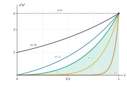
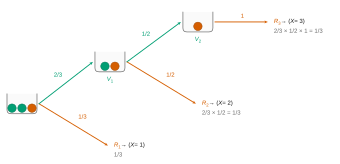
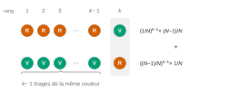

# Agro-Véto TB — Méthodes de calcul et raisonnement 2026 · Corrigé brut

*Corrigé rédigé par IA, non officiel. Signalez toute erreur.*

Épreuve de 2 heures, sans calculatrice ni document. Trois exercices totalement indépendants.

## Exercice d'Algèbre

On note $A=\begin{pmatrix}-3&-4\\2&3\end{pmatrix}$.

### 1.

Pour $\lambda\in\mathbb R$ :

$$\begin{aligned}
\det(A-\lambda I_2)&=\begin{vmatrix}-3-\lambda&-4\\2&3-\lambda\end{vmatrix}\\
&=(-3-\lambda)(3-\lambda)+8\\
&=\lambda^2-9+8\\
&=(\lambda-1)(\lambda+1).
\end{aligned}$$

Un réel $\lambda$ est valeur propre de $A$ si et seulement si $A-\lambda I_2$ n'est pas inversible. Cela équivaut à $\det(A-\lambda I_2)=0$, donc à $\lambda\in\{-1,1\}$.

Ainsi $-1$ et $1$ sont valeurs propres, et ce sont les seules :

$$\boxed{\text{les valeurs propres de }A\text{ sont exactement }-1\text{ et }1.}$$

### 2.a.

Avec $U=\begin{pmatrix}-1\\1\end{pmatrix}$ :

$$\begin{aligned}
AU&=\begin{pmatrix}(-3)(-1)+(-4)(1)\\2(-1)+3(1)\end{pmatrix}\\
&=\begin{pmatrix}-1\\1\end{pmatrix}=U.
\end{aligned}$$

Le vecteur $U$ est non nul et vérifie $AU=1\cdot U$. **$U$ est donc un vecteur propre de $A$ associé à la valeur propre $1$.**

### 2.b.

$$\boxed{m=-2}$$

Vérification : pour $m=-2$, $AV=\begin{pmatrix}-3m-4\\2m+3\end{pmatrix}=\begin{pmatrix}2\\-1\end{pmatrix}$, c'est-à-dire $AV=-V$.

### 3.a.

Les colonnes de $P$ sont des vecteurs propres associés, dans l'ordre, aux coefficients diagonaux de $D$. L'ordre croissant impose $D=\mathrm{diag}(-1,1)$.

On place donc $V$ (valeur propre $-1$) en première colonne et $U$ (valeur propre $1$) en seconde. La deuxième ligne de $P$ est alors formée de $1$ :

$$\boxed{D=\begin{pmatrix}-1&0\\0&1\end{pmatrix}\ \text{ et }\ P=\begin{pmatrix}-2&-1\\1&1\end{pmatrix}.}$$

$P$ est inversible car $\det P=(-2)(1)-(-1)(1)=-1\neq0$.

Par construction, $AP=(AV\ \ AU)=(-V\ \ U)=PD$. En multipliant à droite par $P^{-1}$, on obtient $A=PDP^{-1}$.

Contrôle : $AP$ et $PD$ valent tous deux $\begin{pmatrix}2&-1\\-1&1\end{pmatrix}$.

### 3.b.

Pour $M=\begin{pmatrix}a&b\\c&d\end{pmatrix}$ avec $ad-bc\neq0$ :

$$M^{-1}=\frac1{ad-bc}\begin{pmatrix}d&-b\\-c&a\end{pmatrix}.$$

Ici $\det P=-1$, donc :

$$\boxed{P^{-1}=\begin{pmatrix}-1&-1\\1&2\end{pmatrix}.}$$

Vérification :

$$PP^{-1}=\begin{pmatrix}2-1&2-2\\-1+1&-1+2\end{pmatrix}=I_2.$$

### 4.

Comme $A=PDP^{-1}$, on a $D=P^{-1}AP$.

Comme $P$ est inversible, la définition $Y=P^{-1}XP$ équivaut à $X=PYP^{-1}$. De même, $C=P^{-1}BP$ équivaut à $B=PCP^{-1}$.

*Sens direct.* Supposons $AX+XA=B$. On multiplie à gauche par $P^{-1}$ et à droite par $P$, puis on insère $PP^{-1}=I_2$ (associativité, sans commuter aucun produit) :

$$\begin{aligned}
P^{-1}(AX+XA)P&=P^{-1}AXP+P^{-1}XAP\\
&=(P^{-1}AP)(P^{-1}XP)+(P^{-1}XP)(P^{-1}AP)\\
&=DY+YD.
\end{aligned}$$

Le membre de gauche vaut $P^{-1}BP=C$, donc $DY+YD=C$.

*Réciproque.* Supposons $DY+YD=C$. On multiplie à gauche par $P$ et à droite par $P^{-1}$ :

$$\begin{aligned}
P(DY+YD)P^{-1}&=PDYP^{-1}+PYDP^{-1}\\
&=(PDP^{-1})(PYP^{-1})+(PYP^{-1})(PDP^{-1})\\
&=AX+XA.
\end{aligned}$$

Le membre de gauche vaut $PCP^{-1}=B$, donc $AX+XA=B$.

**Les deux implications sont établies : pour toutes $X,B\in\mathcal M_2(\mathbb R)$, $AX+XA=B$ si et seulement si $DY+YD=C$.**

### 5.a.

$$\begin{aligned}
P^{-1}B&=\begin{pmatrix}-1&-1\\1&2\end{pmatrix}\begin{pmatrix}4&4\\-2&-2\end{pmatrix}=\begin{pmatrix}-2&-2\\0&0\end{pmatrix},\\
C=(P^{-1}B)P&=\begin{pmatrix}-2&-2\\0&0\end{pmatrix}\begin{pmatrix}-2&-1\\1&1\end{pmatrix}\\
&=\begin{pmatrix}4-2&2-2\\0&0\end{pmatrix}\\
&=\begin{pmatrix}2&0\\0&0\end{pmatrix}.
\end{aligned}$$

$$\boxed{C=\begin{pmatrix}2&0\\0&0\end{pmatrix}}$$

### 5.b.

Soit $Y=\begin{pmatrix}a&b\\c&d\end{pmatrix}\in\mathcal M_2(\mathbb R)$. On calcule :

$$\begin{aligned}
DY&=\begin{pmatrix}-a&-b\\c&d\end{pmatrix},\\
YD&=\begin{pmatrix}-a&b\\-c&d\end{pmatrix},\\
DY+YD&=\begin{pmatrix}-2a&0\\0&2d\end{pmatrix}.
\end{aligned}$$

Par identification des coefficients, on raisonne par équivalences :

$$\begin{aligned}
DY+YD=C&\iff\begin{cases}-2a=2\\0=0\\0=0\\2d=0\end{cases}\\
&\iff a=-1\ \text{ et }\ d=0.
\end{aligned}$$

Les équations portant sur $b$ et $c$ sont $0=0$ : elles n'imposent rien, et $b$ et $c$ sont des réels quelconques, pas nécessairement nuls. Comme on a raisonné par équivalences, toute matrice de cette forme convient :

$$\boxed{\{Y\in\mathcal M_2(\mathbb R)\ :\ DY+YD=C\}=\left\{\begin{pmatrix}-1&b\\c&0\end{pmatrix}\ ;\ (b,c)\in\mathbb R^2\right\}.}$$

### 5.c.

D'après la question 4, $X$ est solution de $(E)$ si et seulement si $Y=P^{-1}XP$ est l'une des matrices trouvées en 5.b. Cela équivaut à $X=PYP^{-1}$ avec $Y=\begin{pmatrix}-1&b\\c&0\end{pmatrix}$ et $(b,c)\in\mathbb R^2$. On calcule :

$$\begin{aligned}
PY&=\begin{pmatrix}-2&-1\\1&1\end{pmatrix}\begin{pmatrix}-1&b\\c&0\end{pmatrix}=\begin{pmatrix}2-c&-2b\\c-1&b\end{pmatrix},\\
PYP^{-1}&=\begin{pmatrix}2-c&-2b\\c-1&b\end{pmatrix}\begin{pmatrix}-1&-1\\1&2\end{pmatrix}\\
&=\begin{pmatrix}c-2b-2&c-4b-2\\b-c+1&2b-c+1\end{pmatrix}.
\end{aligned}$$

$$\boxed{\mathcal S_E=\left\{\begin{pmatrix}c-2b-2&c-4b-2\\b-c+1&2b-c+1\end{pmatrix}\ ;\ (b,c)\in\mathbb R^2\right\}.}$$

Autrement dit, $X=X_0+bM+cM'$ avec :

$$X_0=\begin{pmatrix}-2&-2\\1&1\end{pmatrix},\qquad M=\begin{pmatrix}-2&-4\\1&2\end{pmatrix},\qquad M'=\begin{pmatrix}1&1\\-1&-1\end{pmatrix}.$$

Vérification pour $b=c=0$ : $AX_0$ et $X_0A$ valent tous deux $\begin{pmatrix}2&2\\-1&-1\end{pmatrix}$, donc $AX_0+X_0A=B$.

### 6.

On calcule $C=P^{-1}BP$ pour $B=\begin{pmatrix}1&1\\-1&-1\end{pmatrix}$ :

$$\begin{aligned}
P^{-1}B&=\begin{pmatrix}-1&-1\\1&2\end{pmatrix}\begin{pmatrix}1&1\\-1&-1\end{pmatrix}=\begin{pmatrix}0&0\\-1&-1\end{pmatrix},\\
C&=\begin{pmatrix}0&0\\-1&-1\end{pmatrix}\begin{pmatrix}-2&-1\\1&1\end{pmatrix}=\begin{pmatrix}0&0\\1&0\end{pmatrix}.
\end{aligned}$$

D'après la question 4, $(E)$ a une solution si et seulement s'il existe $Y\in\mathcal M_2(\mathbb R)$ telle que $DY+YD=C$.

Or, d'après le calcul de 5.b, valable pour toute matrice $Y=\begin{pmatrix}a&b\\c&d\end{pmatrix}$, le coefficient $(2,1)$ de $DY+YD$ est toujours nul.

Celui de $C$ vaut $1$ : l'égalité imposerait $0=1$, ce qui est absurde. Aucune matrice $Y$ ne convient, donc :

$$\boxed{\text{pour }B=\begin{pmatrix}1&1\\-1&-1\end{pmatrix},\ \text{l'équation }(E)\text{ n'a aucune solution.}}$$

## Exercice d'Analyse

Pour $n\in\mathbb N$, la fonction $x\mapsto x^ne^x$ est continue sur $[0,1]$, donc $I_n=\int_0^1x^ne^x\,\mathrm dx$ est bien définie.

### 1.

$$\begin{aligned}
I_0&=\int_0^1e^x\,\mathrm dx\\
&=\big[e^x\big]_0^1\\
&=e-1.
\end{aligned}$$

$$\boxed{I_0=e-1}$$

### 2.a.

$g$ est dérivable sur $\mathbb R$ et, par dérivation d'un produit, pour tout $x\in\mathbb R$ :

$$\begin{aligned}
g'(x)&=\big(e^x+xe^x\big)-e^x\\
&=xe^x.
\end{aligned}$$

$$\boxed{\forall x\in\mathbb R,\quad g'(x)=xe^x}$$

### 2.b.

D'après 2.a, $g$ est une primitive de $x\mapsto xe^x$ sur $[0,1]$, donc :

$$\begin{aligned}
I_1&=\big[g(x)\big]_0^1\\
&=g(1)-g(0)\\
&=(e-e)-(0-1)\\
&=1.
\end{aligned}$$

$$\boxed{I_1=1}$$

### 3.

Soit $n\in\mathbb N$ et $x\in[0,1]$. Comme $x\ge0$, on a $x^n\ge0$. L'exponentielle est strictement positive, donc $x^ne^x\ge0$.

La fonction $x\mapsto x^ne^x$ est donc continue et positive sur $[0,1]$, et les bornes sont dans l'ordre croissant ($0\le1$). Par positivité de l'intégrale :

$$\boxed{\forall n\in\mathbb N,\quad I_n\ge0.}$$

### 4.a.

Soit $x\in[0,1]$ et $n\in\mathbb N$. On multiplie l'inégalité $x\le1$ par $x^n\ge0$, ce qui conserve le sens : $x^{n+1}\le x^n$.

On multiplie ensuite par $e^x>0$ (positivité de l'exponentielle), ce qui conserve encore le sens :

$$\boxed{x^{n+1}\le x^n\ \text{ et }\ x^{n+1}e^x\le x^ne^x.}$$

### 4.b.

Soit $n\in\mathbb N$. Les fonctions $x\mapsto x^{n+1}e^x$ et $x\mapsto x^ne^x$ sont continues sur $[0,1]$ et vérifient l'inégalité de 4.a en tout point de $[0,1]$.

Par croissance de l'intégrale (bornes $0\le1$), $I_{n+1}\le I_n$. Ceci vaut pour tout $n$ :

$$\boxed{(I_n)_{n\in\mathbb N}\text{ est décroissante.}}$$

### 5.a.

Soit $x\in[0,1]$ et $n\in\mathbb N$. L'exponentielle est croissante sur $\mathbb R$ et $x\le1$, donc $e^x\le e^1=e$.

En multipliant par $x^n\ge0$ :

$$\boxed{x^ne^x\le e\,x^n.}$$

### 5.b.

Les deux membres de 5.a sont continus sur $[0,1]$ et les bornes sont dans l'ordre croissant. Par croissance et linéarité de l'intégrale :

$$\begin{aligned}
I_n&\le\int_0^1e\,x^n\,\mathrm dx\\
&=e\left[\frac{x^{n+1}}{n+1}\right]_0^1\\
&=\frac e{n+1}.
\end{aligned}$$

$$\boxed{\forall n\in\mathbb N,\quad I_n\le\frac e{n+1}}$$

### 5.c.

D'après 3 et 5.b, pour tout $n\in\mathbb N$ :

$$0\le I_n\le\frac e{n+1}.$$

Les deux bornes tendent vers $0$ quand $n\to+\infty$. Le théorème d'encadrement donne à la fois la convergence et la limite :

$$\boxed{(I_n)\text{ converge et }\lim_{n\to+\infty}I_n=0.}$$

### 6.a.

Soit $n\in\mathbb N$. On pose $u(x)=x^{n+1}$ et $v(x)=e^x$, de classe $\mathcal C^1$ sur $[0,1]$.

On a $u'(x)=(n+1)x^n$ et $v'(x)=e^x$. Par intégration par parties :

$$\begin{aligned}
I_{n+1}&=\big[x^{n+1}e^x\big]_0^1-\int_0^1(n+1)x^ne^x\,\mathrm dx\\
&=(e-0)-(n+1)I_n,
\end{aligned}$$

car $0^{n+1}=0$ puisque $n+1\ge1$. Donc :

$$\boxed{\forall n\in\mathbb N,\quad I_{n+1}=e-(n+1)I_n.}$$

Pour $n=0$, on retrouve $I_1=e-(e-1)=1$, en accord avec 2.b.

### 6.b.

De 6.a, on tire $(n+1)I_n=e-I_{n+1}$. Comme $n+1\neq0$ :

$$\boxed{\forall n\in\mathbb N,\quad I_n=\frac{e-I_{n+1}}{n+1}.}$$

### 6.c.

Pour $n\ge1$, d'après 6.b :

$$\begin{aligned}
nI_n&=\frac{n}{n+1}\,\big(e-I_{n+1}\big)\\
&=\frac1{1+\frac1n}\,\big(e-I_{n+1}\big).
\end{aligned}$$

Le premier facteur tend vers $1$. D'après 5.c, $I_{n+1}\to0$, donc le second facteur tend vers $e$. Par produit :

$$\boxed{\lim_{n\to+\infty}nI_n=e.}$$

Comme $e\neq0$, on en déduit, pour $n\ge1$ :

$$\frac{I_n}{e/n}=\frac{nI_n}{e}\xrightarrow[n\to+\infty]{}1.$$

$$\boxed{I_n\underset{n\to+\infty}{\sim}\frac en.}$$

## Exercice de Probabilités

Pour tout $i\ge1$, l'urne ne contenant que des boules vertes et une rouge, $V_i=\overline{R_i}$.

### Partie 1

$N=3$ : 2 boules vertes, 1 rouge, tirages sans remise jusqu'à obtenir la rouge.

#### 1.

$$\boxed{P(R_1)=\frac13}$$

(tirage équiprobable d'une boule parmi 3, une seule rouge).

#### 2.a.

$$\boxed{P(V_1)=\frac23\ \text{ et }\ P_{V_1}(R_2)=\frac12}$$

(sachant $V_1$, l'urne contient 1 verte et 1 rouge).

#### 2.b.

Comme $P(V_1)\neq0$, la formule des probabilités composées donne un **produit** :

$$\begin{aligned}
P(V_1\cap R_2)&=P(V_1)\,P_{V_1}(R_2)\\
&=\frac23\times\frac12\\
&=\frac13.
\end{aligned}$$

$$\boxed{P(V_1\cap R_2)=\frac13}$$

#### 3.

Les tirages étant sans remise, ils ne sont pas indépendants : on conditionne étape par étape.

- $P(V_1)=\frac23\neq0$.
- Sachant $V_1$, l'urne contient 1 verte et 1 rouge, donc $P_{V_1}(V_2)=\frac12$. Ainsi $P(V_1\cap V_2)=\frac13\neq0$.
- Sachant $V_1\cap V_2$, les deux vertes ont été retirées et seule la rouge reste, donc $P_{V_1\cap V_2}(R_3)=1$.

Par la formule des probabilités composées :

$$\begin{aligned}
P(V_1\cap V_2\cap R_3)&=P(V_1)\,P_{V_1}(V_2)\,P_{V_1\cap V_2}(R_3)\\
&=\frac23\times\frac12\times1\\
&=\frac13.
\end{aligned}$$

$$\boxed{P(V_1\cap V_2\cap R_3)=\frac13}$$

#### 4.a.

Il faut au moins un tirage. Comme les tirages se font sans remise, après deux vertes il ne reste que la rouge, tirée au troisième tirage. Les trois valeurs sont atteintes (probabilités non nulles en 4.b) :

$$\boxed{X(\Omega)=\{1,2,3\}.}$$

#### 4.b.

On traduit chaque événement à l'aide des questions précédentes :

- $(X=1)=R_1$, donc $P(X=1)=P(R_1)=\frac13$ (question 1) ;
- $(X=2)=V_1\cap R_2$, donc $P(X=2)=\frac13$ (question 2.b) ;
- $(X=3)=V_1\cap V_2\cap R_3$, donc $P(X=3)=\frac13$ (question 3).

$$\boxed{\begin{aligned}
P(X=1)&=\frac13\\
P(X=2)&=\frac13\\
P(X=3)&=\frac13
\end{aligned}}$$

(contrôle : la somme vaut $1$).

#### 4.c.

$X$ prend les valeurs $1,2,3$, chacune avec probabilité $\frac13$ :

$$\boxed{X\text{ suit la loi uniforme sur }\{1,2,3\}.}$$

Ce n'est pas une loi géométrique : les tirages sans remise ne forment pas une répétition d'épreuves de Bernoulli identiques et indépendantes.

#### 4.d.

$X$ prend un nombre fini de valeurs, donc admet une espérance :

$$\begin{aligned}
E(X)&=1\times\frac13+2\times\frac13+3\times\frac13\\
&=2.
\end{aligned}$$

**Il faut en moyenne 2 tirages pour obtenir la boule rouge.**

### Partie 2

$N\ge3$, tirages avec remise : la composition de l'urne est la même à chaque tirage, et les tirages sont mutuellement indépendants.

#### 1.

Pour tout $i\ge1$ :

$$\boxed{P(R_i)=\frac1N\ \text{ et }\ P(V_i)=\frac{N-1}N.}$$

#### 2.a.

Les événements $R_1\cap R_2\cap V_3$ et $V_1\cap V_2\cap R_3$ sont **incompatibles** : le premier est inclus dans $R_1$, le second dans $V_1=\overline{R_1}$. Donc :

$$P(Y=3)=P(R_1\cap R_2\cap V_3)+P(V_1\cap V_2\cap R_3).$$

Les tirages avec remise étant mutuellement **indépendants** :

$$\begin{aligned}
P(R_1\cap R_2\cap V_3)&=P(R_1)\,P(R_2)\,P(V_3)=\frac{N-1}{N^3},\\
P(V_1\cap V_2\cap R_3)&=P(V_1)\,P(V_2)\,P(R_3)=\frac{(N-1)^2}{N^3}.
\end{aligned}$$

En additionnant :

$$\begin{aligned}
P(Y=3)&=\frac{(N-1)\big(1+(N-1)\big)}{N^3}\\
&=\frac{(N-1)N}{N^3}\\
&=\frac{N-1}{N^2}.
\end{aligned}$$

$$\boxed{P(Y=3)=\frac{N-1}{N^2}}$$

#### 2.b.

Soit $k\ge2$. L'événement $(Y=k)$ signifie qu'après $k-1$ tirages on n'a pas encore vu les deux couleurs, donc que les $k-1$ premiers tirages sont tous de la même couleur, et que le $k$-ième tirage donne l'autre couleur. Ainsi :

$$(Y=k)=\big(R_1\cap\cdots\cap R_{k-1}\cap V_k\big)\cup\big(V_1\cap\cdots\cap V_{k-1}\cap R_k\big).$$

Ces deux événements sont incompatibles (inclus respectivement dans $R_1$ et dans $V_1$). Par indépendance mutuelle des tirages :

$$P(Y=k)=\left(\frac1N\right)^{k-1}\frac{N-1}N+\left(\frac{N-1}N\right)^{k-1}\frac1N.$$

Pour tout entier $k\ge2$ :

$$\boxed{P(Y=k)=\frac{(N-1)+(N-1)^{k-1}}{N^k}.}$$

Contrôles :

- pour $k=3$, on retrouve $\frac{(N-1)N}{N^3}=\frac{N-1}{N^2}$ (question 2.a) ;
- pour $k=2$, $P(Y=2)=\frac{2(N-1)}{N^2}$ ;
- $Y\ge2$, car un seul tirage ne donne qu'une couleur ;
- les deux séries géométriques ont pour sommes $\frac1N$ et $\frac{N-1}N$, de total $1$ : $Y$ est finie presque sûrement.
