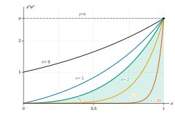
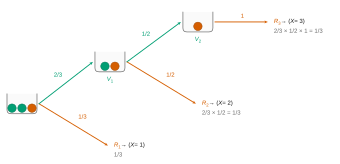
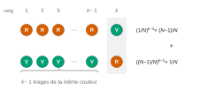

# Agro-Véto TB — Méthodes de calcul et raisonnement 2026 · Corrigé guidé

*Corrigé rédigé par IA, non officiel. Signalez toute erreur.*

## Présentation du sujet

**Format.** L'épreuve dure 2 heures, sans calculatrice ni document. Le sujet tient en 3 pages et compte 33 questions élémentaires réparties en trois exercices **totalement indépendants** : on peut les traiter dans l'ordre de son choix.

**Découpage.**

| Exercice | Questions | Contenu | Notions mobilisées |
|---|---|---|---|
| Algèbre | 1 à 6 (10 questions) | Diagonalisation d'une matrice $2\times2$, puis résolution de l'équation matricielle $AX+XA=B$ (équation de Sylvester) par le changement d'inconnue $Y=P^{-1}XP$ | valeurs et vecteurs propres, déterminant $2\times2$, inverse d'une matrice $2\times2$, produit matriciel, systèmes linéaires |
| Analyse | 1 à 6 (12 questions) | Suite d'intégrales $I_n=\int_0^1x^ne^x\,\mathrm dx$ : premiers termes, signe, monotonie, limite, récurrence, équivalent | primitives, positivité et croissance de l'intégrale, théorème d'encadrement, intégration par parties, équivalents |
| Probabilités | partie 1 : 1 à 4 (8 questions) ; partie 2 : 1 et 2 (3 questions) | Urne à une seule boule rouge : rang de sortie de la rouge sans remise ($N=3$), puis rang où l'on a vu les deux couleurs avec remise | probabilités conditionnelles, formule des probabilités composées, loi uniforme, espérance, indépendance, événements incompatibles |

**Ce que fait chaque exercice.**

- *Algèbre.* Les questions 1 à 3 diagonalisent $A$ en suivant des normalisations imposées. La question 4 transporte l'équation $AX+XA=B$ dans la base de vecteurs propres, où elle devient $DY+YD=C$ avec $D$ diagonale. On résout alors coefficient par coefficient : en question 5, un ensemble de solutions à deux paramètres ; en question 6, aucune solution.
- *Analyse.* Un enchaînement très classique, où chaque question prépare la suivante : encadrement de $I_n$, limite nulle, puis relation de récurrence qui fournit l'équivalent $I_n\sim\frac en$.
- *Probabilités.* La partie 1 fait découvrir que, sans remise, le rang de la boule rouge est uniforme. La partie 2, avec remise, demande la loi d'un temps d'attente qui se décompose en deux scénarios selon la couleur du premier tirage.

**Résultats de la session.** D'après le rapport 2026, la moyenne est de 9,87/20 et la médiane de 9,80/20, avec un écart type de 4,08. Les notes vont de 2 à 20 ; les quartiles valent 6,80 et 12,50. Le jury rappelle qu'« il n'est pas nécessaire de traiter l'intégralité du sujet pour obtenir une note satisfaisante ».

**Difficulté.** Le sujet est d'un niveau abordable et entièrement guidé. Questions à ne pas laisser passer : algèbre 1, 2, 3 et 5.a ; analyse 1, 2, 3 et 6.a-b ; probabilités, partie 1 entière et partie 2, question 1. Le rapport 2026 signale :

- en analyse, la question 1 est réussie dans 85 % des copies et la question 2.a par 78 % des candidats ;
- les questions 4 et 5 d'analyse forment « une série de questions très discriminantes » : elles ne sont pas difficiles, mais chaque inégalité doit être justifiée par un argument précis ;
- l'analyse 6.c « a servi à départager les meilleures copies » ;
- l'algèbre 4 est « une question plus délicate » (équivalence à rédiger), et l'algèbre 6 n'a été bien traitée que dans les meilleures copies ;
- la partie 2 des probabilités a souffert du manque de temps.

Plus généralement, selon le rapport, c'est l'analyse qui pose le plus de problèmes, en particulier le travail sur les inégalités, et la notion d'équivalence est souvent mal mise en évidence.

**Gestion du temps.** Environ 45 minutes pour l'algèbre, plus calculatoire, 35 minutes pour l'analyse et 35 minutes pour les probabilités, en gardant quelques minutes pour relire les calculs matriciels. Sans calculatrice, chaque produit de matrices se vérifie par un contrôle simple : $AP=PD$, $PP^{-1}=I_2$, valeur particulière des paramètres.

## Exercice d'Algèbre

On diagonalise $A=\begin{pmatrix}-3&-4\\2&3\end{pmatrix}$, puis on s'en sert pour résoudre $AX+XA=B$. Outils : déterminant et inverse d'une matrice $2\times2$, produit matriciel, identification de coefficients.

### Question 1

> [!INDICATION]
> Un réel $\lambda$ est valeur propre lorsque $A-\lambda I_2$ n'est pas inversible. Quel critère simple caractérise l'inversibilité d'une matrice $2\times2$ ?

> [!INDICATION]
> Calculez $\det(A-\lambda I_2)$ en fonction de $\lambda$ et factorisez : il faut montrer que $-1$ et $1$ sont valeurs propres **et** qu'il n'y en a pas d'autre.

#### Solution

Pour $\lambda\in\mathbb R$ :

$$\begin{aligned}
\det(A-\lambda I_2)&=\begin{vmatrix}-3-\lambda&-4\\2&3-\lambda\end{vmatrix}\\
&=(-3-\lambda)(3-\lambda)+8\\
&=\lambda^2-9+8\\
&=(\lambda-1)(\lambda+1).
\end{aligned}$$

$\lambda$ est valeur propre de $A$ si et seulement si $A-\lambda I_2$ n'est pas inversible. Cela équivaut à $\det(A-\lambda I_2)=0$, soit $\lambda\in\{-1,1\}$.

$$\boxed{\text{les valeurs propres de }A\text{ sont exactement }-1\text{ et }1.}$$

> [!PIEGE]
> Vérifier seulement que $A+I_2$ et $A-I_2$ ne sont pas inversibles prouve que $-1$ et $1$ sont valeurs propres, mais pas qu'il n'y en a pas d'autre. La factorisation complète règle les deux points d'un coup.

> [!JURY]
> Le rapport 2026 relève deux manques. Avec un déterminant, l'équivalence entre « $\lambda$ valeur propre » et l'annulation de $\det(A-\lambda I_2)$ n'est pas toujours écrite. Avec un calcul de rang ou de déterminant de $A\pm I_2$, les candidats « ne précisent pas toujours pourquoi ce sont les seules ».

### Question 2.a

> [!INDICATION]
> Vérifier qu'un vecteur est propre ne demande aucune résolution : un seul produit matrice-vecteur suffit.

#### Solution

$$\begin{aligned}
AU&=\begin{pmatrix}(-3)(-1)+(-4)(1)\\2(-1)+3(1)\end{pmatrix}\\
&=\begin{pmatrix}-1\\1\end{pmatrix}=U.
\end{aligned}$$

Le vecteur $U$ est non nul et vérifie $AU=1\cdot U$. **$U$ est donc un vecteur propre de $A$ associé à la valeur propre $1$.**

> [!JURY]
> Selon le rapport 2026, le calcul de $AU$ est en général bien mené, « mais le fait que U est non nul n'est pas souvent mentionné ». Un vecteur propre est par définition non nul : ce mot fait partie de la réponse.

### Question 2.b

> [!INDICATION]
> Écrivez l'égalité $AV=-V$ coordonnée par coordonnée.

> [!INDICATION]
> Une seule ligne suffit à trouver $m$ ; l'autre sert de contrôle.

#### Solution

On a $AV=\begin{pmatrix}-3m-4\\2m+3\end{pmatrix}$ et $-V=\begin{pmatrix}-m\\-1\end{pmatrix}$.

La première ligne donne $-3m-4=-m$, soit $m=-2$. La seconde est alors vérifiée : $2(-2)+3=-1$.

$$\boxed{m=-2\ \text{ et }\ V=\begin{pmatrix}-2\\1\end{pmatrix}.}$$

> [!METHODE]
> Même quand aucune justification n'est demandée, la vérification sur la seconde coordonnée protège d'une erreur de signe qui ruinerait les questions 3 à 6.

### Question 3.a

> [!INDICATION]
> Les colonnes de $P$ sont des vecteurs propres ; dans quel ordre faut-il les placer pour que la diagonale de $D$ soit croissante ?

> [!INDICATION]
> Regardez la deuxième coordonnée de $U$ et de $V$ : la seconde contrainte est déjà satisfaite. Pour prouver $A=PDP^{-1}$, calculez $AP$ colonne par colonne.

#### Solution

L'ordre croissant impose $D=\mathrm{diag}(-1,1)$.

La première colonne de $P$ est donc un vecteur propre pour $-1$, soit $V$. La seconde est un vecteur propre pour $1$, soit $U$.

La deuxième ligne de $P$ est bien formée de $1$.

$$\boxed{D=\begin{pmatrix}-1&0\\0&1\end{pmatrix}\ \text{ et }\ P=\begin{pmatrix}-2&-1\\1&1\end{pmatrix}.}$$

$P$ est inversible car $\det P=(-2)(1)-(-1)(1)=-1\neq0$.

De plus $AP=(AV\ \ AU)=(-V\ \ U)=PD$. En multipliant à droite par $P^{-1}$, on obtient $A=PDP^{-1}$.

Contrôle numérique : $AP$ et $PD$ valent tous deux $\begin{pmatrix}2&-1\\-1&1\end{pmatrix}$.

> [!PIEGE]
> Inverser l'ordre des colonnes donne $D=\mathrm{diag}(1,-1)$, qui ne respecte pas l'ordre croissant demandé. La $i$-ème colonne de $P$ correspond toujours au $i$-ème coefficient diagonal de $D$.

> [!JURY]
> Le rapport 2026 note que la construction de $D$ et $P$ est comprise, mais appelle à l'attention à la lecture de l'énoncé : « Une condition était en effet imposée sur l'ordre des valeurs propres sur la diagonale de D. »

### Question 3.b

> [!INDICATION]
> Utilisez la formule de l'inverse d'une matrice $2\times2$ à déterminant non nul.

> [!INDICATION]
> On échange les coefficients diagonaux, on change le signe des deux autres, et on divise par le déterminant. Vérifiez ensuite le produit $PP^{-1}$.

#### Solution

Pour $M=\begin{pmatrix}a&b\\c&d\end{pmatrix}$ avec $ad-bc\neq0$ :

$$M^{-1}=\frac1{ad-bc}\begin{pmatrix}d&-b\\-c&a\end{pmatrix}.$$

Avec $\det P=-1$ :

$$\boxed{P^{-1}=\begin{pmatrix}-1&-1\\1&2\end{pmatrix}.}$$

Vérification :

$$PP^{-1}=\begin{pmatrix}2-1&2-2\\-1+1&-1+2\end{pmatrix}=I_2.$$

> [!METHODE]
> $P^{-1}$ resservira en 5 et 6 : une vérification $PP^{-1}=I_2$, deux minutes de calcul, sécurise toute la fin de l'exercice.

### Question 4

> [!INDICATION]
> Réécrivez la relation de la question 3.a sous la forme $D=\dots$ en fonction de $A$ et $P$.

> [!INDICATION]
> Multipliez l'équation à gauche par $P^{-1}$ et à droite par $P$.
>
> Insérez ensuite $I_2=PP^{-1}$ entre les deux facteurs de chaque produit.

> [!INDICATION]
> On demande une équivalence : traitez la réciproque en multipliant à gauche par $P$ et à droite par $P^{-1}$.

#### Solution

De $A=PDP^{-1}$, on tire $D=P^{-1}AP$.

Comme $P$ est inversible, $Y=P^{-1}XP$ équivaut à $X=PYP^{-1}$. De même, $C=P^{-1}BP$ équivaut à $B=PCP^{-1}$.

*Sens direct.* Supposons $AX+XA=B$. On multiplie à gauche par $P^{-1}$ et à droite par $P$, puis on insère $PP^{-1}=I_2$ entre les facteurs :

$$\begin{aligned}
P^{-1}(AX+XA)P&=P^{-1}AXP+P^{-1}XAP\\
&=(P^{-1}AP)(P^{-1}XP)+(P^{-1}XP)(P^{-1}AP)\\
&=DY+YD.
\end{aligned}$$

Le membre de gauche vaut $P^{-1}BP=C$. Donc $DY+YD=C$.

*Réciproque.* Supposons $DY+YD=C$. On multiplie à gauche par $P$ et à droite par $P^{-1}$ :

$$\begin{aligned}
P(DY+YD)P^{-1}&=PDYP^{-1}+PYDP^{-1}\\
&=(PDP^{-1})(PYP^{-1})+(PYP^{-1})(PDP^{-1})\\
&=AX+XA.
\end{aligned}$$

Le membre de gauche vaut $PCP^{-1}=B$. Donc $AX+XA=B$.

**Les deux implications sont établies : $AX+XA=B$ si et seulement si $DY+YD=C$.**

> [!PIEGE]
> Le produit matriciel n'est pas commutatif : on ne peut pas « simplifier » $P^{-1}AXP$ en déplaçant les matrices. Le rapport 2026 signale des candidats qui « enlèvent » ainsi $P$ ou $P^{-1}$. Seule l'insertion de $PP^{-1}=I_2$, grâce à l'associativité, fait apparaître $D$ et $Y$.

> [!JURY]
> Le rapport 2026 qualifie cette question de plus délicate et précise : « L'équivalence demandée doit être mise en évidence, que ce soit par la preuve de chaque implication, ou bien par une chaîne d'équivalences successives. » Dans une chaîne d'équivalences, chaque étape doit être réversible, ici parce que $P$ est inversible.

### Question 5.a

> [!INDICATION]
> Calcul direct : effectuez d'abord $P^{-1}B$, puis multipliez le résultat à droite par $P$.

#### Solution

$$\begin{aligned}
P^{-1}B&=\begin{pmatrix}-1&-1\\1&2\end{pmatrix}\begin{pmatrix}4&4\\-2&-2\end{pmatrix}=\begin{pmatrix}-2&-2\\0&0\end{pmatrix},\\
C=(P^{-1}B)P&=\begin{pmatrix}-2&-2\\0&0\end{pmatrix}\begin{pmatrix}-2&-1\\1&1\end{pmatrix}\\
&=\begin{pmatrix}4-2&2-2\\0&0\end{pmatrix}\\
&=\begin{pmatrix}2&0\\0&0\end{pmatrix}.
\end{aligned}$$

$$\boxed{C=\begin{pmatrix}2&0\\0&0\end{pmatrix}}$$

> [!PIEGE]
> Calculer $PBP^{-1}$ au lieu de $P^{-1}BP$ donne une autre matrice. On peut contrôler son résultat avec la trace et le déterminant, conservés par ce changement : $\mathrm{tr}\,B=2=\mathrm{tr}\,C$ et $\det B=0=\det C$.

> [!JURY]
> Le rapport 2026 dit avoir « apprécié ici l'honnêteté des candidats » qui, à cause d'une erreur sur $P$ ou $P^{-1}$, n'obtenaient pas la matrice annoncée et l'ont signalé. Mieux vaut écrire que le résultat ne concorde pas que maquiller un calcul.

### Question 5.b

> [!INDICATION]
> Posez $Y=\begin{pmatrix}a&b\\c&d\end{pmatrix}$ et calculez séparément $DY$ et $YD$.

> [!INDICATION]
> Multiplier à gauche par une matrice diagonale agit sur les lignes, à droite sur les colonnes. Identifiez ensuite les quatre coefficients : certaines inconnues ne sont soumises à aucune condition.

#### Solution

Soit $Y=\begin{pmatrix}a&b\\c&d\end{pmatrix}\in\mathcal M_2(\mathbb R)$. On calcule :

$$\begin{aligned}
DY&=\begin{pmatrix}-a&-b\\c&d\end{pmatrix},\\
YD&=\begin{pmatrix}-a&b\\-c&d\end{pmatrix},\\
DY+YD&=\begin{pmatrix}-2a&0\\0&2d\end{pmatrix}.
\end{aligned}$$

Par identification des coefficients, on raisonne par équivalences :

$$\begin{aligned}
DY+YD=C&\iff\begin{cases}-2a=2\\0=0\\0=0\\2d=0\end{cases}\\
&\iff a=-1\ \text{ et }\ d=0.
\end{aligned}$$

Les équations portant sur $b$ et $c$ se réduisent à $0=0$ : $b$ et $c$ sont des réels quelconques. Comme on a raisonné par équivalences, toute matrice de cette forme est solution :

$$\boxed{\{Y\ :\ DY+YD=C\}=\left\{\begin{pmatrix}-1&b\\c&0\end{pmatrix}\ ;\ (b,c)\in\mathbb R^2\right\}.}$$

> [!PIEGE]
> Le rapport 2026 le rappelle : « le fait que b et c n'apparaissent pas dans le système n'implique pas leur nullité ». Les équations $0=0$ disent que $b$ et $c$ sont libres. « Déterminer toutes les matrices » demande l'ensemble paramétré, pas une solution particulière.

> [!JURY]
> Le raisonnement doit rester une suite d'équivalences jusqu'à la conclusion. Le rapport 2026 met en garde contre une conclusion qui se contente d'affirmer que la matrice a telle forme : elle « indique une condition nécessaire, pas forcément suffisante ». Écrire « si et seulement si », ou vérifier que les matrices obtenues conviennent.

### Question 5.c

> [!INDICATION]
> D'après la question 4, $X$ est solution de $(E)$ exactement quand $P^{-1}XP$ est l'une des matrices trouvées en 5.b. Comment retrouver $X$ à partir de $Y$ ?

> [!INDICATION]
> Calculez $PY$ puis $(PY)P^{-1}$ en gardant $b$ et $c$ littéraux, puis vérifiez le résultat sur le cas $b=c=0$.

#### Solution

D'après la question 4, $X$ est solution de $(E)$ si et seulement si $X=PYP^{-1}$, où $Y=\begin{pmatrix}-1&b\\c&0\end{pmatrix}$ et $(b,c)\in\mathbb R^2$. Or :

$$\begin{aligned}
PY&=\begin{pmatrix}-2&-1\\1&1\end{pmatrix}\begin{pmatrix}-1&b\\c&0\end{pmatrix}=\begin{pmatrix}2-c&-2b\\c-1&b\end{pmatrix},\\
PYP^{-1}&=\begin{pmatrix}2-c&-2b\\c-1&b\end{pmatrix}\begin{pmatrix}-1&-1\\1&2\end{pmatrix}\\
&=\begin{pmatrix}c-2b-2&c-4b-2\\b-c+1&2b-c+1\end{pmatrix}.
\end{aligned}$$

$$\boxed{\mathcal S_E=\left\{\begin{pmatrix}c-2b-2&c-4b-2\\b-c+1&2b-c+1\end{pmatrix}\ ;\ (b,c)\in\mathbb R^2\right\}.}$$

On peut l'écrire $X=X_0+bM+cM'$ avec :

$$X_0=\begin{pmatrix}-2&-2\\1&1\end{pmatrix},\qquad M=\begin{pmatrix}-2&-4\\1&2\end{pmatrix},\qquad M'=\begin{pmatrix}1&1\\-1&-1\end{pmatrix}.$$

Vérification pour $b=c=0$ : $AX_0$ et $X_0A$ valent tous deux $\begin{pmatrix}2&2\\-1&-1\end{pmatrix}$. Leur somme est bien $B=\begin{pmatrix}4&4\\-2&-2\end{pmatrix}$.

> [!PIEGE]
> De $Y=P^{-1}XP$ on tire $X=PYP^{-1}$, et non $P^{-1}YP$ : on multiplie à gauche par $P$ et à droite par $P^{-1}$.

> [!JURY]
> C'est une « question de synthèse » pour le rapport 2026 : « Certains candidats n'utilisent pas le résultat de la question précédente et aboutissent à un système inextricable. » Résoudre directement $AX+XA=B$ en quatre inconnues fait perdre tout le bénéfice de la diagonalisation.

> [!METHODE]
> Une vérification sur une valeur particulière des paramètres (ici $b=c=0$) contrôle en une fois toute la chaîne $P$, $P^{-1}$, $C$, $Y$, $X$.

### Question 6

> [!INDICATION]
> Même démarche qu'en question 5 : calculez la nouvelle matrice $C=P^{-1}BP$.

> [!INDICATION]
> Le calcul de 5.b vaut pour toute matrice $Y$ : quelle forme a toujours $DY+YD$ ? Comparez avec $C$.

#### Solution

$$\begin{aligned}
P^{-1}B&=\begin{pmatrix}-1&-1\\1&2\end{pmatrix}\begin{pmatrix}1&1\\-1&-1\end{pmatrix}=\begin{pmatrix}0&0\\-1&-1\end{pmatrix},\\
C&=\begin{pmatrix}0&0\\-1&-1\end{pmatrix}\begin{pmatrix}-2&-1\\1&1\end{pmatrix}=\begin{pmatrix}0&0\\1&0\end{pmatrix}.
\end{aligned}$$

D'après la question 4, $(E)$ a une solution si et seulement s'il existe $Y\in\mathcal M_2(\mathbb R)$ telle que $DY+YD=C$.

Or, d'après 5.b, pour toute $Y=\begin{pmatrix}a&b\\c&d\end{pmatrix}$, le coefficient $(2,1)$ de $DY+YD$ est nul. Celui de $C$ vaut $1$ : l'égalité imposerait $0=1$, ce qui est absurde.

$$\boxed{\text{Pour }B=\begin{pmatrix}1&1\\-1&-1\end{pmatrix},\ \text{l'équation }(E)\text{ n'a aucune solution.}}$$

> [!PIEGE]
> Constater qu'on « n'arrive pas » à résoudre ne prouve rien : il faut exhiber une contradiction précise. Inversement, une condition nécessaire satisfaite ne prouve pas l'existence. Par exemple, la trace de $AX+XA=B$ donne $\mathrm{tr}(B)=2\,\mathrm{tr}(AX)$, qui ne conduit ici à aucune contradiction.

> [!METHODE]
> Notons $\lambda_1,\lambda_2$ les coefficients diagonaux de $D$. Les coefficients hors diagonale de $DY+YD$ valent $(\lambda_1+\lambda_2)$ fois ceux de $Y$.
>
> Comme $-1+1=0$, ils sont toujours nuls : $(E)$ n'a de solution que si $C$ est diagonale. C'est ce qui oppose les questions 5 et 6.

> [!JURY]
> Selon le rapport 2026, cette question de fin d'exercice n'a été abordée de manière satisfaisante « essentiellement dans les meilleures copies ».

## Exercice d'Analyse

On étudie $I_n=\int_0^1x^ne^x\,\mathrm dx$, bien définie car l'intégrande est continue sur $[0,1]$. Outils : primitives usuelles, positivité et croissance de l'intégrale, encadrement, intégration par parties, équivalents. Le rapport 2026 juge que c'est l'exercice qui a posé le plus de problèmes, surtout sur les inégalités.

### Question 1

> [!INDICATION]
> Primitive immédiate de l'exponentielle.

#### Solution

$$\begin{aligned}
I_0&=\int_0^1e^x\,\mathrm dx\\
&=\big[e^x\big]_0^1\\
&=e^1-e^0.
\end{aligned}$$

$$\boxed{I_0=e-1}$$

Le rapport 2026 indique que cette question est traitée correctement dans 85 % des copies.

### Question 2.a

> [!INDICATION]
> Dérivez le produit $x\mapsto xe^x$, puis soustrayez la dérivée de $e^x$.

#### Solution

Pour tout $x\in\mathbb R$ :

$$\begin{aligned}
g'(x)&=\big(1\cdot e^x+x\,e^x\big)-e^x\\
&=xe^x.
\end{aligned}$$

$$\boxed{\forall x\in\mathbb R,\quad g'(x)=xe^x}$$

Calcul réussi par 78 % des candidats selon le rapport 2026.

### Question 2.b

> [!INDICATION]
> Que représente $g$ pour la fonction intégrée dans $I_1$ ?

#### Solution

D'après 2.a, $g$ est une primitive de $x\mapsto xe^x$ sur $[0,1]$, donc :

$$\begin{aligned}
I_1&=\big[g(x)\big]_0^1\\
&=g(1)-g(0)\\
&=(e-e)-(0-1).
\end{aligned}$$

$$\boxed{I_1=1}$$

> [!PIEGE]
> $g(0)=0\cdot e^0-e^0=-1$, et non $0$ : le terme $-e^0$ vaut $-1$.

> [!JURY]
> Le rapport 2026 observe que certains candidats ne font pas le lien avec la question 2.a et refont une intégration par parties : c'est juste, mais c'est du temps perdu. Le « En déduire » de l'énoncé indique la voie.

### Question 3

> [!INDICATION]
> Étudiez le signe de la fonction intégrée sur l'intervalle d'intégration : quel facteur demande un argument ?

> [!INDICATION]
> Citez la propriété de l'intégrale qui conclut, sans oublier l'ordre des bornes.

#### Solution

Soit $n\in\mathbb N$ et $x\in[0,1]$. Comme $x\ge0$, on a $x^n\ge0$. L'exponentielle est strictement positive, donc $x^ne^x\ge0$.

La fonction $x\mapsto x^ne^x$ est donc continue et positive sur $[0,1]$, et les bornes sont dans l'ordre croissant ($0\le1$). Par positivité de l'intégrale :

$$\boxed{\forall n\in\mathbb N,\quad I_n\ge0.}$$

> [!PIEGE]
> Invoquer seulement $e^x>0$ ne suffit pas : il faut aussi le signe de $x^n$, qui vient de $x\ge0$.

> [!JURY]
> Le rapport 2026 est explicite : « La positivité de la fonction exponentielle ne suffit pas ici. Par ailleurs, les candidats pensent rarement à préciser que les bornes de l'intégrale sont dans l'ordre croissant. »

### Question 4.a

> [!INDICATION]
> Partez de $x\le1$ et multipliez par une quantité dont vous connaissez le signe.

#### Solution

Soit $x\in[0,1]$ et $n\in\mathbb N$. On multiplie $x\le1$ par $x^n\ge0$, ce qui conserve le sens : $x^{n+1}\le x^n$.

On multiplie ensuite par $e^x>0$ (positivité de l'exponentielle), ce qui conserve encore le sens :

$$\boxed{x^{n+1}\le x^n\ \text{ et }\ x^{n+1}e^x\le x^ne^x.}$$

> [!PIEGE]
> L'inégalité $x^{n+1}\le x^n$ n'est vraie que pour $x\in[0,1]$ ; elle s'inverse pour $x>1$. Il faut dire pourquoi chaque multiplication conserve le sens de l'inégalité.

> [!JURY]
> Pour les questions 4 et 5, « une série de questions très discriminantes » selon le rapport 2026, « des arguments précis étaient attendus dans la preuve des inégalités demandées, notamment la positivité (en 4 (a)) et la croissance (en 5 (a)) de la fonction exponentielle ».

### Question 4.b

> [!INDICATION]
> Intégrez l'inégalité de 4.a sur $[0,1]$.

#### Solution

Soit $n\in\mathbb N$. Les fonctions $x\mapsto x^{n+1}e^x$ et $x\mapsto x^ne^x$ sont continues sur $[0,1]$ et vérifient l'inégalité de 4.a en tout point de $[0,1]$.

Par croissance de l'intégrale (bornes $0\le1$), $I_{n+1}\le I_n$. Ceci vaut pour tout $n$ :

$$\boxed{(I_n)_{n\in\mathbb N}\text{ est décroissante.}}$$

### Question 5.a

> [!INDICATION]
> Majorez $e^x$ sur $[0,1]$ grâce à une propriété de l'exponentielle.

#### Solution

Soit $x\in[0,1]$ et $n\in\mathbb N$. L'exponentielle est croissante sur $\mathbb R$ et $x\le1$, donc $e^x\le e^1=e$.

En multipliant par $x^n\ge0$ :

$$\boxed{x^ne^x\le e\,x^n.}$$

> [!PIEGE]
> Le membre de droite est le produit du nombre $e$ par $x^n$, et non $e^{x^n}$. Et la majoration $e^x\le e$ doit être justifiée par la croissance de l'exponentielle, que le jury attend explicitement.

### Question 5.b

> [!INDICATION]
> Intégrez l'inégalité de 5.a et calculez l'intégrale de la fonction puissance.

#### Solution

Les deux membres de 5.a sont continus sur $[0,1]$ et les bornes sont dans l'ordre croissant. Par croissance et linéarité de l'intégrale :

$$\begin{aligned}
I_n&\le e\int_0^1x^n\,\mathrm dx\\
&=e\left[\frac{x^{n+1}}{n+1}\right]_0^1\\
&=\frac e{n+1}.
\end{aligned}$$

$$\boxed{\forall n\in\mathbb N,\quad I_n\le\frac e{n+1}}$$

### Question 5.c

> [!INDICATION]
> Rassemblez les résultats des questions 3 et 5.b.

> [!INDICATION]
> Un encadrement dont les deux bornes ont la même limite donne à la fois la convergence et la limite.

#### Solution

D'après 3 et 5.b, pour tout $n\in\mathbb N$ :

$$0\le I_n\le\frac e{n+1}.$$

Les deux bornes tendent vers $0$ quand $n\to+\infty$. Le théorème d'encadrement donne :

$$\boxed{(I_n)\text{ converge et }\lim_{n\to+\infty}I_n=0.}$$

> [!PIEGE]
> Le rapport 2026 le souligne : la majoration de 5.b « ne prouve pas à elle seule la convergence de la suite ». Il faut la minoration par $0$ de la question 3. Il signale aussi des « limites dépendantes de n » : une limite quand $n\to+\infty$ ne peut pas contenir $n$.

> [!METHODE]
> Décroissante et minorée par $0$ suffit pour la convergence (théorème de la limite monotone), mais pas pour identifier la limite. C'est l'encadrement complet qui donne la limite.

### Question 6.a

> [!INDICATION]
> Intégrez par parties $I_{n+1}$ : quel facteur faut-il dériver pour faire baisser l'exposant ?

> [!INDICATION]
> Dérivez $x^{n+1}$ et primitivez $e^x$. Évaluez soigneusement le crochet en $0$ et en $1$.

#### Solution

Soit $n\in\mathbb N$. Posons $u(x)=x^{n+1}$ et $v(x)=e^x$, de classe $\mathcal C^1$ sur $[0,1]$.

On a $u'(x)=(n+1)x^n$ et $v'(x)=e^x$. Par intégration par parties :

$$\begin{aligned}
I_{n+1}&=\big[x^{n+1}e^x\big]_0^1-\int_0^1(n+1)x^ne^x\,\mathrm dx\\
&=(e-0)-(n+1)I_n,
\end{aligned}$$

le crochet valant $e-0$ car $0^{n+1}=0$ ($n+1\ge1$).

$$\boxed{\forall n\in\mathbb N,\quad I_{n+1}=e-(n+1)I_n.}$$

Contrôle : pour $n=0$, $I_1=e-(e-1)=1$, comme en 2.b.

> [!METHODE]
> Pour $\int x^ke^x$, on dérive toujours la puissance et on primitive l'exponentielle : le degré baisse d'une unité. Le choix inverse fait monter le degré.

### Question 6.b

> [!INDICATION]
> Isolez $I_n$ dans la relation de 6.a, en justifiant la division.

#### Solution

De 6.a, on tire $(n+1)I_n=e-I_{n+1}$. Comme $n+1\neq0$ :

$$\boxed{\forall n\in\mathbb N,\quad I_n=\frac{e-I_{n+1}}{n+1}.}$$

### Question 6.c

> [!INDICATION]
> Multipliez la relation de 6.b par $n$ et faites apparaître un quotient de limite connue.

> [!INDICATION]
> Utilisez la limite de 5.c pour la suite $(I_{n+1})$. Pour l'équivalent, revenez à la définition : quotient qui tend vers $1$.

#### Solution

Pour $n\ge1$, d'après 6.b :

$$\begin{aligned}
nI_n&=\frac n{n+1}\big(e-I_{n+1}\big)\\
&=\frac1{1+\frac1n}\big(e-I_{n+1}\big).
\end{aligned}$$

Le premier facteur tend vers $1$. D'après 5.c, $I_{n+1}\to0$, donc le second facteur tend vers $e$. Par produit :

$$\boxed{\lim_{n\to+\infty}nI_n=e.}$$

Comme $e\neq0$, on en déduit, pour $n\ge1$ :

$$\frac{I_n}{e/n}=\frac{nI_n}e\xrightarrow[n\to+\infty]{}1.$$

$$\boxed{I_n\underset{n\to+\infty}{\sim}\frac en.}$$

> [!PIEGE]
> La majoration $I_n\le\frac e{n+1}$ ne donne pas d'équivalent : une inégalité ne dit rien du comportement précis (la suite nulle la vérifie aussi). C'est la relation exacte de 6.b qui permet de conclure.

> [!JURY]
> Le rapport 2026 présente cette question comme « plus difficile, nécessitant davantage de recul » : « Elle a servi à départager les meilleures copies. » Le passage de $\lim nI_n=e$ à l'équivalent utilise $e\neq0$, à écrire.

## Exercice de Probabilités

Une urne contient $N-1$ boules vertes et une rouge, donc $V_i=\overline{R_i}$ pour tout $i$. La partie 1 utilise les probabilités conditionnelles (tirages sans remise), la partie 2 l'indépendance (tirages avec remise).

### Partie 1 — Question 1

> [!INDICATION]
> Combien de boules au total, combien de rouges, et sont-elles équiprobables ?

#### Solution

On tire une boule au hasard parmi 3, dont une seule est rouge :

$$\boxed{P(R_1)=\frac13.}$$

> [!PIEGE]
> Ce sont les boules qui sont équiprobables, pas les couleurs : la réponse n'est pas $\frac12$.

### Partie 1 — Question 2.a

> [!INDICATION]
> Pour la probabilité conditionnelle, décrivez le contenu de l'urne après le premier tirage, sachant qu'il a donné une verte.

#### Solution

$$\boxed{P(V_1)=\frac23\ \text{ et }\ P_{V_1}(R_2)=\frac12.}$$

En effet, deux boules sur trois sont vertes ; sachant $V_1$, l'urne contient une verte et une rouge.

### Partie 1 — Question 2.b

> [!INDICATION]
> Quelle formule relie la probabilité d'une intersection à une probabilité conditionnelle ?

#### Solution

Comme $P(V_1)\neq0$, la formule des probabilités composées donne un produit :

$$\begin{aligned}
P(V_1\cap R_2)&=P(V_1)\,P_{V_1}(R_2)\\
&=\frac23\times\frac12.
\end{aligned}$$

$$\boxed{P(V_1\cap R_2)=\frac13}$$

> [!PIEGE]
> Le rapport 2026 relève deux confusions. Certains candidats « confondent probabilité conditionnelle et probabilité d'une intersection » ; d'autres « ajoutent les probabilités au lieu de les multiplier », ce qui donne ici $\frac76>1$. Autre erreur : sans remise, $V_1$ et $R_2$ ne sont pas indépendants, et écrire $P(V_1)\,P(R_2)$ est faux.

> [!JURY]
> Un résultat incohérent, comme une probabilité supérieure à 1, doit alerter. Le rapport 2026 invite les candidats à ne pas « hésiter à le signaler sur leur copie ».

### Partie 1 — Question 3

> [!INDICATION]
> Généralisez la formule de 2.b à trois événements.

> [!INDICATION]
> Que contient l'urne après deux tirages verts sans remise ?

#### Solution

Les tirages étant sans remise, ils ne sont pas indépendants : on conditionne étape par étape.

- $P(V_1)=\frac23\neq0$.
- Sachant $V_1$, l'urne contient une verte et une rouge, donc $P_{V_1}(V_2)=\frac12$. Ainsi $P(V_1\cap V_2)=\frac13\neq0$.
- Sachant $V_1\cap V_2$, il ne reste que la boule rouge, donc $P_{V_1\cap V_2}(R_3)=1$.

Par la formule des probabilités composées :

$$\begin{aligned}
P(V_1\cap V_2\cap R_3)&=P(V_1)\,P_{V_1}(V_2)\,P_{V_1\cap V_2}(R_3)\\
&=\frac23\times\frac12\times1.
\end{aligned}$$

$$\boxed{P(V_1\cap V_2\cap R_3)=\frac13}$$

> [!PIEGE]
> Le rapport 2026 signale des copies qui invoquent ici « une indépendance d'événements qui n'a pas lieu d'être, puisque les tirages sont sans remise ». Le produit vient de la formule des probabilités composées, pas d'une indépendance.

> [!METHODE]
> Un arbre pondéré, où chaque nœud indique la composition de l'urne (figure 2), donne immédiatement chaque probabilité conditionnelle.

### Partie 1 — Question 4.a

> [!INDICATION]
> Combien de boules vertes peut-on tirer au plus avant la rouge, sachant qu'on ne les remet pas ?

#### Solution

Il faut au moins un tirage. Il y a seulement deux boules vertes, donc la rouge sort au plus tard au troisième tirage. Les trois valeurs sont atteintes (voir 4.b) :

$$\boxed{X(\Omega)=\{1,2,3\}.}$$

### Partie 1 — Question 4.b

> [!INDICATION]
> Écrivez chaque événement $(X=k)$ à l'aide des événements $V_i$ et $R_i$, puis reconnaissez les questions précédentes.

#### Solution

- $(X=1)=R_1$, donc $P(X=1)=\frac13$ (question 1) ;
- $(X=2)=V_1\cap R_2$, donc $P(X=2)=\frac13$ (question 2.b) ;
- $(X=3)=V_1\cap V_2\cap R_3$, donc $P(X=3)=\frac13$ (question 3).

$$\boxed{\begin{aligned}
P(X=1)&=\frac13\\
P(X=2)&=\frac13\\
P(X=3)&=\frac13
\end{aligned}}$$

Contrôle : la somme des trois probabilités vaut $1$.

> [!JURY]
> Le rapport 2026 note que « le lien entre les événements (X=k) et ceux étudiés dans les questions précédentes n'est pas toujours vu ». La justification attendue est précisément cette traduction de chaque événement $(X=k)$, pas un nouveau calcul.

### Partie 1 — Question 4.c

> [!INDICATION]
> Toutes les valeurs prises ont la même probabilité : quelle loi usuelle reconnaissez-vous ?

#### Solution

$X$ prend les trois valeurs $1,2,3$, chacune avec la probabilité $\frac13$ :

$$\boxed{X\text{ suit la loi uniforme sur }\{1,2,3\}.}$$

> [!PIEGE]
> Ce n'est pas une loi géométrique, souvent citée à tort selon le rapport 2026 : « il n'y a pas d'épreuve de Bernoulli répétée de manière identique et indépendante ici, puisque les tirages sont sans remise ». Une loi géométrique prend d'ailleurs une infinité de valeurs, alors que $X$ n'en prend que trois.

> [!METHODE]
> Interprétation : tirer les boules une à une sans remise revient à les ranger dans un ordre aléatoire ; la position de la rouge est alors uniforme parmi les trois places.

### Partie 1 — Question 4.d

> [!INDICATION]
> « Nombre moyen » se traduit par une espérance.

#### Solution

$X$ prend un nombre fini de valeurs, donc admet une espérance :

$$\begin{aligned}
E(X)&=1\times\frac13+2\times\frac13+3\times\frac13\\
&=2.
\end{aligned}$$

**Il faut en moyenne 2 tirages pour obtenir la boule rouge.** On retrouve la formule $\frac{n+1}2$ de l'espérance de la loi uniforme sur $\{1,\dots,n\}$, avec $n=3$.

### Partie 2 — Question 1

> [!INDICATION]
> Avec remise, la composition de l'urne au moment du $i$-ème tirage ne dépend pas de $i$.

#### Solution

À chaque tirage, l'urne contient $N$ boules équiprobables, dont une rouge et $N-1$ vertes. Pour tout $i\ge1$ :

$$\boxed{P(R_i)=\frac1N\ \text{ et }\ P(V_i)=\frac{N-1}N.}$$

Les tirages avec remise sont de plus mutuellement indépendants, ce qui servira à la question 2.

### Partie 2 — Question 2.a

> [!INDICATION]
> Pour additionner les probabilités des deux événements de la réunion, que faut-il vérifier ?

> [!INDICATION]
> Pour calculer chacun des deux termes, quelle propriété des tirages avec remise permet de multiplier les probabilités ?

#### Solution

Les événements $R_1\cap R_2\cap V_3$ et $V_1\cap V_2\cap R_3$ sont **incompatibles** : le premier est inclus dans $R_1$, le second dans $V_1=\overline{R_1}$. Donc :

$$P(Y=3)=P(R_1\cap R_2\cap V_3)+P(V_1\cap V_2\cap R_3).$$

Les tirages étant avec remise, ils sont mutuellement **indépendants** :

$$\begin{aligned}
P(R_1\cap R_2\cap V_3)&=P(R_1)\,P(R_2)\,P(V_3)=\frac{N-1}{N^3},\\
P(V_1\cap V_2\cap R_3)&=P(V_1)\,P(V_2)\,P(R_3)=\frac{(N-1)^2}{N^3}.
\end{aligned}$$

En additionnant et en factorisant :

$$\begin{aligned}
P(Y=3)&=\frac{(N-1)\big(1+(N-1)\big)}{N^3}\\
&=\frac{(N-1)N}{N^3}\\
&=\frac{N-1}{N^2}.
\end{aligned}$$

$$\boxed{P(Y=3)=\frac{N-1}{N^2}}$$

> [!JURY]
> « Calculer soigneusement » appelle deux justifications explicites : l'incompatibilité, qui autorise l'addition, et l'indépendance, qui autorise la multiplication. Le rapport 2026 constate que les candidats « ne pensent pas toujours à préciser les hypothèses d'incompatibilité et d'indépendance ».

### Partie 2 — Question 2.b

> [!INDICATION]
> Que peut-on dire des $k-1$ premiers tirages si l'on n'a pas encore vu les deux couleurs, et que se passe-t-il au $k$-ième ?

> [!INDICATION]
> Distinguez selon la couleur du premier tirage : vous obtenez deux scénarios, qui généralisent la décomposition donnée en 2.a.

#### Solution

Soit $k\ge2$. L'événement $(Y=k)$ signifie qu'après $k-1$ tirages on n'a pas encore obtenu les deux couleurs. Les $k-1$ premiers tirages sont donc tous de la même couleur, et le $k$-ième tirage donne l'autre couleur :

$$(Y=k)=\big(R_1\cap\cdots\cap R_{k-1}\cap V_k\big)\cup\big(V_1\cap\cdots\cap V_{k-1}\cap R_k\big).$$

Ces deux événements sont incompatibles (inclus respectivement dans $R_1$ et dans $V_1$). Par indépendance mutuelle des tirages :

$$P(Y=k)=\left(\frac1N\right)^{k-1}\frac{N-1}N+\left(\frac{N-1}N\right)^{k-1}\frac1N.$$

Pour tout entier $k\ge2$ :

$$\boxed{P(Y=k)=\frac{(N-1)+(N-1)^{k-1}}{N^k}.}$$

Contrôles :

- pour $k=3$, on retrouve $\frac{(N-1)N}{N^3}=\frac{N-1}{N^2}$ ;
- pour $k=2$, $P(Y=2)=\frac{2(N-1)}{N^2}$, somme de $P(R_1\cap V_2)$ et $P(V_1\cap R_2)$ ;
- $Y\ge2$, un seul tirage ne donnant qu'une couleur ;
- les deux séries géométriques ont pour sommes $\frac1N$ et $\frac{N-1}N$, de total $1$ : l'événement « toujours la même couleur » est de probabilité nulle.

> [!PIEGE]
> Ne retenir que le scénario « vertes puis rouge » fait perdre la moitié de la réponse : rien n'empêche de tirer la rouge en premier, auquel cas c'est une verte que l'on attend. Autre erreur : appliquer la formule à $k=1$, alors que $P(Y=1)=0$.

> [!METHODE]
> Notons $T_R$ et $T_V$ les rangs de la première rouge et de la première verte. L'un des deux vaut $1$, et $Y=\max(T_R,T_V)$. Décomposer selon le résultat du premier tirage est le réflexe pour ce type de temps d'attente.

## Bilan

**Méthodes à retenir.**

- *Diagonaliser pour simplifier.* Le changement d'inconnue $Y=P^{-1}XP$ remplace $A$ par la matrice diagonale $D$ ; l'équation se découple alors coefficient par coefficient. Retenir les deux réflexes de calcul : insérer $PP^{-1}=I_2$, et revenir à $X$ par $X=PYP^{-1}$.
- *Équivalences.* Une équivalence se prouve par deux implications ou par une chaîne d'étapes réversibles, jusque dans la conclusion. Le rapport 2026 y revient à plusieurs reprises en algèbre (questions 1, 4 et 5.b).
- *Existence ou non-existence.* Une équation sans solution se justifie par une contradiction explicite (ici $0=1$ sur un coefficient), pas par un échec de calcul.
- *Suites d'intégrales.* Le schéma signe, monotonie, encadrement, récurrence par intégration par parties, équivalent est un grand classique. Chaque inégalité se justifie par un argument nommé : signe de $x^n$, positivité ou croissance de l'exponentielle, ordre des bornes. Un encadrement donne la limite ; seule une relation exacte donne l'équivalent.
- *Probabilités.* Sans remise : formule des probabilités composées et arbre pondéré, sans indépendance. Avec remise : indépendance des tirages. Dans les deux cas, on additionne sur des événements incompatibles et on le dit.

**Questions discriminantes en 2026.** D'après le rapport : analyse 4 et 5 (inégalités justifiées), analyse 6.c (meilleures copies), algèbre 4 (équivalence) et 6 (fin d'exercice). Erreur fréquente à éviter en probabilités : voir une loi géométrique en partie 1, question 4.c.

**Prérequis à revoir.** Déterminant et inverse d'une matrice $2\times2$ ; caractérisation des valeurs propres ; positivité et croissance de l'intégrale ; théorème d'encadrement ; intégration par parties ; définition d'un équivalent ; probabilités conditionnelles et indépendance ; loi uniforme et espérance.

**Questions transposables.**

- L'équation $AX+XA=B$ (ou $AX-XA=B$) se traite de la même façon pour toute matrice diagonalisable.
- Pour $f$ de classe $\mathcal C^1$ sur $[0,1]$ avec $f(1)\neq0$, la suite $\int_0^1x^nf(x)\,\mathrm dx$ est équivalente à $\frac{f(1)}n$, par la même intégration par parties.
- Le temps d'attente de « deux couleurs vues » se décompose toujours selon le premier tirage.
