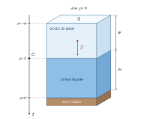
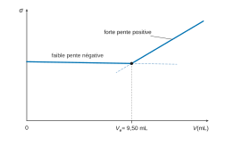
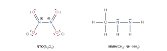
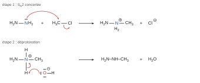

# Agro-Véto TB — Physique-chimie 2026 · Corrigé brut

*Corrigé rédigé par IA, non officiel. Signalez toute erreur.*

Épreuve « Physique-chimie — résolution de problèmes », 3 h, calculatrice autorisée. 42 questions, en deux parties indépendantes (A : océans sous-glaciaires d'Europe et de Ganymède ; B : moteurs-fusées de la sonde *Juice*).

---

## Partie A — Les océans sous-glaciaires d'Europe et Ganymède

## A1. Estimation de l'épaisseur de la croûte glacée d'Europe

### A1.1

Le diagramme est tracé dans le plan $(T, p)$, pression en échelle logarithmique.

- Domaine **I** (basses températures, à gauche de la courbe de fusion et au-dessus de la courbe de sublimation) : **solide** (glace).
- Domaine **II** (entre la courbe de fusion et la courbe de vaporisation, au-dessus du point triple) : **liquide**.
- Domaine **III** (hautes températures et basses pressions, sous les courbes de sublimation et de vaporisation) : **gaz** (vapeur d'eau).

Les points $A$ et $B$ sont les intersections de l'isobare $p = 1$ bar avec les courbes d'équilibre :

- **$A$ : équilibre solide/liquide sous 1 bar**, c'est-à-dire le point de **fusion** (ou de solidification) normal de l'eau, $T_A \simeq 273$ K ($0$ °C) ;
- **$B$ : équilibre liquide/vapeur sous 1 bar**, c'est-à-dire le point de **vaporisation** (ébullition, ou liquéfaction en sens inverse) normal, $T_B \simeq 373$ K ($100$ °C).

### A1.2

À la surface d'Europe, $T \simeq -180$ °C $\simeq 93$ K et la pression est très faible (pas d'atmosphère notable). À cette température, la courbe de sublimation correspond à une pression extrêmement basse, bien en dessous de 1 Pa (limite inférieure du diagramme). Le point représentatif est donc dans le domaine I pour toute pression du diagramme, très loin du domaine liquide, qui n'existe qu'au-dessus de 250 K environ. **La glace est la phase stable à la surface d'Europe.**

Dans l'océan, la pression n'est pas celle de la surface terrestre (1 bar) : elle croît avec la profondeur. Le domaine liquide est limité à gauche par la courbe de fusion. Celle-ci est quasi verticale près de 273 K, puis sa pente devient négative : la température de fusion diminue quand la pression augmente (anomalie de l'eau, la glace ordinaire étant moins dense que le liquide). Le point le plus à gauche du domaine II se lit vers $2\times10^8$ Pa :

$$\boxed{T_{min} \simeq 250\ \mathrm{K}\ (\approx -20\ ^\circ\mathrm{C}),\ \text{sous une pression d'environ } 2\times10^{8}\ \mathrm{Pa}}$$

En dessous, l'eau pure ne peut être liquide à aucune pression. La valeur $T_0 = 270$ K retenue ensuite pour l'interface eau/glace est compatible avec cette lecture.

### A1.3

La conduction thermique est un transfert d'énergie de proche en proche dû à l'agitation microscopique (chocs moléculaires, vibrations du réseau, électrons libres dans les métaux) :

- elle nécessite un **milieu matériel** et se fait **sans déplacement macroscopique de matière** ;
- elle va spontanément **du chaud vers le froid** (sens opposé au gradient de température, loi de Fourier) ; c'est un phénomène diffusif, lent et irréversible ;
- elle est d'autant plus efficace que la conductivité thermique $\lambda$ est grande.

Les deux autres modes de transfert **thermique** sont la **convection** (transport d'énergie par un mouvement macroscopique de fluide) et le **rayonnement** (ondes électromagnétiques, possible dans le vide).

### A1.4

$\Phi_{th}(r)$ est la puissance thermique traversant la sphère de rayon $r$, comptée positivement selon $\vec u_r$, c'est-à-dire de l'amont vers le système. Pendant $\mathrm{d}t$, avec la loi de Fourier écrite en $r$ :

$$\boxed{\delta_e Q = \Phi_{th}(r)\,\mathrm{d}t = -\lambda S \left(\frac{\mathrm{d}T}{\mathrm{d}r}\right)_r \mathrm{d}t}$$

### A1.5

En $r + \mathrm{d}r$, le flux compté selon $\vec u_r$ sort du système vers l'aval. Le transfert reçu depuis l'aval est donc :

$$\boxed{\delta_s Q = -\Phi_{th}(r + \mathrm{d}r)\,\mathrm{d}t}$$

### A1.6

Système : la coquille de glace entre $r$ et $r + \mathrm{d}r$, fermée, indéformable (pas de travail), sans source interne. Premier principe entre $t$ et $t + \mathrm{d}t$ :

$$\mathrm{d}U = \delta_e Q + \delta_s Q = \big[\Phi_{th}(r) - \Phi_{th}(r + \mathrm{d}r)\big]\,\mathrm{d}t .$$

En régime stationnaire, la température en chaque point, donc $U$, ne dépend pas du temps : $\mathrm{d}U = 0$. On en tire :

$$\begin{aligned}
\Phi_{th}(r + \mathrm{d}r) &= \Phi_{th}(r) \\
\frac{\mathrm{d}\Phi_{th}}{\mathrm{d}r}\,\mathrm{d}r &= 0
\end{aligned}$$

$$\boxed{\frac{\mathrm{d}\Phi_{th}}{\mathrm{d}r} = 0 : \ \Phi_{th}\ \text{est indépendant de } r}$$

### A1.7

Loi de Fourier avec $\Phi_{th}$ et $S$ constants :

$$\begin{aligned}
\frac{\mathrm{d}T}{\mathrm{d}r} &= -\frac{\Phi_{th}}{\lambda S} \\
&= -\frac{\varphi_{th}}{\lambda}
\end{aligned}$$

Le gradient de température est donc uniforme (constant).

On intègre entre la borne $r = R$, où la condition aux limites impose $T(R) = T_0$, et la position courante $r$ :

$$\begin{aligned}
\int_{T_0}^{T(r)} \mathrm{d}T &= -\frac{\varphi_{th}}{\lambda}\int_R^r \mathrm{d}r' \\
T(r) - T_0 &= -\frac{\varphi_{th}}{\lambda}\,(r - R)
\end{aligned}$$

$$\boxed{T(r) = T_0 - \frac{\varphi_{th}}{\lambda}\,(r - R)}$$

Le profil est affine, décroissant de $T_0$ (interface eau/glace) à $T_1$ (surface).

### A1.8

Seconde condition aux limites, à la surface : en $r = R + e$, $T = T_1$. Alors

$$T_1 = T_0 - \frac{\varphi_{th}}{\lambda}\,e$$

d'où

$$\boxed{e = \lambda\,\frac{T_0 - T_1}{\varphi_{th}}}$$

### A1.9

Données : $\lambda = 5$ W·m⁻¹·K⁻¹, $T_0 - T_1 = 270 - 90 = 180$ K, $\varphi_{th} = 50\times10^{-3}$ W·m⁻².

$$\begin{aligned}
e &= \frac{5 \times 180}{5{,}0\times10^{-2}} \\
&= 1{,}8\times10^{4}\ \mathrm{m}
\end{aligned}$$

$$\boxed{e \approx 18\ \mathrm{km}}$$

**Commentaire.** La valeur est dans la fourchette annoncée par l'énoncé (quelques kilomètres à quelques dizaines de kilomètres) : le modèle donne le bon ordre de grandeur. Elle vérifie $e \ll R$ (rayon d'Europe d'environ 1 560 km, $e/R \approx 1$ %), ce qui valide l'approximation $S \simeq 4\pi R^2$.

Limites : la conductivité de la glace dépend de la température (elle augmente quand $T$ diminue) ; la croûte n'est pas forcément purement conductive (convection possible dans la glace chaude profonde) ; il peut exister un chauffage interne (marées) dans la glace ; le flux surfacique est mal connu. Le résultat est donc un ordre de grandeur.

## A2. Pression hydrostatique dans l'océan de Ganymède

### A2.1

D'après la deuxième loi de Newton, $1\ \mathrm{N} = 1\ \mathrm{kg\cdot m\cdot s^{-2}}$. Donc :

$$[G] = \mathrm{kg\cdot m\cdot s^{-2}\cdot m^{2}\cdot kg^{-2}} = \mathrm{m^{3}\cdot kg^{-1}\cdot s^{-2}}$$

Alors

$$\begin{aligned}
[g] &= \frac{[G]\,[M]}{[R]^2} \\
&= \frac{\mathrm{m^{3}\cdot kg^{-1}\cdot s^{-2}} \times \mathrm{kg}}{\mathrm{m^{2}}}
\end{aligned}$$

$$\boxed{[g] = \mathrm{m\cdot s^{-2}}}$$

C'est l'unité d'une accélération, exprimée en unités de base du SI (le N·kg⁻¹, équivalent, n'en est pas une).

### A2.2

Conversion : $R = 2631$ km $= 2{,}631\times10^{6}$ m, d'où $R^2 = 6{,}922\times10^{12}$ m². Avec $M = 1{,}48\times10^{23}$ kg :

$$\begin{aligned}
g_G &= \frac{GM}{R^2} \\
&= \frac{6{,}67\times10^{-11} \times 1{,}48\times10^{23}}{6{,}922\times10^{12}} \\
&= \frac{9{,}87\times10^{12}}{6{,}92\times10^{12}}
\end{aligned}$$

$$\boxed{g_G \approx 1{,}43\ \mathrm{m\cdot s^{-2}}}$$

Avec $g_T = 9{,}81$ m·s⁻² :

$$\frac{g_T}{g_G} = \frac{9{,}81}{1{,}43} \approx 6{,}9$$

**Ce rapport vaut environ 7 : la pesanteur sur Ganymède est environ 7 fois plus faible que sur Terre.**

### A2.3

Éléments à faire figurer :

- la tranche parallélépipédique, de section $S$ : une **aire** (la face horizontale), et non une longueur ;
- les épaisseurs $e$ (glace) et $H$ (océan) ;
- l'origine $O$ ($z = 0$) à l'interface eau/glace et l'axe $(Oz)$ descendant ;
- le poids $\vec P$ de la croûte, appliqué au centre de la tranche de glace.

Le schéma n'est pas à l'échelle ($e \approx 150$ km, $H \approx 800$ km).

### A2.4

Masse de la tranche de glace : $m = \rho S e$, d'où

$$\boxed{P = \rho\,S\,e\,g}$$

On en déduit $p_0$ par l'équilibre de la tranche de glace, dans le référentiel supposé galiléen. La glace est un solide : on n'y applique pas la relation fondamentale de la statique des fluides, mais le principe fondamental de la statique. Forces subies :

- son poids $P$, vers le bas ;
- la force pressante de l'atmosphère sur sa face supérieure, nulle ($p = 0$) ;
- la force pressante de l'eau sur sa face inférieure, $p_0 S$, vers le haut ;
- des forces latérales, horizontales.

En projection sur la verticale :

$$p_0 S - \rho S e g = 0$$

$$\boxed{p_0 = \rho\,g\,e}$$

(Numériquement, $p_0 = 10^3 \times 1{,}43 \times 1{,}5\times10^{5} \approx 2{,}1\times10^{8}$ Pa.)

### A2.5

La relation fondamentale de la statique des fluides s'écrit $\overrightarrow{\mathrm{grad}}\,p = \rho \vec g$. L'axe $(Oz)$ est descendant, donc de même sens que le champ de pesanteur : $\vec g = +g\,\vec u_z$. La projection sur $\vec u_z$ donne $\dfrac{\mathrm{d}p}{\mathrm{d}z} = +\rho g$.

**Le signe $+$ vient de ce que l'axe $(Oz)$ et $\vec g$ ont le même sens : la pression augmente avec la profondeur, et ici la profondeur augmente avec $z$.** (Avec un axe ascendant, on aurait $-\rho g$.)

### A2.6

$\rho$ et $g$ sont constants. On intègre entre la borne $z = 0$ et la profondeur $z$, avec la condition aux limites $p(0) = p_0$, où $p_0 = \rho g e$ (A2.4) :

$$\begin{aligned}
\int_{p_0}^{p(z)} \mathrm{d}p &= \rho g \int_0^z \mathrm{d}z' \\
p(z) - p_0 &= \rho g z
\end{aligned}$$

$$\boxed{p(z) = \rho\,g\,(z + e)}$$

Cette expression vaut pour $0 \le z \le H$.

### A2.7

Au fond de l'océan, $z = H$. On prend $H = 800$ km (profondeur de l'océan sous la croûte) et $e = 150$ km :

$$\begin{aligned}
p_{max} &= \rho g (H + e) \\
&= 10^3 \times 1{,}43 \times 9{,}5\times10^{5} \\
&\approx 1{,}4\times10^{9}\ \mathrm{Pa}
\end{aligned}$$

$$\boxed{p_{max} \approx 1{,}4\times10^{4}\ \mathrm{bar}}$$

(Si l'on comprend que 800 km est la profondeur totale depuis la surface, $H + e = 800$ km et $p_{max} \approx 1{,}1\times10^{4}$ bar.)

**Comparaison.** C'est environ **dix à quatorze fois** la pression au fond des océans terrestres ($10^3$ bar). La pesanteur est 7 fois plus faible, mais la colonne d'eau et de glace (près de 1 000 km) est environ 100 fois plus haute que la profondeur des océans terrestres (une dizaine de kilomètres). Une telle pression, de l'ordre du GPa, est cohérente avec la présence de glaces de haute pression au fond de l'océan (figure 1).

## A3. Étude de la composition de l'océan de Ganymède

### A3.1

La dilution conserve la quantité de matière de soluté : $C_0 V_0 = C_1 V_1$. Le facteur de dilution vaut donc

$$\begin{aligned}
F &= \frac{C_0}{C_1} \\
&= \frac{V_1}{V_0} \\
&= 20
\end{aligned}$$

Pour $V_1 = 100{,}0$ mL, il faut prélever $V_0 = V_1/20$, soit $5{,}00$ mL de $S_0$.

**Verrerie :** une **pipette jaugée de 5,00 mL** (avec propipette) pour prélever $S_0$, versée au préalable dans un bécher, et une **fiole jaugée de 100,0 mL**. La verrerie jaugée est imposée par la précision attendue. On complète à l'eau distillée jusqu'au trait de jauge, puis on homogénéise par retournements.

### A3.2

Titrage par précipitation ; les ions spectateurs ($\mathrm{Mg^{2+}}$, $\mathrm{Cl^-}$) n'apparaissent pas :

$$\boxed{\mathrm{Ba^{2+}_{(aq)}} + \mathrm{SO_4^{2-}}_{(aq)} = \mathrm{BaSO_4}_{(s)}}$$

C'est la réaction inverse de la dissolution de $\mathrm{BaSO_4}$, de constante $K_s$ :

$$\begin{aligned}
K^\circ &= \frac{1}{K_s} \\
&= 10^{9{,}9}
\end{aligned}$$

$$\boxed{K^\circ \approx 7{,}9\times10^{9}}$$

$K^\circ \gg 10^4$ : la réaction est quantitative, ce qui permet de l'utiliser pour un titrage.

### A3.3

Un suivi conductimétrique nécessite une **cellule conductimétrique** : deux plaques conductrices (platine) planes et parallèles, entre lesquelles on mesure la conductance de la solution. **Il faut utiliser la sonde 4**, seule à présenter deux plaques en regard. Les sondes 1 (électrode de verre à bulbe, pour le pH), 2 (électrode métallique) et 3 (électrode de référence ou électrode combinée) sont des électrodes de potentiométrie.

### A3.4

| Ion | $\mathrm{Mg^{2+}}$ | $\mathrm{SO_4^{2-}}$ | $\mathrm{Ba^{2+}}$ | $\mathrm{Cl^-}$ |
|---|---|---|---|---|
| Évolution avant l'équivalence | = | ↘ | 0 | ↗ |
| Évolution après l'équivalence | = | 0 | ↗ | ↗ |

$\mathrm{Mg^{2+}}$ est spectateur. Les sulfates sont consommés jusqu'à l'équivalence, puis ne subsistent qu'à l'état de traces. Les ions baryum versés précipitent tant qu'il reste des sulfates (traces), puis s'accumulent. Les ions chlorure, spectateurs, sont apportés en continu.

### A3.5

Loi de Kohlrausch : $\sigma = \sum_i \lambda_i^\circ [X_i]$. La dilution étant négligée, chaque concentration est proportionnelle à la quantité de matière correspondante, dont l'évolution est donnée par le tableau de A3.4 : $\sigma$ varie de façon affine par morceaux en fonction du volume $V$ versé.

- **Avant l'équivalence**, chaque ion baryum versé précipite un ion sulfate et apporte deux ions chlorure : un $\mathrm{SO_4^{2-}}$ est remplacé par deux $\mathrm{Cl^-}$. Le magnésium ne change pas et le baryum reste à l'état de traces. La pente est proportionnelle à $2\lambda^\circ(\mathrm{Cl^-}) - \lambda^\circ(\mathrm{SO_4^{2-}}) = -0{,}8 < 0$ : **légère décroissance**, presque un palier.
- **Après l'équivalence**, $\mathrm{Ba^{2+}}$ et $2\,\mathrm{Cl^-}$ s'accumulent. La pente est proportionnelle à $\lambda^\circ(\mathrm{Ba^{2+}}) + 2\lambda^\circ(\mathrm{Cl^-}) = +27{,}9 > 0$ : **croissance forte**, environ 35 fois plus raide en valeur absolue.

Les deux pentes se calculent ainsi, avec les valeurs du tableau :

$$\begin{aligned}
2\times7{,}6 - 16{,}0 &= -0{,}8 \\
12{,}7 + 2\times7{,}6 &= +27{,}9
\end{aligned}$$

Axes : conductivité $\sigma$ en ordonnée, volume $V$ de solution de chlorure de baryum versé en abscisse. **L'équivalence $V_e = 9{,}50$ mL est l'abscisse du point d'intersection des deux segments de droite** (rupture de pente).

(Remarque : les valeurs du tableau sont les conductivités molaires ioniques usuelles en mS·m²·mol⁻¹ ; l'unité « mS·cm⁻¹·L·mol⁻¹ » de l'énoncé semble erronée d'un facteur 10, sans incidence sur l'allure.)

### A3.6

À l'équivalence, les réactifs ont été introduits en proportions stœchiométriques (1:1) :

$$\begin{aligned}
n(\mathrm{SO_4^{2-}})_{S_2} &= C\,V_e \\
&= 5{,}00\times10^{-2} \times 9{,}50\times10^{-3} \\
&= 4{,}75\times10^{-4}\ \mathrm{mol}
\end{aligned}$$

L'ajout de 90 mL d'eau ne modifie pas cette quantité : elle était contenue dans les $10{,}0$ mL de $S_1$ prélevés, d'où

$$\begin{aligned}
[\mathrm{SO_4^{2-}}]_{S_1} &= \frac{4{,}75\times10^{-4}}{10{,}0\times10^{-3}} \\
&= 4{,}75\times10^{-2}\ \mathrm{mol\cdot L^{-1}}
\end{aligned}$$

$S_1$ est $S_0$ diluée 20 fois :

$$\boxed{[\mathrm{SO_4^{2-}}]_{S_0} = 20 \times 4{,}75\times10^{-2} = 0{,}950\ \mathrm{mol\cdot L^{-1}}}$$

### A3.7

$M(\mathrm{MgSO_4}) = 24{,}3 + 32{,}0 + 4\times16{,}0 = 120{,}3$ g·mol⁻¹. On suppose que tout le sulfate provient de $\mathrm{MgSO_4}$ : $n(\mathrm{MgSO_4}) = n(\mathrm{SO_4^{2-}})$. Pour $1{,}00$ L de $S_0$ :

$$\begin{aligned}
m(\mathrm{MgSO_4}) &= 0{,}950 \times 120{,}3 \\
&= 114\ \mathrm{g} \\
m_{solution} &= \rho V \\
&= 1{,}10\times10^{3}\ \mathrm{g}
\end{aligned}$$

$$\boxed{w = \frac{m(\mathrm{MgSO_4})}{m_{solution}} = \frac{114}{1{,}10\times10^{3}} \approx 10{,}4\ \%}$$

(Pour l'échantillon de 100 g : $V = 100/1{,}10 = 90{,}9$ mL, $n = 8{,}64\times10^{-2}$ mol, $m = 10{,}4$ g.)

**Commentaire.** Le résultat est en accord avec l'estimation de 10 % en masse. Il repose sur l'hypothèse que les sulfates ne sont associés qu'au magnésium ; d'autres sulfates (sodium, par exemple) fausseraient l'attribution. Une telle salinité, environ trois fois celle de l'eau de mer terrestre (3,5 %), abaisse la température de fusion de l'eau.

---

## Partie B — Les moteurs-fusées de la sonde *Juice*

## B1. Étude du mélange d'ergols utilisé pour la propulsion de la sonde

### B1.1

$1s^2\,2s^2\,2p^6\,3s^2\,3p^6\,4s^2\,3d^2$ : $Z = 22$.

- Nombre quantique principal maximal $n = 4$ : **4ᵉ période**.
- Sous-couche $3d$ en cours de remplissage : **bloc d**, métal de transition.
- $4s^2\,3d^2$ : $2 + 2 = 4$ électrons au-delà du cœur d'argon, **colonne 4** (deuxième colonne du bloc d, groupe du titane).
- **4 électrons de valence** ($4s^2\,3d^2$).
- **Ions usuels :** $\mathrm{Ti^{2+}}$, de configuration $[\mathrm{Ar}]\,3d^2$, par départ des deux électrons $4s$, les plus externes. $\mathrm{Ti^{4+}}$, de configuration $[\mathrm{Ar}]$ (gaz noble), par départ des 4 électrons de valence. On rencontre aussi $\mathrm{Ti^{3+}}$ en solution.

### B1.2

**NTO, $\mathrm{O_2N{-}NO_2}$** : $2\times5 + 4\times6 = 34$ électrons de valence, 17 doublets.

Chaque azote, lié à l'autre azote, forme une liaison double N=O et une liaison simple N–O : 4 liaisons, aucun doublet non liant, octet respecté, charge formelle $+1$. L'oxygène doublement lié porte 2 doublets non liants ; l'oxygène simplement lié porte 3 doublets non liants et une charge formelle $-1$. Somme des charges formelles nulle : molécule neutre. Deux formes mésomères équivalentes par groupe $\mathrm{NO_2}$.

Décompte : 7 doublets liants (1 N–N, 2 N=O comptant 4, 2 N–O) + 10 doublets non liants (2×2 + 2×3) = 17.

**MMH, $\mathrm{CH_3{-}NH{-}NH_2}$** : $4 + 2\times5 + 6\times1 = 20$ électrons, 10 doublets ; 8 liaisons simples (3 C–H, C–N, N–N, 3 N–H) et **un doublet non liant sur chaque azote**, aucune charge formelle.

### B1.3

Méthode VSEPR (une liaison multiple compte pour une seule direction) :

- **NTO** : chaque azote est lié à 3 atomes (2 O, 1 N), sans doublet non liant : $\mathrm{AX_3E_0}$, **géométrie trigonale plane** autour de N, angles voisins de 120°.
- **MMH** : chaque azote est lié à 3 atomes et porte un doublet non liant : $\mathrm{AX_3E_1}$, figure de répulsion tétraédrique, **géométrie pyramidale à base triangulaire**, angles légèrement inférieurs à 109,5° (environ 107°), le doublet non liant étant plus répulsif.

### B1.4

Les deux liaisons N–N sont simples ; la différence vient de l'environnement électronique.

- Dans le NTO, les deux azotes portent chacun une **charge formelle $+1$** : deux centres positifs adjacents se repoussent, ce qui affaiblit et allonge la liaison.
- La densité électronique des groupes $\mathrm{NO_2}$ est délocalisée (mésomérie) et attirée vers les oxygènes, très électronégatifs : la région internucléaire N–N est appauvrie en électrons.

Dans la MMH, les azotes sont neutres : liaison simple ordinaire (143 pm, proche de l'hydrazine). **La liaison N–N du NTO est donc plus faible et plus longue (178 pm)**, ce qui est cohérent avec la dissociation facile $\mathrm{N_2O_4} \rightleftharpoons 2\,\mathrm{NO_2}$.

### B1.5

Masses molaires :

$$\begin{aligned}
M(\mathrm{MMH}) &= M(\mathrm{CH_6N_2}) \\
&= 12{,}0 + 6\times1{,}0 + 2\times14{,}0 \\
&= 46{,}0\ \mathrm{g\cdot mol^{-1}} \\
M(\mathrm{NTO}) &= 2\times14{,}0 + 4\times16{,}0 \\
&= 92{,}0\ \mathrm{g\cdot mol^{-1}}
\end{aligned}$$

La stœchiométrie porte sur les **quantités de matière** : $n(\mathrm{MMH}) = 4x$ et $n(\mathrm{NTO}) = 5x$. La masse totale vaut alors

$$\begin{aligned}
m_{tot} &= x\,(4\times46{,}0 + 5\times92{,}0) \\
&= 644\,x\ (\mathrm{g}) \\
x &= \frac{3{,}650\times10^{6}}{644} \\
&= 5{,}67\times10^{3}\ \mathrm{mol}
\end{aligned}$$

$$\boxed{m(\mathrm{MMH}) = 4x\,M(\mathrm{MMH}) \approx 1{,}04\times10^{3}\ \mathrm{kg}}$$

$$\boxed{m(\mathrm{NTO}) = 5x\,M(\mathrm{NTO}) \approx 2{,}61\times10^{3}\ \mathrm{kg}}$$

Vérification : $1043 + 2607 = 3650$ kg.

### B1.6

**Enthalpie standard de réaction** (loi de Hess, à 298 K) :

$$\begin{aligned}
\Delta_r H^\circ &= 9\times0 + 12\times(-242) + 4\times(-394) - 4\times95 - 5\times11 \\
&= -4480 - 435 \\
&= -4915\ \mathrm{kJ\cdot mol^{-1}}
\end{aligned}$$

**Conditions d'application.**

- Approximation d'Ellingham : $\Delta_r H^\circ$ ne dépend pas de la température ; la valeur calculée à 298 K s'utilise à 3000 °C.
- Transformation isobare, sans autre travail que celui des forces de pression : le transfert thermique reçu est égal à la variation d'enthalpie, $Q_p = \Delta H$.
- État final et état initial à la même température (bilan isotherme), gaz assimilés à des gaz parfaits : $\Delta H = \xi_f\,\Delta_r H^\circ$.
- Combustion totale d'un mélange stœchiométrique : les deux réactifs sont épuisés ensemble, et l'avancement final vaut $\xi_f = x = 5{,}67\times10^{3}$ mol (B1.5).

On a $Q_p = \xi_f\,\Delta_r H^\circ < 0$ : le système cède de l'énergie. L'énergie thermique dégagée vaut

$$\begin{aligned}
Q &= -\xi_f\,\Delta_r H^\circ \\
&= 5{,}67\times10^{3} \times 4915 \\
&\approx 2{,}79\times10^{7}\ \mathrm{kJ}
\end{aligned}$$

$$\boxed{Q \approx 2{,}8\times10^{10}\ \mathrm{J}}$$

soit environ 7,6 MJ par kilogramme d'ergols.

## B2. Étude de la tuyère du moteur-fusée principal

### B2.1

Modèle du gaz parfait (limite d'un gaz réel à faible pression, gaz dilué) :

- particules ponctuelles, de volume propre négligeable devant le volume offert ;
- **aucune interaction entre elles** en dehors des chocs ;
- agitation désordonnée.

Équation d'état :

$$\boxed{pV = nRT}$$

($p$ en Pa, $V$ en m³, $n$ en mol, $T$ en K, $R = 8{,}31$ J·K⁻¹·mol⁻¹.)

### B2.2

Par définition de l'enthalpie, avec $U = \dfrac{nRT}{\gamma - 1}$ et $pV = nRT$ :

$$\begin{aligned}
H &= U + pV \\
&= \frac{nRT}{\gamma - 1} + nRT
\end{aligned}$$

$$\boxed{H = \frac{\gamma}{\gamma - 1}\,nRT}$$

### B2.3

La capacité thermique à pression constante est définie par $C_P = \left(\dfrac{\partial H}{\partial T}\right)_p$ (en J·K⁻¹). Pour un gaz parfait, $H$ ne dépend que de $T$ :

$$C_P = \frac{\gamma}{\gamma - 1}\,nR$$

La capacité thermique massique est la capacité thermique rapportée à la masse du système, $c_P = C_P/m$, avec $m = nM$ :

$$\boxed{c_P = \frac{1}{M}\,\frac{\gamma}{\gamma - 1}\,R}$$

### B2.4

- $w_u = 0$ : le travail utile est le travail échangé avec les **parties mobiles** (turbine, piston…) ; la tuyère n'a **aucune pièce mobile** (le travail des forces de pression d'entrée et de sortie est déjà dans $\Delta h$).
- $q = 0$ : une transformation **adiabatique** est une transformation sans transfert thermique entre le fluide et l'extérieur. C'est le cas ici : l'écoulement est rapide, la durée de passage du gaz est trop courte pour un transfert thermique notable avec les parois.

### B2.5

Avec $w_u = q = 0$, le premier principe donne $\Delta h + \Delta e_c = 0$, chaque variation étant prise « sortie moins entrée ». Pour un gaz parfait :

$$\begin{aligned}
\Delta h &= c_P\,(T_s - T_e) \\
\Delta e_c &= \frac{c_s^2 - c_e^2}{2}
\end{aligned}$$

D'où :

$$\begin{aligned}
c_P\,(T_s - T_e) + \frac{c_s^2 - c_e^2}{2} &= 0 \\
c_s^2 &= c_e^2 + 2c_P\,(T_e - T_s)
\end{aligned}$$

Avec $T_s \ll T_e$ et $c_e \ll c_s$, il reste $c_s^2 \simeq 2 c_P T_e$. Avec l'expression de $c_P$ établie en B2.3 :

$$\boxed{c_s = \sqrt{\frac{2\gamma}{\gamma - 1}\,\frac{R\,T_e}{M}}}$$

### B2.6

La masse molaire doit être convertie en kg·mol⁻¹ : $M = 2{,}58\times10^{-2}$ kg·mol⁻¹. Avec $\gamma = 1{,}3$ et $T_e = 3385$ K :

$$\begin{aligned}
c_P &= \frac{1{,}3}{0{,}3}\times\frac{8{,}31}{2{,}58\times10^{-2}} \\
&\approx 1{,}40\times10^{3}\ \mathrm{J\cdot kg^{-1}\cdot K^{-1}} \\
c_s &= \sqrt{2 \times 1{,}396\times10^{3} \times 3385} \\
&\approx 3{,}07\times10^{3}\ \mathrm{m\cdot s^{-1}}
\end{aligned}$$

$$\begin{aligned}
F &= D_m\,c_s \\
&= 0{,}141 \times 3{,}07\times10^{3}
\end{aligned}$$

$$\boxed{F \approx 4{,}33\times10^{2}\ \mathrm{N}}$$

**Écart** à la valeur attendue (425 N) : $+2$ %. Un écart aussi faible **valide le modèle** dans ses grandes lignes ; il reste à expliquer le léger excès. Hypothèses pouvant l'expliquer :

- la détente n'est pas totale ($T_s$ non négligeable) : $c_s$ est surestimée ;
- l'écoulement n'est pas parfaitement adiabatique (parois refroidies), ni sans frottement, ni parfaitement axial (divergence du jet) : pertes d'énergie cinétique utile ;
- le mélange à 3385 K n'est pas un gaz parfait de $\gamma$ et $M$ constants (dissociation partielle, $\gamma$ variable avec $T$) ; la combustion peut être incomplète ;
- à l'inverse, négliger $c_e$ et le terme de pression en sortie de tuyère sous-estime la poussée.

Le modèle surestime globalement la poussée de 2 %, ce qui est remarquable pour un modèle aussi simple.

(Les données indiquent un mélange « 9 N₂ ; 18 H₂O ; 4 CO₂ », alors que la réaction (1) produit 12 H₂O. La masse molaire donnée correspond bien à 12 H₂O : $(9\times28 + 12\times18 + 4\times44)/25 = 25{,}8$ g·mol⁻¹. C'est une coquille sans incidence.)

## B3. Étude de la synthèse de la monométhylhydrazine (MMH)

### B3.1

$$\boxed{\mathrm{H_2N{-}NH_2 + CH_3Cl + HO^- \longrightarrow CH_3{-}NH{-}NH_2 + Cl^- + H_2O}}$$

Éléments et charges équilibrés (1 C, 2 N, 7 H, 1 Cl, 1 O ; charge $-1$ de chaque côté).

### B3.2

**Nature du mécanisme.** Le chlorométhane est un halogénoalcane méthylique : le carbone est très peu encombré, ce qui favorise l'attaque dorsale d'un nucléophile. Le carbocation $\mathrm{CH_3^+}$, qu'exigerait un mécanisme $\mathrm{S_N1}$, est extrêmement instable (aucun groupe donneur). **Mécanisme limite $\mathrm{S_N2}$.** La liaison $\mathrm{C{-}Cl}$ est polarisée $\mathrm{C^{\delta+}{-}Cl^{\delta-}}$ ($\chi(\mathrm{Cl}) > \chi(\mathrm{C})$), le carbone est électrophile ; l'hydrazine est nucléophile par les doublets non liants de ses azotes.

**Étape 1 (substitution, concertée, bimoléculaire)** : flèche courbe du doublet non liant d'un azote de l'hydrazine vers le carbone (attaque à l'opposé du chlore) ; flèche courbe du doublet de la liaison C–Cl vers le chlore.

$$\mathrm{H_2N{-}\ddot{N}H_2 + H_3C{-}Cl \longrightarrow \left[H_2N{-}NH_2\cdots CH_3 \cdots Cl\right]^{\ddagger} \longrightarrow H_2N{-}NH_2^{+}{-}CH_3 + Cl^-}$$

(état de transition à carbone pentacoordiné, inversion de Walden sans conséquence ici.)

**Étape 2 (acido-basique, rapide)** : flèche du doublet de $\mathrm{HO^-}$ vers un H porté par l'azote chargé, flèche de la liaison N–H vers l'azote.

$$\mathrm{H_2N{-}NH_2^{+}{-}CH_3 + HO^- \longrightarrow H_2N{-}NH{-}CH_3 + H_2O}$$

La substitution précède la déprotonation : l'hydrazine, très peu acide, n'est pas transformée en ion amidure par $\mathrm{HO^-}$ ; c'est l'hydrazine neutre qui joue le rôle de nucléophile.

### B3.3

Une seconde méthylation peut avoir lieu sur l'un ou l'autre azote de la MMH ($\mathrm{C_2H_8N_2}$) :

$$\boxed{\text{1,1-diméthylhydrazine : } \mathrm{(CH_3)_2N{-}NH_2}}$$

$$\boxed{\text{1,2-diméthylhydrazine : } \mathrm{CH_3{-}NH{-}NH{-}CH_3}}$$

### B3.4

Électronégativités : $\mathrm{O}\,(3{,}4) > \mathrm{Cl}\,(3{,}2) > \mathrm{N}\,(3{,}0) > \mathrm{H}\,(2{,}2)$. Les électrons de chaque liaison sont attribués à l'atome le plus électronégatif.

| Espèce | n.o.(Cl) | n.o.(N) |
|---|---|---|
| $\mathrm{ClO^-}$ | $+\mathrm{I}$ (O plus électronégatif, O à $-\mathrm{II}$) | — |
| $\mathrm{NH_3}$ | — | $-\mathrm{III}$ |
| $\mathrm{NH_2Cl}$ | $-\mathrm{I}$ (Cl plus électronégatif que N) | $-\mathrm{I}$ ($-2$ pour les deux N–H, $+1$ pour N–Cl) |
| $\mathrm{HO^-}$ | — | — (O : $-\mathrm{II}$, H : $+\mathrm{I}$) |

Cl passe de $+\mathrm{I}$ à $-\mathrm{I}$ (réduction, gain de 2 électrons) et N de $-\mathrm{III}$ à $-\mathrm{I}$ (oxydation, perte de 2 électrons) : **c'est une oxydoréduction**.

$$\boxed{\text{Oxydant : } \mathrm{ClO^-} \qquad \text{Réducteur : } \mathrm{NH_3}}$$

### B3.5

Dans $\mathrm{NH_2Cl}$, $\chi(\mathrm{Cl}) = 3{,}2 > \chi(\mathrm{N}) = 3{,}0$ : la liaison est polarisée $\mathrm{N^{\delta+}{-}Cl^{\delta-}}$. L'azote, appauvri en électrons dans la direction de la liaison N–Cl, peut être attaqué par un nucléophile (doublet de l'azote de la méthylamine). La liaison N–Cl se rompt de façon hétérolytique, le chlore partant avec le doublet sous forme d'ion chlorure, base très faible et stable. Une substitution nucléophile est donc possible :

$$\boxed{\text{site électrophile : l'atome d'azote de } \mathrm{NH_2Cl} \qquad \text{nucléofuge : } \mathrm{Cl}\ (\text{départ de } \mathrm{Cl^-})}$$

### B3.6

Les deux mécanismes forment la MMH en parallèle : $v = v' + v''$, avec $v' = k_{SN2}\,[\mathrm{NH_2Cl}][\mathrm{CH_3NH_2}]$.

Pré-équilibre rapide, de constante $K$ (l'eau, solvant, a une activité égale à 1) :

$$K = \frac{[\mathrm{NHCl^-}]\,c^\circ}{[\mathrm{NH_2Cl}][\mathrm{HO^-}]}$$

$$[\mathrm{NHCl^-}] = \frac{K}{c^\circ}\,[\mathrm{NH_2Cl}][\mathrm{HO^-}]$$

L'étape lente impose la vitesse de la seconde voie : $v'' = k\,[\mathrm{NHCl^-}][\mathrm{CH_3NH_2}]$. L'autoprotolyse de l'eau donne $[\mathrm{HO^-}]$ :

$$K_e = \frac{[\mathrm{H_3O^+}][\mathrm{HO^-}]}{(c^\circ)^2}$$

$$[\mathrm{HO^-}] = \frac{K_e (c^\circ)^2}{[\mathrm{H_3O^+}]}$$

On en déduit :

$$v'' = \frac{k\,K\,K_e\,c^\circ}{[\mathrm{H_3O^+}]}\,[\mathrm{NH_2Cl}][\mathrm{CH_3NH_2}]$$

$$v = \left(k_{SN2} + \frac{k\,K\,K_e\,c^\circ}{[\mathrm{H_3O^+}]}\right)[\mathrm{NH_2Cl}][\mathrm{CH_3NH_2}]$$

C'est la forme expérimentale $v = k_0 [\mathrm{NH_2Cl}][\mathrm{CH_3NH_2}]$ avec $k_0 = a + b/[\mathrm{H_3O^+}]$ :

$$\begin{aligned}
a &= k_{SN2} \\
b &= k\,K\,K_e\,c^\circ
\end{aligned}$$

($b$ a bien la dimension d'une constante de vitesse d'ordre 2 multipliée par une concentration.) La vitesse augmente quand le milieu devient plus basique.

### B3.7

Dans le procédé Raschig, la liaison N–N se forme entre l'azote d'une chloramine et celui d'une amine : on choisit à l'avance les substituants de chaque azote.

**1,1-diméthylhydrazine** (deux méthyles sur le même azote) : chloramine $\mathrm{NH_2Cl}$ et diméthylamine.

$$\mathrm{ClO^- + NH_3 = NH_2Cl + HO^-}$$

$$\boxed{\mathrm{NH_2Cl + (CH_3)_2NH + HO^- = (CH_3)_2N{-}NH_2 + H_2O + Cl^-}}$$

Autre possibilité, en chlorant la diméthylamine puis en la faisant réagir avec l'ammoniac :

$$\mathrm{ClO^- + (CH_3)_2NH = (CH_3)_2NCl + HO^-}$$

$$\mathrm{(CH_3)_2NCl + NH_3 + HO^- = (CH_3)_2N{-}NH_2 + H_2O + Cl^-}$$

**1,2-diméthylhydrazine** (un méthyle sur chaque azote) : chloramine méthylée et méthylamine.

$$\mathrm{ClO^- + CH_3NH_2 = CH_3NHCl + HO^-}$$

$$\boxed{\mathrm{CH_3NHCl + CH_3NH_2 + HO^- = CH_3{-}NH{-}NH{-}CH_3 + H_2O + Cl^-}}$$
