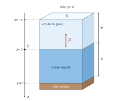
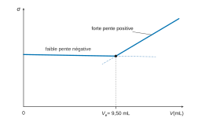
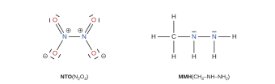
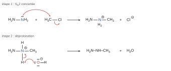

# Agro-Véto TB — Physique-chimie 2026 · Corrigé guidé

*Corrigé rédigé par IA, non officiel. Signalez toute erreur.*

## Présentation du sujet

**Thème.** L'épreuve « Physique-chimie — résolution de problèmes » (3 heures, calculatrice autorisée, 12 pages) suit la mission européenne *Juice*, lancée en 2023 vers Jupiter et ses lunes glacées. Elle compte **42 questions** en deux parties indépendantes, chacune découpée en trois sous-parties elles aussi indépendantes. Les données numériques sont regroupées à la fin de chaque sous-partie.

**Découpage.**

| Sous-partie | Questions | Contenu | Notions du programme mobilisées |
|---|---|---|---|
| A1 | A1.1–A1.9 | Épaisseur de la croûte glacée d'Europe | diagramme $(T,p)$, modes de transfert thermique, loi de Fourier, bilan d'énergie en régime stationnaire |
| A2 | A2.1–A2.7 | Pression au fond de l'océan de Ganymède | analyse dimensionnelle, gravitation, statique des fluides |
| A3 | A3.1–A3.7 | Teneur en $\mathrm{MgSO_4}$ de l'océan | dilution, précipitation, $K_s$, titrage conductimétrique, loi de Kohlrausch |
| B1 | B1.1–B1.6 | Ergols NTO/MMH | classification périodique, Lewis, VSEPR, stœchiométrie, loi de Hess |
| B2 | B2.1–B2.6 | Tuyère du moteur | gaz parfait, enthalpie, $c_P$, premier principe en système ouvert |
| B3 | B3.1–B3.7 | Synthèse de la MMH | $\mathrm{S_N2}$, isomérie, nombres d'oxydation, électrophilie, pré-équilibre rapide, étape cinétiquement déterminante |

**Difficulté et longueur.** Le sujet est long (42 questions en 3 heures, environ 4 minutes par question) mais rarement difficile : la plupart des résultats intermédiaires sont donnés par l'énoncé (A1.7, A1.8, A2.4, B2.3, B2.5), ce qui permet de repartir après un blocage. Les questions les plus exigeantes sont A1.2 (lecture fine du diagramme), A3.5 (allure justifiée d'une courbe conductimétrique), B1.4 (explication structurale), B2.6 (discussion d'un écart) et B3.6 (cinétique à deux voies).

**Ce qu'a montré la session 2026.** D'après le rapport 2026, la moyenne est de 9,79/20 (médiane 9,10, écart type 3,75, notes de 3,50 à 20,00). Les questions qui ont fait la différence ne sont pas les plus calculatoires, mais celles où il faut une démarche complète :

- **A3.2** : très peu de candidats trouvent l'équation du titrage, dont dépend toute la sous-partie A3 ;
- **B1.5** : stœchiométrie appliquée aux masses au lieu des quantités de matière, bonnes réponses « très rares » ;
- **B1.6** : aucune réponse complète (avancement et conditions d'application oubliés) ;
- **B1.4** : quelques rares bonnes réponses ;
- **A3.6, A3.7, B2.5, B3.6** : peu traitées ; **B3.7** : pas traitée du tout.

Le rapport insiste aussi sur deux points de forme, jugés à chaque question : le nombre de chiffres significatifs et l'unité de chaque application numérique, et la mise en évidence des résultats (encadrement, soulignement), avec des numéros de question complets.

**Questions à ne pas laisser passer.** A1.1, A1.3, A1.8, A1.9, A2.1, A2.2, A2.5, A2.6, A3.1, A3.2, A3.4, A3.6, B1.1, B1.5, B1.6, B2.1 à B2.4, B3.1, B3.3, B3.4 : des questions de cours ou des calculs directs.

**Gestion du temps.** Les six blocs sont indépendants : on peut commencer par ceux où l'on se sent le plus à l'aise, à condition de numéroter clairement. Compter environ 25 à 30 minutes par sous-partie et garder un quart d'heure pour les commentaires (A1.9, A2.7, A3.7, B2.6), qui demandent une phrase argumentée et chiffrée.

**Deux coquilles de l'énoncé**, sans conséquence sur les calculs :

- en B2, le mélange gazeux est noté « 9 N₂ ; 18 H₂O ; 4 CO₂ » alors que la réaction (1) produit 12 H₂O (la masse molaire 25,8 g·mol⁻¹ correspond bien à 12 H₂O) ;
- en A3, l'unité des conductivités molaires ioniques (« mS·cm⁻¹·L·mol⁻¹ ») ne correspond pas aux valeurs données, qui sont les valeurs usuelles en mS·m²·mol⁻¹.

---

## Partie A1 — Estimation de l'épaisseur de la croûte glacée d'Europe

On lit le diagramme de phases de l'eau, puis on construit un modèle de conduction stationnaire dans une coquille de glace mince : bilan d'énergie sur une tranche élémentaire, flux conservatif, profil affine, épaisseur.

### Question A1.1

> [!INDICATION]
> Repérer d'abord les deux points nommés (point triple, point critique) : les trois courbes qui en partent délimitent les trois domaines.

> [!INDICATION]
> Les points $A$ et $B$ sont tous deux sur le trait rouge horizontal. Quelle est la pression correspondante, et quelles courbes ce trait coupe-t-il ?

#### Solution

Le diagramme est tracé dans le plan $(T, p)$, pression en échelle logarithmique.

- Domaine **I** (basses températures) : **solide** (glace).
- Domaine **II** (entre la courbe de fusion et la courbe de vaporisation) : **liquide**.
- Domaine **III** (hautes températures, basses pressions) : **gaz** (vapeur d'eau).

$A$ et $B$ sont les intersections de l'isobare $p = 1$ bar avec les courbes d'équilibre :

- **$A$ : équilibre solide/liquide sous 1 bar**, c'est-à-dire le point de **fusion** (ou de solidification) normal, $T_A \simeq 273$ K ($0$ °C) ;
- **$B$ : équilibre liquide/vapeur sous 1 bar**, c'est-à-dire le point de **vaporisation** (ébullition, ou liquéfaction en sens inverse) normal, $T_B \simeq 373$ K ($100$ °C).

> [!PIEGE]
> $A$ et $B$ ne sont ni le point triple ni le point critique, déjà nommés sur la figure. Il faut nommer le changement d'état associé à chacun, et préciser « sous 1 bar » : une température de fusion ou d'ébullition n'a de sens qu'à pression donnée. Ne pas confondre non plus ce diagramme $(T, p)$ avec le diagramme de Clapeyron de l'équilibre liquide-vapeur.

> [!JURY]
> D'après le rapport 2026, les états physiques ont presque toujours été bien identifiés, mais « les points A et B n'ont pas toujours été associés à des noms de changements d'état ».

### Question A1.2

> [!INDICATION]
> Placer le point (température de surface d'Europe convertie en kelvins, pression très faible) sur le diagramme.

> [!INDICATION]
> Pour la seconde partie, chercher le point le plus à gauche du domaine II : suivre la courbe de fusion quand la pression augmente.

#### Solution

À la surface d'Europe, $T \simeq -180$ °C $\simeq 93$ K et la pression est très faible. À cette température, la pression de sublimation est extrêmement basse, bien en dessous de 1 Pa (limite basse du diagramme) : le point représentatif est dans le domaine I, très loin du domaine liquide. **La glace est la phase stable à la surface d'Europe.**

Dans l'océan, la pression n'est pas celle de la surface terrestre : elle croît avec la profondeur. Le domaine liquide est limité à gauche par la courbe de fusion, quasi verticale près de 273 K puis de pente négative : la température de fusion diminue quand la pression augmente. Le point le plus à gauche du domaine II se lit vers $2\times10^8$ Pa :

$$\boxed{T_{min} \simeq 250\ \mathrm{K}\ (\approx -20\ ^\circ\mathrm{C}),\ \text{sous environ } 2\times10^{8}\ \mathrm{Pa}}$$

En dessous de cette température, l'eau pure n'est liquide sous aucune pression. La valeur $T_0 = 270$ K utilisée ensuite pour l'interface eau/glace est compatible.

> [!METHODE]
> Une compression favorise la phase la plus dense. La glace ordinaire étant moins dense que l'eau liquide, comprimer de la glace près de 0 °C peut la faire fondre : c'est ce qu'exprime la pente négative de la courbe de fusion de l'eau, exception parmi les corps purs usuels.

> [!PIEGE]
> Répondre 273 K, c'est raisonner sous 1 bar, comme à la surface de la Terre. Le rapport 2026 note que la question n'a guère posé de problème aux candidats qui n'ont pas confondu les conditions de pression terrestres avec celles de l'océan d'Europe : sous forte pression, la courbe de fusion se décale vers la gauche.

### Question A1.3

> [!INDICATION]
> Trois aspects : le support nécessaire, l'existence ou non d'un mouvement de matière, le sens spontané du transfert.

#### Solution

La conduction thermique est un transfert d'énergie de proche en proche, dû à l'agitation microscopique (chocs moléculaires, vibrations du réseau, électrons libres dans les métaux) :

- elle exige un **milieu matériel** et se fait **sans déplacement macroscopique de matière** ;
- elle va spontanément **du chaud vers le froid**, dans le sens opposé au gradient de température (signe $-$ de la loi de Fourier) ; c'est un phénomène diffusif, lent et irréversible ;
- elle est d'autant plus efficace que la conductivité thermique $\lambda$ est grande.

Les deux autres modes de transfert **thermique** sont la **convection** (transport d'énergie par le mouvement macroscopique d'un fluide) et le **rayonnement** (ondes électromagnétiques, seul mode possible dans le vide).

> [!PIEGE]
> La question porte sur les transferts **thermiques** : le travail (mécanique, électrique) n'en est pas un. Et l'agitation moléculaire dans un fluide immobile relève de la conduction, pas de la convection, qui suppose un écoulement d'ensemble.

> [!JURY]
> Le rapport 2026 est net : « Les caractéristiques de la conduction thermique sont méconnues. » Il relève aussi que de nombreux candidats ont cité des modes de transfert d'énergie qui ne sont pas thermiques.

### Question A1.4

> [!INDICATION]
> $\Phi_{th}(r)$ est compté positivement dans le sens des $r$ croissants. Sur la face $r$, ce sens va-t-il vers le système ou en sort-il ?

#### Solution

$\Phi_{th}(r)$ est la puissance thermique traversant la sphère de rayon $r$ selon $+\vec u_r$, donc de l'amont vers le système. Pendant $\mathrm{d}t$, avec la loi de Fourier écrite en $r$ :

$$\boxed{\delta_e Q = \Phi_{th}(r)\,\mathrm{d}t = -\lambda S \left(\frac{\mathrm{d}T}{\mathrm{d}r}\right)_r \mathrm{d}t}$$

Comme $T$ décroît vers l'extérieur, $\Phi_{th} > 0$ : le système reçoit bien de l'énergie par l'amont.

> [!JURY]
> Le rapport 2026 constate que les questions A1.4, A1.5 et A1.6 sont « souvent ignorées ou bâclées », alors que la plupart des candidats savent exploiter la loi de Fourier à flux constant. Ces trois questions de démarche rapportent des points à peu de frais.

### Question A1.5

> [!INDICATION]
> Même raisonnement sur la face $r + \mathrm{d}r$ : le sens positif du flux y est maintenant sortant.

#### Solution

En $r + \mathrm{d}r$, le flux compté selon $+\vec u_r$ quitte le système. Le transfert reçu depuis l'aval est l'opposé :

$$\boxed{\delta_s Q = -\Phi_{th}(r + \mathrm{d}r)\,\mathrm{d}t}$$

> [!METHODE]
> Un flux est orienté par l'axe, pas par le système. On décide ensuite, face par face, s'il est entrant ($+$) ou sortant ($-$) pour le système étudié.

### Question A1.6

> [!INDICATION]
> Écrire le premier principe pour la tranche de glace (système fermé) pendant $\mathrm{d}t$. Que vaut le travail reçu par un solide immobile et indéformable ?

> [!INDICATION]
> Que signifie « régime stationnaire » pour l'énergie interne de la tranche ?

#### Solution

Système : la coquille de glace entre $r$ et $r + \mathrm{d}r$. Elle est fermée, immobile et indéformable (pas de travail), sans source interne. Premier principe :

$$\mathrm{d}U = \delta_e Q + \delta_s Q = \big[\Phi_{th}(r) - \Phi_{th}(r + \mathrm{d}r)\big]\,\mathrm{d}t .$$

En régime stationnaire, la température en chaque point ne dépend pas du temps, donc $U$ non plus : $\mathrm{d}U = 0$. On en tire :

$$\begin{aligned}
\Phi_{th}(r + \mathrm{d}r) &= \Phi_{th}(r) \\
\frac{\mathrm{d}\Phi_{th}}{\mathrm{d}r}\,\mathrm{d}r &= 0
\end{aligned}$$

$$\boxed{\frac{\mathrm{d}\Phi_{th}}{\mathrm{d}r} = 0 : \ \Phi_{th}\ \text{ne dépend pas de } r}$$

> [!PIEGE]
> Flux constant ne veut pas dire température constante : c'est le gradient de température qui est constant (question suivante).

> [!METHODE]
> En géométrie sphérique exacte, c'est $\Phi_{th} = -\lambda\,4\pi r^2\,\mathrm{d}T/\mathrm{d}r$ qui est conservé, et le profil n'est plus affine. L'hypothèse $e \ll R$ (surface $S$ constante) est ce qui ramène le problème à une géométrie plane.

### Question A1.7

> [!INDICATION]
> Avec $\Phi_{th}$ et $S$ constants, la loi de Fourier donne une dérivée constante. Quelle condition aux limites fixe la constante d'intégration ?

#### Solution

$$\begin{aligned}
\frac{\mathrm{d}T}{\mathrm{d}r} &= -\frac{\Phi_{th}}{\lambda S} \\
&= -\frac{\varphi_{th}}{\lambda}
\end{aligned}$$

Le gradient de température est donc uniforme. On intègre entre la borne $r = R$, où la condition aux limites impose $T(R) = T_0$, et la position courante $r$ :

$$\begin{aligned}
\int_{T_0}^{T(r)} \mathrm{d}T &= -\frac{\varphi_{th}}{\lambda}\int_R^r \mathrm{d}r' \\
T(r) - T_0 &= -\frac{\varphi_{th}}{\lambda}\,(r - R)
\end{aligned}$$

$$\boxed{T(r) = T_0 - \frac{\varphi_{th}}{\lambda}\,(r - R)}$$

Le profil est affine, décroissant de $T_0$ à l'interface eau/glace jusqu'à $T_1$ en surface. Sa pente vaut $-\varphi_{th}/\lambda = -10$ K·km⁻¹ pour les données de l'énoncé.

> [!JURY]
> Le rapport 2026 regrette que « les bornes de l'intégration ou les conditions limites ne sont pas toujours clairement explicitées » de A1.4 à A1.8 : écrire l'intégrale avec ses bornes, ou nommer la condition aux limites utilisée.

### Question A1.8

> [!INDICATION]
> Utiliser la seconde condition aux limites, à la surface.

#### Solution

Seconde condition aux limites : en $r = R + e$, $T = T_1$. Alors

$$T_1 = T_0 - \frac{\varphi_{th}}{\lambda}\,e$$

d'où

$$\boxed{e = \lambda\,\frac{T_0 - T_1}{\varphi_{th}}}$$

À flux imposé, la croûte est d'autant plus épaisse que la glace conduit bien la chaleur et que l'écart de température est grand.

> [!METHODE]
> Les questions A1.7 et A1.8 donnent leur résultat : même si le bilan de A1.6 n'a pas abouti, on les traite à partir des expressions de l'énoncé.

### Question A1.9

> [!INDICATION]
> Convertir le flux en W·m⁻² avant de calculer.

> [!INDICATION]
> Pour le commentaire : comparer à la fourchette donnée en introduction de A1, vérifier l'hypothèse $e \ll R$, puis discuter une ou deux hypothèses du modèle.

#### Solution

Données : $\lambda = 5$ W·m⁻¹·K⁻¹, $T_0 - T_1 = 180$ K, $\varphi_{th} = 50\times10^{-3}$ W·m⁻².

$$\begin{aligned}
e &= \frac{5 \times 180}{5{,}0\times10^{-2}} \\
&= 1{,}8\times10^{4}\ \mathrm{m}
\end{aligned}$$

$$\boxed{e \approx 18\ \mathrm{km}}$$

**Commentaire.** La valeur est dans la fourchette annoncée (quelques kilomètres à quelques dizaines de kilomètres) : ce modèle simple donne le bon ordre de grandeur. Elle vérifie $e \ll R$ (Europe a un rayon d'environ 1 560 km, $e/R \approx 1$ %), ce qui justifie $S \simeq 4\pi R^2$.

Limites : la conductivité de la glace dépend de la température (elle est plus grande dans la glace froide de surface) ; la partie profonde, plus chaude, peut être le siège de convection ; un chauffage de marée dans la glace elle-même n'est pas pris en compte ; le flux surfacique est mal connu.

> [!PIEGE]
> Oublier le préfixe « milli » donne $e = 18$ m, valeur absurde qui doit alerter.

> [!JURY]
> Le rapport 2026 déplore des résultats « manifestement faux puisque l'ordre de grandeur attendu était fourni dans l'énoncé ». Comparer son résultat à la fourchette de l'énoncé fait partie de la réponse.

---

## Partie A2 — Pression hydrostatique dans l'océan de Ganymède

On calcule la pesanteur de Ganymède, puis on applique la statique des fluides à une colonne glace + eau avec un axe vertical descendant.

### Question A2.1

> [!INDICATION]
> Exprimer d'abord le newton en unités de base à l'aide de la deuxième loi de Newton.

#### Solution

D'après la deuxième loi de Newton, $1\ \mathrm{N} = 1\ \mathrm{kg\cdot m\cdot s^{-2}}$. Donc $[G] = \mathrm{m^{3}\cdot kg^{-1}\cdot s^{-2}}$, et

$$\begin{aligned}
[g] &= \frac{[G]\,[M]}{[R]^2} \\
&= \frac{\mathrm{m^{3}\cdot kg^{-1}\cdot s^{-2}} \times \mathrm{kg}}{\mathrm{m^{2}}}
\end{aligned}$$

$$\boxed{[g] = \mathrm{m\cdot s^{-2}}}$$

C'est l'unité d'une accélération, cohérente avec $\vec P = m\vec g$.

> [!JURY]
> Presque tous les candidats ont trouvé le newton par kilogramme. Le rapport 2026 précise : « Bien que cette unité soit la bonne, elle n'est pas exprimée en fonction des unités de base du SI. » Le newton n'est pas une unité de base.

### Question A2.2

> [!INDICATION]
> Convertir le rayon en mètres, puis former le rapport $g_{Terre}/g_{Ganymède}$.

#### Solution

Conversion : $R = 2{,}631\times10^{6}$ m, d'où $R^2 = 6{,}922\times10^{12}$ m².

$$\begin{aligned}
g_G &= \frac{GM}{R^2} \\
&= \frac{6{,}67\times10^{-11}\times1{,}48\times10^{23}}{6{,}922\times10^{12}} \\
&= \frac{9{,}87\times10^{12}}{6{,}92\times10^{12}}
\end{aligned}$$

$$\boxed{g_G \approx 1{,}43\ \mathrm{m\cdot s^{-2}}}$$

Avec $g_T = 9{,}81$ m·s⁻² :

$$\frac{g_T}{g_G} = \frac{9{,}81}{1{,}43} \approx 6{,}9$$

**La pesanteur sur Ganymède est environ 7 fois plus faible que sur Terre.**

> [!JURY]
> Question très souvent réussie. Le rapport 2026 prévient toutefois : « Les tentatives malhonnêtes de la démonstration g(Terre)/g(Ganymède) n'ont pas échappé au jury. » Quand on demande de « montrer » une valeur, on écrit le calcul complet, conversions comprises, et on conclut sur le rapport effectivement obtenu.

### Question A2.3

> [!INDICATION]
> Faire figurer tous les éléments nommés dans le paragraphe précédent : $S$, $H$, $e$, l'origine, l'orientation de l'axe, le poids.

#### Solution

La tranche est un parallélépipède ; la section $S$ est une aire, la face horizontale de la tranche. Le poids $\vec P$ est appliqué au centre de la tranche de glace ; la surface est en $z = -e$, le fond en $z = H$. Échelle non respectée ($e \approx 150$ km, $H \approx 800$ km).

> [!PIEGE]
> L'origine est à l'interface eau/glace, pas à la surface de la glace, et l'axe est descendant. Ces deux choix fixent le signe de A2.5 et la constante de A2.6.

> [!JURY]
> Le rapport 2026 relève des schémas en trapèze au lieu d'un parallélépipède, une surface $S$ « souvent représentée par une distance » et des schémas non légendés.

### Question A2.4

> [!INDICATION]
> Masse = masse volumique × volume de la tranche de glace.

> [!INDICATION]
> Écrire l'équilibre de la seule tranche de glace : quelles forces verticales subit-elle sur ses faces supérieure et inférieure ?

#### Solution

$m = \rho S e$, donc

$$\boxed{P = \rho\,S\,e\,g}$$

On en déduit $p_0$ par l'équilibre de la tranche de glace. C'est un solide : on lui applique le principe fondamental de la statique, pas la relation de la statique des fluides. Forces subies :

- son poids, vers le bas ;
- une force pressante nulle sur sa face supérieure (pression atmosphérique nulle) ;
- la force pressante de l'eau $p_0 S$ sur sa face inférieure, vers le haut ;
- des forces latérales horizontales.

En projection verticale :

$$p_0 S - \rho S e g = 0$$

$$\boxed{p_0 = \rho\,g\,e}$$

Numériquement, $p_0 \approx 10^3 \times 1{,}43 \times 1{,}5\times10^5 \approx 2{,}1\times10^8$ Pa, soit déjà deux fois la pression au fond des océans terrestres.

> [!METHODE]
> Nommer le système et faire l'inventaire des forces : c'est ce qui distingue une démonstration de l'application d'une formule apprise. Sur Terre, on aurait $p_0 = p_{atm} + \rho g e$.

> [!JURY]
> Selon le rapport 2026, le lien entre le poids et $p_0$ a très rarement été vu « malgré la consigne « En déduire » ». Le jury rappelle aussi que « la relation fondamentale de la statique des fluides ne s'applique que dans les fluides » : on ne l'écrit pas dans la glace.

### Question A2.5

> [!INDICATION]
> Comment varie physiquement la pression quand on s'enfonce dans un fluide ? Comment varie $z$ quand on s'enfonce, avec l'axe choisi ?

#### Solution

La relation fondamentale s'écrit $\overrightarrow{\mathrm{grad}}\,p = \rho\vec g$. L'axe $(Oz)$ est descendant, donc de même sens que le champ de pesanteur : $\vec g = +g\,\vec u_z$. La projection donne $\dfrac{\mathrm{d}p}{\mathrm{d}z} = +\rho g$.

**Le signe $+$ vient de ce que $(Oz)$ et $\vec g$ ont le même sens : la pression augmente avec la profondeur, et la profondeur augmente avec $z$.** Avec un axe ascendant, on écrirait $-\rho g$.

> [!PIEGE]
> Réciter $\mathrm{d}p/\mathrm{d}z = -\rho g$ sans regarder l'orientation de l'axe.

> [!JURY]
> D'après le rapport 2026, la justification attendue consiste à comparer le sens de l'axe $(Oz)$ à celui du champ de pesanteur.

### Question A2.6

> [!INDICATION]
> Intégrer entre $0$ et $z$ en utilisant la valeur de la pression en $z = 0$ obtenue en A2.4.

#### Solution

$\rho$ et $g$ sont constants. On intègre entre la borne $z = 0$, où $p(0) = p_0$, et la profondeur $z$ :

$$\begin{aligned}
\int_{p_0}^{p(z)} \mathrm{d}p &= \rho g \int_0^z \mathrm{d}z' \\
p(z) - p_0 &= \rho g z
\end{aligned}$$

Avec $p_0 = \rho g e$ :

$$\boxed{p(z) = \rho\,g\,(z + e)}$$

Cette expression vaut pour $0 \le z \le H$. C'est la pression d'une colonne de hauteur $z + e$ : glace et eau ont ici la même masse volumique. Vérification : $p = 0$ en $z = -e$, à la surface de la glace.

> [!JURY]
> L'intégration est en moyenne bien menée selon le rapport 2026, mais le jury souhaite que les bornes d'intégration ou les conditions aux limites soient explicitées complètement (A2.6 et A2.7).

### Question A2.7

> [!INDICATION]
> Choisir et annoncer la valeur de $H$ tirée du texte d'introduction de A2.

> [!INDICATION]
> Pour comparer à la Terre, séparer l'effet de la pesanteur et celui de la hauteur de la colonne.

#### Solution

Au fond, $z = H$. Avec $H = 800$ km (profondeur de l'océan sous la croûte) et $e = 150$ km :

$$\begin{aligned}
p_{max} &= \rho g (H + e) \\
&= 10^3 \times 1{,}43 \times 9{,}5\times10^{5} \\
&\approx 1{,}4\times10^{9}\ \mathrm{Pa}
\end{aligned}$$

$$\boxed{p_{max} \approx 1{,}4\times10^{4}\ \mathrm{bar}}$$

(Si 800 km désigne la profondeur totale depuis la surface, $p_{max} \approx 1{,}1\times10^{4}$ bar.)

**Comparaison.** C'est **dix à quatorze fois** la pression au fond des océans terrestres ($10^3$ bar). La pesanteur est 7 fois plus faible, mais la colonne (près de 1 000 km) est environ 100 fois plus haute que la profondeur des océans terrestres (une dizaine de kilomètres) : l'effet de la profondeur l'emporte. Une pression de l'ordre du GPa est cohérente avec l'existence de glaces de haute pression au fond de l'océan (figure 1).

> [!JURY]
> Le rapport 2026 (qui numérote cette application numérique « A2.8 ») déplore des résultats « absurdement grands ou petits sans commentaire ». Quand une donnée est ambiguë, on annonce l'interprétation retenue ; puis on confronte la valeur obtenue à la référence terrestre fournie.

---

## Partie A3 — Étude de la composition de l'océan de Ganymède

Chimie des solutions et techniques expérimentales : préparation d'une dilution, réaction de précipitation, choix de la sonde, puis exploitation quantitative d'un titrage conductimétrique.

### Question A3.1

> [!INDICATION]
> Calculer d'abord le volume de $S_0$ à prélever. Une dilution précise se fait avec de la verrerie jaugée.

#### Solution

La dilution conserve la quantité de matière de soluté : $C_0 V_0 = C_1 V_1$. Le facteur de dilution vaut donc $V_1/V_0 = 20$. Il faut prélever $V_1/20$, soit $5{,}00$ mL de $S_0$.

**Verrerie :** une **pipette jaugée de 5,00 mL** munie d'une propipette (prélèvement dans un bécher contenant $S_0$) et une **fiole jaugée de 100,0 mL**. La verrerie jaugée est imposée par la précision d'une dilution quantitative. On complète avec de l'eau distillée jusqu'au trait de jauge, puis on homogénéise par retournements.

> [!PIEGE]
> L'éprouvette graduée et le bécher ne conviennent pas pour une dilution quantitative.

> [!JURY]
> Le rapport 2026 attend une justification succincte et précise : « On attend le nom de la verrerie ainsi que sa capacité. »

### Question A3.2

> [!INDICATION]
> Que forment ensemble les ions baryum et sulfate ? Relier la constante de cette réaction au produit de solubilité donné.

#### Solution

$$\boxed{\mathrm{Ba^{2+}_{(aq)}} + \mathrm{SO_4^{2-}}_{(aq)} = \mathrm{BaSO_4}_{(s)}}$$

Les ions $\mathrm{Mg^{2+}}$ et $\mathrm{Cl^-}$, spectateurs, n'y figurent pas. C'est l'inverse de la dissolution, de constante $K_s$ :

$$\begin{aligned}
K^\circ &= \frac{1}{K_s} \\
&= 10^{9{,}9}
\end{aligned}$$

$$\boxed{K^\circ \approx 7{,}9\times10^{9}}$$

$K^\circ \gg 10^4$ : la réaction est quantitative, condition nécessaire pour une réaction de titrage (qui doit aussi être rapide et unique).

> [!PIEGE]
> Écrire l'équation dans le sens de la dissolution et donner $K^\circ = K_s$ ; confondre le solide $\mathrm{BaSO_4}$ et les ions en solution ; faire figurer $\mathrm{Mg^{2+}}$ ou $\mathrm{Cl^-}$ dans l'équation.

> [!JURY]
> Question discriminante. Le rapport 2026 : « Très peu de candidats trouvent l'équation de la réaction support du titrage. » Or presque toute la sous-partie A3 en dépend. Le jury rappelle : « Les ions spectateurs ne doivent pas apparaître dans l'équation de la réaction. » Les constantes d'équilibre correctes sont restées très rares.

### Question A3.3

> [!INDICATION]
> Une conductivité se mesure entre deux surfaces conductrices en regard. Laquelle des sondes en présente ?

#### Solution

**La sonde 4** : c'est une cellule conductimétrique, reconnaissable à ses deux plaques (platine) planes et parallèles, entre lesquelles on mesure la conductance de la solution. Les sondes 1 (électrode de verre à bulbe, pour le pH), 2 (électrode métallique) et 3 (électrode de référence ou combinée) sont des électrodes de potentiométrie : elles mesurent une tension, pas une conductance.

> [!JURY]
> Le rapport 2026 estime que les réponses à A3.3 et A3.4 semblaient souvent données au hasard. Il faut savoir reconnaître les sondes courantes du laboratoire.

### Question A3.4

> [!INDICATION]
> Classer les ions : spectateurs, réactif titré, réactif titrant.

> [!INDICATION]
> Le réactif titrant ne peut pas s'accumuler tant qu'il reste du réactif titré.

#### Solution

| Ion | $\mathrm{Mg^{2+}}$ | $\mathrm{SO_4^{2-}}$ | $\mathrm{Ba^{2+}}$ | $\mathrm{Cl^-}$ |
|---|---|---|---|---|
| Évolution avant l'équivalence | = | ↘ | 0 | ↗ |
| Évolution après l'équivalence | = | 0 | ↗ | ↗ |

$\mathrm{Mg^{2+}}$ est spectateur. Les sulfates sont consommés, puis ne restent qu'à l'état de traces. Les ions baryum précipitent dès leur ajout tant qu'il reste des sulfates, puis s'accumulent. Les ions chlorure, spectateurs, sont apportés en continu.

> [!PIEGE]
> Mettre « = » pour $\mathrm{Cl^-}$ après l'équivalence : il continue d'être versé. Et la question porte sur des quantités de matière, pas sur des concentrations.

### Question A3.5

> [!INDICATION]
> Écrire $\sigma = \sum_i \lambda_i^\circ [X_i]$ et raisonner sur ce que change l'ajout d'une petite quantité de $\mathrm{BaCl_2}$, avant puis après l'équivalence.

> [!INDICATION]
> Avant l'équivalence, comparer la contribution de l'ion qui disparaît à celle des ions qui apparaissent : le calcul est indispensable, car les deux valeurs sont proches.

#### Solution

Sans dilution, chaque concentration suit la quantité de matière correspondante, dont l'évolution est donnée par le tableau de A3.4. D'après la loi de Kohlrausch, $\sigma$ est donc affine par morceaux en fonction du volume versé.

- **Avant l'équivalence** : un $\mathrm{SO_4^{2-}}$ est remplacé par deux $\mathrm{Cl^-}$, $\mathrm{Mg^{2+}}$ est inchangé et $\mathrm{Ba^{2+}}$ reste à l'état de traces. La pente est **légèrement négative** : décroissance faible.
- **Après l'équivalence** : un $\mathrm{Ba^{2+}}$ et deux $\mathrm{Cl^-}$ s'accumulent. La pente est **fortement positive**, environ 35 fois plus raide en valeur absolue.

Les pentes sont proportionnelles à :

$$\begin{aligned}
2\lambda^\circ(\mathrm{Cl^-}) - \lambda^\circ(\mathrm{SO_4^{2-}}) &= 2\times7{,}6 - 16{,}0 \\
&= -0{,}8 \\
\lambda^\circ(\mathrm{Ba^{2+}}) + 2\lambda^\circ(\mathrm{Cl^-}) &= 12{,}7 + 2\times7{,}6 \\
&= +27{,}9
\end{aligned}$$

Axes légendés : $\sigma$ en ordonnée, volume $V$ versé en abscisse. **$V_e = 9{,}50$ mL est l'abscisse de l'intersection des deux segments de droite.**

> [!METHODE]
> En conductimétrie, l'équivalence se repère par une rupture de pente (intersection de deux droites), pas par un saut ni un point d'inflexion comme en pH-métrie.

> [!PIEGE]
> Dessiner une première branche croissante « parce qu'on ajoute des ions » : on en ajoute deux, mais on en retire un qui conduit davantage. Autres erreurs relevées par le rapport 2026 : axes sans légende, temps en abscisse au lieu du volume versé, courbe en forme de saut de pH-métrie.

> [!JURY]
> Le rapport 2026 note que peu de candidats justifient l'allure de la courbe à l'aide de la question précédente, alors que le tableau de A3.4 est fait pour cela. Il ajoute que « des questions expérimentales ont toutes leur place dans un sujet d'écrit ».

### Question A3.6

> [!INDICATION]
> Écrire la relation à l'équivalence, puis remonter les étapes : $S_2$, puis $S_1$, puis $S_0$.

> [!INDICATION]
> L'ajout de 90 mL d'eau change-t-il la quantité de sulfate présente dans le bécher ?

#### Solution

À l'équivalence, stœchiométrie 1:1 :

$$\begin{aligned}
n(\mathrm{SO_4^{2-}}) &= C\,V_e \\
&= 5{,}00\times10^{-2}\times9{,}50\times10^{-3} \\
&= 4{,}75\times10^{-4}\ \mathrm{mol}
\end{aligned}$$

L'eau ajoutée ne change pas cette quantité, contenue dans les $10{,}0$ mL de $S_1$ prélevés :

$$\begin{aligned}
[\mathrm{SO_4^{2-}}]_{S_1} &= \frac{4{,}75\times10^{-4}}{10{,}0\times10^{-3}} \\
&= 4{,}75\times10^{-2}\ \mathrm{mol\cdot L^{-1}}
\end{aligned}$$

$S_0$ est 20 fois plus concentrée :

$$\boxed{[\mathrm{SO_4^{2-}}]_{S_0} = 0{,}950\ \mathrm{mol\cdot L^{-1}}}$$

> [!PIEGE]
> Compter les 90 mL comme une dilution supplémentaire (on trouve 9,5 mol·L⁻¹, valeur absurde). Ils servent seulement à immerger la cellule et à limiter l'effet de dilution par le titrant.

> [!JURY]
> Question peu abordée en 2026, mais très bien traitée dans quelques copies (rapport 2026). L'énoncé demande d'expliquer « soigneusement la démarche » : chaque étape (équivalence, prélèvement, dilution) doit être écrite.

### Question A3.7

> [!INDICATION]
> Raisonner sur un volume commode de $S_0$ : la masse de sel vient de la concentration, la masse de solution de la masse volumique.

#### Solution

$M(\mathrm{MgSO_4}) = 24{,}3 + 32{,}0 + 4\times16{,}0 = 120{,}3$ g·mol⁻¹. Tout le sulfate est attribué à $\mathrm{MgSO_4}$. Pour $1{,}00$ L de $S_0$ :

$$\begin{aligned}
m(\mathrm{MgSO_4}) &= 0{,}950\times120{,}3 \\
&= 114\ \mathrm{g} \\
m_{solution} &= 1{,}10\times10^3\ \mathrm{g}
\end{aligned}$$

$$\boxed{w = \frac{114}{1{,}10\times10^{3}} \approx 10{,}4\ \%}$$

**Commentaire.** Accord avec l'estimation de 10 % de l'énoncé. Le résultat suppose que tous les sulfates sont associés au magnésium. Cette salinité, environ trois fois celle de l'eau de mer terrestre, abaisse la température de fusion de l'eau, ce qui favorise le maintien d'un océan liquide.

> [!PIEGE]
> Diviser par 1 000 g au lieu de 1 100 g (on trouve 11,4 %), ou calculer le pourcentage massique en ions sulfate au lieu de $\mathrm{MgSO_4}$ (on trouve 8,3 %) : c'est la confusion que relève le rapport 2026.

---

## Partie B1 — Étude du mélange d'ergols utilisé pour la propulsion de la sonde

Atomistique et structure (titane, Lewis, VSEPR, longueurs de liaison), puis thermochimie de la combustion.

### Question B1.1

> [!INDICATION]
> La période se lit sur le plus grand nombre quantique principal, le bloc sur la sous-couche en cours de remplissage.

> [!INDICATION]
> Pour les ions : quels électrons partent en premier, et quelle configuration particulièrement stable peut-on atteindre ?

#### Solution

$Z = 22$.

- $n_{max} = 4$ : **4ᵉ période**.
- Sous-couche $3d$ en cours de remplissage : **bloc d** (métal de transition).
- $4s^2\,3d^2$, soit $2 + 2$ électrons au-delà du cœur d'argon : **colonne 4**, et **4 électrons de valence**.
- **Ions usuels :** $\mathrm{Ti^{2+}}$, par départ des deux électrons $4s$, les plus externes ($[\mathrm{Ar}]\,3d^2$). $\mathrm{Ti^{4+}}$, par départ des 4 électrons de valence (configuration de l'argon). L'ion $\mathrm{Ti^{3+}}$ est aussi rencontré en solution.

> [!PIEGE]
> Lire la période sur la dernière sous-couche écrite ($3d$) au lieu du $n$ maximal, ou ne compter que les 2 électrons $4s$ comme électrons de valence.

> [!JURY]
> Selon le rapport 2026, la position est en général trouvée « mais pas toujours bien justifiée », et les ions usuels sont rarement proposés : chaque élément de réponse (période, bloc, colonne) doit être relié à la configuration.

### Question B1.2

> [!INDICATION]
> Compter les électrons de valence, puis placer les liaisons imposées par la formule semi-développée.

> [!INDICATION]
> Pour le NTO, un azote ne peut pas dépasser l'octet : avec trois voisins, une seule de ses liaisons N–O peut être double. Vérifier ensuite les charges formelles.

#### Solution

**NTO, $\mathrm{O_2N{-}NO_2}$** : $2\times5 + 4\times6 = 34$ électrons, 17 doublets. Chaque azote forme une liaison N–N, une liaison N=O et une liaison N–O : 4 liaisons, aucun doublet non liant, charge formelle $+1$. L'oxygène doublement lié porte 2 doublets non liants ; l'oxygène simplement lié en porte 3 et une charge $-1$. Les charges formelles se compensent : la molécule est neutre.

Décompte : 7 doublets liants + 10 doublets non liants = 17. Chaque groupe $\mathrm{NO_2}$ a deux formes mésomères équivalentes.

**MMH, $\mathrm{CH_3{-}NH{-}NH_2}$** : $4 + 10 + 6 = 20$ électrons, 10 doublets ; 8 liaisons simples et **un doublet non liant sur chaque azote**, aucune charge formelle.

> [!PIEGE]
> Erreurs relevées par le rapport 2026 : azote hypervalent (deux liaisons N=O, cinq liaisons autour de N) ; charges formelles dont la somme n'est pas nulle pour une molécule neutre ; formule semi-développée sans doublets non liants à la place d'un schéma de Lewis (sanctionnée) ; cycles N–O–O, formellement corrects mais peu plausibles car très instables.

### Question B1.3

> [!INDICATION]
> Pour chaque azote, compter les atomes liés (une liaison double compte pour une direction) et les doublets non liants.

#### Solution

- **NTO** : $\mathrm{AX_3E_0}$ autour de chaque N, **trigonal plan**, angles voisins de 120°.
- **MMH** : $\mathrm{AX_3E_1}$ autour de chaque N, figure de répulsion tétraédrique, **géométrie pyramidale** ; le doublet non liant, plus répulsif, ferme les angles à environ 107°.

> [!PIEGE]
> Confondre la figure de répulsion (tétraèdre) et la géométrie de la molécule (pyramide), ou compter la liaison double comme deux directions.

### Question B1.4

> [!INDICATION]
> Les deux liaisons N–N sont simples : regarder les charges formelles portées par les azotes dans les schémas de B1.2.

> [!INDICATION]
> Penser aussi à l'effet des oxygènes, très électronégatifs, sur la densité électronique entre les deux azotes.

#### Solution

- Dans le NTO, les deux azotes portent chacun une **charge formelle $+1$** : deux centres positifs adjacents se repoussent, ce qui affaiblit et allonge la liaison.
- La densité électronique des groupes $\mathrm{NO_2}$ est délocalisée et attirée vers les oxygènes : la région entre les deux azotes s'appauvrit en électrons.

Dans la MMH, la liaison N–N est une liaison simple ordinaire entre azotes neutres (143 pm, valeur proche de celle de l'hydrazine). **La liaison N–N du NTO est plus faible, donc plus longue (178 pm).** Cette fragilité explique la dissociation facile $\mathrm{N_2O_4} \rightleftharpoons 2\,\mathrm{NO_2}$.

> [!PIEGE]
> Invoquer un ordre de liaison différent : les deux liaisons N–N sont simples. Dans le NTO, les azotes ne portent aucun doublet non liant ; c'est la délocalisation des électrons π des groupes $\mathrm{NO_2}$ qui intervient.

> [!JURY]
> Bilan du rapport 2026 : « Quelques rares bonnes réponses. » Une explication fondée sur les charges formelles du schéma de B1.2 suffit à se distinguer.

### Question B1.5

> [!INDICATION]
> Proportions stœchiométriques : les quantités de matière sont proportionnelles aux coefficients. Introduire un paramètre commun.

> [!INDICATION]
> Traduire la masse totale en fonction de ce paramètre à l'aide des masses molaires.

#### Solution

$M(\mathrm{MMH}) = 46{,}0$ g·mol⁻¹ et $M(\mathrm{NTO}) = 92{,}0$ g·mol⁻¹. La stœchiométrie porte sur les quantités de matière : $n(\mathrm{MMH}) = 4x$ et $n(\mathrm{NTO}) = 5x$. Alors

$$\begin{aligned}
m_{tot} &= 644\,x\ (\mathrm{g}) \\
x &= \frac{3{,}650\times10^6}{644} \\
&= 5{,}67\times10^3\ \mathrm{mol}
\end{aligned}$$

$$\boxed{m(\mathrm{MMH}) \approx 1{,}04\times10^{3}\ \mathrm{kg}}$$

$$\boxed{m(\mathrm{NTO}) \approx 2{,}61\times10^{3}\ \mathrm{kg}}$$

Vérification : $1043 + 2607 = 3650$ kg.

> [!PIEGE]
> Répartir la masse selon les coefficients ($4/9$ et $5/9$) : c'est confondre proportions molaires et proportions massiques.

> [!JURY]
> Question discriminante. Le rapport 2026 parle d'une « confusion grave sur la notion de stœchiométrie » : « Une majorité de candidats ont traduit la stœchiométrie sur les masses et non les quantités de matière. » Il demande aussi de vérifier que la somme des deux masses redonne 3650 kg.

### Question B1.6

> [!INDICATION]
> Trois étapes : enthalpie standard de réaction (loi de Hess), avancement final, produit des deux.

> [!INDICATION]
> L'approximation d'Ellingham indique ce que devient $\Delta_r H^\circ$ à 3000 °C.

#### Solution

**Loi de Hess**, avec les enthalpies de formation à 298 K :

$$\begin{aligned}
\Delta_r H^\circ &= 12\times(-242) + 4\times(-394) - 4\times95 - 5\times11 \\
&= -4915\ \mathrm{kJ\cdot mol^{-1}}
\end{aligned}$$

**Conditions d'application.**

- Approximation d'Ellingham : $\Delta_r H^\circ$ est indépendante de $T$, donc utilisable à 3000 °C.
- Transformation isobare, sans autre travail que celui des forces de pression : $Q_p = \Delta H$.
- Bilan entre états initial et final à la même température, gaz parfaits : $\Delta H = \xi_f\,\Delta_r H^\circ$.
- Combustion totale d'un mélange stœchiométrique : $\xi_f = n(\mathrm{MMH})/4$, soit $5{,}67\times10^3$ mol.

$Q_p = \xi_f \Delta_r H^\circ$ est négatif (transfert reçu par le système). L'énergie dégagée vaut

$$\begin{aligned}
Q &= -\xi_f\,\Delta_r H^\circ \\
&= 5{,}67\times10^3\times4915\ \mathrm{kJ}
\end{aligned}$$

$$\boxed{Q \approx 2{,}8\times10^{10}\ \mathrm{J}}$$

soit environ 7,6 MJ par kilogramme d'ergols. La constante $R$ fournie ne sert pas dans ce calcul.

> [!PIEGE]
> Donner $-4915$ kJ·mol⁻¹ comme « énergie dégagée » : c'est une grandeur molaire, il faut la multiplier par l'avancement. Prendre $\xi_f = n(\mathrm{MMH})$ introduit un facteur 4.

> [!JURY]
> Le rapport 2026 constate que beaucoup de candidats s'arrêtent à l'enthalpie standard de réaction : « Beaucoup donnent des relations sans préciser les conditions d'application. Il n'y a eu aucune réponse complète. » Les conditions (Ellingham, pression constante, réaction totale, avancement) font partie de la réponse.

---

## Partie B2 — Étude de la tuyère du moteur-fusée principal

Thermodynamique du gaz parfait, puis premier principe en système ouvert pour une tuyère, jusqu'à la vitesse d'éjection et à la poussée.

### Question B2.1

> [!INDICATION]
> Deux hypothèses microscopiques essentielles : taille des particules, interactions entre elles.

#### Solution

Modèle limite d'un gaz réel dilué (faible pression) :

- particules assimilées à des points (volume propre négligeable) ;
- **aucune interaction entre elles** hors des chocs ;
- agitation désordonnée.

Équation d'état :

$$\boxed{pV = nRT}$$

avec $p$ en Pa, $V$ en m³, $n$ en mol, $T$ en K.

> [!PIEGE]
> Le rapport 2026 relève des confusions entre le gaz parfait et la phase condensée indilatable et incompressible, l'écoulement parfait (fluide sans viscosité) ou les gaz nobles. Les hypothèses du modèle, « largement ignorées », sont précisément ce que demande la question.

### Question B2.2

> [!INDICATION]
> Partir de la définition de l'enthalpie.

#### Solution

Par définition, $H = U + pV$. Avec $pV = nRT$ :

$$\begin{aligned}
H &= U + pV \\
&= \frac{nRT}{\gamma - 1} + nRT
\end{aligned}$$

$$\boxed{H = \frac{\gamma}{\gamma - 1}\,nRT}$$

$H$ ne dépend que de $T$ (deuxième loi de Joule).

> [!JURY]
> D'après le rapport 2026, la définition de l'enthalpie comme somme de l'énergie interne et du produit pression-volume est majoritairement ignorée. C'est la seule étape de la question.

### Question B2.3

> [!INDICATION]
> « Définir » : écrire une dérivée partielle et préciser la variable maintenue constante.

> [!INDICATION]
> Passer du molaire au massique : diviser par la masse $m = nM$.

#### Solution

Définition : $C_P = \left(\dfrac{\partial H}{\partial T}\right)_p$, en J·K⁻¹. Pour un gaz parfait :

$$C_P = \frac{\gamma}{\gamma - 1}\,nR$$

La capacité thermique massique est la capacité thermique rapportée à la masse, $c_P = C_P/m$, avec $m = nM$ :

$$\boxed{c_P = \frac{1}{M}\,\frac{\gamma}{\gamma - 1}\,R}$$

Unité : (J·K⁻¹·mol⁻¹)/(kg·mol⁻¹) = J·K⁻¹·kg⁻¹.

> [!PIEGE]
> Donner l'interprétation à la place de la définition. Le rapport 2026 distingue la définition $(\partial H/\partial T)_P$ de son interprétation, « quantité d'énergie à transférer à pression constante à un système pour augmenter sa température d'un kelvin » : la question demande la première.

### Question B2.4

> [!INDICATION]
> Avec quoi le fluide peut-il échanger un travail utile ? Quel est l'effet d'un écoulement rapide sur les échanges thermiques ?

#### Solution

- $w_u = 0$ : le travail utile est échangé avec des **parties mobiles** (turbine, compresseur) ; la tuyère n'a **aucune pièce mobile** (le travail des forces de pression d'entrée et de sortie est contenu dans $\Delta h$).
- $q = 0$ : une évolution **adiabatique** est une évolution sans transfert thermique avec l'extérieur. C'est le cas ici : l'écoulement est rapide et la durée de passage du gaz est trop courte pour un transfert thermique notable avec les parois.

> [!PIEGE]
> Dire que la tuyère est calorifugée : elle est au contraire refroidie. C'est la rapidité de l'écoulement qui justifie l'hypothèse.

> [!JURY]
> Le rapport 2026 : « Le jury attendait que le candidat définisse le terme adiabatique et relève l'absence de pièces mobiles dans la tuyère. »

### Question B2.5

> [!INDICATION]
> Exprimer $\Delta h$ pour un gaz parfait et $\Delta e_c$ en fonction des vitesses, en écrivant chaque variation « sortie moins entrée ».

> [!INDICATION]
> Garder d'abord l'expression exacte, puis appliquer les deux approximations annoncées par l'énoncé.

#### Solution

Avec $w_u = q = 0$, le premier principe se réduit à $\Delta h + \Delta e_c = 0$. Chaque variation se prend « sortie moins entrée » :

$$\begin{aligned}
\Delta h &= c_P (T_s - T_e) \\
\Delta e_c &= \frac{c_s^2 - c_e^2}{2}
\end{aligned}$$

D'où :

$$c_s^2 = c_e^2 + 2c_P (T_e - T_s)$$

Avec $T_s \ll T_e$ et $c_e \ll c_s$ : $c_s \simeq \sqrt{2c_P T_e}$, et avec B2.3 :

$$\boxed{c_s = \sqrt{\frac{2\gamma}{\gamma - 1}\,\frac{R\,T_e}{M}}}$$

Toute l'enthalpie massique du gaz chaud est convertie en énergie cinétique : vitesse maximale théorique, d'autant plus grande que $T_e$ est élevée et $M$ faible.

> [!METHODE]
> Premier principe en système ouvert : identifier les termes nuls ($w_u$, $q$, $\Delta e_p$), exprimer $\Delta h$ avec $c_P$ pour un gaz parfait, et n'introduire les approximations qu'à la fin.

> [!JURY]
> Question rarement traitée. Le rapport 2026 dit avoir été attentif aux erreurs de signe venant d'une mauvaise application de l'opérateur $\Delta$ : écrire explicitement $T_s - T_e$ et $c_s^2 - c_e^2$ avant de simplifier.

### Question B2.6

> [!INDICATION]
> Mettre $M$ en kg·mol⁻¹, calculer $c_s$, puis $F = D_m c_s$.

> [!INDICATION]
> Pour l'écart : relire chaque hypothèse du modèle et se demander dans quel sens elle fait varier la poussée calculée.

#### Solution

Avec $M = 2{,}58\times10^{-2}$ kg·mol⁻¹ :

$$\begin{aligned}
c_P &= \frac{1{,}3}{0{,}3}\times\frac{8{,}31}{2{,}58\times10^{-2}} \\
&\approx 1{,}40\times10^{3}\ \mathrm{J\cdot kg^{-1}\cdot K^{-1}} \\
c_s &= \sqrt{2\times1{,}396\times10^3\times3385} \\
&\approx 3{,}07\times10^{3}\ \mathrm{m\cdot s^{-1}}
\end{aligned}$$

$$\begin{aligned}
F &= D_m c_s \\
&= 0{,}141\times3{,}07\times10^3
\end{aligned}$$

$$\boxed{F \approx 4{,}33\times10^{2}\ \mathrm{N}}$$

**Écart** à la valeur attendue (425 N) : $+2$ %. Un écart aussi faible **valide le modèle** ; il reste à expliquer le léger excès :

- détente incomplète ($T_s$ non négligeable) ;
- pertes thermiques aux parois refroidies, frottements, divergence du jet ;
- gaz non parfait à 3385 K, dissociation partielle, $\gamma$ et $M$ variables, combustion éventuellement incomplète.

En sens inverse, négliger $c_e$ et le terme de pression en sortie de tuyère sous-estime la poussée. Le bilan net reste un écart de 2 %, remarquable pour un modèle aussi simple.

(Les données de B2 indiquent « 18 H₂O » alors que la réaction (1) en produit 12 ; la masse molaire 25,8 g·mol⁻¹ correspond à 12 H₂O. Coquille sans incidence.)

> [!PIEGE]
> Oublier de convertir $M$ en kg·mol⁻¹ donne $c_s \approx 97$ m·s⁻¹ : la valeur absurde doit alerter. C'est, selon le rapport 2026, la cause la plus fréquente d'application numérique fausse à cette question.

> [!JURY]
> Le rapport 2026 rappelle que constater la validité d'un modèle quand l'écart est faible est « tout aussi intéressant » que critiquer un modèle quand l'écart est grand. Ici, on conclut d'abord à la validité, puis on propose des hypothèses précises en indiquant leur effet sur le résultat.

---

## Partie B3 — Étude de la synthèse de la monométhylhydrazine (MMH)

Chimie organique (substitution nucléophile sur un carbone puis sur un azote), oxydoréduction et cinétique à deux voies parallèles.

### Question B3.1

> [!INDICATION]
> Le groupe méthyle passe du chlorométhane à l'hydrazine. Que deviennent le chlore et le proton libéré, compte tenu de la présence d'ions hydroxyde ?

#### Solution

$$\boxed{\mathrm{H_2N{-}NH_2 + CH_3Cl + HO^- \longrightarrow CH_3{-}NH{-}NH_2 + Cl^- + H_2O}}$$

Équilibrée en éléments (1 C, 2 N, 7 H, 1 Cl, 1 O) et en charge ($-1$ de chaque côté).

> [!JURY]
> Le rapport 2026 rappelle qu'« une équation de réaction doit être ajustée » : vérifier éléments et charges.

### Question B3.2

> [!INDICATION]
> Classe du carbone fonctionnel : quelle serait la stabilité du carbocation qu'imposerait un mécanisme $\mathrm{S_N1}$ ?

> [!INDICATION]
> Écrire une étape concertée avec des flèches courbes partant de doublets, puis une étape acido-basique pour obtenir un produit neutre.

#### Solution

**Nature du mécanisme.** Le chlorométhane est un substrat méthylique : son carbone est très peu encombré, ce qui permet l'attaque du nucléophile à l'opposé du chlore. Le carbocation $\mathrm{CH_3^+}$ de la voie $\mathrm{S_N1}$ serait extrêmement instable. **Mécanisme limite $\mathrm{S_N2}$.** La liaison C–Cl est polarisée $\mathrm{C^{\delta+}{-}Cl^{\delta-}}$, l'azote de l'hydrazine est nucléophile.

**Étape 1 (substitution concertée, bimoléculaire)** : flèche du doublet non liant de N vers C, du côté opposé au chlore ; flèche du doublet de la liaison C–Cl vers Cl.

$$\mathrm{H_2N{-}\ddot{N}H_2 + H_3C{-}Cl \longrightarrow \left[H_2N{-}NH_2\cdots CH_3 \cdots Cl\right]^{\ddagger} \longrightarrow H_2N{-}NH_2^{+}{-}CH_3 + Cl^-}$$

**Étape 2 (acido-basique, rapide)** : flèche du doublet de $\mathrm{HO^-}$ vers un H de l'azote chargé, flèche de la liaison N–H vers N.

$$\mathrm{H_2N{-}NH_2^{+}{-}CH_3 + HO^- \longrightarrow H_2N{-}NH{-}CH_3 + H_2O}$$

> [!PIEGE]
> Inverser les deux étapes, en formant d'abord un amidure par action de $\mathrm{HO^-}$ sur l'hydrazine puis en réalisant la substitution : le rapport 2026 indique que cela « ne peut être accepté ». L'hydrazine est trop peu acide pour être déprotonée par $\mathrm{HO^-}$ ; c'est la molécule neutre qui attaque. Autres fautes : faire partir une flèche d'un atome ou d'une charge au lieu d'un doublet, ou oublier la déprotonation finale.

> [!JURY]
> Le rapport 2026 : « La nature du mécanisme est rarement justifiée. » Il faut l'argument du substrat méthylique (encombrement minimal, carbocation instable), pas seulement le nom $\mathrm{S_N2}$.

### Question B3.3

> [!INDICATION]
> La MMH a deux azotes nucléophiles : la seconde méthylation peut se produire sur l'un ou sur l'autre.

#### Solution

$$\boxed{\mathrm{(CH_3)_2N{-}NH_2}\ \text{(1,1-diméthylhydrazine)}}$$

$$\boxed{\mathrm{CH_3{-}NH{-}NH{-}CH_3}\ \text{(1,2-diméthylhydrazine)}}$$

Même formule brute $\mathrm{C_2H_8N_2}$, position des méthyles différente.

> [!PIEGE]
> Dessiner deux fois la même molécule vue sous deux angles (par rotation) : le rapport 2026 relève cette confusion. Des isomères de position diffèrent par la place des substituants, ici sur le même azote ou sur deux azotes différents.

### Question B3.4

> [!INDICATION]
> Attribuer les électrons de chaque liaison à l'atome le plus électronégatif, en utilisant les valeurs fournies : comparer en particulier N et Cl.

> [!INDICATION]
> Une oxydoréduction se reconnaît à deux éléments dont les nombres d'oxydation varient en sens opposés.

#### Solution

Électronégativités : O (3,4) > Cl (3,2) > N (3,0) > H (2,2).

| Espèce | n.o.(Cl) | n.o.(N) |
|---|---|---|
| $\mathrm{ClO^-}$ | $+\mathrm{I}$ | — |
| $\mathrm{NH_3}$ | — | $-\mathrm{III}$ |
| $\mathrm{NH_2Cl}$ | $-\mathrm{I}$ | $-\mathrm{I}$ ($-2$ pour les N–H, $+1$ pour N–Cl) |

Le chlore passe de $+\mathrm{I}$ à $-\mathrm{I}$ (réduction) et l'azote de $-\mathrm{III}$ à $-\mathrm{I}$ (oxydation). Deux électrons échangés : **oxydoréduction**.

$$\boxed{\text{Oxydant : } \mathrm{ClO^-} \qquad \text{Réducteur : } \mathrm{NH_3}}$$

> [!PIEGE]
> Croire que l'azote est réduit parce que son nombre d'oxydation est négatif : seule compte la variation, ici une augmentation.

> [!JURY]
> Le rapport 2026 indique que le calcul des nombres d'oxydation est « rarement correct », ce qui empêche ensuite d'identifier oxydant et réducteur. Le point délicat est $\mathrm{NH_2Cl}$, où Cl est plus électronégatif que N.

### Question B3.5

> [!INDICATION]
> Regarder la polarisation de la liaison N–Cl à partir des électronégativités données.

> [!INDICATION]
> Le nucléofuge est le groupe qui part avec le doublet de la liaison rompue : est-il stable sous cette forme ?

#### Solution

$\chi(\mathrm{Cl}) = 3{,}2 > \chi(\mathrm{N}) = 3{,}0$ : liaison polarisée $\mathrm{N^{\delta+}{-}Cl^{\delta-}}$. L'azote peut donc être attaqué par un nucléophile (le doublet de l'azote de la méthylamine). La liaison N–Cl se rompt de façon hétérolytique et le chlore part sous forme d'ion chlorure, stable et base très faible.

$$\boxed{\text{site électrophile : l'azote de } \mathrm{NH_2Cl} \qquad \text{nucléofuge : le chlore (départ de } \mathrm{Cl^-})}$$

La différence d'électronégativité est faible (0,2) ; c'est surtout la qualité du nucléofuge qui rend la substitution possible.

> [!PIEGE]
> Désigner le chlore comme site électrophile : il est $\delta-$.

### Question B3.6

> [!INDICATION]
> Les deux voies sont en parallèle : comment se combinent leurs vitesses de formation ?

> [!INDICATION]
> Pour la seconde voie, exprimer la concentration de l'intermédiaire grâce au pré-équilibre, puis faire apparaître $[\mathrm{H_3O^+}]$ à l'aide de $K_e$.

> [!INDICATION]
> Attention aux constantes d'équilibre, qui sont sans dimension : $c^\circ$ doit apparaître.

#### Solution

$v = v' + v''$ avec $v' = k_{SN2}[\mathrm{NH_2Cl}][\mathrm{CH_3NH_2}]$.

Pré-équilibre rapide (eau solvant, activité 1) :

$$K = \frac{[\mathrm{NHCl^-}]\,c^\circ}{[\mathrm{NH_2Cl}][\mathrm{HO^-}]}$$

$$[\mathrm{NHCl^-}] = \frac{K}{c^\circ}[\mathrm{NH_2Cl}][\mathrm{HO^-}]$$

L'étape lente impose $v'' = k[\mathrm{NHCl^-}][\mathrm{CH_3NH_2}]$, et l'autoprotolyse de l'eau donne $[\mathrm{HO^-}] = \dfrac{K_e (c^\circ)^2}{[\mathrm{H_3O^+}]}$. D'où :

$$v'' = \frac{k\,K\,K_e\,c^\circ}{[\mathrm{H_3O^+}]}[\mathrm{NH_2Cl}][\mathrm{CH_3NH_2}]$$

$$v = \left(k_{SN2} + \frac{k\,K\,K_e\,c^\circ}{[\mathrm{H_3O^+}]}\right)[\mathrm{NH_2Cl}][\mathrm{CH_3NH_2}]$$

C'est la loi expérimentale avec $k_0 = a + b/[\mathrm{H_3O^+}]$ :

$$\begin{aligned}
a &= k_{SN2} \\
b &= k\,K\,K_e\,c^\circ
\end{aligned}$$

La réaction est d'autant plus rapide que le milieu est basique, ce qui justifie les conditions du procédé Raschig.

> [!METHODE]
> Pré-équilibre rapide : la constante d'équilibre donne la concentration de l'intermédiaire. Étape cinétiquement déterminante : sa vitesse est celle de la voie. Voies parallèles : les vitesses s'additionnent.

> [!PIEGE]
> Multiplier les vitesses des deux voies, ou ne garder que la plus rapide.

> [!JURY]
> Le rapport 2026 regrette que beaucoup de candidats aient introduit leurs propres constantes de vitesse pour la première étape au lieu d'utiliser la constante d'équilibre $K$. Beaucoup n'ont pas non plus repris les notations $v'$ et $v''$ de l'énoncé, « ce qui entraîne de la confusion ». On garde les notations imposées : $a$ et $b$ s'expriment avec les seules constantes citées par l'énoncé.

### Question B3.7

> [!INDICATION]
> Dans la réaction (2), d'où provient chacun des deux azotes du produit ?

> [!INDICATION]
> Choisir l'amine et la chloramine (éventuellement méthylée, obtenue comme dans la réaction (3)) qui placent les méthyles au bon endroit.

#### Solution

La liaison N–N se forme entre l'azote d'une chloramine et celui d'une amine : les substituants de chaque azote sont fixés par le choix des réactifs, d'où la sélectivité.

**1,1-diméthylhydrazine** : chloramine $\mathrm{NH_2Cl}$ et diméthylamine.

$$\mathrm{ClO^- + NH_3 = NH_2Cl + HO^-}$$

$$\boxed{\mathrm{NH_2Cl + (CH_3)_2NH + HO^- = (CH_3)_2N{-}NH_2 + H_2O + Cl^-}}$$

(Variante : $\mathrm{(CH_3)_2NCl}$, préparée à partir de $\mathrm{(CH_3)_2NH}$ et $\mathrm{ClO^-}$, avec l'ammoniac.)

**1,2-diméthylhydrazine** : N-chlorométhylamine et méthylamine.

$$\mathrm{ClO^- + CH_3NH_2 = CH_3NHCl + HO^-}$$

$$\boxed{\mathrm{CH_3NHCl + CH_3NH_2 + HO^- = CH_3{-}NH{-}NH{-}CH_3 + H_2O + Cl^-}}$$

> [!PIEGE]
> Oublier d'écrire la préparation de la chloramine méthylée : la question demande les équations de toutes les transformations en jeu.

> [!JURY]
> Le rapport 2026 est laconique : « Cette question n'est pas traitée. » Elle ne demande pourtant que de transposer les réactions (2) et (3) de l'énoncé : c'est un point à prendre en fin d'épreuve.

---

## Bilan

**Méthodes à retenir.**

- Lire un diagramme $(T,p)$ : domaines, courbes, nom du changement d'état associé à un point sur une isobare, pente de la courbe de fusion de l'eau.
- Bilan d'énergie sur une tranche élémentaire en régime stationnaire : un flux conservé, puis l'intégration de la loi de Fourier avec ses bornes et ses conditions aux limites.
- Statique des fluides : adapter le signe de $\mathrm{d}p/\mathrm{d}z$ à l'orientation de l'axe, ne pas oublier la constante d'intégration (pression à l'interface) ; dans un solide, raisonner sur l'équilibre des forces.
- Titrage conductimétrique : écrire d'abord l'équation sans ions spectateurs ; prévoir les pentes à partir des conductivités molaires ioniques des ions qui apparaissent et disparaissent ; repérer l'équivalence par l'intersection de deux droites ; remonter les dilutions avec soin.
- Stœchiométrie massique d'un mélange : un paramètre commun $x$ sur les quantités de matière, puis les masses molaires, puis la vérification de la masse totale.
- Thermochimie : loi de Hess, avancement final, approximation d'Ellingham, conditions d'application énoncées.
- Premier principe en système ouvert : $\Delta h + \Delta e_c = w_u + q$, avec $\Delta h = c_P \Delta T$ pour un gaz parfait, chaque $\Delta$ pris « sortie moins entrée ».
- Cinétique : pré-équilibre rapide (constante $K$), étape cinétiquement déterminante, addition des vitesses de voies parallèles, $K_e$ pour passer de $[\mathrm{HO^-}]$ à $[\mathrm{H_3O^+}]$.

**Questions discriminantes en 2026** (rapport 2026) : A3.2 (équation du titrage), B1.4, B1.5 (stœchiométrie), B1.6 (aucune réponse complète), B2.5, B3.6 et B3.7 (non traitée). Les candidats qui ont mené ces questions jusqu'au bout, avec des applications numériques correctement arrondies et des résultats mis en évidence, se sont détachés d'une moyenne de 9,79/20.

**Prérequis à revoir.** Schémas de Lewis avec charges formelles, VSEPR, nombres d'oxydation à partir des électronégativités, conditions d'un mécanisme $\mathrm{S_N2}$, verrerie de dilution, sondes de laboratoire (pH-métrie, potentiométrie, conductimétrie), hypothèses du gaz parfait, définition de l'enthalpie.

**Questions classiques transposables.** Épaisseur d'une couche isolante par la loi de Fourier (murs, sols gelés, banquise) ; pression hydrostatique dans un océan ou une atmosphère ; dosage des sulfates par le baryum ; vitesse d'éjection d'une tuyère ou d'un jet ; voies cinétiques parallèles dépendant du pH.
