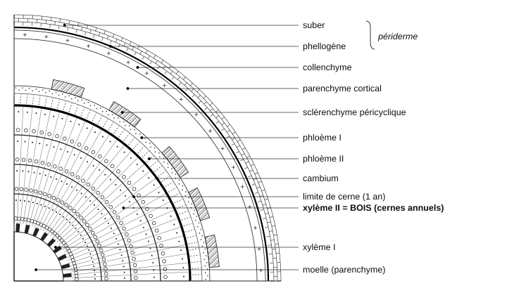
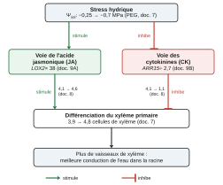
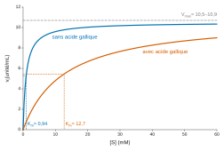
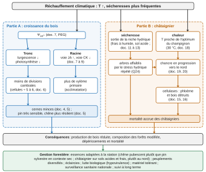

# Agro-Véto TB — SVT 2026 · Corrigé brut

*Corrigé rédigé par IA, non officiel. Signalez toute erreur.*

**Le bois face aux changements environnementaux.** Durée 3 h, calculatrice et documents interdits. L'annexe A3 (annexe A1, reproduction du document 1) n'est pas jointe au sujet disponible : la question 1 est traitée sous forme de liste de légendes.

## Partie A — La croissance du bois en contexte de sécheresse

### Question 1

Légendes à porter sur l'annexe A1 (coupe transversale de tronc de chêne pubescent).

**Image A (échelle centimétrique, organe entier) :**
- au centre, la **moelle** (point sombre) ;
- le **bois = xylème secondaire (xylème II)**, qui occupe presque toute la section ; on y distingue le **duramen** (bois de cœur, plus foncé, central, non conducteur) et l'**aubier** (bois périphérique plus clair, conducteur) ;
- les **cernes annuels** (cercles concentriques) ;
- les **rayons ligneux** (fines lignes radiales claires, larges chez le chêne) ;
- une **fente radiale** de dessiccation ;
- en périphérie, l'**écorce** : **suber** (liège, rhytidome) à l'extérieur, **liber = phloème II** mince à l'intérieur ;
- le **cambium** (zone génératrice libéro-ligneuse), à la limite bois/écorce : on le repère à la **zone de décollement** de l'écorce, visible sur le bord de la section.

**Image B (zoom du cadre de A) :**
- **cernes** annuels successifs ; dans chaque cerne, le **bois de printemps (bois initial)** marqué par une couronne de **gros vaisseaux** (pores visibles à l'œil nu : bois à **zone poreuse**), puis le **bois d'été (bois final)** dense, à petits vaisseaux groupés en plages ;
- **limite de cerne** entre le bois final d'une année et le bois initial de la suivante ;
- **rayons ligneux** larges, rectilignes, perpendiculaires aux cernes.

**Image C (microscope optique, carmin vert d'iode, zoom du cadre de B) :**
- **éléments de vaisseaux de xylème II du bois de printemps** (lumière vide de ≈ 0,4 à 0,6 mm à l'échelle indiquée, paroi lignifiée colorée en vert) ;
- **éléments de vaisseaux de xylème II du bois d'été**, plus petits, et **fibres** à paroi épaisse lignifiée (vert) ;
- **parenchyme ligneux** et **rayon ligneux** (cellules vivantes alignées radialement) ;
- **limite entre l'année *n* et l'année *n + 1*** (trait net) : à gauche le bois de printemps de l'année *n + 1*, à droite le bois d'été de l'année *n*.

**Le bois est le xylème secondaire (xylème II)** : tissu conducteur de sève brute et de soutien, à parois lignifiées (colorées en vert par le vert d'iode), produit vers l'intérieur par le cambium.

### Question 2

Méthode : en climat tempéré, le cambium fonctionne de façon saisonnière. Il produit au printemps un bois clair, à cellules et vaisseaux de grand diamètre, puis en été un bois plus foncé et plus dense, et s'arrête en hiver. Un **cerne = un couple bois de printemps + bois d'été = une année**. On compte les cernes le long d'un rayon, de la moelle (bord inférieur de l'image 2.A) jusqu'à l'écorce.

Sur l'image 2.A on dénombre environ 40 cernes.

$$\boxed{\text{âge} \approx 40\ \text{ans (35 à 45 ans)}}$$

C'est un **âge minimal** : la coupe a été faite à une certaine hauteur, les premières années de croissance en hauteur ne sont pas enregistrées ; des cernes très fins ou manquants (années sèches) et des faux cernes peuvent fausser le compte, d'où l'intérêt de compter sur plusieurs rayons.

### Question 3

Les barres « 0,5 mm » des images 1.C et 2.C n'ont pas la même longueur : les grossissements diffèrent et chaque mesure doit être ramenée à sa propre échelle.

| | Chêne pubescent (1.C) | Pin sylvestre (2.C) |
|---|---|---|
| Diversité des cellules | grande : gros vaisseaux, petits vaisseaux, fibres, parenchyme, rayons | faible : presque uniquement des **trachéides**, rayons fins |
| Type de bois | **hétéroxylé** | **homoxylé** |
| Taille des éléments conducteurs | très hétérogène : vaisseaux du bois de printemps ≈ 0,4–0,6 mm de lumière, entourés de vaisseaux **≈ 10 fois plus fins** et de fibres ; vaisseaux du bois d'été encore ≈ 2 fois plus fins | homogène : trachéides ≈ 40–70 µm au printemps, **≈ 2 fois plus larges** que celles du bois d'été |
| Organisation | bois de printemps hétérogène : gros vaisseaux en couronne au début du cerne (zone poreuse) ; bois d'été plus dense, petits vaisseaux en plages | files radiales régulières ; passage net du bois d'été (petites cellules, parois plus épaisses, vert foncé) au bois de printemps (grandes cellules, parois minces) |

Les plus gros vaisseaux du chêne sont environ **dix fois plus larges** que les trachéides du bois de printemps du pin. Le chêne (Angiosperme) répartit les fonctions entre cellules spécialisées (vaisseaux pour la conduction, fibres à paroi épaisse pour le soutien) ; chez le pin (Gymnosperme, conifère), la trachéide assure à la fois conduction et soutien.

$$\boxed{\text{chêne : bois hétéroxylé à zone poreuse ; pin : bois homoxylé à trachéides}}$$

### Question 4

La sève brute circule passivement dans les éléments conducteurs morts et lignifiés, sous l'effet du gradient de potentiel hydrique créé par la transpiration.

- Chêne : **vaisseaux** de grand diamètre (≈ 0,5 mm) formés d'éléments empilés dont les parois transversales sont **perforées** : tube continu, faible résistance hydraulique.
- Pin : **trachéides** ≈ 10 fois plus étroites et **closes** (quelques mm de long) ; l'eau passe d'une trachéide à l'autre par les **ponctuations aréolées**, ce qui ajoute une forte résistance.

D'après la **loi de Poiseuille**, à gradient de pression égal, le débit d'un conduit cylindrique varie comme $r^4$ et la vitesse moyenne comme $r^2$. Un rapport de diamètre ≈ 10 donne donc un rapport de vitesse ≈ $10^2$ et un rapport de débit par conduit ≈ $10^4$.

Ce modèle de tube idéal surestime l'écart réel (≈ 5 à 50 entre 10–50 m/h et 1–2 m/h), mais il en donne le sens et explique l'ordre de grandeur.

**Les gros vaisseaux continus du chêne conduisent la sève beaucoup plus vite (10 à 50 m/h) que les trachéides étroites et cloisonnées du pin (1 à 2 m/h).** En contrepartie, les gros vaisseaux sont plus exposés à la cavitation (embolie) en cas de forte tension.

### Question 5

Schéma conventionnel (secteur de coupe transversale de tige de jeune chêne), de l'extérieur vers le centre, avec les figurés imposés :

| Position | Tissu | Figuré |
|---|---|---|
| 1 (externe) | **périderme** : **suber** (assise externe jaune-vert, subérifiée) et **phellogène** sous-jacent ; restes d'épiderme éventuels | périderme (phellogène) |
| 2 | **parenchyme cortical** (rose, avec cellules à tanins), **collenchyme** sous le périderme | parenchyme (blanc) ; collenchyme (+) |
| 3 | **sclérenchyme** péricyclique en arcs discontinus (plages vert foncé) | sclérenchyme (croix) |
| 4 | phloème I écrasé, puis **phloème II** en files radiales (rose) | phloème I, phloème II |
| 5 | **cambium** (fine assise entre phloème II et xylème II) | trait épais |
| 6 | **xylème II** (vert, gros vaisseaux, rayons), avec ses **cernes** : chaque couronne de gros vaisseaux marque un début de cerne | xylème II |
| 7 | xylème I, contre la moelle | xylème I (noir) |
| 8 (central) | moelle (parenchyme médullaire) | parenchyme (blanc) |

Comme sur la figure 1, on représente en périphérie le **périderme** (suber et phellogène, figuré « périderme ») et, dans le xylème II, les **limites de cerne** visibles sur le document 3 (en nombre conforme au document).

Le schéma porte aussi un titre (« Schéma conventionnel d'une coupe transversale de tige de jeune chêne pubescent en structure secondaire ») et une échelle.

### Question 6

Sur le schéma, on légende **« bois = xylème II »** la couronne à figuré « xylème II » comprise entre le xylème I (à l'intérieur) et le cambium (à l'extérieur). C'est le tissu produit vers l'intérieur par le cambium, dont l'accumulation forme le tronc (document 1).

### Question 7

- **Construction** : charpentes, ossatures, parquets, menuiseries (résistance mécanique).
- **Ameublement et artisanat** : meubles, ébénisterie, tonnellerie (merrains de chêne), tournerie, lutherie.
- **Pâte à papier et carton** (cellulose des parois), panneaux de particules et de fibres.
- **Bois-énergie** : bûches, plaquettes, granulés.

(Autres : outillage, manches d'ustensiles, vaisselle, piquets et clôtures, chimie du bois — tanins, viscose —, charbon de bois.)

### Question 8

**Description** (cerne de 1976, année très sèche ; valeurs ramenées aux barres d'échelle).

| | Témoin (non irrigué) | Irrigué | Rapport |
|---|---|---|---|
| Pin, cerne (ANNÉE) | ≈ 0,03 mm, 2 à 3 cellules | ≈ 0,6 mm, ≈ 30 cellules | ≈ × 20 |
| Pin, PTP / ETE | quelques cellules chacun | ≈ 0,42 / ≈ 0,17 mm | PTP ≈ 2/3 du cerne irrigué |
| Pin, diamètre des trachéides | ≈ 0,01–0,02 mm | ≈ 0,01–0,02 mm | ≈ × 1 |
| Chêne, cerne (ANNÉE) | ≈ 0,11 mm | ≈ 0,35 mm | ≈ × 3 |
| Chêne, PTP / ETE | ≈ 0,08 / ≈ 0,03 mm | ≈ 0,13 / ≈ 0,21 mm | ≈ × 1,6 / ≈ × 7 |

- Chez les deux espèces, l'irrigation augmente fortement l'épaisseur du cerne de 1976.
- Chez le **pin**, l'effet est massif (≈ × 20) ; le bois de printemps représente ≈ 2/3 du cerne irrigué. La différence tient au **nombre de cellules** produites (files radiales de 2–3 cellules contre ≈ 30) : le diamètre des trachéides ne change pas de façon visible.
- Chez le **chêne**, l'effet est plus modéré (≈ × 2 à 3) et porte surtout sur le **bois d'été**, qui devient majoritaire. La couronne de gros vaisseaux du bois de printemps est présente dans les deux cas, avec des vaisseaux de taille comparable : pas d'augmentation évidente du diamètre cellulaire.

**Limites** : **une seule mesure par arbre** (une coupe, un arbre par condition, une seule année) ; aucune répétition ni statistique ; échelles différentes d'une image à l'autre (0,1 et 0,2 mm, longueurs de barre variables) ; irrigués et témoins peuvent différer par d'autres facteurs (âge, position, concurrence).

**Mécanisme cellulaire proposé.** L'épaisseur du cerne dépend du fonctionnement du cambium et de ses dérivées, en trois étapes :
1. **mérèse** : divisions périclines des cellules cambiales ;
2. **auxèse** : grandissement des cellules filles par entrée d'eau dans la vacuole, la turgescence étirant la paroi primaire ;
3. **différenciation** : dépôt de paroi secondaire lignifiée, puis mort cellulaire.

Le document 4 montre des cernes plus épais **sans cellules plus grandes** : c'est le nombre de cellules qui change. L'hypothèse retenue est donc que **l'irrigation stimule la mérèse cambiale** (divisions plus nombreuses, ou saison de divisions prolongée en été chez le chêne), fortement chez le pin, plus modérément chez le chêne.

En sécheresse, $\Psi_{sol}$ baisse et l'arbre absorbe moins d'eau. La turgescence des cellules cambiales diminue et la fermeture des stomates réduit les apports carbonés : les divisions ralentissent.

$$\boxed{\begin{aligned}
&\text{sécheresse} \Rightarrow \text{turgescence et apports carbonés}\downarrow \\
&\Rightarrow \text{moins de divisions cambiales (mérèse)} \\
&\Rightarrow \text{moins de cellules par file, diamètre inchangé} \\
&\Rightarrow \text{cerne mince}
\end{aligned}}$$

### Question 9

**Analyse du document 5** (épaisseur moyenne des cernes, en 1/100 mm).

- **Jusqu'en 1983**, chez les deux espèces, les arbres irrigués ont une croissance en moyenne **≈ 2 fois** plus forte que les témoins : chêne irrigué ≈ 100 à 280 contre ≈ 30 à 100 ; pin irrigué ≈ 100 à 200 contre ≈ 50 à 130.
- **Pin** : après l'arrêt de l'irrigation, la courbe des irrigués **chute rapidement** et rejoint en quelques années celle des témoins (≈ 30 à 60). Les années sèches marquent fortement les témoins (≈ 10 en 1921).
- **Chêne** : la croissance des irrigués **décroît lentement** (≈ 150 vers 1985, ≈ 100 en 2005) et reste au-dessus de celle des témoins (≈ 50).
- Après 1985, les pins (irrigués ou non) ont des cernes comparables ou inférieurs à ceux des chênes **témoins** (≈ 30 à 70), et nettement inférieurs à ceux des chênes irrigués.

**Conclusion** : la croissance du pin dépend étroitement de l'humidité du sol de l'année même et ne garde aucun bénéfice de l'irrigation passée ; le chêne est moins sensible, ou plus lentement sensible, au manque d'eau. **La plantation de chêne pubescent est la plus adaptée à des sécheresses plus fréquentes.**

**Limites** : courbes **moyennes sans barres d'erreur** ni effectif, donc significativité des écarts impossible à évaluer ; un seul site (Valais) ; l'épaisseur des cernes diminue naturellement avec l'âge et le diamètre (tendance du siècle non corrigée) ; incertitude sur l'arrêt de l'irrigation des chênes en 1983 (le texte le suggère, la flèche ne concerne que les pins) ; l'épaisseur de cerne mesure la croissance, pas la survie ; l'arrêt d'irrigation n'équivaut pas à un réchauffement (pas de hausse de température).

Comme l'arrêt de l'irrigation n'est indiqué que pour les pins, on peut aussi comparer les seuls arbres non irrigués : avant 1983, les pins non irrigués (≈ 50 à 130) ont des cernes un peu plus épais que les chênes non irrigués (≈ 30 à 100), ce qui plaiderait pour le pin. La conclusion dépend donc de la lecture retenue ; celle fondée sur la réponse à l'arrêt de l'irrigation est la plus directe.

### Question 10

Le rapport $\dfrac{\text{diamètre de la lumière}}{\text{épaisseur de la paroi}}$ quantifie le **grandissement cellulaire (auxèse)** des cellules conductrices : plus la cellule a grandi avant de déposer sa paroi secondaire, plus le rapport est élevé.

$$\boxed{\text{auxèse (grandissement cellulaire)}}$$

### Question 11

**Description du document 6.**
- Nombre de cellules produites par an : ≈ 55 à 62 de 1960 à 1973, déclin à ≈ 25–35 de 1976 à 1983 (**déclin amorcé avant l'arrêt**), puis chute à ≈ 8–15 entre 1986 et 1994 : **division par 2 à 3** par rapport aux années qui précèdent l'arrêt (÷ 5 à 6 par rapport aux années 1960). Cette chute dépasse nettement les variations interannuelles. Remontée transitoire à ≈ 30 en 2001.
- Rapport du bois de printemps : ≈ 8 à 11,5 avant 1983, ≈ 9,5 à 17 après (moyenne ≈ 13 contre ≈ 10) : **hausse modérée** (≈ + 20 à 30 %), avec une **variabilité interannuelle bien plus forte**.
- Rapport du bois d'été : ≈ 1,3 à 2,2 avant 1983 ; ensuite plus variable, avec des pics ponctuels, sans changement net de la valeur moyenne (lecture gênée par la rupture d'axe).

**Discussion du mécanisme de la question 8.**
- **Mérèse** : le nombre de cellules chute fortement quand l'eau manque ; cela suffit à expliquer l'amincissement des cernes (document 5). **L'hypothèse est validée.**
- **Auxèse** : elle n'est pas réduite par le manque d'eau. Le rapport du bois d'été ne change pas en moyenne ; celui du bois de printemps augmente un peu, de façon peu significative au regard de sa variabilité. Le grandissement cellulaire n'explique donc pas la réponse du bois à l'eau.

**Conclusion : la réponse physiologique du bois de pin à l'irrigation passe principalement par l'activité de division du cambium (mérèse), conformément à l'hypothèse de la question 8.** Limites : un rapport ne dit pas si c'est la lumière ou la paroi qui varie ; pas de barres d'erreur ; déclin commencé avant 1983 (vieillissement, sécheresse de 1976).

### Question 12

Le PEG est un polymère hydrosoluble de grande taille, **non absorbé** par les cellules et non toxique. Dissous dans le milieu, il abaisse le potentiel osmotique, donc le **potentiel hydrique du sol** : $\Psi_{sol}$ passe de −0,25 MPa (témoin) à −0,7 MPa.

L'eau se déplace dans le sens des potentiels hydriques décroissants. Avec le PEG, elle est davantage retenue par le sol : le gradient sol → racine diminue et l'absorption devient plus difficile, comme dans un sol qui s'assèche. La plante est en **stress hydrique**.

Le PEG permet d'imposer une contrainte hydrique **contrôlée, homogène et constante** sans modifier l'aération ni la teneur en eau apparente du milieu.

### Question 13

**Analyse** : en présence de PEG, la file de xylème primaire de la racine compte des vaisseaux supplémentaires (flèches rouges), lignifiés (bleu de toluidine). Le nombre moyen de cellules de xylème passe de **≈ 3,9 à ≈ 4,8** (+ ≈ 25 %), différence significative (astérisque).

**Un stress hydrique de 8 jours augmente la formation de xylème primaire dans les jeunes racines**, ce qui traduit une stimulation de la mérèse (une différenciation accrue de cellules du procambium en vaisseaux est aussi compatible avec ce comptage).

**Comparaison** : dans les troncs (documents 4 à 6), le manque d'eau **réduit** la production de xylème (cernes minces, chute des divisions). Les conclusions **divergent**, mais les situations ne sont pas comparables :
- racine contre tronc ;
- xylème **primaire** (issu du procambium) contre xylème **secondaire** (issu du cambium) ;
- plantules de 8 jours contre arbres adultes ;
- stress bref et modéré contre déficit durable.

Dans la racine, davantage de vaisseaux améliore la conduction de l'eau : c'est une réponse d'acclimatation.

### Question 14

- **CK** (50 nM) : le nombre de cellules de xylème chute de ≈ 4,1 à ≈ 1,1 (significatif) ; les coupes ne montrent presque plus de cellules lignifiées. Les cytokinines **inhibent** la formation du xylème.
- **JA** (10 µM) : ≈ 4,1 → ≈ 4,6 (+ ≈ 13 %, significatif), avec des vaisseaux supplémentaires (flèches rouges). C'est la **seule augmentation significative**, de même sens que l'effet du PEG (+ ≈ 25 %).
- CK/JA : non quantifié.

$$\boxed{\text{l'acide jasmonique (JA) est l'hormone impliquée : il reproduit l'effet du stress hydrique}}$$

La réponse du xylème au stress hydrique serait donc médiée par l'acide jasmonique.

### Question 15

Données : sous PEG, l'expression de *LOX2* (gène sous contrôle du JA) est multipliée par ≈ 38 ; celle d'*ARR15* (gène sous contrôle des CK) passe de ≈ 1,0 à ≈ 0,37 (÷ ≈ 2,7, soit ≈ 2/3 de baisse).

Ces gènes sont des **gènes de réponse** : leur expression témoigne de l'activité des voies de signalisation du JA et des CK dans les cellules de xylème, pas de la synthèse des hormones.

Schéma fonctionnel (flèche : stimule ; barre : inhibe) :

Le stress hydrique active la voie de signalisation du JA (*LOX2* × 38), qui stimule la formation du xylème (doc. 8), et réprime celle des CK (*ARR15* ÷ 2,7), dont l'effet inhibiteur sur le xylème est levé (doc. 8). Les deux effets, antagonistes en temps normal, convergent vers une augmentation du nombre de vaisseaux de xylème (doc. 7). (Une interaction directe CK/JA reste hypothétique, la condition CK/JA n'étant pas quantifiée.)

## Partie B — Le châtaignier face aux changements environnementaux

### Question 16

Une espèce dont un même individu porte des fleurs mâles et des fleurs femelles séparées est **monoïque**.

### Question 17

Le zoom 10.C montre qu'un élément du chaton porte des organes fertiles d'un seul sexe (étamines) entourés de pièces stériles (périanthe réduit) : c'est **une fleur unisexuée**. Le chaton (10.A, 10.B) est un axe portant de nombreuses fleurs de ce type. **Le chaton est donc une inflorescence** (épi souple de petites fleurs unisexuées, sans pétales voyants).

### Question 18

- **10.C** : une dizaine d'**étamines** (filet + anthère jaune) entourées de pièces stériles, aucun pistil : **fleurs mâles** ; le chaton correspondant (long chaton de 10.A) est un chaton mâle.
- **10.B** : **styles et stigmates** rouges surmontant des **ovaires** contenant des ovules (visibles en coupe), entourés d'écailles (cupule), sans étamine : **fleurs femelles**.

### Question 19

Un fruit dérive de l'**ovaire** après fécondation : sa paroi (péricarpe) vient de la paroi ovarienne et il contient la ou les graines issues des ovules. Les documents en apportent les preuves :

- 10.B : les fleurs femelles comportent un ovaire contenant des ovules, surmonté des styles et stigmates ; elles sont groupées par 2 ou 3 et enveloppées par une **cupule** d'écailles.
- 10.D : la **châtaigne** porte à son sommet des **restes de pièces florales** (styles et stigmates desséchés, en pointe) ; sa coque brune est le péricarpe ; la bogue épineuse contient **2 à 3 châtaignes**, autant que de fleurs femelles dans une cupule, et dérive de la cupule.

**La châtaigne est issue de l'ovaire de la fleur femelle : c'est un fruit** (fruit sec indéhiscent, akène) ; la bogue n'est pas le fruit mais la cupule accrescente ; la partie comestible est la graine.

### Question 20

- **Présence (11.A)** : Massif central et ses bordures (Limousin, Périgord, Cévennes, Ardèche), Massif armoricain (Bretagne, Pays de la Loire, Normandie), Île-de-France et Sologne, Picardie et Nord (dispersé), piémonts pyrénéen et vosgien, Corse.
- **Absence** : Champagne, Lorraine, Bourgogne, Jura, Alpes, Charentes, Causses, Provence et Languedoc de plaine, haute montagne.

Croisements :
- **Précipitations (11.B)**, facteur de premier ordre : la présence est corrélée aux régions recevant **plus de ≈ 1 000 mm** par an (Limousin, Cévennes, Bretagne occidentale, piémont pyrénéen, Corse). La corrélation a des exceptions : le **Jura**, très arrosé, est sans châtaignier ; la **Sologne** et le Bassin parisien (< 1 000 mm, ≈ 600–700 mm) en portent. Il existe donc un autre facteur.
- **Sols (11.C)**, facteur de second ordre : présence majoritaire sur les **brunisols d'altération** (brunisols dystriques, alocrisols) des massifs cristallins et sur certains sols sableux décarbonatés (Sologne, Landes) ; **absence sur les sols des roches calcaires** (rendosols, calcosols, calcisols de Champagne, Bourgogne, Jura, Charentes, Causses, Provence) : **espèce calcifuge**. Ce facteur explique les exceptions précédentes.
- **Températures (11.D)** : **aucune corrélation** avec la température moyenne ; le châtaignier est présent de ≈ 10 °C (Normandie, Nord) à ≈ 15 °C (Corse, bordure cévenole).

$$\boxed{\text{facteurs contraignants : humidité (précipitations) et nature du sol (calcaire exclu)}}$$

### Question 21

La théorie de la **niche écologique** (niche fondamentale ou potentielle, au sens de Hutchinson : ensemble des conditions du milieu dans lesquelles une espèce peut se maintenir).

### Question 22

Le rectangle (95 % des relevés) couvre les milieux **frais à humides** et **acides**, du très acide jusqu'à la limite de la neutralité. Des points existent en milieu sec (quelques-uns en très sec) et en milieu neutre, mais aucun en milieu basique.

$$\boxed{\text{conditions favorables : milieu acide, frais à humide}}$$

Ces conditions **correspondent** aux conclusions de la question 20 :
- l'exigence d'humidité retrouve la corrélation avec les précipitations (11.B) ;
- l'exigence d'acidité se relie à la nature du sol (11.C) : sols calcaires, basiques, exclus.

### Question 23

**Lien observé (11.C et 13)** :
- sur les **granites et gneiss** des massifs anciens (Massif central, Vosges, Massif armoricain) : sols d'altération peu différenciés (brunisols dystriques, alocrisols), **acides** : pH < 5,6 dans le Limousin, la Margeride, les Cévennes, les Vosges ; ≈ 5,8 à 6,1 et localement moins sur le Massif armoricain ;
- sur les **sables siliceux** tertiaires (Sologne) ou quaternaires (Landes) : podzosols, arénosols, moyennement acides (pH < 6) ;
- sur les **calcaires secondaires et tertiaires** (Bassin parisien oriental, Charentes, Causses, Provence, Jura) : rendosols, calcosols, calcisols, **basiques** (pH > 7, souvent > 8).

**Les sols acides correspondent à des sous-sols riches en silice**, qu'ils soient magmatiques (granites), métamorphiques (gneiss) ou sédimentaires (sables).

**Explication** : le sol se forme par altération de la roche mère.
- Les **silicates** (feldspaths, micas) subissent une **hydrolyse** lente. Elle libère peu de cations basiques (calcium, magnésium, potassium), que le climat humide **lessive**.
- Le complexe argilo-humique se **désature** : il fixe des ions $\mathrm{H^+}$ et $\mathrm{Al^{3+}}$, et le sol s'acidifie.
- L'acidification a aussi des sources biologiques : l'**absorption racinaire** des cations, échangés contre des $\mathrm{H^+}$, et la **minéralisation de la matière organique** (CO₂, acides organiques, nitrification).
- Sur roche **calcaire**, la dissolution des carbonates **tamponne** cette acidité et sature le complexe en $\mathrm{Ca^{2+}}$ : le sol reste neutre à basique.

$$\mathrm{CaCO_3 + CO_2 + H_2O \rightleftharpoons Ca^{2+} + 2\,HCO_3^-}$$

Sur roche siliceuse, sans carbonates, rien ne compense l'acidification.

$$\boxed{\text{roche mère} \rightarrow \text{altération et lessivage} \rightarrow \text{saturation du complexe} \rightarrow \text{pH} \rightarrow \text{type de sol}}$$

### Question 24

**Hypothèse** :
1. Le châtaignier est présent dans des régions chaudes (Cévennes, Corse) et sa répartition n'est pas corrélée à la température (Q20) : la hausse des températures n'est donc pas, en elle-même, la cause attendue.
2. Le réchauffement actuel augmente surtout l'évapotranspiration et la **fréquence des sécheresses** estivales.
3. Le châtaignier exige un milieu frais à humide (Q22) et occupe souvent des sols acides filtrants ou peu profonds, à faible réserve en eau : dans une grande partie de son aire actuelle, il sortirait de sa niche hydrique.

Le stress hydrique répété (moins de croissance, fermeture des stomates, cavitation des gros vaisseaux d'une espèce à zone poreuse, épuisement des réserves) l'affaiblirait et le rendrait plus sensible aux parasites, d'où une **mortalité excessive**. La remontée de l'espèce vers le nord ou en altitude serait limitée aux stations à sol acide et frais.

### Question 25

**Parasitisme**, relation d'exploitation :
- le champignon (ascomycète) se développe **au sein de l'arbre**, entre bois et écorce, et en tire habitat et matière organique ; il s'y reproduit (germination des spores sur les blessures) : l'hôte lui est nécessaire (+) ;
- l'arbre subit la destruction du phloème puis du bois, le dépérissement et parfois la mort : sa survie diminue (−).

Relation durable, à bénéfice unilatéral et au détriment de l'hôte : *C. parasitica* est un **parasite pathogène**. L'hôte européen, qui n'a pas coévolué avec lui (contrairement à *C. crenata*, tolérant), est très sensible.

### Question 26

- **Bois sain (15.A)** : structure alvéolaire régulière, nombreuses lumières de cellules (vaisseaux et fibres) de tailles variées, séparées par des parois continues et nettes.
- **Bois malade (15.B)** : les lumières ne sont plus visibles, les parois sont fragmentées en fibrilles désordonnées : le tissu a perdu son organisation et sa cohésion.

**L'infection désorganise et détruit les parois des cellules du bois : les vaisseaux conducteurs ne sont plus distinguables** ; conséquences : arrêt de la conduction de la sève brute et perte de résistance mécanique.

### Question 27

#### 27.a

Les vaisseaux du bois sont des cellules mortes de xylème II dont il ne reste que les parois. Ces parois sont principalement constituées de **cellulose** (polymère de glucose β1→4, microfibrilles) et de **lignine** (polymère phénolique qui imprègne la paroi secondaire).

#### 27.b

Le champignon est hétérotrophe et absorbe de petites molécules : il pratique une **digestion extracellulaire**. Ses hyphes **sécrètent des enzymes** (cellulases, enzymes de dégradation de la lignine et des tanins) qui hydrolysent les polymères des parois ; les produits solubles (glucose…) sont **absorbés** et nourrissent le champignon : les molécules pariétales sont ses ressources nutritives. Les parois, privées de cellulose et de lignine, se délitent : c'est la structure fragmentée du document 15.B.

### Question 28

- **Cellulase purifiée (16.A)** : **témoin positif**. Elle montre l'effet cellulolytique maximal attendu (halo de cellulose dégradée), prouve que le milieu et la révélation au rouge Congo fonctionnent, et permet d'estimer par comparaison l'activité cellulolytique du champignon. Le dépôt d'eau distillée est le témoin négatif. Sans ce témoin, une absence de halo serait ininterprétable.
- **ARNm de l'actine (16.B)** : l'actine est codée par un **gène de ménage**, exprimé de façon constante. Sa détection dans toutes les pistes est un **témoin de charge** du Northern blot : la même quantité d'ARNm a été déposée dans chaque puits et l'hybridation a fonctionné. Une variation ou une absence de *cbh-1* traduit alors une variation réelle de transcription.

### Question 29

**Erreur d'énoncé à signaler.** Sur le document 16.B tel qu'il est imprimé, la bande *cbh-1* apparaît dans la piste légendée « Infectées » (milieu cellulose), et non dans la piste « Non infectées ». Cette lecture contredit le document 16.A (halo autour de la seule colonie non infectée) et le texte (souches infectées peu agressives). On en conclut que les légendes « Infectées » et « Non infectées » du document 16.B sont **inversées**, et l'on raisonne avec les légendes rétablies.

- **16.A** : la colonie non infectée est entourée d'un large halo, comme la cellulase purifiée (pas de halo avec l'eau) : elle **sécrète une activité cellulasique** qui dégrade la cellulose du milieu.
- **16.B** (légendes rétablies) : en milieu cellulose, l'ARNm *cbh-1* (1,8 kb) est abondant ; en milieu cellulose + glucose, il est **absent**, alors que l'actine est présente.

**Le champignon utilise la cellulose comme source de carbone grâce à des cellulases sécrétées ; le gène *cbh-1* est induit par la cellulose et réprimé par le glucose** : il ne dégrade la cellulose (polymère de glucose) que si aucune source de glucose directement assimilable n'est disponible. C'est une économie de moyens, par régulation transcriptionnelle.

### Question 30

(Légendes du document 16.B rétablies, voir Q29.)

- **16.A** : la colonie infectée ne produit **aucun halo**, comme l'eau distillée : pas d'activité cellulasique.
- **16.B** : pas d'ARNm *cbh-1*, **même en présence de cellulose seule**, alors que l'actine est exprimée.

Le virus **empêche la transcription** du gène de cellulase induite par la cellulose : le champignon infecté ne répond plus à la présence de cellulose et ne produit plus de cellulase. Il ne peut plus dégrader la cellulose des parois : il ne progresse plus dans le bois, le chancre reste superficiel et l'arbre survit (**hypovirulence**). De plus, les souches infectées ne se reproduisent plus sexuellement, ce qui limite leur dissémination. L'infection virale est donc un moyen de **lutte biologique** : elle ne tue pas le champignon, elle le rend peu pathogène.

### Question 31

| | Sans acide gallique | Avec acide gallique |
|---|---|---|
| $K_m$ (mM) | 0,94 ± 0,12 | 12,7 ± 0,05 |
| $V_{max}$ (u/mL) | 10,5 ± 0,61 | 10,9 ± 0,81 |

- $K_m$ est multiplié par $12{,}7 / 0{,}94 \approx 13{,}5$, écart très supérieur aux écarts types : **l'affinité apparente de l'enzyme pour son substrat diminue fortement**.
- $V_{max}$ varie de 0,4 u/mL, moins que les écarts types : **$V_{max}$ est inchangée**.

**L'acide gallique diminue l'affinité de la tannase pour son substrat sans modifier sa vitesse maximale.**

### Question 32

L'acide gallique est un **inhibiteur compétitif** de la tannase.

La tannase hydrolyse les tanins galliques en libérant de l'acide gallique. L'acide gallique, **produit** de la réaction et analogue structural du motif galloyle du substrat, se fixe sur le **site actif** et entre en compétition avec le substrat.

Il faut alors plus de substrat pour atteindre la demi-saturation : le $K_m$ apparent augmente.

$$K_m^{app} = K_m\left(1 + \frac{[I]}{K_i}\right)$$

Quand le substrat est en large excès sur l'inhibiteur, il le déplace du site actif et la vitesse maximale est atteinte : $V_{max}$ est inchangée.

### Question 33

**Piste** : apporter de l'**acide gallique** (inhibiteur) au niveau des chancres, ou sélectionner des châtaigniers dont l'écorce est riche en acide gallique libre, pour bloquer la tannase du champignon, ralentir sa croissance et améliorer la survie de l'arbre. Limites : l'inhibition compétitive est levée par un excès de substrat (les tanins sont abondants dans le bois) ; la tannase n'est qu'une des enzymes du champignon (les cellulases ne sont pas visées) ; résultat obtenu *in vitro*.

### Question 34

L'activité de la tannase dépend de la température et du pH, avec pour chaque facteur une gamme d'activité maximale. Elle repose sur la fixation du substrat au site actif, dont la forme dépend de la **structure tridimensionnelle** de l'enzyme, maintenue par des **liaisons faibles** (liaisons hydrogène, liaisons ioniques, interactions hydrophobes).

- **Température** : l'activité augmente jusqu'à 30 °C (agitation thermique, rencontres enzyme–substrat plus fréquentes), puis diminue ; au-delà de 45–50 °C, la **dénaturation thermique** (rupture des liaisons faibles, déformation du site actif) l'annule ; en dessous de 10 °C, l'agitation est trop faible et l'activité minimale.
- **pH** : le pH modifie l'**ionisation** des acides aminés du site actif et du substrat, donc les liaisons ioniques et hydrogène indispensables à la liaison et à la catalyse ; optimum à pH 5,5 ; aux pH extrêmes (< 2,5 ou > 8,5), la protéine est dénaturée.

L'enzyme est adaptée à un milieu tempéré chaud et légèrement acide (tissus de l'hôte, qui vit sur sols acides) ; un réchauffement rapproche les températures estivales de son optimum et favorise l'activité du champignon.

### Question 35

**Description** : les premiers signalements (avant 1996) se situent dans le **sud-ouest** (Périgord, Quercy, Pays basque, Landes), le sud-ouest du Massif central, les **Cévennes**, la région lyonnaise et la **Corse** ; entre 1996 et 2006, ils gagnent le **Centre**, le Limousin, la Bourgogne, les Pays de la Loire et surtout la **Bretagne** ; de 2007 à 2017, les nouveaux signalements sont surtout dans le **nord-ouest** (Bretagne, Pays de la Loire, Normandie), en Île-de-France, dans le Nord, en Alsace et en Rhône-Alpes. **La maladie progresse du sud vers le nord en une soixantaine d'années.**

**Explications** :
- la hausse des températures moyennes rapproche les régions du nord, autrefois trop froides, de l'optimum thermique des enzymes fongiques comme la tannase (30 °C, doc. 18) : le champignon y survit et y progresse ;
- dispersion de proche en proche des spores (pluie, vent, insectes, blessures de l'écorce) et transport humain (plants, bois, outils) pour les foyers éloignés ;
- hôtes affaiblis par les sécheresses ; absence de résistance du châtaignier européen.

Biais : il s'agit de **signalements** (dépendant de l'effort de surveillance, plus fort dans les régions castanéicoles) et de la présence de l'hôte.

### Question 36

**Prédictions 20.A (1961–1990)** : prévalence forte (jaune à rouge) dans le sud-ouest, le pourtour méditerranéen, la vallée du Rhône et la Corse ; bande verte (0,1–0,2) au centre ; bleu (≤ 0,1) sur toute la moitié nord, la Bretagne et les reliefs.

- **Accords** : les signalements anciens (avant 1996, période la plus proche de 1961–1990) sont tous dans la moitié sud, dans les zones prédites favorables (sud-ouest, Cévennes, Corse) ; aucun signalement ancien dans le nord, prédit en bleu.
- **Désaccords** : forte prévalence prédite sur le littoral méditerranéen et en Provence, où il n'y a pas de signalement ; mais il n'y a pas non plus de châtaigniers (doc. 11.A) : le modèle décrit la niche du champignon, pas la présence de l'hôte.
- **Limites de la comparaison** : les signalements postérieurs à 1996 (Bretagne, Normandie, Centre) ne peuvent pas être opposés à un modèle calé sur le climat 1961–1990, le climat ayant changé depuis ; le document 19 donne des dates de premier signalement, pas une proportion d'arbres malades ; effort de surveillance inégal ; maladie en expansion, pas à l'équilibre.

**Pour sa période, le modèle reproduit bien la répartition observée de la maladie (moitié sud seulement) : il est globalement satisfaisant**, sous réserve de croiser ses prédictions avec la présence de l'hôte et de ne pas l'appliquer au-delà de son climat de référence.

### Question 37

Informations utilisables pour un modèle fondé sur la survie et la reproduction du champignon selon la température :
- **Doc. 11.A** : carte de répartition du châtaignier, **hôte obligatoire** du champignon : là où le modèle doit s'appliquer.
- **Doc. 18** (et 17) : température et pH optimaux de l'activité enzymatique de la tannase (optimum 30 °C et pH 5,5, gamme 20–45 °C et pH 4–7,5) : réponse du champignon à la température.
- **Doc. 11.D** : carte des températures moyennes actuelles, à combiner avec le doc. 18 et avec les projections du scénario climatique.
- **Doc. 13** : carte du pH des sols, à combiner avec l'optimum de pH du doc. 18.
- **Doc. 19** : carte de répartition des signalements du champignon pathogène depuis 1956 : vitesse de propagation, calibration et validation du modèle.

Compléments plus indirects : doc. 14 (infection par les blessures, destruction du phloème puis du bois : définition de l'arbre malade), doc. 15 et 16 (dégradation du bois, hypovirulence et absence de reproduction sexuée des souches infectées : virulence et dissémination), doc. 12 (humidité et acidité favorables à l'hôte).

### Question 38

**20.B (2070–2099)** : prévalence > 0,6 sur la plus grande partie du sud, de l'ouest et du centre (Aquitaine, Massif central, vallée du Rhône, Languedoc, Corse entière, Alsace) ; 0,2 à 0,6 sur le sud et l'est de la Bretagne, les Pays de la Loire, le Centre et le Bassin parisien. La prévalence reste **faible (0,1 à 0,2, vert)** :
- aux **hautes latitudes** : la **pointe occidentale et le nord de la Bretagne**, la **Normandie**, la Picardie, le Nord, le nord de l'Île-de-France, les Ardennes, une partie de la Champagne et de la Lorraine ;
- aux **hautes altitudes** : un îlot des **hauteurs du Massif central** (vert et bleu), les **Vosges**, les reliefs alpins (≤ 0,1 localement) et quelques points des Pyrénées.

**Croisement avec 11.A** : régions où le châtaignier est présent et la prévalence prédite faible, grâce à des températures basses et une humidité suffisante :

$$\boxed{\text{hautes latitudes (Bretagne occidentale, Normandie, Picardie, Nord) et hautes altitudes (Massif central, Vosges)}}$$

Les grandes régions castanéicoles actuelles du sud (Limousin, Périgord, Cévennes de basse altitude, Corse) seraient fortement touchées. Prédiction d'un modèle validé seulement pour le climat 1961–1990 (Q36), pour un seul scénario climatique.

### Question 39

**Atténuer les effets du chancre** (Q30, Q33, Q35) :
- **traitements** par souches hypovirulentes (lutte biologique) et par acide gallique, appliqués surtout aux **arbres isolés des forêts nouvellement contaminées**, pour freiner le front de propagation ; ils sont peu utiles dans les zones déjà entièrement contaminées ;
- **surveillance et prophylaxie** : réseau national de signalement à effort homogène ; contrôle de la circulation des plants et du bois ; désinfection des outils, limitation des blessures (doc. 14) ; élimination des arbres à chancres actifs dans les nouveaux foyers.

**S'adapter aux changements climatiques, chancre compris** (Q20–Q24, Q38) :
- **choix des stations** : planter le châtaignier sur sols acides et frais (sols sableux ou d'altération), dans le **nord** de la France et dans les forêts d'**altitude** du Massif central et des Vosges, régions prédites préservées ; éviter les stations séchantes ;
- **matériel végétal** (Q25) : maintenir une **diversité génétique** élevée ; sélectionner des châtaigniers tolérants, des hybrides avec *C. crenata*, des arbres riches en composés inhibiteurs ;
- **sylviculture** : peuplements mélangés plutôt que monocultures, éclaircies pour limiter la concurrence pour l'eau, suivi à long terme de la croissance et de la mortalité.

### Question 40

Schéma bilan (flèches = « entraîne ») :

Le schéma part de la variable modifiée par le réchauffement (température, fréquence des sécheresses) et parcourt toutes les échelles :
- **moléculaire** : voies hormonales JA et CK, cellulases et gène *cbh-1*, optimum de la tannase ;
- **cellulaire** : divisions cambiales (mérèse) ;
- **tissulaire** : cernes, xylème, destruction des parois du bois ;
- **population** : répartition du châtaignier, progression du chancre, mortalité.

**Le réchauffement agit directement sur la croissance (effet abiotique : déficit hydrique, cambium) et indirectement par les pathogènes (effet biotique : chancre favorisé par la chaleur et par l'affaiblissement des arbres) ; la gestion doit adapter le choix des essences et des stations et surveiller la santé des forêts.**
