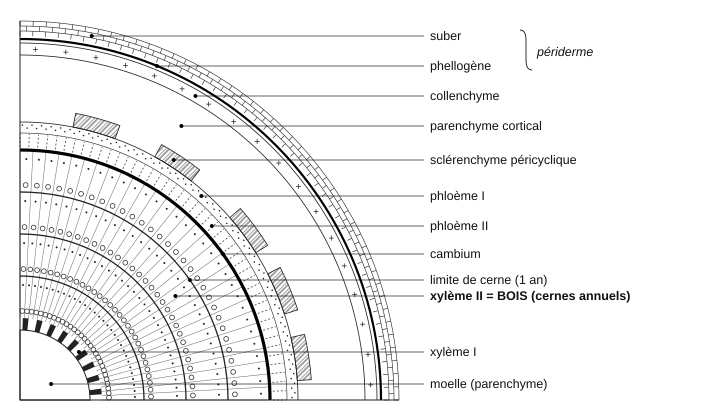
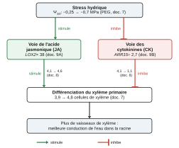
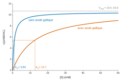
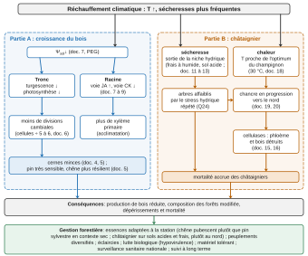

# Agro-Véto TB — SVT 2026 · Corrigé guidé

*Corrigé rédigé par IA, non officiel. Signalez toute erreur.*

## Présentation du sujet

**Thème.** « Le bois face aux changements environnementaux » : un sujet de biologie végétale intégrée qui suit le bois de la cellule au territoire. Épreuve de **3 heures**, sans calculatrice ni document, sur 15 pages, avec une annexe A3 à rendre (annexe A1, reproduction du document 1 à légender, non jointe au PDF disponible). Le sujet compte **40 questions numérotées** (dont la 27 en deux sous-questions, soit 41 questions élémentaires), presque toutes adossées à un document.

**Découpage.**
- **Partie A — La croissance du bois en contexte de sécheresse** (Q1 à Q15). On légende des coupes de chêne et de pin (Q1–Q3), on relie structure et vitesse de la sève (Q4), on réalise un schéma conventionnel de tige (Q5–Q6), puis on exploite un suivi séculaire de plantations irriguées ou non en Valais (documents 4 à 6 : cernes, nombre de cellules) pour proposer puis tester un mécanisme cellulaire (Q8–Q11). La fin de la partie descend au niveau hormonal sur de jeunes racines de pin (PEG, acide jasmonique, cytokinines, expression de gènes de réponse : Q12–Q15).
- **Partie B — Le châtaignier face aux changements environnementaux** (Q16 à Q40). Biologie florale (Q16–Q19), niche écologique par superposition de cartes (climat, sols, pH, géologie : Q20–Q24), chancre à *Cryphonectria parasitica* : relation parasitaire, dégradation du bois, cellulases et hypovirus, cinétique de la tannase (Q25–Q34), puis cartes de propagation, critique d'un modèle de niche, gestion et schéma bilan (Q35–Q40).

**Notions du programme mobilisées.** Tissus végétaux et structure secondaire (cambium, xylème II, phloème II, périderme), croissance cellulaire (mérèse, auxèse, différenciation pariétale), relations hydriques (potentiel hydrique, osmose), régulation hormonale, reproduction des Angiospermes (fleur, inflorescence, fruit), écologie (niche, facteurs limitants, relations interspécifiques), sols (altération, complexe argilo-humique), enzymologie (Michaelis-Menten, inhibition compétitive, effets de la température et du pH), expression génétique (ARNm, témoins).

**Difficulté et longueur.** Le niveau de chaque question est modeste, mais le sujet est **long** : 40 questions en 180 minutes, soit environ 4 minutes par question en moyenne, avec trois schémas (Q5, Q15, Q40) et de nombreuses lectures de cartes. La consigne insiste sur la **concision** et l'exploitation des documents **sans paraphrase** : une réponse courte, chiffrée, comparée au témoin et conclue vaut mieux qu'un développement de cours.

**Résultats de la session (rapport 2026).** Moyenne 10,50/20, médiane 10,10, écart type 3,50 ; notes de 2,50 à 18,80, quartiles 7,70 et 13,10. Le jury relève que les schémas bilans ont rarement été réalisés et que l'anatomie végétale (position du cambium, xylème I et II, nature du bois) a été très mal maîtrisée, ce qui a pénalisé lourdement la partie A.

**Questions discriminantes selon le jury.** Le rapport signale comme mal réussies ou peu traitées : les légendes du document 1 (Q1), le schéma conventionnel et la légende du bois (Q5, Q6), la nature de l'auxèse (Q10, « très mal comprise »), le schéma fonctionnel (Q15), le mot « monoïque » (Q16, « très faible nombre de réponses correctes »), l'explication géologique de l'acidité des sols (Q23), la justification du parasitisme (Q25), les molécules du bois (Q27.a), les témoins des électrophorèses (Q28) et le schéma bilan (Q40, « très peu été présenté »).

**Questions abordables à ne pas laisser passer.** Q2, Q6, Q7, Q10, Q16, Q17, Q18, Q21, Q25, Q27.a, Q28, Q31, Q32 : vocabulaire précis et raisonnements courts. Le jury rappelle que ces applications directes du cours et des TP auraient dû être largement réussies.

**Gestion du temps.** Environ 80 minutes pour la partie A et 90 pour la partie B, en gardant 10 à 15 minutes pour le schéma bilan de la Q40. Préparer les schémas au brouillon, mais ne pas les embellir : clarté, titre, légende.

> [!JURY]
> Le rapport 2026 insiste sur l'exploitation quantitative et comparée des documents : une description chiffrée sans élément de comparaison (test et témoin) n'apporte pas de point, et des formules comme « jouer un rôle » ou « avoir une influence » ne suffisent pas si elles ne s'appuient pas sur les données. Il note aussi : « Des questions d'application directe du cours et des TP (sur l'anatomie du tronc, sur les paramètres cinétiques des enzymes ou sur les témoins des électrophorèses) auraient dû être largement réussies, ce qui n'a pas été le cas dans la majorité des copies. »

## Partie A — La croissance du bois en contexte de sécheresse

On commence par identifier le bois et ses deux grands types (hétéroxylé, homoxylé), puis on mesure l'effet de l'eau sur la croissance des cernes et on en cherche le mécanisme cellulaire et hormonal. Outils : observation à plusieurs échelles, barres d'échelle, raisonnement témoin/traitement.

### Question 1

> [!INDICATION]
> Procéder par échelle emboîtée : organe entier (A), tissus (B), cellules (C). Chaque image a son propre niveau de précision.

> [!INDICATION]
> Le vert d'iode colore les parois lignifiées. Repérer ce qui est concentrique (cernes) et ce qui est radial (rayons), puis ce qui change à l'intérieur d'un cerne. Sur l'image A, où l'écorce se décolle-t-elle du bois ?

#### Solution

Légendes à porter sur l'annexe A1.

**Image A (organe entier, échelle 1 cm) :**
- moelle (centre) ;
- **bois = xylème II**, avec duramen (cœur plus foncé, non conducteur) et aubier (périphérie claire, conductrice) ;
- cernes annuels concentriques ; rayons ligneux (lignes radiales claires, larges chez le chêne) ; fente radiale de dessiccation ;
- écorce : **suber** (liège, rhytidome) à l'extérieur, **liber = phloème II** mince à l'intérieur ;
- **cambium** à la limite bois/écorce, repérable à la **zone de décollement** de l'écorce.

**Image B (zoom du cadre de A) :** cernes annuels successifs ; dans chaque cerne, **bois de printemps** marqué par une couronne de gros vaisseaux visibles comme des pores (bois à **zone poreuse**), puis **bois d'été** dense ; limite de cerne ; rayons ligneux larges perpendiculaires aux cernes.

**Image C (microscope optique, carmin vert d'iode) :**
- éléments de vaisseaux de xylème II du **bois de printemps** (lumière vide de ≈ 0,4 à 0,6 mm à l'échelle indiquée, paroi lignifiée verte) ;
- éléments de vaisseaux plus petits du **bois d'été** et fibres à paroi épaisse ; parenchyme et rayon ligneux ;
- **limite entre l'année *n* et l'année *n + 1*** (à gauche, le bois de printemps de l'année *n + 1* ; à droite, le bois d'été de l'année *n*).

**Le bois est le xylème secondaire**, tissu lignifié conducteur de sève brute et de soutien, produit vers l'intérieur par le cambium.

> [!PIEGE]
> « Écorce » ne désigne pas un tissu unique : elle comprend le suber et le liber (phloème II), séparés du bois par le cambium. Ne pas oublier d'écrire le mot « bois » sur l'annexe : c'est demandé explicitement.

> [!JURY]
> Rapport 2026 : « Le jury a constaté de multiples erreurs sur les légendes de ce document ». Parmi les confusions générales relevées : vaisseaux du xylème pris pour des bulles d'air, xylème I et II ou phloème I et II confondus, position du cambium, nature du « bois ».

### Question 2

> [!INDICATION]
> Pourquoi un tronc d'arbre tempéré forme-t-il des cernes ? Relier leur formation au rythme des saisons.

> [!INDICATION]
> Préciser d'où à où l'on compte, et ce que le résultat représente vraiment (la coupe est faite à une certaine hauteur).

#### Solution

Le cambium a une activité saisonnière : au printemps, bois clair à cellules et vaisseaux de grand diamètre ; en été, bois plus foncé et plus dense ; arrêt en hiver. **Un cerne (bois de printemps + bois d'été) correspond à une année.**

On compte les cernes le long d'un rayon, de la moelle (bord inférieur de l'image 2.A) jusqu'à l'écorce : on en trouve environ 40.

$$\boxed{\text{âge} \approx 40\ \text{ans (35 à 45 ans)}}$$

C'est un âge minimal à la hauteur de la coupe (les premières années de croissance en hauteur manquent) ; des cernes manquants ou doubles lors d'années anormales peuvent fausser le comptage, qu'on refait sur plusieurs rayons.

> [!PIEGE]
> Compter séparément bandes claires et bandes sombres double l'âge. Un cerne est un couple.

### Question 3

> [!INDICATION]
> La consigne demande taille **et** diversité : construire un tableau comparatif à deux colonnes.

> [!INDICATION]
> Avant de comparer des tailles, vérifier que les deux barres d'échelle « 0,5 mm » ont la même longueur sur la page.

> [!INDICATION]
> Combien de types de cellules distingue-t-on sur chaque image ? Comparer aussi, dans chaque espèce, le bois de printemps et le bois d'été.

#### Solution

Les barres « 0,5 mm » des deux images n'ont pas la même longueur : les grossissements diffèrent, chaque mesure est ramenée à sa propre échelle.

| | Chêne pubescent (1.C) | Pin sylvestre (2.C) |
|---|---|---|
| Diversité | gros vaisseaux, petits vaisseaux, fibres, parenchyme, rayons | presque uniquement des trachéides, rayons fins |
| Type de bois | **hétéroxylé** | **homoxylé** |
| Taille des conducteurs | très hétérogène : vaisseaux du bois de printemps ≈ 0,4–0,6 mm de lumière, entourés de vaisseaux ≈ 10 fois plus fins ; vaisseaux du bois d'été encore ≈ 2 fois plus fins | homogène : trachéides ≈ 40–70 µm au printemps, ≈ 2 fois plus larges qu'en été |
| Organisation | bois de printemps hétérogène (couronne de gros vaisseaux : zone poreuse) ; bois d'été plus dense, petits vaisseaux en plages | files radiales régulières ; transition nette bois d'été (petites cellules, paroi épaisse) / bois de printemps (grandes cellules, paroi mince) |

Les gros vaisseaux du chêne sont environ dix fois plus larges que les trachéides du pin. Chez le chêne (Angiosperme), les fonctions sont réparties entre cellules spécialisées (vaisseaux pour la conduction, fibres pour le soutien) ; chez le pin (Gymnosperme), la trachéide assure les deux.

$$\boxed{\text{chêne : bois hétéroxylé à zone poreuse ; pin : bois homoxylé à trachéides}}$$

> [!METHODE]
> Pour comparer deux micrographies, mesurer chaque objet contre la barre d'échelle **de son image** : la longueur sur la page d'un « 0,5 mm » n'est pas la même d'une figure à l'autre. Donner ensuite des rapports (« 10 fois plus fins », « 2 fois plus larges ») plutôt que des valeurs isolées.

> [!PIEGE]
> Les conifères n'ont pas de vaisseaux : on parle de trachéides. Le rapport 2026 précise toutefois : « À noter que le jury n'attendait pas la distinction vaisseau/trachéide. » L'essentiel était la taille et la diversité des structures.

### Question 4

> [!INDICATION]
> Quels paramètres géométriques d'un conduit gouvernent l'écoulement d'un liquide visqueux ? Penser à la loi de Poiseuille.

> [!INDICATION]
> Au-delà du diamètre, regarder la continuité du conduit : tube ouvert, ou cellules closes communiquant par des ponctuations ?

#### Solution

La sève brute circule passivement dans des éléments morts et lignifiés, tirée par la transpiration.

- Chêne : **vaisseaux** larges (≈ 0,5 mm) dont les parois transversales sont **perforées** : tube continu, faible résistance.
- Pin : **trachéides** ≈ 10 fois plus étroites et **closes** ; l'eau passe de l'une à l'autre par les **ponctuations aréolées**, à chaque fois une résistance supplémentaire.

D'après la **loi de Poiseuille**, le débit d'un tube varie comme $r^4$ et la vitesse moyenne comme $r^2$. Avec un rapport de diamètre ≈ 10, la vitesse est multipliée par ≈ $10^2$ et le débit par conduit par ≈ $10^4$. Ce modèle idéal surestime l'écart réel, mais il en donne le sens.

**Les vaisseaux larges et continus du chêne conduisent la sève beaucoup plus vite (10 à 50 m/h) que les trachéides étroites et cloisonnées du pin (1 à 2 m/h)**, les bois à pores diffus étant intermédiaires. En contrepartie, les gros vaisseaux sont plus vulnérables à la cavitation.

> [!METHODE]
> Une relation structure–fonction se rédige en deux temps : la différence de structure (mesurée), puis la loi physique ou biologique qui la traduit en différence de fonction.

> [!JURY]
> Rapport 2026 : « Le jury attendait la référence à la loi de Poiseuille (sans en attendre la formule explicite) pour expliquer la différence de vitesse de conduction. »

### Question 5

> [!INDICATION]
> Un schéma conventionnel représente des plages de tissus, pas des cellules. Repérer d'abord les grandes couronnes concentriques du document 3 et leurs couleurs.

> [!INDICATION]
> Rose (carmin) = paroi cellulosique, vert (vert d'iode) = paroi lignifiée ou subérifiée. Où se trouve la limite entre ce qui est produit vers l'extérieur et vers l'intérieur par le cambium ? Qu'est devenue l'assise la plus externe d'une tige qui a commencé sa croissance secondaire ?

#### Solution

Ordre des tissus, de l'extérieur vers le centre, avec les figurés imposés :

| Position | Tissu | Figuré |
|---|---|---|
| 1 | **périderme** : suber (fine assise externe jaune-vert) et phellogène | périderme (phellogène) |
| 2 | parenchyme cortical (rose, cellules à tanins), collenchyme sous le périderme | parenchyme ; collenchyme |
| 3 | sclérenchyme péricyclique en arcs discontinus (plages vert foncé ondulées) | sclérenchyme |
| 4 | phloème I écrasé puis phloème II en files radiales (rose) | phloème I ; phloème II |
| 5 | cambium | trait épais |
| 6 | xylème II (vert, gros vaisseaux, rayons), avec ses **cernes** | xylème II |
| 7 | xylème I contre la moelle | xylème I |
| 8 | moelle | parenchyme |

Comme sur la figure 1, on représente le **périderme** (suber et phellogène) en périphérie et les **limites de cerne** du xylème II, en nombre conforme au document 3.

On ajoute un titre (« Schéma conventionnel d'une coupe transversale de tige de jeune chêne pubescent ») et une échelle.

> [!PIEGE]
> Inverser phloème et xylème. Le cambium produit le xylème II vers l'intérieur et le phloème II vers l'extérieur ; le xylème I est le plus interne des tissus conducteurs, le phloème I le plus externe.

> [!JURY]
> Rapport 2026 : légendes attendues, xylème II avec cernes, cambium, phloème II, sclérenchyme, collenchyme ou parenchyme cortical, phellogène et suber. Le jury juge que « ce type d'exercice n'est pas du tout maîtrisé par l'essentiel des candidats, à la fois sur le fond et sur la forme » ; sur la forme, « les schémas reflétaient rarement l'adéquation au document et les figurés n'étaient pas toujours placés correctement ».

### Question 6

> [!INDICATION]
> Lequel des tissus du schéma est produit par le cambium vers l'intérieur et s'accumule d'année en année ?

#### Solution

On légende **« bois = xylème II »** la couronne au figuré « xylème II », entre le xylème I et le cambium. C'est le tissu dont l'accumulation forme le tronc du document 1.

> [!PIEGE]
> Le xylème I (d'origine procambiale) et le phloème II ne font pas partie du bois.

> [!JURY]
> Rapport 2026 : « Les candidats ont eu beaucoup de mal avec cette question, peu la traitent et la réussissent. » Une question d'une ligne, donc à ne pas laisser passer.

### Question 7

> [!INDICATION]
> Varier les usages : construction, objets, papier, énergie… quatre usages réellement différents.

#### Solution

- **Construction** : charpentes, ossatures, parquets, menuiseries.
- **Ameublement et artisanat** : meubles, ébénisterie, tonnellerie, tournerie, lutherie.
- **Papier et carton** (cellulose), panneaux de fibres et de particules.
- **Bois-énergie** : bûches, plaquettes, granulés.

(Autres : outillage, manches d'ustensiles, vaisselle, piquets, chimie du bois — tanins, viscose —, charbon de bois.)

> [!PIEGE]
> « Table, chaise, armoire » ne font qu'un usage. Le liège ou la résine ne sont pas du bois.

> [!JURY]
> Rapport 2026 : « Le jury a accepté toutes les utilisations à partir du moment où elles étaient réalistes. »

### Question 8

> [!INDICATION]
> Trois commandes successives : décrire (avec des valeurs), donner les limites, proposer un mécanisme. Les traiter dans cet ordre, séparément.

> [!INDICATION]
> Mesurer ANNÉE, PTP et ETE avec la barre d'échelle de chaque image ; comparer le nombre de files de cellules dans un cerne, **et** la taille des cellules.

> [!INDICATION]
> La croissance radiale d'un tronc résulte de trois étapes cellulaires dans les dérivées du cambium. Si les cellules n'ont pas grandi, laquelle a été modifiée ?

#### Solution

**Description** (cerne de 1976, valeurs ramenées aux barres d'échelle) :

| | Témoin | Irrigué | Rapport |
|---|---|---|---|
| Pin, cerne | ≈ 0,03 mm (2–3 cellules) | ≈ 0,6 mm (≈ 30 cellules) | ≈ × 20 |
| Pin, PTP / ETE | quelques cellules chacun | ≈ 0,42 / ≈ 0,17 mm | PTP ≈ 2/3 du cerne |
| Pin, diamètre des trachéides | ≈ 0,01–0,02 mm | ≈ 0,01–0,02 mm | ≈ × 1 |
| Chêne, cerne | ≈ 0,11 mm | ≈ 0,35 mm | ≈ × 3 |
| Chêne, PTP / ETE | ≈ 0,08 / ≈ 0,03 mm | ≈ 0,13 / ≈ 0,21 mm | ≈ × 1,6 / ≈ × 7 |

- L'irrigation augmente fortement l'épaisseur du cerne chez les deux espèces.
- **Pin** : effet massif (≈ × 20), bois de printemps ≈ 2/3 du cerne irrigué ; il tient au **nombre de cellules** produites, sans changement visible du diamètre des trachéides.
- **Chêne** : effet plus modéré (≈ × 2 à 3), surtout sur le **bois d'été**, qui devient majoritaire ; vaisseaux du bois de printemps de taille comparable dans les deux cas.

**Limites** : une seule mesure par arbre (une coupe, un arbre et une année par condition) ; aucune répétition ni statistique ; échelles différentes ; irrigués et témoins peuvent différer par l'âge, la position ou la concurrence.

**Mécanisme.** Les dérivées du cambium passent par trois étapes :
1. **mérèse** (divisions) ;
2. **auxèse** (grandissement par entrée d'eau dans la vacuole, la turgescence étirant la paroi) ;
3. **différenciation** (paroi secondaire lignifiée, mort).

Les cernes sont plus épais **sans cellules plus grandes** : l'irrigation stimule donc la **mérèse** cambiale, fortement chez le pin, plus modérément chez le chêne (divisions prolongées en été). En sécheresse, $\Psi_{sol}$ baisse et l'arbre absorbe moins d'eau ; la turgescence des cellules cambiales diminue et la fermeture des stomates réduit les apports carbonés : les divisions ralentissent.

$$\boxed{\begin{aligned}
&\text{sécheresse} \Rightarrow \text{turgescence et apports carbonés}\downarrow \\
&\Rightarrow \text{moins de divisions cambiales (mérèse)} \\
&\Rightarrow \text{moins de cellules par file, diamètre inchangé} \\
&\Rightarrow \text{cerne mince}
\end{aligned}}$$

> [!METHODE]
> Un mécanisme proposé doit être **testable** et découler des observations : ici, plus de cellules de même taille désigne la mérèse. Le document 6 permettra de vérifier séparément le nombre de cellules et leur grandissement.

> [!PIEGE]
> Parler de « meilleure croissance », de « meilleur développement » ou de « formation de cellules », ou écrire que la photosynthèse diminue donc qu'il y a moins de bois, ce n'est pas proposer un mécanisme cellulaire : il faut nommer l'étape (mérèse, auxèse, différenciation) et la relier au cambium.

> [!JURY]
> Rapport 2026 : « Il faut identifier clairement mérèse, auxèse ou différenciation. » Le jury attendait comme limite qu'une seule mesure ait été faite par arbre, et rappelle de traiter chaque sous-partie de la question : « Souvent les analyses étaient ici incomplètes. »

### Question 9

> [!INDICATION]
> Comparer non pas les niveaux de croissance des deux espèces, mais leur **sensibilité** : écart irrigué/témoin, et réaction après la flèche de 1983.

> [!INDICATION]
> Que deviennent les pins irrigués quelques années après l'arrêt de l'irrigation ? Et les chênes irrigués : chute rapide ou décroissance lente ?

> [!INDICATION]
> Limites : que manque-t-il à ces courbes moyennes pour juger de la significativité ?

#### Solution

**Analyse** (épaisseur des cernes en 1/100 mm) :
- **Jusqu'en 1983**, les irrigués des deux espèces poussent en moyenne ≈ 2 fois plus que les témoins (chêne ≈ 100–280 contre ≈ 30–100 ; pin ≈ 100–200 contre ≈ 50–130).
- **Pin** : après l'arrêt, les irrigués **chutent rapidement** et rejoignent en quelques années les témoins (≈ 30 à 60) ; les années sèches marquent fortement les témoins (≈ 10 en 1921).
- **Chêne** : les irrigués **décroissent lentement** (≈ 150 vers 1985, ≈ 100 en 2005) et restent au-dessus des témoins (≈ 50).

**Conclusion** : le pin est très sensible à l'humidité du sol de l'année et ne garde aucun bénéfice de l'irrigation passée ; le chêne y est moins sensible, ou plus lentement. **La plantation de chêne pubescent est la plus adaptée aux sécheresses plus fréquentes.**

**Limites** : courbes moyennes **sans barres d'erreur** ni effectif, donc significativité impossible à évaluer ; un seul site ; épaisseur des cernes qui diminue naturellement avec l'âge ; ambiguïté sur l'irrigation des chênes après 1983 (texte : irrigation jusqu'en 1983 ; flèche : pins seulement) ; croissance n'est pas survie ; arrêt d'irrigation n'est pas réchauffement.

Autre lecture défendable : en comparant les seuls non-irrigués avant 1983, les pins (≈ 50 à 130) ont des cernes un peu plus épais que les chênes (≈ 30 à 100), ce qui plaiderait pour le pin.

> [!METHODE]
> Pour juger la tolérance à un facteur, comparer l'**écart relatif** traitement/témoin et la **réponse à une perturbation**, pas les valeurs absolues de deux espèces différentes.

> [!JURY]
> Rapport 2026 : la limite attendue est « Limite : moyenne sans barres d'erreur, donc impossible d'évaluer la significativité des effets. » L'arrêt de l'irrigation des chênes n'étant pas clairement indiqué, le jury a aussi accepté la conclusion inverse (pin mieux adapté, car ses cernes sont plus épais que ceux du chêne sans irrigation), si elle était argumentée.

### Question 10

> [!INDICATION]
> Le numérateur dépend de l'agrandissement de la cellule avant le dépôt de sa paroi secondaire. Quel processus de la croissance cellulaire végétale fait grandir la lumière ?

#### Solution

Le rapport $\dfrac{\text{diamètre de la lumière}}{\text{épaisseur de la paroi}}$ quantifie le **grandissement cellulaire (auxèse)** des cellules conductrices.

$$\boxed{\text{auxèse (grandissement cellulaire)}}$$

Un rapport élevé : cellule large à paroi mince (bois de printemps, ≈ 10) ; un rapport faible : cellule étroite à paroi épaisse (bois d'été, ≈ 2).

> [!PIEGE]
> Répondre « division », « lignification » ou « différenciation » : le rapport ne compte pas des cellules, il mesure leur taille. C'est l'auxèse.

> [!JURY]
> Rapport 2026 : « Cette question a été très mal comprise. » La réponse attendue tenait en un mot, auxèse, ou croissance cellulaire.

### Question 11

> [!INDICATION]
> Reprendre le mécanisme de la Q8 (mérèse) et confronter séparément au document 6 le nombre de cellules (mérèse) et le rapport lumière/paroi (auxèse).

> [!INDICATION]
> Chiffrer la chute du nombre de cellules par rapport aux années qui précèdent 1983, et juger chaque variation au regard des fluctuations d'une année à l'autre.

#### Solution

**Lecture.**
- Nombre de cellules : ≈ 55 à 62 de 1960 à 1973, ≈ 25–35 de 1976 à 1983 (**déclin amorcé avant l'arrêt**), ≈ 8–15 de 1986 à 1994 : **÷ 2 à 3** par rapport aux années précédant l'arrêt, bien au-delà des variations interannuelles ; remontée à ≈ 30 en 2001.
- Rapport du bois de printemps : ≈ 8 à 11,5 avant 1983, ≈ 9,5 à 17 après (moyenne ≈ 13 contre ≈ 10) : hausse modérée (≈ + 20 à 30 %), avec une **variabilité interannuelle accrue**.
- Rapport du bois d'été : ≈ 1,3 à 2,2 avant ; plus variable ensuite, sans changement net de la moyenne.

**Confrontation.**
- **Mérèse** : forte chute du nombre de cellules quand l'eau manque : **hypothèse validée** ; cela suffit à expliquer les cernes minces du document 5.
- **Auxèse** : pas de baisse ; effet nul en moyenne sur le bois d'été, faible et peu significatif sur le bois de printemps. Le grandissement n'explique pas la réponse.

**La réponse du bois de pin à l'irrigation passe principalement par la division cambiale (mérèse), conformément à l'hypothèse de la Q8.** Limites : un rapport ne dit pas si c'est la lumière ou la paroi qui change ; pas de barres d'erreur ; déclin commencé avant 1983 (âge, sécheresse de 1976).

> [!PIEGE]
> Conclure sur l'auxèse à partir d'une seule année : la courbe noire fluctue beaucoup après 1983, et une hausse de ≈ 20 % noyée dans cette variabilité n'est pas un effet net.

### Question 12

> [!INDICATION]
> Le PEG est un grand polymère soluble. Quel effet a un soluté sur le potentiel hydrique d'une solution ?

> [!INDICATION]
> Exploiter les deux valeurs de $\Psi_{sol}$ de la légende et le sens des mouvements d'eau entre sol et racine.

#### Solution

Le PEG est un polymère hydrosoluble de grande taille, **non absorbé** par les cellules, non toxique. Dissous dans le milieu, il abaisse le potentiel osmotique, donc le **potentiel hydrique du sol** : de −0,25 MPa (témoin) à −0,7 MPa.

L'eau se déplace dans le sens des potentiels hydriques décroissants : avec le PEG, elle est davantage retenue par le sol, le gradient sol → racine diminue et l'absorption devient plus difficile, comme dans un sol qui s'assèche. La plante est en **stress hydrique**.

Le PEG impose une contrainte **contrôlée, homogène et constante**, sans modifier l'aération ni la teneur apparente en eau du milieu.

> [!PIEGE]
> Le PEG n'« absorbe » pas l'eau comme une éponge et ne rend pas l'absorption impossible : il abaisse le potentiel hydrique du milieu.

### Question 13

> [!INDICATION]
> Décrire 7.A, 7.B et 7.C avec les valeurs et la significativité, puis rappeler la conclusion des documents 4 à 6.

> [!INDICATION]
> Si les conclusions s'opposent, chercher ce qui diffère entre les deux situations : organe, type de xylème et de méristème, âge, durée du stress.

#### Solution

**Analyse** : sous PEG, la file de xylème primaire porte des vaisseaux supplémentaires lignifiés (flèches rouges) ; le nombre moyen de cellules de xylème passe de **≈ 3,9 à ≈ 4,8** (+ ≈ 25 %), différence significative. **Le stress hydrique stimule la formation de xylème primaire des jeunes racines**, donc la mérèse (une différenciation accrue de cellules du procambium est aussi compatible avec ce comptage).

**Comparaison** : dans les troncs, le manque d'eau **réduit** les divisions et la production de xylème : les conclusions **divergent**. Les situations ne sont pas comparables : racine contre tronc, xylème **primaire** (procambium) contre **secondaire** (cambium), plantules de 8 jours contre arbres adultes, stress bref et modéré contre déficit durable. Dans la racine, plus de vaisseaux améliore la conduction : c'est une acclimatation.

> [!METHODE]
> Face à deux résultats opposés, nommer la contradiction puis la lever en listant les différences de dispositif ; aucun des deux résultats n'est « faux ».

> [!JURY]
> Rapport 2026 : le jury attendait la divergence avec la chute de la mitose observée après l'arrêt de l'irrigation des pins, et l'« Explication possible : xylème I pas comparable au xylème II des troncs. »

### Question 14

> [!INDICATION]
> Comparer chaque condition au témoin (sens, amplitude, astérisque), puis chercher celle qui reproduit l'effet du PEG du document 7.

#### Solution

- **CK** : ≈ 4,1 → ≈ 1,1 cellules de xylème (significatif), presque plus de cellules lignifiées : les cytokinines **inhibent** la formation du xylème.
- **JA** : ≈ 4,1 → ≈ 4,6 (+ ≈ 13 %, significatif), vaisseaux supplémentaires (flèches) : **seule augmentation significative**, de même sens que sous PEG.
- CK/JA : non quantifié.

$$\boxed{\text{l'acide jasmonique (JA) est l'hormone impliquée : il reproduit l'effet du stress hydrique}}$$

La réponse du xylème au stress hydrique serait donc médiée par l'acide jasmonique.

> [!PIEGE]
> L'effet le plus spectaculaire (CK) n'est pas l'effet pertinent : la sécheresse augmente le xylème, comme le JA.

### Question 15

> [!INDICATION]
> Lire le document 9 : comment le stress hydrique modifie-t-il l'activité des voies JA et CK ? Les gènes mesurés sont sous le contrôle de chaque hormone.

> [!INDICATION]
> Un schéma fonctionnel : un stimulus, des relais, un effet ; flèches d'activation et d'inhibition distinctes, des valeurs chiffrées, et pour chaque flèche le document qui la justifie.

#### Solution

Données : sous PEG, *LOX2* (gène sous contrôle du JA) est multiplié par ≈ 38 ; *ARR15* (gène sous contrôle des CK) passe de ≈ 1,0 à ≈ 0,37 (÷ ≈ 2,7, soit ≈ 2/3 de baisse). Ces gènes témoignent de l'activité des voies de signalisation, pas de la synthèse des hormones.

Le stress hydrique active la voie du JA, qui stimule la formation du xylème, et réprime celle des CK, qui l'inhibe ; les deux effets convergent vers plus de vaisseaux de xylème. Une interaction directe CK/JA reste hypothétique.

> [!PIEGE]
> Lire *LOX2* et *ARR15* comme des gènes qui déclenchent la synthèse des hormones : ce sont des gènes de réponse, sous le contrôle du JA et des CK. Écrire « voie du JA activée » plutôt que « le stress produit du JA ».

> [!JURY]
> Rapport 2026 : le schéma devait comporter des éléments de quantification, les hormones de contrôle de ces gènes et « La clarification des voies de signalisation ». Le jury note que peu de schémas ont été proposés, avec une confusion sur les gènes *LOX2* et *ARR15* « considérés comme des gènes déclenchant la synthèse des hormones et non comme étant des gènes sous contrôle de ces hormones ».

## Partie B — Le châtaignier face aux changements environnementaux

On passe à une autre espèce et à l'échelle du territoire : biologie florale, niche écologique (cartes), puis chancre, de l'enzyme au modèle de propagation. Outils : vocabulaire botanique, superposition de cartes, enzymologie, critique de modèle.

### Question 16

> [!INDICATION]
> Deux sexes sur le même individu, mais dans des fleurs différentes : quel adjectif qualifie l'espèce (et non la fleur) ?

#### Solution

L'espèce est **monoïque** (fleurs unisexuées mâles et femelles sur le même pied ; à distinguer de la fleur hermaphrodite et de l'espèce dioïque).

> [!PIEGE]
> Hermaphrodite, autogame, actinomorphe ou cléistogame, termes proposés dans des copies, qualifient une fleur ou un mode de pollinisation, pas cette répartition des sexes.

> [!JURY]
> Rapport 2026 : « Le jury a relevé le très faible nombre de réponses correctes à cette question. » Il conclut : « Le jury rappelle donc l'importance d'une maîtrise précise du vocabulaire scientifique et de son contexte d'utilisation. »

### Question 17

> [!INDICATION]
> Observer 10.C : un élément du chaton, qu'est-ce que c'est ? En déduire ce qu'est un axe portant beaucoup de ces éléments.

#### Solution

Le zoom 10.C montre qu'un élément du chaton porte des organes fertiles d'un seul sexe (étamines) entourés de pièces stériles (périanthe réduit) : c'est **une fleur unisexuée**. Le chaton est un axe portant de nombreuses fleurs : **c'est une inflorescence** (épi souple de petites fleurs unisexuées).

> [!PIEGE]
> Définir le chaton sans justifier, ou par une formule vague (« petite structure dotée d'un appareil reproducteur ») : il faut montrer, sur le document, des fleurs (organes fertiles entourés de pièces stériles) regroupées sur un axe.

### Question 18

> [!INDICATION]
> Identifier et compter les pièces fertiles visibles sur chaque image : étamines ou pistil ?

#### Solution

- **10.C** : une dizaine d'**étamines** (filets et anthères jaunes) entourées de pièces stériles, pas de pistil : **fleurs mâles**.
- **10.B** : **styles et stigmates** rouges sur des **ovaires** contenant des ovules (visibles en coupe), entourés d'écailles (cupule), pas d'étamine : **fleurs femelles**.

> [!PIEGE]
> Conclure sur la couleur (« rouge donc femelle ») : il faut nommer les organes observés.

> [!JURY]
> Rapport 2026 : les termes « masculin » et « féminin » se rapportent à l'être humain ; dans le contexte du sujet, « mâle » et « femelle » étaient les termes à utiliser.

### Question 19

> [!INDICATION]
> De quel organe de la fleur dérive un fruit ? Le retrouver sur 10.B, puis chercher sa trace sur 10.D.

> [!INDICATION]
> Que représente la petite pointe au sommet de la châtaigne ? Combien de châtaignes la bogue contient-elle, et combien de fleurs la cupule de 10.B ?

#### Solution

Un fruit dérive de l'**ovaire** après fécondation : sa paroi (péricarpe) vient de la paroi ovarienne et il contient les graines issues des ovules. Les documents le montrent :
- 10.B : fleurs femelles à ovaire contenant des ovules, surmonté des styles et stigmates, groupées par 2 ou 3 dans une **cupule** d'écailles ;
- 10.D : la châtaigne porte au sommet des **restes de pièces florales** (styles et stigmates desséchés) ; sa coque est le péricarpe ; la bogue épineuse, issue de la cupule, contient **2 à 3 châtaignes**, autant que de fleurs femelles.

**La châtaigne provient de l'ovaire : c'est un fruit** (sec, indéhiscent : akène) ; la bogue n'est pas le fruit ; la partie comestible est la graine.

> [!PIEGE]
> Prendre la bogue pour le fruit et la châtaigne pour une graine.

> [!JURY]
> Rapport 2026 : « il fallait obligatoirement s'appuyer sur les documents pour répondre correctement à cette question et ne pas réciter son cours en donnant la définition théorique d'un fruit ».

### Question 20

> [!INDICATION]
> Commencer par décrire où le châtaignier est présent et surtout où il est absent (11.A).

> [!INDICATION]
> Pour chaque carte, vérifier si le facteur explique à la fois les présences et les absences. Chercher les exceptions au premier facteur : un second facteur les explique-t-il ?

#### Solution

- **Présence** : Massif central et bordures (Limousin, Périgord, Cévennes, Ardèche), Massif armoricain, Normandie, Île-de-France et Sologne, Picardie et Nord (dispersé), piémonts pyrénéen et vosgien, Corse.
- **Absence** : Champagne, Lorraine, Bourgogne, Jura, Alpes, Charentes, Causses, plaines de Provence et du Languedoc, haute montagne.

Croisements :
- **Précipitations** (premier ordre) : présence corrélée aux régions recevant **plus de ≈ 1 000 mm** ; exceptions : le Jura, très arrosé, sans châtaignier ; la Sologne et le Bassin parisien (≈ 600–700 mm) avec châtaigniers.
- **Sols** (second ordre) : présence sur les brunisols d'altération des massifs cristallins et sur certains sols sableux ; **absence sur sols calcaires** : espèce **calcifuge**. Ce facteur explique les exceptions.
- **Température** : **aucune corrélation**, présence de ≈ 10 °C (Normandie) à ≈ 15 °C (Corse).

$$\boxed{\text{facteurs contraignants : humidité (précipitations) et nature du sol (calcaire exclu)}}$$

> [!METHODE]
> Superposition de cartes : un facteur est contraignant s'il rend compte des absences autant que des présences ; une exception à un premier facteur oblige à en chercher un second. Une corrélation spatiale n'est pas une preuve de causalité.

> [!PIEGE]
> Retenir la température parce que le châtaignier manque en haute montagne : la carte 11.D, par département, ne montre aucune corrélation, et l'espèce est présente dans les régions les plus chaudes (Corse, Cévennes).

> [!JURY]
> Rapport 2026 : précipitations (premier ordre) et sols (second ordre), « Aucune corrélation avec la température moyenne. » Conclusion attendue : « La pédologie et l'hygrométrie sont les deux facteurs abiotiques contraignants principalement la présence du châtaignier. »

### Question 21

> [!INDICATION]
> Concept d'écologie qui décrit l'ensemble des conditions dans lesquelles une espèce peut vivre et se reproduire.

#### Solution

La théorie de la **niche écologique** (niche fondamentale ou potentielle, au sens de Hutchinson).

### Question 22

> [!INDICATION]
> Lire les bornes du rectangle sur chaque axe, puis regarder les points hors du rectangle.

> [!INDICATION]
> Ne pas oublier la seconde moitié de la question : relier chaque condition à une carte de la Q20.

#### Solution

Le rectangle (95 % des relevés) couvre les milieux **frais à humides** et **acides**, du très acide jusqu'à la limite de la neutralité ; des points existent en milieu sec (quelques-uns en très sec) et neutre, aucun en milieu basique.

$$\boxed{\text{conditions favorables : milieu acide, frais à humide}}$$

Cela **correspond** à la Q20 : l'humidité retrouve la carte des précipitations (11.B) ; l'acidité se relie à la nature du sol (11.C), les sols calcaires étant basiques.

### Question 23

> [!INDICATION]
> Superposer : roche (13 gauche), pH (13 droite), type de sol (11.C). Trouver deux grands ensembles, et le point commun des roches sous les sols acides.

> [!INDICATION]
> Expliquer par l'altération : que libèrent, et en quelle quantité, les silicates d'un granite d'une part, le carbonate de calcium d'un calcaire d'autre part ? Que devient le complexe argilo-humique ? Quels processus biologiques acidifient aussi le sol ?

#### Solution

**Lien observé** :
- **granites et gneiss** des massifs anciens (Massif central, Vosges, Massif armoricain) : brunisols dystriques, alocrisols, **acides** (pH < 5,6 en Limousin, Margeride, Cévennes, Vosges ; ≈ 5,8–6,1 et localement moins sur le Massif armoricain) ;
- **sables siliceux** tertiaires (Sologne) ou quaternaires (Landes) : podzosols, arénosols, moyennement acides (pH < 6) ;
- **calcaires secondaires et tertiaires** (Bassin parisien oriental, Charentes, Causses, Provence, Jura) : rendosols, calcosols, calcisols, **basiques** (pH > 7, souvent > 8).

**Les sols acides recouvrent des roches riches en silice**, magmatiques, métamorphiques ou sédimentaires.

**Explication** :
- silicates (feldspaths, micas) : **hydrolyse** lente, peu de cations basiques libérés, et ceux-ci sont **lessivés** sous climat humide ; le complexe argilo-humique se **désature** et fixe $\mathrm{H^+}$ et $\mathrm{Al^{3+}}$ : sol acide ;
- sources biologiques d'acidité : absorption racinaire des cations contre des protons, minéralisation de la matière organique (CO₂, acides organiques, nitrification) ;
- calcaire : la dissolution des carbonates **tamponne** l'acidité et sature le complexe en $\mathrm{Ca^{2+}}$ : sol neutre à basique.

$$\mathrm{CaCO_3 + CO_2 + H_2O \rightleftharpoons Ca^{2+} + 2\,HCO_3^-}$$

$$\boxed{\text{roche mère} \rightarrow \text{altération et lessivage} \rightarrow \text{saturation du complexe} \rightarrow \text{pH} \rightarrow \text{type de sol}}$$

> [!PIEGE]
> « Le granite est acide donc le sol est acide » : l'acidité pétrographique (richesse en silice) n'est pas l'acidité du sol ; le mécanisme est la pauvreté en cations basiques, leur lessivage et l'absence de carbonates pour tamponner.

> [!JURY]
> Rapport 2026 : « Les candidats ont généralement bien associé sols acides à sols riches en silice, mais ils n'ont pas su expliciter le lien entre les deux en utilisant leur cours de géologie. » C'est l'explication, pas le constat, qui départage les copies.

### Question 24

> [!INDICATION]
> Partir des facteurs trouvés en Q20–Q22 : la température en fait-elle partie ? Lequel le réchauffement modifie-t-il le plus ?

> [!INDICATION]
> Mobiliser la partie A : que fait un déficit hydrique à la croissance et à la conduction d'une espèce à gros vaisseaux ?

#### Solution

**Hypothèse** :
1. Le châtaignier vit déjà dans des régions chaudes (Cévennes, Corse) : la hausse des températures n'est pas, en soi, le problème.
2. Le réchauffement augmente surtout l'évapotranspiration et la **fréquence des sécheresses** estivales.
3. Exigeant un milieu frais à humide et souvent installé sur des sols acides filtrants, à faible réserve en eau, l'arbre sortirait de sa niche hydrique dans une grande partie de son aire.

Le stress répété (croissance réduite, fermeture des stomates, cavitation des gros vaisseaux d'une espèce à zone poreuse, épuisement des réserves) l'affaiblirait et le rendrait plus sensible aux parasites : **mortalité excessive**. Une remontée vers le nord ou en altitude ne serait possible que sur les stations acides et fraîches.

> [!METHODE]
> Une hypothèse se formule au conditionnel, s'appuie sur les facteurs limitants établis (et écarte ceux qui ne le sont pas) et propose une chaîne causale vérifiable.

### Question 25

> [!INDICATION]
> Bilan pour chaque partenaire (bénéfice, coût), lieu de vie du champignon et durée de l'association.

#### Solution

**Parasitisme**, relation d'exploitation :
- le champignon (ascomycète) se développe **dans l'arbre**, entre bois et écorce, y trouve habitat et nourriture et s'y reproduit : l'hôte lui est nécessaire (+) ;
- l'arbre subit la destruction du phloème puis du bois, le dépérissement et parfois la mort (−).

Association durable, au détriment de l'hôte : *C. parasitica* est un **parasite pathogène**. Le châtaignier européen, qui n'a pas coévolué avec lui (contrairement à *C. crenata*, tolérant), est très sensible.

> [!JURY]
> Rapport 2026 : « La relation de parasitisme a bien été identifiée, mais elle est généralement peu ou incomplètement justifiée. » Le nom seul ne suffit pas : il faut le bilan pour chaque partenaire.

### Question 26

> [!INDICATION]
> Même échelle sur les deux clichés : comparer les lumières des cellules et l'aspect des parois.

#### Solution

- **Sain (15.A)** : structure alvéolaire régulière, nombreuses lumières de tailles variées, parois continues et nettes.
- **Malade (15.B)** : lumières invisibles, parois fragmentées en fibrilles désordonnées, perte d'organisation et de cohésion.

**L'infection désorganise les parois des cellules du bois : les vaisseaux conducteurs ne sont plus distinguables** ; d'où arrêt de la conduction de la sève brute et perte de résistance mécanique.

### Question 27

#### 27.a

> [!INDICATION]
> Que reste-t-il d'un vaisseau mort du bois ? Quels polymères constituent sa paroi secondaire (pensez à la coloration au vert d'iode) ?

#### Solution

Les vaisseaux du bois sont des cellules mortes de xylème II réduites à leurs parois, constituées principalement de **cellulose** (polymère de glucose β1→4) et de **lignine** (polymère phénolique imprégnant la paroi secondaire).

> [!PIEGE]
> Répondre par ce que transportent les vaisseaux (eau, ions, photosynthétats), par des tissus (xylème, phloème) ou par des processus (auxèse, mérèse) : la question porte sur les molécules de la paroi. L'amidon est une réserve et la chitine une molécule de paroi des champignons.

> [!JURY]
> Rapport 2026 : « Le jury s'étonne du peu de réponses correctes à cette question. » Les réponses fautives citées (eau et ions, xylème et phloème, actine…) témoignent selon lui de confusions dans les connaissances et dans les processus.

#### 27.b

> [!INDICATION]
> Un champignon ne peut absorber que de petites molécules : comment se nourrit-il de polymères insolubles ?

> [!INDICATION]
> Relier ce mode de nutrition à l'aspect des parois en 15.B.

#### Solution

Le champignon pratique une **digestion extracellulaire** : ses hyphes **sécrètent des enzymes** (cellulases, enzymes dégradant la lignine et les tanins) qui hydrolysent les polymères des parois ; les produits solubles (glucose…) sont **absorbés**. Les molécules pariétales sont ses ressources nutritives ; privées de cellulose et de lignine, les parois se délitent (15.B).

### Question 28

> [!INDICATION]
> Qu'apporte une expérience avec une enzyme dont on connaît d'avance l'effet ? Comment s'appelle ce type de condition ?

> [!INDICATION]
> Pour l'actine : quelle propriété de son gène en fait une référence entre pistes d'un Northern blot ?

#### Solution

- **Cellulase purifiée** : **témoin positif** ; elle montre l'effet cellulolytique maximal (halo), prouve que le milieu et la révélation au rouge Congo fonctionnent et permet d'estimer par comparaison l'activité du champignon (l'eau distillée est le témoin négatif). Sans elle, une absence de halo serait ininterprétable.
- **ARNm de l'actine** : gène de ménage exprimé de façon constante : **témoin de charge** du Northern blot ; il prouve que la même quantité d'ARNm a été déposée dans chaque puits et que l'hybridation a marché. Une variation de *cbh-1* traduit alors une variation réelle de transcription.

> [!PIEGE]
> Dire que la cellulase purifiée « sert à dégrader la cellulose » : un témoin ne fait pas partie du traitement, il valide l'interprétation.

> [!JURY]
> Rapport 2026 : l'actine constitue un « témoin de charge du Northern Blot » ; le jury range les témoins des électrophorèses parmi les applications directes des TP qui auraient dû être largement réussies.

### Question 29

> [!INDICATION]
> Ne traiter que les souches non infectées, dans A puis dans B. Vérifier d'abord que les deux documents racontent la même histoire : sur 16.B, dans quelle piste apparaît la bande *cbh-1* ?

> [!INDICATION]
> Comparer les deux milieux de culture de B : que change l'ajout de glucose ?

#### Solution

**Erreur d'énoncé à signaler.** Sur 16.B tel qu'imprimé, la bande *cbh-1* est dans la piste « Infectées » (milieu cellulose). C'est incompatible avec 16.A (halo autour de la seule colonie non infectée) et avec le texte (souches infectées peu agressives) : les légendes « Infectées » et « Non infectées » de 16.B sont **inversées**. On raisonne avec les légendes rétablies.

- **16.A** : large halo autour de la colonie non infectée, comme avec la cellulase purifiée : **activité cellulasique sécrétée**.
- **16.B** (légendes rétablies) : ARNm *cbh-1* (1,8 kb) abondant en milieu cellulose, **absent** en milieu cellulose + glucose ; actine présente partout.

**Le champignon utilise la cellulose comme source de carbone grâce à des cellulases sécrétées ; *cbh-1* est induit par la cellulose et réprimé par le glucose** : il ne digère la cellulose que si aucun sucre simple n'est disponible, une économie de moyens par régulation de la transcription.

> [!METHODE]
> Une piste « + glucose » sert à tester une répression : comparer toujours à la piste qui ne diffère que par ce facteur, avec le témoin de charge. Quand deux documents se contredisent, le signaler sur la copie, proposer la correction et dire avec quelle lecture on poursuit.

> [!JURY]
> Rapport 2026 : « une erreur s'était glissée sur l'un des documents document 16B : les légendes infectée et non infectée ont été inversées. » Le jury a pris en compte les réponses allant dans le sens de l'erreur, et valorisé celles qui critiquaient ce résultat étonnant ou l'avaient corrigé d'elles-mêmes.

### Question 30

> [!INDICATION]
> Même lecture que la Q29 pour les souches infectées (légendes rétablies), puis relier au texte sur les souches hypovirulentes.

#### Solution

- **16.A** : **pas de halo** (comme l'eau) : pas d'activité cellulasique.
- **16.B** : pas d'ARNm *cbh-1*, même en cellulose seule ; actine présente.

Le virus **empêche la transcription** du gène de cellulase : le champignon infecté ne répond plus à la cellulose et ne la dégrade plus. Il ne progresse plus dans le bois, le chancre reste superficiel et l'arbre survit (**hypovirulence**) ; ne se reproduisant plus sexuellement, ces souches se disséminent peu. **L'infection virale est une lutte biologique : elle rend le champignon peu pathogène sans le tuer.**

### Question 31

> [!INDICATION]
> Calculer le rapport des $K_m$ et comparer chaque différence aux écarts types.

> [!INDICATION]
> Rappeler le lien entre $K_m$ et affinité.

#### Solution

- $K_m$ : de 0,94 à 12,7 mM, soit un facteur $12{,}7/0{,}94 \approx 13{,}5$, très supérieur aux écarts types : **affinité apparente fortement diminuée**.
- $V_{max}$ : 10,5 et 10,9 u/mL ; la différence (0,4) est inférieure aux écarts types (0,61 et 0,81) : **$V_{max}$ inchangée**.

**L'acide gallique diminue l'affinité de la tannase pour son substrat sans modifier sa vitesse maximale.**

> [!PIEGE]
> Écrire « $V_{max}$ augmente un peu » : la différence n'est pas significative, et la conclure oriente vers un mauvais type d'inhibition.

> [!JURY]
> Le rapport 2026 classe les paramètres cinétiques des enzymes parmi les applications directes du cours qui n'ont pas été réussies dans la majorité des copies : rapport des $K_m$, comparaison aux écarts types et conclusion en termes d'affinité suffisaient.

### Question 32

> [!INDICATION]
> Quel type d'inhibition augmente $K_m$ sans changer $V_{max}$ ?

> [!INDICATION]
> Que produit la tannase quand elle hydrolyse un tanin gallique ? Où se fixe alors l'acide gallique ?

#### Solution

L'acide gallique est un **inhibiteur compétitif**. La tannase hydrolyse les tanins galliques en libérant de l'acide gallique : ce **produit**, analogue au motif galloyle du substrat, se fixe sur le **site actif** et entre en compétition avec le substrat.

Il faut plus de substrat pour la demi-saturation : le $K_m$ apparent augmente.

$$\begin{aligned}
K_m^{app} &= K_m\left(1 + \frac{[I]}{K_i}\right) \\
\frac{[I]}{K_i} &\approx 13{,}5 - 1 \approx 12{,}5
\end{aligned}$$

Quand le substrat est en large excès sur l'inhibiteur, il le déplace du site actif : $V_{max}$ est inchangée.

> [!METHODE]
> Inhibition compétitive : $K_m$ ↑ et $V_{max}$ inchangée, droites de Lineweaver-Burk concourantes sur l'axe des ordonnées. Inhibition non compétitive : $K_m$ inchangé et $V_{max}$ ↓.

### Question 33

> [!INDICATION]
> La piste doit découler de la Q32 : quelle molécule apporter, et où ?

> [!INDICATION]
> Attention à distinguer le substrat de l'enzyme et son inhibiteur.

#### Solution

**Piste** : apporter de l'**acide gallique** au niveau des chancres, ou sélectionner des arbres à écorce riche en acide gallique libre, pour inhiber la tannase, ralentir la croissance du champignon et améliorer la survie de l'arbre. Limites : une inhibition compétitive est levée par un excès de substrat (les tanins sont abondants dans le bois) ; seule la tannase est visée (pas les cellulases) ; résultat *in vitro*.

> [!PIEGE]
> Proposer d'« apporter des tanins » : ce sont les substrats de la tannase, ils lèveraient l'inhibition.

### Question 34

> [!INDICATION]
> Expliquer l'effet de la température par deux phénomènes opposés, et celui du pH par l'état d'ionisation de la protéine. Quelles liaisons maintiennent la forme du site actif ?

> [!INDICATION]
> Relier enfin les optima au milieu de vie du champignon et au réchauffement.

#### Solution

La fixation du substrat dépend de la forme du site actif, donc de la **structure tridimensionnelle** de l'enzyme, maintenue par des **liaisons faibles** (liaisons hydrogène, ioniques, interactions hydrophobes).

- **Température** : activité croissante jusqu'à 30 °C (agitation thermique, rencontres enzyme–substrat plus fréquentes) ; au-delà de 45–50 °C, **dénaturation** (rupture des liaisons faibles, déformation du site actif) ; sous 10 °C, activité minimale.
- **pH** : le pH fixe l'**ionisation** des acides aminés du site actif et du substrat, donc les liaisons ioniques et hydrogène nécessaires à la liaison et à la catalyse ; optimum à 5,5 ; dénaturation aux pH extrêmes (< 2,5, > 8,5).

L'enzyme est adaptée à un milieu tempéré chaud et légèrement acide (tissus d'un hôte de sols acides) ; **un réchauffement rapproche les températures estivales de son optimum et favorise le champignon**.

### Question 35

> [!INDICATION]
> Décrire couleur par couleur : où sont les mailles de chaque période ? En déduire un sens de progression.

> [!INDICATION]
> Explications : rôle du climat sur les enzymes du champignon (Q34), modes de dispersion, état des hôtes ; et ce que mesure vraiment la carte.

#### Solution

**Description** : avant 1996, signalements dans le **sud-ouest** (Périgord, Quercy, Pays basque, Landes), le sud-ouest du Massif central, les **Cévennes**, la région lyonnaise et la **Corse** ; 1996–2006, **Centre**, Limousin, Bourgogne, Pays de la Loire et surtout **Bretagne** ; 2007–2017, surtout **nord-ouest** (Bretagne, Pays de la Loire, Normandie), Île-de-France, Nord, Alsace, Rhône-Alpes. **Progression du sud vers le nord en une soixantaine d'années.**

**Explications** :
- la hausse des températures moyennes rapproche les régions du nord, autrefois trop froides, de l'optimum des enzymes fongiques comme la tannase (30 °C) : le champignon y survit ;
- dispersion de proche en proche des spores (pluie, vent, insectes, blessures) et transport humain (plants, bois, outils) ;
- hôtes affaiblis par les sécheresses ; absence de résistance du châtaignier européen.

Biais : ce sont des **signalements**, dépendant de l'effort de surveillance et de la présence de l'hôte.

> [!PIEGE]
> Lire une carte de signalements comme une carte de prévalence : une maille vide peut signifier « pas de châtaignier » ou « pas de prospection ».

### Question 36

> [!INDICATION]
> Décrire 20.A, puis chercher accords et désaccords avec 19, région par région, en ne retenant que les signalements contemporains de la période modélisée.

> [!INDICATION]
> Les deux documents mesurent-ils la même chose, sur la même période ? Le modèle tient-il compte de l'hôte ?

#### Solution

**20.A (1961–1990)** : forte prévalence dans le sud-ouest, le pourtour méditerranéen, la vallée du Rhône et la Corse ; bande verte (0,1–0,2) au centre ; bleu (≤ 0,1) sur toute la moitié nord, la Bretagne et les reliefs.

- **Accords** : les signalements d'avant 1996, les plus proches de la période modélisée, sont tous dans la moitié sud, dans les zones prédites favorables (sud-ouest, Cévennes, Corse) ; aucun dans le nord, prédit en bleu.
- **Désaccords apparents** : forte prévalence prédite en Provence et sur le littoral méditerranéen, sans signalement, mais aussi sans châtaigniers (11.A) : le modèle décrit la niche du champignon, pas la présence de l'hôte.
- **Limites de la comparaison** : les signalements postérieurs à 1996 (Bretagne, Normandie, Centre) relèvent d'un climat plus chaud que celui de 1961–1990 et ne contredisent pas le modèle ; dates de premier signalement contre proportion d'arbres malades ; surveillance inégale ; maladie en expansion.

**Pour sa période, le modèle reproduit la répartition observée (moitié sud seulement) : il est globalement satisfaisant**, à condition de le croiser avec la présence de l'hôte.

> [!METHODE]
> Critiquer un modèle : ce qu'il reproduit, ce qu'il rate, et ce que la comparaison elle-même permet ou non de conclure ; on ne juge un modèle que sur des données de la période qu'il simule.

> [!PIEGE]
> Opposer au modèle 1961–1990 les signalements bretons de 2007–2017 : ils datent d'un autre climat.

> [!JURY]
> Rapport 2026 : les prédictions pour 1960-1990 correspondent à la répartition observée avant 1996, dans la moitié sud uniquement, d'où la conclusion « Le modèle de niche semble globalement satisfaisant. »

### Question 37

> [!INDICATION]
> La légende du document 20 dit sur quoi repose le modèle (survie et reproduction du champignon selon la température, scénario climatique) : quels documents renseignent ces données ?

> [!INDICATION]
> Le champignon a besoin d'un hôte : quel document localise cet hôte ? Quel document permet de valider le modèle ?

#### Solution

- **Doc. 11.A** : répartition du châtaignier, **hôte obligatoire**.
- **Doc. 18** (et 17) : température et pH optimaux de l'activité de la tannase (30 °C, pH 5,5 ; gamme 20–45 °C, pH 4–7,5).
- **Doc. 11.D** : températures moyennes actuelles, à combiner avec le doc. 18 et le scénario climatique.
- **Doc. 13** : pH des sols, à combiner avec l'optimum de pH du doc. 18.
- **Doc. 19** : répartition des signalements du champignon depuis 1956 : propagation, calibration et validation.

Compléments indirects : doc. 14 (infection, définition de l'arbre malade), doc. 15 et 16 (virulence, dissémination), doc. 12 (conditions favorables à l'hôte).

> [!JURY]
> Rapport 2026 : les cinq informations attendues sont les docs 11.A, 18, 11.D, 13 et 19, et « Le jury attendait au moins 3 justifications parmi les 5 listées. » Chaque document cité doit donc être justifié, pas seulement nommé.

### Question 38

> [!INDICATION]
> Repérer d'abord sur 20.B les régions qui restent en vert ou en bleu, en regardant à la fois les latitudes et les altitudes.

> [!INDICATION]
> Faire ensuite l'intersection avec les présences actuelles du châtaignier (11.A).

#### Solution

**20.B (2070–2099)** : prévalence > 0,6 sur la plus grande partie du sud, de l'ouest et du centre (Aquitaine, Massif central, vallée du Rhône, Languedoc, Corse entière, Alsace) ; 0,2–0,6 dans le sud et l'est de la Bretagne, les Pays de la Loire, le Centre, le Bassin parisien. Prévalence **faible (0,1–0,2)** :
- aux **hautes latitudes** : pointe occidentale et nord de la Bretagne, Normandie, Picardie, Nord, nord de l'Île-de-France, Ardennes, une partie de la Champagne et de la Lorraine ;
- aux **hautes altitudes** : îlot des hauteurs du Massif central, Vosges, reliefs alpins, quelques points des Pyrénées.

**Croisement avec 11.A** (températures basses et humidité suffisante) :

$$\boxed{\text{hautes latitudes (Bretagne occidentale, Normandie, Picardie, Nord) et hautes altitudes (Massif central, Vosges)}}$$

Les grandes régions castanéicoles du sud (Limousin, Périgord, Cévennes de basse altitude, Corse) seraient fortement touchées. C'est la sortie d'un modèle validé pour le seul climat 1961–1990 (Q36), pour un seul scénario.

> [!PIEGE]
> Répondre sur 20.B seule : les Alpes, vertes ou bleues, n'ont guère de châtaigniers. Il faut l'intersection avec 11.A, en latitude comme en altitude.

### Question 39

> [!INDICATION]
> Reprendre chaque résultat de la partie B et en tirer une mesure : traitements (Q30, Q33), surveillance, choix des stations (Q20–Q24, Q38), matériel végétal.

> [!INDICATION]
> Distinguer les mesures qui **atténuent** les effets du chancre de celles qui **adaptent** la châtaigneraie au climat futur ; « à l'échelle nationale » appelle des choix de régions et des mesures collectives.

#### Solution

**Atténuer les effets du chancre** :
- traitements par souches hypovirulentes et par acide gallique, surtout sur les **arbres isolés des forêts nouvellement contaminées**, pour freiner le front ; peu utiles dans les zones déjà entièrement contaminées ;
- surveillance et prophylaxie : réseau national de signalement à effort homogène ; contrôle de la circulation des plants et du bois ; désinfection des outils, limitation des blessures (doc. 14) ; élimination des arbres à chancres actifs dans les nouveaux foyers.

**S'adapter aux changements climatiques, chancre compris** :
- planter le châtaignier sur sols acides et frais (sableux ou d'altération), dans le **nord** et dans les forêts d'**altitude** du Massif central et des Vosges ; éviter les stations séchantes ;
- maintenir une **diversité génétique** élevée ; sélectionner des arbres tolérants, des hybrides avec *C. crenata*, des arbres riches en composés inhibiteurs ;
- peuplements mélangés, éclaircies pour limiter la concurrence pour l'eau, suivi à long terme de la croissance et de la mortalité.

> [!JURY]
> Rapport 2026 : « Le jury rappelle qu'il a valorisé des solutions logiques, possibles et de bons sens, même si elles n'étaient pas listées ici. » Une solution irréaliste, comme refroidir les forêts par des machines, n'a pas été valorisée.

### Question 40

> [!INDICATION]
> Partir de la variable modifiée par le réchauffement, puis construire deux branches (partie A : croissance ; partie B : châtaignier et chancre) qui convergent vers des conséquences, puis vers la gestion.

> [!INDICATION]
> Faire figurer les mécanismes établis (divisions cambiales, hormones, niche, optimum enzymatique, cellulases), avec le document qui justifie chaque flèche, et les différentes échelles, de la molécule à la population.

#### Solution

Le schéma parcourt les échelles :
- **moléculaire** : voies JA et CK, cellulases et *cbh-1*, optimum de la tannase ;
- **cellulaire** : divisions cambiales (mérèse) ;
- **tissulaire** : cernes, xylème, destruction des parois du bois ;
- **population** : répartition du châtaignier, progression du chancre, mortalité.

**Le réchauffement agit directement sur la croissance (effet abiotique : déficit hydrique, cambium) et indirectement par les pathogènes (effet biotique : chancre favorisé par la chaleur et par l'affaiblissement des arbres) ; la gestion doit adapter le choix des essences et des stations et surveiller la santé des forêts.**

> [!METHODE]
> Un schéma bilan est hiérarchisé : cause, mécanismes, conséquences, décisions. Chaque flèche doit pouvoir être justifiée par un document du sujet.

> [!JURY]
> Rapport 2026 : le schéma devait faire apparaître, même partiellement, la variable influencée par le réchauffement, ses effets abiotiques (température, humidité) et biotiques (via les parasites ou ravageurs), les mécanismes enzymatiques, hormonaux ou génétiques, les différentes échelles spatio-temporelles et les implications en gestion. « Le jury note que ce schéma a très peu été présenté. »

## Bilan

**Méthodes à retenir.**
- Mesurer avec la barre d'échelle de chaque image, et vérifier que deux barres « identiques » ont la même longueur avant de comparer.
- Décrire avec des valeurs **comparées au témoin**, conclure, puis seulement critiquer (effectifs, réplicats, barres d'erreur, période, variable mesurée).
- Nommer précisément le processus cellulaire en jeu : mérèse, auxèse ou différenciation.
- Proposer un mécanisme testable, puis le confronter honnêtement aux données.
- Lire un gel : bande d'intérêt, témoin de charge, conditions qui ne diffèrent que par un facteur ; signaler une légende incohérente.
- Superposer des cartes : expliquer les absences autant que les présences, chercher un second facteur pour les exceptions.
- Critiquer un modèle : accords, désaccords, comparabilité des données et des périodes.

**Questions qui ont départagé les candidats (rapport 2026).** Les schémas (Q5, Q15, Q40), rarement faits ou mal construits ; les questions de vocabulaire (Q10 auxèse, Q16 monoïque, Q27.a cellulose et lignine) ; l'explication géologique de l'acidité des sols (Q23) ; les applications directes des TP (anatomie du tronc, paramètres cinétiques, témoins des électrophorèses).

**Prérequis à revoir.** Structure secondaire de la tige et fonctionnement du cambium ; bois hétéroxylé et homoxylé ; croissance cellulaire (mérèse, auxèse, différenciation) ; potentiel hydrique et osmose ; inflorescence, fleur, fruit, monoïcie ; altération des roches et complexe argilo-humique ; Michaelis-Menten et types d'inhibition ; témoins positifs, négatifs et de charge.

**Questions classiques transposables.** Âge d'un arbre par les cernes ; schéma conventionnel d'une tige en structure secondaire ; justification de l'usage du PEG ; identification d'un fruit ; facteurs limitants d'une répartition ; inhibition compétitive à partir d'un tableau de $K_m$ et $V_{max}$ ; effets de la température et du pH sur une enzyme ; critique d'un modèle de niche face à des observations.
