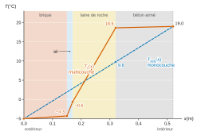
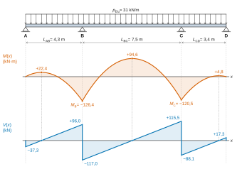
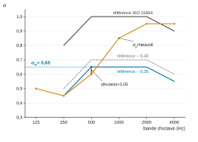
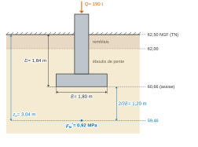

# Concours ATS — Génie civil 2026 · Corrigé brut

*Corrigé rédigé par IA, non officiel. Signalez toute erreur.*

Épreuve de 5 h, calculatrice autorisée. Étude du bâtiment « La Fabrique » (extension du campus ESTP de Cachan). Les parties sont indépendantes ; la partie I est une présentation sans question.

## II. Étude thermique

### Q.1

**Hypothèses complémentaires.** L'annexe 3 ne donne que des normales mensuelles (1991–2020) : on applique la méthode « météo » mois par mois, avec $T_m=\frac{T_{max}+T_{min}}{2}$ moyenne mensuelle et $\text{DJU}_{mois}=(T_s-T_m)\times N_{jours}$ si $T_m<T_s$, 0 sinon. Année non bissextile (365 jours). Chauffage continu à $T_s=18$ °C : seuls les déficits sont comptés.

Document réponse n°1 :

| Mois | J | F | M | A | M | J | J | A | S | O | N | D |
|---|---|---|---|---|---|---|---|---|---|---|---|---|
| $T_{max}$ (°C) | 6,8 | 8,0 | 11,9 | 15,4 | 18,8 | 22,1 | 24,6 | 24,6 | 20,7 | 15,8 | 10,4 | 7,2 |
| $T_{min}$ (°C) | 1,9 | 1,8 | 3,9 | 6,0 | 9,4 | 12,5 | 14,4 | 14,2 | 11,3 | 8,5 | 4,8 | 2,4 |
| $T_m$ (°C) | 4,35 | 4,90 | 7,90 | 10,70 | 14,10 | 17,30 | 19,50 | 19,40 | 16,00 | 12,15 | 7,60 | 4,80 |
| $T_s$ (°C) | 18 | 18 | 18 | 18 | 18 | 18 | 18 | 18 | 18 | 18 | 18 | 18 |
| $\Delta T$ (°C) | 13,65 | 13,10 | 10,10 | 7,30 | 3,90 | 0,70 | −1,50 | −1,40 | 2,00 | 5,85 | 10,40 | 13,20 |
| Jours | 31 | 28 | 31 | 30 | 31 | 30 | 31 | 31 | 30 | 31 | 30 | 31 |
| DJU (°C·j) | 423,2 | 366,8 | 313,1 | 219,0 | 120,9 | 21,0 | 0 | 0 | 60,0 | 181,4 | 312,0 | 409,2 |

Juillet et août ($T_m>T_s$) donnent $\text{DJU}=0$.

$$\boxed{\text{DJU}_{chauffage}=\sum_{mois}(T_s-T_m)^+N\approx 2427\ \text{°C·jours}}$$

Cette valeur est cohérente avec les 2500 °C·j retenus ensuite (le calcul sur moyennes mensuelles lisse les journées froides).

### Q.2

Dimensions : $[U_p]=\text{W·m}^{-2}\text{·K}^{-1}$, $[S]=\text{m}^2$ et $[\text{DJU}]=\text{K·jour}$.

Donc $[U_pS\,\text{DJU}]=\text{W·jour}$ : c'est une énergie. Avec $1\ \text{jour}=24$ h et $1\ \text{W}=10^{-3}$ kW :

$$1\ \text{W·jour}=\frac{24}{1000}\ \text{kWh}$$

d'où :

$$\boxed{E_{consommée}\ (\text{kWh/an})=\frac{24}{1000}\,U_p\,S\,\text{DJU}}$$

$U_pS$ (W/K) est le coefficient de déperdition de l'enveloppe ; le DJU est l'intégrale annuelle de l'écart de température, exprimée en K·jour.

### Q.3

$$E=\frac{24}{1000}\times0{,}5\times6400\times2500=\boxed{192\,000\ \text{kWh/an}}$$

### Q.4

$$E'=\frac{24}{1000}\times0{,}4\times6400\times2500=153\,600\ \text{kWh/an}$$

$$\begin{aligned}
\Delta E&=192\,000-153\,600\\
&=\boxed{38\,400\ \text{kWh/an}}
\end{aligned}$$

soit $-20$ %, car $E\propto U_p$.

$$\Delta C=38\,400\times0{,}19=\boxed{7\,296\ \text{€/an}}$$

### Q.5

Les déperditions étant supposées homogènes sur l'année, la puissance moyenne est l'énergie annuelle divisée par $365\times24=8760$ h :

$$D_{tot\_bâti\_parois}=\frac{192\,000}{8760}=\boxed{21{,}9\ \text{kW}}$$

Contrôle : $U_pS\cdot\frac{\text{DJU}}{365}=3200\times6{,}85=21{,}9$ kW.

### Q.6

Homogénéité : $\frac{\text{Wh}}{\text{K·m}^3}\cdot\frac{\text{m}^3}{\text{h·m}^2}\cdot\text{m}^2\cdot\text{K}=\text{W}$. Avec $0{,}34\times1{,}7\times6=3{,}468$ W/m² :

| Local | $S_i$ (m²) | $Dp_{lab_i}=0{,}34\,Q\,S_i\,\Delta T$ (W) |
|---|---|---|
| Lab_1 (recherche) | 285,4 | 989,8 |
| Lab_2 (espace expérimental) | 347,5 | 1205,1 |
| Lab_3 (hydraulique) | 281,8 | 977,3 |
| Total | 914,7 | 3172,2 |

$$\boxed{\begin{aligned}
Dp_{lab_1}&\approx990\ \text{W}\\
Dp_{lab_2}&\approx1205\ \text{W}\\
Dp_{lab_3}&\approx977\ \text{W}
\end{aligned}}$$

### Q.7

Les laboratoires représentent 6 % des déperditions par renouvellement d'air du bâtiment :

$$D_{tot\_bâti\_renouvellement}=\frac{3172{,}2}{0{,}06}=52\,870\ \text{W}\approx\boxed{52{,}9\ \text{kW}}$$

### Q.8

**Phénomène.** Un pont thermique est une zone localisée de l'enveloppe où la résistance thermique est nettement plus faible qu'en partie courante (interruption ou contournement de l'isolant, élément conducteur traversant, changement de géométrie). Le flux s'y concentre : surconsommation, température de surface intérieure abaissée, risque de condensation et de moisissures.

**Les deux types :**

- **pont thermique linéique** (liaison entre deux parois), caractérisé par $\psi$ en W/(m·K). Exemple : liaison plancher intermédiaire / façade en isolation par l'intérieur, où la dalle traverse l'isolant sur toute la longueur de façade (également : refend / façade, acrotère, plancher bas) ;
- **pont thermique ponctuel** (élément traversant localement l'isolant), caractérisé par $\chi$ en W/K. Exemple : fixations métalliques d'un bardage ou d'une isolation par l'extérieur, pattes de fixation de balcon ou de garde-corps.

### Q.9

$D_{tot\_bâti}=D_{parois}+D_{renouvellement}+D_{vitrées}+D_{Pt}$ avec $D_{vitrées}=D_{parois}$ et $D_{Pt}=0{,}10\,D_{tot\_bâti}$ :

$$0{,}90\,D_{tot\_bâti}=21{,}92+52{,}87+21{,}92=96{,}71\ \text{kW}$$

$$\boxed{D_{tot\_bâti}=\frac{96{,}71}{0{,}90}\approx107{,}5\ \text{kW}}$$

dont $D_{Pt}\approx10{,}7$ kW.

Répartition : renouvellement d'air 49 %, parois opaques 20 %, vitrages 20 %, ponts thermiques 10 %.

## III. Étude d'une paroi opaque

### Q.10

En plus du rayonnement :

- **Conduction** : transfert d'énergie de proche en proche dans un milieu matériel sans mouvement macroscopique (agitation moléculaire, électrons libres), du chaud vers le froid. Loi de Fourier : $\vec\varphi=-\lambda\,\overrightarrow{\text{grad}}\,T$, soit en 1D $\varphi=-\lambda\frac{\mathrm dT}{\mathrm dx}$. Unités : $\varphi$ densité de flux (W·m⁻²), $\lambda$ conductivité (W·m⁻¹·K⁻¹), $\frac{\mathrm dT}{\mathrm dx}$ gradient (K·m⁻¹). Flux : $\Phi=\varphi S$ (W).
- **Convection** : transfert entre une paroi et un fluide en mouvement (naturel, par différence de masse volumique, ou forcé), avec transport de matière. Loi de Newton : $\varphi=h\,(T_{paroi}-T_{fluide})$, avec $\varphi$ (W·m⁻²), $h$ coefficient d'échange (W·m⁻²·K⁻¹), températures en K ou °C (seul l'écart compte). En bâtiment : résistances superficielles $R_s=1/h$.

### Q.11

Couches en série, résistances superficielles négligées :

$$\begin{aligned}
R_{tot}&=\frac{0{,}15}{1}+\frac{0{,}02}{0{,}025}+\frac{e_{iso}}{0{,}036}+\frac{0{,}20}{2{,}5}\\
&=1{,}030+\frac{e_{iso}}{0{,}036}
\end{aligned}$$

Exigence MEXT10 (annexe 4) : $R>5$ m²·K/W, donc $e_{iso}>0{,}036\times(5-1{,}030)=0{,}143$ m. Valeur entière (en cm) :

$$\boxed{e_{iso}=15\ \text{cm}}$$

On en déduit :

$$\begin{aligned}
R_{tot}&=1{,}030+4{,}167\\
&=5{,}20\ \text{m}^2\text{·K/W}\\[4pt]
e_{mur}&=15+2+15+20\\
&=52\ \text{cm}
\end{aligned}$$

### Q.12

$R_{tot}$ est une fonction croissante de $e_{iso}$ et le cahier des charges impose une borne inférieure sur $R$ : **15 cm est une épaisseur minimale**. Toute épaisseur supérieure respecte l'exigence ; seules des considérations d'encombrement, de coût et de surface utile limitent l'épaisseur par le haut.

### Q.13

La lame d'air immobile est très peu conductrice ($\lambda=0{,}025$ W/(m·K), du même ordre que les meilleurs isolants) : avec 2 cm, elle apporte $R=0{,}80$ m²·K/W, soit 15 % de l'exigence. Elle désolidarise aussi le parement de brique du reste du mur : coupure capillaire, drainage et évacuation de l'eau ayant traversé le parement, ce qui protège l'isolant (une laine humide perd son pouvoir isolant), et reprise des tolérances de pose. Son efficacité thermique suppose qu'elle reste peu ou pas ventilée.

### Q.14

Hypothèses :

- paroi plane de grande extension : température fonction de $x$ seul, donc $\nabla^2T_s=\frac{\mathrm d^2T_s}{\mathrm dx^2}$ ;
- régime stationnaire : $\frac{\partial T_s}{\partial t}=0$ ;
- pas de source.

L'équation devient $\alpha\frac{\mathrm d^2T_s}{\mathrm dx^2}=0$ avec $\alpha\ne0$, d'où :

$$\begin{aligned}
\frac{\mathrm d^2T_s}{\mathrm dx^2}&=0\\
T_s(x)&=Ax+B
\end{aligned}$$

Axe orienté de l'extérieur ($x=0$) vers l'intérieur ($x=e$). La condition $T_s(0)=T_{ext}$ donne $B=T_{ext}$. La condition $T_s(e)=T_{int}$ donne $A=\frac{T_{int}-T_{ext}}{e}$.

$$\boxed{T_s(x)=T_{ext}+\left(T_{int}-T_{ext}\right)\frac{x}{e}}$$

### Q.15

En 1D, $\vec\varphi=-\lambda\frac{\mathrm dT_s}{\mathrm dx}\vec u_x$ et, d'après Q.14, $\frac{\mathrm dT_s}{\mathrm dx}=\frac{T_{int}-T_{ext}}{e}$ est constant :

$$\varphi=-\lambda\,\frac{T_{int}-T_{ext}}{e}$$

Comme $T_{int}>T_{ext}$, $\varphi<0$ : le flux va de l'intérieur vers l'extérieur. En valeur absolue :

$$\boxed{|\varphi|=\frac{\lambda}{e}\left(T_{int}-T_{ext}\right)=\frac{T_{int}-T_{ext}}{R}}$$

avec $R=\frac{e}{\lambda}$.

En régime stationnaire, $\varphi$ est le même dans toutes les couches d'un multicouche (rien ne s'accumule), et les résistances s'ajoutent en série (analogie électrique).

### Q.16

$\overrightarrow{\text{grad}}\,T$ pointe vers les températures croissantes. Le signe « − » exprime que le flux de chaleur est dirigé en sens inverse, **du chaud vers le froid** : c'est la traduction locale du second principe (irréversibilité du transfert thermique). Ce n'est pas une convention d'orientation.

### Q.17

Ordre des couches de l'extérieur ($x=0$, −5 °C) vers l'intérieur ($x=0{,}52$ m, 19 °C) : brique (0 → 0,15), lame d'air (0,15 → 0,17), laine de roche (0,17 → 0,32), béton (0,32 → 0,52), ordre cohérent avec les interfaces repérées sur l'annexe 6.

$$\begin{aligned}
\varphi&=\frac{T_{int}-T_{ext}}{R_{tot}}\\
&=\frac{24}{5{,}197}\\
&=4{,}62\ \text{W/m}^2\\[4pt]
\Delta T_i&=\varphi R_i
\end{aligned}$$

| Interface | $x$ (m) | $R_i$ traversée (m²·K/W) | $\Delta T_i$ (K) | $T$ (°C) |
|---|---|---|---|---|
| face extérieure | 0 | — | — | −5,0 |
| brique / air | 0,15 | 0,150 | 0,69 | −4,3 |
| air / laine | 0,17 | 0,800 | 3,69 | −0,6 |
| laine / béton | 0,32 | 4,167 | 19,24 | 18,6 |
| face intérieure | 0,52 | 0,080 | 0,37 | 19,0 |

Document réponse n°2 : profil **affine par morceaux et continu** reliant ces cinq points ; pente faible dans la brique et le béton, forte dans la lame d'air et très forte (sur 15 cm) dans la laine de roche, qui porte 80 % de la chute de température.

### Q.18

Paroi monocouche d'épaisseur $e_{mur}=0{,}52$ m, mêmes conditions aux limites ; le résultat de Q.14 s'applique :

$$\boxed{\begin{aligned}
T_{seq}(x)&=-5+\frac{24}{0{,}52}\,x\\
&=-5+46{,}15\,x
\end{aligned}}$$

($T_{seq}$ en °C, $x$ en m.)

Valeurs : 1,9 ; 2,8 ; 9,8 et 19,0 °C aux abscisses 0,15 ; 0,17 ; 0,32 et 0,52 m (ce sont les valeurs de l'annexe 6).

Document réponse n°3 : droite de (0 ; −5) à (0,52 ; 19), superposée au profil brisé de Q.17. Les deux profils coïncident aux bords et diffèrent à l'intérieur (18,6 contre 9,8 °C en $x=0{,}32$ m) : le modèle équivalent ne décrit pas le champ interne réel.

### Q.19

Chaque terme $n$ est un mode : profil spatial fixe $\sin(n\pi x/e)$ dont l'amplitude $a_n$ décroît en $e^{-t/\tau_n}$ avec

$$\tau_n=\frac{1}{\alpha_{eq}}\left(\frac{e}{n\pi}\right)^2=\frac{\tau_1}{n^2}.$$

Les modes d'ordre élevé (variations spatiales courtes, gradients forts) s'amortissent beaucoup plus vite (mode 2 : 4 fois, mode 3 : 9 fois plus vite) et ont de plus une amplitude initiale plus faible ($a_n\propto1/n$). Après un temps de l'ordre de $\tau_1/4$, seul le mode 1 subsiste : il gouverne la durée du transitoire. Quand $t\to\infty$, $\theta\to0$ et $T(x,t)\to T_{seq}(x)$.

### Q.20

En $x=0$, $\sin 0=0$. En $x=e$, $\sin(n\pi)=0$ pour tout $n\in\mathbb N^*$.

Donc, pour tout $t$, $\theta(0,t)=\theta(e,t)=0$ et :

$$\boxed{\begin{aligned}
T(0,t)&=T_{seq}(0)=T_{ext}\\
T(e,t)&=T_{seq}(e)=T_{int}
\end{aligned}}$$

Les conditions aux limites sont portées par $T_{seq}$ ; le correctif $\theta$ s'annule aux bords.

### Q.21

Pour un mode, avec $k_n=n\pi/e$ et $\theta_n=a_ne^{-\alpha_{eq}k_n^2t}\sin(k_nx)$ :

$$\begin{aligned}
\frac{\partial\theta_n}{\partial t}&=-\alpha_{eq}k_n^2\,\theta_n\\
\frac{\partial^2\theta_n}{\partial x^2}&=-k_n^2\,\theta_n
\end{aligned}$$

donc $\frac{\partial\theta_n}{\partial t}=\alpha_{eq}\nabla^2\theta_n$. L'équation étant linéaire, la somme $\theta=\sum\theta_n$ est solution.

Comme $T_{seq}$ est affine, $\nabla^2T_{seq}=0$ et $\partial_tT_{seq}=0$. Donc $T=T_{seq}+\theta$ est aussi solution de l'équation de Fourier sans source.

### Q.22

À $t=0$ :

$$\theta(x,0)=T_{int}-T_{seq}(x)=24\left(1-\frac{x}{e}\right)$$

Le développement en série de sinus donne des coefficients inversement proportionnels à $n$ :

$$\begin{aligned}
a_n&=\frac{2}{e}\int_0^e24\left(1-\frac{x}{e}\right)\sin\frac{n\pi x}{e}\,\mathrm dx\\
&=\frac{48}{n\pi}
\end{aligned}$$

d'où $a_1=48/\pi\approx15{,}3$ °C. Avec $e=0{,}52$ m, $(\pi/e)^2=36{,}5$ m⁻² :

$$\boxed{\theta(x,t)=\frac{48}{\pi}\,\exp\!\left(-\alpha_{eq}\left(\frac{\pi}{0{,}52}\right)^2t\right)\sin\!\left(\frac{\pi x}{0{,}52}\right)\approx15{,}3\,e^{-36{,}5\,\alpha_{eq}t}\sin(6{,}04\,x)}$$

$\theta>0$ : le mur, initialement à 19 °C, se refroidit vers le profil stationnaire.

### Q.23

En un point fixe $x_0$, $\ln\theta=\ln\left(a_1\sin\frac{\pi x_0}{e}\right)-\alpha_{eq}\left(\frac{\pi}{e}\right)^2t$ : une droite de pente $-1/\tau_1$.

Lecture de l'annexe 5 : $\ln\theta\approx$ 2,659 à $t=0$, 2,631 à 10⁴ s et 2,516 à 5 × 10⁴ s. Pente :

$$p=\frac{2{,}516-2{,}659}{5\times10^4}\approx-2{,}86\times10^{-6}\ \text{s}^{-1}$$

(L'ordonnée à l'origine $2{,}659=\ln\left(15{,}28\times\sin\frac{0{,}32\pi}{0{,}52}\right)$ montre que la courbe est relevée en $x_0=0{,}32$ m.)

$$\begin{aligned}
\alpha_{eq}&=|p|\left(\frac{e_{mur}}{\pi}\right)^2\\
&=2{,}86\times10^{-6}\times2{,}74\times10^{-2}
\end{aligned}$$

$$\boxed{\alpha_{eq}\approx7{,}8\times10^{-8}\ \text{m}^2\text{/s}}$$

Diffusivité faible, conforme à l'objectif annoncé d'une paroi qui transmet lentement les variations de température.

### Q.24

$$\begin{aligned}
\tau_1&=\frac{1}{\alpha_{eq}}\left(\frac{e_{mur}}{\pi}\right)^2\\
&=\frac{2{,}74\times10^{-2}}{7{,}8\times10^{-8}}\\
&\approx3{,}5\times10^5\ \text{s}\\
&=\frac{3{,}5\times10^5}{86\,400}\ \text{jours}
\end{aligned}$$

$$\boxed{\tau_1\approx4{,}0\ \text{jours}}$$

(cohérent avec $\tau_1=1/|p|$).

### Q.25

Sur l'annexe 6, l'écart $T-T_{seq}$ en $x=0{,}32$ m vaut 13,9 ; 12,3 ; 10,7 puis 3,4 °C aux instants 10⁴ ; 5 × 10⁴ ; 10⁵ et 5 × 10⁵ s.

À $5\times10^5$ s (≈ 1,4 $\tau_1$, environ 6 jours), le profil est encore nettement au-dessus du profil stationnaire (≈ 24 % de l'écart initial) : le régime n'est pas atteint sur la plage tracée.

L'écart décroît en $e^{-t/\tau_1}$. Il tombe à 5 % pour $t=3\tau_1$ et à moins de 1 % pour $t=5\tau_1$.

$$\boxed{t_{stationnaire}\approx3\ \text{à}\ 5\,\tau_1\approx12\ \text{à}\ 20\ \text{jours}\ (\text{ordre de grandeur } 5\tau_1)}$$

## IV. Étude d'une poutre continue

### Q.26

Annexe 8, zone d'étude : planche CP, trame magenta à triangles sur toute la zone ; planche CE, trame magenta à hachures sur les bureaux (l'essentiel de la zone), bande cyan (400 daN/m²) limitée à la circulation. Charge d'exploitation la plus représentative : celle des bureaux. Avec $100$ daN/m² $=1$ kN/m² :

$$\boxed{\begin{aligned}
\text{CP}&=100\ \text{daN/m}^2=1{,}0\ \text{kN/m}^2\\
\text{CE}&=350\ \text{daN/m}^2=3{,}5\ \text{kN/m}^2
\end{aligned}}$$

(CP est une charge permanente complémentaire : elle n'inclut pas le poids propre de la dalle.)

### Q.27

$$p'_{Elu}=1{,}35\times1{,}0+1{,}5\times3{,}5=\boxed{6{,}60\ \text{kN/m}^2}$$

La poutre de la file 2 reprend la moitié des portées de plancher adjacentes (annexe 7 bis : 6,48 m vers la file 1 et 2,62 m vers la file 3) : largeur de reprise $\frac{6{,}48}{2}+\frac{2{,}62}{2}=4{,}55$ m.

$$\boxed{p_{Elu}=6{,}60\times4{,}55\approx30\ \text{kN/m}}$$

Valeur cohérente avec les 31 kN/m imposés pour la suite (écart de lecture des cotes et, éventuellement, poids propre de la retombée).

### Q.28

Quatre appuis A, B, C, D, chargement vertical : inconnues de liaison $R_A,R_B,R_C,R_D$ (la composante horizontale de l'appui fixe est nulle). Équations utiles : $\sum F_y=0$ et $\sum M=0$.

$$\boxed{h=4-2=2}$$

Inconnues hyperstatiques : les **moments sur appuis intermédiaires $M_B$ et $M_C$** (rotules fictives en B et C, trois travées isostatiques), choix du théorème des trois moments. On peut aussi prendre les réactions $R_B$ et $R_C$.

### Q.29

La continuité crée des moments négatifs sur appuis qui **réduisent les moments en travée et les flèches** : sur BC, $pL^2/8=218$ kN·m en isostatique contre 94,6 kN·m en continu, d'où une section plus économique. Autre avantage : la redondance (redistribution des efforts en cas de plastification locale, réserve de sécurité).

### Q.30

Annexe 9, travée $i$ de longueur $L_i$ :

$$\begin{aligned}
M(x_i)&=m(x_i)+M_{i-1}\left(1-\frac{x_i}{L_i}\right)+M_i\frac{x_i}{L_i}\\
V(x_i)&=v(x_i)+\frac{M_{i-1}-M_i}{L_i}
\end{aligned}$$

En dérivant :

$$\frac{\mathrm dM}{\mathrm dx_i}=\frac{\mathrm dm}{\mathrm dx_i}-\frac{M_{i-1}-M_i}{L_i}$$

Pour que les deux formules soient compatibles quels que soient $M_{i-1}$ et $M_i$, il faut que les termes en $(M_{i-1}-M_i)/L_i$ se correspondent au signe près. Donc $V=-\frac{\mathrm dM}{\mathrm dx}$, et de même $v=-\frac{\mathrm dm}{\mathrm dx}$ pour la travée isostatique.

$$\boxed{V(x)=-\frac{\mathrm dM(x)}{\mathrm dx}}$$

et

$$\frac{\mathrm dV}{\mathrm dx}=p$$

C'est la convention où les efforts intérieurs sont les actions de la partie droite sur la partie gauche. Pour la travée isostatique sous charge uniforme :

$$\begin{aligned}
m&=\frac{p}{2}x(L-x)\\
v&=p\left(x-\frac L2\right)
\end{aligned}$$

Cette convention est cohérente avec $R_i=v_{g,i}-v_{d,i}$ (le tranchant diminue de $R_i$ en franchissant l'appui). Conséquence : $M$ est extrémal là où $V=0$.

Avec la convention opposée, on écrirait $V=+\mathrm dM/\mathrm dx$ et tous les signes de $V$ s'inverseraient.

### Q.31

Rotation d'extrémité d'une travée isostatique sous charge uniforme : $|\omega|=\frac{pL^3}{24EI}$ (intégrale de Mohr parabole × triangle unité). Avec les signes de l'annexe :

$$6EI(\omega'_{i+1}-\omega''_i)=-\frac{p}{4}(L_i^3+L_{i+1}^3)$$

Équation en B, avec $M_A=0$, $p=31$ kN/m et des portées $L_{AB}=4{,}3$ m et $L_{BC}=7{,}5$ m :

$$2M_B(4{,}3+7{,}5)+7{,}5\,M_C=-\frac{31}{4}\left(4{,}3^3+7{,}5^3\right)=-3885{,}7$$

Avec $M_C=-120{,}48$ kN·m : $23{,}6\,M_B=-3885{,}7+903{,}6=-2982{,}1$.

$$\boxed{M_B\approx-126{,}36\ \text{kN·m}}$$

Contrôle par l'équation en C : $7{,}5M_B+2M_C(7{,}5+3{,}4)=-\frac{31}{4}(7{,}5^3+3{,}4^3)=-3574{,}1$ redonne $M_C=-120{,}48$ kN·m.

### Q.32

Données : $p=31$ kN/m et les moments sur appuis (kN·m) suivants.

| $M_A$ | $M_B$ | $M_C$ | $M_D$ |
|---|---|---|---|
| 0 | −126,36 | −120,48 | 0 |

$x$ est compté depuis l'appui gauche de chaque travée ; $V=-\mathrm dM/\mathrm dx$ (convention de l'annexe 9).

**Travée AB** ($L=4{,}3$ m) :

$$\begin{aligned}
M(x)&=15{,}5\,x(4{,}3-x)-126{,}36\frac{x}{4{,}3}\\
&=-15{,}5x^2+37{,}26x\\[4pt]
V(x)&=31x-37{,}26
\end{aligned}$$

- tranchant aux extrémités : $V(0)=-37{,}26$ kN et $V(4{,}3)=+96{,}04$ kN ;
- moment maximal : $M_{max}=22{,}4$ kN·m en $x=1{,}20$ m ;
- moment nul en $x=0$ et en $x=2{,}40$ m.

**Travée BC** ($L=7{,}5$ m) :

$$\begin{aligned}
M(x)&=15{,}5\,x(7{,}5-x)-126{,}36\left(1-\frac{x}{7{,}5}\right)-120{,}48\frac{x}{7{,}5}\\
&=-15{,}5x^2+117{,}03x-126{,}36\\[4pt]
V(x)&=31x-117{,}03
\end{aligned}$$

- tranchant aux extrémités : $V(0)=-117{,}03$ kN et $V(7{,}5)=+115{,}47$ kN ;
- moment maximal : $M_{max}=94{,}6$ kN·m en $x=3{,}78$ m ;
- moment nul en $x=1{,}31$ m et en $x=6{,}25$ m.

**Travée CD** ($L=3{,}4$ m) :

$$\begin{aligned}
M(x)&=15{,}5\,x(3{,}4-x)-120{,}48\left(1-\frac{x}{3{,}4}\right)\\
&=-15{,}5x^2+88{,}14x-120{,}48\\[4pt]
V(x)&=31x-88{,}14
\end{aligned}$$

- tranchant aux extrémités : $V(0)=-88{,}14$ kN et $V(3{,}4)=+17{,}26$ kN ;
- moment maximal : $M_{max}=4{,}8$ kN·m en $x=2{,}84$ m ;
- moment nul en $x=2{,}29$ m et en $x=3{,}4$ m.

**Épures** (figure 2). $M$ : trois arcs de parabole, positifs en travée. $V$ : trois segments de pente $+31$ kN/m, discontinus aux appuis (sauts égaux aux réactions) ; $V$ s'annule au droit de chaque maximum de $M$.

$$\boxed{\begin{aligned}
M_{travée}^{max}&=94{,}6\ \text{kN·m (BC)}\\
M_{appui}^{max}&=-126{,}4\ \text{kN·m (B)}\\
|V|_{max}&=117{,}0\ \text{kN (à droite de B)}
\end{aligned}}$$

### Q.33

$R_i=V(\text{juste à gauche de }i)-V(\text{juste à droite de }i)$ :

$$\begin{aligned}
R_A&=0-(-37{,}26)=37{,}26\ \text{kN}\\
R_B&=96{,}04-(-117{,}03)=213{,}07\ \text{kN}\\
R_C&=115{,}47-(-88{,}14)=203{,}60\ \text{kN}\\
R_D&=17{,}26-0=17{,}26\ \text{kN}
\end{aligned}$$

$$\boxed{\begin{aligned}
R_A&\approx37{,}3\ \text{kN}\\
R_B&\approx213{,}1\ \text{kN}\\
R_C&\approx203{,}6\ \text{kN}\\
R_D&\approx17{,}3\ \text{kN}
\end{aligned}}$$

Contrôle : $\sum R_i=471{,}2$ kN $=31\times15{,}2$.

### Q.34

Charge virtuelle unité au milieu de BC : $\bar m$ triangulaire de maximum $L/4$. Superposition :

- charge répartie : parabole de maximum $P_{flèche}L^2/8$ × triangle centré, coefficient $5/12$ (annexe 10) : $\frac{1}{EI_z}\cdot L\cdot\frac{P_{flèche}L^2}{8}\cdot\frac{L}{4}\cdot\frac{5}{12}=\frac{5P_{flèche}L^4}{384EI_z}$ ;
- moments d'extrémité : deux triangles (maximums $M_b$ et $M_c$) × triangle centré, coefficient $1/4$ chacun : $\frac{1}{EI_z}\left(LM_b\frac L4\cdot\frac14+LM_c\frac L4\cdot\frac14\right)=\frac{(M_b+M_c)L^2}{16EI_z}$.

$$\boxed{\delta_f=\frac{5\,P_{flèche}\,L^4}{384\,EI_z}+\frac{(M_b+M_c)\,L^2}{16\,EI_z}}$$

avec $L=7{,}5$ m (flèche positive vers le bas ; $M_b,M_c$ algébriques, négatifs ici).

Numériquement, avec $P_{flèche}=31$ kN/m :

$$\begin{aligned}
\delta_f&=\frac{1277{,}2-867{,}8}{EI_z}\\
&=\frac{409{,}4}{EI_z}\ (\text{kN·m}^3)
\end{aligned}$$

soit 68 % de moins que la travée isostatique.

### Q.35

Le flambement est une **instabilité de forme** d'un élément élancé comprimé : au-delà d'une charge critique, la position rectiligne cesse d'être un équilibre stable. Une petite imperfection crée un déplacement latéral $\Delta$, donc un moment $P_v\Delta$ qui augmente la courbure, donc $\Delta$, etc. La ruine est brutale, par grands déplacements latéraux, et survient avant que la contrainte de compression n'atteigne la résistance du matériau.

### Q.36

La force critique d'Euler est la charge de **bifurcation** d'une barre idéale (parfaitement droite, homogène, chargée exactement dans l'axe, élastique linéaire indéfiniment) : au-delà, l'équilibre rectiligne est instable. **On ne l'atteint pas en pratique** : les imperfections géométriques et l'excentricité de la charge font fléchir la barre dès le début du chargement (amplification $1/(1-P/P_{cr})$), le matériau plastifie ou s'écrase avant (domaine d'Euler limité aux grands élancements), et pour le béton le fluage et la fissuration abaissent la rigidité. La ruine réelle survient donc sous une charge inférieure à $P_{cr}$.

### Q.37

Une charge excentrée de $e$ équivaut à une charge centrée $P_v$ plus un moment $M_0=P_v\,e$ : on passe de la compression simple à la **flexion composée**.

Les contraintes ne sont plus uniformes :

$$\sigma=\frac{P_v}{S}\pm\frac{M_0\,v}{I}$$

Le bord le plus comprimé est surchargé, et une traction peut apparaître si $e$ sort du noyau central ($a/6$ pour une section carrée). Le moment initial s'ajoute au moment du second ordre $P_v\Delta$ : la déformée croît dès le premier chargement et la capacité portante diminue (flambement aggravé).

### Q.38

Le flambement peut se produire dans chacun des deux plans principaux, avec un élancement $\lambda=L_{cr}/i$ propre à chaque plan ; il se produit dans le plan le plus élancé. Des conditions d'appui similaires dans les deux sens signifient que la longueur de flambement est la même dans les deux plans (ici bi-articulé : $L_{cr}=L$). Il est important de le préciser car $L_{cr}$ dépend des liaisons dans chaque plan (0,5 L à 2 L) : sans cette information, on ne peut pas calculer $\lambda$. Avec une section carrée (même rayon de giration), un seul calcul suffit.

### Q.39

Poteau P0 : section $0{,}50\times0{,}50$ m (annexe 7 bis), hauteur sous poutre $L=6{,}62$ m, bi-articulé : $L_{cr}=L=6{,}62$ m.

$$\begin{aligned}
i&=\sqrt{\frac IS}=\frac{a}{\sqrt{12}}\\
&=0{,}144\ \text{m}\\[4pt]
\lambda&=\frac{6{,}62}{0{,}144}\approx45{,}9
\end{aligned}$$

$$\begin{aligned}
f_{cd}&=\frac{20}{1{,}5}=13{,}33\ \text{MPa}\\[4pt]
n&=\frac{P_v}{Sf_{cd}}=\frac{0{,}220}{0{,}25\times13{,}33}\\
&=0{,}066
\end{aligned}$$

$$\lambda_{lim}=\frac{20\times0{,}7\times1{,}1\times1}{\sqrt{0{,}066}}=\frac{15{,}4}{0{,}257}\approx59{,}9$$

$$\boxed{\lambda\approx45{,}9<\lambda_{lim}\approx59{,}9\ :\ \text{pas de prise en compte des effets du second ordre}}$$

(Avec 6,60 m de l'annexe 11 : $\lambda=45{,}7$, même conclusion.)

## V. Confort de l'habitat

### Q.40

La durée de réverbération mesure la persistance du son dans un local. Trop longue, elle dégrade l'**intelligibilité** (chaque syllabe masque la suivante), élève le **niveau sonore** ambiant (chacun parle plus fort) et crée fatigue et inconfort. Trop courte, le local paraît « sourd ». Elle doit être adaptée à l'usage : courte pour les bureaux et salles de cours, plus longue pour la musique.

### Q.41

$\alpha_p$ (fraction d'énergie incidente absorbée) dépend de la fréquence car la longueur d'onde $\lambda=c/f$ varie de 2,7 m (125 Hz) à 8,5 cm (4000 Hz) et les mécanismes de dissipation sont sélectifs. Phénomène principal pour une dalle minérale poreuse : **absorption par frottement visqueux** de l'air dans les pores, efficace seulement si l'épaisseur du matériau (et son éloignement de la paroi rigide) est de l'ordre d'une fraction notable de la longueur d'onde. Elle est donc bonne en aigu et faible en grave, d'où la croissance de $\alpha_p$ de 0,5 à 0,95. On peut citer aussi la résonance de membrane ou de Helmholtz (plénum).

### Q.42

Données : courbe de référence ISO 11654 (document réponse n°4) et $\alpha_p$ (figure 6). Seules les déviations défavorables (mesure inférieure à la référence) sont comptées.

Document réponse n°5 :

| Bande d'octave (Hz) | 125 | 250 | 500 | 1000 | 2000 | 4000 | Somme | Conforme ? |
|---|---|---|---|---|---|---|---|---|
| Courbe de référence ISO 11654 | #N/A | 0,80 | 1,00 | 1,00 | 1,00 | 0,90 | | |
| Coefficient mesuré $\alpha_p$ | 0,50 | 0,45 | 0,60 | 0,85 | 0,95 | 0,95 | | |
| Déviation (1re itération, sans correction) | — | 0,35 | 0,40 | 0,15 | 0,05 | 0 | 0,95 | non |
| Référence corrigée de −0,30 | — | 0,50 | 0,70 | 0,70 | 0,70 | 0,60 | | |
| Déviation (2e itération) | — | 0,05 | 0,10 | 0 | 0 | 0 | 0,15 | non (> 0,1) |
| Référence corrigée de −0,35 | — | 0,45 | 0,65 | 0,65 | 0,65 | 0,55 | | |
| Déviation (3e itération) | — | 0 | 0,05 | 0 | 0 | 0 | 0,05 | oui (≤ 0,1) |

Document réponse n°4 : tracer la courbe jaune (points 0,5 ; 0,45 ; 0,60 ; 0,85 ; 0,95 ; 0,95), puis les courbes de référence abaissées de 0,30 et de 0,35. On lit $\alpha_w$ sur la courbe de référence corrigée à 500 Hz :

$$\boxed{\alpha_{w\_dalle}=1{,}00-0{,}35=0{,}65}$$

(La translation normative au pas de 0,05 aboutit au même décalage de 0,35.)

### Q.43

$\alpha_{w\_sol}=0{,}05$ : le linoléum n'absorbe que 5 % de l'énergie incidente et en **réfléchit 95 %**. C'est un coefficient très faible : matériau dense, lisse, non poreux, collé sur un support rigide (ni frottement visqueux ni vibration). Acoustiquement, il se comporte comme une paroi réfléchissante. Son absorption n'est pas conséquente.

### Q.44

Bureau FI05-1M (annexe 15) : $S=16{,}1$ m², HSFP = 3,1 m, donc $V=49{,}91$ m³ ; $S_{dalle}=16{,}1$ m². Annexe 14, ligne « bureaux collectifs : bureaux des enseignants permanents », objectif réglementaire $0{,}4\ \text{s}\le T_r\le0{,}8$ s. Seule la dalle absorbe :

$$\begin{aligned}
&T_{rev}=\frac{0{,}16V}{\alpha_{w\_dalle}S_{dalle}}\in[0{,}4\,;\,0{,}8]\\
\iff\ &\frac{0{,}16V}{0{,}8\,S_{dalle}}\le\alpha_{w\_dalle}\le\frac{0{,}16V}{0{,}4\,S_{dalle}}
\end{aligned}$$

$$\boxed{0{,}62\le\alpha_{w\_dalle}\le1{,}24}$$

Avec $\alpha_{w\_dalle}=0{,}65$ : $T_{rev}=\frac{7{,}99}{0{,}65\times16{,}1}=0{,}76$ s. **Le choix du bureau d'étude respecte l'objectif réglementaire**, avec une marge faible. En revanche, l'objectif retenu/HQE ($T_r\le0{,}6$ s) exigerait $\alpha_{w\_dalle}\ge0{,}83$ et n'est pas atteint par la dalle seule.

### Q.45

Absorption apportée par 30 personnes : $30\times0{,}5\times0{,}7=10{,}5$ m².

$$T_{rev}^{comble}=\frac{0{,}16\times49{,}91}{0{,}65\times16{,}1+10{,}5}=\frac{7{,}99}{20{,}97}\approx\boxed{0{,}38\ \text{s}}$$

Les objectifs de l'annexe 14 portent sur les locaux non occupés ; 30 personnes dans 16,1 m² est une hypothèse de calcul extrême.

### Q.46

On compare deux situations qui ne diffèrent que par le coefficient de la surface $S_{new}=S_{dalle}$, toutes les autres absorptions $A_0$ restant inchangées. Avant : coefficient $\alpha_{w\_dalle}$ et durée $T_{rev}$. Après : coefficient $\alpha_{w\_new}$ et durée $T_{optimal}=\beta V^{1/3}$.

$$\begin{aligned}
\frac{0{,}16V}{T_{rev}}&=A_0+\alpha_{w\_dalle}S_{new}\\
\frac{0{,}16V}{\beta V^{1/3}}&=A_0+\alpha_{w\_new}S_{new}
\end{aligned}$$

Par différence, $A_0$ s'élimine :

$$\begin{aligned}
(\alpha_{w\_new}-\alpha_{w\_dalle})\,S_{new}&=\frac{0{,}16V^{2/3}}{\beta}-\frac{0{,}16V}{T_{rev}}\\
&=0{,}16\,V^{2/3}\left(\frac1\beta-\frac{V^{1/3}}{T_{rev}}\right)
\end{aligned}$$

$$\boxed{\alpha_{w\_new}=\alpha_{w\_dalle}+\frac{0{,}16}{S_{new}}\,V^{2/3}\left(\frac1\beta-\frac{V^{1/3}}{T_{rev}}\right)}$$

Homogénéité : 0,16 en s/m, $V^{2/3}/S$ sans dimension, $1/\beta$ et $V^{1/3}/T_{rev}$ en m/s.

Si $T_{optimal}=T_{rev}$, on retrouve $\alpha_{w\_new}=\alpha_{w\_dalle}$.

Remarque : si le matériau remplacé est le linoléum (même surface au sol), le coefficient à faire figurer est $\alpha_{w\_sol}$ ; l'énoncé l'assimile à $\alpha_{w\_dalle}$.

## VI. Étude de fondation

### Q.47

- **Fondations superficielles** (encastrement faible devant la largeur) : la charge est transmise par la base de la fondation aux couches de surface. Semelles isolées sous poteaux, semelles filantes sous murs, radiers généraux. Pour un bon sol proche de la surface.
- **Fondations semi-profondes** : puits, massifs ou semelles sur gros béton. Elles traversent quelques mètres de mauvais sol pour atteindre un horizon porteur.
- **Fondations profondes** (encastrement grand devant la largeur) : pieux (forés, battus, vissés), barrettes, micropieux. La charge est reprise par la pointe et par le frottement latéral. Pour des sols de surface médiocres, de fortes charges, la présence d'une nappe.

Les seuils indicatifs sur $D/B$ (de l'ordre de 4 à 6 pour la limite superficiel/semi-profond, de 10 pour le profond) varient selon les référentiels.

### Q.48

Semelle carrée : $B=\sqrt{3{,}24}=1{,}80$ m. Encastrement : $D=62{,}50-60{,}66=1{,}84$ m (l'assise est à 1,34 m sous le toit des éboulis, ancrage ≥ 0,5 m respecté).

$$\begin{aligned}
z_e&=D+\frac23B\\
&=1{,}84+1{,}20\\
&=3{,}04\ \text{m}
\end{aligned}$$

soit la cote 59,46 NGF.

Sondage SP18, colonne $p_l^*$ : 0,92 MPa à 3,0 m et 1,33 MPa à 4,5 m (sable argileux). À $z_e$ :

$$\boxed{p_{le}^*\approx0{,}92\ \text{MPa}}$$

(L'interpolation linéaire donne 0,93 MPa, ou 0,99 MPa si l'on prend la tête du log à 62,70 m ; on retient la valeur mesurée la plus faible, côté sécurité.)

### Q.49

$$\begin{aligned}
q_u&=K_p\,p_{le}^*=0{,}85\times0{,}92\\
&=0{,}782\ \text{MPa}\\[4pt]
Q_{adm}&=q_uS=0{,}782\times3{,}24\\
&=2{,}53\ \text{MN}
\end{aligned}$$

$Q=190$ t, soit $\approx1{,}90$ MN ($g\approx10$ m/s² ; 1,86 MN avec 9,81).

$$\boxed{F=\frac{Q_{adm}}{Q}=\frac{2{,}53}{1{,}90}\approx1{,}33<2}$$

La semelle de $1{,}80\times1{,}80$ m ne présente pas la sécurité requise vis-à-vis de la rupture du sol (le sol ne rompt pas sous la charge réelle, $586<782$ kPa, mais la marge est insuffisante) : **il faut l'agrandir.**

### Q.50

$$\begin{aligned}
&F=\frac{q_uB^2}{Q}\ge2\\
\iff\ &B^2\ge\frac{2\times1{,}90}{0{,}782}=4{,}86\ \text{m}^2\\
\iff\ &B\ge2{,}21\ \text{m}
\end{aligned}$$

Augmenter $B$ abaisse $z_e$ (3,37 m pour $B=2{,}30$ m), où $p_l^*$ est un peu plus élevé : garder 0,92 MPa est conservatif.

$$\boxed{\text{Semelle carrée }2{,}30\times2{,}30\ \text{m}\ (S=5{,}29\ \text{m}^2)\ \text{ancrée à }60{,}66\ \text{NGF}}$$

Vérification :

$$\begin{aligned}
Q_{adm}&=0{,}782\times5{,}29=4{,}14\ \text{MN}\\
F&=\frac{4{,}14}{1{,}90}=2{,}18\ge2
\end{aligned}$$

La fondation reste superficielle ($D/B=0{,}8$). Il resterait à vérifier les tassements (modules $E_M$ modestes, 10 à 15 MPa) et le ferraillage de la semelle.
