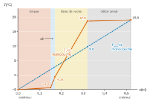
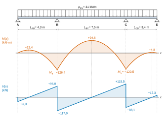
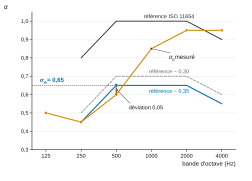
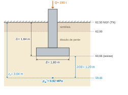

# Concours ATS — Génie civil 2026 · Corrigé guidé

*Corrigé rédigé par IA, non officiel. Signalez toute erreur.*

## Présentation du sujet

**Cadre.** Épreuve de 5 h, calculatrice autorisée, 17 pages d'énoncé, 17 annexes et 5 documents réponses à rendre. Le support est un projet réel : « La Fabrique », bâtiment d'enseignement et de recherche de l'extension du campus ESTP de Cachan. Les parties sont indépendantes ; la partie I présente le projet et ne contient pas de question. Il y a **50 questions numérotées Q.1 à Q.50**.

**Découpage.**

| Partie | Questions | Contenu | Outils |
|---|---|---|---|
| II. Étude thermique | Q.1–Q.9 | DJU par la méthode « météo », énergie de chauffage, gain économique, ventilation des laboratoires, ponts thermiques, déperdition totale | moyennes, analyse dimensionnelle, règle de trois, bilan de puissances |
| III. Paroi opaque | Q.10–Q.25 | modes de transfert, épaisseur d'isolant, profils stationnaires multicouche et monocouche, régime transitoire en série de Fourier, diffusivité identifiée sur un graphe en $\ln$ | résistances en série, loi de Fourier, équation de la chaleur 1D, lecture de pente |
| IV. Poutre continue et poteau | Q.26–Q.39 | lecture des plans de charges, ELU, hyperstaticité, relation $M$–$V$, trois moments, épures, réactions, flèche par Mohr, flambement, critère d'élancement | RDM des poutres, intégrales de Mohr, Eurocode 2 simplifié |
| V. Confort acoustique | Q.40–Q.46 | réverbération, indice $\alpha_w$ (ISO 11654), formule de Sabine, salle comble, formule d'optimisation | lecture de norme, Sabine, manipulation algébrique |
| VI. Fondation | Q.47–Q.50 | types de fondations, $p_{le}^*$ sur un sondage pressiométrique, coefficient de sécurité, redimensionnement | méthode pressiométrique, lecture de log |

**Difficulté et longueur.** Le sujet est long mais rarement difficile. Une quinzaine de questions sont des questions de cours rédigées (Q.8, Q.10, Q.12, Q.13, Q.16, Q.19, Q.29, Q.35 à Q.38, Q.40, Q.41, Q.43, Q.47) : elles rapportent beaucoup pour peu de temps. Les questions longues sont Q.1 (tableau de 12 mois), Q.17–Q.18 (tracés), Q.31 à Q.33 (poutre continue) et Q.42 (méthode normalisée sur deux documents réponses). Plusieurs valeurs « de recalage » sont imposées (DJU = 2500, $p_{Elu}=31$ kN/m, $M_C=-120{,}48$ kN·m) : une erreur en amont ne bloque pas la suite.

**Questions à ne pas laisser passer.** Q.2–Q.5 (cascade d'applications numériques), Q.11 (une somme de résistances), Q.14–Q.15 (équation de Fourier 1D), Q.31 (une seule équation des trois moments), Q.39 (application de formules), Q.48–Q.50 (portance d'une semelle).

**Gestion du temps (indicative).** Partie II : 45 min ; partie III : 1 h 30 ; partie IV : 1 h 30 ; partie V : 45 min ; partie VI : 30 min. Remplir les documents réponses au fur et à mesure.

## Partie II — Étude thermique

On estime les déperditions moyennes du bâtiment sur une année, poste par poste : parois opaques (via les degrés-jours), renouvellement d'air (via trois laboratoires), vitrages et ponts thermiques (via des proportions). Les outils sont des moyennes, une analyse dimensionnelle et des règles de trois.

### Question 1

> [!INDICATION]
> L'annexe 3 ne donne que des températures mensuelles : il faut adapter la définition journalière du DJU au mois, et le dire.

> [!INDICATION]
> Pour chaque mois, calculer $T_m$, puis $\Delta T=T_s-T_m$ ; ne compter que les mois où cet écart est positif, et multiplier par le nombre de jours du mois.

#### Solution

**Hypothèses.** Méthode « météo » appliquée mois par mois avec la moyenne mensuelle $T_m=\frac{T_{max}+T_{min}}{2}$ ; année de 365 jours (février : 28 jours) ; chauffage continu à $T_s=18$ °C, donc seuls les déficits comptent. On pose $\text{DJU}=0$ si $T_m\ge T_s$.

| Mois | J | F | M | A | M | J | J | A | S | O | N | D |
|---|---|---|---|---|---|---|---|---|---|---|---|---|
| $T_{max}$ (°C) | 6,8 | 8,0 | 11,9 | 15,4 | 18,8 | 22,1 | 24,6 | 24,6 | 20,7 | 15,8 | 10,4 | 7,2 |
| $T_{min}$ (°C) | 1,9 | 1,8 | 3,9 | 6,0 | 9,4 | 12,5 | 14,4 | 14,2 | 11,3 | 8,5 | 4,8 | 2,4 |
| $T_m$ (°C) | 4,35 | 4,90 | 7,90 | 10,70 | 14,10 | 17,30 | 19,50 | 19,40 | 16,00 | 12,15 | 7,60 | 4,80 |
| $T_s$ (°C) | 18 | 18 | 18 | 18 | 18 | 18 | 18 | 18 | 18 | 18 | 18 | 18 |
| $\Delta T$ (°C) | 13,65 | 13,10 | 10,10 | 7,30 | 3,90 | 0,70 | −1,50 | −1,40 | 2,00 | 5,85 | 10,40 | 13,20 |
| Jours | 31 | 28 | 31 | 30 | 31 | 30 | 31 | 31 | 30 | 31 | 30 | 31 |
| DJU (°C·j) | 423,2 | 366,8 | 313,1 | 219,0 | 120,9 | 21,0 | 0 | 0 | 60,0 | 181,4 | 312,0 | 409,2 |

$$\boxed{\text{DJU}_{chauffage}\approx2427\ \text{°C·jours}}$$

C'est cohérent avec les 2500 °C·j imposés ensuite : raisonner sur des moyennes mensuelles lisse les journées froides des mois de mi-saison.

> [!PIEGE]
> Juillet et août ont un $\Delta T$ négatif : on les compte pour 0, on ne les retranche pas. Un DJU de chauffage est une somme de déficits.

### Question 2

> [!INDICATION]
> Écrire l'unité de chacun des trois facteurs et celle de leur produit.

> [!INDICATION]
> Le produit est bien une énergie, mais pas en kWh : quel facteur de conversion manque-t-il entre « jour » et « heure » ?

#### Solution

$[U_p]=\text{W·m}^{-2}\text{·K}^{-1}$, $[S]=\text{m}^2$ et $[\text{DJU}]=\text{K·jour}$.

Le produit $U_pS\,\text{DJU}$ s'exprime donc en W·jour. Or :

$$\begin{aligned}
1\ \text{W·jour}&=24\ \text{Wh}\\
&=\frac{24}{1000}\ \text{kWh}
\end{aligned}$$

d'où :

$$\boxed{E_{consommée}\ (\text{kWh/an})=\frac{24}{1000}\,U_p\,S\,\text{DJU}}$$

$U_pS$ est le coefficient de déperdition de l'enveloppe (W/K) ; le DJU cumule l'écart de température sur l'année.

> [!METHODE]
> Quand on demande une relation « homogène », on écrit les crochets de dimension, on voit ce qu'on obtient, puis on convertit explicitement.

### Question 3

> [!INDICATION]
> Application numérique directe de Q.2.

#### Solution

$$E=\frac{24}{1000}\times0{,}5\times6400\times2500=\boxed{192\,000\ \text{kWh/an}}$$

> [!PIEGE]
> Oublier le facteur 24 donne 8 000 kWh/an, moins que la consommation d'un logement pour des milliers de m² : un contrôle d'ordre de grandeur évite l'erreur.

### Question 4

> [!INDICATION]
> L'énergie est proportionnelle à $U_p$.

#### Solution

$E'=\frac{24}{1000}\times0{,}4\times6400\times2500=153\,600$ kWh/an.

$$\boxed{\begin{aligned}
\Delta E&=38\,400\ \text{kWh/an}\ (-20\ \%)\\
\Delta C&=38\,400\times0{,}19=7\,296\ \text{€/an}
\end{aligned}}$$

### Question 5

> [!INDICATION]
> Une déperdition « moyenne » en kW est une puissance : énergie divisée par une durée.

> [!INDICATION]
> L'énoncé suppose les déperditions homogènes sur tous les jours de l'année : quelle durée en heures ?

#### Solution

$$D_{tot\_bâti\_parois}=\frac{192\,000\ \text{kWh}}{8760\ \text{h}}=\boxed{21{,}9\ \text{kW}}$$

Contrôle : $U_pS\times\frac{\text{DJU}}{365}=3200\times6{,}85=21{,}9$ kW (écart moyen annuel de 6,85 K).

> [!PIEGE]
> Diviser par 365 donnerait des kWh/jour, pas des kW : la conversion vers une puissance passe par des heures.

### Question 6

> [!INDICATION]
> Vérifier d'abord l'homogénéité de la formule donnée : $Q_{ventilation}$ est un débit par m² de plancher.

#### Solution

$\frac{\text{Wh}}{\text{K·m}^3}\cdot\frac{\text{m}^3}{\text{h·m}^2}\cdot\text{m}^2\cdot\text{K}=\text{W}$. Avec $0{,}34\times1{,}7\times6=3{,}468$ W/m² :

| Local | $S_i$ (m²) | $Dp_{lab_i}$ (W) |
|---|---|---|
| Lab_1 | 285,4 | 989,8 |
| Lab_2 | 347,5 | 1205,1 |
| Lab_3 | 281,8 | 977,3 |
| Total | 914,7 | 3172,2 |

$$\boxed{\begin{aligned}
Dp_{lab_1}&\approx990\ \text{W}\\
Dp_{lab_2}&\approx1205\ \text{W}\\
Dp_{lab_3}&\approx977\ \text{W}
\end{aligned}}$$

> [!METHODE]
> La constante 0,34 Wh/(m³·K) est la capacité thermique volumique de l'air ($\rho c_p\approx1{,}2\times1006$ J/(m³·K)) exprimée en Wh : la reconnaître sécurise la formule.

### Question 7

> [!INDICATION]
> Les trois laboratoires sont une fraction connue du total : faut-il multiplier ou diviser par cette fraction ?

#### Solution

$$D_{tot\_bâti\_renouvellement}=\frac{3172{,}2}{0{,}06}\approx\boxed{52{,}9\ \text{kW}}$$

Ce poste dépasse celui des parois opaques : sur un bâtiment bien isolé, le renouvellement d'air devient le premier poste (d'où l'intérêt d'une ventilation double flux).

### Question 8

> [!INDICATION]
> Commencer par définir le phénomène (où et pourquoi le flux se concentre), puis classer selon la géométrie : le long d'une ligne ou en un point.

> [!INDICATION]
> Chaque famille a son coefficient caractéristique, avec une unité différente.

#### Solution

Un pont thermique est une zone localisée de l'enveloppe où la résistance thermique est nettement plus faible qu'en partie courante (isolant interrompu ou traversé, changement de géométrie). Le flux s'y concentre : pertes accrues, surface intérieure plus froide, risque de condensation et de moisissures.

- **Linéique** (liaison entre parois), coefficient $\psi$ en W/(m·K). Exemple : liaison plancher / façade isolée par l'intérieur, la dalle traversant l'isolant sur toute la longueur.
- **Ponctuel** (élément traversant localement l'isolant), coefficient $\chi$ en W/K. Exemple : pattes de fixation métalliques d'une isolation par l'extérieur ou d'un bardage, fixations de balcon.

### Question 9

> [!INDICATION]
> Écrire le bilan des quatre postes ; attention, les ponts thermiques sont un pourcentage du total, qui est l'inconnue.

#### Solution

$D_{tot}=21{,}92+52{,}87+21{,}92+0{,}10\,D_{tot}$, donc $0{,}90\,D_{tot}=96{,}71$ kW :

$$\boxed{D_{tot\_bâti}\approx107{,}5\ \text{kW}}$$

dont $D_{Pt}\approx10{,}7$ kW.

> [!PIEGE]
> Multiplier la somme des trois autres postes par 1,10 donne 106,4 kW : les ponts thermiques ne feraient alors que 9,1 % du total, et non 10 %.

## Partie III — Étude d'une paroi opaque

On étudie le mur MEXT10 : épaisseur d'isolant, profils de température stationnaires (multicouche réel et monocouche équivalent), puis régime transitoire décrit par une série de modes, dont on identifie la diffusivité équivalente et le temps caractéristique sur des graphes.

### Question 10

> [!INDICATION]
> Il reste deux modes une fois le rayonnement écarté : l'un sans mouvement de matière, l'autre avec.

> [!INDICATION]
> Pour chacun : principe, loi, et unité de chaque grandeur.

#### Solution

- **Conduction** : transfert de proche en proche dans un milieu sans mouvement macroscopique (agitation moléculaire), du chaud vers le froid. Loi de Fourier $\vec\varphi=-\lambda\,\overrightarrow{\text{grad}}\,T$, en 1D $\varphi=-\lambda\frac{\mathrm dT}{\mathrm dx}$. Unités : $\varphi$ en W·m⁻², $\lambda$ en W·m⁻¹·K⁻¹, gradient en K·m⁻¹.
- **Convection** : échange entre une paroi et un fluide en mouvement (naturel ou forcé), avec transport de matière. Loi de Newton $\varphi=h\,(T_{paroi}-T_{fluide})$ : $\varphi$ en W·m⁻², $h$ en W·m⁻²·K⁻¹, températures en K ou °C.

> [!PIEGE]
> La convection n'est pas « la conduction dans un fluide » : ce qui la caractérise est le mouvement du fluide. $h$ dépend de l'écoulement, alors que $\lambda$ est une propriété du matériau.

### Question 11

> [!INDICATION]
> Les couches sont traversées successivement par le même flux : comment se combinent leurs résistances ?

> [!INDICATION]
> Écrire $R_{tot}(e_{iso})>5$, isoler $e_{iso}$, puis choisir un entier de centimètres dans le bon sens.

#### Solution

$$\begin{aligned}
R_{tot}&=\frac{0{,}15}{1}+\frac{0{,}02}{0{,}025}+\frac{e_{iso}}{0{,}036}+\frac{0{,}20}{2{,}5}\\
&=1{,}030+\frac{e_{iso}}{0{,}036}\\
&>5
\end{aligned}$$

d'où $e_{iso}>0{,}143$ m.

$$\boxed{\begin{aligned}
e_{iso}&=15\ \text{cm}\\
R_{tot}&=5{,}20\ \text{m}^2\text{·K/W}\\
e_{mur}&=52\ \text{cm}
\end{aligned}}$$

> [!PIEGE]
> Arrondir à 14 cm donne $R=4{,}92<5$ : l'arrondi se fait vers le haut. Ne pas oublier la lame d'air, qui pèse 0,80 m²·K/W.

### Question 12

> [!INDICATION]
> Comment varie $R_{tot}$ avec $e_{iso}$, et l'exigence est-elle une borne inférieure ou supérieure ?

#### Solution

$R_{tot}$ croît avec $e_{iso}$ et l'exigence est $R>5$ : **15 cm est une épaisseur minimale**. Une épaisseur plus forte reste conforme ; seuls le coût, l'encombrement et la surface utile la limitent.

### Question 13

> [!INDICATION]
> Penser à la valeur de $\lambda$ de l'air immobile, puis au rôle d'un vide entre un parement extérieur et le reste du mur.

#### Solution

L'air immobile est un très bon isolant ($\lambda=0{,}025$ W/(m·K)) : la lame de 2 cm apporte $R=0{,}80$ m²·K/W. Elle désolidarise aussi le parement de brique : coupure capillaire, drainage de l'eau ayant traversé la brique, protection de l'isolant contre l'humidité, reprise des tolérances de pose. Son intérêt thermique suppose qu'elle soit peu ou pas ventilée.

> [!METHODE]
> La valeur $\lambda=0{,}025$ pour 2 cm d'air est une donnée idéalisée. En pratique, une lame d'air non ventilée compte plutôt pour environ 0,17 m²·K/W, convection et rayonnement compris. On applique la donnée de l'énoncé, mais il est bon de le savoir.

### Question 14

> [!INDICATION]
> Trois hypothèses simplifient l'équation : lesquelles annulent le terme temporel et les dérivées en $y$ et $z$ ?

> [!INDICATION]
> Intégrer deux fois, puis fixer les deux constantes par les températures des faces, après avoir orienté l'axe $x$.

#### Solution

Paroi plane (dépendance en $x$ seul), régime stationnaire ($\partial_tT_s=0$), pas de source. L'équation se réduit à :

$$\begin{aligned}
\frac{\mathrm d^2T_s}{\mathrm dx^2}&=0\\
T_s(x)&=Ax+B
\end{aligned}$$

Avec $x=0$ côté extérieur et $x=e$ côté intérieur :

$$\boxed{T_s(x)=T_{ext}+\left(T_{int}-T_{ext}\right)\frac xe}$$

> [!PIEGE]
> En régime stationnaire, ce n'est pas $\alpha$ qui est nul, c'est $\partial T/\partial t$.

### Question 15

> [!INDICATION]
> Injecter le profil de Q.14 dans la loi de Fourier à une dimension.

> [!INDICATION]
> Interpréter le signe obtenu, puis faire apparaître une résistance thermique.

#### Solution

$$\begin{aligned}
\varphi&=-\lambda\frac{\mathrm dT_s}{\mathrm dx}\\
&=-\lambda\frac{T_{int}-T_{ext}}{e}<0
\end{aligned}$$

Le flux est dirigé de l'intérieur vers l'extérieur.

$$\boxed{|\varphi|=\frac{\lambda}{e}\left(T_{int}-T_{ext}\right)=\frac{T_{int}-T_{ext}}{R}}$$

avec $R=\frac e\lambda$.

En stationnaire, $\varphi$ est le même dans toutes les couches d'un multicouche : les résistances s'ajoutent comme des résistances électriques en série.

> [!METHODE]
> La conservation du flux d'une couche à l'autre est la clé du profil multicouche (Q.17) : un seul flux, puis une chute $\varphi R_i$ par couche.

### Question 16

> [!INDICATION]
> Vers où pointe un gradient ? Vers où va spontanément la chaleur ?

#### Solution

Le gradient pointe vers les températures croissantes. Le signe « − » indique que le flux est dirigé en sens inverse : la chaleur va **du chaud vers le froid**. C'est l'expression locale du second principe (transfert thermique irréversible), pas une convention d'axe.

### Question 17

> [!INDICATION]
> Déterminer l'ordre des couches de l'extérieur vers l'intérieur : les abscisses repérées sur l'annexe 6 (0,15 ; 0,17 ; 0,32 m) aident.

> [!INDICATION]
> Calculer une fois $\varphi=\Delta T/R_{tot}$, puis avancer couche par couche avec $\Delta T_i=\varphi R_i$.

#### Solution

$\varphi=24/5{,}197=4{,}62$ W/m².

| Interface | $x$ (m) | $\Delta T_i$ (K) | $T$ (°C) |
|---|---|---|---|
| extérieur | 0 | — | −5,0 |
| brique / air | 0,15 | 0,69 | −4,3 |
| air / laine | 0,17 | 3,69 | −0,6 |
| laine / béton | 0,32 | 19,24 | 18,6 |
| intérieur | 0,52 | 0,37 | 19,0 |

Document réponse n°2 : ligne brisée continue reliant ces points. Pente faible dans la brique et le béton ; la laine de roche porte 80 % de la chute de température ; le béton (côté intérieur) reste près de 19 °C.

> [!PIEGE]
> Tracer une droite de −5 à 19 °C, c'est tracer le modèle monocouche (Q.18), pas le multicouche. Le tracé s'arrête à 0,52 m même si l'axe va jusqu'à 0,60 m.

### Question 18

> [!INDICATION]
> C'est le résultat de Q.14 avec l'épaisseur totale du mur.

#### Solution

$$\boxed{\begin{aligned}
T_{seq}(x)&=-5+\frac{24}{0{,}52}x\\
&=-5+46{,}15\,x
\end{aligned}}$$

($T_{seq}$ en °C, $x$ en m.)

Valeurs 1,9 ; 2,8 ; 9,8 °C en 0,15 ; 0,17 ; 0,32 m (celles de l'annexe 6). Document réponse n°3 : la droite et le profil brisé de Q.17. Ils coïncident aux bords et s'écartent à l'intérieur (18,6 contre 9,8 °C en 0,32 m) : le modèle monocouche sert à décrire la dynamique globale, pas le champ interne.

### Question 19

> [!INDICATION]
> Isoler, dans l'exponentielle de chaque terme, la durée au bout de laquelle l'amplitude est divisée par $e$, et regarder comment elle dépend de $n$.

#### Solution

Chaque terme est un mode $\sin(n\pi x/e)$ d'amplitude décroissante, de constante de temps $\tau_n=\frac{1}{\alpha_{eq}}\left(\frac{e}{n\pi}\right)^2=\frac{\tau_1}{n^2}$. Les modes élevés (variations spatiales courtes, gradients forts) s'éteignent beaucoup plus vite, et leur amplitude initiale est plus faible ($a_n\propto1/n$). Rapidement, seul le mode 1 subsiste et fixe la durée du transitoire. Quand $t\to\infty$, $T(x,t)\to T_{seq}(x)$.

### Question 20

> [!INDICATION]
> Évaluer $\theta$ en $x=0$ et $x=e$ pour tout $n$ et tout $t$.

#### Solution

$\sin0=\sin(n\pi)=0$, donc $\theta(0,t)=\theta(e,t)=0$ pour tout $t$.

Les conditions aux limites sont donc satisfaites pour tout $t$, portées par $T_{seq}$ :

$$\begin{aligned}
T(0,t)&=T_{ext}\\
T(e,t)&=T_{int}
\end{aligned}$$

### Question 21

> [!INDICATION]
> Travailler sur un seul mode, dériver une fois en $t$ et deux fois en $x$, puis invoquer la linéarité.

#### Solution

Avec $k_n=n\pi/e$ :

$$\begin{aligned}
\partial_t\theta_n&=-\alpha_{eq}k_n^2\theta_n\\
\partial_{xx}\theta_n&=-k_n^2\theta_n
\end{aligned}$$

donc $\partial_t\theta_n=\alpha_{eq}\nabla^2\theta_n$. Par linéarité, la somme est solution. $T_{seq}$ étant affine et indépendant du temps, $T=T_{seq}+\theta$ l'est aussi.

### Question 22

> [!INDICATION]
> Remplacer $n$ par 1 et $e$ par l'épaisseur totale du mur.

> [!INDICATION]
> Pour comprendre la valeur de $a_1$ : que vaut $\theta(x,0)$ quand le mur part de $T_{int}$ ?

#### Solution

$\theta(x,0)=T_{int}-T_{seq}(x)=24(1-x/e)$, dont les coefficients en sinus valent $a_n=\frac{48}{n\pi}$ ; on retrouve $a_1=48/\pi\approx15{,}3$ °C.

$$\boxed{\theta(x,t)=\frac{48}{\pi}\exp\!\left(-\alpha_{eq}\left(\frac{\pi}{0{,}52}\right)^2t\right)\sin\frac{\pi x}{0{,}52}}$$

$\theta>0$ : le mur, initialement à 19 °C, se refroidit vers le profil stationnaire.

> [!PIEGE]
> Prendre $e_{iso}=0{,}15$ m au lieu de $e_{mur}=0{,}52$ m fausse d'un facteur 12 la constante de temps et la diffusivité.

### Question 23

> [!INDICATION]
> Prendre le logarithme du mode 1 en un point fixe : quelle est la forme de la courbe et que représente sa pente ?

> [!INDICATION]
> Lire deux points bien séparés de l'annexe 5, puis diviser la pente par $(\pi/e)^2$.

#### Solution

En un point fixe $x_0$ :

$$\ln\theta=\ln\left(a_1\sin\frac{\pi x_0}{e}\right)-\alpha_{eq}\left(\frac\pi e\right)^2t$$

C'est une droite de pente $-1/\tau_1$. Lecture : $\ln\theta\approx$ 2,659 à $t=0$ et 2,516 à 5 × 10⁴ s, donc :

$$p=\frac{2{,}516-2{,}659}{5\times10^4}\approx-2{,}86\times10^{-6}\ \text{s}^{-1}$$

$$\alpha_{eq}=|p|\left(\frac{0{,}52}{\pi}\right)^2\Rightarrow\boxed{\alpha_{eq}\approx7{,}8\times10^{-8}\ \text{m}^2\text{/s}}$$

L'ordonnée à l'origine ($2{,}659=\ln(15{,}28\times0{,}935)$) montre que la courbe est relevée en $x_0=0{,}32$ m et non au milieu du mur ; seule la pente compte.

> [!PIEGE]
> Confondre la pente (s⁻¹) et la diffusivité (m²/s) : l'analyse dimensionnelle tranche. Ne lire que des points effectivement tracés (le dernier est à $5\times10^4$ s).

### Question 24

> [!INDICATION]
> Appliquer la définition donnée, puis convertir les secondes en jours.

#### Solution

$$\tau_1=\frac{1}{\alpha_{eq}}\left(\frac{0{,}52}{\pi}\right)^2\approx3{,}5\times10^5\ \text{s}\Rightarrow\boxed{\tau_1\approx4{,}0\ \text{jours}}$$

(cohérent avec $1/|p|$).

### Question 25

> [!INDICATION]
> Comparer, sur l'annexe 6, la dernière courbe tracée au profil stationnaire : l'écart est-il négligeable ?

> [!INDICATION]
> L'écart décroît en $e^{-t/\tau_1}$ : choisir un seuil (quelques %) et le traduire en multiple de $\tau_1$.

#### Solution

En $x=0{,}32$ m, l'écart vaut encore 3,4 °C à $5\times10^5$ s (≈ 1,4 $\tau_1$), soit environ 24 % de l'écart initial : le régime n'est pas atteint sur la plage tracée. Pour un écart résiduel de 5 % à moins de 1 %, il faut 3 à 5 $\tau_1$ :

$$\boxed{t_{stationnaire}\approx3\ \text{à}\ 5\,\tau_1\approx12\ \text{à}\ 20\ \text{jours}}$$

> [!PIEGE]
> Répondre « $5\times10^5$ s », c'est confondre le dernier instant tracé avec l'instant où le régime est atteint.

## Partie IV — Étude d'une poutre continue et d'un poteau

On passe des plans de charges à une charge linéique ELU, puis on résout une poutre continue à quatre appuis (degré 2) par le théorème des trois moments, avant de calculer une flèche par les intégrales de Mohr. La fin de la partie porte sur le flambement du poteau P0 et sur le critère d'élancement de l'Eurocode 2.

### Question 26

> [!INDICATION]
> Repérer la zone d'étude sur chacune des deux planches de l'annexe 8 et identifier sa trame dans la légende correspondante.

> [!INDICATION]
> La zone CE contient deux trames : laquelle couvre l'essentiel de la surface ? Penser ensuite à convertir les daN/m².

#### Solution

Planche CP : trame magenta à triangles, $\text{CP}=100$ daN/m². Planche CE : trame magenta hachurée sur les bureaux, qui couvre l'essentiel de la zone ($350$ daN/m²) ; la bande cyan de circulation ($400$ daN/m²) est minoritaire.

$$\boxed{\begin{aligned}
\text{CP}&=1{,}0\ \text{kN/m}^2\\
\text{CE}&=3{,}5\ \text{kN/m}^2
\end{aligned}}$$

CP est une charge permanente complémentaire (revêtements, cloisons, faux plafond) : le poids propre de la dalle n'y figure pas.

> [!PIEGE]
> 1 daN = 10 N, donc 100 daN/m² = 1 kN/m². Une erreur d'un facteur 10 ou 100 ici fausse toute la partie.

### Question 27

> [!INDICATION]
> Pondérer les charges surfaciques, puis passer aux kN/m en multipliant par une largeur.

> [!INDICATION]
> Quelle bande de plancher la poutre de la file 2 reprend-elle ? Regarder les entraxes de part et d'autre sur l'annexe 7 bis.

#### Solution

$$p'_{Elu}=1{,}35\times1{,}0+1{,}5\times3{,}5=\boxed{6{,}60\ \text{kN/m}^2}$$

Largeur de reprise : $\frac{6{,}48}{2}+\frac{2{,}62}{2}=4{,}55$ m.

$$\boxed{p_{Elu}=6{,}60\times4{,}55\approx30\ \text{kN/m}}$$

Valeur cohérente avec les 31 kN/m imposés pour la suite.

> [!METHODE]
> La charge linéique sur une poutre de plancher vaut la charge surfacique multipliée par la demi-somme des portées de plancher adjacentes.

### Question 28

> [!INDICATION]
> Compter les inconnues de liaison et les équations d'équilibre réellement utiles pour un chargement vertical.

#### Solution

Quatre réactions verticales, deux équations utiles ($\sum F_y=0$, $\sum M=0$) :

$$\boxed{h=2}$$

Inconnues hyperstatiques : les moments sur appuis intermédiaires $M_B$ et $M_C$. On peut aussi choisir les réactions $R_B$ et $R_C$.

> [!METHODE]
> Une poutre continue sur $N$ appuis simples est hyperstatique de degré $N-2$. Les inconnues naturelles sont les $N-2$ moments sur appuis intermédiaires.

### Question 29

> [!INDICATION]
> Comparer le moment maximal en travée d'une travée isostatique à celui de la même travée dans la poutre continue.

#### Solution

Les moments négatifs sur appuis réduisent les moments en travée et les flèches : sur BC, $pL^2/8=218$ kN·m en isostatique contre 94,6 kN·m en continu. On obtient des sections plus économiques et une redondance (redistribution des efforts en cas de plastification locale).

> [!PIEGE]
> L'hyperstaticité a une contrepartie : la structure devient sensible aux tassements différentiels d'appui et aux dilatations, qui y créent des efforts.

### Question 30

> [!INDICATION]
> Dériver par rapport à $x$ l'expression de $M(x_i)$ de l'annexe 9.

> [!INDICATION]
> Comparer terme à terme avec l'expression de $V(x_i)$ de l'annexe, en regardant attentivement le signe du terme $(M_{i-1}-M_i)/L_i$.

#### Solution

$$\begin{aligned}
\frac{\mathrm dM}{\mathrm dx}&=\frac{\mathrm dm}{\mathrm dx}-\frac{M_{i-1}-M_i}{L_i}\\
V&=v+\frac{M_{i-1}-M_i}{L_i}
\end{aligned}$$

Pour que ces deux écritures soient compatibles quelles que soient les valeurs de $M_{i-1}$ et $M_i$ :

$$\boxed{V(x)=-\frac{\mathrm dM}{\mathrm dx}}$$

et

$$\frac{\mathrm dV}{\mathrm dx}=p$$

C'est la convention « efforts de la partie droite sur la partie gauche ». Pour une travée isostatique sous charge uniforme, $m=\frac p2x(L-x)$ et $v=p\left(x-\frac L2\right)$.

Cette convention est cohérente avec $R_i=v_{g,i}-v_{d,i}$ de l'annexe. $M$ est extrémal là où $V=0$.

> [!PIEGE]
> Le signe de la relation dépend de la convention. On adopte celle de l'annexe et on s'y tient jusqu'aux réactions ; recopier la formule de l'annexe avec un signe modifié pour obtenir $V=+\mathrm dM/\mathrm dx$ est une faute.

### Question 31

> [!INDICATION]
> $M_A=0$ et $M_C$ est donné : une seule équation des trois moments, écrite sur l'appui B, suffit.

> [!INDICATION]
> Il faut les rotations d'extrémité d'une travée isostatique sous charge uniforme ; l'intégrale de Mohr « parabole × triangle » les donne.

#### Solution

$|\omega|=\frac{pL^3}{24EI}$, d'où un second membre $6EI(\omega'_{BC}-\omega''_{AB})=-\frac p4(L_{AB}^3+L_{BC}^3)$ :

$$2M_B(4{,}3+7{,}5)+7{,}5\times(-120{,}48)=-\frac{31}{4}(4{,}3^3+7{,}5^3)=-3885{,}7$$

$$\boxed{M_B\approx-126{,}36\ \text{kN·m}}$$

Contrôle sur l'appui C : $7{,}5M_B+2M_C(10{,}9)=-\frac{31}{4}(7{,}5^3+3{,}4^3)$ redonne $M_C=-120{,}48$ kN·m.

> [!METHODE]
> Pour une charge uniforme $p$ sur deux travées adjacentes, l'équation des trois moments s'écrit $M_{i-1}L_i+2M_i(L_i+L_{i+1})+M_{i+1}L_{i+1}=-\frac p4(L_i^3+L_{i+1}^3)$.

### Question 32

> [!INDICATION]
> Dans chaque travée, $M(x)$ est la parabole isostatique plus la droite qui joint les moments sur appuis.

> [!INDICATION]
> $V$ se déduit de $M$ par la relation de Q.30 ; les extrema de $M$ sont aux points où $V$ s'annule.

#### Solution

Convention $V=-\mathrm dM/\mathrm dx$ ; $x$ compté depuis l'appui gauche de chaque travée.

| Travée | $M(x)$ (kN·m) | $V(x)$ (kN) | $M_{max}$ | Moment nul |
|---|---|---|---|---|
| AB ($L=4{,}3$) | $-15{,}5x^2+37{,}26x$ | $31x-37{,}26$ | 22,4 en $x=1{,}20$ | 0 et 2,40 m |
| BC ($L=7{,}5$) | $-15{,}5x^2+117{,}03x-126{,}36$ | $31x-117{,}03$ | 94,6 en $x=3{,}78$ | 1,31 et 6,25 m |
| CD ($L=3{,}4$) | $-15{,}5x^2+88{,}14x-120{,}48$ | $31x-88{,}14$ | 4,8 en $x=2{,}84$ | 2,29 et 3,40 m |

Valeurs de $V$ aux extrémités : AB, −37,26 puis +96,04 ; BC, −117,03 puis +115,47 ; CD, −88,14 puis +17,26 kN.

Épure de $M$ : trois paraboles, positives en travée. Épure de $V$ : trois segments de pente +31 kN/m, avec des sauts aux appuis ; $V=0$ au droit de chaque maximum de $M$.

> [!PIEGE]
> Contrôler chaque parabole aux bornes : elle doit valoir exactement $M_{i-1}$ et $M_i$. Repérer les moments nuls, qui servent ensuite à placer les arrêts de barres.

### Question 33

> [!INDICATION]
> Une réaction d'appui est le saut de l'effort tranchant au droit de l'appui ; respecter l'ordre donné par l'annexe 9.

#### Solution

$R_i=V(\text{gauche})-V(\text{droite})$ :

$$\boxed{\begin{aligned}
R_A&=37{,}3\ \text{kN}\\
R_B&=213{,}1\ \text{kN}\\
R_C&=203{,}6\ \text{kN}\\
R_D&=17{,}3\ \text{kN}
\end{aligned}}$$

Contrôle : $\sum R_i=471{,}2$ kN $=31\times15{,}2$.

> [!METHODE]
> La vérification de l'équilibre global (somme des réactions égale à la charge totale) valide d'un coup Q.31 à Q.33.

### Question 34

> [!INDICATION]
> Superposer deux cas sur la travée BC isostatique : la charge répartie seule, puis les deux moments d'extrémité seuls.

> [!INDICATION]
> Méthode de la charge unité : force unité au milieu, diagramme triangulaire de sommet $L/4$ ; lire les coefficients dans l'annexe 10.

#### Solution

Parabole × triangle centré (coefficient 5/12) : $\frac{5PL^4}{384EI_z}$. Chaque triangle d'extrémité × triangle centré (coefficient 1/4) : $\frac{M_bL^2}{16EI_z}$ et $\frac{M_cL^2}{16EI_z}$.

$$\boxed{\delta_f=\frac{5\,P_{flèche}\,L^4}{384\,EI_z}+\frac{(M_b+M_c)\,L^2}{16\,EI_z}}$$

Avec $P=31$ kN/m et $L=7{,}5$ m : $\delta_f=409{,}4/EI_z$ (kN·m³). En isostatique, on aurait $1277/EI_z$.

> [!METHODE]
> Contrôle de cas limite : avec $M_b=M_c=-PL^2/12$ (encastrement parfait), on retrouve $\frac{PL^4}{384EI}$.

### Question 35

> [!INDICATION]
> Ce n'est pas un problème de résistance du matériau mais d'équilibre : que devient une petite déformation latérale sous compression ?

#### Solution

Le flambement est une instabilité de forme des éléments élancés comprimés. Au-delà d'une charge critique, la position droite n'est plus un équilibre stable : un déplacement latéral $\Delta$ crée un moment $P_v\Delta$ qui accroît $\Delta$, et ainsi de suite. La ruine est brutale et survient avant que le matériau n'atteigne sa résistance en compression.

### Question 36

> [!INDICATION]
> Quelles hypothèses idéales sous-tendent la charge d'Euler ? Lesquelles sont violées par un poteau réel ?

#### Solution

C'est la charge de bifurcation d'une barre idéale (droite, homogène, chargée dans l'axe, élastique indéfiniment). On ne l'atteint pas en pratique : imperfections et excentricités font fléchir le poteau dès le début du chargement, le matériau plastifie ou s'écrase avant pour les élancements courants, et fluage et fissuration du béton réduisent la rigidité. La ruine réelle survient sous une charge inférieure à $P_{cr}$.

### Question 37

> [!INDICATION]
> Réduire la force excentrée au centre de gravité de la section.

#### Solution

Charge excentrée = charge centrée + moment $M_0=P_v\,e$ : **flexion composée**.

Les contraintes ne sont plus uniformes :

$$\sigma=\frac{P_v}S\pm\frac{M_0v}{I}$$

Une traction apparaît si $e$ sort du noyau central ($a/6$ pour un carré). Le moment initial s'ajoute à l'effet $P_v\Delta$ : le flambement est aggravé et la capacité portante réduite.

### Question 38

> [!INDICATION]
> Dans combien de plans un poteau peut-il flamber, et de quoi dépend l'élancement dans chacun ?

#### Solution

L'élancement $\lambda=L_{cr}/i$ se calcule dans chacun des deux plans principaux, et le poteau flambe dans le plus élancé. Des conditions d'appui similaires signifient une même longueur de flambement dans les deux plans (ici $L_{cr}=L$). Il faut le préciser car $L_{cr}$ dépend des liaisons dans chaque plan. La section étant carrée, un seul calcul suffit.

### Question 39

> [!INDICATION]
> Enchaîner longueur de flambement, rayon de giration et élancement, puis $f_{cd}$, $n$ et $\lambda_{lim}$, et comparer.

> [!INDICATION]
> Contrôler que $n$ est sans dimension (MN avec MPa·m²).

#### Solution

$L_{cr}=6{,}62$ m (bi-articulé, hauteur sous poutre). Puis :

$$\begin{aligned}
i&=0{,}5/\sqrt{12}=0{,}144\ \text{m}\\
\lambda&=45{,}9\\
f_{cd}&=13{,}33\ \text{MPa}\\
n&=\frac{0{,}22}{0{,}25\times13{,}33}=0{,}066\\
\lambda_{lim}&=\frac{20\times0{,}7\times1{,}1}{\sqrt{0{,}066}}=59{,}9
\end{aligned}$$

$$\boxed{\lambda\approx45{,}9<\lambda_{lim}\approx59{,}9\ :\ \text{effets du second ordre non pris en compte}}$$

> [!PIEGE]
> Prendre $L_{cr}=0{,}5L$ (bi-encastré) contredit l'hypothèse imposée. Oublier la racine carrée donne $\lambda_{lim}\approx233$, une marge illusoire.

## Partie V — Confort de l'habitat

On applique la méthode normalisée de l'indice d'absorption pondéré $\alpha_w$, puis la formule de Sabine pour un bureau d'enseignants, vide puis comble, et on établit une formule de dimensionnement d'un matériau de substitution.

### Question 40

> [!INDICATION]
> Que se passe-t-il pour la parole si le son persiste longtemps après son émission ?

#### Solution

$T_{rev}$ mesure la persistance du son. Trop long, il nuit à l'intelligibilité (recouvrement des syllabes), élève le niveau sonore ambiant et crée de la fatigue. Trop court, le local paraît sourd. La valeur doit être adaptée à l'usage (courte pour bureaux et salles de cours).

### Question 41

> [!INDICATION]
> Comparer la longueur d'onde à 125 Hz et à 4000 Hz avec l'épaisseur d'une dalle de plafond.

#### Solution

La longueur d'onde varie de 2,7 m à 8,5 cm sur les bandes considérées, et les mécanismes de dissipation sont sélectifs. Dans une dalle poreuse, l'énergie est dissipée par **frottement visqueux** de l'air dans les pores. Ce mécanisme est efficace quand l'épaisseur est significative devant la longueur d'onde : bon en aigu, faible en grave, d'où $\alpha_p$ croissant avec $f$. On peut citer aussi la résonance de membrane ou de Helmholtz.

### Question 42

> [!INDICATION]
> Reporter les valeurs de la figure 6 sur le document réponse n°4 et relever la courbe de référence telle qu'elle est tracée (à quelles fréquences est-elle définie ?).

> [!INDICATION]
> Seules les déviations défavorables comptent ; après chaque translation de la référence, recalculer la somme et la comparer à 0,1.

> [!INDICATION]
> $\alpha_w$ se lit sur la référence corrigée, à 500 Hz.

#### Solution

| Bande (Hz) | 125 | 250 | 500 | 1000 | 2000 | 4000 | Somme | Conforme ? |
|---|---|---|---|---|---|---|---|---|
| Référence ISO 11654 | #N/A | 0,80 | 1,00 | 1,00 | 1,00 | 0,90 | | |
| $\alpha_p$ mesuré | 0,50 | 0,45 | 0,60 | 0,85 | 0,95 | 0,95 | | |
| Déviation, 1re itération | — | 0,35 | 0,40 | 0,15 | 0,05 | 0 | 0,95 | non |
| Référence −0,30 | — | 0,50 | 0,70 | 0,70 | 0,70 | 0,60 | | |
| Déviation, 2e itération | — | 0,05 | 0,10 | 0 | 0 | 0 | 0,15 | non |
| Référence −0,35 | — | 0,45 | 0,65 | 0,65 | 0,65 | 0,55 | | |
| Déviation, 3e itération | — | 0 | 0,05 | 0 | 0 | 0 | 0,05 | oui |

$$\boxed{\alpha_{w\_dalle}=1{,}00-0{,}35=0{,}65}$$

La translation au pas de 0,05 prévue par la norme aboutit au même décalage de 0,35.

> [!PIEGE]
> La courbe de référence commence à 250 Hz (0,8) et vaut 1 de 500 à 2000 Hz, puis 0,9 à 4000 Hz. La décaler d'une octave fausse tout le calcul. Les déviations favorables (mesure au-dessus de la référence) ne se retranchent pas.

### Question 43

> [!INDICATION]
> Que signifie physiquement un coefficient de 0,05 : quelle part de l'énergie est absorbée, quelle part est réfléchie ?

#### Solution

Le linoléum absorbe 5 % de l'énergie incidente et en **réfléchit 95 %** : son absorption n'est pas conséquente. Matériau dense, lisse, non poreux et collé sur un support rigide, il se comporte comme une paroi réfléchissante. Cela justifie qu'on le néglige ensuite.

### Question 44

> [!INDICATION]
> Calculer le volume du bureau (annexe 15) et repérer la bonne ligne et la bonne colonne de l'annexe 14.

> [!INDICATION]
> Traduire l'encadrement de $T_r$ en encadrement de $\alpha_{w\_dalle}$ par la formule de Sabine, puis comparer à la valeur de Q.42.

#### Solution

$V=16{,}1\times3{,}1=49{,}91$ m³, $S_{dalle}=16{,}1$ m². Bureaux collectifs (enseignants permanents), objectif réglementaire $0{,}4\le T_r\le0{,}8$ s :

$$\begin{aligned}
&\frac{0{,}16V}{0{,}8\,S}\le\alpha_{w\_dalle}\le\frac{0{,}16V}{0{,}4\,S}\\
\iff\ &\boxed{0{,}62\le\alpha_{w\_dalle}\le1{,}24}
\end{aligned}$$

Avec $\alpha_w=0{,}65$ : $T_{rev}=\frac{7{,}99}{0{,}65\times16{,}1}=0{,}76$ s. **Le choix du bureau d'étude respecte l'objectif réglementaire**, avec une marge faible. L'objectif retenu/HQE ($T_r\le0{,}6$ s) demanderait $\alpha_w\ge0{,}83$ : il n'est pas atteint par la dalle seule.

> [!PIEGE]
> Les colonnes de l'annexe 14 diffèrent : la question parle de l'objectif réglementaire. Il est utile de commenter aussi l'objectif retenu, en le nommant.

### Question 45

> [!INDICATION]
> Les personnes ajoutent une aire d'absorption équivalente ; celle de la dalle reste.

#### Solution

$A_{per}=30\times0{,}5\times0{,}7=10{,}5$ m².

$$T_{rev}^{comble}=\frac{7{,}99}{10{,}47+10{,}5}\approx\boxed{0{,}38\ \text{s}}$$

Les objectifs de l'annexe 14 visent des locaux non occupés ; 30 personnes dans 16,1 m² est une hypothèse de calcul extrême.

### Question 46

> [!INDICATION]
> Écrire la formule de Sabine pour la situation actuelle et pour la situation visée, en ne changeant que le coefficient de la surface $S_{new}=S_{dalle}$.

> [!INDICATION]
> Soustraire les deux écritures pour éliminer les absorptions inchangées, puis factoriser $V^{2/3}$ en utilisant $V=V^{2/3}V^{1/3}$.

#### Solution

Avec $A_0$ l'ensemble des absorptions inchangées :

$$\begin{aligned}
\frac{0{,}16V}{T_{rev}}&=A_0+\alpha_{w\_dalle}S_{new}\\
\frac{0{,}16V}{\beta V^{1/3}}&=A_0+\alpha_{w\_new}S_{new}
\end{aligned}$$

$$(\alpha_{w\_new}-\alpha_{w\_dalle})S_{new}=0{,}16V^{2/3}\left(\frac1\beta-\frac{V^{1/3}}{T_{rev}}\right)$$

$$\boxed{\alpha_{w\_new}=\alpha_{w\_dalle}+\frac{0{,}16}{S_{new}}V^{2/3}\left(\frac1\beta-\frac{V^{1/3}}{T_{rev}}\right)}$$

Contrôles. Homogénéité : 0,16 en s/m, $1/\beta$ et $V^{1/3}/T_{rev}$ en m/s. Cas limite : si $T_{optimal}=T_{rev}$, on retrouve $\alpha_{w\_new}=\alpha_{w\_dalle}$.

> [!PIEGE]
> L'énoncé parle de remplacer le linoléum, mais la formule fait intervenir $\alpha_{w\_dalle}$. La démonstration fonctionne si l'on raisonne par substitution sur la surface $S_{new}=S_{dalle}$. Le signaler vaut mieux que forcer un calcul.

## Partie VI — Étude de fondation

On dimensionne une semelle isolée carrée par la méthode pressiométrique : lecture de la pression limite sous la fondation, calcul de la portance, vérification du coefficient de sécurité, puis redimensionnement.

### Question 47

> [!INDICATION]
> Classer selon le rapport profondeur / largeur et selon la manière dont la charge est transmise au sol (base seule, ou pointe et frottement).

#### Solution

- **Superficielles** : semelles isolées, filantes, radiers ; charge transmise par la base aux couches de surface.
- **Semi-profondes** : puits, massifs sur gros béton ; ils traversent quelques mètres de mauvais sol.
- **Profondes** : pieux, barrettes, micropieux ; charge reprise par la pointe et le frottement latéral, pour des sols médiocres ou des charges fortes.

Les seuils sur $D/B$ varient selon les référentiels : il vaut mieux les présenter comme indicatifs.

### Question 48

> [!INDICATION]
> Déduire $B$ de la surface, $D$ des cotes NGF, puis la profondeur $z_e$ de l'énoncé.

> [!INDICATION]
> Lire la colonne $p_l^*$ (et non $p_f^*$) du sondage à cette profondeur, en encadrant par les essais voisins.

#### Solution

$$\begin{aligned}
B&=\sqrt{3{,}24}=1{,}80\ \text{m}\\
D&=62{,}50-60{,}66=1{,}84\ \text{m}\\
z_e&=1{,}84+\frac23\times1{,}80=3{,}04\ \text{m}
\end{aligned}$$

Sur SP18 : 0,92 MPa à 3,0 m et 1,33 MPa à 4,5 m.

$$\boxed{p_{le}^*\approx0{,}92\ \text{MPa}}$$

(Interpolation : 0,93 MPa, ou 0,99 MPa avec la tête du log à 62,70 m ; on garde la valeur prudente.)

> [!PIEGE]
> L'énoncé (62,50 NGF) et le log (62,70 m) ne donnent pas la même cote de tête de sondage : il faut le relever et justifier son choix.

### Question 49

> [!INDICATION]
> $q_u$, puis $Q_{adm}=q_uS$, puis $F=Q_{adm}/Q$ ; soigner la conversion des tonnes en MN.

#### Solution

$$\begin{aligned}
q_u&=0{,}85\times0{,}92=0{,}782\ \text{MPa}\\
Q_{adm}&=0{,}782\times3{,}24=2{,}53\ \text{MN}\\
Q&=190\ \text{t}\approx1{,}90\ \text{MN}
\end{aligned}$$

$$\boxed{F=\frac{2{,}53}{1{,}90}\approx1{,}33<2}$$

La sécurité requise n'est pas assurée : la semelle doit être agrandie.

> [!PIEGE]
> 190 t correspondent à environ 1900 kN, pas à 190 kN.

### Question 50

> [!INDICATION]
> Inverser $F\ge2$ pour obtenir une surface minimale, puis une largeur, arrondie vers le haut à une cote constructive.

> [!INDICATION]
> Vérifier que la nouvelle largeur ne rend pas la valeur de $p_{le}^*$ défavorable.

#### Solution

$$\begin{aligned}
B^2&\ge\frac{2\times1{,}90}{0{,}782}=4{,}86\ \text{m}^2\\
B&\ge2{,}21\ \text{m}
\end{aligned}$$

Une largeur plus grande abaisse $z_e$ vers des sols un peu meilleurs : garder 0,92 MPa est conservatif.

$$\boxed{\text{Semelle }2{,}30\times2{,}30\ \text{m, ancrée à }60{,}66\ \text{NGF}}$$

Vérification :

$$F=\frac{0{,}782\times5{,}29}{1{,}90}=2{,}18$$

> [!METHODE]
> Une semelle se dimensionne aussi au tassement et au ferraillage : il est bon de le mentionner en une ligne, même si la question ne porte que sur la portance.

## Bilan

**Méthodes à retenir.**

- Analyse dimensionnelle avant toute application numérique (Q.2, Q.6, Q.39, Q.46).
- Résistances thermiques en série, conservation du flux et chute $\varphi R_i$ par couche pour tracer un profil multicouche.
- Équation de la chaleur 1D : profil affine en stationnaire ; en transitoire, modes de constante de temps $\tau_n=\tau_1/n^2$. Une diffusivité s'identifie par la pente d'un graphe en $\ln$.
- Poutre continue : degré $N-2$, équation des trois moments, superposition « isostatique + droite des moments sur appuis », contrôle par l'équilibre global.
- Flèches par intégrales de Mohr avec la charge unité.
- Critère d'élancement : $\lambda=L_{cr}/i$ comparé à $\lambda_{lim}=20ABC/\sqrt n$.
- Méthodes normalisées (ISO 11654) : lire exactement la référence et appliquer la règle de translation.
- Sabine et raisonnement par différence pour éliminer les absorptions inchangées.
- Portance pressiométrique : $q_u=K_pp_{le}^*$, coefficient de sécurité, redimensionnement arrondi vers le haut.

**Prérequis à revoir.** Conventions de signe de l'effort tranchant ; table des intégrales de Mohr ; conversion daN, kN, t ; lecture de logs pressiométriques ; définitions des ponts thermiques et des modes de transfert.

**Questions classiques transposables.** Calcul de DJU, épaisseur d'isolant pour un $R$ imposé, profil de température dans un mur, poutre continue à trois travées, flèche par Mohr, vérification d'élancement d'un poteau, temps de réverbération de Sabine, portance d'une semelle isolée.
