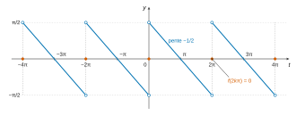
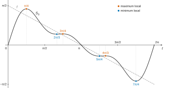
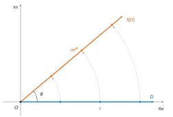
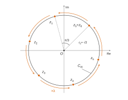

# ATS — Mathématiques 2026 · Corrigé brut

*Corrigé rédigé par IA, non officiel. Signalez toute erreur.*

Épreuve de 3 h, calculatrice interdite. Quatre exercices indépendants.

---

## Exercice 1

Notations : $f$ est $2\pi$-périodique et impaire, avec $f(t)=\frac{\pi-t}{2}$ sur $]0,\pi[$ et $f(0)=0$.

Coefficients de Fourier, avec la convention $S(t)=a_0+\sum_{k\ge1}(a_k\cos(kt)+b_k\sin(kt))$ :

$$\begin{aligned}
a_0&=\frac{1}{2\pi}\int_{-\pi}^{\pi}f(t)\,dt,\\
a_n&=\frac1\pi\int_{-\pi}^{\pi}f(t)\cos(nt)\,dt\quad(n\ge1),\\
b_n&=\frac1\pi\int_{-\pi}^{\pi}f(t)\sin(nt)\,dt\quad(n\ge1).
\end{aligned}$$

### Partie A — Calcul de la série de Fourier de $f$

**Question 1.** Pour $t\in\,]-\pi,0[$, on a $-t\in\,]0,\pi[$. Comme $f$ est impaire :

$$f(t)=-f(-t)=-\frac{\pi+t}{2}.$$

Pour $t\in\,]\pi,2\pi[$, on a $t-2\pi\in\,]-\pi,0[$, donc par périodicité :

$$\begin{aligned}
f(t)&=f(t-2\pi)\\
&=-\frac{\pi+t-2\pi}{2}\\
&=\frac{\pi-t}{2}.
\end{aligned}$$

Enfin $f(\pi)=f(-\pi)$ par périodicité et $f(-\pi)=-f(\pi)$ par imparité, donc $f(\pi)=0$, valeur égale à $\frac{\pi-\pi}{2}$.

$$\boxed{\begin{aligned}
f(t)&=\frac{\pi-t}{2}\ \text{pour } t\in\,]0,2\pi[,\\
f(2k\pi)&=0\ (k\in\mathbb{Z}).
\end{aligned}}$$



Graphe sur $[-4\pi,4\pi]$ : quatre segments de pente $-\frac12$, un par intervalle $]2k\pi,2(k+1)\pi[$.

Chaque segment coupe l'axe en $(2k+1)\pi$. En chaque $2k\pi$, la fonction saute de $-\frac\pi2$ à $\frac\pi2$ et vaut $0$.

| Intervalle | Expression de $f(t)$ | Limite à droite | Zéro | Limite à gauche |
|---|---|---|---|---|
| $]-4\pi,-2\pi[$ | $-\frac{3\pi+t}{2}$ | $\frac\pi2$ | $-3\pi$ | $-\frac\pi2$ |
| $]-2\pi,0[$ | $-\frac{\pi+t}{2}$ | $\frac\pi2$ | $-\pi$ | $-\frac\pi2$ |
| $]0,2\pi[$ | $\frac{\pi-t}{2}$ | $\frac\pi2$ | $\pi$ | $-\frac\pi2$ |
| $]2\pi,4\pi[$ | $\frac{3\pi-t}{2}$ | $\frac\pi2$ | $3\pi$ | $-\frac\pi2$ |

(« Limite à droite » : en la borne gauche de l'intervalle ; « limite à gauche » : en sa borne droite. En $-4\pi,-2\pi,0,2\pi,4\pi$, $f$ vaut $0$.)

Le graphe est symétrique par rapport à l'origine : le segment de $]-2\pi,0[$ est l'image de celui de $]0,2\pi[$ par $t\mapsto-t$, $y\mapsto-y$, ce qui traduit l'imparité.

**Question 2.** Pour $n\ge1$, $t\mapsto f(t)\cos(nt)$ est impaire (produit d'une fonction impaire et d'une fonction paire) et continue par morceaux.

Son intégrale sur le segment symétrique $[-\pi,\pi]$ est donc nulle : $a_n=0$.

Pour $n=0$, $f$ est elle-même impaire, donc $a_0=\frac1{2\pi}\int_{-\pi}^{\pi}f=0$.

$$\boxed{\forall n\in\mathbb{N},\ a_n=0.}$$

**Question 3(a).** Soit $n\ge1$. On intègre par parties avec $u=x$ et $v=-\frac{\cos(nx)}{n}$, fonctions $\mathcal{C}^1$ sur $[0,\pi]$ :

$$\begin{aligned}
\int_0^\pi x\sin(nx)\,dx&=\Big[-\frac{x\cos(nx)}{n}\Big]_0^\pi+\frac1n\int_0^\pi\cos(nx)\,dx\\
&=-\frac{\pi(-1)^n}{n}+\frac1{n^2}\big[\sin(nx)\big]_0^\pi\\
&=-\frac{\pi(-1)^n}{n}.
\end{aligned}$$

$$\boxed{\int_0^\pi x\sin(nx)\,dx=-\frac{\pi(-1)^n}{n}.}$$

**Question 3(b).** $t\mapsto f(t)\sin(nt)$ est paire (produit de deux fonctions impaires), donc :

$$\begin{aligned}
b_n&=\frac2\pi\int_0^\pi\frac{\pi-t}{2}\sin(nt)\,dt\\
&=\int_0^\pi\sin(nt)\,dt-\frac1\pi\int_0^\pi t\sin(nt)\,dt\\
&=\frac{1-(-1)^n}{n}+\frac{(-1)^n}{n}.
\end{aligned}$$

$$\boxed{\forall n\ge1,\ b_n=\frac1n.}$$

**Question 4.** *Théorème de Dirichlet.* Si $g$ est $2\pi$-périodique et de classe $\mathcal{C}^1$ par morceaux sur $\mathbb{R}$, sa série de Fourier converge en tout point $t$.

Sa somme vaut alors $\frac12\big(g(t^+)+g(t^-)\big)$ ; en particulier, elle vaut $g(t)$ en tout point de continuité.

*Hypothèses.* $f$ est $2\pi$-périodique. Sur $]0,2\pi[$, elle coïncide avec la fonction affine $t\mapsto\frac{\pi-t}{2}$.

Cette fonction affine se prolonge en une fonction $\mathcal{C}^1$ sur $[0,2\pi]$ : $f$ est donc $\mathcal{C}^1$ par morceaux.

*Points de continuité.* $f$ est continue sur $\mathbb{R}\setminus2\pi\mathbb{Z}$, donc $S(t)=f(t)$ en ces points.

*Points de discontinuité.* En $2k\pi$, la série converge vers la demi-somme des limites latérales :

$$\begin{aligned}
\frac12\big(f(0^+)+f(0^-)\big)&=\frac12\Big(\frac\pi2-\frac\pi2\Big)\\
&=0\\
&=f(2k\pi).
\end{aligned}$$

$$\boxed{\text{La série de Fourier de } f \text{ converge en tout point et } \forall t\in\mathbb{R},\ S(t)=f(t).}$$

Avec les questions 2 et 3 :

$$\boxed{\forall t\in\mathbb{R},\ \sum_{k=1}^{+\infty}\frac{\sin(kt)}{k}=f(t).}$$

**Question 5(a).** Si $k=2p$ avec $p\in\mathbb{N}^*$, alors $\sin\big(\frac{k\pi}2\big)=\sin(p\pi)=0$.

Si $k=2p+1$ avec $p\in\mathbb{N}$, alors $p=\frac{k-1}2$ et :

$$\begin{aligned}
\sin\Big(\frac{k\pi}2\Big)&=\sin\Big(p\pi+\frac\pi2\Big)\\
&=\cos(p\pi)\\
&=(-1)^p.
\end{aligned}$$

$$\boxed{\sin\Big(\frac{k\pi}{2}\Big)=\begin{cases}(-1)^{\frac{k-1}{2}}&\text{si } k \text{ impair},\\ 0&\text{si } k \text{ pair}.\end{cases}}$$

**Question 5(b).** On a $\frac\pi2\in\,]0,\pi[$, point de continuité de $f$. Par la question 4 :

$$\begin{aligned}
S\Big(\frac\pi2\Big)&=f\Big(\frac\pi2\Big)\\
&=\frac{\pi-\pi/2}{2}\\
&=\frac\pi4.
\end{aligned}$$

D'autre part $S\big(\frac\pi2\big)=\sum_{k\ge1}\frac{\sin(k\pi/2)}{k}$. D'après 5(a), les termes d'indice pair sont nuls.

La somme partielle d'indice $2P+1$ vaut donc $\sum_{p=0}^{P}\frac{(-1)^p}{2p+1}$. C'est une suite extraite de la suite des sommes partielles, qui converge vers $\frac\pi4$ : elle a la même limite.

$$\boxed{\begin{aligned}
S\Big(\frac\pi2\Big)&=\frac\pi4,\\
\sum_{p=0}^{+\infty}\frac{(-1)^p}{2p+1}&=\frac\pi4.
\end{aligned}}$$

**Question 6.** *Identité de Parseval.* Si $g$ est $2\pi$-périodique et continue par morceaux sur $\mathbb{R}$, de coefficients $a_0,a_n,b_n$ (convention ci-dessus), alors :

$$\frac1{2\pi}\int_{-\pi}^{\pi}g(t)^2\,dt=a_0^2+\frac12\sum_{n=1}^{+\infty}\big(a_n^2+b_n^2\big).$$

$f$ est $2\pi$-périodique et continue par morceaux : l'identité s'applique. Comme $f^2$ est paire :

$$\begin{aligned}
\frac1{2\pi}\int_{-\pi}^{\pi}f^2&=\frac1\pi\int_0^\pi\frac{(\pi-t)^2}{4}\,dt\\
&=\frac1{4\pi}\Big[-\frac{(\pi-t)^3}{3}\Big]_0^\pi\\
&=\frac{\pi^2}{12}.
\end{aligned}$$

Avec $a_0=a_n=0$ et $b_n=\frac1n$, le membre de droite vaut $\frac12\sum_{n\ge1}\frac1{n^2}$. On obtient :

$$\frac12\sum_{n=1}^{+\infty}\frac1{n^2}=\frac{\pi^2}{12}.$$

$$\boxed{\sum_{n=1}^{+\infty}\frac1{n^2}=\frac{\pi^2}6.}$$

**Question 7(a).** La fonction renvoie $\sum_{k=1}^n\frac1{k^2}$. Pour $n=3$ :

$$\begin{aligned}
f(3)&=1+\frac14+\frac19\\
&=\frac{36+9+4}{36}.
\end{aligned}$$

$$\boxed{f(3)=\frac{49}{36}.}$$

**Question 7(b).** La somme partielle croît vers $\frac{\pi^2}6$ (question 6). L'écart $\frac{\pi^2}6-\sum_{k=1}^n\frac1{k^2}$ décroît donc vers $0$, et la boucle s'arrête.

```python
from math import pi

def approx(eps):
    cible = pi**2 / 6
    n = 1
    S = 1.0                      # S = somme des 1/k^2 pour k = 1..n
    while abs(S - cible) > eps:
        n = n + 1
        S = S + 1 / (n * n)
    return n
```

Exemples : `approx(0.1)` renvoie $10$, `approx(0.001)` renvoie $1000$ (le reste est de l'ordre de $\frac1n$).

En flottants, la somme cesse de croître pour $n$ de l'ordre de $10^8$ : la fonction n'est utilisable que pour $\varepsilon$ pas trop petit (de l'ordre de $10^{-7}$ au mieux).

### Partie B — Extremum de $S_n$

D'après la partie A, $S_n(t)=\sum_{k=1}^n\frac{\sin(kt)}{k}$.

**Question 8.** $S_n$ est une somme finie de fonctions dérivables sur $\mathbb{R}$. Elle est donc dérivable, et sa dérivée est la somme des dérivées, avec $\big(\frac{\sin(kt)}k\big)'=\cos(kt)$.

$$\boxed{\forall t\in\mathbb{R},\ S_n'(t)=\sum_{k=1}^n\cos(kt).}$$

**Question 9(a).** On a $\cos(kt)=\operatorname{Re}(e^{ikt})$, et $\operatorname{Re}$ est additive :

$$\begin{aligned}
\sum_{k=1}^n\cos(kt)&=\sum_{k=1}^n\operatorname{Re}(e^{ikt})\\
&=\operatorname{Re}\Big(\sum_{k=1}^ne^{ikt}\Big).
\end{aligned}$$

**Question 9(b).** Pour $t\notin2\pi\mathbb{Z}$, $e^{it}\neq1$. On utilise la somme géométrique et la factorisation par l'angle moitié :

$$e^{i\alpha}-1=e^{i\alpha/2}\big(e^{i\alpha/2}-e^{-i\alpha/2}\big)=2i\,e^{i\alpha/2}\sin\frac\alpha2.$$

On obtient :

$$\begin{aligned}
\sum_{k=1}^ne^{ikt}&=e^{it}\,\frac{e^{int}-1}{e^{it}-1}\\
&=e^{it}\,\frac{e^{i\frac{nt}2}\cdot2i\sin\frac{nt}2}{e^{i\frac t2}\cdot2i\sin\frac t2}\\
&=e^{i(n+1)\frac t2}\,\frac{\sin\frac{nt}2}{\sin\frac t2}.
\end{aligned}$$

La division est licite car $\sin\frac t2\neq0$, puisque $\frac t2\notin\pi\mathbb{Z}$. Avec 9(a) :

$$\boxed{\sum_{k=1}^n\cos(kt)=\operatorname{Re}\Big(e^{i(n+1)\frac t2}\,\frac{\sin(\frac{nt}2)}{\sin(\frac t2)}\Big).}$$

**Question 9(c).** Le quotient $\frac{\sin(nt/2)}{\sin(t/2)}$ est réel : il sort de la partie réelle. De plus $\operatorname{Re}\big(e^{i(n+1)t/2}\big)=\cos\frac{(n+1)t}2$.

$$\boxed{\forall t\in\mathbb{R}\setminus2\pi\mathbb{Z},\ \sum_{k=1}^n\cos(kt)=\frac{\cos(\frac{(n+1)t}{2})\sin(\frac{nt}{2})}{\sin(\frac t2)}.}$$

**Question 10(a).** On utilise $\sin u=0\iff u\in\pi\mathbb{Z}$ :

$$\begin{aligned}
\sin\frac{nt}2=0&\iff\exists m\in\mathbb{Z},\ \frac{nt}2=m\pi\\
&\iff\exists m\in\mathbb{Z},\ t=\frac{2m\pi}n.
\end{aligned}$$

**Question 10(b).** On utilise $\cos u=0\iff u\in\frac\pi2+\pi\mathbb{Z}$ :

$$\begin{aligned}
\cos\frac{(n+1)t}2=0&\iff\exists m\in\mathbb{Z},\ \frac{(n+1)t}2=\frac\pi2+m\pi\\
&\iff\exists m\in\mathbb{Z},\ t=\frac{\pi(2m+1)}{n+1}.
\end{aligned}$$

**Question 10(c).** *Points de $2\pi\mathbb{Z}$.* Par la question 8, $S_n'(2j\pi)=\sum_{k=1}^n1=n\neq0$ : aucun n'est critique.

*Points de $\mathbb{R}\setminus2\pi\mathbb{Z}$.* Par 9(c), comme $\sin\frac t2\neq0$, $S_n'(t)=0$ si et seulement si $\sin\frac{nt}2=0$ ou $\cos\frac{(n+1)t}2=0$.

Il faut retirer des ensembles de 10(a) et 10(b) leurs éléments dans $2\pi\mathbb{Z}$ :
- $\frac{2m\pi}n\in2\pi\mathbb{Z}\iff\frac mn\in\mathbb{Z}\iff m\in n\mathbb{Z}$ ;
- $\frac{\pi(2m+1)}{n+1}=2j\pi$ imposerait $2m+1=2j(n+1)$, impair égal à pair : impossible.

$$\boxed{\{t\in\mathbb{R}\mid S_n'(t)=0\}=\Big\{\frac{2m\pi}n\ \Big|\ m\in\mathbb{Z}\setminus n\mathbb{Z}\Big\}\cup\Big\{\frac{\pi(2m+1)}{n+1}\ \Big|\ m\in\mathbb{Z}\Big\}.}$$

**Question 11.** *Première famille.* $0\le\frac{2m\pi}n<2\pi\iff0\le m<n$. La condition $m\notin n\mathbb{Z}$ retire $m=0$ seulement : $1\le m\le n-1$.

*Seconde famille.* Pour $m$ entier :

$$\begin{aligned}
0\le\frac{\pi(2m+1)}{n+1}<2\pi&\iff0\le2m+1<2n+2\\
&\iff-\frac12\le m<n+\frac12\\
&\iff0\le m\le n.
\end{aligned}$$

$$\boxed{\begin{aligned}
t_{1,m}&=\frac{2m\pi}n,\quad 1\le m\le n-1,\\
t_{2,m}&=\frac{\pi(2m+1)}{n+1},\quad 0\le m\le n.
\end{aligned}}$$

Remarque : l'égalité $\frac{2m}{n}=\frac{2m'+1}{n+1}$ donne $2m(n+1)=n(2m'+1)$.

Comme $n$ et $n+1$ sont premiers entre eux, $n\mid2m$ avec $0<2m<2n$, donc $2m=n$.

Les deux familles ne se rencontrent qu'en $\pi$, lorsque $n$ est pair ($m=m'=\frac n2$).

**Question 12.** Pour $n=3$ : $t_{1,1}=\frac{2\pi}3$ et $t_{1,2}=\frac{4\pi}3$. Puis $t_{2,m}=\frac{(2m+1)\pi}4$ pour $m=0,1,2,3$.

$$\boxed{\{t\in[0,2\pi[\ \mid S_3'(t)=0\}=\Big\{\frac{2\pi}3,\frac{4\pi}3,\frac\pi4,\frac{3\pi}4,\frac{5\pi}4,\frac{7\pi}4\Big\}.}$$



(La nature de chaque point, indiquée sur la figure, est établie aux questions 14 et 15.)

**Question 13(a).** On pose $A=\frac{nt}2$ et $B=\frac{(n+1)t}2$. Alors $A+B=\big(n+\frac12\big)t$ et $A-B=-\frac t2$, donc :

$$2\cos\frac{(n+1)t}2\,\sin\frac{nt}2=\sin\Big(\Big(n+\frac12\Big)t\Big)-\sin\frac t2.$$

On reporte dans 9(c), après avoir multiplié numérateur et dénominateur par $2$ :

$$\boxed{\forall t\in\mathbb{R}\setminus2\pi\mathbb{Z},\ S_n'(t)=\frac{\sin((n+\frac12)t)-\sin(\frac t2)}{2\sin(\frac t2)}.}$$

**Question 13(b).** $N$ et $D$ sont dérivables, et $D$ ne s'annule pas sur $\mathbb{R}\setminus2\pi\mathbb{Z}$. Sur cet ensemble :

$$S_n''=\frac{N'D-ND'}{D^2}.$$

Si $t$ est critique, $\frac{N(t)}{D(t)}=0$, donc $N(t)=0$, et :

$$\begin{aligned}
S_n''(t)&=\frac{N'(t)D(t)}{D(t)^2}\\
&=\frac{N'(t)}{D(t)}.
\end{aligned}$$

$$\boxed{S_n''(t)=\frac{N'(t)}{D(t)}.}$$

**Question 14(a).** (Le renvoi « question 6.(b) » de l'énoncé est lu comme 13.(b).) On dérive $N$ :

$$N'(t)=\Big(n+\frac12\Big)\cos\Big(\Big(n+\frac12\Big)t\Big)-\frac12\cos\frac t2.$$

Pour $t=t_{1,m}$ : $\big(n+\frac12\big)t_{1,m}=2m\pi+\frac{m\pi}n$ et $\frac{t_{1,m}}2=\frac{m\pi}n$. Par $2\pi$-périodicité du cosinus :

$$\begin{aligned}
N'(t_{1,m})&=\Big(n+\frac12\Big)\cos\frac{m\pi}n-\frac12\cos\frac{m\pi}n\\
&=n\cos\frac{m\pi}n,\\
D(t_{1,m})&=2\sin\frac{m\pi}n.
\end{aligned}$$

$t_{1,m}$ est un point critique hors de $2\pi\mathbb{Z}$, et 13(b) donne :

$$\boxed{S_n''(t_{1,m})=\frac n2\,\frac{\cos(\frac{m\pi}n)}{\sin(\frac{m\pi}n)}.}$$

**Question 14(b).** $1\le m\le n-1$ donne $\frac{m\pi}n\in\,]0,\pi[$, donc $\sin\frac{m\pi}n>0$.

Le signe de $S_n''(t_{1,m})$ est celui de $\cos\frac{m\pi}n$. Ce cosinus est strictement positif si et seulement si $\frac{m\pi}n<\frac\pi2$, c'est-à-dire $m<\frac n2$, et strictement négatif si et seulement si $m>\frac n2$.

$$\boxed{\begin{aligned}
S_n''(t_{1,m})&>0 \text{ si } m<\tfrac n2,\\
S_n''(t_{1,m})&<0 \text{ si } m>\tfrac n2.
\end{aligned}}$$

**Question 14(c).** En un point où $S_n'$ s'annule et $S_n''\neq0$, la formule de Taylor-Young à l'ordre 2 donne un minimum local strict si $S_n''>0$, un maximum local strict si $S_n''<0$.

$$\boxed{t_{1,m}\ \text{est un minimum local si } m<\tfrac n2,\ \text{un maximum local si } m>\tfrac n2.}$$

**Question 15(a).** On calcule :

$$\begin{aligned}
\Big(n+\frac12\Big)t_{2,m}&=\frac{(2n+1)\pi(2m+1)}{2(n+1)}\\
&=\pi(2m+1)\,\frac{2(n+1)-1}{2(n+1)}\\
&=\pi(2m+1)-\frac{\pi(2m+1)}{2(n+1)}.
\end{aligned}$$

Pour tout réel $x$, on a $\cos((2m+1)\pi)=-1$ et $\sin((2m+1)\pi)=0$, donc :

$$\begin{aligned}
\cos\big((2m+1)\pi-x\big)&=\cos((2m+1)\pi)\cos x+\sin((2m+1)\pi)\sin x\\
&=-\cos x.
\end{aligned}$$

$$\boxed{\cos\Big(\Big(n+\frac12\Big)t_{2,m}\Big)=-\cos\Big(\frac{\pi(2m+1)}{2(n+1)}\Big).}$$

**Question 15(b).** Posons $x_m=\frac{\pi(2m+1)}{2(n+1)}=\frac{t_{2,m}}2$. Par 15(a) :

$$\begin{aligned}
N'(t_{2,m})&=-\Big(n+\frac12\Big)\cos x_m-\frac12\cos x_m\\
&=-(n+1)\cos x_m.
\end{aligned}$$

$$\boxed{N'(t_{2,m})=-(n+1)\cos\Big(\frac{\pi(2m+1)}{2(n+1)}\Big).}$$

**Question 15(c).** $t_{2,m}\notin2\pi\mathbb{Z}$ (question 10(c)) et $D(t_{2,m})=2\sin x_m$. La question 13(b) donne :

$$\boxed{S_n''(t_{2,m})=-\frac{n+1}2\,\frac{\cos(\frac{\pi(2m+1)}{2(n+1)})}{\sin(\frac{\pi(2m+1)}{2(n+1)})}.}$$

**Question 15(d).** $0\le m\le n$ donne $1\le2m+1\le2n+1<2(n+1)$, donc $x_m\in\,]0,\pi[$ et $\sin x_m>0$.

Le signe de $S_n''(t_{2,m})$ est l'opposé de celui de $\cos x_m$. Or :

$$\begin{aligned}
\cos x_m>0&\iff x_m<\frac\pi2\\
&\iff2m+1<n+1\\
&\iff m<\frac n2,
\end{aligned}$$

et de même $\cos x_m<0\iff m>\frac n2$.

$$\boxed{\begin{aligned}
S_n''(t_{2,m})&<0 \text{ si } m<\tfrac n2,\\
S_n''(t_{2,m})&>0 \text{ si } m>\tfrac n2.
\end{aligned}}$$

**Question 15(e).** Par le même critère qu'en 14(c) :

$$\boxed{t_{2,m}\ \text{est un maximum local si } m<\tfrac n2,\ \text{un minimum local si } m>\tfrac n2.}$$

Ainsi, sur $]0,\pi[$, $S_n$ présente successivement un maximum en $t_{2,0}=\frac\pi{n+1}$, un minimum en $t_{1,1}=\frac{2\pi}n$, un maximum en $t_{2,1}$, etc.

---

## Exercice 2

$A=\begin{pmatrix}0&1&1\\1&0&1\\1&1&0\end{pmatrix}$.

### Partie A

**Question 1(a).** On pose $\chi_A(X)=\det(XI_3-A)$, polynôme de degré $3$. On ajoute les deux dernières colonnes à la première, on factorise $X-2$, puis on retranche la première ligne aux deux autres :

$$\begin{aligned}
\chi_A(X)&=\begin{vmatrix}X&-1&-1\\-1&X&-1\\-1&-1&X\end{vmatrix}\\
&=(X-2)\begin{vmatrix}1&-1&-1\\1&X&-1\\1&-1&X\end{vmatrix}\\
&=(X-2)\begin{vmatrix}1&-1&-1\\0&X+1&0\\0&0&X+1\end{vmatrix}\\
&=(X-2)(X+1)^2.
\end{aligned}$$

$$\boxed{\chi_A(X)=X^3-3X-2=(X-2)(X+1)^2.}$$

(Avec la convention $\det(A-XI_3)$, on obtient l'opposé $-X^3+3X+2$.)

**Question 1(b).** Les valeurs propres sont les racines de $\chi_A$, lues sur la forme factorisée ; la multiplicité est l'exposant du facteur.

$$\boxed{\begin{aligned}
\lambda_1&=-1\ \text{(multiplicité 2)},\\
\lambda_2&=2\ \text{(multiplicité 1)}.
\end{aligned}}$$

**Question 2(a).** On résout $(A-2I_3)X=0$ :

$$(x,y,z)\in E_2\iff\begin{cases}-2x+y+z=0\\x-2y+z=0\\x+y-2z=0\end{cases}$$

La différence des deux premières équations donne $x=y$, celle des deux dernières $y=z$. Réciproquement, $x=y=z$ vérifie le système.

$$\boxed{\begin{aligned}
E_{\lambda_2}=E_2&=\operatorname{Vect}\big((1,1,1)^T\big),\\
\dim E_2&=1.
\end{aligned}}$$

**Question 2(b).** $A+I_3$ a ses trois lignes égales à $(1\ 1\ 1)$. Donc $(x,y,z)\in E_{-1}\iff x+y+z=0$ : c'est un plan vectoriel.

En écrivant $x=-y-z$, on obtient $(x,y,z)=-y(1,-1,0)-z(1,0,-1)$, d'où une base :

$$\boxed{\begin{aligned}
E_{\lambda_1}=E_{-1}&=\operatorname{Vect}\big((1,-1,0)^T,(1,0,-1)^T\big),\\
\dim E_{-1}&=2.
\end{aligned}}$$

Les deux vecteurs sont dans $E_{-1}$ et non colinéaires ; on retrouve $\dim E_{-1}=3-\operatorname{rg}(A+I_3)=3-1=2$.

**Question 2(c).** La somme des dimensions des sous-espaces propres vaut $\dim E_{-1}+\dim E_2=2+1=3$, la taille de la matrice. Donc **$A$ est diagonalisable** :

$$\begin{aligned}
P&=\begin{pmatrix}1&1&1\\-1&0&1\\0&-1&1\end{pmatrix},\\
D&=\begin{pmatrix}-1&0&0\\0&-1&0\\0&0&2\end{pmatrix},\\
A&=PDP^{-1}.
\end{aligned}$$

**Question 3(a).** $B-I_3$ a des $0$ sur la diagonale et des $1$ ailleurs : $\boxed{A=B-I_3.}$

**Question 3(b).** $I_3$ commute avec toute matrice, donc $B$ et $I_3$ commutent, et $B$ et $-I_3$ aussi.

La formule du binôme de Newton s'applique donc dans $\mathcal{M}_3(\mathbb{R})$ : pour $n\in\mathbb{N}$,

$$\begin{aligned}
A^n&=(B+(-I_3))^n\\
&=\sum_{k=0}^n\binom nkB^k(-I_3)^{n-k},
\end{aligned}$$

et $(-I_3)^{n-k}=(-1)^{n-k}I_3$.

$$\boxed{A^n=\sum_{k=0}^n\binom nk(-1)^{n-k}B^k.}$$

**Question 3(c).** Chaque coefficient de $B^2$ vaut $1\cdot1+1\cdot1+1\cdot1=3$ : $B^2=3B$.

Montrons par récurrence sur $k\ge1$ la propriété $\mathcal{P}(k)$ : « $B^k=3^{k-1}B$ ».

*Initialisation.* Pour $k=1$, $B^1=B=3^0B$ : $\mathcal{P}(1)$ est vraie.

*Hérédité.* Soit $k\ge1$ tel que $\mathcal{P}(k)$ soit vraie. Alors :

$$\begin{aligned}
B^{k+1}&=B^k\,B=3^{k-1}B^2\\
&=3^{k-1}\cdot3B=3^kB,
\end{aligned}$$

donc $\mathcal{P}(k+1)$ est vraie.

*Conclusion.* Par récurrence, $\mathcal{P}(k)$ est vraie pour tout $k\ge1$.

$$\boxed{\begin{aligned}
B^2&=3B,\\
\forall k\in\mathbb{N}^*,\ B^k&=3^{k-1}B.
\end{aligned}}$$

**Question 3(d).** Pour $n\ge1$, on isole le terme $k=0$ de 3(b), égal à $(-1)^nI_3$ puisque $B^0=I_3$. On applique 3(c) aux autres termes :

$$\boxed{A^n=(-1)^nI_3+\Big(\sum_{k=1}^n\binom nk3^{k-1}(-1)^{n-k}\Big)B.}$$

**Question 3(e).** Binôme dans $\mathbb{R}$ :

$$\begin{aligned}
\sum_{k=0}^n\binom nk3^k(-1)^{n-k}&=(3-1)^n\\
&=2^n.
\end{aligned}$$

On retire le terme $k=0$, égal à $(-1)^n$, puis on divise par $3$ :

$$\boxed{\sum_{k=1}^n\binom nk3^{k-1}(-1)^{n-k}=\frac13\big(2^n-(-1)^n\big).}$$

**Question 3(f).** Pour $n\ge1$, les questions 3(d) et 3(e) donnent :

$$A^n=(-1)^nI_3+\frac{2^n-(-1)^n}3B.$$

Les coefficients diagonaux valent $(-1)^n+\frac{2^n-(-1)^n}3$, les autres $\frac{2^n-(-1)^n}3$.

Pour $n=0$, les formules ci-dessous donnent $a_0=1$ et $b_0=0$, soit $A^0=I_3$ : elles valent pour tout $n\in\mathbb{N}$.

$$\boxed{\begin{aligned}
A^n&=\begin{pmatrix}a_n&b_n&b_n\\b_n&a_n&b_n\\b_n&b_n&a_n\end{pmatrix},\\
a_n&=\frac{2^n+2(-1)^n}3,\\
b_n&=\frac{2^n-(-1)^n}3.
\end{aligned}}$$

Contrôle : $A^2=B^2-2B+I_3=B+I_3$, soit $a_2=2$ et $b_2=1$.

### Partie B

**Question 4.** On calcule le produit ligne par ligne :

$$\begin{aligned}
AX_n&=\begin{pmatrix}v_n+w_n\\u_n+w_n\\u_n+v_n\end{pmatrix}\\
&=\begin{pmatrix}u_{n+1}\\v_{n+1}\\w_{n+1}\end{pmatrix}.
\end{aligned}$$

$$\boxed{\forall n\in\mathbb{N},\ X_{n+1}=AX_n.}$$

**Question 5.** Montrons par récurrence sur $n\in\mathbb{N}$ la propriété « $X_n=A^nX_0$ ».

*Initialisation.* $A^0X_0=I_3X_0=X_0$.

*Hérédité.* Si $X_n=A^nX_0$ pour un $n\in\mathbb{N}$, alors, par la question 4, $X_{n+1}=AX_n=A^{n+1}X_0$.

*Conclusion.* La propriété est vraie pour tout $n\in\mathbb{N}$.

$$\boxed{\forall n\in\mathbb{N},\ X_n=A^nX_0.}$$

**Question 6.** Avec 3(f), chaque ligne de $A^n$ a pour somme $a_n+2b_n$, donc :

$$X_n=A^n\begin{pmatrix}1\\1\\1\end{pmatrix}=(a_n+2b_n)\begin{pmatrix}1\\1\\1\end{pmatrix}.$$

Et :

$$\begin{aligned}
a_n+2b_n&=\frac{2^n+2(-1)^n+2\cdot2^n-2(-1)^n}3\\
&=2^n.
\end{aligned}$$

$$\boxed{\begin{aligned}
X_n&=2^n\begin{pmatrix}1\\1\\1\end{pmatrix},\\
u_n=v_n=w_n&=2^n.
\end{aligned}}$$

(Contrôle : $X_0$ est vecteur propre de $A$ pour la valeur propre $2$, d'où $A^nX_0=2^nX_0$.)

---

## Exercice 3

$\lambda\in\mathbb{C}$, $|\lambda|=1$, $\lambda\neq1$, $f(z)=\lambda z$.

La suite est définie par $z_{n+1}=\lambda z_n$ et $z_0\in\mathbb{C}^*$.

### Partie A — Étude de la transformation

**Question 1.** Le module d'un produit est le produit des modules : $|f(z)|=|\lambda|\,|z|=|z|$.

**Question 2.** On regroupe dans un membre :

$$\begin{aligned}
f(z)=z&\iff(\lambda-1)z=0\\
&\iff z=0,
\end{aligned}$$

car $\lambda-1\neq0$. $\boxed{\text{L'unique solution est } z=0.}$

**Question 3.** Pour $z\neq0$, on écrit $z=|z|e^{i\varphi}$ avec $\varphi=\arg z$. Alors :

$$\begin{aligned}
f(z)&=e^{i\theta}\,|z|e^{i\varphi}\\
&=|z|e^{i(\varphi+\theta)},
\end{aligned}$$

avec $|z|>0$. C'est la forme exponentielle de $f(z)$, donc :

$$\boxed{\arg f(z)\equiv\arg z+\theta\pmod{2\pi}\qquad(z\neq0).}$$

($z=0$ n'a pas d'argument.)

**Question 4.** $D=\{r\mid r\in\mathbb{R}_+\}$, donc $f(D)=\{r\lambda\mid r\ge0\}=\{re^{i\theta}\mid r\ge0\}$.

$$\boxed{f(D)\ \text{est la demi-droite fermée d'origine } O \text{ dirigée par } e^{i\theta}.}$$



Chaque point $r\in D$ est envoyé sur le point de $f(D)$ situé à la même distance $r$ de $O$.

Ainsi $f$ est la rotation de centre $O$ et d'angle $\theta$.

### Partie B — Étude de la suite $(z_n)_{n\in\mathbb{N}}$

**Question 5.** Montrons par récurrence sur $n\in\mathbb{N}$ la propriété « $z_n=\lambda^nz_0$ ».

*Initialisation.* $\lambda^0z_0=z_0$.

*Hérédité.* Si $z_n=\lambda^nz_0$ pour un $n\in\mathbb{N}$, alors $z_{n+1}=\lambda z_n=\lambda^{n+1}z_0$.

*Conclusion.* $\boxed{\forall n\in\mathbb{N},\ z_n=\lambda^nz_0.}$

**Question 6.** $|z_n|=|\lambda|^n|z_0|=|z_0|$.

**Question 7.** La distance de $O$ au point d'affixe $z_n$ est $|z_n-0|=|z_0|$, avec $|z_0|>0$.

**Le point d'affixe $z_n$ appartient donc au cercle de centre $O$ et de rayon $|z_0|$.**

**Question 8(a).** On écrit $\frac\theta{2\pi}=\frac ap$ avec $a\in\mathbb{Z}$ et $p\in\mathbb{N}^*$ (on choisit le dénominateur positif). Alors :

$$\begin{aligned}
\lambda^p&=e^{ip\theta}\\
&=e^{2ia\pi}=1.
\end{aligned}$$

$$\boxed{\exists p\ge1,\ \lambda^p=1.}$$

**Question 8(b).** Pour tout $n$, $z_{n+p}=\lambda^p\lambda^nz_0=z_n$.

$$\boxed{(z_n) \text{ est périodique, de période } p.}$$

**Question 9.** Supposons $(z_n)$ périodique de période $p\ge1$, avec $z_0\neq0$. Alors $z_p=z_0$, soit $(\lambda^p-1)z_0=0$, donc $\lambda^p=1$.

Ainsi $e^{ip\theta}=1$ : il existe $k\in\mathbb{Z}$ tel que $p\theta=2k\pi$, et $\frac\theta{2\pi}=\frac kp\in\mathbb{Q}$, ce qui contredit l'hypothèse.

**$(z_n)$ n'est pas périodique** (si $z_0=0$, la suite serait nulle donc périodique).

### Partie C — Application numérique

$z_0=1+i$, $\lambda\in\mathbb{U}_N$.

**Question 10.** $\boxed{r_0=|1+i|=\sqrt2}$, et $z_0=\sqrt2\,e^{i\pi/4}$.

**Question 11.** On écrit $\lambda=e^{i\theta}$, ce qui est possible car $|\lambda|=1$. Alors $\lambda^N=1$ s'écrit $e^{iN\theta}=1$, soit $N\theta\in2\pi\mathbb{Z}$.

$$\boxed{\begin{aligned}
\lambda&=e^{\frac{2ik\pi}{N}}\\
&=\cos\frac{2k\pi}N+i\sin\frac{2k\pi}N,\quad k\in\{0,\dots,N-1\}.
\end{aligned}}$$

L'hypothèse $\lambda\neq1$ impose $k\neq0$ (donc $N\ge2$). En particulier, $\frac\theta{2\pi}=\frac kN\in\mathbb{Q}$.

**Question 12.** $\lambda^N=1$, donc pour tout $n$, $z_{n+N}=\lambda^N\lambda^nz_0=z_n$.

$$\boxed{(z_n) \text{ est périodique, } N \text{ est une période.}}$$

(La plus petite période est $\frac N{\gcd(k,N)}$.)



**Question 13.** *Inclusion directe.* Si $\mu\in\mathbb{U}_N$, alors $(\lambda\mu)^N=\lambda^N\mu^N=1$, donc $f(\mathbb{U}_N)\subset\mathbb{U}_N$.

*Inclusion réciproque.* Si $\nu\in\mathbb{U}_N$, le complexe $\mu=\lambda^{-1}\nu$ vérifie $\mu^N=\frac{\nu^N}{\lambda^N}=1$ et $f(\mu)=\nu$. Donc $\mathbb{U}_N\subset f(\mathbb{U}_N)$.

$$\boxed{f(\mathbb{U}_N)=\mathbb{U}_N.}$$

**Question 14.** $\lambda=e^{i\theta}$ avec $\theta=2\sqrt2\pi$ ; on a $|\lambda|=1$ et $\lambda\neq1$.

De plus $\frac\theta{2\pi}=\sqrt2\notin\mathbb{Q}$ : si $\sqrt2=\frac ab$ sous forme irréductible, $a^2=2b^2$ rend $a$ pair, puis $b$ pair.

Comme $z_0=1+i\neq0$, la question 9 s'applique : $\boxed{(z_n) \text{ n'est pas périodique.}}$

**Question 15.** *Existence.* Les $z_n$ sont deux à deux distincts : $z_n=z_m$ avec $n<m$ donnerait $\lambda^{m-n}=1$, donc $\frac\theta{2\pi}\in\mathbb{Q}$.

Découpons $C_{r_0}$ en $K$ arcs de corde inférieure à $\varepsilon$.

Parmi $z_0,\dots,z_K$, deux points $z_n,z_m$ ($n<m$) tombent dans le même arc. Avec $q=m-n\ge1$ :

$$0<r_0|\lambda^q-1|=|z_m-z_n|<\varepsilon.$$

Les points $z_{jq}=(\lambda^q)^jz_0$, $j\in\mathbb{N}$, parcourent alors le cercle dans un sens fixé, par pas de corde $r_0|\lambda^q-1|<\varepsilon$, et en font le tour.

Tout $z\in C_{r_0}$ est donc à distance $<\varepsilon$ de l'un d'eux. L'ensemble $\{n\in\mathbb{N}\mid|z_n-z|<\varepsilon\}$ est non vide et admet un plus petit élément.

*Algorithme* ($\theta$ est passé en paramètre) :

```python
import cmath

def premier_indice(eps, z, theta):
    lam = cmath.exp(1j * theta)   # lambda = e^{i theta}
    n = 0
    zn = 1 + 1j                   # z_0
    while abs(zn - z) >= eps:
        n = n + 1
        zn = lam * zn             # z_{n} = lambda * z_{n-1}
    print(n)
    return n
```

La boucle s'arrête au premier $n$ tel que $|z_n-z|<\varepsilon$, qui est affiché.

---

## Exercice 4

### Partie A — Étude de la convergence de la suite $(a_n)_{n\in\mathbb{N}^*}$

**Question 1(a).** Pour tout $n\ge1$, $a_{n+1}-a_n=\frac1{(n+1)!}>0$.

$$\boxed{(a_n) \text{ est strictement croissante.}}$$

**Question 1(b).** Soit $n\ge1$. Avec $(n+1)!=(n+1)\,n!$, on réduit au dénominateur commun $n(n+1)^2n!$ :

$$\begin{aligned}
b_{n+1}-b_n&=\frac1{(n+1)!}+\frac1{(n+1)(n+1)!}-\frac1{n\,n!}\\
&=\frac{n(n+1)+n-(n+1)^2}{n(n+1)^2\,n!}\\
&=\frac{-1}{n(n+1)^2\,n!}<0.
\end{aligned}$$

$$\boxed{(b_n) \text{ est strictement décroissante.}}$$

**Question 1(c).** Les trois conditions de la définition sont vérifiées : $(a_n)$ est croissante, $(b_n)$ est décroissante, et $b_n-a_n=\frac1{n\,n!}\to0$.

$$\boxed{(a_n) \text{ et } (b_n) \text{ sont adjacentes.}}$$

**Question 1(d).** Par le théorème des suites adjacentes, $(a_n)$ et $(b_n)$ convergent vers une même limite $\ell\in\mathbb{R}$.

Les monotonies étant strictes, $a_n<\ell<b_n$ pour tout $n\ge1$.

**Question 2(a).** $t\mapsto e^{-t}$ est décroissante, donc $e^{-1}\le e^{-t}\le1$ sur $[0,1]$.

On multiplie par $t^n\ge0$ et on intègre sur $[0,1]$ (croissance de l'intégrale, bornes dans l'ordre croissant), avec $\int_0^1t^n\,dt=\frac1{n+1}$ :

$$\boxed{\forall n\in\mathbb{N},\ \frac1{e(n+1)}\le f_n\le\frac1{n+1}.}$$

**Question 2(b).** Par 2(a), $0\le\frac{f_n}{n!}\le\frac1{(n+1)!}$, et $\frac1{(n+1)!}\to0$.

Par encadrement, $\frac{f_n}{n!}\to0$, donc $\boxed{\varphi_n\to e.}$

**Question 3(a).** $f_0=\int_0^1e^{-t}\,dt=1-e^{-1}$. Puis :

$$\begin{aligned}
\varphi_0&=e\big(1-(1-e^{-1})\big)\\
&=1.
\end{aligned}$$

$$\boxed{\begin{aligned}
f_0&=1-\frac1e,\\
\varphi_0&=1.
\end{aligned}}$$

**Question 3(b).** On intègre par parties avec $u=t^{n+1}$ et $v=-e^{-t}$, fonctions $\mathcal{C}^1$ sur $[0,1]$ :

$$\begin{aligned}
f_{n+1}&=\big[-t^{n+1}e^{-t}\big]_0^1+(n+1)\int_0^1t^ne^{-t}\,dt\\
&=-\frac1e+(n+1)f_n.
\end{aligned}$$

$$\boxed{f_{n+1}=(n+1)f_n-\frac1e.}$$

**Question 3(c).** On divise 3(b) par $(n+1)!=(n+1)\,n!$ :

$$\begin{aligned}
\frac{f_{n+1}}{(n+1)!}&=\frac{(n+1)f_n-e^{-1}}{(n+1)\,n!}\\
&=\frac{f_n}{n!}-\frac{e^{-1}}{(n+1)!}.
\end{aligned}$$

On reporte dans la définition de $\varphi_{n+1}$ :

$$\begin{aligned}
\varphi_{n+1}&=e\Big(1-\frac{f_n}{n!}\Big)+\frac{e\cdot e^{-1}}{(n+1)!}\\
&=\varphi_n+\frac1{(n+1)!}.
\end{aligned}$$

$$\boxed{\varphi_{n+1}=\varphi_n+\frac1{(n+1)!}.}$$

**Question 3(d).** Par définition, $a_{n+1}=a_n+\frac1{(n+1)!}$.

(Lecture retenue de l'énoncé : « en déduire que, pour tout entier naturel non nul, $\varphi_n=a_n$ ».) Montrons par récurrence sur $n\ge1$ la propriété « $\varphi_n=a_n$ ».

*Initialisation.* Par 3(a) et 3(c), $\varphi_1=\varphi_0+\frac1{1!}=2$, et $a_1=1+1=2$.

*Hérédité.* Si $\varphi_n=a_n$ pour un $n\ge1$, alors $\varphi_{n+1}=a_n+\frac1{(n+1)!}=a_{n+1}$.

*Conclusion.* $\boxed{\forall n\ge1,\ \varphi_n=a_n.}$

**Question 3(e).** $a_n=\varphi_n\to e$ (question 2(b)). Par unicité de la limite :

$$\boxed{\begin{aligned}
\ell&=e,\\
\sum_{k=0}^{+\infty}\frac1{k!}&=e.
\end{aligned}}$$

### Partie B — Étude de la convergence de la suite $(c_n)_{n\in\mathbb{N}^*}$

**Question 1.** $c_n=e^{n\ln(1+1/n)}$. On pose $x=\frac1n$, qui tend vers $0$ : le développement limité de $\ln(1+x)$ en $0$ s'applique.

$$\ln(1+x)=x-\frac{x^2}2+o(x^2).$$

En multipliant par $n$ :

$$\begin{aligned}
n\ln\Big(1+\frac1n\Big)&=n\Big(\frac1n-\frac1{2n^2}+o\Big(\frac1{n^2}\Big)\Big)\\
&=1-\frac1{2n}+o\Big(\frac1n\Big).
\end{aligned}$$

L'exposant tend vers $1$, et non vers $0$ : on ne peut pas composer directement avec le développement de l'exponentielle en $0$.

On factorise donc $e^1$ : $c_n=e\cdot e^{u_n}$ avec $u_n=-\frac1{2n}+o\big(\frac1n\big)$. Comme $u_n\to0$, on peut utiliser $e^u=1+u+o(u)$ au voisinage de $0$ :

$$\begin{aligned}
c_n&=e\cdot e^{u_n}\\
&=e\Big(1-\frac1{2n}+o\Big(\frac1n\Big)\Big).
\end{aligned}$$

$$\boxed{c_n=e-\frac e{2n}+o\Big(\frac1n\Big).}$$

**Question 2.** $\frac e{2n}\to0$ et $o\big(\frac1n\big)\to0$ : $\boxed{(c_n) \text{ converge vers } e.}$

### Partie C — Étude de la vitesse de convergence des suites $(a_n)$ et $(c_n)$

**Question 1(a).** Par 1(d) et 3(e) de la partie A, $a_{n+1}<e<b_n$. Donc :

$$\begin{aligned}
e-a_n&<b_n-a_n=\frac1{n\,n!},\\
e-a_n&>a_{n+1}-a_n=\frac1{(n+1)!}.
\end{aligned}$$

$$\boxed{\forall n\ge1,\ \frac1{(n+1)!}\le e-a_n\le\frac1{n\cdot n!}.}$$

**Question 1(b).** $e-a_n>0$, donc $(a_n)$ ne prend pas la valeur $e$.

On majore le numérateur par 1(a) au rang $n+1$, et on minore le dénominateur par 1(a) au rang $n$ :

$$\begin{aligned}
0<\frac{|a_{n+1}-e|}{|a_n-e|}&=\frac{e-a_{n+1}}{e-a_n}\\
&\le\frac{1/\big((n+1)(n+1)!\big)}{1/(n+1)!}\\
&=\frac1{n+1}.
\end{aligned}$$

Comme $\frac1{n+1}\to0$, l'encadrement donne $\beta=0$ : $\boxed{\text{la convergence de } (a_n) \text{ vers } e \text{ est rapide.}}$

**Question 2(a).** Par B.1, $c_n-e=-\frac e{2n}+o\big(\frac1n\big)$, avec $\frac e{2n}\neq0$ :

$$\boxed{c_n-e\underset{n\to+\infty}{\sim}-\frac e{2n}.}$$

**Question 2(b).** Pour $x>0$, $\ln(1+x)<x$ : la fonction $x\mapsto x-\ln(1+x)$ est nulle en $0$ et de dérivée $\frac x{1+x}>0$.

Donc $n\ln(1+\frac1n)<1$ et $c_n<e$ pour tout $n\ge1$ : $(c_n)$ ne prend pas la valeur $e$.

Par 2(a), $|c_n-e|\sim\frac e{2n}$ et $|c_{n+1}-e|\sim\frac e{2(n+1)}$, donc :

$$\begin{aligned}
\frac{|c_{n+1}-e|}{|c_n-e|}&\sim\frac{e/(2(n+1))}{e/(2n)}\\
&=\frac n{n+1}\to1.
\end{aligned}$$

$\beta=1$ : $\boxed{\text{la convergence de } (c_n) \text{ vers } e \text{ est lente.}}$
