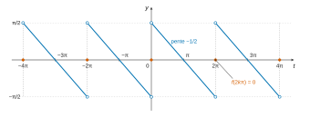
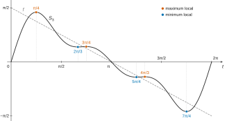
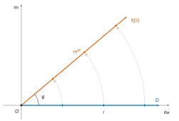
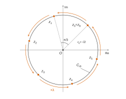

# ATS — Mathématiques 2026 · Corrigé guidé

*Corrigé rédigé par IA, non officiel. Signalez toute erreur.*

## Présentation du sujet

**Format.** Épreuve de 3 heures, **calculatrice interdite**, sans document. Quatre exercices totalement indépendants, 76 questions élémentaires en comptant chaque sous-question.

**Exercice 1 — Série de Fourier d'une dent de scie (29 questions).**
- *Partie A (questions 1 à 7)* : tracé de la fonction, calcul des coefficients de Fourier (parité, intégration par parties), théorème de Dirichlet. On en déduit deux sommes classiques : $\sum\frac{(-1)^p}{2p+1}=\frac\pi4$ par évaluation en $\frac\pi2$, et $\sum\frac1{n^2}=\frac{\pi^2}6$ par Parseval. Un petit volet algorithmique conclut.
- *Partie B (questions 8 à 15)* : étude des points critiques de la somme partielle $S_n(t)=\sum_{k=1}^n\frac{\sin(kt)}k$. On calcule $S_n'$ comme somme géométrique complexe, on résout $S_n'(t)=0$, puis on classe chaque point critique par le signe de $S_n''$. C'est la partie la plus longue et la plus technique, mais elle est très guidée.

**Exercice 2 — Puissances d'une matrice (14 questions).** Réduction de $A=J-I_3$ ($J$ = matrice dont tous les coefficients valent $1$), calcul de $A^n$ par le binôme de Newton, application à un système de trois suites récurrentes.

**Exercice 3 — Rotation dans le plan complexe (16 questions).** Étude de $z\mapsto\lambda z$ avec $|\lambda|=1$ : module, argument, image d'une demi-droite. Puis périodicité de la suite $z_n=\lambda^nz_0$ selon que $\frac\theta{2\pi}$ est rationnel ou non. La partie C fait intervenir les racines $N$-ièmes de l'unité et un algorithme.

**Exercice 4 — Deux approximations de $e$ (17 questions).** Suites adjacentes $a_n=\sum_{k\le n}\frac1{k!}$ et $b_n$, identification de la limite par les intégrales $\int_0^1t^ne^{-t}\,dt$. Puis développement limité de $(1+\frac1n)^n$ et comparaison des vitesses de convergence.

**Notions du programme mobilisées.** Séries de Fourier (coefficients, Dirichlet, Parseval) ; nombres complexes (exponentielle, somme géométrique, racines de l'unité) ; trigonométrie ; dérivation, critère de la dérivée seconde ; réduction des matrices (polynôme caractéristique, sous-espaces propres, critère de diagonalisabilité) ; binôme de Newton dans $\mathcal{M}_n(\mathbb{R})$ ; suites adjacentes, intégration par parties, encadrement d'intégrales ; développements limités, équivalents ; algorithmique élémentaire (boucle « tant que »).

**Difficulté et gestion du temps.** Le sujet est long mais sans question vraiment difficile. Les exercices 2, 3 (parties A et B) et 4 (partie A) contiennent beaucoup de questions courtes et sûres à ne pas laisser passer : 2.1 à 2.6, 3.1 à 3.10, 4.A.1, 4.A.3(a)-(b).

Le passage le plus exigeant est l'exercice 1 partie B, où chaque question s'appuie sur la précédente ; un candidat bloqué peut admettre les formules données par l'énoncé et poursuivre. Un partage raisonnable : environ 70 minutes pour l'exercice 1, 35 pour l'exercice 2, 35 pour l'exercice 3, 40 pour l'exercice 4.

**Ce qu'en dit le jury (rapport 2026).** Le rapport ne donne ni statistique ni barème. Il indique que peu de candidats ont traité intégralement l'un des quatre exercices.

Les exercices 1 et 2 ont été les plus traités, sans être menés au bout. L'exercice 3, pourtant le plus élémentaire, a été « Étonnamment peu traité », et l'exercice 4 moins que les deux premiers.

Le jury relève aussi que certains candidats sautent d'un exercice à l'autre question par question : mieux vaut traiter un exercice dans l'ordre, puis passer au suivant.

Les points où le rapport voit des copies perdre des points, donc ceux qui ont fait la différence :
- le tracé de la question 1.1 (fonction impaire) ;
- l'application de Dirichlet et de Parseval aux sommes numériques (1.4 à 1.6), et la convergence aux points de discontinuité ;
- en exercice 2, le polynôme caractéristique, les bases des sous-espaces propres, la confusion inversible/diagonalisable, la commutation avant le binôme et la rédaction des récurrences ;
- en exercice 3, module, argument, formes trigonométrique et exponentielle ;
- en exercice 4, l'application du théorème des suites adjacentes, la monotonie prouvée pour tout $n$ et les développements limités composés au voisinage de $0$.

**Deux coquilles d'énoncé** à signaler sur la copie :
- en 1.14(a) et 1.15(c), le renvoi « question 6.(b) » désigne en fait la question **13.(b)** ;
- en 4.A.3(d), la phrase « En déduire que les suites pour tout entier naturel non nul, $\varphi_n=a_n$ » se lit « En déduire que, pour tout entier naturel non nul, $\varphi_n=a_n$ ».

## Exercice 1 — Partie A : calcul de la série de Fourier de $f$

On identifie la fonction sur une période complète, on calcule ses coefficients par parité et intégration par parties. Puis on exploite les deux grands théorèmes (Dirichlet, Parseval) pour obtenir des sommes de séries numériques.

Convention utilisée (celle de l'énoncé, où le terme constant s'écrit $a_0$) :

$$\begin{aligned}
a_0&=\frac1{2\pi}\int_{-\pi}^{\pi}f,\\
a_n&=\frac1\pi\int_{-\pi}^{\pi}f(t)\cos(nt)\,dt,\\
b_n&=\frac1\pi\int_{-\pi}^{\pi}f(t)\sin(nt)\,dt.
\end{aligned}$$

### Question 1

> [!INDICATION]
> L'énoncé ne donne $f$ que sur $]0,\pi[$ et en $0$. Utilisez l'imparité pour obtenir $f$ sur $]-\pi,0[$, puis la périodicité.

> [!INDICATION]
> Calculez l'expression de $f$ sur $]\pi,2\pi[$ en passant par $t-2\pi$ : vous constaterez qu'une seule formule suffit sur tout $]0,2\pi[$. Que vaut $f(\pi)$ ?

#### Solution

Pour $t\in\,]-\pi,0[$, l'imparité donne $f(t)=-f(-t)=-\frac{\pi+t}2$.

Pour $t\in\,]\pi,2\pi[$, la périodicité donne :

$$\begin{aligned}
f(t)&=f(t-2\pi)\\
&=-\frac{\pi+t-2\pi}2\\
&=\frac{\pi-t}2.
\end{aligned}$$

Enfin $f(\pi)=f(-\pi)=-f(\pi)$ donne $f(\pi)=0=\frac{\pi-\pi}2$ : $f$ est continue en $\pi$.

$$\boxed{\begin{aligned}
f(t)&=\frac{\pi-t}2\ \text{sur } ]0,2\pi[,\\
f(2k\pi)&=0.
\end{aligned}}$$



Le graphe sur $[-4\pi,4\pi]$ est formé de quatre segments parallèles de pente $-\frac12$, un sur chaque intervalle $]2k\pi,2(k+1)\pi[$ ($k=-2,-1,0,1$).

Chacun coupe l'axe des abscisses en $(2k+1)\pi$. En $-4\pi,-2\pi,0,2\pi,4\pi$, la fonction vaut $0$ : point isolé au milieu du saut.

> [!PIEGE]
> Recopier la formule $\frac{\pi-t}2$ par simple symétrie autour de l'axe des ordonnées donne une fonction paire (un graphe « en toit »), incompatible avec l'imparité. Contrôle : le graphe doit être symétrique par rapport à l'origine. Sur la figure, on marque les extrémités exclues par des cercles vides et la valeur $0$ en $2k\pi$ par un point plein.

> [!JURY]
> Rapport 2026 : « Peu de candidats ont tracé correctement la courbe ; parfois, la fonction représentée n’est pas impaire. » Une question de cours rapide sur le papier, mais qui coûte cher si l'on va trop vite : tracez au moins deux périodes complètes et vérifiez la symétrie centrale.

### Question 2

> [!INDICATION]
> Quelle est la parité de $t\mapsto f(t)\cos(nt)$ ?

> [!INDICATION]
> N'oubliez pas $n=0$ : $a_0$ a une formule propre.

#### Solution

Pour $n\ge1$, $t\mapsto f(t)\cos(nt)$ est impaire (impaire × paire) et continue par morceaux. Son intégrale sur $[-\pi,\pi]$ est donc nulle : $a_n=0$.

Pour $n=0$, $a_0=\frac1{2\pi}\int_{-\pi}^{\pi}f=0$ car $f$ est impaire.

$$\boxed{\forall n\in\mathbb{N},\ a_n=0.}$$

> [!METHODE]
> Fonction impaire : tous les $a_n$ sont nuls ; fonction paire : tous les $b_n$ sont nuls. On l'écrit en une ligne, mais en nommant la parité de l'intégrande et la symétrie de l'intervalle.

### Question 3(a)

> [!INDICATION]
> Intégration par parties : dérivez $x$, primitivez $\sin(nx)$.

#### Solution

Les fonctions $x\mapsto x$ et $x\mapsto-\frac{\cos(nx)}n$ sont $\mathcal{C}^1$ sur $[0,\pi]$ :

$$\begin{aligned}
\int_0^\pi x\sin(nx)\,dx&=\Big[-\frac{x\cos(nx)}n\Big]_0^\pi+\frac1n\int_0^\pi\cos(nx)\,dx\\
&=-\frac{\pi\cos(n\pi)}n+\frac1{n^2}\big[\sin(nx)\big]_0^\pi.
\end{aligned}$$

Avec $\cos(n\pi)=(-1)^n$ et $\sin(n\pi)=0$ :

$$\boxed{\int_0^\pi x\sin(nx)\,dx=-\frac{\pi(-1)^n}n.}$$

### Question 3(b)

> [!INDICATION]
> L'intégrande $f(t)\sin(nt)$ est paire : ramenez $b_n$ à une intégrale sur $[0,\pi]$, où l'expression de $f$ est connue.

> [!INDICATION]
> Développez $\frac{\pi-t}2\sin(nt)$ en deux morceaux ; l'un est élémentaire, l'autre est le résultat de (a).

#### Solution

$$\begin{aligned}
b_n&=\frac2\pi\int_0^\pi\frac{\pi-t}2\sin(nt)\,dt\\
&=\int_0^\pi\sin(nt)\,dt-\frac1\pi\int_0^\pi t\sin(nt)\,dt\\
&=\frac{1-(-1)^n}n+\frac{(-1)^n}n.
\end{aligned}$$

$$\boxed{\forall n\ge1,\ b_n=\frac1n.}$$

> [!PIEGE]
> Une erreur de signe dans l'un des deux morceaux donne un résultat de la forme $\frac{1-2(-1)^n}n$, plausible mais faux. Vérification rapide : $b_1=\frac2\pi\int_0^\pi\frac{\pi-t}2\sin t\,dt=1$.

### Question 4

> [!INDICATION]
> Le théorème attendu est celui de Dirichlet (convergence ponctuelle). Énoncez-le avec ses hypothèses, puis vérifiez-les pour $f$.

> [!INDICATION]
> Distinguez les points de continuité et les points de $2\pi\mathbb{Z}$ ; c'est pour ces derniers que la convention $f(0)=0$ a été posée.

#### Solution

*Théorème de Dirichlet.* Si $g$ est $2\pi$-périodique et $\mathcal{C}^1$ par morceaux, sa série de Fourier converge en tout point $t$ vers $\frac12\big(g(t^+)+g(t^-)\big)$, donc vers $g(t)$ en tout point de continuité.

*Hypothèses.* $f$ est $2\pi$-périodique ; sur $]0,2\pi[$ elle coïncide avec une fonction affine, prolongeable en fonction $\mathcal{C}^1$ sur $[0,2\pi]$. Elle est donc $\mathcal{C}^1$ par morceaux.

*Points de continuité.* Sur $\mathbb{R}\setminus2\pi\mathbb{Z}$, $f$ est continue, donc $S(t)=f(t)$.

*Points de discontinuité.* En $2k\pi$, la somme est la demi-somme des limites latérales :

$$\begin{aligned}
\frac12\big(f(0^+)+f(0^-)\big)&=\frac12\Big(\frac\pi2-\frac\pi2\Big)\\
&=0=f(2k\pi).
\end{aligned}$$

$$\boxed{\begin{aligned}
\forall t\in\mathbb{R},\ S(t)&=\sum_{k=1}^{+\infty}\frac{\sin(kt)}k\\
&=f(t).
\end{aligned}}$$

> [!PIEGE]
> En un point de discontinuité, la série de Fourier ne converge pas « vers $f$ » en général, mais vers la demi-somme des limites à gauche et à droite. Ici elle vaut $0$ en $2k\pi$, qui se trouve être la valeur posée par l'énoncé : il faut le calculer, pas l'affirmer.

> [!PIEGE]
> Le théorème de convergence normale exige une fonction **continue** et $\mathcal{C}^1$ par morceaux : il ne s'applique pas ici (d'ailleurs $\sum\frac1k$ diverge, la convergence n'est pas normale). C'est le théorème de Dirichlet qu'il faut citer.

> [!JURY]
> Rapport 2026 : les théorèmes de Dirichlet et de Parseval sont en général bien énoncés, mais « la convergence aux points de discontinuité est parfois mal comprise ». Énoncé complet, vérification de chaque hypothèse, puis traitement séparé des points $2k\pi$.

### Question 5(a)

> [!INDICATION]
> Séparez les cas $k=2p$ et $k=2p+1$.

#### Solution

Si $k=2p$ ($p\ge1$) : $\sin\frac{k\pi}2=\sin(p\pi)=0$.

Si $k=2p+1$ ($p\ge0$), avec $p=\frac{k-1}2$ :

$$\begin{aligned}
\sin\Big(p\pi+\frac\pi2\Big)&=\cos(p\pi)\\
&=(-1)^p.
\end{aligned}$$

$$\boxed{\sin\Big(\frac{k\pi}2\Big)=\begin{cases}(-1)^{\frac{k-1}2}&k\text{ impair}\\0&k\text{ pair}\end{cases}}$$

### Question 5(b)

> [!INDICATION]
> Évaluez la relation $S=f$ de la question 4 en un point bien choisi, où $f$ est continue.

> [!INDICATION]
> Avec (a), seuls les termes d'indice impair subsistent. Justifiez en une phrase le passage de la somme sur $k$ à la somme sur $p$.

#### Solution

$\frac\pi2\in\,]0,\pi[$ est un point de continuité, donc $S\big(\frac\pi2\big)=f\big(\frac\pi2\big)=\frac\pi4$.

D'autre part $S\big(\frac\pi2\big)=\sum_k\frac{\sin(k\pi/2)}k$, et les termes d'indice pair sont nuls. La somme partielle d'indice $2P+1$ vaut donc $\sum_{p=0}^P\frac{(-1)^p}{2p+1}$.

Ces sommes partielles forment une suite extraite d'une suite convergente : elles ont la même limite.

$$\boxed{\begin{aligned}
S\Big(\frac\pi2\Big)&=\frac\pi4,\\
\sum_{p=0}^{+\infty}\frac{(-1)^p}{2p+1}&=\frac\pi4.
\end{aligned}}$$

> [!JURY]
> Rapport 2026 : les deux théorèmes sont en général correctement énoncés, « mais leur application pour la détermination des séries numériques n'était pas correctement faite dans certains cas, ce qui n'a pas permis d'aboutir aux résultats des sommes attendues. » Écrivez explicitement la relation $S\big(\frac\pi2\big)=f\big(\frac\pi2\big)$, puis le terme général après simplification par 5(a).

### Question 6

> [!INDICATION]
> Écrivez l'identité de Parseval avec la convention de l'énoncé (terme constant noté $a_0$, sans facteur $\frac12$).

> [!INDICATION]
> Le membre de gauche demande $\int_{-\pi}^\pi f^2$ : utilisez la parité de $f^2$.

#### Solution

*Parseval.* Si $g$ est $2\pi$-périodique et continue par morceaux :

$$\frac1{2\pi}\int_{-\pi}^{\pi}g^2=a_0^2+\frac12\sum_{n\ge1}\big(a_n^2+b_n^2\big).$$

$f$ est $2\pi$-périodique et continue par morceaux. Comme $f^2$ est paire :

$$\begin{aligned}
\frac1{2\pi}\int_{-\pi}^{\pi}f^2&=\frac1\pi\int_0^\pi\frac{(\pi-t)^2}4\,dt\\
&=\frac1{4\pi}\cdot\frac{\pi^3}3\\
&=\frac{\pi^2}{12}.
\end{aligned}$$

Le membre de droite vaut $\frac12\sum\frac1{n^2}$, d'où :

$$\boxed{\sum_{n=1}^{+\infty}\frac1{n^2}=\frac{\pi^2}6.}$$

> [!PIEGE]
> Selon que la série s'écrit avec $a_0$ ou $\frac{a_0}2$, Parseval s'écrit $a_0^2+\frac12\sum(\dots)$ ou $\frac{a_0^2}4+\frac12\sum(\dots)$ (avec $\frac1{2\pi}\int$ à gauche).
>
> Mélanger les conventions donne $\frac{\pi^2}{12}$ ou $\frac{\pi^2}3$ ; le résultat $\frac{\pi^2}6$, connu, sert de contrôle.

> [!METHODE]
> Parseval demande moins que Dirichlet : la continuité par morceaux suffit. Pour obtenir une somme $\sum\frac1{n^{2}}$, $\sum\frac1{n^4}$…, on cherche une fonction dont les coefficients sont $\frac1n$, $\frac1{n^2}$…

### Question 7(a)

> [!INDICATION]
> Déroulez la boucle à la main pour $k=1,2,3$.

#### Solution

La fonction calcule $\sum_{k=1}^n\frac1{k^2}$. Pour $n=3$ :

$$\begin{aligned}
f(3)&=1+\frac14+\frac19\\
&=\frac{36+9+4}{36}.
\end{aligned}$$

$$\boxed{f(3)=\frac{49}{36}.}$$

### Question 7(b)

> [!INDICATION]
> Le nombre de tours n'est pas connu à l'avance : quelle boucle faut-il ?

> [!INDICATION]
> Le test de la boucle est la négation de la condition d'arrêt. Initialisez de sorte que la variable `S` contienne toujours la somme jusqu'à l'indice courant `n`.

#### Solution

```python
from math import pi

def approx(eps):
    cible = pi**2 / 6
    n = 1
    S = 1.0                      # somme des 1/k^2 pour k = 1..n
    while abs(S - cible) > eps:
        n = n + 1
        S = S + 1 / (n * n)
    return n
```

La boucle termine car $\sum_{k\le n}\frac1{k^2}$ croît vers $\frac{\pi^2}6$ (question 6).

Essais : `approx(0.1)` renvoie $10$, `approx(0.001)` renvoie $1000$. Le reste $\sum_{k>n}\frac1{k^2}$ est de l'ordre de $\frac1n$ : il faut donc environ $\frac1\varepsilon$ tours.

> [!PIEGE]
> Avec des nombres flottants, ajouter $\frac1{n^2}$ à une somme voisine de $1{,}64$ ne change plus rien dès que $n$ dépasse environ $10^8$. Pour $\varepsilon$ très petit, la boucle peut alors tourner indéfiniment : la terminaison mathématique ne garantit pas la terminaison numérique.

## Exercice 1 — Partie B : extremum de $S_n$

Ici $S_n(t)=\sum_{k=1}^n\frac{\sin(kt)}k$. On calcule $S_n'$ sous forme close (somme géométrique), on en déduit les points critiques, puis leur nature par le signe de $S_n''$. Outils : exponentielle complexe, équations trigonométriques, dérivée d'un quotient.

### Question 8

> [!INDICATION]
> $S_n$ est une somme **finie** : aucun théorème sur les séries n'est nécessaire.

#### Solution

D'après la partie A, $S_n(t)=\sum_{k=1}^n\frac{\sin(kt)}k$. Chaque terme est dérivable de dérivée $\cos(kt)$, et une somme finie de fonctions dérivables est dérivable :

$$\boxed{\forall t\in\mathbb{R},\ S_n'(t)=\sum_{k=1}^n\cos(kt).}$$

### Question 9(a)

> [!INDICATION]
> Formule d'Euler et additivité de la partie réelle.

#### Solution

$\cos(kt)=\operatorname{Re}(e^{ikt})$ et $\operatorname{Re}(z+z')=\operatorname{Re}z+\operatorname{Re}z'$, d'où :

$$\begin{aligned}
\sum_{k=1}^n\cos(kt)&=\sum_{k=1}^n\operatorname{Re}(e^{ikt})\\
&=\operatorname{Re}\Big(\sum_{k=1}^ne^{ikt}\Big).
\end{aligned}$$

### Question 9(b)

> [!INDICATION]
> Somme géométrique de raison $e^{it}$ ; pourquoi faut-il $t\notin2\pi\mathbb{Z}$ ?

> [!INDICATION]
> Technique de l'angle moitié : factorisez $e^{i\alpha}-1$ par $e^{i\alpha/2}$.

#### Solution

Pour $t\notin2\pi\mathbb{Z}$, $e^{it}\neq1$, et l'on utilise $e^{i\alpha}-1=2i\,e^{i\alpha/2}\sin\frac\alpha2$ :

$$\begin{aligned}
\sum_{k=1}^ne^{ikt}&=e^{it}\,\frac{e^{int}-1}{e^{it}-1}\\
&=e^{it}\,\frac{e^{int/2}\sin(nt/2)}{e^{it/2}\sin(t/2)}\\
&=e^{i(n+1)\frac t2}\,\frac{\sin(\frac{nt}2)}{\sin(\frac t2)}.
\end{aligned}$$

Le calcul est licite car $\sin\frac t2\neq0$. Avec (a), on obtient la formule demandée.

> [!METHODE]
> L'angle moitié transforme toute somme $\sum e^{ikt}$ en un produit « exponentielle × quotient de sinus réels » : c'est la façon standard de calculer $\sum\cos(kt)$ et $\sum\sin(kt)$.

### Question 9(c)

> [!INDICATION]
> Le quotient de sinus est réel : que devient la partie réelle d'un réel fois une exponentielle ?

#### Solution

$\rho=\frac{\sin(nt/2)}{\sin(t/2)}$ est réel, donc $\operatorname{Re}(\rho\,e^{i(n+1)t/2})=\rho\cos\frac{(n+1)t}2$. Pour $t\notin2\pi\mathbb{Z}$ :

$$\boxed{\sum_{k=1}^n\cos(kt)=\frac{\cos(\frac{(n+1)t}2)\sin(\frac{nt}2)}{\sin(\frac t2)}.}$$

### Question 10(a)

> [!INDICATION]
> $\sin u=0\iff u\in\pi\mathbb{Z}$.

#### Solution

$$\begin{aligned}
\sin\frac{nt}2=0&\iff\frac{nt}2=m\pi\ (m\in\mathbb{Z})\\
&\iff t=\frac{2m\pi}n\ (m\in\mathbb{Z}).
\end{aligned}$$

### Question 10(b)

> [!INDICATION]
> $\cos u=0\iff u\in\frac\pi2+\pi\mathbb{Z}$.

#### Solution

$$\begin{aligned}
\cos\frac{(n+1)t}2=0&\iff\frac{(n+1)t}2=\frac{(2m+1)\pi}2\ (m\in\mathbb{Z})\\
&\iff t=\frac{\pi(2m+1)}{n+1}\ (m\in\mathbb{Z}).
\end{aligned}$$

### Question 10(c)

> [!INDICATION]
> La formule de 9(c) n'est valable que hors de $2\pi\mathbb{Z}$ : traitez ces points à part avec la question 8.

> [!INDICATION]
> Parmi les solutions de (a) et (b), lesquelles tombent dans $2\pi\mathbb{Z}$ ? Pour la seconde famille, regardez la parité.

#### Solution

En $t=2j\pi$ : $S_n'(t)=\sum_{k=1}^n1=n\neq0$.

Hors de $2\pi\mathbb{Z}$ : $\sin\frac t2\neq0$, donc $S_n'(t)=0$ si et seulement si $\sin\frac{nt}2=0$ ou $\cos\frac{(n+1)t}2=0$. On retire les points de $2\pi\mathbb{Z}$ :
- $\frac{2m\pi}n\in2\pi\mathbb{Z}\iff m\in n\mathbb{Z}$ ;
- $\frac{\pi(2m+1)}{n+1}=2j\pi\iff2m+1=2j(n+1)$, impossible (impair = pair).

$$\boxed{\{S_n'=0\}=\Big\{\frac{2m\pi}n\ \Big|\ m\in\mathbb{Z}\setminus n\mathbb{Z}\Big\}\cup\Big\{\frac{\pi(2m+1)}{n+1}\ \Big|\ m\in\mathbb{Z}\Big\}.}$$

> [!PIEGE]
> Conclure directement depuis 9(c) ferait apparaître $t=0$ comme point critique, alors que $S_n'(0)=n$. La notation $\mathbb{Z}\setminus n\mathbb{Z}$ de l'énoncé est précisément là pour l'exclure.

### Question 11

> [!INDICATION]
> Traduisez $0\le t<2\pi$ en une double inégalité sur $m$ pour chaque famille ; attention à la borne stricte.

#### Solution

*Première famille.* $0\le\frac{2m\pi}n<2\pi\iff0\le m\le n-1$, et $m\notin n\mathbb{Z}$ retire $m=0$ : $1\le m\le n-1$.

*Seconde famille.* Pour $m$ entier :

$$\begin{aligned}
0\le\frac{\pi(2m+1)}{n+1}<2\pi&\iff0\le2m+1<2n+2\\
&\iff-\frac12\le m<n+\frac12\\
&\iff0\le m\le n.
\end{aligned}$$

$$\boxed{\begin{aligned}
t_{1,m}&=\frac{2m\pi}n,\quad 1\le m\le n-1,\\
t_{2,m}&=\frac{\pi(2m+1)}{n+1},\quad 0\le m\le n.
\end{aligned}}$$

> [!METHODE]
> Pour savoir si les deux familles se recoupent : $\frac{2m}n=\frac{2m'+1}{n+1}$ impose $n\mid2m$ ($n$ et $n+1$ sont premiers entre eux), donc $2m=n$.
>
> Seul $\pi$ est commun, et seulement pour $n$ pair : c'est le cas $m=\frac n2$ écarté en 14(c) et 15(e).

### Question 12

> [!INDICATION]
> Appliquez directement la question 11 avec $n=3$.

#### Solution

$t_{1,1}=\frac{2\pi}3$ et $t_{1,2}=\frac{4\pi}3$ ; puis $t_{2,m}=\frac{(2m+1)\pi}4$ pour $m=0,\dots,3$. Ces six réels sont distincts ($n=3$ est impair).

$$\boxed{\Big\{\frac{2\pi}3,\frac{4\pi}3,\frac\pi4,\frac{3\pi}4,\frac{5\pi}4,\frac{7\pi}4\Big\}.}$$

Valeurs pour contrôle :
- $S_3(\frac\pi4)\approx1{,}443$ (maximum) ;
- $S_3(\frac{2\pi}3)\approx0{,}433$ (minimum) ;
- $S_3(\frac{3\pi}4)\approx0{,}443$ (maximum) ;
- puis les valeurs opposées sur $]\pi,2\pi[$, car $S_3(2\pi-t)=-S_3(t)$.



La nature des points (maximum ou minimum local) est démontrée aux questions 14 et 15.

### Question 13(a)

> [!INDICATION]
> Identifiez $A$ et $B$ dans la formule donnée à partir du numérateur de 9(c) : $\sin$ porte $A$, $\cos$ porte $B$.

#### Solution

On pose $A=\frac{nt}2$ et $B=\frac{(n+1)t}2$. Alors $A+B=\big(n+\frac12\big)t$ et $A-B=-\frac t2$, donc :

$$2\cos B\sin A=\sin\Big(\Big(n+\frac12\Big)t\Big)-\sin\frac t2.$$

En multipliant numérateur et dénominateur de 9(c) par $2$, pour $t\notin2\pi\mathbb{Z}$ :

$$\boxed{S_n'(t)=\frac{\sin((n+\frac12)t)-\sin(\frac t2)}{2\sin(\frac t2)}.}$$

> [!PIEGE]
> Intervertir $A$ et $B$ donne $+\sin\frac t2$ au numérateur. Contrôle : la bonne formule tend vers $n$ quand $t\to0$, comme $S_n'(0)=n$.

### Question 13(b)

> [!INDICATION]
> Dérivez le quotient $\frac ND$, puis utilisez ce que signifie « $t$ est un point critique ».

#### Solution

Sur $\mathbb{R}\setminus2\pi\mathbb{Z}$, $D$ ne s'annule pas et :

$$S_n''=\frac{N'D-ND'}{D^2}.$$

En un point critique, $\frac{N(t)}{D(t)}=0$, donc $N(t)=0$ et :

$$\boxed{S_n''(t)=\frac{N'(t)}{D(t)}.}$$

> [!METHODE]
> En un point où un quotient $\frac ND$ s'annule, sa dérivée vaut simplement $\frac{N'}D$ : cela évite de dériver deux fois une expression lourde.

### Question 14(a)

> [!INDICATION]
> Calculez $N'(t)$, puis simplifiez $\big(n+\frac12\big)\frac{2m\pi}n$ modulo $2\pi$.

> [!INDICATION]
> Le renvoi de l'énoncé à « la question 6.(b) » est une coquille : c'est la question 13.(b) qui sert.

#### Solution

On dérive $N$ :

$$N'(t)=\Big(n+\frac12\Big)\cos\Big(\Big(n+\frac12\Big)t\Big)-\frac12\cos\frac t2.$$

En $t_{1,m}$ : $\big(n+\frac12\big)t_{1,m}=2m\pi+\frac{m\pi}n$ et $\frac{t_{1,m}}2=\frac{m\pi}n$, donc :

$$\begin{aligned}
N'(t_{1,m})&=\Big(n+\frac12\Big)\cos\frac{m\pi}n-\frac12\cos\frac{m\pi}n\\
&=n\cos\frac{m\pi}n,\\
D(t_{1,m})&=2\sin\frac{m\pi}n.
\end{aligned}$$

$t_{1,m}$ est critique et hors de $2\pi\mathbb{Z}$ ; par 13(b) :

$$\boxed{S_n''(t_{1,m})=\frac n2\,\frac{\cos(\frac{m\pi}n)}{\sin(\frac{m\pi}n)}.}$$

### Question 14(b)

> [!INDICATION]
> Dans quel intervalle se trouve $\frac{m\pi}n$ ? Quel est alors le signe du sinus ?

#### Solution

$1\le m\le n-1$ donne $\frac{m\pi}n\in\,]0,\pi[$, donc $\sin\frac{m\pi}n>0$.

Sur $]0,\pi[$, $\cos u>0\iff u<\frac\pi2$ et $\cos u<0\iff u>\frac\pi2$. Or $\frac{m\pi}n<\frac\pi2\iff m<\frac n2$.

$$\boxed{\begin{aligned}
S_n''(t_{1,m})&>0\text{ si } m<\tfrac n2,\\
S_n''(t_{1,m})&<0\text{ si } m>\tfrac n2.
\end{aligned}}$$

### Question 14(c)

> [!INDICATION]
> Critère de la dérivée seconde en un point critique.

#### Solution

Si $S_n'(t_0)=0$ et $S_n''(t_0)>0$, la formule de Taylor-Young donne :

$$S_n(t)-S_n(t_0)=\frac{S_n''(t_0)}2(t-t_0)^2+o((t-t_0)^2).$$

Cette quantité est strictement positive au voisinage de $t_0$ (sauf en $t_0$) : minimum local strict. De même, $S_n''(t_0)<0$ donne un maximum local strict.

$$\boxed{t_{1,m}:\ \text{minimum local si } m<\tfrac n2,\ \text{maximum local si } m>\tfrac n2.}$$

> [!PIEGE]
> $S_n''>0$ correspond à un **minimum** (fonction localement convexe). Pour $m=\frac n2$ ($n$ pair), $S_n''(\pi)=0$ et le critère ne conclut pas ; en fait, $S_n(2\pi-t)=-S_n(t)$ montre que $\pi$ est un centre de symétrie du graphe, donc pas un extremum.

### Question 15(a)

> [!INDICATION]
> Écrivez $n+\frac12=(n+1)-\frac12$ avant de multiplier par $t_{2,m}$.

> [!INDICATION]
> $\cos\big((2m+1)\pi-x\big)$ : développez, ou pensez à $\cos(\pi-x)$ et à la $2\pi$-périodicité.

#### Solution

$$\begin{aligned}
\Big(n+\frac12\Big)t_{2,m}&=\big((n+1)-\tfrac12\big)\frac{\pi(2m+1)}{n+1}\\
&=\pi(2m+1)-\frac{\pi(2m+1)}{2(n+1)}.
\end{aligned}$$

Avec $\cos((2m+1)\pi)=-1$ et $\sin((2m+1)\pi)=0$, on a $\cos\big((2m+1)\pi-x\big)=-\cos x$ :

$$\boxed{\cos\Big(\Big(n+\frac12\Big)t_{2,m}\Big)=-\cos\Big(\frac{\pi(2m+1)}{2(n+1)}\Big).}$$

### Question 15(b)

> [!INDICATION]
> Remarquez que $\frac{t_{2,m}}2$ est exactement l'angle qui apparaît en (a).

#### Solution

Avec $x_m=\frac{\pi(2m+1)}{2(n+1)}=\frac{t_{2,m}}2$ et la question (a) :

$$\begin{aligned}
N'(t_{2,m})&=\Big(n+\frac12\Big)(-\cos x_m)-\frac12\cos x_m\\
&=-(n+1)\cos x_m.
\end{aligned}$$

$$\boxed{N'(t_{2,m})=-(n+1)\cos\Big(\frac{\pi(2m+1)}{2(n+1)}\Big).}$$

### Question 15(c)

> [!INDICATION]
> Même démarche qu'en 14(a) : vérifiez que 13(b) s'applique, puis calculez $D(t_{2,m})$.

#### Solution

$t_{2,m}$ est critique et n'appartient pas à $2\pi\mathbb{Z}$ (question 10(c)) ; de plus $D(t_{2,m})=2\sin x_m$. Par 13(b) :

$$\boxed{S_n''(t_{2,m})=-\frac{n+1}2\,\frac{\cos(\frac{\pi(2m+1)}{2(n+1)})}{\sin(\frac{\pi(2m+1)}{2(n+1)})}.}$$

### Question 15(d)

> [!INDICATION]
> Encadrez $x_m$ à l'aide de $0\le m\le n$, puis comparez $x_m$ à $\frac\pi2$.

#### Solution

$1\le2m+1\le2n+1<2(n+1)$ donne $x_m\in\,]0,\pi[$ et $\sin x_m>0$.

Le signe de $S_n''(t_{2,m})$ est l'opposé de celui de $\cos x_m$. Or $\cos x_m>0\iff2m+1<n+1\iff m<\frac n2$, et $\cos x_m<0\iff m>\frac n2$.

$$\boxed{\begin{aligned}
S_n''(t_{2,m})&<0\text{ si } m<\tfrac n2,\\
S_n''(t_{2,m})&>0\text{ si } m>\tfrac n2.
\end{aligned}}$$

### Question 15(e)

> [!INDICATION]
> Même critère qu'en 14(c) ; attention, les conclusions s'inversent.

#### Solution

$$\boxed{t_{2,m}:\ \text{maximum local si } m<\tfrac n2,\ \text{minimum local si } m>\tfrac n2.}$$

Bilan de la partie : sur $]0,\pi[$, maxima en $t_{2,m}$ et minima en $t_{1,m}$ alternent, en commençant par le maximum $t_{2,0}=\frac\pi{n+1}$ ; sur $]\pi,2\pi[$, c'est l'inverse.

> [!METHODE]
> Le premier maximum $t_{2,0}=\frac\pi{n+1}$ se rapproche de $0$ quand $n$ grandit, et $S_n(\frac\pi{n+1})$ tend vers $\int_0^\pi\frac{\sin u}u\,du\approx1{,}852$, nettement au-dessus de $\frac\pi2\approx1{,}571$ (phénomène de Gibbs, hors programme). Cela illustre pourquoi la convergence de la question 4 n'est pas uniforme.

## Exercice 2 — Partie A : réduction et puissances de $A$

$A=\begin{pmatrix}0&1&1\\1&0&1\\1&1&0\end{pmatrix}$. On réduit $A$ par la méthode générale (polynôme caractéristique, sous-espaces propres), puis on calcule $A^n$ par une autre voie : l'écriture $A=B-I_3$ et le binôme de Newton.

### Question 1(a)

> [!INDICATION]
> Annoncez votre convention : $\det(XI_3-A)$ ou $\det(A-XI_3)$.

> [!INDICATION]
> Les sommes des lignes de $XI_3-A$ sont toutes égales : ajoutez toutes les colonnes à la première pour faire apparaître un facteur commun.

#### Solution

On ajoute les colonnes 2 et 3 à la colonne 1, on factorise $X-2$, puis on retranche la ligne 1 aux lignes 2 et 3 :

$$\begin{aligned}
\chi_A(X)&=\det(XI_3-A)\\
&=\begin{vmatrix}X&-1&-1\\-1&X&-1\\-1&-1&X\end{vmatrix}\\
&=(X-2)\begin{vmatrix}1&-1&-1\\1&X&-1\\1&-1&X\end{vmatrix}\\
&=(X-2)\begin{vmatrix}1&-1&-1\\0&X+1&0\\0&0&X+1\end{vmatrix}.
\end{aligned}$$

$$\boxed{\chi_A(X)=X^3-3X-2=(X-2)(X+1)^2.}$$

Avec l'autre convention, $\det(A-XI_3)=-X^3+3X+2$.

> [!PIEGE]
> Pour une matrice $3\times3$, le polynôme caractéristique est de degré $3$ : un résultat de degré $2$ signale un déterminant mal développé. Le rapport 2026 relève que, parfois, « le polynôme caractéristique n’était pas de dimension 3 » (comprendre : de degré 3).

> [!METHODE]
> Contrôles rapides sans calculatrice : la somme des valeurs propres (avec multiplicité) vaut la trace, ici $-1-1+2=0=\operatorname{tr}A$ ; leur produit vaut le déterminant, $(-1)^2\cdot2=2=\det A$.

### Question 1(b)

> [!INDICATION]
> Lisez les racines sur la forme factorisée.

#### Solution

$$\boxed{\begin{aligned}
\lambda_1&=-1\ \text{(multiplicité 2)},\\
\lambda_2&=2\ \text{(multiplicité 1)}.
\end{aligned}}$$

### Question 2(a)

> [!INDICATION]
> Résolvez $(A-2I_3)X=0$ ; les différences de lignes simplifient beaucoup.

#### Solution

$(x,y,z)\in E_2$ si et seulement si :

$$\begin{cases}-2x+y+z=0\\x-2y+z=0\\x+y-2z=0\end{cases}$$

La différence des deux premières équations donne $x=y$, celle des deux dernières $y=z$ ; réciproquement $(1,1,1)$ convient.

$$\boxed{\begin{aligned}
E_2&=\operatorname{Vect}\big((1,1,1)^T\big),\\
\dim E_2&=1.
\end{aligned}}$$

### Question 2(b)

> [!INDICATION]
> Écrivez $A+I_3$ : ses lignes ont une forme très particulière.

#### Solution

$A+I_3$ a ses trois lignes égales à $(1\ 1\ 1)$ ; elle est de rang $1$. $E_{-1}$ est le plan d'équation $x+y+z=0$.

En écrivant $x=-y-z$, on obtient $(x,y,z)=-y(1,-1,0)-z(1,0,-1)$, d'où une base :

$$\boxed{\begin{aligned}
E_{-1}&=\operatorname{Vect}\big((1,-1,0)^T,(1,0,-1)^T\big),\\
\dim E_{-1}&=2.
\end{aligned}}$$

> [!JURY]
> Rapport 2026 : pour les sous-espaces propres, « certains ne calculent que le rang avec le théorème du rang et ne donnent pas les vecteurs de base. » Le théorème du rang donne la dimension, pas le sous-espace : déterminer $E_\lambda$ veut dire en donner une base explicite.

### Question 2(c)

> [!INDICATION]
> Énoncez un critère de diagonalisabilité fondé sur les dimensions des sous-espaces propres.

#### Solution

$\dim E_{-1}+\dim E_2=3$ : la somme des dimensions des sous-espaces propres vaut la taille de la matrice. Donc **$A$ est diagonalisable**, avec :

$$\begin{aligned}
P&=\begin{pmatrix}1&1&1\\-1&0&1\\0&-1&1\end{pmatrix},\\
D&=\operatorname{diag}(-1,-1,2),\\
A&=PDP^{-1}.
\end{aligned}$$

> [!PIEGE]
> Le critère « $\chi_A$ scindé à racines simples » ne s'applique pas ($-1$ est double) : il faut bien passer par la dimension de $E_{-1}$.

> [!PIEGE]
> Inversible et diagonalisable sont deux notions indépendantes. Ici $A$ est inversible ($0$ n'est pas valeur propre), mais ce n'est pas cela qui la rend diagonalisable : $\begin{pmatrix}1&1\\0&1\end{pmatrix}$ est inversible et non diagonalisable. Le rapport 2026 note que « quelques étudiants confondent inversible/diagonalisable ».

### Question 3(a)

> [!INDICATION]
> Comparez coefficient par coefficient.

#### Solution

$B-I_3$ a des $0$ sur la diagonale et des $1$ ailleurs : c'est $A$. $\boxed{A=B-I_3.}$

### Question 3(b)

> [!INDICATION]
> La formule du binôme pour des matrices exige une hypothèse : laquelle ? Vérifiez-la ici.

#### Solution

$I_3$ commute avec toute matrice : $B$ et $I_3$ commutent, donc $B$ et $-I_3$ aussi.

La formule du binôme s'applique donc à $A^n=(B+(-I_3))^n$, et $(-I_3)^{n-k}=(-1)^{n-k}I_3$ :

$$\boxed{A^n=\sum_{k=0}^n\binom nk(-1)^{n-k}B^k.}$$

> [!JURY]
> Rapport 2026 : « Il faut préciser que $B$ et $I$ commutent pour appliquer le binôme de Newton. » L'énoncé demande de justifier l'utilisation de la formule : c'est cette phrase qui est évaluée.

### Question 3(c)

> [!INDICATION]
> Calculez $B^2$ directement, puis faites une récurrence sur $k\ge1$.

#### Solution

Chaque coefficient de $B^2$ vaut $1+1+1=3$, donc $B^2=3B$.

Montrons par récurrence sur $k\ge1$ la propriété $\mathcal{P}(k)$ : « $B^k=3^{k-1}B$ ».

*Initialisation.* $B^1=B=3^0B$.

*Hérédité.* Si $\mathcal{P}(k)$ est vraie pour un $k\ge1$, alors :

$$\begin{aligned}
B^{k+1}&=B^kB=3^{k-1}B^2\\
&=3^{k-1}\cdot3B=3^kB.
\end{aligned}$$

*Conclusion.* $\mathcal{P}(k)$ est vraie pour tout $k\ge1$.

$$\boxed{\forall k\ge1,\ B^k=3^{k-1}B.}$$

> [!JURY]
> Rapport 2026 : « Les récurrences ne sont pas toujours bien rédigées, voire complétement oubliées. » Nommez la propriété, rédigez l'initialisation et l'hérédité, et concluez : vérifier quelques rangs puis généraliser ne vaut pas preuve.

### Question 3(d)

> [!INDICATION]
> La formule de (c) est fausse pour $k=0$ : isolez ce terme avant de l'utiliser.

#### Solution

Pour $n\ge1$, le terme $k=0$ vaut $(-1)^nI_3$, et les autres valent $\binom nk(-1)^{n-k}3^{k-1}B$ :

$$\boxed{A^n=(-1)^nI_3+\Big(\sum_{k=1}^n\binom nk3^{k-1}(-1)^{n-k}\Big)B.}$$

### Question 3(e)

> [!INDICATION]
> Reconnaissez le développement de $(3+(-1))^n$, auquel il manque un terme et un facteur.

#### Solution

$$\begin{aligned}
\sum_{k=0}^n\binom nk3^k(-1)^{n-k}&=(3-1)^n\\
&=2^n.
\end{aligned}$$

On retire le terme $k=0$, égal à $(-1)^n$, et on divise par $3$ :

$$\boxed{\sum_{k=1}^n\binom nk3^{k-1}(-1)^{n-k}=\frac13\big(2^n-(-1)^n\big).}$$

### Question 3(f)

> [!INDICATION]
> Reportez (e) dans (d) et lisez les coefficients diagonaux et non diagonaux. L'énoncé dit « pour tout $n\in\mathbb{N}$ » : et $n=0$ ?

#### Solution

Pour $n\ge1$ :

$$A^n=(-1)^nI_3+\frac{2^n-(-1)^n}3B.$$

On lit les coefficients diagonaux et non diagonaux :

$$\boxed{\begin{aligned}
a_n&=\frac{2^n+2(-1)^n}3,\\
b_n&=\frac{2^n-(-1)^n}3.
\end{aligned}}$$

Pour $n=0$, ces formules donnent $a_0=1$ et $b_0=0$, soit $A^0=I_3$ : elles valent pour tout $n\in\mathbb{N}$.

Contrôle : $a_1=0$ et $b_1=1$ redonnent $A$ ; $a_2=2$ et $b_2=1$ redonnent $A^2=B+I_3$.

> [!METHODE]
> Vérifier une formule de $A^n$ sur $n=0,1,2$ coûte quelques secondes et détecte la plupart des erreurs de signe.

## Exercice 2 — Partie B : système récurrent

On traduit le système en $X_{n+1}=AX_n$ et on réutilise $A^n$.

### Question 4

> [!INDICATION]
> Calculez le produit $AX_n$ ligne par ligne.

#### Solution

$$\begin{aligned}
AX_n&=\begin{pmatrix}v_n+w_n\\u_n+w_n\\u_n+v_n\end{pmatrix}\\
&=X_{n+1}.
\end{aligned}$$

### Question 5

> [!INDICATION]
> Récurrence, initialisée à $n=0$ avec $A^0=I_3$.

#### Solution

Montrons par récurrence sur $n\in\mathbb{N}$ la propriété « $X_n=A^nX_0$ ».

*Initialisation.* $A^0X_0=I_3X_0=X_0$.

*Hérédité.* Si $X_n=A^nX_0$, la question 4 donne $X_{n+1}=AX_n=A^{n+1}X_0$.

*Conclusion.* $\boxed{\forall n\in\mathbb{N},\ X_n=A^nX_0.}$

### Question 6

> [!INDICATION]
> Utilisez 3(f), ou remarquez que $X_0$ est un vecteur propre de $A$.

#### Solution

Chaque ligne de $A^n$ a pour somme $a_n+2b_n$, donc $X_n=(a_n+2b_n)\begin{pmatrix}1\\1\\1\end{pmatrix}$, avec :

$$\begin{aligned}
a_n+2b_n&=\frac{3\cdot2^n}3\\
&=2^n.
\end{aligned}$$

$$\boxed{\begin{aligned}
X_n&=2^n\begin{pmatrix}1\\1\\1\end{pmatrix},\\
u_n=v_n=w_n&=2^n.
\end{aligned}}$$

Contrôle : $AX_0=2X_0$ ($X_0\in E_2$), donc $A^nX_0=2^nX_0$.

> [!METHODE]
> Quand la donnée initiale est un vecteur propre, l'itéré $A^nX_0$ est immédiat : $\lambda^nX_0$. Plus généralement, on décompose $X_0$ sur une base de vecteurs propres.

## Exercice 3 — Partie A : étude de la transformation

$f(z)=\lambda z$ avec $|\lambda|=1$, $\lambda\neq1$, $\lambda=e^{i\theta}$ : c'est la rotation de centre $O$ et d'angle $\theta$. Les quatre questions reposent sur les propriétés du module et de l'argument.

### Question 1

> [!INDICATION]
> Le module d'un produit est le produit des modules.

#### Solution

$|f(z)|=|\lambda|\,|z|=|z|$.

### Question 2

> [!INDICATION]
> Ne divisez pas par $z$ : regroupez tout dans un membre et factorisez.

#### Solution

$$\begin{aligned}
f(z)=z&\iff(\lambda-1)z=0\\
&\iff z=0,
\end{aligned}$$

car $\lambda\neq1$. **L'unique solution est $z=0$.**

> [!PIEGE]
> Diviser par $z$ conduit à « $\lambda=1$, impossible, donc pas de solution » et fait perdre la solution $z=0$.

### Question 3

> [!INDICATION]
> Écrivez $z$ sous forme trigonométrique ; quel cas faut-il exclure ?

#### Solution

Pour $z\neq0$, on écrit $z=|z|e^{i\varphi}$ (forme exponentielle). Alors :

$$f(z)=|z|e^{i(\varphi+\theta)},$$

avec $|z|>0$ : c'est la forme exponentielle de $f(z)$, de module $|z|$ et d'argument $\varphi+\theta$.

$$\boxed{\arg f(z)\equiv\arg z+\theta\ [2\pi]}$$

Pour $z=0$, l'argument n'est pas défini.

> [!PIEGE]
> L'argument se lit sur une écriture $re^{i\alpha}$ avec $r>0$ : si le coefficient devant l'exponentielle est négatif, l'argument est $\alpha+\pi$. Le module multiplie, l'argument s'ajoute.

> [!JURY]
> Rapport 2026 : l'exercice 3 a été « Étonnamment peu traité, avec des incohérences sur la notion de module et argument qui devraient être maitrisées. » Le jury ajoute : « Il y a une méconnaissance de la forme trigonométrique et de la forme exponentielle. » Ces questions sont parmi les plus rentables du sujet.

### Question 4

> [!INDICATION]
> Paramétrez $D$ par $r\ge0$ et appliquez $f$.

#### Solution

$D=\{r\mid r\ge0\}$, donc $f(D)=\{re^{i\theta}\mid r\ge0\}$.

C'est **la demi-droite fermée d'origine $O$, dirigée par $e^{i\theta}$**, image de $D$ par la rotation de centre $O$ et d'angle $\theta$.



Sur la copie, on attend : le demi-axe $D$, la demi-droite $f(D)$, l'arc qui marque l'angle $\theta$.

On peut ajouter quelques points $r$ reliés à leur image $re^{i\theta}$ par des arcs de cercle de centre $O$ (le module est conservé).

## Exercice 3 — Partie B : étude de la suite $(z_n)$

La suite est géométrique de raison $\lambda$ ; sa périodicité dépend de l'existence d'une puissance de $\lambda$ égale à $1$.

### Question 5

> [!INDICATION]
> Récurrence (ou cours sur les suites géométriques).

#### Solution

Montrons par récurrence sur $n\in\mathbb{N}$ la propriété « $z_n=\lambda^nz_0$ ».

*Initialisation.* $\lambda^0z_0=z_0$.

*Hérédité.* Si $z_n=\lambda^nz_0$, alors $z_{n+1}=\lambda z_n=\lambda^{n+1}z_0$.

*Conclusion.* $\boxed{\forall n\in\mathbb{N},\ z_n=\lambda^nz_0.}$

### Question 6

> [!INDICATION]
> Module d'une puissance.

#### Solution

$|z_n|=|\lambda|^n|z_0|=|z_0|$.

### Question 7

> [!INDICATION]
> Traduisez géométriquement la question 6 : distance du point $M_n$ à l'origine.

#### Solution

$OM_n=|z_n|=|z_0|>0$ : **le point d'affixe $z_n$ est sur le cercle de centre $O$ et de rayon $|z_0|$.**

### Question 8(a)

> [!INDICATION]
> Écrivez $\frac\theta{2\pi}=\frac ap$ et calculez $\lambda^p$.

#### Solution

On écrit $\frac\theta{2\pi}=\frac ap$ avec $a\in\mathbb{Z}$ et $p\in\mathbb{N}^*$ (dénominateur choisi positif). Alors :

$$\begin{aligned}
\lambda^p&=e^{ip\theta}\\
&=e^{2ia\pi}=1.
\end{aligned}$$

### Question 8(b)

> [!INDICATION]
> Calculez $z_{n+p}$ avec la question 5.

#### Solution

$z_{n+p}=\lambda^p\lambda^nz_0=z_n$ pour tout $n$ : **$(z_n)$ est périodique de période $p$.**

### Question 9

> [!INDICATION]
> Raisonnez par l'absurde : il suffit d'écrire la périodicité en $n=0$.

#### Solution

Si $p\ge1$ est une période, $z_p=z_0$, soit $(\lambda^p-1)z_0=0$. Comme $z_0\neq0$, $\lambda^p=1$.

Donc $p\theta=2k\pi$ pour un $k\in\mathbb{Z}$, et $\frac\theta{2\pi}=\frac kp\in\mathbb{Q}$ : contradiction.

**$(z_n)$ n'est pas périodique** (pour $z_0=0$, la suite serait nulle donc périodique).

> [!METHODE]
> Les questions 8 et 9 établissent ensemble, pour $z_0\neq0$ : $(z_n)$ périodique $\iff\frac\theta{2\pi}\in\mathbb{Q}$.

## Exercice 3 — Partie C : application numérique

$z_0=1+i$, $\lambda\in\mathbb{U}_N$. On applique les résultats précédents au cas des racines de l'unité, puis à un $\lambda$ « irrationnel ».

### Question 10

> [!INDICATION]
> Module d'un complexe $a+ib$.

#### Solution

$\boxed{r_0=|1+i|=\sqrt2}$, et $z_0=\sqrt2\,e^{i\pi/4}$.

### Question 11

> [!INDICATION]
> Écrivez $\lambda=e^{i\theta}$ et traduisez $\lambda^N=1$ sur l'argument.

#### Solution

$e^{iN\theta}=1\iff N\theta\in2\pi\mathbb{Z}$. Forme exponentielle puis forme trigonométrique :

$$\boxed{\begin{aligned}
\lambda&=e^{\frac{2ik\pi}N}\\
&=\cos\frac{2k\pi}N+i\sin\frac{2k\pi}N,\quad k\in\{0,\dots,N-1\}.
\end{aligned}}$$

L'hypothèse générale $\lambda\neq1$ exclut $k=0$ (et impose $N\ge2$). On a $\frac\theta{2\pi}=\frac kN\in\mathbb{Q}$.

> [!PIEGE]
> La « forme trigonométrique » est $\cos\alpha+i\sin\alpha$ (multipliée par le module) ; la forme exponentielle est $e^{i\alpha}$. La question demande la forme trigonométrique : donnez-la explicitement, la forme exponentielle en complément ; une forme algébrique $a+ib$ ne répond pas à la question.

### Question 12

> [!INDICATION]
> Quelle puissance de $\lambda$ vaut $1$ ? Revenez à la question 8(b).

#### Solution

$\lambda^N=1$, donc $z_{n+N}=z_n$ pour tout $n$ : **$(z_n)$ est périodique et $N$ en est une période.** (La plus petite période est $\frac N{\gcd(k,N)}$, ce qui n'est pas demandé.)



### Question 13

> [!INDICATION]
> Une égalité d'ensembles se prouve par double inclusion.

> [!INDICATION]
> Pour l'inclusion $\mathbb{U}_N\subset f(\mathbb{U}_N)$, cherchez l'antécédent de $\nu$ sous la forme $\lambda^{-1}\nu$.

#### Solution

*Inclusion directe.* Si $\mu\in\mathbb{U}_N$, $(\lambda\mu)^N=\lambda^N\mu^N=1$ : $f(\mathbb{U}_N)\subset\mathbb{U}_N$.

*Inclusion réciproque.* Si $\nu\in\mathbb{U}_N$, $\mu=\lambda^{-1}\nu$ vérifie $\mu^N=1$ et $f(\mu)=\nu$ : $\mathbb{U}_N\subset f(\mathbb{U}_N)$.

$$\boxed{f(\mathbb{U}_N)=\mathbb{U}_N.}$$

> [!PIEGE]
> Une seule inclusion ne prouve pas l'égalité. Variante valable : $f$ est injective et $\mathbb{U}_N$ est fini, donc $f(\mathbb{U}_N)\subset\mathbb{U}_N$ a autant d'éléments que $\mathbb{U}_N$.

### Question 14

> [!INDICATION]
> Identifiez $\theta$ et calculez $\frac\theta{2\pi}$. Quel résultat de la partie B s'applique ?

#### Solution

$\theta=2\sqrt2\pi$, donc $\frac\theta{2\pi}=\sqrt2\notin\mathbb{Q}$ : si $\sqrt2=\frac ab$ sous forme irréductible, $a^2=2b^2$ rend $a$ pair, puis $b$ pair, contradiction.

De plus $|\lambda|=1$, $\lambda\neq1$ et $z_0\neq0$ : par la question 9, **$(z_n)$ n'est pas périodique.**

(Ce $\lambda$ n'est dans aucun $\mathbb{U}_N$ : la question sort du cadre posé en tête de partie C.)

### Question 15

> [!INDICATION]
> On ne connaît pas à l'avance le nombre de termes : boucle « tant que », avec la mise à jour $z\leftarrow\lambda z$.

> [!INDICATION]
> Pour la terminaison : les $z_n$ sont deux à deux distincts sur un cercle ; deux d'entre eux sont donc très proches (principe des tiroirs). Que dire alors de $\lambda^{m-n}$ ?

#### Solution

*Terminaison.* Les $z_n$ sont distincts : $z_n=z_m$ avec $n<m$ donnerait $\lambda^{m-n}=1$.

Découpons $C_{r_0}$ en $K$ arcs de corde inférieure à $\varepsilon$. Deux des $K+1$ points $z_0,\dots,z_K$ sont dans un même arc ; avec $q=m-n$ :

$$0<|z_m-z_n|=r_0|\lambda^q-1|<\varepsilon.$$

Les points $z_{jq}=(\lambda^q)^jz_0$ tournent alors autour du cercle, toujours dans le même sens, par pas de corde inférieure à $\varepsilon$.

Tout $z\in C_{r_0}$ est donc à distance inférieure à $\varepsilon$ de l'un d'eux : le plus petit $n$ cherché existe.

*Algorithme* (on passe $\theta$ en paramètre) :

```python
import cmath

def premier_indice(eps, z, theta):
    lam = cmath.exp(1j * theta)
    n = 0
    zn = 1 + 1j                   # z_0
    while abs(zn - z) >= eps:
        n = n + 1
        zn = lam * zn
    print(n)
    return n
```

Essai : avec $\theta=2\sqrt2\pi$, $z=-1-i$ et $\varepsilon=10^{-3}$, la fonction affiche $1189$.

> [!PIEGE]
> La condition de la boucle est la négation de $|z_n-z|<\varepsilon$, soit $|z_n-z|\ge\varepsilon$. L'énoncé demande d'**afficher** $n$ : un `print` est attendu.

> [!METHODE]
> La justification complète de la terminaison (densité de l'orbite) dépasse ce qu'on attend en ATS ; l'essentiel est une boucle correcte, et l'argument des tiroirs ci-dessus suffit à la justifier si on le souhaite.

## Exercice 4 — Partie A : convergence de la suite $(a_n)$

$a_n=\sum_{k=0}^n\frac1{k!}$ et $b_n=a_n+\frac1{n\cdot n!}$. On montre que les deux suites sont adjacentes, puis on identifie la limite commune grâce aux intégrales $f_n=\int_0^1t^ne^{-t}\,dt$.

### Question 1(a)

> [!INDICATION]
> Calculez $a_{n+1}-a_n$.

#### Solution

Pour tout $n\ge1$, $a_{n+1}-a_n=\frac1{(n+1)!}>0$ : $(a_n)$ est strictement croissante.

> [!PIEGE]
> Calculer $a_1$, $a_2$, $a_3$ et constater qu'ils croissent ne prouve rien : la monotonie se démontre pour **tout** $n$, par le signe de $a_{n+1}-a_n$ (ou du quotient, pour une suite positive). Le rapport 2026 le relève : « Certaines copies pensent qu’il suffit de tester les premiers termes pour montrer qu’une suite est croissante ou décroissante. »

### Question 1(b)

> [!INDICATION]
> Dans $b_{n+1}$, le terme correctif devient $\frac1{(n+1)\,(n+1)!}$.

> [!INDICATION]
> Utilisez $(n+1)!=(n+1)\,n!$ et réduisez au dénominateur commun $n(n+1)^2n!$ ; le numérateur est remarquablement simple.

#### Solution

Pour tout $n\ge1$ :

$$\begin{aligned}
b_{n+1}-b_n&=\frac1{(n+1)!}+\frac1{(n+1)(n+1)!}-\frac1{n\,n!}\\
&=\frac{n(n+1)+n-(n+1)^2}{n(n+1)^2\,n!}\\
&=\frac{-1}{n(n+1)^2\,n!}<0.
\end{aligned}$$

$(b_n)$ est strictement décroissante.

> [!PIEGE]
> Oublier de remplacer $n$ par $n+1$ dans le terme $\frac1{n\cdot n!}$ en écrivant $b_{n+1}$.

### Question 1(c)

> [!INDICATION]
> Rappelez la définition de suites adjacentes ; il reste à étudier $b_n-a_n$.

#### Solution

Les trois conditions de la définition sont vérifiées : $(a_n)$ croît, $(b_n)$ décroît, et $b_n-a_n=\frac1{n\cdot n!}\to0$. **Les suites sont adjacentes.**

> [!JURY]
> Rapport 2026 : « le cours est compris sur les suites adjacentes, mais ils ne savent pas toujours l'appliquer. » Citez les trois conditions de la définition et renvoyez, pour chacune, à la question qui l'établit.

### Question 1(d)

> [!INDICATION]
> Théorème des suites adjacentes.

#### Solution

Deux suites adjacentes convergent vers une même limite : $(a_n)$ converge vers un réel $\ell$.

Les monotonies étant strictes, $a_n<\ell<b_n$ pour tout $n\ge1$.

> [!METHODE]
> L'encadrement $a_n<\ell<b_n$ est le sous-produit le plus utile du théorème : il servira à mesurer l'erreur en partie C.

### Question 2(a)

> [!INDICATION]
> Monotonie de $t\mapsto e^{-t}$ sur $[0,1]$.

> [!INDICATION]
> Multipliez par un facteur positif, puis intégrez (bornes dans l'ordre croissant).

#### Solution

$t\mapsto e^{-t}$ décroît, donc $\frac1e\le e^{-t}\le1$ sur $[0,1]$.

On multiplie par $t^n\ge0$ et on intègre sur $[0,1]$, avec $\int_0^1t^n\,dt=\frac1{n+1}$ :

$$\boxed{\frac1{e(n+1)}\le f_n\le\frac1{n+1}.}$$

### Question 2(b)

> [!INDICATION]
> Encadrez $\frac{f_n}{n!}$ et appliquez le théorème des gendarmes.

#### Solution

$0\le\frac{f_n}{n!}\le\frac1{(n+1)!}$ et $\frac1{(n+1)!}\to0$, donc $\frac{f_n}{n!}\to0$ et :

$$\boxed{\varphi_n=e\Big(1-\frac{f_n}{n!}\Big)\to e.}$$

### Question 3(a)

> [!INDICATION]
> Primitive de $e^{-t}$.

#### Solution

$f_0=\big[-e^{-t}\big]_0^1=1-\frac1e$. Puis :

$$\begin{aligned}
\varphi_0&=e\Big(1-1+\frac1e\Big)\\
&=1.
\end{aligned}$$

### Question 3(b)

> [!INDICATION]
> Intégration par parties : dérivez $t^{n+1}$, primitivez $e^{-t}$.

#### Solution

$$\begin{aligned}
f_{n+1}&=\big[-t^{n+1}e^{-t}\big]_0^1+(n+1)\int_0^1t^ne^{-t}\,dt\\
&=-\frac1e+(n+1)f_n.
\end{aligned}$$

$$\boxed{f_{n+1}=(n+1)f_n-\frac1e.}$$

### Question 3(c)

> [!INDICATION]
> Divisez la relation de (b) par $(n+1)!$ avant de la reporter dans $\varphi_{n+1}$.

#### Solution

En divisant (b) par $(n+1)!$ :

$$\frac{f_{n+1}}{(n+1)!}=\frac{f_n}{n!}-\frac1{e\,(n+1)!}.$$

On reporte dans la définition de $\varphi_{n+1}$ :

$$\begin{aligned}
\varphi_{n+1}&=e\Big(1-\frac{f_n}{n!}\Big)+\frac{e}{e\,(n+1)!}\\
&=\varphi_n+\frac1{(n+1)!}.
\end{aligned}$$

$$\boxed{\varphi_{n+1}=\varphi_n+\frac1{(n+1)!}.}$$

### Question 3(d)

> [!INDICATION]
> Les suites $(a_n)$ et $(\varphi_n)$ vérifient la même relation de récurrence : il suffit qu'elles coïncident au rang initial.

> [!INDICATION]
> L'énoncé contient une coquille ; lisez « en déduire que, pour tout entier naturel non nul, $\varphi_n=a_n$ ». Initialisez à $n=1$.

#### Solution

Par définition, $a_{n+1}=a_n+\frac1{(n+1)!}$. Montrons par récurrence sur $n\ge1$ la propriété « $\varphi_n=a_n$ ».

*Initialisation.* $\varphi_1=\varphi_0+1=2$ et $a_1=1+1=2$.

*Hérédité.* Si $\varphi_n=a_n$, alors $\varphi_{n+1}=a_n+\frac1{(n+1)!}=a_{n+1}$.

*Conclusion.* $\boxed{\forall n\ge1,\ \varphi_n=a_n.}$

### Question 3(e)

> [!INDICATION]
> Combinez (d) et 2(b).

#### Solution

$a_n=\varphi_n\to e$, donc, par unicité de la limite :

$$\boxed{\begin{aligned}
\ell&=e,\\
\sum_{k=0}^{+\infty}\frac1{k!}&=e.
\end{aligned}}$$

## Exercice 4 — Partie B : convergence de la suite $(c_n)$

On étudie $c_n=(1+\frac1n)^n$ par un développement limité, qui donne à la fois la limite et la vitesse.

### Question 1

> [!INDICATION]
> Développez $\ln(1+x)$ à l'ordre 2 en $x=\frac1n$, qui tend bien vers $0$, puis multipliez par $n$.

> [!INDICATION]
> L'exposant tend vers $1$, pas vers $0$ : écrivez $c_n=e\cdot e^{u_n}$ avec $u_n\to0$, et développez $e^{u}$ à l'ordre 1.

#### Solution

Comme $x=\frac1n\to0$, le développement $\ln(1+x)=x-\frac{x^2}2+o(x^2)$ en $0$ s'applique :

$$\begin{aligned}
n\ln\Big(1+\frac1n\Big)&=n\Big(\frac1n-\frac1{2n^2}+o\Big(\frac1{n^2}\Big)\Big)\\
&=1-\frac1{2n}+o\Big(\frac1n\Big).
\end{aligned}$$

L'exposant tend vers $1$ : on factorise $e^1$ et l'on pose $u_n=-\frac1{2n}+o(\frac1n)$, qui tend vers $0$. Le développement $e^{u}=1+u+o(u)$ en $0$ s'applique alors :

$$\begin{aligned}
c_n&=e\,e^{u_n}\\
&=e\Big(1-\frac1{2n}+o\Big(\frac1n\Big)\Big).
\end{aligned}$$

$$\boxed{c_n=e-\frac e{2n}+o\Big(\frac1n\Big).}$$

> [!PIEGE]
> Un développement de $\ln(1+x)$ à l'ordre 1 seulement donne $c_n\to e$ mais perd le terme $-\frac e{2n}$, indispensable en partie C. Après multiplication par $n$, le reste $o(\frac1{n^2})$ devient $o(\frac1n)$.

> [!PIEGE]
> Écrire $e^{1-\frac1{2n}+\dots}=1+\big(1-\frac1{2n}\big)+\dots$ revient à utiliser le développement de l'exponentielle loin de $0$ : c'est faux. On ne compose avec $e^u=1+u+o(u)$ que si $u\to0$.

> [!JURY]
> Rapport 2026 : « Certains candidats calculent des DL sans vérifier qu’ils sont au voisinage de 0 : attention quand on compose les DL, il faut être en 0. » Écrivez explicitement que $\frac1n\to0$, puis que $u_n\to0$, avant chaque développement.

### Question 2

> [!INDICATION]
> Lisez la limite sur le développement.

#### Solution

$\frac e{2n}\to0$ et $o(\frac1n)\to0$ : $\boxed{c_n\to e.}$

## Exercice 4 — Partie C : vitesse de convergence

On compare $\frac{|u_{n+1}-\alpha|}{|u_n-\alpha|}$ à $0$ ou $1$. Il faut d'abord vérifier que la suite ne prend jamais la valeur $\alpha$.

### Question 1(a)

> [!INDICATION]
> Utilisez l'encadrement issu des suites adjacentes, au rang $n$ pour la majoration et au rang $n+1$ pour la minoration.

#### Solution

$a_{n+1}<e<b_n$ (partie A, 1(d) et 3(e)). Donc :

$$\begin{aligned}
e-a_n&<b_n-a_n=\frac1{n\cdot n!},\\
e-a_n&>a_{n+1}-a_n=\frac1{(n+1)!}.
\end{aligned}$$

$$\boxed{\frac1{(n+1)!}\le e-a_n\le\frac1{n\cdot n!}.}$$

### Question 1(b)

> [!INDICATION]
> Majorez le numérateur $e-a_{n+1}$ et minorez le dénominateur $e-a_n$ avec (a).

#### Solution

$e-a_n>0$ : $(a_n)$ ne prend pas la valeur $e$. Par (a) :

$$\begin{aligned}
0<\frac{e-a_{n+1}}{e-a_n}&\le\frac{1/\big((n+1)(n+1)!\big)}{1/(n+1)!}\\
&=\frac1{n+1}\to0.
\end{aligned}$$

Donc $\beta=0$ : **la convergence de $(a_n)$ vers $e$ est rapide.**

> [!PIEGE]
> Pour majorer un quotient de nombres positifs, on majore le numérateur **et** on minore le dénominateur ; utiliser deux majorations ne donne rien.

### Question 2(a)

> [!INDICATION]
> Partez du développement de la partie B : un terme non nul suivi d'un $o$ de même ordre donne un équivalent.

#### Solution

$c_n-e=-\frac e{2n}+o\big(\frac1n\big)$, donc $\boxed{c_n-e\sim-\frac e{2n}.}$

### Question 2(b)

> [!INDICATION]
> Vérifiez d'abord que $c_n\neq e$ pour **tout** $n$ : comparez $\ln(1+x)$ et $x$.

> [!INDICATION]
> Formez le quotient des équivalents de $|c_{n+1}-e|$ et $|c_n-e|$.

#### Solution

Pour $x>0$, $\ln(1+x)<x$ : la fonction $x\mapsto x-\ln(1+x)$ est nulle en $0$, de dérivée $\frac x{1+x}>0$.

Donc $n\ln(1+\frac1n)<1$ et $c_n<e$ pour tout $n\ge1$. Ensuite :

$$\begin{aligned}
\frac{|c_{n+1}-e|}{|c_n-e|}&\sim\frac{e/(2(n+1))}{e/(2n)}\\
&=\frac n{n+1}\to1.
\end{aligned}$$

Donc $\beta=1$ : **la convergence de $(c_n)$ vers $e$ est lente.**

Ordre de grandeur : pour une erreur inférieure à $10^{-8}$, il suffit de $n=11$ avec $(a_n)$, car $e-a_{11}\approx2{,}3\cdot10^{-9}$ alors que $e-a_{10}\approx2{,}7\cdot10^{-8}$.

Avec $(c_n)$, il faut $n$ de l'ordre de $1{,}4\cdot10^8$.

> [!PIEGE]
> L'équivalent ne montre $c_n\neq e$ qu'à partir d'un certain rang ; la définition de l'énoncé demande que la suite ne prenne jamais la valeur $\alpha$, d'où l'inégalité $\ln(1+x)<x$.

## Bilan

**Méthodes à retenir.**
- Coefficients de Fourier : exploiter la parité (fonction impaire : $a_n=0$, $b_n=\frac2\pi\int_0^\pi f(t)\sin(nt)\,dt$), puis intégration par parties.
- Dirichlet pour une valeur ponctuelle de la somme (vérifier $\mathcal{C}^1$ par morceaux et traiter les points de discontinuité), Parseval pour une somme de carrés (continuité par morceaux suffit) ; toujours annoncer la convention des coefficients.
- Sommes $\sum e^{ikt}$ : somme géométrique et angle moitié, en excluant $t\in2\pi\mathbb{Z}$.
- En un point critique d'un quotient $\frac ND$, la dérivée seconde vaut $\frac{N'}D$ ; critère de la dérivée seconde pour la nature d'un extremum.
- Puissances d'une matrice $\alpha I+\beta J$ : binôme de Newton (après avoir vérifié la commutation) et relation $J^k=3^{k-1}J$ ; contrôle sur $n=0,1,2$.
- Rotation $z\mapsto e^{i\theta}z$ : l'orbite est périodique si et seulement si $\frac\theta{2\pi}\in\mathbb{Q}$.
- Suites adjacentes pour encadrer une limite, puis encadrement de l'erreur.
- Développement limité de $n\ln(1+\frac1n)$ et passage à l'exponentielle, en se ramenant au voisinage de $0$.

**Ce que le rapport 2026 invite à soigner.** Le tracé d'une fonction définie par parité et périodicité ; le traitement des points de discontinuité dans Dirichlet ; l'exploitation concrète de Dirichlet et de Parseval jusqu'à la somme demandée ; des bases explicites de sous-espaces propres ; la commutation avant tout binôme matriciel ; des récurrences complètes ; module, argument, formes trigonométrique et exponentielle ; la monotonie prouvée pour tout $n$ ; des DL composés au voisinage de $0$. Et, sur la forme, traiter les exercices l'un après l'autre.

**Prérequis à revoir si besoin.** Énoncés exacts des théorèmes de Dirichlet et de Parseval ; formules de trigonométrie ($\cos(\pi-x)$, transformation produit-somme) ; critère de diagonalisabilité par les dimensions ; racines $N$-ièmes de l'unité ; développements limités usuels de $\ln(1+x)$ et $e^x$.

**Questions classiques transposables.**
- $\sum\frac1{n^2}=\frac{\pi^2}6$ par Parseval, et la formule de Leibniz $\sum\frac{(-1)^p}{2p+1}=\frac\pi4$ ;
- noyau de Dirichlet $\sum_{k=1}^n\cos(kt)$ ;
- puissances de $J-I$ ;
- $\sum\frac1{k!}=e$ via $\int_0^1t^ne^{-t}\,dt$ ;
- $(1+\frac1n)^n=e-\frac e{2n}+o(\frac1n)$ ;
- comparaison de vitesses de convergence par le rapport $\frac{|u_{n+1}-\alpha|}{|u_n-\alpha|}$.
