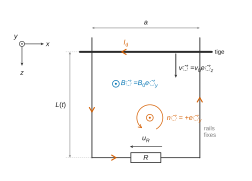
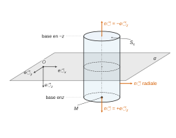
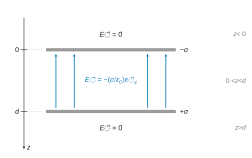
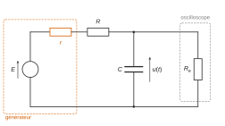
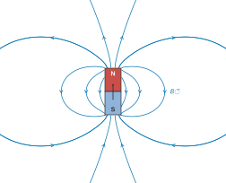

# ATS — Physique 2026 · Corrigé brut

*Corrigé rédigé par IA, non officiel. Signalez toute erreur.*

Épreuve de 3 h, calculatrice interdite. Sujet : *Métrologie des masses*. Les applications numériques sont menées à la main, en valeur approchée, comme le demande l'énoncé.

## I. Comparaison de masses

### Question 1

L'étalon est un cylindre plein de rayon $R_0$ et de hauteur $h$. Son volume est

$$V=\pi R_0^2h .$$

Sa masse volumique est donc

$$\boxed{\rho=\frac{m}{\pi R_0^2h}}$$

Avec $m=1$ kg, $R_0=2\times10^{-2}$ m et $h=4\times10^{-2}$ m :

$$\begin{aligned}
V&=\pi\times4\times10^{-4}\times4\times10^{-2}\\
&=1{,}6\pi\times10^{-5}\\
&\simeq5{,}0\times10^{-5}\ \mathrm{m^3}\ (50\ \mathrm{cm^3}),
\end{aligned}$$

d'où, en écriture scientifique,

$$\boxed{\rho\simeq2{,}0\times10^{4}\ \mathrm{kg\cdot m^{-3}}}$$

Ordre de grandeur cohérent avec un alliage de platine (environ $21\ \mathrm{g\cdot cm^{-3}}$), compte tenu des dimensions données « environ ».

### Question 2

Un volume $V$ d'air contient $n$ moles, avec $pV=nRT$ (gaz parfait). La masse correspondante est $nM$. Donc

$$\boxed{\rho_{\rm air}=\frac{nM}{V}=\frac{pM}{RT}}$$

avec $M=29\times10^{-3}\ \mathrm{kg\cdot mol^{-1}}$. Pour $p=1{,}0\times10^5$ Pa et $T\simeq293$ K :

$$\rho_{\rm air}=\frac{2{,}9\times10^3}{2{,}4\times10^3}\simeq1{,}2\ \mathrm{kg\cdot m^{-3}},$$

cohérent avec la valeur $\approx1\ \mathrm{kg\cdot m^{-3}}$ annoncée.

### Question 3

D'après le théorème d'Archimède, la poussée est verticale ascendante et égale au poids de l'air déplacé. L'étalon étant entièrement immergé, le volume déplacé est $V=\pi R_0^2h$ :

$$\boxed{\Pi=\rho_{\rm air}Vg=\rho_{\rm air}\pi R_0^2h\,g}$$

Numériquement :

$$\boxed{\Pi\simeq1\times5\times10^{-5}\times9{,}8\simeq5\times10^{-4}\ \mathrm{N}}$$

Cela correspond à une masse équivalente $\Pi/g=\rho_{\rm air}V\simeq5\times10^{-5}$ kg, soit 50 mg.

### Question 4

Sur le plateau, l'étalon subit son poids $mg$ (vers le bas), la poussée $\Pi$ (vers le haut) et la réaction $N$ du plateau. À l'équilibre :

$$N=mg-\rho_{\rm air}Vg .$$

La balance affiche $N/g$, donc

$$m_{\rm aff}=m-\rho_{\rm air}V .$$

**La masse affichée est inférieure à 1 kg, d'environ $\rho_{\rm air}V\simeq5\times10^{-5}$ kg $=50$ mg.**

Influence sur la précision : l'incertitude-type d'un comparateur est de 1 à 10 µg. L'écart dû à la poussée est donc

$$\frac{5\times10^{-5}\ \mathrm{kg}}{10^{-8}\ \mathrm{kg}}\sim5\times10^{3}$$

fois plus grand que l'incertitude visée.

Même lorsqu'on compare deux masses, les poussées ne se compensent que si les volumes sont égaux. Un étalon de 1 kg en inox ($\rho\simeq8\times10^3\ \mathrm{kg\cdot m^{-3}}$, $V\simeq125\ \mathrm{cm^3}$) et un étalon en Pt-Ir ($V\simeq50\ \mathrm{cm^3}$) diffèrent de $\rho_{\rm air}\Delta V\simeq75$ mg. **Il est donc nécessaire de prendre en compte la poussée d'Archimède dans un comparateur de masse.**

### Question 5

En $r=R_T$, $F(R_T)=mg$. En $r=R_T+a$, avec le développement limité $(1+x)^{-2}\simeq1-2x$ pour $x=a/R_T\ll1$ :

$$\begin{aligned}
F(R_T+a)&=\frac{mgR_T^2}{(R_T+a)^2}\\
&=mg\left(1+\frac{a}{R_T}\right)^{-2}\\
&\simeq mg\left(1-\frac{2a}{R_T}\right).
\end{aligned}$$

D'où

$$\boxed{F(R_T)-F(R_T+a)\simeq\frac{2mga}{R_T}}$$

### Question 6

$r$ repère le centre de masse. Les deux étalons, posés sur le même plateau, ont leur centre de masse à mi-hauteur : 2,0 cm (Pt-Ir) et 3,2 cm (inox). Donc $a=1{,}2\times10^{-2}$ m et, pour $m=1$ kg :

$$\begin{aligned}
F(R_T)-F(R_T+a)&=\frac{2mga}{R_T}\\
&=\frac{2\times9{,}8\times1{,}2\times10^{-2}}{6{,}4\times10^{6}}\\
&\simeq3{,}7\times10^{-8}\ \mathrm{N}.
\end{aligned}$$

La différence de masse équivalente est

$$\boxed{\frac{\Delta F}{g}=\frac{2ma}{R_T}\simeq3{,}8\times10^{-9}\ \mathrm{kg}\approx4\ \mathrm{\mu g}}$$

**C'est du même ordre que l'incertitude-type du comparateur (1 à 10 µg) : il faut en tenir compte** lorsqu'on compare un étalon en platine iridié à un étalon en inox.

## II. Balance de Kibble : pesée primaire à l'échelle du kilogramme

Base $(\vec e_x,\vec e_y,\vec e_z)$ directe : $\vec e_x$ horizontal vers la droite, $\vec e_y$ sortant de la feuille (sens de $\vec B$), $\vec e_z$ vertical descendant. On vérifie $\vec e_x\wedge\vec e_y=\vec e_z$.

### II.1 Mode statique

### Question 7

Loi de Laplace sur la tige rectiligne de longueur utile $a$, parcourue par $I$ selon $+\vec e_x$ (sens de la figure II.1), dans le champ uniforme $B_0\vec e_y$ :

$$\begin{aligned}
\vec F_{\rm L}&=\int_0^a I\,\mathrm{d}x\,\vec e_x\wedge B_0\vec e_y\\
&=IaB_0\,\vec e_x\wedge\vec e_y,
\end{aligned}$$

$$\boxed{\vec F_{\rm L}=IaB_0\,\vec e_z}$$

Force verticale descendante, comme sur la figure. L'équilibre donne $IaB_0=mg$.

### II.2 Mode dynamique

### Question 8



On oriente le courant induit $I_{\rm d}$ selon $-\vec e_x$ dans la tige (de droite à gauche), donc selon $+\vec e_x$ dans la résistance. Le circuit est alors parcouru dans le sens trigonométrique vu par le lecteur.

La normale au circuit se déduit de cette orientation par la règle de la main droite ; elle sert à calculer le flux de $\vec B$ :

$$\boxed{\vec n=+\vec e_y}$$

(normale sortant de la feuille, représentée sur le schéma). Avec l'orientation opposée, on aurait $\vec n=-\vec e_y$ et tous les signes suivants seraient changés.

### Question 9

Avec $z(t)=v_0t$, la distance entre la tige et le bas du circuit est $L(t)=L_0-v_0t$. La surface du circuit est donc $S(t)=aL(t)$, et le champ étant uniforme :

$$\Phi(t)=\vec B\cdot\vec n\,S(t)=B_0a\,(L_0-v_0t).$$

$L_0$ étant constante, seule la partie $-v_0t$ contribue à la dérivée. Loi de Faraday :

$$\boxed{e=-\frac{\mathrm{d}\Phi}{\mathrm{d}t}=aB_0v_0}$$

Contrôle par la circulation du champ électromoteur, la tige étant parcourue selon $-\vec e_x$ :

$$\int_{\rm tige}(\vec v\wedge\vec B)\cdot\mathrm{d}\vec\ell=v_0B_0(\vec e_z\wedge\vec e_y)\cdot(-a\,\vec e_x)=aB_0v_0 .$$

Loi de Lenz : la force de Laplace sur la tige vaut $I_{\rm d}(-a\vec e_x)\wedge B_0\vec e_y=-I_{\rm d}aB_0\vec e_z$. Elle est dirigée vers le haut et freine la descente.

### Question 10

Le circuit ne comporte que $R$ (toute autre résistance négligée). Avec l'orientation choisie, $I_{\rm d}$ traverse $R$ selon $+\vec e_x$. La tension $u_R$, fléchée vers la gauche (figure II.2), est donc en convention récepteur :

$$u_R=RI_{\rm d}.$$

La loi des mailles, la f.é.m. étant orientée dans le sens de $I_{\rm d}$, donne $RI_{\rm d}=e$. Donc $u_R=e=aB_0v_0$ et

$$\boxed{aB_0=\frac{u_R}{v_0}}$$

### II.3 Mise ensemble

### Question 11

Mode statique (Q7) : l'équilibre s'écrit

$$mg=IaB_0 .$$

Mode dynamique (Q10) : $aB_0=u_R/v_0$. Le même produit $aB_0$ intervient dans les deux modes (même tige, même champ). En l'éliminant :

$$\boxed{m=\frac{I\,u_R}{g\,v_0}}$$

Homogénéité : $\mathrm{A\cdot V}/(\mathrm{m\cdot s^{-2}\cdot m\cdot s^{-1}})=\mathrm{W\cdot s^3\cdot m^{-2}}=\mathrm{kg}$.

La relation s'écrit aussi $mgv_0=u_RI$ : égalité d'une puissance mécanique et d'une puissance électrique.

## III. Balance électrostatique : pesées primaires à l'échelle du milligramme

### III.1 Étude du condensateur plan

### Question 12

*Invariances* : la distribution de charges (plan infini uniformément chargé) est invariante par toute translation selon $\vec e_x$ et selon $\vec e_y$. Le champ qu'elle crée a les mêmes invariances : $\vec E$ ne dépend ni de $x$ ni de $y$.

*Symétries* : pour un point $M$ quelconque, les plans $(M,\vec e_x,\vec e_z)$ et $(M,\vec e_y,\vec e_z)$ sont des plans de symétrie de la distribution de charges. $\vec E(M)$ appartient à chacun d'eux, donc à leur intersection, la droite $(M,\vec e_z)$.

$$\boxed{\vec E(M)=E(z)\,\vec e_z}$$

### Question 13

Le plan $(O,\vec e_x,\vec e_y)$, c'est-à-dire le plan chargé $z=0$, est un plan de symétrie de la distribution de charges. Le champ en $M'(x,y,-z)$, symétrique de $M(x,y,z)$, est donc le symétrique de $\vec E(M)$.

Cette symétrie change $\vec e_z$ en $-\vec e_z$, d'où $E(-z)\vec e_z=-E(z)\vec e_z$ :

$$\boxed{\vec E(z)=-\vec E(-z)}$$

($E$ est impaire en $z$ pour $z\neq0$ ; le champ n'est pas défini dans le plan chargé lui-même.)

### Question 14



La surface de Gauss est un cylindre fermé d'axe parallèle à $\vec e_z$ passant par $M$, de section $S_c$. Ses bases sont en $z$ (elle contient $M$) et en $-z$.

Comme dans le sujet, $\vec e_z$ est dirigé vers le bas : la base en $z>0$ est dessinée sous le plan.

Sur la surface latérale, $\vec E$ est tangent (flux nul). Sur chaque base, $\vec E$ est normal et de norme uniforme.

### Question 15

Flux sortant, face par face :

$$\begin{aligned}
\Phi_{\text{base en }z}&=E(z)\,S_c\\
\Phi_{\text{base en }-z}&=-E(-z)\,S_c=E(z)\,S_c\\
\Phi_{\text{latéral}}&=0
\end{aligned}$$

La charge intérieure est celle du disque découpé dans le plan, $\sigma S_c$. Le théorème de Gauss donne

$$2E(z)S_c=\frac{\sigma S_c}{\varepsilon_0},$$

donc $E(z)=\sigma/(2\varepsilon_0)$ pour $z>0$, puis, par imparité :

$$\boxed{\vec E(M)=\frac{\sigma}{2\varepsilon_0}\vec e_z\quad\text{pour } z>0}$$

$$\boxed{\vec E(M)=-\frac{\sigma}{2\varepsilon_0}\vec e_z\quad\text{pour } z<0}$$

### Question 16

Par superposition, le plan $z=0$ (densité $-\sigma$) et le plan $z=d$ (densité $+\sigma$) créent respectivement

$$\begin{aligned}
\vec E_0&=-\frac{\sigma}{2\varepsilon_0}\,\mathrm{sgn}(z)\,\vec e_z\\
\vec E_d&=\frac{\sigma}{2\varepsilon_0}\,\mathrm{sgn}(z-d)\,\vec e_z
\end{aligned}$$

Dans les trois zones :

$$\begin{aligned}
z<0:&\quad\vec E=\frac{\sigma}{2\varepsilon_0}\vec e_z-\frac{\sigma}{2\varepsilon_0}\vec e_z=\vec 0\\
0<z<d:&\quad\vec E=-\frac{\sigma}{2\varepsilon_0}\vec e_z-\frac{\sigma}{2\varepsilon_0}\vec e_z=-\frac{\sigma}{\varepsilon_0}\vec e_z\\
z>d:&\quad\vec E=-\frac{\sigma}{2\varepsilon_0}\vec e_z+\frac{\sigma}{2\varepsilon_0}\vec e_z=\vec 0
\end{aligned}$$

$$\boxed{\vec E=-\frac{\sigma}{\varepsilon_0}\vec e_z\ \text{pour }0<z<d}$$

$$\boxed{\vec E=\vec 0\ \text{hors du condensateur}}$$

Le champ intérieur va bien de l'armature positive vers l'armature négative.



### Question 17

Entre les armatures, $\vec E=-\overrightarrow{\mathrm{grad}}\,V$ se projette en

$$E_z=-\frac{\mathrm{d}V}{\mathrm{d}z}=-\frac{\sigma}{\varepsilon_0}.$$

En intégrant de $z=0$ à $z=d$ :

$$U=V(d)-V(0)=\frac{\sigma d}{\varepsilon_0}.$$

Avec $Q=\sigma S$ (plan $z=d$) :

$$\boxed{C=\frac{Q}{U}=\frac{\varepsilon_0S}{d}}$$

### Question 18

L'élément $\mathrm{d}S$ de la plaque du bas porte la charge $\mathrm{d}q=\sigma\,\mathrm{d}S$. Il subit le champ créé par la plaque du haut (une charge ne subit pas son propre champ) : $\mathrm{d}\vec F=\mathrm{d}q\,\vec E_{\rm haut}(M)$, soit

$$\boxed{\mathrm{d}\vec F=\sigma\,\mathrm{d}S\,\vec E_{\rm haut}(M)=-\frac{\sigma^2}{2\varepsilon_0}\,\mathrm{d}S\,\vec e_z}$$

### Question 19

$\sigma$ et $\vec E_{\rm haut}$ étant uniformes sur la plaque, l'intégration sur la surface $S$ donne

$$\boxed{\vec F_e=-\frac{\sigma^2S}{2\varepsilon_0}\,\vec e_z}$$

Le coefficient de $\vec e_z$ est négatif : la force subie par la plaque du bas est dirigée vers la plaque du haut ($-\vec e_z$). **Elle est attractive**, ce qui est attendu entre charges de signes opposés.

### Question 20

À tension $U$ et distance $z$ : $Q=C(z)U=\sigma S$, donc

$$\sigma=\frac{\varepsilon_0U}{z}.$$

En reportant dans Q19 :

$$\begin{aligned}
\vec F_e&=-\frac{S}{2\varepsilon_0}\left(\frac{\varepsilon_0U}{z}\right)^2\vec e_z\\
&=-\frac{\varepsilon_0SU^2}{2z^2}\vec e_z .
\end{aligned}$$

Par ailleurs, à $U$ constante :

$$\begin{aligned}
\frac{\mathrm{d}}{\mathrm{d}z}\left(\frac12C(z)U^2\right)&=\frac{U^2}{2}\left(-\frac{\varepsilon_0S}{z^2}\right)\\
&=-\frac{\varepsilon_0SU^2}{2z^2}.
\end{aligned}$$

Les deux expressions coïncident :

$$\boxed{\vec F_e=\frac{\mathrm{d}}{\mathrm{d}z}\left(\frac12CU^2\right)\vec e_z}$$

### III.2 Mesure de la capacité

#### III.2.1 Méthode 1 : charge d'un circuit RC

### Question 21

Loi des mailles : $E=Ri+u$. Condensateur en convention récepteur : $i=C\dfrac{\mathrm{d}u}{\mathrm{d}t}$. D'où, avec $\tau=RC$,

$$\boxed{\tau\frac{\mathrm{d}u}{\mathrm{d}t}+u=E}$$

### Question 22

Solution générale : $u(t)=E+A\,\mathrm{e}^{-t/\tau}$. La tension aux bornes d'un condensateur est continue, et le condensateur est déchargé pour $t<0$ : $u(0^+)=u(0^-)=0$, donc $A=-E$.

$$\boxed{u(t)=E\left(1-\mathrm{e}^{-t/\tau}\right)\quad(t\ge0)}$$

### Question 23

Calibres : 100 µs par carreau horizontalement, 2 V par carreau verticalement. La courbe $u(t)$ part de 0 au front de montée et tend vers $\approx10$ V (5 carreaux).

D'après Q22, $u(\tau)=(1-\mathrm{e}^{-1})E\simeq0{,}63E\simeq6{,}3$ V, soit environ 3,2 carreaux au-dessus de la ligne de base. La courbe atteint ce niveau environ **un carreau après le front**, donc $\tau\simeq100$ µs. La tangente à l'origine coupe l'asymptote au même instant, et le régime permanent est atteint au bout de 4 à 5 carreaux, soit $\approx5\tau$. Avec $\tau=RC$ :

$$\begin{aligned}
C&=\frac{\tau}{R}\simeq\frac{1\times10^{-4}}{1\times10^{3}}\\
&=1\times10^{-7}\ \mathrm{F}
\end{aligned}$$

$$\boxed{C\simeq100\ \mathrm{nF}}$$

On note que la trace du générateur ne monte pas instantanément à 10 V : elle saute à $\approx9{,}5$ V puis rejoint 10 V, indice d'une résistance interne du générateur (exploité en Q29).

### Question 24

*Graphique de gauche* : le modèle prédit $\tau=RC$, droite passant par l'origine. Les points sont alignés jusqu'à $\approx100\ \mathrm{k\Omega}$ puis s'infléchissent nettement : la tendance n'est pas linéaire.

À $500\ \mathrm{k\Omega}$, on attend $RC\simeq50$ ms alors que l'on mesure $\approx33$ ms, écart très supérieur aux incertitudes (« à peine visibles »). **$\tau$ n'est pas proportionnel à $R$ : les mesures ne sont pas compatibles avec le modèle linéaire.**

*Graphique de droite* : le modèle prédit $u\to E$. Or le plateau final de $u(t)$ reste nettement en dessous de celui du générateur, d'environ un demi-carreau, soit $\approx1$ V. **La tension ne tend pas vers $E$.**

#### Second modèle

### Question 25

$C$ et $R_e$ sont en parallèle sous la même tension $u$ :

$$\boxed{i_1=C\frac{\mathrm{d}u}{\mathrm{d}t}}$$

$$\boxed{i_2=\frac{u}{R_e}}$$

La loi des nœuds donne le courant $i_1+i_2$ dans $R$, en convention récepteur pour $u_R$ :

$$\boxed{u_R=R\left(C\frac{\mathrm{d}u}{\mathrm{d}t}+\frac{u}{R_e}\right)}$$

### Question 26

Loi des mailles : $E=u_R+u$. En remplaçant $u_R$ :

$$E=RC\frac{\mathrm{d}u}{\mathrm{d}t}+\frac{R}{R_e}u+u .$$

En divisant par $RC$ :

$$\begin{aligned}
\frac{E}{RC}&=\frac{\mathrm{d}u}{\mathrm{d}t}+u\left(\frac1{RC}+\frac1{R_eC}\right)\\
&=\frac{\mathrm{d}u}{\mathrm{d}t}+\frac{u}{\tau'}
\end{aligned}$$

$$\boxed{\tau'=\frac{RR_e}{R+R_e}\,C}$$

Pour $R=500\ \mathrm{k\Omega}$ et $C\approx0{,}1$ µF : $\tau'\simeq333\times10^3\times10^{-7}\simeq33$ ms, en accord avec la figure III.7.

### Question 27

Aux temps longs, $u$ tend vers une constante, donc $\dfrac{\mathrm{d}u}{\mathrm{d}t}\to0$ dans (1), sans qu'il soit nécessaire de résoudre l'équation. Il reste $u_\infty=\dfrac{\tau'E}{RC}$ :

$$\boxed{u_\infty=\frac{R_e}{R+R_e}\,E}$$

C'est un pont diviseur entre $R$ et $R_e$, le condensateur chargé se comportant comme un interrupteur ouvert.

Pour $R=100\ \mathrm{k\Omega}$, $R_e=1\ \mathrm{M\Omega}$ et $E=10$ V, on obtient $u_\infty=10/1{,}1\simeq9{,}1$ V.

**La tension $u$ se stabilise $\approx0{,}9$ V sous celle du générateur, ce que montre la figure III.7 (droite).** La constante de temps correspondante, $\tau'\simeq9$ ms, est également cohérente avec l'acquisition (10 ms par carreau).

#### Restriction aux petites valeurs de R

### Question 28

Sur la figure III.10 (droite), les résidus $\tau-(aR+b)$ sont compris entre environ $-1{,}7$ et $+1{,}7$ µs. Leurs incertitudes-types, égales à 2 % de $\tau$, vont d'environ 0,7 µs (à $0{,}3\ \mathrm{k\Omega}$) à 2 µs (à $1\ \mathrm{k\Omega}$).

- Chaque résidu est à moins de deux incertitudes-types de zéro : le plus grand rapport, à $0{,}6\ \mathrm{k\Omega}$, vaut environ $1{,}7/1{,}2\simeq1{,}4$, et la plupart des barres coupent l'axe nul.
- Les résidus sont répartis de part et d'autre de zéro, sans tendance non linéaire marquée.

**Le modèle $\tau=aR+b$ est compatible avec les mesures sur cette plage.**

### Question 29

Pour $R\le1\ \mathrm{k\Omega}\ll R_e$, le second modèle donne $\tau'\simeq RC$, droite passant par l'origine. Or $b=4{,}8$ µs avec $u(b)=0{,}4$ µs :

$$\frac{|b-0|}{u(b)}=12\gg2,$$

donc $b$ n'est pas compatible avec zéro.

Une ordonnée à l'origine non nulle est produite par une résistance $r$ **en série** avec $R$ et indépendante de $R$ :

$$\tau=(R+r)C=CR+rC .$$

L'élément négligé est **la résistance interne (de sortie) du générateur**. La résistance d'entrée $R_e$, en parallèle et déjà prise en compte, ne peut pas produire ce terme. L'identification avec $\tau=aR+b$ donne $a=C$ et $b=rC$ :

$$\boxed{r=\frac{b}{a}=\frac{4{,}8\times10^{-6}}{97\times10^{-9}}\simeq50\ \Omega}$$



C'est la valeur typique de la résistance de sortie d'un générateur basse fréquence ($50\ \Omega$). Elle est corroborée par la figure III.6 : à l'instant du front, le courant $E/(R+r)$ fait chuter la tension du générateur de $rE/(R+r)\simeq0{,}5$ V. Cette tension remonte ensuite à $E$ à mesure que le courant s'annule.

### Question 30

Dans le modèle $\tau=(R+r)C$, la pente de la régression s'identifie à $C$ :

$$\boxed{C=a=97\ \mathrm{nF}}$$

$$\boxed{u(C)=u(a)=1\ \mathrm{nF}}$$

#### III.2.2 Méthode 2 : étude en RSF

### Question 31

Pont diviseur de tension (loi d'Ohm généralisée), avec $\underline Z_R=R$ et $\underline Z_C=\dfrac{1}{\mathrm{j}C\omega}$ :

$$\begin{aligned}
\underline u&=\frac{\underline Z_C}{\underline Z_R+\underline Z_C}\,\underline e\\
&=\frac{\underline e}{1+\mathrm{j}RC\omega}
\end{aligned}$$

$$\boxed{\underline u=\frac{\underline e}{1+\mathrm{j}RC\omega}}$$

### Question 32

L'amplitude est le module de $\underline u$ ; le module de $1+\mathrm{j}RC\omega$ est $\sqrt{1+(RC\omega)^2}$ :

$$\boxed{U_0=|\underline u|=\frac{E_0}{\sqrt{1+(RC\omega)^2}}}$$

### Question 33

Si $RC\omega\gg1$, $\sqrt{1+(RC\omega)^2}\simeq RC\omega$ :

$$\boxed{U_0\simeq\frac{E_0}{RC\omega}}$$

### Question 34

$$\boxed{C=\frac{E_0}{R\omega U_0}=\frac{E_0}{2\pi fRU_0}}$$

Application numérique, avec $1/\pi\simeq0{,}3183$ :

$$\begin{aligned}
\frac{E_0}{U_0}&=\frac{2{,}001}{0{,}3185}\\
&=2\pi\times\frac{2{,}001}{2}\times\frac{1}{\pi\times0{,}3185}\\
&\simeq2\pi\times1{,}0005\times\frac{0{,}3183}{0{,}3185}\\
&\simeq2\pi
\end{aligned}$$

donc

$$\boxed{C\simeq\frac{2\pi}{2\pi\times10^3\times10^4}=1{,}0\times10^{-7}\ \mathrm{F}}$$

soit 100 nF, du même ordre que la méthode 1. On vérifie a posteriori $RC\omega\simeq6{,}3$ : l'approximation est assez grossière (erreur relative $\simeq1/(2\times6{,}3^2)\simeq1{,}3\,\%$).

### Question 35

Méthode 1 : $C_1=97$ nF, $u(C_1)=1$ nF. Méthode 2 sans approximation : $C_2=98{,}7$ nF, d'incertitude non fournie. L'écart normalisé, majoré en négligeant $u(C_2)$, vaut

$$\frac{|C_2-C_1|}{\sqrt{u(C_1)^2+u(C_2)^2}}\le\frac{98{,}7-97}{1}=1{,}7 .$$

Il est inférieur à 2 : **les deux valeurs sont compatibles.** La valeur approchée de Q34, 100 nF, donnerait un écart normalisé de 3 avec $u(C_1)$ seule : c'est le biais de l'approximation $RC\omega\gg1$, que le calcul exact supprime.

### III.3 Exemple d'utilisation

### Question 36

Système {électrode du bas + masse} ; le poids de l'électrode est compensé par le dispositif. Forces restantes : le poids $mg\,\vec e_z$ et la force de Q20 ($U$ constante),

$$\vec F_e=\frac{U^2}{2}\frac{\mathrm{d}C}{\mathrm{d}z}\vec e_z,\qquad\text{avec } \frac{\mathrm{d}C}{\mathrm{d}z}<0 .$$

À l'équilibre, la projection sur $\vec e_z$ donne

$$\boxed{m=\frac{U^2}{2g}\left|\frac{\mathrm{d}C}{\mathrm{d}z}\right|_{z=d_0}}$$

Lecture sur la figure III.12 (droite) à $d_0=70$ µm :

$$\frac{\mathrm{d}C}{\mathrm{d}z}\simeq-0{,}9\ \mathrm{pF\cdot\mu m^{-1}}=-9\times10^{-7}\ \mathrm{F\cdot m^{-1}},$$

cohérent avec $-C/z\simeq-62/70$ pour le modèle plan. Avec $U^2\simeq14{,}5^2\simeq210\ \mathrm{V^2}$ :

$$\boxed{m\simeq\frac{210\times9\times10^{-7}}{2\times9{,}8}\simeq9{,}6\times10^{-6}\ \mathrm{kg}\approx10\ \mathrm{mg}}$$

### Question 37

Le modèle $C=\varepsilon_0S/z$ suppose des armatures infinies, sans effet de bord. Les électrodes réelles sont finies : les lignes de champ débordent sur les bords, ce qui ajoute de la charge à tension donnée. **La raison principale est l'effet de bord, qui augmente la capacité** ; s'y ajoutent les capacités parasites du montage (connexions, pièces métalliques voisines), en parallèle et donc additives.

## IV. Mesure de g : gravimètre à chute libre

### Modélisation

### Question 38

Système : l'aimant, dans le référentiel terrestre supposé galiléen, axe $z$ descendant. Seule force : le poids $m\vec g=mg\,\vec e_z$. La deuxième loi de Newton donne $\ddot z=g$.

Première intégration : $\dot z(t)=gt+\dot z(0)$, et $\dot z(0)=0$ car l'aimant est lâché sans vitesse initiale.

Seconde intégration : $z(t)=\frac12gt^2+z(0)$, et $z(0)=0$ car il est lâché en $z=0$. Donc

$$\boxed{z(t)=\frac12gt^2}$$

### Question 39

En inversant $z(t)$ pour $z=d_1$ puis $z=d_2$ (avec $t\ge0$) :

$$\boxed{t_1=\sqrt{\frac{2d_1}{g}}}$$

$$\boxed{t_2=\sqrt{\frac{2d_2}{g}}}$$

### Question 40

$$\Delta t=t_2-t_1=\sqrt{\frac2g}\left(\sqrt{d_2}-\sqrt{d_1}\right).$$

En élevant au carré, le facteur $\left(\sqrt{d_2}-\sqrt{d_1}\right)^2$ ne se simplifie pas en $d_2-d_1$ :

$$\boxed{g=\frac{2\left(\sqrt{d_2}-\sqrt{d_1}\right)^2}{\Delta t^2}}$$

### Expérience : valeur de g

### Question 41



Les lignes de champ sont fermées : elles sortent par le pôle Nord et rentrent par le pôle Sud à l'extérieur, vont du Sud vers le Nord à l'intérieur, ne se croisent pas et se resserrent près des pôles. Le pôle Nord peut aussi être placé en bas, pourvu qu'il soit indiqué sur le dessin.

La tension induite dans les bobines, dont le flux magnétique varie quand l'aimant passe, s'explique par la **loi de Faraday** (loi de Lenz-Faraday) : $e=-\dfrac{\mathrm{d}\Phi}{\mathrm{d}t}$.

### Question 42

Chaque passage produit une impulsion à deux lobes de signes opposés. Le passage par zéro central correspond à l'aimant au centre de la bobine (flux extrémal). On mesure directement l'écart entre les passages par zéro des deux impulsions : il vaut 6,0 carreaux de 36 ms.

$$\boxed{\Delta t\simeq6{,}0\times36\ \mathrm{ms}\simeq0{,}22\ \mathrm{s}}$$

### Question 43

```python
liste_Dt = [0.2165, 0.2185, 0.219, 0.2185, 0.2165, 0.2165, 0.2175, 0.216,
            0.219, 0.218, 0.2175, 0.2175, 0.2185, 0.2185, 0.218]  # en s
N = len(liste_Dt)
somme = 0
for i in range(N):
    somme = somme + liste_Dt[i]   # instruction 1 (dans la boucle)

Dt_moy = somme / N                # instruction 2 (après la boucle)
print(Dt_moy)                     # affiche 0.21773...
```

### Estimation de l'incertitude

### Question 44

```python
for k in range(100000):
    Dt_moy_k = np.random.uniform(Dt_moy-Delta_Dt_moy, Dt_moy+Delta_Dt_moy)
    d1_k = np.random.uniform(d1-Delta_d, d1+Delta_d)   # instruction 1
    d2_k = np.random.uniform(d2-Delta_d, d2+Delta_d)   # instruction 2

    g_liste.append(g(d1_k, d2_k, Dt_moy_k))

print(np.std(g_liste))                                 # instruction 3
```

Les distances sont tirées indépendamment, uniformément dans leur intervalle de demi-étendue $\Delta_d=1$ mm. L'écart-type de la distribution simulée des $g$ est l'incertitude-type $u(g)$.

### Question 45

$u(g)$ a l'unité de $g$ : **$\mathrm{m\cdot s^{-2}}$**.

### Question 46

$u(g)=0{,}045\,949\ \mathrm{m\cdot s^{-2}}$ arrondi à un chiffre significatif donne $0{,}05\ \mathrm{m\cdot s^{-2}}$. On arrondit $g$ au même rang (centièmes) :

$$\boxed{g=9{,}73\ \mathrm{m\cdot s^{-2}}}$$

$$\boxed{u(g)=0{,}05\ \mathrm{m\cdot s^{-2}}}$$
