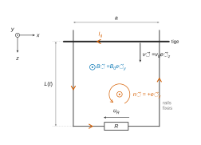
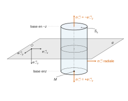
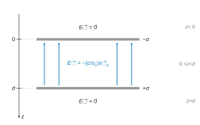
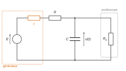
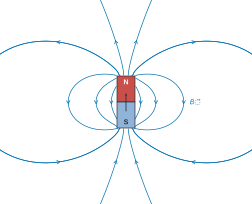

# ATS — Physique 2026 · Corrigé guidé

*Corrigé rédigé par IA, non officiel. Signalez toute erreur.*

## Présentation du sujet

**Format.** Épreuve de 3 heures, **calculatrice interdite**, sans document. Douze pages d'énoncé, **46 questions** réparties en quatre parties annoncées comme indépendantes. Les applications numériques sont attendues « en valeur approchée » : il faut savoir mener un calcul à la main avec deux chiffres significatifs.

**Thème.** *Métrologie des masses* : comment, depuis la redéfinition du kilogramme de 2019, on relie une masse à des grandeurs électriques et temporelles mesurables sans masse de référence, et comment on juge la qualité d'une mesure par son incertitude.

**Découpage.**

- *Partie I — Comparaison de masses (Q1 à Q6).* Masse volumique d'un étalon, poussée d'Archimède dans l'air, effet de la différence de hauteur dans le champ de pesanteur. Statique des fluides, gaz parfait, développement limité, et surtout le réflexe de comparer un effet à l'incertitude visée.
- *Partie II — Balance de Kibble (Q7 à Q11).* Un rail de Laplace utilisé en mode moteur (la force de Laplace équilibre le poids) puis en mode générateur (induction à vitesse imposée). Le produit $aB_0$, inconnu, s'élimine entre les deux modes.
- *Partie III — Balance électrostatique (Q12 à Q37).* La plus longue. Électrostatique du plan infini et du condensateur plan par le théorème de Gauss, force entre armatures ; puis deux méthodes de mesure d'une capacité : charge d'un circuit $RC$ confrontée à l'expérience (résistance d'entrée de l'oscilloscope, régression linéaire, résidus, résistance interne du générateur) et régime sinusoïdal forcé ; enfin une pesée.
- *Partie IV — Gravimètre à chute libre (Q38 à Q46).* Chute libre, lecture d'oscillogramme, loi de Faraday, deux scripts Python (moyenne, Monte-Carlo) et écriture d'un résultat de mesure.

**Notions du programme mobilisées.** Poussée d'Archimède, modèle du gaz parfait ; développement limité à l'ordre 1 ; force de Laplace, loi de Faraday, loi de Lenz, orientation d'un circuit ; symétries et invariances, théorème de Gauss, superposition, potentiel, capacité ; circuits du premier ordre, régime sinusoïdal forcé et impédances complexes ; incertitude-type, écart normalisé, régression linéaire, méthode de Monte-Carlo ; Python élémentaire (boucle, accumulation, `numpy`).

**Difficulté et gestion du temps.** Le sujet est long mais très guidé, sans question réellement difficile. Les questions sûres à ne pas laisser passer : Q2, Q3, Q5, Q7, Q11, Q12 à Q17, Q21, Q22, Q25, Q26, Q31 à Q34, Q38 à Q40, Q43, Q45, Q46. Les questions coûteuses sont celles qui demandent une lecture de figure argumentée (Q23, Q24, Q28, Q36, Q42) et la résolution de problème Q29. Les trois schémas demandés (Q8, Q14, Q41) rapportent vite s'ils sont soignés et légendés. Un partage raisonnable : 25 min pour la partie I, 25 min pour la partie II, 1 h 30 pour la partie III, 40 min pour la partie IV.

**Ce qu'en dit le rapport 2026.** Le jury trouve la performance d'ensemble « un peu décevante par rapport aux années précédentes ». Q2 est la question la mieux réussie ; Q21, Q22 et les questions Python (Q43, Q44) sont bien traitées. Les questions qui ont fait la différence sont, d'après le rapport :

- Q5 et Q6 (développement limité, puis conclusion chiffrée), chacune jugée « très peu réussie » ;
- Q8 (normale au circuit), « absolument pas comprise » ;
- Q12 (symétries et invariances, raisonnement exigé sur la distribution de charges) ;
- tout le bloc incertitudes et régression : Q24, Q28, Q29, Q30, Q35, très peu ou mal traités ;
- Q36, quasiment jamais abordée, et Q40, où la manipulation littérale a souvent échoué.

Ce sont des points faciles à prendre pour qui a les réflexes du cours : ils valent le temps qu'on y passe.

## Partie I — Comparaison de masses

On évalue deux effets systématiques qui perturbent la comparaison de deux étalons dans l'air. Le fil conducteur : un effet n'est « négligeable » ou « à prendre en compte » que par comparaison avec l'incertitude visée (1 à 10 µg pour un comparateur).

### Question 1

> [!INDICATION]
> Masse volumique = masse / volume. Quel est le volume d'un cylindre ?

> [!INDICATION]
> Passez toutes les longueurs en mètres avant de calculer, et gardez $\pi$ jusqu'au bout : $\pi\times4\times10^{-4}\times4\times10^{-2}$ se simplifie bien.

#### Solution

Le volume du cylindre est $V=\pi R_0^2h$, donc

$$\boxed{\rho=\frac{m}{\pi R_0^2h}}$$

Avec $m=1$ kg, $R_0=2\times10^{-2}$ m et $h=4\times10^{-2}$ m :

$$\begin{aligned}
V&=1{,}6\pi\times10^{-5}\\
&\simeq5{,}0\times10^{-5}\ \mathrm{m^3}\ (50\ \mathrm{cm^3}),
\end{aligned}$$

$$\boxed{\rho\simeq2{,}0\times10^{4}\ \mathrm{kg\cdot m^{-3}}}$$

Ordre de grandeur cohérent avec un alliage de platine (environ $21\ \mathrm{g\cdot cm^{-3}}$), les dimensions n'étant données qu'« environ ».

> [!PIEGE]
> Confondre rayon et diamètre : $R_0=2$ cm, donc 4 cm de diamètre. Prendre $R_0=4$ cm divise $\rho$ par quatre.

> [!JURY]
> Le rapport 2026 note que « l'expression du volume d'un cylindre est la plupart du temps fausse voire inhomogène ». Il rappelle aussi qu'une application numérique laissée sous forme de fraction ne suffit pas : « le résultat en écriture scientifique est attendu ».

### Question 2

> [!INDICATION]
> Partez de $pV=nRT$ et exprimez la masse de gaz contenue dans $V$ à l'aide de la masse molaire.

#### Solution

Un volume $V$ d'air contient $n=\dfrac{pV}{RT}$ moles, de masse $nM$. Donc

$$\boxed{\rho_{\rm air}=\frac{pM}{RT}}$$

Avec $p\simeq1{,}0\times10^5$ Pa, $T\simeq293$ K et $M=29\times10^{-3}\ \mathrm{kg\cdot mol^{-1}}$ :

$$\rho_{\rm air}\simeq\frac{2{,}9\times10^3}{2{,}4\times10^3}\simeq1{,}2\ \mathrm{kg\cdot m^{-3}}.$$

> [!PIEGE]
> $M$ doit être en $\mathrm{kg\cdot mol^{-1}}$ : oublier la conversion donne une masse volumique de l'air mille fois trop grande.

### Question 3

> [!INDICATION]
> Théorème d'Archimède : à quoi est égale la poussée ? Quel volume de fluide est déplacé ?

> [!INDICATION]
> Le volume déplacé est celui de l'étalon, déjà calculé en Q1. Convertissez ensuite la force en masse équivalente : c'est ce qui servira en Q4.

#### Solution

La poussée est verticale ascendante, égale au poids de l'air déplacé, de volume $V=\pi R_0^2h$ :

$$\boxed{\Pi=\rho_{\rm air}\,\pi R_0^2h\,g}$$

$$\boxed{\Pi\simeq1\times5\times10^{-5}\times9{,}8\simeq5\times10^{-4}\ \mathrm{N}}$$

Masse équivalente : $\Pi/g=\rho_{\rm air}V\simeq5\times10^{-5}$ kg, soit 50 mg.

> [!JURY]
> Le rapport 2026 constate, à propos de la poussée d'Archimède pourtant explicitement au programme, que « sa formule est très mal maitrisée ». Écrire le volume déplacé et la masse volumique du fluide, pas celle du solide.

### Question 4

> [!INDICATION]
> Faites le bilan des forces sur l'étalon posé sur le plateau. Que mesure la balance : le poids, ou la force exercée sur le plateau ?

> [!INDICATION]
> Pour répondre à « est-il nécessaire », comparez l'écart trouvé à l'incertitude du comparateur. Demandez-vous aussi si la poussée se compense quand on compare deux étalons de matériaux différents.

#### Solution

À l'équilibre, la réaction du plateau vaut

$$N=mg-\rho_{\rm air}Vg .$$

La balance affiche $N/g$ :

$$m_{\rm aff}=m-\rho_{\rm air}V .$$

**La masse affichée est inférieure à 1 kg, d'environ 50 mg** ($5\times10^{-5}$ kg).

C'est $\sim5\times10^3$ fois l'incertitude d'un comparateur ($\sim10$ µg). Dans une comparaison, les poussées ne se compensent que pour des volumes égaux. Un kilogramme en inox ($\rho\simeq8\times10^3\ \mathrm{kg\cdot m^{-3}}$, $V\simeq125\ \mathrm{cm^3}$) et un kilogramme en Pt-Ir ($V\simeq50\ \mathrm{cm^3}$) diffèrent de $\rho_{\rm air}\Delta V\simeq75$ mg. **La poussée d'Archimède doit donc être prise en compte.**

> [!METHODE]
> En métrologie, on ne qualifie jamais un effet de « petit » dans l'absolu : on le rapporte à l'incertitude visée. Convertir les forces en masses équivalentes rend la comparaison immédiate.

> [!PIEGE]
> La poussée allège : la balance ne peut pas afficher plus que la masse vraie.

> [!JURY]
> Pour le rapport 2026, la conclusion n'est correcte que si l'on a chiffré l'influence de la poussée sur la précision recherchée : comparer 50 mg à quelques µg est la justification attendue.

### Question 5

> [!INDICATION]
> Factorisez $R_T^2$ au dénominateur pour faire apparaître une quantité sans dimension petite devant 1.

> [!INDICATION]
> Utilisez $(1+x)^{\alpha}\simeq1+\alpha x$ pour $x\ll1$.

#### Solution

$F(R_T)=mg$, et avec $x=a/R_T\ll1$ :

$$\begin{aligned}
F(R_T+a)&=mg\left(1+\frac{a}{R_T}\right)^{-2}\\
&\simeq mg\left(1-\frac{2a}{R_T}\right)
\end{aligned}$$

$$\boxed{F(R_T)-F(R_T+a)\simeq\frac{2mga}{R_T}}$$

Le signe est attendu : la gravitation diminue quand on s'éloigne de la Terre.

> [!JURY]
> Question « très peu réussie » selon le rapport 2026 : « le développement limité n'est quasiment jamais fait, ni même tenté alors qu'il était explicitement demandé ». Écrire la ligne du développement limité est ce qui rapporte les points.

### Question 6

> [!INDICATION]
> La formule porte sur la distance au centre de masse. Où est le centre de masse d'un cylindre homogène posé sur un plateau ?

> [!INDICATION]
> $a$ est alors l'écart entre les deux centres de masse. Convertissez enfin la force en masse équivalente pour conclure.

#### Solution

Les centres de masse sont à mi-hauteur : 2,0 cm (Pt-Ir) et 3,2 cm (inox). D'où $a=1{,}2\times10^{-2}$ m et, pour $m=1$ kg :

$$\begin{aligned}
\Delta F&=\frac{2mga}{R_T}\\
&=\frac{2\times9{,}8\times1{,}2\times10^{-2}}{6{,}4\times10^6}\\
&\simeq3{,}7\times10^{-8}\ \mathrm{N}
\end{aligned}$$

Masse équivalente :

$$\boxed{\frac{\Delta F}{g}=\frac{2ma}{R_T}\simeq3{,}8\times10^{-9}\ \mathrm{kg}\approx4\ \mathrm{\mu g}}$$

**C'est du même ordre que l'incertitude du comparateur (1 à 10 µg) : il faut en tenir compte.**

> [!PIEGE]
> Prendre $a=2{,}4$ cm (différence des hauteurs) au lieu de l'écart entre centres de masse double le résultat. La conclusion est la même, mais la valeur est fausse.

> [!PIEGE]
> Conclure « c'est négligeable » parce que $10^{-8}$ N paraît minuscule : c'est l'erreur relevée par le rapport 2026, où les candidats, faute de calculer la différence de masse, sont arrivés à la mauvaise conclusion. Seule la comparaison des µg aux µg tranche.

## Partie II — Balance de Kibble : pesée primaire à l'échelle du kilogramme

La même tige sert deux fois. En mode statique, la force de Laplace équilibre le poids ($mg=IaB_0$) ; en mode dynamique, la tige déplacée à vitesse connue crée une f.é.m. ($e=aB_0v_0$). Le produit $aB_0$, mal connu, s'élimine. Outils : loi de Laplace, loi de Faraday, orientation d'un circuit.

Repère : $\vec e_x$ vers la droite, $\vec e_y$ sortant de la feuille, $\vec e_z$ vers le bas ; la base est directe ($\vec e_x\wedge\vec e_y=\vec e_z$).

### Question 7

> [!INDICATION]
> Force de Laplace sur un élément de conducteur : $\mathrm{d}\vec F=I\,\mathrm{d}\vec\ell\wedge\vec B$.

> [!INDICATION]
> Le sens du courant dans la tige est indiqué sur la figure II.1. Vérifiez le produit vectoriel avec un axe $z$ descendant.

#### Solution

Avec $I$ selon $+\vec e_x$ sur la longueur $a$ et $\vec B=B_0\vec e_y$ uniforme :

$$\begin{aligned}
\vec F_{\rm L}&=IaB_0\,\vec e_x\wedge\vec e_y\\
&=IaB_0\,\vec e_z
\end{aligned}$$

$$\boxed{\vec F_{\rm L}=IaB_0\,\vec e_z}$$

La force est descendante, comme sur la figure, et l'équilibre s'écrit $IaB_0=mg$.

> [!PIEGE]
> Avec $z$ vers le bas, $\vec e_x\wedge\vec e_y=+\vec e_z$ : la force est descendante. Le contrôle physique est gratuit : pour équilibrer la masse suspendue à l'autre bras du fléau, la tige doit être tirée vers le bas.

> [!JURY]
> Le rapport 2026 s'étonne : « Curieusement l'intensité du courant est souvent absente de l'expression de la force de Laplace proposée par les candidats. » Un contrôle d'homogénéité ($\mathrm{T\cdot A\cdot m}=\mathrm{N}$) évite cette perte.

### Question 8

> [!INDICATION]
> Le choix du sens de $I_{\rm d}$ est libre. La normale, elle, ne l'est pas : elle se déduit du sens de parcours.

> [!INDICATION]
> Règle de la main droite : les doigts suivent le sens de parcours du contour, le pouce donne la normale. Choisir un sens qui rendra $u_R$ (fléchée sur la figure II.2) positive simplifie la suite.

#### Solution



Le schéma de la copie doit porter les rails, la tige et sa vitesse, la résistance, $\vec B$ ($\odot$), le repère, le sens choisi pour $I_{\rm d}$ et la normale.

On oriente $I_{\rm d}$ selon $-\vec e_x$ dans la tige, donc selon $+\vec e_x$ dans la résistance. Le contour est parcouru dans le sens trigonométrique vu par le lecteur, et la main droite donne la normale qui servira au calcul du flux :

$$\boxed{\vec n=+\vec e_y}$$

L'orientation opposée donnerait $\vec n=-\vec e_y$ et changerait le signe de $e$.

> [!METHODE]
> Orientation d'un circuit en induction : (1) choisir et dessiner le sens positif du courant ; (2) en déduire la normale par la main droite ; (3) calculer le flux avec cette normale ; (4) appliquer $e=-\mathrm{d}\Phi/\mathrm{d}t$, la f.é.m. étant orientée dans le même sens que le courant. Ne plus changer de convention ensuite.

> [!JURY]
> Question « absolument pas comprise » selon le rapport 2026 : les candidats orientent le courant et s'arrêtent là, sans voir qu'« il faut définir une normale au circuit pour calculer le flux du champ magnétique ». Le rapport ajoute : « La normale n'est quasiment jamais représentée ». Elle doit figurer sur le schéma.

### Question 9

> [!INDICATION]
> Exprimez la surface du circuit en fonction du temps : la tige descend, le bas du circuit est fixe.

> [!INDICATION]
> Calculez le flux avec la normale de Q8, puis appliquez la loi de Faraday. La constante $L_0$ doit disparaître.

#### Solution

$z(t)=v_0t$, donc la hauteur du circuit est $L(t)=L_0-v_0t$. Le flux à travers le circuit vaut

$$\Phi=B_0\vec e_y\cdot\vec e_y\;a\,(L_0-v_0t)=aB_0(L_0-v_0t).$$

$L_0$ est constante : seule la partie $-v_0t$ se dérive. Loi de Faraday :

$$\boxed{e=-\frac{\mathrm{d}\Phi}{\mathrm{d}t}=aB_0v_0}$$

Contrôle par le champ électromoteur, la tige étant parcourue selon $-\vec e_x$ :

$$(\vec v\wedge\vec B)\cdot(-a\vec e_x)=v_0B_0(\vec e_z\wedge\vec e_y)\cdot(-a\vec e_x)=aB_0v_0 .$$

Loi de Lenz : la force de Laplace sur le courant induit, $-I_{\rm d}aB_0\vec e_z$, est dirigée vers le haut et s'oppose au mouvement.

> [!PIEGE]
> La surface diminue quand la tige descend vers $R$ : écrire $L_0+v_0t$ inverse le signe de $e$.

> [!PIEGE]
> Le rapport 2026 relève des démonstrations fausses qui aboutissent pourtant au bon résultat : dériver $L_0$ comme si elle valait $v_0$. $L_0$ est une constante, sa dérivée est nulle ; c'est $-v_0t$ qui donne $-v_0$.

### Question 10

> [!INDICATION]
> Le circuit ne contient que $R$ et la f.é.m. de la tige. Écrivez la loi des mailles.

> [!INDICATION]
> Vérifiez que la flèche de $u_R$ sur la figure et le sens choisi pour $I_{\rm d}$ sont en convention récepteur.

#### Solution

$I_{\rm d}$ traverse $R$ selon $+\vec e_x$ et $u_R$ est fléchée vers la gauche : convention récepteur,

$$u_R=RI_{\rm d}.$$

La loi des mailles donne $RI_{\rm d}=e$, donc $u_R=aB_0v_0$ :

$$\boxed{aB_0=\frac{u_R}{v_0}}$$

Le produit $aB_0$, difficile à mesurer directement, est ramené à une tension et à une vitesse.

> [!JURY]
> Question « en général bien traitée si abordée, avec parfois des incohérences de signe » (rapport 2026). Annoncer la convention (récepteur ou générateur) avant d'écrire la loi d'Ohm suffit à les éviter.

### Question 11

> [!INDICATION]
> Vous disposez d'une relation entre $m$ et $aB_0$ (mode statique) et d'une expression de $aB_0$ (mode dynamique).

#### Solution

Mode statique : $mg=IaB_0$. Mode dynamique : $aB_0=u_R/v_0$. Le même produit $aB_0$ (même tige, même champ) s'élimine :

$$\boxed{m=\frac{I\,u_R}{g\,v_0}}$$

Soit $mgv_0=u_RI$ : la balance égale une puissance mécanique à une puissance électrique (d'où son autre nom de « balance du watt »).

> [!PIEGE]
> $I$ et $u_R$ proviennent de deux expériences différentes : écrire $u_R=RI$ mélange les deux modes et fait apparaître $R$, qui n'a rien à faire dans le résultat.

> [!JURY]
> Le rapport 2026 parle d'une « Question de synthèse pour laquelle la démonstration attendue a manqué ». Le résultat seul ne suffit pas : rappeler les deux relations et dire que $aB_0$ est commun aux deux modes.

## Partie III — Balance électrostatique : pesées primaires à l'échelle du milligramme

On établit la force entre les armatures d'un condensateur plan, puis on mesure une capacité par deux méthodes en confrontant modèles et expériences, et on termine par une pesée. Outils : théorème de Gauss, superposition, circuits du premier ordre, impédances complexes, incertitudes.

### III.1 Étude du condensateur plan

### Question 12

> [!INDICATION]
> Invariances d'abord (de quelles variables le champ peut-il dépendre ?), symétries ensuite (quelle direction ?).

> [!INDICATION]
> Un seul plan de symétrie passant par $M$ ne donne qu'un plan ; il en faut deux pour obtenir une droite.

#### Solution

La distribution de charges (plan infini uniformément chargé) est invariante par translation selon $\vec e_x$ et selon $\vec e_y$. Le champ a les mêmes invariances : $\vec E$ ne dépend que de $z$.

Les plans $(M,\vec e_x,\vec e_z)$ et $(M,\vec e_y,\vec e_z)$ sont plans de symétrie de la distribution de charges et contiennent $M$. $\vec E(M)$ appartient à chacun d'eux, donc à leur intersection :

$$\boxed{\vec E(M)=E(z)\,\vec e_z}$$

> [!JURY]
> Le rapport 2026 parle d'« Une vraie déception pour cette question très classique » : le raccourci du type « le champ électrique est invariant selon x et y donc ne dépend que de z » n'est pas accepté. « Il faut analyser les invariances et symétries de la distribution de charges. » On raisonne sur les charges, puis on en déduit le champ.

### Question 13

> [!INDICATION]
> Le plan chargé lui-même est un plan de symétrie de la distribution. Comment se transforme un vecteur porté par $\vec e_z$ dans cette symétrie ?

#### Solution

Le plan $(O,\vec e_x,\vec e_y)$ est un plan de symétrie de la distribution de charges.

La symétrie par rapport à ce plan envoie $M(x,y,z)$ sur $M'(x,y,-z)$ et $\vec E(M)$ sur $\vec E(M')$ ; elle change $\vec e_z$ en $-\vec e_z$. Donc

$$\boxed{\vec E(-z)=-\vec E(z)}$$

($E$ est impaire, le champ n'étant pas défini dans le plan chargé.)

> [!PIEGE]
> Ne pas justifier cette relation par le résultat de Q15 : le calcul de Gauss l'utilise, ce serait circulaire.

> [!PIEGE]
> Le rapport 2026 relève deux défauts : le plan $(O,\vec e_x,\vec e_y)$ souvent pas cité, ou bien « cité comme plan d'antisymétrie alors que c'est un plan de symétrie des charges ». Le plan chargé uniformément est un plan de symétrie : il faut le nommer et le qualifier correctement.

### Question 14

> [!INDICATION]
> Il faut une surface fermée sur laquelle le champ est soit tangent, soit normal et de norme uniforme.

> [!INDICATION]
> Un cylindre d'axe $\vec e_z$, à cheval sur le plan, symétrique par rapport à lui.

#### Solution



Le cylindre fermé, d'axe parallèle à $\vec e_z$ et de section $S_c$, a ses bases en $z$ (contenant $M$) et en $-z$. Comme dans le sujet, $\vec e_z$ est dirigé vers le bas.

Sur la surface latérale, $\vec E$ est tangent : flux nul. Sur chaque base, $\vec E$ est normal et de norme uniforme.

> [!JURY]
> D'après le rapport 2026, les surfaces proposées sont « correctes dans l'ensemble mais mal utilisées pour l'application du théorème de Gauss ». Dessiner les normales sortantes sur chaque face prépare directement le calcul du flux de Q15.

### Question 15

> [!INDICATION]
> Calculez le flux sortant face par face, puis utilisez Q13 pour relier les deux bases.

> [!INDICATION]
> La charge intérieure est celle du morceau de plan découpé par le cylindre.

#### Solution

Flux sortant, face par face :

$$\begin{aligned}
\Phi_{\text{base en }z}&=E(z)\,S_c\\
\Phi_{\text{base en }-z}&=-E(-z)\,S_c=E(z)\,S_c\\
\Phi_{\text{latéral}}&=0
\end{aligned}$$

Charge intérieure : $\sigma S_c$. Le théorème de Gauss donne

$$2E(z)S_c=\frac{\sigma S_c}{\varepsilon_0},$$

donc $E(z)=\sigma/(2\varepsilon_0)$ pour $z>0$ et, par imparité :

$$\boxed{\vec E(M)=\frac{\sigma}{2\varepsilon_0}\vec e_z\quad\text{pour } z>0}$$

$$\boxed{\vec E(M)=-\frac{\sigma}{2\varepsilon_0}\vec e_z\quad\text{pour } z<0}$$

Le champ est uniforme de chaque côté et subit une discontinuité $\sigma/\varepsilon_0$ à la traversée du plan.

### Question 16

> [!INDICATION]
> Superposition : appliquez Q15 à chacun des deux plans, en faisant attention aux signes des densités et à la position de chaque plan.

#### Solution

Le plan $z=0$ ($-\sigma$) et le plan $z=d$ ($+\sigma$) créent respectivement

$$\begin{aligned}
\vec E_0&=-\frac{\sigma}{2\varepsilon_0}\,\mathrm{sgn}(z)\,\vec e_z\\
\vec E_d&=\frac{\sigma}{2\varepsilon_0}\,\mathrm{sgn}(z-d)\,\vec e_z
\end{aligned}$$

Dans les trois zones :

$$\begin{aligned}
z<0:&\quad\vec E=\frac{\sigma}{2\varepsilon_0}\vec e_z-\frac{\sigma}{2\varepsilon_0}\vec e_z=\vec 0\\
0<z<d:&\quad\vec E=-\frac{\sigma}{2\varepsilon_0}\vec e_z-\frac{\sigma}{2\varepsilon_0}\vec e_z=-\frac{\sigma}{\varepsilon_0}\vec e_z\\
z>d:&\quad\vec E=-\frac{\sigma}{2\varepsilon_0}\vec e_z+\frac{\sigma}{2\varepsilon_0}\vec e_z=\vec 0
\end{aligned}$$

$$\boxed{\vec E=-\frac{\sigma}{\varepsilon_0}\vec e_z\ \text{entre les plans}}$$

$$\boxed{\vec E=\vec 0\ \text{à l'extérieur}}$$



> [!METHODE]
> Contrôle immédiat : entre les armatures, le champ va de la plaque positive vers la plaque négative (ici de $z=d$ vers $z=0$, donc selon $-\vec e_z$). Le rapport 2026 remarque que les candidats qui ont représenté en couleurs le champ de chaque plaque s'en sont mieux sortis : un schéma par zone vaut un calcul.

### Question 17

> [!INDICATION]
> Reliez $U$ au champ par $\vec E=-\overrightarrow{\mathrm{grad}}\,V$, puis utilisez $Q=\sigma S$.

#### Solution

Entre les armatures :

$$-\frac{\mathrm{d}V}{\mathrm{d}z}=-\frac{\sigma}{\varepsilon_0}.$$

En intégrant de $0$ à $d$, $U=V(d)-V(0)=\dfrac{\sigma d}{\varepsilon_0}$. Avec $Q=\sigma S$ :

$$\boxed{C=\frac{\varepsilon_0S}{d}}$$

> [!PIEGE]
> Vérifiez que $U$ et $Q$ ont le même signe : une capacité négative trahit une erreur de signe sur le champ ou sur le gradient.

> [!JURY]
> Le rapport 2026 note que « La formule du condensateur plan est bien souvent donnée directement sans démonstration. » Elle est connue, mais c'est la démonstration à partir du champ de Q16 qui est notée.

### Question 18

> [!INDICATION]
> Quelle charge porte $\mathrm{d}S$ ? Dans quel champ est-elle plongée ?

> [!INDICATION]
> Une charge ne subit pas son propre champ : n'utilisez que le champ de la plaque du haut, donné par l'énoncé.

#### Solution

La charge de l'élément est $\mathrm{d}q=\sigma\,\mathrm{d}S$, et $\mathrm{d}\vec F=\mathrm{d}q\,\vec E_{\rm haut}(M)$ :

$$\boxed{\mathrm{d}\vec F=\sigma\,\mathrm{d}S\,\vec E_{\rm haut}(M)=-\frac{\sigma^2}{2\varepsilon_0}\mathrm{d}S\,\vec e_z}$$

> [!PIEGE]
> Utiliser le champ total $-\sigma/\varepsilon_0$ entre les plaques donne une force deux fois trop grande.

> [!JURY]
> Le rapport 2026 regrette de rencontrer rarement la formule attendue, $\mathrm{d}\vec F=\mathrm{d}q\,\vec E$ : l'écrire d'abord, puis remplacer $\mathrm{d}q$ et $\vec E$.

### Question 19

> [!INDICATION]
> Tout est uniforme sur la plaque : l'intégration est une multiplication.

#### Solution

$$\boxed{\vec F_e=-\frac{\sigma^2S}{2\varepsilon_0}\vec e_z}$$

Le coefficient de $\vec e_z$ est négatif : la force subie par la plaque du bas est orientée vers la plaque du haut. **La force est attractive**, comme attendu entre charges opposées.

> [!JURY]
> Selon le rapport 2026, la force est vue attractive par la plupart des candidats, « mais la justification manque ». La phrase sur le signe de la composante et sur le sens de $-\vec e_z$ est cette justification.

### Question 20

> [!INDICATION]
> Exprimez $\sigma$ en fonction de $U$ et $z$ grâce à $Q=C(z)U$.

> [!INDICATION]
> Calculez séparément les deux membres et comparez ; la tension $U$ est constante dans la dérivation.

#### Solution

$$\sigma=\frac{C(z)U}{S}=\frac{\varepsilon_0U}{z},$$

donc $\vec F_e=-\dfrac{\varepsilon_0SU^2}{2z^2}\vec e_z$. Par ailleurs, à $U$ constante :

$$\begin{aligned}
\frac{\mathrm{d}}{\mathrm{d}z}\left(\frac12C(z)U^2\right)&=\frac{U^2}{2}\cdot\left(-\frac{\varepsilon_0S}{z^2}\right)\\
&=-\frac{\varepsilon_0SU^2}{2z^2}.
\end{aligned}$$

$$\boxed{\vec F_e=\frac{\mathrm{d}}{\mathrm{d}z}\left(\frac12CU^2\right)\vec e_z}$$

Comme $\mathrm{d}C/\mathrm{d}z<0$, la force est selon $-\vec e_z$ : on retrouve l'attraction de Q19.

### III.2 Mesure de la capacité

#### III.2.1 Méthode 1 : charge d'un circuit RC

### Question 21

> [!INDICATION]
> Loi des mailles et relation courant-tension du condensateur en convention récepteur.

#### Solution

$E=Ri+u$ et $i=C\dfrac{\mathrm{d}u}{\mathrm{d}t}$, donc, avec $\tau=RC$ :

$$\boxed{\tau\frac{\mathrm{d}u}{\mathrm{d}t}+u=E}$$

### Question 22

> [!INDICATION]
> Solution générale de l'équation homogène + solution particulière constante, puis condition initiale.

> [!INDICATION]
> Quelle grandeur est continue aux bornes d'un condensateur ?

#### Solution

$u(t)=E+A\mathrm{e}^{-t/\tau}$. La tension aux bornes du condensateur est continue et il est déchargé pour $t<0$ : $u(0^+)=u(0^-)=0$, d'où $A=-E$ :

$$\boxed{u(t)=E\left(1-\mathrm{e}^{-t/\tau}\right)}$$

> [!JURY]
> Question bien réussie, mais le rapport 2026 note qu'« il manque parfois l'argument de continuité de la tension aux bornes du condensateur pour justifier la condition initiale ». Écrire $u(0^+)=u(0^-)$ avec sa raison.

### Question 23

> [!INDICATION]
> Rappelez une méthode graphique de mesure de $\tau$ : valeur atteinte à $t=\tau$, ou tangente à l'origine.

> [!INDICATION]
> Comptez les carreaux à partir du front de montée, pas depuis le bord de l'écran, et convertissez avec les calibres.

#### Solution

Calibres : 100 µs et 2 V par carreau. $u$ part de 0 au front et tend vers $\approx10$ V (5 carreaux).

Méthode des 63 % : $u(\tau)\simeq6{,}3$ V, soit environ 3,2 carreaux. La courbe atteint ce niveau environ un carreau après le front, donc $\tau\simeq100$ µs ; la tangente à l'origine coupe l'asymptote au même instant. Avec $R=1\ \mathrm{k\Omega}$ :

$$\boxed{C=\frac{\tau}{R}\simeq1\times10^{-7}\ \mathrm{F}=100\ \mathrm{nF}}$$

On remarque que la trace du générateur ne monte pas d'un coup à 10 V : elle saute à $\approx9{,}5$ V puis rejoint 10 V. Ce détail servira en Q29.

> [!METHODE]
> Une lecture graphique se rédige en trois temps : méthode nommée, carreaux comptés depuis un repère explicite, conversion avec le calibre. Le résultat ne mérite qu'un ou deux chiffres significatifs.

> [!JURY]
> Le rapport 2026 signale « Beaucoup de mauvaises exploitations de la courbe pour trouver la valeur de » $\tau$, alors que la méthode semble connue. Les erreurs viennent du repère (bord de l'écran au lieu du front) et des calibres.

### Question 24

> [!INDICATION]
> Que prédit le premier modèle pour la forme de $\tau(R)$ ? Et pour la valeur de $u$ aux temps longs ?

> [!INDICATION]
> Chiffrez un écart : par exemple la valeur de $RC$ attendue à $500\ \mathrm{k\Omega}$ avec $C\approx100$ nF.

#### Solution

*Gauche* : le modèle prédit $\tau=RC$, une droite par l'origine. Les points s'infléchissent au-delà de $\approx100\ \mathrm{k\Omega}$ : la tendance n'est pas linéaire.

À $500\ \mathrm{k\Omega}$ on attend $RC\simeq50$ ms et on mesure $\approx33$ ms, écart sans commune mesure avec les barres d'incertitude. **$\tau$ n'est pas proportionnel à $R$ : les mesures ne sont pas décrites par le modèle linéaire.**

*Droite* : le modèle prédit $u\to E$, mais le plateau de $u$ reste nettement sous celui du générateur (environ un demi-carreau, $\approx1$ V). **$u$ ne tend pas vers $E$.**

> [!JURY]
> Le rapport 2026 : « très peu de candidats parviennent à écrire que le graphique de gauche n'est pas décrit par un modèle linéaire. La notion de compatibilité entre un modèle affine et des données n'est pas maîtrisée. » L'argument attendu est la courbure des points, comparée aux barres d'incertitude.

#### Second modèle

### Question 25

> [!INDICATION]
> Identifiez les dipôles en parallèle (même tension) et le courant qui traverse $R$.

#### Solution

$C$ et $R_e$ sont sous la même tension $u$ :

$$\boxed{i_1=C\frac{\mathrm{d}u}{\mathrm{d}t}}$$

$$\boxed{i_2=\frac{u}{R_e}}$$

$R$ est traversée par $i_1+i_2$ (loi des nœuds) :

$$\boxed{u_R=R\left(C\frac{\mathrm{d}u}{\mathrm{d}t}+\frac{u}{R_e}\right)}$$

> [!JURY]
> « Question qui ne nécessitait pas d'écrire une loi des mailles ! » (rapport 2026). Beaucoup de candidats ont anticipé Q26 et s'y sont perdus « au lieu de se laisser guider par l'énoncé ». Ici, deux lois de comportement et une loi des nœuds suffisent.

### Question 26

> [!INDICATION]
> Écrivez $E=u_R+u$, remplacez $u_R$, puis divisez par $RC$ pour retrouver la forme imposée.

#### Solution

$$E=RC\frac{\mathrm{d}u}{\mathrm{d}t}+\left(1+\frac{R}{R_e}\right)u .$$

En divisant par $RC$ :

$$\frac{E}{RC}=\frac{\mathrm{d}u}{\mathrm{d}t}+u\left(\frac{1}{RC}+\frac{1}{R_eC}\right)$$

$$\boxed{\tau'=\frac{RR_e}{R+R_e}\,C}$$

C'est $C$ multipliée par l'association parallèle de $R$ et $R_e$.

Contrôle : pour $R=500\ \mathrm{k\Omega}$, $\tau'\simeq333\times10^3\times10^{-7}\simeq33$ ms, comme sur la figure. Pour $R\ll R_e$, on retrouve $\tau'\simeq RC$.

> [!METHODE]
> Vérifier un modèle sur un cas limite et sur un point de mesure chiffré : c'est ce qui prouve qu'il « rend compte » de l'expérience.

> [!PIEGE]
> Le rapport 2026 relève des difficultés à exprimer la nouvelle constante de temps. L'erreur typique est d'identifier $\tau'$ à partir d'une équation qui n'a pas la forme (1) : ramener d'abord le coefficient de $\mathrm{d}u/\mathrm{d}t$ à 1.

### Question 27

> [!INDICATION]
> Aux temps longs, que vaut la dérivée de $u$ ?

> [!INDICATION]
> Contrôlez le résultat par un raisonnement en régime permanent : par quoi peut-on remplacer le condensateur chargé ?

#### Solution

Aux temps longs, $\dfrac{\mathrm{d}u}{\mathrm{d}t}\to0$ dans (1), d'où $u_\infty=\dfrac{\tau'E}{RC}$ :

$$\boxed{u_\infty=\frac{R_e}{R+R_e}E}$$

C'est le pont diviseur $R$, $R_e$ (le condensateur chargé se comporte comme un interrupteur ouvert). Pour $R=100\ \mathrm{k\Omega}$, $u_\infty=10/1{,}1\simeq9{,}1$ V.

**D'où le plateau de $u$ situé $\approx0{,}9$ V sous celui du générateur sur la figure III.7 (droite).**

> [!JURY]
> Le rapport 2026 est net : « Inutile de résoudre complètement l'équation différentielle » pour obtenir la valeur limite. Annuler la dérivée suffit et fait gagner du temps.

#### Restriction aux petites valeurs de R

### Question 28

> [!INDICATION]
> Le graphique de droite trace les résidus. Que doivent-ils vérifier, par rapport à leurs barres d'incertitude, pour que le modèle soit acceptable ?

> [!INDICATION]
> Deux critères : l'amplitude des résidus comparée aux incertitudes, et l'absence de tendance.

#### Solution

Les résidus sont compris entre environ $-1{,}7$ et $+1{,}7$ µs. Leurs incertitudes-types (2 % de $\tau$) vont d'environ 0,7 µs à 2 µs.

- Chaque résidu est à moins de deux incertitudes-types de zéro : le plus grand rapport, à $0{,}6\ \mathrm{k\Omega}$, vaut environ $1{,}7/1{,}2\simeq1{,}4$.
- Les résidus se répartissent de part et d'autre de zéro, sans tendance non linéaire marquée.

**Le modèle $\tau=aR+b$ est compatible avec les mesures.**

> [!METHODE]
> Juger un ajustement à l'œil sur la droite elle-même est trompeur : un écart de 2 µs sur 100 µs est invisible. Le tracé des résidus, comparés à leurs barres d'incertitude, est l'outil adapté.

> [!JURY]
> Ce sont exactement les deux critères du rapport 2026 : « L'absence de tendance non linéaire dans les points expérimentaux et l'écart de moins de deux incertitudes-types entre points et modèle sont très rarement évoqués pour valider le modèle. » Il ajoute : « Les questions sur les incertitudes n'ont pas été comprises du tout. »

### Question 29

> [!INDICATION]
> Pour $R\ll R_e$, le second modèle prédit une droite par l'origine. Quel type d'élément ajouterait une constante à $\tau$ ?

> [!INDICATION]
> Pensez à une résistance en série avec $R$, présente quelle que soit la valeur de $R$. Quel appareil du montage en possède une ?

> [!INDICATION]
> Identifiez pente et ordonnée à l'origine dans $\tau=(R+r)C$. Regardez aussi la trace du générateur de la figure III.6.

#### Solution

$|b|/u(b)=4{,}8/0{,}4=12\gg2$ : $b$ n'est pas nul. Une résistance $r$ en série avec $R$, indépendante de $R$, donne

$$\tau=(R+r)C=CR+rC .$$

L'élément négligé est **la résistance interne (de sortie) du générateur**. Avec $a=C$ et $b=rC$ :

$$\boxed{r=\frac{b}{a}=\frac{4{,}8\times10^{-6}}{97\times10^{-9}}\simeq50\ \Omega}$$



C'est la valeur usuelle de la résistance de sortie d'un générateur basse fréquence. Confirmation sur la figure III.6 : au front, le courant $E/(R+r)$ fait chuter la tension de sortie du générateur de $rE/(R+r)\simeq0{,}5$ V. Cette tension remonte ensuite vers $E$ quand le courant s'annule.

La résistance d'entrée $R_e$, en parallèle et déjà prise en compte, ne peut pas expliquer $b$.

> [!METHODE]
> Dans une résolution de problème, écrire les pistes envisagées et la raison pour laquelle on les retient ou les écarte fait partie de la réponse.

> [!JURY]
> « Résolution de problème très peu abordée car les candidats n'ont pas compris le lien entre la droite modèle et les grandeurs mesurées » (rapport 2026). Certains ont cité la résistance interne du générateur de mémoire ; ce qui est attendu, c'est le lien $b=rC$ et la valeur de $r$ qui en découle.

### Question 30

> [!INDICATION]
> Dans le modèle retenu en Q29, à quoi correspond la pente de la régression ?

#### Solution

La pente s'identifie à $C$ :

$$\boxed{C=a=97\ \mathrm{nF}}$$

$$\boxed{u(C)=u(a)=1\ \mathrm{nF}}$$

La régression affine absorbe la résistance du générateur dans l'ordonnée à l'origine et laisse la pente égale à $C$.

> [!JURY]
> Question « très peu traitée alors qu'il suffisait d'identifier a et C » (rapport 2026), qui conclut sur ce bloc que « l'exploitation des paramètres d'une régression linéaire n'est pas suffisamment maitrisée ».

#### III.2.2 Méthode 2 : étude en RSF

### Question 31

> [!INDICATION]
> Pont diviseur de tension avec les impédances complexes de $R$ et de $C$.

#### Solution

$$\begin{aligned}
\underline u&=\frac{1/(\mathrm{j}C\omega)}{R+1/(\mathrm{j}C\omega)}\,\underline e\\
&=\frac{\underline e}{1+\mathrm{j}RC\omega}
\end{aligned}$$

$$\boxed{\underline u=\frac{\underline e}{1+\mathrm{j}RC\omega}}$$

> [!JURY]
> Le rapport 2026 : les impédances complexes sont connues, mais avec des « difficultés à écrire la loi d'Ohm généralisée ». Nommer le pont diviseur et écrire les deux impédances avant de combiner.

### Question 32

> [!INDICATION]
> L'amplitude est le module du signal complexe.

#### Solution

$$\boxed{U_0=\frac{E_0}{\sqrt{1+(RC\omega)^2}}}$$

> [!PIEGE]
> Garder un $\mathrm{j}$ dans le module, erreur relevée par le rapport 2026 : $|1+\mathrm{j}x|=\sqrt{1+x^2}$, nombre réel positif.

### Question 33

> [!INDICATION]
> Quel terme domine sous la racine ?

#### Solution

$$\boxed{U_0\simeq\frac{E_0}{RC\omega}}$$

Le circuit se comporte alors en intégrateur.

### Question 34

> [!INDICATION]
> Isolez $C$ dans l'expression simplifiée, avec $\omega=2\pi f$.

> [!INDICATION]
> Sans calculatrice, comparez $E_0/U_0$ à $2\pi$ grâce à la valeur de $1/\pi$ fournie.

#### Solution

$$\boxed{C=\frac{E_0}{2\pi fRU_0}}$$

Avec $\dfrac1\pi\simeq0{,}3183$ :

$$\begin{aligned}
\frac{E_0}{U_0}&=\frac{2{,}001}{0{,}3185}\\
&=2\pi\times\frac{2{,}001}{2}\times\frac{1}{\pi\times0{,}3185}\\
&\simeq2\pi
\end{aligned}$$

donc

$$\boxed{C\simeq\frac{2\pi}{2\pi\times10^3\times10^4}=1{,}0\times10^{-7}\ \mathrm{F}}$$

soit 100 nF. On vérifie $RC\omega\simeq6{,}3$ : l'approximation introduit une erreur relative $\simeq1/(2\times6{,}3^2)\simeq1{,}3\,\%$.

> [!JURY]
> Le rapport 2026 relève des erreurs de calcul de $C$, alors que « l'ordre de grandeur attendu se vérifie aisément d'après les questions précédentes ». La méthode 1 a donné environ 100 nF : un résultat éloigné de plusieurs puissances de 10 doit alerter.

### Question 35

> [!INDICATION]
> Utilisez l'écart normalisé défini dans les données. Que faire de l'incertitude de la méthode 2, qui n'est pas fournie ?

#### Solution

$C_1=97$ nF, $u(C_1)=1$ nF ; $C_2=98{,}7$ nF, $u(C_2)$ inconnue. En négligeant $u(C_2)$, on majore l'écart normalisé :

$$\frac{|C_2-C_1|}{\sqrt{u(C_1)^2+u(C_2)^2}}\le\frac{1{,}7}{1}=1{,}7 .$$

Il est inférieur à 2 : **les deux mesures sont compatibles.** La valeur approchée de Q34 (100 nF) ne l'aurait pas été (écart normalisé 3) : l'approximation $RC\omega\gg1$ n'était pas assez bonne pour ce niveau de précision.

> [!PIEGE]
> « 97 et 98,7, c'est proche » n'est pas une justification : la compatibilité se juge avec l'écart normalisé et un seuil (ici 2).

> [!JURY]
> Question « Rarement traitée » : selon le rapport 2026, « les questions sur les incertitudes ont désarçonné les candidats ». La formule de l'écart normalisé est pourtant donnée en tête d'énoncé.

### III.3 Exemple d'utilisation

### Question 36

> [!INDICATION]
> Écrivez l'équilibre de l'électrode du bas chargée de $m$, avec la force de Q20.

> [!INDICATION]
> Lisez la pente $\mathrm{d}C/\mathrm{d}z$ sur le graphique de droite en $z=d_0$, et convertissez soigneusement $\mathrm{pF\cdot\mu m^{-1}}$ en $\mathrm{F\cdot m^{-1}}$.

#### Solution

Le poids de l'électrode étant compensé, l'équilibre projeté sur $\vec e_z$ s'écrit

$$mg+\frac{U^2}{2}\frac{\mathrm{d}C}{\mathrm{d}z}=0,$$

donc

$$\boxed{m=\frac{U^2}{2g}\left|\frac{\mathrm{d}C}{\mathrm{d}z}\right|}$$

À $z=70$ µm, la courbe donne

$$\frac{\mathrm{d}C}{\mathrm{d}z}\simeq-0{,}9\ \mathrm{pF\cdot\mu m^{-1}}=-9\times10^{-7}\ \mathrm{F\cdot m^{-1}},$$

cohérent avec $-C/z\simeq-62/70$. Avec $U^2\simeq210\ \mathrm{V^2}$ :

$$\boxed{m\simeq\frac{210\times9\times10^{-7}}{19{,}6}\simeq9{,}6\times10^{-6}\ \mathrm{kg}\approx10\ \mathrm{mg}}$$

Ordre de grandeur cohérent avec une balance « à l'échelle du milligramme ».

> [!PIEGE]
> $1\ \mathrm{pF\cdot\mu m^{-1}}=10^{-12}/10^{-6}=10^{-6}\ \mathrm{F\cdot m^{-1}}$ : oublier l'une des deux conversions fausse le résultat d'un facteur $10^6$.

> [!JURY]
> « Quasiment jamais abordée » d'après le rapport 2026, alors qu'elle ne demande que Q20, un équilibre et une lecture de graphique : une question à aller chercher.

### Question 37

> [!INDICATION]
> Quelle hypothèse du modèle du condensateur plan n'est pas réalisée par des électrodes réelles ?

> [!INDICATION]
> Pourquoi l'effet correspondant ne peut-il qu'augmenter la capacité ?

#### Solution

Le modèle suppose des armatures infinies, sans effet de bord. Des électrodes réelles sont finies : le champ déborde sur les bords et la charge accumulée à tension donnée est plus grande. **La raison principale est l'effet de bord, qui augmente la capacité** ; les capacités parasites du montage, en parallèle, s'y ajoutent.

## Partie IV — Mesure de g : gravimètre à chute libre

La chute libre fournit $g$ à partir de deux distances et d'une durée, sans connaître l'instant du lâcher. La partie se termine par l'estimation de l'incertitude par tirages aléatoires et l'écriture d'un résultat de mesure.

### Question 38

> [!INDICATION]
> Deuxième loi de Newton avec le seul poids, puis deux intégrations avec les conditions initiales.

#### Solution

L'aimant, dans le référentiel terrestre supposé galiléen, n'est soumis qu'à son poids. La deuxième loi de Newton projetée sur l'axe $z$ descendant donne $\ddot z=g$.

- Première intégration : $\dot z(t)=gt+\dot z(0)$, avec $\dot z(0)=0$ (lâché sans vitesse initiale).
- Seconde intégration : $z(t)=\frac12gt^2+z(0)$, avec $z(0)=0$ (lâché en $z=0$).

$$\boxed{z(t)=\frac12gt^2}$$

> [!JURY]
> Le rapport 2026 approuve l'usage de la deuxième loi de Newton, mais rappelle que les candidats « doivent veiller à bien justifier les constantes d'intégration ». Chaque constante est reliée à une donnée de l'énoncé.

### Question 39

> [!INDICATION]
> Inversez la relation précédente pour $z=d_1$ puis $z=d_2$.

#### Solution

$$\boxed{t_1=\sqrt{\frac{2d_1}{g}}}$$

$$\boxed{t_2=\sqrt{\frac{2d_2}{g}}}$$

### Question 40

> [!INDICATION]
> Formez $\Delta t=t_2-t_1$ et factorisez $\sqrt{2/g}$.

#### Solution

$$\Delta t=\sqrt{\frac2g}\left(\sqrt{d_2}-\sqrt{d_1}\right),$$

donc, en élevant au carré :

$$\boxed{g=\frac{2\left(\sqrt{d_2}-\sqrt{d_1}\right)^2}{\Delta t^2}}$$

Contrôle : avec $d_1=0{,}099$ m, $d_2=0{,}632$ m et $\Delta t\simeq0{,}218$ s, on trouve $g\simeq9{,}7\ \mathrm{m\cdot s^{-2}}$, cohérent avec l'énoncé.

> [!METHODE]
> Mesurer une différence de temps élimine l'instant initial, mal connu : c'est le même principe que l'élimination de $aB_0$ dans la balance de Kibble.

> [!PIEGE]
> $\left(\sqrt{d_2}-\sqrt{d_1}\right)^2\neq d_2-d_1$ : il manque le double produit $-2\sqrt{d_1d_2}$. Le rapport 2026 parle de « Catastrophe pour la manipulation littérale » sur ce point, qui a conduit à une expression fausse de $g$ dans beaucoup de copies.

### Question 41

> [!INDICATION]
> Les lignes de champ d'un aimant droit ressemblent à celles d'une bobine. D'où sortent-elles, où rentrent-elles ?

> [!INDICATION]
> Quelle grandeur varie dans une bobine quand l'aimant s'en approche puis s'en éloigne ?

#### Solution



Sur la copie : pôles N et S indiqués, lignes fermées et orientées (du Nord au Sud à l'extérieur, du Sud au Nord à l'intérieur), sans croisement, resserrées près des pôles.

Le flux magnétique à travers chaque bobine varie au passage de l'aimant ; la tension induite s'explique par la **loi de Faraday** (loi de Lenz-Faraday), $e=-\dfrac{\mathrm{d}\Phi}{\mathrm{d}t}$.

> [!PIEGE]
> À l'intérieur d'un aimant, les lignes de champ vont du Sud vers le Nord ; elles sont fermées et ne s'arrêtent pas aux pôles.

### Question 42

> [!INDICATION]
> Repérez sur chaque impulsion un point qui correspond au même événement physique pour les deux bobines.

> [!INDICATION]
> L'aimant au centre de la bobine correspond au flux extrémal, donc à une f.é.m. nulle : le passage par zéro entre les deux lobes.

#### Solution

Chaque impulsion a deux lobes de signes opposés ; le passage par zéro central correspond à l'aimant au centre de la bobine. On compte directement les carreaux qui séparent les deux passages par zéro : 6,0 carreaux de 36 ms.

$$\boxed{\Delta t\simeq216\ \mathrm{ms}\simeq0{,}22\ \mathrm{s}}$$

> [!PIEGE]
> Mesurer entre les deux maxima n'est pas rigoureux : l'écart entre le centre d'une impulsion et son maximum dépend de la vitesse de l'aimant, plus grande à la seconde bobine (l'impulsion y est plus brève). Ici l'écart reste de l'ordre de la précision de lecture.

> [!JURY]
> Question plutôt bien traitée, mais parfois maladroitement selon le rapport 2026, « en repérant la position de chaque impulsion au lieu de déterminer directement la durée entre les deux impulsions ». Une seule lecture d'écart limite l'erreur de lecture.

### Question 43

> [!INDICATION]
> Dans la boucle, on accumule ; après la boucle, on divise.

#### Solution

```python
for i in range(N):
    somme = somme + liste_Dt[i]   # instruction 1

Dt_moy = somme / N                # instruction 2
```

Le programme affiche $0{,}217\,73$ s environ.

> [!PIEGE]
> `somme + liste_Dt[i]` sans réaffectation ne modifie pas `somme` ; placer la division dans la boucle est inutile et maladroit.

### Question 44

> [!INDICATION]
> Les distances doivent être tirées comme l'est déjà la durée moyenne : uniformément dans leur intervalle.

> [!INDICATION]
> L'incertitude-type sur $g$ est la dispersion des valeurs simulées. Quelle fonction `numpy` la donne ?

#### Solution

```python
    d1_k = np.random.uniform(d1-Delta_d, d1+Delta_d)   # instruction 1
    d2_k = np.random.uniform(d2-Delta_d, d2+Delta_d)   # instruction 2
# (après la boucle)
print(np.std(g_liste))                                 # instruction 3
```

Les deux distances sont tirées indépendamment à chaque itération ; l'écart-type de la liste des $g$ simulés est l'incertitude-type $u(g)$. Le script ainsi complété renvoie bien $\approx0{,}046\ \mathrm{m\cdot s^{-2}}$.

> [!METHODE]
> Méthode de Monte-Carlo : simuler chaque grandeur d'entrée selon sa loi (ici uniforme sur l'intervalle de demi-étendue donnée), recalculer la grandeur de sortie, et prendre l'écart-type de la distribution obtenue.

> [!JURY]
> Bonne nouvelle du rapport 2026 : « Les questions d'informatique sont bien plus abordées et mieux réussies que les années précédentes. » Des points accessibles, à condition de respecter l'indentation (instructions 1 et 2 dans la boucle, instruction 3 après).

### Question 45

> [!INDICATION]
> Un écart-type a la même dimension que les valeurs dont il mesure la dispersion.

#### Solution

$u(g)$ s'exprime en **$\mathrm{m\cdot s^{-2}}$**, comme $g$.

### Question 46

> [!INDICATION]
> Arrondissez d'abord l'incertitude, puis la valeur au même rang décimal.

#### Solution

$u(g)=0{,}045\,949$ arrondi à un chiffre significatif donne $0{,}05\ \mathrm{m\cdot s^{-2}}$ (rang des centièmes). Donc

$$\boxed{g=9{,}73\ \mathrm{m\cdot s^{-2}}}$$

$$\boxed{u(g)=0{,}05\ \mathrm{m\cdot s^{-2}}}$$

Comparée à la valeur usuelle $9{,}81\ \mathrm{m\cdot s^{-2}}$, l'écart normalisé vaut $0{,}08/0{,}05\simeq1{,}6<2$ : la mesure est compatible.

L'incertitude relative ($\approx0{,}5\,\%$) vient surtout de la position $d_1$ de la première bobine, puis de $\overline{\Delta t}$ (qui intervient au carré) et enfin de $d_2$.

> [!PIEGE]
> Écrire $g=9{,}733\,76$ avec $u(g)=0{,}05$ : les chiffres au-delà des centièmes n'ont aucune signification.

## Bilan

**Méthodes à retenir.**

- Juger un effet systématique en le comparant à l'incertitude visée, après l'avoir converti en masse équivalente (Q4, Q6).
- Orientation en induction : sens du courant, normale par la main droite, flux, $e=-\mathrm{d}\Phi/\mathrm{d}t$, et une seule convention du début à la fin (Q8 à Q10).
- Éliminer une grandeur mal connue entre deux mesures : $aB_0$ (Q11), l'instant du lâcher (Q40), la résistance du générateur via l'ordonnée à l'origine (Q30).
- Électrostatique : invariances et symétries de la distribution de charges, puis Gauss ; superposition pour plusieurs plans ; une charge ne subit pas son propre champ (Q12 à Q19).
- Confronter un modèle à l'expérience : prédiction chiffrée, cas limites, résidus comparés aux barres d'incertitude, écart normalisé (Q24, Q26, Q28, Q35).
- Écrire un résultat de mesure : incertitude à un ou deux chiffres significatifs, valeur arrondie au même rang, unité (Q46).

**Ce qui a départagé les candidats en 2026.** D'après le rapport du jury : le développement limité de Q5 et la conclusion chiffrée de Q6 ; la normale au circuit (Q8) ; l'analyse des symétries de la distribution de charges (Q12, Q13) ; tout ce qui touche à la régression et aux incertitudes (Q24, Q28 à Q30, Q35) ; la pesée de Q36 et le calcul littéral de Q40. Ces questions ne demandent aucune idée nouvelle, seulement des réflexes de cours appliqués jusqu'au bout.

**Prérequis à revoir si besoin.** Développements limités usuels ; produit vectoriel en base directe ; théorème de Gauss ; circuits du premier ordre et continuité de la tension d'un condensateur ; impédances complexes ; lectures d'oscillogrammes avec calibres ; identités remarquables ; boucles Python et `numpy.random.uniform`, `numpy.std`.

**Questions transposables.** Le plan infini et le condensateur plan par Gauss, la force entre armatures, le rail de Laplace en modes moteur et générateur, la charge d'un $RC$ avec résistance d'entrée de l'oscilloscope et résistance interne du générateur, le filtre $RC$ en RSF, la chute libre avec deux capteurs et l'incertitude par Monte-Carlo reviennent régulièrement dans les sujets de physique des concours.
