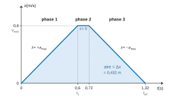
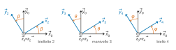
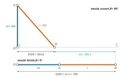
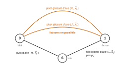
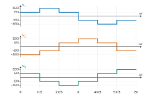

# ATS — Sciences industrielles 2026 · Corrigé brut

*Corrigé rédigé par IA, non officiel. Signalez toute erreur.*

Sujet : « L'injection plastique ». Durée 5 h, calculatrice autorisée. La partie 1 est une présentation sans question ; les questions 1 à 64 sont réparties dans les parties 2 à 9.

## Partie 2 — Étude de la cadence de fabrication

### Question 1

L'exigence « 112 » impose une cadence maximale de $C=6000$ pièces par heure. Un cycle produisant $n=10$ pièces, il faut $6000/10=600$ cycles par heure, donc

$$\begin{aligned}
t_{moy}&=\frac{3600\,n}{C}\\
&=\frac{3600}{600}
\end{aligned}$$

$$\boxed{t_{moy}=6{,}0\ \text{s}}$$

C'est la durée maximale admissible d'un cycle (une durée, à ne pas confondre avec la cadence, qui est un nombre de pièces par heure).

### Question 2

La vis agit comme un piston de section $S=\pi D_f^2/4$ se déplaçant à $v_i$ :

$$\boxed{Q_i=\frac{\pi D_f^2}{4}\,v_i}$$

$$\begin{aligned}
Q_i&=\frac{\pi\times0{,}04^2}{4}\times0{,}12\\
&=1{,}508\cdot10^{-4}\ \text{m}^3/\text{s}
\end{aligned}$$

$$\boxed{Q_i\simeq150{,}8\ \text{cm}^3/\text{s}}$$

### Question 3

Le débit étant constant pendant l'injection :

$$\boxed{t_i=\frac{V_p}{Q_i}=\frac{4V_p}{\pi D_f^2v_i}}$$

$$\begin{aligned}
t_i&=\frac{210\ \text{cm}^3}{150{,}8\ \text{cm}^3/\text{s}}\\
&\simeq1{,}39\ \text{s}
\end{aligned}$$

### Question 4

Les éjecteurs font un aller-retour de course $x_e$ à vitesse constante $v_e$ : la distance parcourue est $2x_e$.

$$\boxed{t_e=\frac{2x_e}{v_e}}$$

$$\begin{aligned}
t_e&=\frac{2\times0{,}15}{0{,}3}\\
&=1{,}0\ \text{s}
\end{aligned}$$

### Question 5

Loi en trapèze à trois phases :

- phase 1, de $0$ à $t_1=v_{max}/a_{max}=0{,}6$ s : $\dot x$ croît linéairement de $0$ à $v_{max}=0{,}6$ m/s (pente $a_{max}=1$ m/s²) ;
- phase 2, de $0{,}6$ s à $0{,}72$ s : palier $\dot x=v_{max}$ ;
- phase 3, de $0{,}72$ s à $1{,}32$ s : $\dot x$ décroît linéairement jusqu'à $0$ (pente $-a_{max}$).

Le graphe $\dot x=f(t)$ est donc un trapèze isocèle (figure 1) ; son aire vaut $\Delta x=0{,}432$ m (durées justifiées à la question 6).



### Question 6

Phases d'accélération et de décélération :

$$\begin{aligned}
t_1=t_3&=\frac{v_{max}}{a_{max}}\\
&=0{,}6\ \text{s}\\
d_1=d_3&=\frac{v_{max}^2}{2a_{max}}\\
&=0{,}18\ \text{m}
\end{aligned}$$

Comme $d_1+d_3=0{,}36\ \text{m}<\Delta x$, le palier existe :

$$\begin{aligned}
d_2&=\Delta x-d_1-d_3\\
&=0{,}432-0{,}36=0{,}072\ \text{m}\\
t_2&=\frac{d_2}{v_{max}}\\
&=0{,}12\ \text{s}
\end{aligned}$$

$$\begin{aligned}
t_{o/f}&=t_1+t_2+t_3\\
&=\frac{\Delta x}{v_{max}}+\frac{v_{max}}{a_{max}}\\
&=0{,}72+0{,}60
\end{aligned}$$

$$\boxed{t_{o/f}=1{,}32\ \text{s}}$$

### Question 7

Les quatre étapes se succèdent sans chevauchement (plastification en temps masqué) ; l'ouverture et la fermeture durent chacune $t_{o/f}$ :

$$\boxed{t_{cycl}=t_f+t_i+t_o+t_e=2\,t_{o/f}+t_i+t_e}$$

$$\begin{aligned}
t_{cycl}&=2\times1{,}32+1{,}39+1{,}0\\
&\simeq5{,}03\ \text{s}
\end{aligned}$$

### Question 8

On compare $t_{cycl}\simeq5{,}03$ s à $t_{moy}=6{,}0$ s : $t_{cycl}<t_{moy}$.

La cadence atteignable vaut $10\times3600/5{,}03\simeq7{,}15\cdot10^3$ pièces/h, supérieure à $6000$ pièces/h.

**L'exigence « 112 » est respectée**, avec une marge d'environ $1$ s par cycle.

## Partie 3 — Étude géométrique et cinématique

### Question 9

Les trois bases se déduisent de $(\vec x_0,\vec y_0,\vec z_0)$ par des rotations d'axe $\vec z_0$ (figures planes, $\vec z_0$ sortant) :

- d'angle $\beta$ : $\vec x_2=\cos\beta\,\vec x_0+\sin\beta\,\vec y_0$ et $\vec y_2=-\sin\beta\,\vec x_0+\cos\beta\,\vec y_0$ ;
- d'angle $\theta$ : $\vec x_3=\cos\theta\,\vec x_0+\sin\theta\,\vec y_0$ et $\vec y_3=-\sin\theta\,\vec x_0+\cos\theta\,\vec y_0$ ;
- d'angle $\varphi$ : $\vec x_4=\cos\varphi\,\vec x_0+\sin\varphi\,\vec y_0$ et $\vec y_4=-\sin\varphi\,\vec x_0+\cos\varphi\,\vec y_0$.



Les angles sont dessinés positifs ; sur la figure 7 du sujet, $\beta$ et $\varphi$ sont négatifs dans la position représentée, ce qui ne change pas les relations de projection.

### Question 10

Fermeture géométrique sur $OABO$, avec $\vec{BO}=-\vec{OB}=-e\,\vec x_3$ :

$$\vec{OA}+\vec{AB}+\vec{BO}=\vec 0$$

$$\lambda\,\vec x_0+h\,\vec y_0+d\,\vec x_2-e\,\vec x_3=\vec 0$$

En projection sur $\vec x_0$ et $\vec y_0$ (deux équations scalaires) :

$$\boxed{\begin{cases}\lambda+d\cos\beta-e\cos\theta=0\\ h+d\sin\beta-e\sin\theta=0\end{cases}}$$

### Question 11

On isole les termes en $\beta$ :

$$\begin{aligned}
d\cos\beta&=e\cos\theta-\lambda\\
d\sin\beta&=e\sin\theta-h
\end{aligned}$$

En élevant au carré et en sommant ($\cos^2\beta+\sin^2\beta=1$) :

$$\begin{aligned}
d^2&=(e\cos\theta-\lambda)^2+(e\sin\theta-h)^2\\
&=e^2+\lambda^2+h^2-2e\lambda\cos\theta-2eh\sin\theta
\end{aligned}$$

d'où $P\cos\theta+Q\sin\theta=R$ avec

$$\boxed{\begin{aligned}
P&=2e\lambda\\
Q&=2eh\\
R&=\lambda^2+h^2+e^2-d^2
\end{aligned}}$$

### Question 12

En divisant par $\sqrt{P^2+Q^2}$ et avec la définition de $\psi$ :

$$\begin{aligned}
\cos\theta\cos\psi+\sin\theta\sin\psi&=\frac{R}{\sqrt{P^2+Q^2}}\\
\cos(\theta-\psi)&=\frac{R}{\sqrt{P^2+Q^2}}
\end{aligned}$$

donc

$$\theta=\psi\pm\arccos\frac{R}{\sqrt{P^2+Q^2}}$$

Détermination de $\psi$ : comme $\tan\psi=Q/P$, on a $\psi=\arctan\dfrac{Q}{P}$ lorsque $P>0$ (c'est-à-dire $\lambda>0$).

Comme $Q=2eh>0$, on a $\sin\psi>0$ et $\psi\in\left]0,\pi\right[$.

Lorsque $P<0$ ($\lambda<0$, ce qui arrive pendant l'ouverture), il faut prendre $\psi=\arctan\dfrac{Q}{P}+\pi$ ; pour $P=0$, $\psi=\pi/2$.

Une écriture valable dans tous les cas est $\psi=\arccos\dfrac{P}{\sqrt{P^2+Q^2}}$.

La branche du mécanisme réel est celle qui donne $\theta=0$ en position fermée (et $\theta(0)\simeq20^\circ$ sur la figure 8) :

$$\boxed{\theta=\psi-\arccos\frac{R}{\sqrt{P^2+Q^2}}}$$

avec $\psi=\arccos\dfrac{P}{\sqrt{P^2+Q^2}}$. Pour $\lambda>0$, cela s'écrit aussi :

$$\theta=\arctan\frac{Q}{P}-\arccos\frac{R}{\sqrt{P^2+Q^2}}\qquad(\lambda>0)$$

L'autre signe correspond à l'autre mode d'assemblage du triangle $OAB$.

### Question 13

Sur la figure 8 :

- moule fermé, $\theta=0^\circ$ pour $\lambda_f\simeq150$ mm ;
- moule ouvert, $\theta=90^\circ$ pour $\lambda_o\simeq-210$ mm (en $\lambda=-150$ mm on ne lit que $\theta\simeq69^\circ$).

$$\begin{aligned}
\Delta\lambda&=\lambda_f-\lambda_o\\
&\simeq150-(-210)=360\ \text{mm}
\end{aligned}$$

$$\boxed{\Delta\lambda\simeq360\ \text{mm}=0{,}36\ \text{m}}$$

### Question 14

$$\boxed{\dot\lambda_{moy}=\frac{\Delta\lambda}{\Delta t}}$$

$$\begin{aligned}
\dot\lambda_{moy}&=\frac{0{,}36}{1{,}2}\\
&=0{,}30\ \text{m/s}
\end{aligned}$$

### Question 15

Un tour de vis $6/0$ fait avancer l'écrou $1$ (guidé en translation, partie 4) d'un pas $p_v$. Avec $N_{6/0}$ en tr/min, la vis fait $N_{6/0}/60$ tours par seconde :

$$\boxed{\dot\lambda_{moy}=\frac{p_v\,N_{6/0}}{60}}\qquad(\dot\lambda\ \text{en m/s},\ p_v\ \text{en m/tr},\ N_{6/0}\ \text{en tr/min})$$

### Question 16

Courroie crantée : égalité des vitesses linéaires de la courroie sur les deux poulies, donc $N_mZ_m=N_{6/0}Z_6$ :

$$N_m=N_{6/0}\,\frac{Z_6}{Z_m}$$

puis, avec la question 15 :

$$\boxed{N_m=\frac{60\,\dot\lambda_{moy}}{p_v}\cdot\frac{Z_6}{Z_m}}$$

Application numérique :

$$\begin{aligned}
N_{6/0}&=\frac{60\times0{,}30}{0{,}03}\\
&=600\ \text{tr/min}\\
N_m&=600\times\frac{90}{30}
\end{aligned}$$

$$\boxed{N_m=1800\ \text{tr/min}}$$

C'est la vitesse minimale fixée par l'exigence « 1121 ».

### Question 17

Le moule $5$ étant en translation suivant $\vec x_0$, $D$ reste sur l'axe $(O,\vec x_0)$.

Pour $\theta=90^\circ$, $\vec{OC}=2e\,\vec y_0$ est orthogonal à $\vec{OD}$ : le triangle $OCD$ est rectangle en $O$, d'hypoténuse $CD=L$. Théorème de Pythagore :

$$\boxed{\|\vec{OD}\|=\sqrt{L^2-4e^2}}$$

$$\begin{aligned}
\|\vec{OD}\|&=\sqrt{400^2-300^2}\\
&\simeq264{,}6\ \text{mm}
\end{aligned}$$

### Question 18

Pour $\theta=0^\circ$, $O$, $C$ et $D$ sont alignés sur $\vec x_0$ (position de genouillère, annexe 3) :

$$\boxed{\|\vec{OD}\|=2e+L=700\ \text{mm}}$$



L'amplitude d'ouverture est la différence des deux positions de $D$ :

$$\begin{aligned}
\Delta x&=2e+L-\sqrt{L^2-4e^2}\\
&\simeq700-264{,}6
\end{aligned}$$

$$\boxed{\Delta x\simeq435{,}4\ \text{mm}}$$

$435{,}4\ \text{mm}\geq400$ mm : **l'exigence « 1211 » est respectée**.

## Partie 4 — Étude des liaisons

### Question 19

Liaisons de la figure 10 :

- $0$–$1$ en $J$ : pivot glissant d'axe $(J,\vec x_0)$ ;
- $0$–$1$ en $K$ : pivot glissant d'axe $(K,\vec x_0)$ ;
- $6$–$1$ en $L$ : hélicoïdale d'axe $(L,\vec x_0)$, de pas $p_v$ ;
- $6$–$0$ en $M$ : pivot d'axe $(M,\vec x_0)$.

Graphe de structure (figure 4) :



**Les liaisons en $J$ et $K$ relient le même couple de solides : elles sont en parallèle.**

### Question 20

Pivot glissant d'axe $(K,\vec x_0)$ : rotation et translation suivant $\vec x_0$ libres, donc résultante et moment nuls suivant $\vec x_0$.

$$\boxed{{}_K\{T_{0\to1}\}=\left\{\begin{matrix}0 & 0\\ Y_K & M_K\\ Z_K & N_K\end{matrix}\right\}_{K,(\vec x_0,\vec y_0,\vec z_0)}}$$

$$\boxed{{}_K\{V_{1/0}\}=\left\{\begin{matrix}\omega_K & v_K\\ 0 & 0\\ 0 & 0\end{matrix}\right\}_{K,(\vec x_0,\vec y_0,\vec z_0)}}$$

### Question 21

Méthode cinématique. Les liaisons étant en parallèle, le torseur cinématique équivalent doit être compatible avec chacune.

En $J$, de même forme qu'en $K$ : $\vec\Omega_{1/0}=\omega_J\vec x_0$ et $\vec V_{J\in1/0}=v_J\vec x_0$. L'égalité des rotations donne $\omega_J=\omega_K=\omega$.

On transporte le torseur de $K$ en $J$, avec $\vec{KJ}=\vec{KL}+\vec{LJ}=2a\,\vec z_0$ :

$$\begin{aligned}
\vec V_{J\in1/0}&=\vec V_{K\in1/0}+\vec\Omega_{1/0}\wedge\vec{KJ}\\
&=v_K\vec x_0+2a\,\omega\,\vec x_0\wedge\vec z_0\\
&=v_K\vec x_0-2a\,\omega\,\vec y_0
\end{aligned}$$

L'identification avec $v_J\vec x_0$ impose $\omega=0$ (car $a\neq0$) et $v_J=v_K=v$ :

$$\{V_{1/0}\}_{eq}=\left\{\begin{matrix}0 & v\\ 0 & 0\\ 0 & 0\end{matrix}\right\}_{\forall P,(\vec x_0,\vec y_0,\vec z_0)}$$

**La liaison équivalente entre $0$ et $1$ est une glissière de direction $\vec x_0$** (une mobilité, cinq inconnues statiques transmissibles). L'association est hyperstatique : $h=8-(6-1)=3$.

## Partie 5 — Dimensionnement du moteur

### Question 22

Cylindre plein de rayon $d_v/2$ et de longueur $L_v$, de volume $\pi\dfrac{d_v^2}{4}L_v$, donc de masse

$$m_v=\rho\,\pi\frac{d_v^2}{4}L_v$$

$$\begin{aligned}
J_v&=\frac{m_v}{2}\left(\frac{d_v}{2}\right)^2\\
&=\frac{m_vd_v^2}{8}\\
&=\frac{\pi\rho L_vd_v^4}{32}
\end{aligned}$$

$$\boxed{J_v=\frac{m_vd_v^2}{8}=\frac{\pi\rho L_vd_v^4}{32}}$$

### Question 23

Maillon par maillon :

$$\begin{aligned}
\omega_v&=r\,\omega_m&&\text{(courroie)}\\
\dot\lambda&=\frac{p_v}{2\pi}\,\omega_v&&\text{(vis-écrou, }p_v\text{ en m/tr, }\omega_v\text{ en rad/s)}\\
\dot x&=i\,\dot\lambda&&\text{(définition }i=\dot x/\dot\lambda)
\end{aligned}$$

D'où

$$\boxed{\dot x=\frac{i\,r\,p_v}{2\pi}\,\omega_m}$$

Contrôle d'homogénéité : $p_v/2\pi$ est en m/rad, $\omega_m$ en rad/s, $i$ et $r$ sans dimension, donc $\dot x$ en m/s. Le facteur $2\pi$ (nombre de radians par tour) apparaît une seule fois, au dénominateur.

Avec $k=2{,}4\cdot10^{-3}$ m, $r=1/3$ et $p_v=0{,}03$ m/tr, cela correspond à $i=\dfrac{2\pi k}{r\,p_v}\simeq1{,}5$.

### Question 24

Seuls l'arbre moteur, la vis $6$ et le moule $5$ ont une inertie non négligée. L'arbre et la vis tournent autour d'axes fixes, le moule est en translation :

$$E_{c(S/0)}=\tfrac12J_m\omega_m^2+\tfrac12J_v\omega_v^2+\tfrac12M\dot x^2$$

Avec $\omega_v=r\,\omega_m$ et $\dot x=k\,\omega_m$ :

$$E_{c(S/0)}=\tfrac12\left(J_m+r^2J_v+Mk^2\right)\omega_m^2$$

$$\boxed{E_{c(S/0)}=\tfrac12J_{eq}\,\omega_m^2}$$

avec

$$\boxed{J_{eq}=J_m+r^2J_v+Mk^2}$$

### Question 25

Puissances **extérieures** à $S$ (actions de l'extérieur de $S$ sur $S$) :

- couple moteur, exercé par le stator (lié au bâti $0$, extérieur à $S$) sur l'arbre moteur : puissance extérieure $C_m\,\omega_m$ ;
- pesanteur sur le moule $5$ : le poids $-Mg\,\vec y_0$ est orthogonal à la vitesse $\dot x\,\vec x_0$ (translation horizontale), d'où $-Mg\,\vec y_0\cdot\dot x\,\vec x_0=0$ ;
- pesanteur sur la vis : son centre d'inertie reste sur l'axe fixe, sa vitesse est nulle, puissance nulle ; les autres pièces ont une masse négligée ;
- liaisons avec le bâti (pivots en $E$/$M$ et $F$, glissière $0$/$1$, guidage du moule, articulations en $O$) : parfaites, puissance nulle.

Puissances **intérieures** à $S$ : liaisons internes (hélicoïdale $6/1$, pivots en $A$, $B$, $C$, $D$, transmission poulies-courroie) parfaites, rendements égaux à 1, donc puissance nulle.

$$\boxed{P_{ext\to S}=C_m\,\omega_m}$$

$$\boxed{P_{int}=0}$$

### Question 26

Théorème de l'énergie cinétique appliqué à $S$ dans le repère lié au bâti $0$, supposé galiléen :

$$\frac{\mathrm dE_{c(S/0)}}{\mathrm dt}=P_{ext\to S}+P_{int}$$

Avec $J_{eq}$ constant ($k$ constant) :

$$\begin{aligned}
\frac{\mathrm dE_{c(S/0)}}{\mathrm dt}&=J_{eq}\,\omega_m\dot\omega_m\\
J_{eq}\,\omega_m\dot\omega_m&=C_m\,\omega_m
\end{aligned}$$

En simplifiant par $\omega_m\neq0$ en cours de mouvement :

$$\boxed{C_m=J_{eq}\,\dot\omega_m}$$

### Question 27

$\ddot x=k\,\dot\omega_m$, donc

$$\begin{aligned}
\dot\omega_m&=\frac{\ddot x}{k}\\
&=\frac{1}{2{,}4\cdot10^{-3}}\\
&\simeq416{,}7\ \text{rad/s}^2
\end{aligned}$$

$$\begin{aligned}
C_m&=\frac{J_{eq}\,\ddot x}{k}\\
&=2\cdot10^{-2}\times416{,}7
\end{aligned}$$

$$\boxed{C_m\simeq8{,}3\ \text{N}\cdot\text{m}}$$

### Question 28

Il faut $N_n\geq1900$ tr/min et $M_n\geq9$ N·m (puissance utile $9\times1900\times2\pi/60\simeq1{,}79$ kW).

- 6 pôles ($N_n\leq974$ tr/min) et 4 pôles ($N_n\leq1474$ tr/min) : vitesse insuffisante, exclus.
- 2 pôles ($N_n\simeq2820$ à $2950$ tr/min) : le LS 90 L (2,2 kW) n'a que $7{,}30$ N·m ; le premier moteur avec $M_n\geq9$ N·m est le LS 100 L de 3 kW.

**Moteur retenu : LS 100 L, 2 pôles, $P_n=3$ kW, $M_n=10$ N·m, $N_n=2860$ tr/min** (vitesse nominale compatible avec l'exigence « 1121 »).

## Partie 6 — Vérification des coussinets

### Question 29

L'effort de fermeture se répartit également entre les 4 bielles :

$$\boxed{F_R=\frac{F}{4}}$$

$$\begin{aligned}
F_R&=\frac{1000\ \text{kN}}{4}\\
&=250\ \text{kN}\\
&=2{,}5\cdot10^5\ \text{N}
\end{aligned}$$

### Question 30

Pression rapportée à la surface projetée, rectangle $d_{int}\times b$ (figure de l'énoncé) :

$$\boxed{p=\frac{F_R}{d_{int}\,b}}$$

$$\begin{aligned}
p&=\frac{2{,}5\cdot10^5}{75\times80}\\
&\simeq41{,}7\ \text{N/mm}^2
\end{aligned}$$

### Question 31

La phase étudiée est statique : on compare à $p_{max}=200$ N/mm². $p\simeq41{,}7\ \text{N/mm}^2<200$ N/mm² (et même $<140$ N/mm²).

**Les coussinets conviennent vis-à-vis de la pression admissible.**

### Question 32

Vitesse de glissement d'un point de l'alésage, de rayon $d_{int}/2$. La vitesse angulaire est $\omega_{4/5}=2\pi N_{4/5}/60$ (rad/s, avec $N_{4/5}$ en tr/min) :

$$\begin{aligned}
v_{gliss}&=\omega_{4/5}\,\frac{d_{int}}{2}\\
&=\frac{2\pi N_{4/5}}{60}\cdot\frac{d_{int}}{2}\\
&=\frac{\pi\,d_{int}\,N_{4/5}}{60}
\end{aligned}$$

$$\boxed{v_{gliss}=\frac{\pi\,d_{int}\,N_{4/5}}{60}}$$

### Question 33

Sur la figure 13, $N_{4/5\,max}\simeq9{,}8$ tr/min (palier entre $1{,}0$ et $1{,}2$ s).

$$\begin{aligned}
v_{gliss\,max}&=\frac{\pi\times75\times9{,}8}{60}\\
&\simeq38{,}5\ \text{mm/s}
\end{aligned}$$

$$\boxed{v_{gliss\,max}\simeq38{,}5\ \text{mm/s}<200\ \text{mm/s}}$$

**Les coussinets conviennent aussi vis-à-vis de la vitesse de glissement.**

## Partie 7 — Asservissement en température du fourreau

### Question 34

Analogie : potentiel ↔ température, courant ↔ puissance thermique. La source $P_{th}$ alimente en parallèle $C_{th}$ et $R_{th}$, soumis tous deux à $\Delta\theta=\theta-\theta_a$.

Loi des nœuds (la puissance thermique est un courant) : le courant fourni par la source se partage entre la résistance, qui reçoit $\Delta\theta/R_{th}$, et le condensateur, qui reçoit $C_{th}\,\mathrm d\Delta\theta/\mathrm dt$.

$$\boxed{P_{th}(t)=\frac{\Delta\theta(t)}{R_{th}}+C_{th}\,\frac{\mathrm d\Delta\theta(t)}{\mathrm dt}}$$

(puissance perdue à travers l'isolant + puissance stockée dans l'ensemble fourreau/vis).

### Question 35

Conditions de Heaviside (conditions initiales nulles) : $\mathcal L\left[\frac{\mathrm d\Delta\theta}{\mathrm dt}\right]=p\,\Delta\theta(p)$.

$$\begin{aligned}
P_{th}(p)&=\frac{\Delta\theta(p)}{R_{th}}+C_{th}\,p\,\Delta\theta(p)\\
&=\Delta\theta(p)\left(\frac1{R_{th}}+C_{th}p\right)\\
&=\frac{\Delta\theta(p)}{R_{th}}\left(1+R_{th}C_{th}\,p\right)
\end{aligned}$$

(factorisation par $1/R_{th}$), d'où

$$\boxed{H(p)=\frac{\Delta\theta(p)}{P_{th}(p)}=R_{th}\,\frac{1}{1+R_{th}C_{th}\,p}}$$

### Question 36

**Premier ordre** (dénominateur de degré 1 en $p$), **classe 0** (aucun intégrateur : pas de facteur $p$ en facteur au dénominateur).

Gain statique $K=R_{th}=17{,}56\cdot10^{-3}$ K/W, constante de temps $\tau=R_{th}C_{th}\simeq2775$ s.

### Question 37

Retour unitaire, $\mathrm{FTBO}(p)=K_pH(p)$ :

$$\begin{aligned}
\mathrm{FTBF}_1(p)&=\frac{K_pH(p)}{1+K_pH(p)}\\
&=\frac{K_pR_{th}}{1+K_pR_{th}+R_{th}C_{th}\,p}
\end{aligned}$$

$$\boxed{\mathrm{FTBF}_1(p)=\frac{K_{BF}}{1+\tau_{BF}\,p}}$$

$$\boxed{\begin{aligned}
K_{BF}&=\frac{K_pR_{th}}{1+K_pR_{th}}\\
\tau_{BF}&=\frac{R_{th}C_{th}}{1+K_pR_{th}}
\end{aligned}}$$

Premier ordre de classe 0, gain statique inférieur à 1.

### Question 38

La FTBF est du premier ordre, de coefficients tous positifs. Son pôle unique

$$p_1=-\frac{1+K_pR_{th}}{R_{th}C_{th}}$$

est réel et strictement négatif pour tout $K_p>0$ : un premier ordre à coefficients positifs est stable quel que soit le gain.

**Le système bouclé est stable : aucun problème de stabilité.**

### Question 39

D'après le schéma bloc, l'écart est la différence entre la consigne et la sortie, et la sortie vaut $\theta(p)=K_pH(p)\,\varepsilon(p)$ :

$$\begin{aligned}
\varepsilon(p)&=\theta_c(p)-\theta(p)\\
&=\theta_c(p)-K_pH(p)\,\varepsilon(p)
\end{aligned}$$

$$\boxed{\varepsilon(p)=\frac{\theta_c(p)}{1+K_pH(p)}=\frac{1+R_{th}C_{th}\,p}{1+K_pR_{th}+R_{th}C_{th}\,p}\,\theta_c(p)}$$

### Question 40

Théorème de la valeur finale (applicable : système stable, question 38), avec $\theta_c(p)=\theta_c/p$ :

$$\begin{aligned}
\varepsilon_\infty&=\lim_{p\to0}p\,\varepsilon(p)\\
&=\lim_{p\to0}\frac{1+R_{th}C_{th}\,p}{1+K_pR_{th}+R_{th}C_{th}\,p}\,\theta_c\\
&=\frac{\theta_c}{1+K_pR_{th}}
\end{aligned}$$

$$\boxed{\varepsilon_r=\frac{\varepsilon_\infty}{\theta_c}=\frac1{1+K_pR_{th}}}$$

Exigence « 142 » :

$$\frac1{1+K_pR_{th}}<10^{-3}\iff K_pR_{th}>999$$

$$\boxed{K_p>\frac{999}{R_{th}}\simeq5{,}69\cdot10^4\ \text{W/K}}$$

### Question 41

$\varepsilon_r$ et $\tau_{BF}$ sont tous deux divisés par $1+K_pR_{th}$ : **il faut augmenter $K_p$**, ce qui améliore à la fois la précision et la rapidité (la limite viendra de la puissance disponible, questions 45 à 48).

### Question 42

Un **correcteur à action intégrale** (intégral ou proportionnel-intégral) : il rend la boucle ouverte de classe 1, l'erreur statique vis-à-vis d'un échelon est alors nulle quel que soit le gain.

### Question 43

$K_pR_{th}=60\,000\times17{,}56\cdot10^{-3}=1053{,}6$, d'où

$$\begin{aligned}
\tau_{BF}&=\frac{2774{,}5}{1054{,}6}\\
&\simeq2{,}63\ \text{s}\\
t_{r5\%}&=3\,\tau_{BF}
\end{aligned}$$

$$\boxed{t_{r5\%}\simeq7{,}9\ \text{s}<8\ \text{s}}$$

**L'exigence « 141 » est respectée** (sur le modèle linéaire). En outre $\varepsilon_r=1/1054{,}6\simeq0{,}095\ \%<0{,}1\ \%$ : l'exigence « 142 » l'est aussi.

### Question 44

$P_{th}(p)=K_p\,\varepsilon(p)$, donc, avec la question 39 :

$$\boxed{P_{th}(p)=\frac{K_p}{1+K_pH(p)}\,\theta_c(p)=\frac{K_p\,(1+R_{th}C_{th}\,p)}{1+K_pR_{th}+R_{th}C_{th}\,p}\,\theta_c(p)}$$

### Question 45

Théorème de la valeur initiale avec $\theta_c(p)=220/p$ :

$$\begin{aligned}
P_{th}(0^+)&=\lim_{p\to\infty}p\,P_{th}(p)\\
&=\lim_{p\to\infty}\frac{K_p\,(1+R_{th}C_{th}\,p)}{1+K_pR_{th}+R_{th}C_{th}\,p}\times220\\
&=220\,K_p
\end{aligned}$$

$$\boxed{P_{th}(0^+)=1{,}32\cdot10^7\ \text{W}=13{,}2\ \text{MW}}$$

soit 440 fois la puissance maximale des colliers (30 kW).

### Question 46

La commande sature à $P_{max}=30$ kW tant que $K_p\varepsilon>30$ kW, c'est-à-dire $\varepsilon>0{,}5$ K. Le système évolue alors en boucle ouverte sous puissance constante :

$$\Delta\theta(t)=R_{th}P_{max}\left(1-e^{-t/\tau}\right)$$

avec $R_{th}P_{max}=526{,}8$ K et $\tau=2775$ s. La montée est limitée par $P_{max}/C_{th}\simeq0{,}19$ K/s.

**Le temps de réponse à 5 % est très fortement augmenté** : le système est ralenti, et non accéléré. Il passe à l'ordre de $-\tau\ln\left(1-\frac{209}{526{,}8}\right)\simeq1{,}4\cdot10^3$ s au lieu de $7{,}9$ s.

### Question 47

Le bloc sature la commande $P_{th}$, qui est une puissance thermique (en watts), et non une tension. Limite haute : puissance maximale des colliers ; limite basse : les colliers ne peuvent pas refroidir.

$$\boxed{v_1=30\,000\ \text{W}}$$

$$\boxed{v_2=0\ \text{W}}$$

### Question 48

Sur la figure 18, on mesure directement l'instant où la température franchit $95\ \%$ de la consigne, soit $209$ °C : vers $t\simeq1400$ s ; elle atteint 220 °C vers $1500$ s.

La réponse n'est pas celle d'un premier ordre (montée quasi linéaire, raccord anguleux à 220 °C) : on ne peut pas mesurer une constante de temps puis multiplier par 3.

$$\boxed{t_{r5\%}\simeq1400\ \text{s}\simeq23\ \text{min}}$$

à comparer aux $7{,}9$ s de la question 43 (rapport d'environ 180).

Explication : le calcul de la question 43 suppose un modèle linéaire où l'actionneur fournit toute la puissance demandée ; or la commande initiale demandée est $13{,}2$ MW pour 30 kW disponibles. La commande reste saturée pendant presque toute la montée (jusqu'à $\varepsilon\simeq0{,}5$ K) ; la dynamique est alors imposée par la puissance installée et la capacité thermique, non par le correcteur. Le calcul en régime saturé donne $1402$ s pour atteindre 209 °C, en accord avec la simulation.

$t_{r5\%}\simeq23\ \text{min}<30$ min : **l'exigence « 111 » (préchauffage en moins de 30 minutes) est respectée.**

## Partie 8 — Alimentation de la machine d'entraînement de la vis du fourreau

### Question 49

Document réponse DR1 :

| Courbe | Tension | Justification |
|---|---|---|
| quasi continue, environ 200 V, faible ondulation | $u_3$ | sortie du filtre |
| arches positives de 0 à 325 V, période 10 ms | $u_2$ | sortie du pont de diodes (redressement double alternance) |
| sinusoïde $\pm325$ V, période 20 ms | $u_1$ | tension du réseau (230 V efficaces, 50 Hz) |

### Question 50

Entrée alternative, sortie continue : **convertisseur alternatif-continu, c'est-à-dire un redresseur** (pont de diodes, non commandé, double alternance).

### Question 51

Si $T_x$ et $T_x'$ étaient fermés simultanément, ils relieraient directement les deux bornes de la source de tension $E$ : **court-circuit de la source de tension**. Une source de tension impose sa tension quel que soit le courant : le courant ne serait limité que par les résistances parasites et détruirait les interrupteurs. Les commandes d'un même bras sont donc complémentaires.

### Question 52

On repère les potentiels par rapport à la borne négative de $E$. Le potentiel $V_x$ du point $x$ vaut $E$ si $T_x$ est fermé.

Il vaut $0$ si $T_x'$ est fermé. On en déduit :

$$\begin{aligned}
u_{12}&=V_1-V_2\\
u_{23}&=V_2-V_3\\
u_{31}&=V_3-V_1
\end{aligned}$$

Les graduations de DR2 se lisent de $\pi/3$ en $\pi/3$, de $0$ à $2\pi$. Le document imprime par erreur « π/2 » pour $\pi$ et « 10π/3 » pour $5\pi/3$.

| $\omega t$ | interrupteurs fermés | $u_{12}$ | $u_{23}$ | $u_{31}$ |
|---|---|---|---|---|
| $[0,\frac\pi3]$ | $T_1,T_2',T_3$ | $E$ | $-E$ | $0$ |
| $[\frac\pi3,\frac{2\pi}3]$ | $T_1,T_2',T_3'$ | $E$ | $0$ | $-E$ |
| $[\frac{2\pi}3,\pi]$ | $T_1,T_2,T_3'$ | $0$ | $E$ | $-E$ |
| $[\pi,\frac{4\pi}3]$ | $T_1',T_2,T_3'$ | $-E$ | $E$ | $0$ |
| $[\frac{4\pi}3,\frac{5\pi}3]$ | $T_1',T_2,T_3$ | $-E$ | $0$ | $E$ |
| $[\frac{5\pi}3,2\pi]$ | $T_1',T_2',T_3$ | $0$ | $-E$ | $E$ |

Sur chaque intervalle, $u_{12}+u_{23}+u_{31}=0$.

### Question 53

On part des définitions lues sur la figure 21 :

$$\begin{aligned}
u_{12}&=v_1-v_2\\
u_{23}&=v_2-v_3\\
u_{31}&=v_3-v_1
\end{aligned}$$

Alors, avec $v_2+v_3=-v_1$ :

$$\begin{aligned}
u_{12}-u_{31}&=(v_1-v_2)-(v_3-v_1)\\
&=2v_1-(v_2+v_3)\\
&=3v_1
\end{aligned}$$

De même :

$$\begin{aligned}
u_{23}-u_{12}&=2v_2-(v_1+v_3)\\
&=3v_2\\
u_{31}-u_{23}&=2v_3-(v_1+v_2)\\
&=3v_3
\end{aligned}$$

$$\boxed{\begin{aligned}
v_1&=\tfrac13(u_{12}-u_{31})\\
v_2&=\tfrac13(u_{23}-u_{12})\\
v_3&=\tfrac13(u_{31}-u_{23})
\end{aligned}}$$

### Question 54

| $\omega t$ | $v_1$ | $v_2$ | $v_3$ |
|---|---|---|---|
| $[0,\frac\pi3]$ | $E/3$ | $-2E/3$ | $E/3$ |
| $[\frac\pi3,\frac{2\pi}3]$ | $2E/3$ | $-E/3$ | $-E/3$ |
| $[\frac{2\pi}3,\pi]$ | $E/3$ | $E/3$ | $-2E/3$ |
| $[\pi,\frac{4\pi}3]$ | $-E/3$ | $2E/3$ | $-E/3$ |
| $[\frac{4\pi}3,\frac{5\pi}3]$ | $-2E/3$ | $E/3$ | $E/3$ |
| $[\frac{5\pi}3,2\pi]$ | $-E/3$ | $-E/3$ | $2E/3$ |



Avec $E=200$ V : $E/3\simeq66{,}7$ V et $2E/3\simeq133{,}3$ V.

Chaque tension simple est une onde « en marches d'escalier » à six paliers, de période $2\pi$, symétrique : $v(\omega t+\pi)=-v(\omega t)$.

Les tensions $v_2$ et $v_3$ sont $v_1$ retardée de $2\pi/3$ et $4\pi/3$. La somme des trois est nulle sur chaque intervalle.

## Partie 9 — Protocole de communication module moteur et capteur du robot de déchargement

### Question 55

Un protocole **full-duplex** permet d'émettre et de recevoir **simultanément** dans les deux sens, grâce à deux canaux distincts (TxD broche 3, RxD broche 2, masse commune broche 5).

### Question 56

**Asynchrone** : aucun signal d'horloge n'est transmis avec les données ; émetteur et récepteur utilisent chacun leur horloge locale. (Le terme n'a rien à voir avec la machine asynchrone ni avec un glissement.)

Le **bit de start** (passage de l'état de repos 1 à 0) crée un front qui signale le début de trame et resynchronise le récepteur, qui échantillonne ensuite chaque bit au milieu de sa durée.

Il faut donc **régler au préalable la même vitesse de transmission** (débit en bauds) et le même format de trame (8 bits de données, parité, 2 bits de stop) sur la centrale de gestion et sur chaque module d'axe.

### Question 57

**Principe** : l'émetteur ajoute un bit choisi pour que le nombre total de bits à 1 (données + parité) soit pair (parité paire) ou impair (parité impaire) ; le récepteur refait le comptage.

**Utilité** : détecter une erreur de transmission.

**Limitation** : seul un nombre impair de bits erronés est détecté (deux inversions se compensent) et l'erreur n'est ni localisée ni corrigée.

### Question 58

Chaque trame transporte 8 bits de données ; la position est codée sur 16 bits : **2 trames**.

### Question 59

$$\begin{aligned}
q&=\frac{1500}{2^{16}}\\
&=\frac{1500}{65\,536}\\
&\simeq0{,}023\ \text{mm}
\end{aligned}$$

$$\boxed{q\simeq0{,}023\ \text{mm}}$$

$0{,}023\ \text{mm}<0{,}05$ mm : **l'exigence « 152 » est respectée** (du point de vue de la résolution du capteur).

### Question 60

Les curseurs encadrent un bit : $\Delta=52{,}00\ \mu$s. Donc $T_{bit}=52\ \mu$s et

$$\boxed{D=\frac1{T_{bit}}\simeq19\,230\ \text{bit/s}}$$

soit le débit normalisé de 19 200 bauds.

### Question 61

Lecture par tranches de $52\ \mu$s à partir du front descendant du start (niveau haut = 1). Le bit de start, le bit de parité et les bits de stop ne font pas partie de la donnée :

| bit | trame 1 | trame 2 |
|---|---|---|
| start | 0 | 0 |
| $b_0$ (poids faible) | 1 | 1 |
| $b_1$ | 0 | 1 |
| $b_2$ | 0 | 0 |
| $b_3$ | 0 | 0 |
| $b_4$ | 0 | 0 |
| $b_5$ | 0 | 1 |
| $b_6$ | 1 | 1 |
| $b_7$ (poids fort) | 0 | 0 |
| parité | 0 | 0 |
| stop | 1 1 | 1 1 |

Bits de poids faible en premier : l'octet de la trame 1 s'écrit $0100\,0001_2$ et celui de la trame 2 $0110\,0011_2$ (parité paire vérifiée dans les deux cas : deux puis quatre bits à 1).

La trame 1 porte l'octet de poids faible, la trame 2 l'octet de poids fort (données émises en commençant par le poids faible). Le nombre de 16 bits est :

$$N=0110\,0011\,0100\,0001_2=6341_{16}$$

$$\boxed{N=25\,409}$$

### Question 62

(Le sujet renvoie aux questions 58 et 60 ; il s'agit du quantum de la question 59 et de la valeur de la question 61.)

$$\begin{aligned}
x&=N\,q\\
&=25\,409\times\frac{1500}{65\,536}\\
&\simeq581{,}6\ \text{mm}
\end{aligned}$$

$$\boxed{x\simeq581{,}6\ \text{mm}}$$

### Question 63

Une trame compte $1+8+1+2=12$ bits ; deux trames enchaînées sans temps mort :

$$\begin{aligned}
t_{min}&=24\,T_{bit}\\
&=24\times52\ \mu\text{s}\\
&\simeq1{,}25\ \text{ms}
\end{aligned}$$

$$\boxed{t_{min}\simeq1{,}25\ \text{ms}}$$

### Question 64

Seuils, en valeurs numériques codées sur 16 bits (écrites en décimal) :

$$\begin{aligned}
\frac{375}{1500}\times65\,536&=16\,384\\
\frac{750}{1500}\times65\,536&=32\,768
\end{aligned}$$

```text
--- DEBUT ALGORITHME ---
Limite_inf_x0 = 16384
Limite_sup_x0 = 32768
Valeur = lire_capteur_x0
SI (Valeur < Limite_inf_x0) OU (Valeur > Limite_sup_x0)
    Allumer_alarme
--- FIN ALGORITHME ---
```

Le mot-clé utile est **SI** : la valeur n'étant pas relue dans le bloc, un `TANT QUE` bouclerait indéfiniment ; le test est réexécuté à chaque nouvelle lecture du capteur. Pour la position de la question 62 ($25\,409$), aucune alarme n'est déclenchée.
