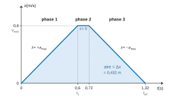
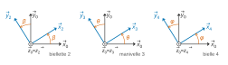
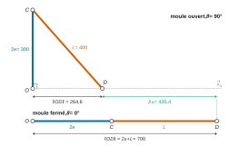
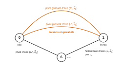
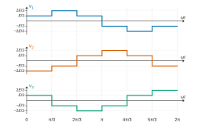

# ATS — Sciences industrielles 2026 · Corrigé guidé

*Corrigé rédigé par IA, non officiel. Signalez toute erreur.*

## Présentation du sujet

**Format.** Épreuve de 5 heures, calculatrice autorisée, aucune documentation autre que celle fournie. Le sujet (26 pages) est accompagné de 5 annexes (diagramme des exigences, schéma cinématique complet, phases de fonctionnement de la genouillère, catalogue de moteurs, protocole RS232) et de 3 documents réponses à rendre (DR1 à DR3). Il compte **64 questions**.

**Support.** Une presse à injecter les matières plastiques : un ensemble de fermeture à genouillère, mû par un moteur, une transmission poulies-courroie et un système vis-écrou, ouvre et ferme le moule ; un ensemble de plastification/injection (vis dans un fourreau chauffé) prépare et injecte la matière ; un robot cartésien décharge les pièces. Le fil directeur est le diagramme des exigences de l'annexe 1 : chaque partie vérifie une ou plusieurs exigences chiffrées.

**Découpage.** Huit parties indépendantes, souvent elles-mêmes découpées en sous-parties indépendantes :

| Partie | Thème | Questions | Outils |
|---|---|---|---|
| 2 | Cadence de fabrication (exigence 112) | 1 à 8 | débit volumique, cinématique du point, loi en trapèze |
| 3 | Géométrie et cinématique de la genouillère (exigences 1121, 1211) | 9 à 18 | figures de changement de base, fermeture géométrique, lecture graphique, transmissions |
| 4 | Guidage de l'écrou | 19 à 21 | graphe de structure, torseurs, liaison équivalente |
| 5 | Pré-dimensionnement du moteur | 22 à 28 | inertie, énergie cinétique, théorème de l'énergie cinétique, catalogue |
| 6 | Coussinets | 29 à 33 | pression sur surface projetée, vitesse de glissement |
| 7 | Asservissement en température (exigences 111, 141, 142) | 34 à 48 | analogie électrique, Laplace, premier ordre, précision, saturation |
| 8 | Alimentation de la machine de la vis (exigence 13) | 49 à 54 | redresseur, onduleur triphasé pleine onde |
| 9 | Liaison RS232 du robot (exigence 152) | 55 à 64 | transmission série, codage binaire, algorithme |

**Difficulté et longueur.** Le sujet est long mais très progressif ; aucune question n'est hors de portée d'un candidat ATS préparé. Les lectures graphiques (Q13, Q33, Q48, Q60-Q61) demandent du soin : une lecture fausse en Q13 se propage jusqu'à Q16.

**Questions discriminantes selon le rapport 2026.** Le jury juge la géométrie bien maîtrisée mais les questions de cinématique de la partie 3 « plus sélectives » ; il relève en particulier :

- la fermeture géométrique Q11-Q12 (« moins bien traitées ») et les positions particulières Q17-Q18 ;
- la démonstration de la liaison équivalente Q21, « rarement menée à son terme » ;
- la lecture du schéma bloc, source de « nombreuses erreurs relevées aux questions Q39, Q44 et Q47 » ;
- la classe en Q36 (moins de la moitié des candidats la connaissent) ;
- l'électronique de puissance Q50-Q53 et le décodage des trames Q61.

Le rapport note aussi que les meilleurs résultats viennent des candidats d'un niveau homogène en génie mécanique et en génie électrique : ne faire l'impasse ni sur les parties 2 à 6 ni sur les parties 7 à 9.

**Questions à ne pas laisser passer.** Toute la partie 2 (Q1 à Q8), Q15-Q18, Q20, Q22, Q29-Q33, Q35-Q40, Q43, Q47, Q49-Q51, Q55, Q58-Q60, Q63. Elles représentent plus de la moitié du sujet pour des calculs d'une ou deux lignes.

**Gestion du temps.** Environ 30 min pour la partie 2, 50 min pour la partie 3, 25 min pour la partie 4, 40 min pour la partie 5, 20 min pour la partie 6, 60 min pour la partie 7, 35 min pour la partie 8, 40 min pour la partie 9. Les parties étant indépendantes, ne pas rester bloqué : passer à la suivante et revenir.

**Une seule réponse par question.** Le rapport 2026 est explicite : « certains candidats proposent plusieurs réponses. Il faut noter que, dans ce cas, le correcteur enlèvera systématiquement les points à la question, même si une des réponses données est correcte. »

**Coquilles d'énoncé à signaler.** Les graduations des documents réponses DR2 et DR3 portent « π/2 » au lieu de $\pi$ et « 10π/3 » au lieu de $5\pi/3$ ; la question 62 renvoie aux « questions 58 et 60 » alors qu'il faut utiliser les questions 59 et 61.

## Partie 2 — Étude de la cadence de fabrication

On décompose un cycle en quatre étapes successives (fermeture, injection, ouverture, éjection), on chiffre chacune, puis on compare à la durée imposée par l'exigence « 112 ».

### Question 1

> [!INDICATION]
> Traduire une cadence (pièces par heure) en durée de cycle.

> [!INDICATION]
> Combien de pièces un cycle produit-il ?

#### Solution

L'exigence « 112 » impose $6000$ pièces par heure. Chaque cycle produit $10$ pièces, il faut donc $600$ cycles par heure :

$$\boxed{t_{moy}=\frac{3600}{600}=6{,}0\ \text{s}}$$

C'est la durée **maximale** admissible d'un cycle.

> [!PIEGE]
> Le rapport 2026 signale que « quelques candidats ont toutefois confondu cadence de production et temps moyen de cycle ». La cadence est un nombre de pièces par heure, $t_{moy}$ une durée en secondes. Oublier le facteur 10 donne $0{,}6$ s, durée irréaliste qui conduit à une conclusion fausse en question 8.

### Question 2

> [!INDICATION]
> La vis poussée par le vérin se comporte comme un piston dans un cylindre.

> [!INDICATION]
> Débit volumique = section balayée × vitesse.

#### Solution

$$\boxed{Q_i=\frac{\pi D_f^2}{4}\,v_i}$$

$$\begin{aligned}
Q_i&=\frac{\pi\times0{,}04^2}{4}\times0{,}12\\
&=1{,}508\cdot10^{-4}\ \text{m}^3/\text{s}
\end{aligned}$$

$$\boxed{Q_i\simeq150{,}8\ \text{cm}^3/\text{s}}$$

> [!PIEGE]
> $1\ \text{m}^3=10^6\ \text{cm}^3$. L'unité de sortie est imposée par l'énoncé.

### Question 3

> [!INDICATION]
> À débit constant, durée = volume / débit.

#### Solution

$$\boxed{t_i=\frac{V_p}{Q_i}=\frac{4V_p}{\pi D_f^2v_i}}$$

$$\begin{aligned}
t_i&=\frac{210}{150{,}8}\\
&\simeq1{,}39\ \text{s}
\end{aligned}$$

> [!JURY]
> Pour Q2-Q3, le rapport 2026 rappelle : « Une vérification rapide de l'homogénéité des résultats permettait souvent de détecter les erreurs de calcul. » Ici, des cm³ divisés par des cm³/s donnent bien des secondes.

### Question 4

> [!INDICATION]
> Relire attentivement le mouvement décrit par les éjecteurs avant la fermeture.

#### Solution

Les éjecteurs font un aller-retour, soit une distance $2x_e$ à vitesse constante :

$$\boxed{t_e=\frac{2x_e}{v_e}}$$

$$\begin{aligned}
t_e&=\frac{0{,}30}{0{,}3}\\
&=1{,}0\ \text{s}
\end{aligned}$$

> [!PIEGE]
> Selon le rapport 2026, « une part significative des candidats a oublié de prendre en compte le mouvement de retour lors du calcul demandé » : $x_e/v_e=0{,}5$ s est faux.

### Question 5

> [!INDICATION]
> Une loi « en trapèze » de vitesse : trois phases, accélération constante, vitesse constante, décélération constante.

> [!INDICATION]
> Calculer la durée de la phase d'accélération pour placer les points caractéristiques sur le tracé.

#### Solution

- Phase 1 : $\dot x$ croît linéairement de $0$ à $v_{max}=0{,}6$ m/s en $t_1=v_{max}/a_{max}=0{,}6$ s.
- Phase 2 : palier à $0{,}6$ m/s, de $0{,}6$ s à $0{,}72$ s.
- Phase 3 : décroissance linéaire jusqu'à $0$, de $0{,}72$ s à $1{,}32$ s.

Le tracé de $\dot x(t)$ est un trapèze isocèle de pentes $\pm1$ m/s² (figure 1) ; l'aire sous la courbe vaut la distance $\Delta x=0{,}432$ m.



> [!METHODE]
> Sur un graphe de vitesse, la pente est l'accélération et l'aire est le déplacement : ces deux lectures suffisent à construire et à vérifier tout profil de vitesse.

### Question 6

> [!INDICATION]
> Découper la distance totale en trois morceaux.

> [!INDICATION]
> Calculer la distance parcourue pendant l'accélération, puis en déduire celle du palier.

#### Solution

Accélération et décélération :

$$\begin{aligned}
t_1=t_3&=0{,}6\ \text{s}\\
d_1=d_3&=\frac{v_{max}^2}{2a_{max}}\\
&=0{,}18\ \text{m}
\end{aligned}$$

Comme $d_1+d_3=0{,}36\ \text{m}<0{,}432$ m, le palier existe :

$$\begin{aligned}
d_2&=0{,}432-0{,}36=0{,}072\ \text{m}\\
t_2&=\frac{0{,}072}{0{,}6}\\
&=0{,}12\ \text{s}
\end{aligned}$$

$$\begin{aligned}
t_{o/f}&=\frac{\Delta x}{v_{max}}+\frac{v_{max}}{a_{max}}\\
&=0{,}72+0{,}60
\end{aligned}$$

$$\boxed{t_{o/f}=1{,}32\ \text{s}}$$

> [!PIEGE]
> Toujours vérifier que $v_{max}$ est effectivement atteinte ($d_1+d_3<\Delta x$) ; sinon le profil est triangulaire et la formule ne s'applique plus.

> [!JURY]
> Pour Q5-Q6, le rapport 2026 indique que « la maîtrise et l'interprétation d'une loi de vitesse trapézoïdale sont attendues » ; les difficultés viennent des candidats qui n'ont pas lu toutes les données ($a_{max}$, $v_{max}$, égalité des temps d'accélération et de décélération) avant d'identifier les phases.

### Question 7

> [!INDICATION]
> Quelles étapes se succèdent, lesquelles sont masquées ?

#### Solution

$$\boxed{t_{cycl}=2\,t_{o/f}+t_i+t_e}$$

$$\begin{aligned}
t_{cycl}&=2{,}64+1{,}39+1{,}0\\
&\simeq5{,}03\ \text{s}
\end{aligned}$$

La plastification/dosage est réalisée en temps masqué : elle n'entre pas dans la somme.

> [!PIEGE]
> D'après le rapport 2026, « les erreurs proviennent majoritairement de l'oubli d'une phase d'ouverture ou de fermeture dans le cycle étudié ». Le cycle contient une fermeture **et** une ouverture : $t_{o/f}$ compte deux fois.

### Question 8

> [!INDICATION]
> Comparer deux durées, puis conclure en citant l'exigence.

#### Solution

On compare : $t_{cycl}\simeq5{,}03\ \text{s}<t_{moy}=6$ s.

La cadence atteignable vaut $36\,000/5{,}03\simeq7{,}15\cdot10^3$ pièces/h. **L'exigence « 112 » est respectée.**

> [!JURY]
> Une conclusion se rédige : rappeler le critère, comparer explicitement les deux valeurs, citer l'exigence par son identifiant.

## Partie 3 — Étude géométrique et cinématique

On établit la loi entrée-sortie de la genouillère (fermeture géométrique), on l'exploite par une courbe fournie pour pré-dimensionner la vitesse du moteur, puis on calcule la course d'ouverture du moule.

### Question 9

> [!INDICATION]
> Trois rotations planes, toutes autour de $\vec z_0$ : une figure par angle.

#### Solution

Pour chaque angle, on trace $\vec x_0$, $\vec y_0$ et les vecteurs tournés, avec $\vec z_0=\vec z_i$ sortant (figure 2) :



On en déduit :

- $\vec x_2=\cos\beta\,\vec x_0+\sin\beta\,\vec y_0$ et $\vec y_2=-\sin\beta\,\vec x_0+\cos\beta\,\vec y_0$ ;
- $\vec x_3=\cos\theta\,\vec x_0+\sin\theta\,\vec y_0$ et $\vec y_3=-\sin\theta\,\vec x_0+\cos\theta\,\vec y_0$ ;
- $\vec x_4=\cos\varphi\,\vec x_0+\sin\varphi\,\vec y_0$ et $\vec y_4=-\sin\varphi\,\vec x_0+\cos\varphi\,\vec y_0$.

On dessine l'angle orienté positif (petit angle entre $0$ et $90^\circ$) même si, dans la position de la figure 7, $\beta$ et $\varphi$ sont négatifs : les formules restent valables pour des angles algébriques.

> [!METHODE]
> Tracer la figure avec un petit angle positif : les projections se lisent alors sans erreur de signe ($\cos$ sur l'axe « voisin », $\sin$ sur l'axe « tourné »).

### Question 10

> [!INDICATION]
> Relation de Chasles sur le contour fermé.

> [!INDICATION]
> L'énoncé donne $\vec{OB}$ : il faut $\vec{BO}=-\vec{OB}$.

#### Solution

$$\vec{OA}+\vec{AB}+\vec{BO}=\vec 0$$

$$\lambda\,\vec x_0+h\,\vec y_0+d\,\vec x_2-e\,\vec x_3=\vec 0$$

$$\boxed{\begin{cases}\lambda+d\cos\beta-e\cos\theta=0\\ h+d\sin\beta-e\sin\theta=0\end{cases}}$$

> [!PIEGE]
> Le rapport 2026 regrette que « certains candidats écrivent des équations incomplètes ou mettent en égalité des grandeurs de nature différente, notamment des vecteurs et des scalaires ». Une équation vectorielle a un $\vec 0$ au second membre ; seules ses projections sont des équations scalaires.

### Question 11

> [!INDICATION]
> On veut éliminer $\beta$ : quelle identité trigonométrique fait disparaître un angle ?

> [!INDICATION]
> Isoler les termes en $\beta$ dans chaque équation, puis élever au carré et sommer.

#### Solution

On isole les termes en $\beta$ :

$$\begin{aligned}
d\cos\beta&=e\cos\theta-\lambda\\
d\sin\beta&=e\sin\theta-h
\end{aligned}$$

donc

$$\begin{aligned}
d^2&=(e\cos\theta-\lambda)^2+(e\sin\theta-h)^2\\
&=e^2+\lambda^2+h^2-2e\lambda\cos\theta-2eh\sin\theta
\end{aligned}$$

$$\boxed{\begin{aligned}
P&=2e\lambda\\
Q&=2eh\\
R&=\lambda^2+h^2+e^2-d^2
\end{aligned}}$$

> [!METHODE]
> Pour éliminer un angle d'un système de deux projections : isoler, élever au carré, sommer. C'est le réflexe standard de toute fermeture géométrique plane.

### Question 12

> [!INDICATION]
> Reconnaître le développement de $\cos(\theta-\psi)$ dans le membre de gauche normalisé.

> [!INDICATION]
> L'équation $\cos u=c$ a deux familles de solutions ; laquelle correspond au mécanisme réel ? Utiliser la figure 8.

#### Solution

$$\cos(\theta-\psi)=\frac{R}{\sqrt{P^2+Q^2}}$$

donc

$$\theta=\psi\pm\arccos\frac{R}{\sqrt{P^2+Q^2}}$$

Comme $\tan\psi=Q/P$, on a $\psi=\arctan(Q/P)$ tant que $P>0$.

Comme $Q=2eh>0$, $\psi\in\left]0,\pi\right[$ : pour $P<0$ il faut ajouter $\pi$. L'écriture $\psi=\arccos\dfrac{P}{\sqrt{P^2+Q^2}}$ vaut dans tous les cas.

La figure 8 ($\theta=0$ en position fermée, $\theta(0)\simeq20^\circ$) sélectionne le signe « $-$ » :

$$\boxed{\theta=\psi-\arccos\frac{R}{\sqrt{P^2+Q^2}}}$$

avec $\psi=\arccos\dfrac{P}{\sqrt{P^2+Q^2}}$. Pour $\lambda>0$, cela s'écrit aussi :

$$\theta=\arctan\frac{Q}{P}-\arccos\frac{R}{\sqrt{P^2+Q^2}}$$

L'autre racine correspond à l'autre mode d'assemblage du triangle $OAB$.

> [!PIEGE]
> Écrire $\psi=\arctan(Q/P)$ sans condition est faux lorsque $P=2e\lambda<0$, ce qui arrive pendant le mouvement : l'arctangente renvoie alors $\psi-\pi$.

> [!JURY]
> Le rapport 2026 juge Q11-Q12 « moins bien traitées » : « Peu de candidats ont identifié la simplification obtenue après élévation au carré ou ont correctement fait apparaître le terme faisant intervenir l'arctangente. » Le jury attend donc la forme en $\arctan(Q/P)$ ; préciser son domaine de validité est un plus.

### Question 13

> [!INDICATION]
> Repérer sur la figure 8 les abscisses des deux positions extrêmes.

> [!INDICATION]
> Lire avec soin l'abscisse où la courbe coupe l'horizontale $\theta=90^\circ$, en s'aidant du quadrillage.

#### Solution

Moule fermé : $\theta=0^\circ$ pour $\lambda_f\simeq150$ mm. Moule ouvert : $\theta=90^\circ$ pour $\lambda_o\simeq-210$ mm.

$$\boxed{\Delta\lambda=\lambda_f-\lambda_o\simeq360\ \text{mm}=0{,}36\ \text{m}}$$

> [!PIEGE]
> En $\lambda=-150$ mm la courbe ne vaut qu'environ $69^\circ$. Une lecture trop rapide donne $\Delta\lambda=300$ mm et fausse les questions 14 et 16. Le résultat de la question 16 (qui doit retrouver l'exigence « 1121 ») sert de contrôle.

### Question 14

> [!INDICATION]
> Vitesse moyenne = déplacement / durée.

#### Solution

$$\boxed{\dot\lambda_{moy}=\frac{\Delta\lambda}{\Delta t}}$$

$$\begin{aligned}
\dot\lambda_{moy}&=\frac{0{,}36}{1{,}2}\\
&=0{,}30\ \text{m/s}
\end{aligned}$$

### Question 15

> [!INDICATION]
> Que représente le pas d'une vis ? Attention aux unités des vitesses de rotation.

#### Solution

Un tour de vis fait avancer l'écrou (guidé en translation) d'un pas :

$$\boxed{\dot\lambda_{moy}=\frac{p_v\,N_{6/0}}{60}}\qquad(N_{6/0}\ \text{en tr/min})$$

> [!PIEGE]
> $p_vN$ est en m/min : il faut diviser par 60 pour obtenir des m/s.

### Question 16

> [!INDICATION]
> Pour une courroie crantée, la vitesse linéaire de la courroie est la même sur les deux poulies.

> [!INDICATION]
> La poulie motrice a le moins de dents : réduction ou multiplication ?

#### Solution

$N_mZ_m=N_{6/0}Z_6$, d'où

$$N_m=N_{6/0}\,\frac{Z_6}{Z_m}$$

$$\boxed{N_m=\frac{60\,\dot\lambda_{moy}}{p_v}\cdot\frac{Z_6}{Z_m}}$$

$N_{6/0}=60\times0{,}30/0{,}03=600$ tr/min, donc $\boxed{N_m=1800\ \text{tr/min}}$, exactement la vitesse minimale exigée par « 1121 ».

> [!METHODE]
> Quand un résultat numérique retombe sur une valeur du cahier des charges, c'est un bon indice que la lecture graphique en amont était juste.

> [!JURY]
> Pour Q15-Q16, le rapport 2026 relève de nombreuses erreurs d'homogénéité, des unités non précisées, et note que « la relation cinématique associée à l'ensemble poulie-courroie n'est pas toujours maîtrisée ». Donner l'unité de chaque vitesse (m/s, tr/min) et justifier le rapport $Z_6/Z_m$ par l'égalité des vitesses de la courroie.

### Question 17

> [!INDICATION]
> Où se trouve $D$ ? Le moule est en translation horizontale.

> [!INDICATION]
> Pour $\theta=90^\circ$, quel est l'angle en $O$ du triangle $OCD$ ?

#### Solution

$D$ reste sur l'axe $(O,\vec x_0)$ et $\vec{OC}=2e\,\vec y_0$ : le triangle $OCD$ est rectangle en $O$, d'hypoténuse $L$.

$$\boxed{\|\vec{OD}\|=\sqrt{L^2-4e^2}}$$

$$\begin{aligned}
\|\vec{OD}\|&=\sqrt{400^2-300^2}\\
&\simeq264{,}6\ \text{mm}
\end{aligned}$$

> [!PIEGE]
> $OC=2e=300$ mm, et non $e$. L'hypoténuse est la bielle $CD=L$ : c'est $L^2$ qui porte le signe « $+$ » dans Pythagore.

### Question 18

> [!INDICATION]
> Pour $\theta=0^\circ$, comment sont disposés $O$, $C$ et $D$ (annexe 3) ?

#### Solution

Points alignés : $\|\vec{OD}\|=2e+L=700$ mm. L'amplitude d'ouverture est la différence des deux positions (figure 3) :



$$\boxed{\Delta x=2e+L-\sqrt{L^2-4e^2}\simeq435{,}4\ \text{mm}}$$

$435{,}4\ \text{mm}\geq400$ mm : **l'exigence « 1211 » est respectée.**

> [!METHODE]
> L'alignement $O$, $C$, $D$ en position fermée est le principe même de la genouillère : au voisinage de cette position, un faible effort moteur équilibre un très grand effort sur le moule.

> [!JURY]
> Pour Q17-Q18, le rapport 2026 distingue deux profils : ceux qui n'ont pas vu que les positions illustrées en annexe donnaient des configurations simples (aligné ou triangle rectangle), et ceux qui ont appliqué Pythagore avec des erreurs. Il ajoute : « Plusieurs candidats n'ont pas traité la question 18 alors qu'elle découlait directement du résultat précédent. »

## Partie 4 — Étude des liaisons

On justifie que deux pivots glissants parallèles guident l'écrou en translation pure, ce qui est nécessaire pour que le système vis-écrou transforme la rotation de la vis en translation.

### Question 19

> [!INDICATION]
> Identifier chaque liaison de la figure 10 par sa forme de contact et son axe.

> [!INDICATION]
> Deux liaisons sont en parallèle si elles relient directement le même couple de solides.

#### Solution

- $J$ et $K$ : pivots glissants d'axes $(J,\vec x_0)$ et $(K,\vec x_0)$ entre $0$ et $1$ ;
- $L$ : hélicoïdale d'axe $(L,\vec x_0)$, de pas $p_v$, entre $6$ et $1$ ;
- $M$ : pivot d'axe $(M,\vec x_0)$ entre $0$ et $6$.



**Les liaisons en $J$ et $K$ relient le même couple $0$–$1$ : elles sont en parallèle.**

> [!PIEGE]
> Le rapport 2026 relève deux défauts du graphe : des classes d'équivalence représentées plusieurs fois (chaque solide est un seul sommet), et des candidats qui « n'ont pas pris en compte les liaisons parallèles et se sont limités à une unique liaison de type pivot glissant ». Il faut deux arcs distincts entre $0$ et $1$.

### Question 20

> [!INDICATION]
> Quelles mobilités laisse un pivot glissant d'axe $\vec x_0$ ? Les composantes statiques nulles sont duales des mobilités.

#### Solution

$$\boxed{{}_K\{T_{0\to1}\}=\left\{\begin{matrix}0 & 0\\ Y_K & M_K\\ Z_K & N_K\end{matrix}\right\}_{K,(\vec x_0,\vec y_0,\vec z_0)}}$$

$$\boxed{{}_K\{V_{1/0}\}=\left\{\begin{matrix}\omega_K & v_K\\ 0 & 0\\ 0 & 0\end{matrix}\right\}_{K,(\vec x_0,\vec y_0,\vec z_0)}}$$

> [!METHODE]
> Contrôle : nombre de mobilités + nombre d'inconnues statiques $=6$ pour une liaison parfaite ($2+4$ ici).

### Question 21

> [!INDICATION]
> Méthode cinématique : le mouvement autorisé par l'ensemble doit être compatible avec chacune des deux liaisons parallèles.

> [!INDICATION]
> Écrire les deux torseurs cinématiques au même point (par exemple $J$) en utilisant $\vec{KJ}$, puis identifier.

#### Solution

$\vec\Omega_{1/0}=\omega\,\vec x_0$ (même rotation pour les deux liaisons). Avec $\vec{KJ}=2a\,\vec z_0$ :

$$\begin{aligned}
\vec V_{J\in1/0}&=\vec V_{K\in1/0}+\vec\Omega_{1/0}\wedge\vec{KJ}\\
&=v_K\vec x_0-2a\,\omega\,\vec y_0
\end{aligned}$$

La liaison en $J$ impose $\vec V_{J\in1/0}$ colinéaire à $\vec x_0$ : $\omega=0$ et $v_J=v_K=v$.

$$\{V_{1/0}\}_{eq}=\left\{\begin{matrix}0 & v\\ 0 & 0\\ 0 & 0\end{matrix}\right\}_{\forall P}$$

**Liaison équivalente : glissière de direction $\vec x_0$.** Elle est hyperstatique d'ordre $h=8-(6-1)=3$.

> [!PIEGE]
> Deux pivots glissants **coaxiaux** donneraient un pivot glissant ; c'est le décalage des axes ($2a\neq0$) qui supprime la rotation. La démonstration doit donc faire intervenir $\vec{KJ}$.

> [!JURY]
> Pour Q20-Q21, le rapport 2026 note : « La liaison équivalente est souvent identifiée comme une glissière, mais la démonstration demandée est rarement menée à son terme. » Les points viennent du transport du torseur et de l'identification qui annule $\omega$, pas du seul nom de la liaison.

## Partie 5 — Dimensionnement du moteur

On ramène toutes les inerties à l'arbre moteur (inertie équivalente), puis le théorème de l'énergie cinétique donne le couple nécessaire pour l'accélération imposée au moule ; on choisit enfin un moteur sur catalogue.

### Question 22

> [!INDICATION]
> Exprimer d'abord la masse du cylindre à partir de sa masse volumique et de son volume.

> [!INDICATION]
> La formule rappelée utilise le rayon, pas le diamètre.

#### Solution

Volume $\pi\dfrac{d_v^2}{4}L_v$, donc masse :

$$m_v=\rho\,\frac{\pi d_v^2}{4}L_v$$

$$\begin{aligned}
J_v&=\frac{m_v}{2}\left(\frac{d_v}{2}\right)^2\\
&=\frac{m_vd_v^2}{8}
\end{aligned}$$

$$\boxed{J_v=\frac{\pi\rho L_vd_v^4}{32}}$$

> [!PIEGE]
> Le rapport 2026 observe que « certains candidats n'ont pas réussi à exprimer correctement la masse à partir du volume et de la masse volumique » et relève des erreurs sur le volume du cylindre. Rayon $d_v/2$, aire de la section $\pi d_v^2/4$ : contrôle, $J_v$ en kg·m².

> [!METHODE]
> L'inertie d'un cylindre plein croît comme $d^4$ à longueur fixée : c'est pourquoi on garde les arbres de transmission aussi fins que possible.

### Question 23

> [!INDICATION]
> Remonter la chaîne de transmission maillon par maillon : courroie, vis-écrou, genouillère.

> [!INDICATION]
> Le pas est en m/tr alors que $\omega$ est en rad/s ; relire la définition exacte de $i$.

#### Solution

Maillon par maillon :

$$\begin{aligned}
\omega_v&=r\,\omega_m\\
\dot\lambda&=\frac{p_v}{2\pi}\,\omega_v\\
\dot x&=i\,\dot\lambda
\end{aligned}$$

D'où

$$\boxed{\dot x=\frac{i\,r\,p_v}{2\pi}\,\omega_m}$$

Avec $k=2{,}4\cdot10^{-3}$ m, on en déduit $i=2\pi k/(r\,p_v)\simeq1{,}5$.

> [!PIEGE]
> Le sujet définit $i=\dot x/\dot\lambda$ (vitesse du moule sur vitesse de l'écrou) : $i$ est au numérateur. L'inverser change la formule d'un facteur $i^2$.

> [!JURY]
> Le rapport 2026 juge que les erreurs de Q23 « auraient pu être détectées grâce à une simple analyse dimensionnelle » et que « certains candidats ont confondu les relations impliquant la vitesse angulaire et introduit à tort le facteur 2π ». Le $2\pi$ convertit des tours en radians : il apparaît une fois, au dénominateur, parce que $p_v$ est en m/tr et $\omega$ en rad/s. Avec une vitesse en tr/min (Q15), il n'y a pas de $2\pi$ mais un $60$.

### Question 24

> [!INDICATION]
> Quelles pièces de $S$ ont une masse ou une inertie non négligée, et quel est leur mouvement ?

> [!INDICATION]
> Exprimer toutes les vitesses en fonction de $\omega_m$ grâce à $r$ et $k$, puis factoriser.

#### Solution

$$E_{c(S/0)}=\tfrac12J_m\omega_m^2+\tfrac12J_v\omega_v^2+\tfrac12M\dot x^2$$

$$E_{c(S/0)}=\tfrac12\left(J_m+r^2J_v+Mk^2\right)\omega_m^2$$

$$\boxed{J_{eq}=J_m+r^2J_v+Mk^2}$$

> [!METHODE]
> Ramener une inertie ou une masse à un arbre, c'est la multiplier par le carré du rapport de vitesse correspondant. Contrôle dimensionnel : $Mk^2$ est bien en kg·m².

> [!PIEGE]
> Selon le rapport 2026, « de nombreux candidats oublient l'un des termes composant l'inertie équivalente Jeq, pourtant explicitement demandée ». Faire la liste des pièces de $S$ et écarter explicitement celles de masse négligée.

### Question 25

> [!INDICATION]
> Lister les actions extérieures (bâti, pesanteur, moteur) puis les liaisons internes ; pour chacune, se demander si elle travaille.

> [!INDICATION]
> Le moule se déplace horizontalement ; les liaisons sont parfaites.

#### Solution

Puissances extérieures :

- couple moteur : le stator est lié au bâti $0$, extérieur à $S$ ; il exerce sur l'arbre une puissance extérieure $C_m\,\omega_m$ ;
- pesanteur : nulle pour le moule (translation horizontale, $\vec g\cdot\vec x_0=0$) et pour la vis (centre d'inertie fixe) ; les autres pièces sont de masse négligée ;
- liaisons avec le bâti : parfaites, puissance nulle.

Puissances intérieures : liaisons internes (hélicoïdale, pivots $A$, $B$, $C$, $D$, transmission par courroie) parfaites, rendements unitaires, puissance nulle.

$$\boxed{P_{ext\to S}=C_m\,\omega_m}$$

$$\boxed{P_{int}=0}$$

> [!PIEGE]
> D'après le rapport 2026, « la puissance du moteur est fréquemment classée parmi les puissances intérieures alors qu'il s'agit d'une puissance extérieure ». Et « peu de candidats justifient correctement la nullité de la puissance du poids » : écrire le produit scalaire du poids et de la vitesse.

> [!JURY]
> Un bilan de puissances se rédige action par action, avec la justification de chaque puissance nulle ; donner seulement le résultat final ne suffit pas.

### Question 26

> [!INDICATION]
> Dériver l'énergie cinétique en tenant compte de ce que $J_{eq}$ est constant.

#### Solution

Théorème de l'énergie cinétique, dans le repère lié au bâti $0$ supposé galiléen :

$$\begin{aligned}
\frac{\mathrm dE_c}{\mathrm dt}&=J_{eq}\,\omega_m\dot\omega_m\\
J_{eq}\,\omega_m\dot\omega_m&=C_m\,\omega_m
\end{aligned}$$

$$\boxed{C_m=J_{eq}\,\dot\omega_m}$$

(simplification par $\omega_m\neq0$).

> [!JURY]
> Le rapport 2026 regrette que « peu de candidats précisent également le caractère galiléen du référentiel utilisé ». Il note aussi des développements « inutilement complexes faute d'utiliser directement l'inertie équivalente » : dériver $\frac12J_{eq}\omega_m^2$ suffit.

### Question 27

> [!INDICATION]
> Relier l'accélération du moule à l'accélération angulaire du moteur par $k$.

#### Solution

$\dot\omega_m=\ddot x/k\simeq416{,}7$ rad/s², donc

$$\begin{aligned}
C_m&=\frac{J_{eq}\,\ddot x}{k}\\
&=2\cdot10^{-2}\times416{,}7
\end{aligned}$$

$$\boxed{C_m\simeq8{,}3\ \text{N}\cdot\text{m}}$$

### Question 28

> [!INDICATION]
> Deux critères simultanés : vitesse nominale et moment nominal.

> [!INDICATION]
> Commencer par éliminer les familles de pôles dont la vitesse est trop faible.

#### Solution

Il faut $N_n\geq1900$ tr/min et $M_n\geq9$ N·m. Les moteurs 4 et 6 pôles tournent à moins de $1500$ tr/min : exclus. Parmi les 2 pôles ($\simeq2900$ tr/min), le LS 90 L (2,2 kW) n'offre que $7{,}30$ N·m ; le premier convenable est :

**LS 100 L, 2 pôles, $P_n=3$ kW, $M_n=10$ N·m, $N_n=2860$ tr/min.**

> [!PIEGE]
> Choisir sur la seule puissance ($9\times199\simeq1{,}8$ kW) mènerait à un 4 pôles de 1,8 kW dont la vitesse nominale (1435 tr/min) est insuffisante.

> [!JURY]
> Le rapport 2026 signale que cette question indépendante n'a été traitée que par une partie des candidats, avec de bons résultats quand la démarche est menée : c'est une question rapide à ne pas laisser passer.

## Partie 6 — Vérification des coussinets

Deux critères classiques de dimensionnement d'un palier lisse : la pression sur la surface projetée et la vitesse de glissement.

### Question 29

> [!INDICATION]
> L'effort de fermeture est réparti également entre les bielles.

#### Solution

$$\boxed{F_R=\frac{F}{4}=250\ \text{kN}}$$

### Question 30

> [!INDICATION]
> La pression conventionnelle d'un coussinet se calcule sur la surface projetée (voir la figure).

#### Solution

$$\boxed{p=\frac{F_R}{d_{int}\,b}}$$

$$\begin{aligned}
p&=\frac{250\,000}{75\times80}\\
&\simeq41{,}7\ \text{N/mm}^2
\end{aligned}$$

> [!PIEGE]
> Ni la surface développée $\pi d\,b$, ni le diamètre extérieur : le contact a lieu sur l'alésage, et les pressions admissibles du catalogue sont données pour la surface projetée. Pour Q30-Q31, le rapport 2026 confirme que « la principale difficulté réside dans l'identification de la surface projetée à considérer », pourtant hachurée sur la figure de l'énoncé.

### Question 31

> [!INDICATION]
> Quel cas de charge du tableau correspond à la phase étudiée ?

#### Solution

Phase statique : $41{,}7\ \text{N/mm}^2<200$ N/mm². **Les coussinets conviennent** (ils conviendraient même avec la limite de 140 N/mm²).

### Question 32

> [!INDICATION]
> Vitesse d'un point de la surface de contact = vitesse angulaire × rayon.

#### Solution

Avec $N_{4/5}$ en tr/min, la vitesse angulaire vaut $2\pi N_{4/5}/60$ rad/s et le rayon de contact $d_{int}/2$ :

$$\begin{aligned}
v_{gliss}&=\frac{2\pi N_{4/5}}{60}\cdot\frac{d_{int}}{2}\\
&=\frac{\pi\,d_{int}\,N_{4/5}}{60}
\end{aligned}$$

$$\boxed{v_{gliss}=\frac{\pi\,d_{int}\,N_{4/5}}{60}}$$

> [!PIEGE]
> Pour Q32-Q33, le rapport 2026 constate que « la relation reliant vitesse, rayon et fréquence de rotation reste insuffisamment maîtrisée » et que « de nombreux candidats se sont trompés dans l'expression analytique de la vitesse de glissement ». Erreurs typiques : prendre le diamètre au lieu du rayon, oublier la conversion tr/min → rad/s.

### Question 33

> [!INDICATION]
> Lire le maximum de la courbe sur le palier de la figure 13.

#### Solution

$N_{4/5\,max}\simeq9{,}8$ tr/min, d'où

$$\begin{aligned}
v_{gliss\,max}&=\frac{\pi\times75\times9{,}8}{60}\\
&\simeq38{,}5\ \text{mm/s}
\end{aligned}$$

$38{,}5\ \text{mm/s}<200$ mm/s : **les coussinets conviennent.**

> [!PIEGE]
> Garder des unités homogènes : avec $d_{int}$ en mm on obtient des mm/s, directement comparables à $v_{max}$.

## Partie 7 — Asservissement en température du fourreau

On modélise le fourreau par un premier ordre (analogie électrique), on étudie la boucle avec correcteur proportionnel (stabilité, précision, rapidité), puis on montre que la saturation de la puissance de chauffe change radicalement le temps de réponse.

### Question 34

> [!INDICATION]
> Dans l'analogie, la puissance thermique joue le rôle d'un courant : quelle loi des circuits utiliser ?

> [!INDICATION]
> Quelle est la tension aux bornes du condensateur et de la résistance ?

#### Solution

$C_{th}$ et $R_{th}$ sont en parallèle sur la source et soumis à $\Delta\theta=\theta-\theta_a$. Loi des nœuds :

$$\boxed{P_{th}(t)=\frac{\Delta\theta(t)}{R_{th}}+C_{th}\,\frac{\mathrm d\Delta\theta(t)}{\mathrm dt}}$$

Le premier terme est la puissance perdue à travers l'isolant, le second la puissance stockée.

> [!PIEGE]
> Le rapport 2026 indique que « plus de 30% des candidats utilisent la loi des mailles au lieu de la loi des nœuds », alors que l'énoncé assimile la puissance thermique à un courant : c'est un partage de courant entre deux branches en parallèle.

### Question 35

> [!INDICATION]
> « Conditions de Heaviside » : que valent les conditions initiales ?

> [!INDICATION]
> Pour retrouver la forme donnée, il suffit de mettre $1/R_{th}$ en facteur.

#### Solution

Conditions initiales nulles :

$$\begin{aligned}
P_{th}(p)&=\Delta\theta(p)\left(\frac1{R_{th}}+C_{th}p\right)\\
&=\frac{\Delta\theta(p)}{R_{th}}\left(1+R_{th}C_{th}\,p\right)
\end{aligned}$$

donc

$$\boxed{H(p)=\frac{\Delta\theta(p)}{P_{th}(p)}=\frac{R_{th}}{1+R_{th}C_{th}\,p}}$$

> [!JURY]
> Le rapport 2026 note que retrouver la fonction de transfert donnée est sujet à erreurs « alors qu’il suffit d’effectuer une factorisation », et que « beaucoup d’étudiants essayent de faire croire au correcteur de leur capacité de calcul en sautant des étapes ». Écrire la ligne de factorisation. Il signale aussi, dans ses remarques générales, des candidats qui écrivent « le passage dans le domaine de la place » : c'est la transformée de Laplace.

### Question 36

> [!INDICATION]
> Ordre : degré du dénominateur. Classe : nombre d'intégrateurs.

#### Solution

**Ordre 1, classe 0**, gain statique $K=R_{th}=17{,}56\cdot10^{-3}$ K/W, constante de temps $\tau=R_{th}C_{th}\simeq2775$ s (environ 46 min).

> [!PIEGE]
> Erreur majoritaire selon le rapport 2026 : « Pour une majorité, la classe de la fonction de transfert donnée vaut 1. » La classe est le nombre de facteurs $p$ en facteur du dénominateur (intégrateurs purs) ; $1+R_{th}C_{th}p$ n'en contient aucun, la classe est $0$.

### Question 37

> [!INDICATION]
> Boucle à retour unitaire : formule de Black, puis forme canonique.

#### Solution

$$\begin{aligned}
\mathrm{FTBF}_1(p)&=\frac{K_pH(p)}{1+K_pH(p)}\\
&=\frac{K_pR_{th}}{1+K_pR_{th}+R_{th}C_{th}p}
\end{aligned}$$

$$\boxed{\mathrm{FTBF}_1(p)=\frac{K_{BF}}{1+\tau_{BF}p}}$$

$$\boxed{\begin{aligned}
K_{BF}&=\frac{K_pR_{th}}{1+K_pR_{th}}\\
\tau_{BF}&=\frac{R_{th}C_{th}}{1+K_pR_{th}}
\end{aligned}}$$

Premier ordre, classe 0, gain statique inférieur à 1.

> [!METHODE]
> Mettre toute fonction de transfert sous forme canonique $\frac{K}{1+\tau p}$ : gain et constante de temps se lisent directement et préparent les questions de précision et de rapidité.

> [!PIEGE]
> Le rapport 2026 relève des candidats qui donnent la formule de Black sans l'appliquer : « Ils considèrent que la fonction de transfert en boucle ouverte est une constante par rapport à la variable de Laplace et donc ne la remplacent pas par son expression. » Remplacer $H(p)$ par son expression est indispensable pour obtenir $K_{BF}$ et $\tau_{BF}$.

### Question 38

> [!INDICATION]
> Étudier le signe du pôle.

#### Solution

Le pôle unique $-\dfrac{1+K_pR_{th}}{R_{th}C_{th}}$ est négatif pour tout $K_p>0$ : **pas de problème de stabilité.**

> [!JURY]
> Le rapport 2026 constate que « peu de candidats savent qu’un système du 1er ordre est stable inconditionnellement ». La justification attendue tient en une ligne : premier ordre à coefficients positifs, pôle réel négatif quel que soit $K_p>0$.

### Question 39

> [!INDICATION]
> Écrire $\varepsilon=\theta_c-\theta$ en lisant le comparateur du schéma bloc, puis $\theta=K_pH\varepsilon$.

#### Solution

$$\begin{aligned}
\varepsilon(p)&=\theta_c(p)-\theta(p)\\
&=\theta_c(p)-K_pH(p)\,\varepsilon(p)
\end{aligned}$$

$$\boxed{\varepsilon(p)=\frac{\theta_c(p)}{1+K_pH(p)}=\frac{1+R_{th}C_{th}p}{1+K_pR_{th}+R_{th}C_{th}p}\,\theta_c(p)}$$

> [!JURY]
> Selon le rapport 2026, seule la moitié des candidats a compris que l'écart est la différence entre consigne et sortie, et très peu ont terminé le calcul. Q39, Q44 et Q47 sont citées comme révélatrices des difficultés de lecture d'un schéma bloc.

### Question 40

> [!INDICATION]
> Théorème de la valeur finale, puis rapporter l'erreur à l'amplitude de la consigne.

#### Solution

$$\begin{aligned}
\varepsilon_\infty&=\lim_{p\to0}p\,\varepsilon(p)\\
&=\frac{\theta_c}{1+K_pR_{th}}
\end{aligned}$$

$$\boxed{\varepsilon_r=\frac{\varepsilon_\infty}{\theta_c}=\frac1{1+K_pR_{th}}}$$

Exigence « 142 » : $\varepsilon_r<10^{-3}$, soit

$$\boxed{K_p>\frac{999}{R_{th}}\simeq5{,}69\cdot10^4\ \text{W/K}}$$

> [!PIEGE]
> Le théorème de la valeur finale ne s'applique qu'à un système stable : le rappeler (question 38). Et l'appliquer réellement : le rapport 2026 note qu'il est « souvent cité et donné sans pour autant l’appliquer ».

### Question 41

> [!INDICATION]
> Regarder comment $K_p$ intervient dans $\varepsilon_r$ et dans $\tau_{BF}$.

#### Solution

Les deux sont divisés par $1+K_pR_{th}$ : **augmenter $K_p$** améliore simultanément précision et rapidité. La limite sera la puissance disponible des colliers.

### Question 42

> [!INDICATION]
> Annuler l'erreur statique pour un échelon : quelle classe faut-il en boucle ouverte ?

#### Solution

Un **correcteur intégral** (en pratique proportionnel-intégral) : la boucle ouverte devient de classe 1 et l'erreur statique est nulle quel que soit le gain.

### Question 43

> [!INDICATION]
> Temps de réponse à 5 % d'un premier ordre : combien de constantes de temps ?

#### Solution

$K_pR_{th}=1053{,}6$, d'où

$$\begin{aligned}
\tau_{BF}&=\frac{2774{,}5}{1054{,}6}\\
&\simeq2{,}63\ \text{s}
\end{aligned}$$

$$\boxed{t_{r5\%}=3\tau_{BF}\simeq7{,}9\ \text{s}<8\ \text{s}}$$

**Exigence « 141 » respectée** (modèle linéaire). De plus $\varepsilon_r\simeq0{,}095\ \%<0{,}1\ \%$.

> [!PIEGE]
> Utiliser $\tau_{BF}$ et non la constante de temps $\tau$ du procédé seul.

### Question 44

> [!INDICATION]
> La commande est la sortie du correcteur : $P_{th}=K_p\,\varepsilon$.

#### Solution

$$\boxed{P_{th}(p)=\frac{K_p\,(1+R_{th}C_{th}p)}{1+K_pR_{th}+R_{th}C_{th}p}\,\theta_c(p)}$$

> [!JURY]
> Le rapport 2026 relie Q44 à Q39 : ceux qui ont bien répondu à Q39 réussissent généralement Q44. Tout repose sur $P_{th}=K_p\varepsilon$ lu sur le schéma bloc.

### Question 45

> [!INDICATION]
> « Au démarrage » : théorème de la valeur initiale.

#### Solution

$$\begin{aligned}
P_{th}(0^+)&=\lim_{p\to\infty}p\,P_{th}(p)\\
&=220\,K_p
\end{aligned}$$

$$\boxed{P_{th}(0^+)=1{,}32\cdot10^7\ \text{W}=13{,}2\ \text{MW}}$$

Interprétation directe : à $t=0^+$, $\theta=0$ donc $\varepsilon=220$ K et $P_{th}=K_p\varepsilon$.

> [!JURY]
> Le rapport 2026 : « Le théorème de la valeur initiale est souvent cité et donné, très peu souvent appliqué correctement. » Écrire la limite $p\to\infty$ de $p\,P_{th}(p)$, puis la calculer.

### Question 46

> [!INDICATION]
> Que fournissent réellement les colliers quand la commande dépasse 30 kW ? La boucle agit-elle encore ?

> [!INDICATION]
> Estimer la vitesse de montée en température à puissance maximale.

#### Solution

La commande sature à 30 kW tant que $\varepsilon>0{,}5$ K : le système évolue en boucle ouverte,

$$\Delta\theta(t)=R_{th}P_{max}(1-e^{-t/\tau})$$

avec une pente initiale $P_{max}/C_{th}\simeq0{,}19$ K/s. **Le temps de réponse est très fortement augmenté**, le système est donc ralenti : environ $1{,}4\cdot10^3$ s au lieu de $7{,}9$ s.

> [!METHODE]
> Un correcteur ne crée pas de puissance : dès que l'actionneur sature, la dynamique est fixée par l'actionneur et le procédé, et les résultats du modèle linéaire ne s'appliquent plus.

> [!PIEGE]
> Le rapport 2026 cite une incohérence fréquente : « certains candidats répondent que le temps de réponse à 5% augmente et que le phénomène va donc s’accélérer ». Un temps de réponse plus long signifie un système plus lent.

### Question 47

> [!INDICATION]
> Quelle grandeur le bloc limite-t-il ? Les colliers peuvent-ils refroidir ?

#### Solution

Le bloc est placé entre le correcteur et $H(p)$ : il limite la puissance thermique $P_{th}$, en watts.

$$\boxed{v_1=30\,000\ \text{W}}$$

$$\boxed{v_2=0\ \text{W}}$$

> [!PIEGE]
> Poser $v_2=-30$ kW par symétrie : un collier chauffant ne peut pas extraire de la chaleur.

> [!JURY]
> Le rapport 2026 : « Les variables s’appelant V1 et V2, ils pensent que l’on attend des tensions. Il est donc important de préciser les unités des valeurs proposées (unités quasi systématiquement oubliées). » La position du bloc dans le schéma (sortie du correcteur, entrée de $H$) dit quelle grandeur il limite.

### Question 48

> [!INDICATION]
> Repérer sur la figure 18 l'instant où la température atteint 95 % de la consigne.

> [!INDICATION]
> Pour l'explication, comparer la puissance demandée au démarrage et la puissance disponible.

#### Solution

On mesure directement : $95\ \%$ de 220 °C $=209$ °C, atteint vers $t\simeq1400$ s ($\simeq23$ min).

Le calcul de la question 43 ($7{,}9$ s) supposait un actionneur capable de fournir $13{,}2$ MW. La commande reste saturée à 30 kW pendant presque toute la montée : la boucle est alors inopérante et la montée, quasi linéaire, est imposée par $P_{max}/C_{th}$.

Le calcul en régime saturé confirme la simulation :

$$t=-\tau\ln\left(1-\frac{209}{526{,}8}\right)\simeq1402\ \text{s}$$

$1400\ \text{s}<1800$ s : **l'exigence « 111 » est respectée.**

> [!PIEGE]
> Le rapport 2026 note qu'une partie des candidats mesure une constante de temps sur la courbe puis la multiplie par 3. Cette règle ne vaut que pour un premier ordre ; la réponse saturée n'en est pas un (montée presque linéaire, raccord anguleux à 220 °C). Il faut lire directement l'instant où la courbe atteint 209 °C.

> [!METHODE]
> Les exigences « 141 » et « 111 » ne se contredisent pas : la première concerne une petite perturbation (régime linéaire), la seconde un grand échelon depuis l'ambiante (régime saturé).

## Partie 8 — Alimentation de la machine d'entraînement de la vis du fourreau

La chaîne d'alimentation est : réseau monophasé, pont de diodes, filtre, onduleur triphasé pleine onde, machine asynchrone. On identifie les formes d'onde puis on construit les tensions de sortie de l'onduleur.

### Question 49

> [!INDICATION]
> Trois critères pour distinguer les courbes : le signe, la période, l'ondulation.

#### Solution

| Courbe de DR1 | Tension | Justification |
|---|---|---|
| quasi continue $\simeq200$ V, faible ondulation | $u_3$ | sortie du filtre |
| arches positives 0 à 325 V, période 10 ms | $u_2$ | redressement double alternance |
| sinusoïde $\pm325$ V, période 20 ms | $u_1$ | réseau 230 V, 50 Hz |

> [!METHODE]
> Le redressement double alternance double la fréquence (100 Hz) et rend la tension toujours positive ; la valeur moyenne des arches vaut $2\hat U/\pi\simeq207$ V, cohérente avec $E\simeq200$ V.

### Question 50

> [!INDICATION]
> Classer selon la nature (alternative ou continue) de l'entrée et de la sortie.

#### Solution

Convertisseur **alternatif-continu : redresseur** (pont de diodes, non commandé, double alternance).

> [!PIEGE]
> Selon le rapport 2026, « un bon tiers des candidats ont répondu qu’il s’agissait d’un convertisseur analogique numérique ». Un CAN traite un signal d'information ; ici on convertit de l'énergie électrique, d'une forme alternative à une forme continue.

### Question 51

> [!INDICATION]
> Que deviendrait la source $E$ si les deux interrupteurs d'un même bras conduisaient ?

#### Solution

$T_x$ et $T_x'$ fermés ensemble relieraient directement les deux bornes de la source de tension $E$ : **court-circuit de la source de tension**. Une source de tension impose sa tension quel que soit le courant, qui ne serait limité que par les résistances parasites : courant destructeur. Les commandes d'un même bras sont donc complémentaires.

> [!METHODE]
> Règles d'interconnexion : on ne court-circuite jamais une source de tension, on n'ouvre jamais une source de courant.

> [!JURY]
> Le rapport 2026 : « La notion de court-circuit a souvent été mise en avant, peu de candidats ont répondu que ce court-circuit posait problème à cause de la source de tension. » C'est la nature de la source qui rend le court-circuit inacceptable.

### Question 52

> [!INDICATION]
> Raisonner d'abord sur les potentiels des points 1, 2, 3 par rapport à la borne négative de $E$.

> [!INDICATION]
> Vérifier la méthode sur la première colonne fournie par le document réponse.

#### Solution

On note $V_x$ le potentiel du point $x$ par rapport à la borne négative de $E$.

Ainsi $V_x=E$ si $T_x$ est fermé, $V_x=0$ si $T_x'$ est fermé. Puis :

$$\begin{aligned}
u_{12}&=V_1-V_2\\
u_{23}&=V_2-V_3\\
u_{31}&=V_3-V_1
\end{aligned}$$

Graduations à lire de $\pi/3$ en $\pi/3$ (DR2 imprime par erreur « π/2 » et « 10π/3 »).

| $\omega t$ | fermés | $u_{12}$ | $u_{23}$ | $u_{31}$ |
|---|---|---|---|---|
| $[0,\frac\pi3]$ | $T_1,T_2',T_3$ | $E$ | $-E$ | $0$ |
| $[\frac\pi3,\frac{2\pi}3]$ | $T_1,T_2',T_3'$ | $E$ | $0$ | $-E$ |
| $[\frac{2\pi}3,\pi]$ | $T_1,T_2,T_3'$ | $0$ | $E$ | $-E$ |
| $[\pi,\frac{4\pi}3]$ | $T_1',T_2,T_3'$ | $-E$ | $E$ | $0$ |
| $[\frac{4\pi}3,\frac{5\pi}3]$ | $T_1',T_2,T_3$ | $-E$ | $0$ | $E$ |
| $[\frac{5\pi}3,2\pi]$ | $T_1',T_2',T_3$ | $0$ | $-E$ | $E$ |

> [!PIEGE]
> Écrire directement les tensions composées sans passer par les potentiels conduit presque toujours à une erreur de signe. Contrôle : $u_{12}+u_{23}+u_{31}=0$ sur chaque intervalle.

> [!JURY]
> D'après le rapport 2026, « la moitié des candidats ayant répondu ont compris le fonctionnement » : question discriminante, dont dépend Q54.

### Question 53

> [!INDICATION]
> Exprimer les tensions composées à l'aide des tensions simples, puis utiliser $v_1+v_2+v_3=0$.

#### Solution

Sur la figure 21, $u_{12}=v_1-v_2$ et $u_{31}=v_3-v_1$, donc

$$\begin{aligned}
u_{12}-u_{31}&=(v_1-v_2)-(v_3-v_1)\\
&=2v_1-(v_2+v_3)\\
&=3v_1
\end{aligned}$$

d'où $v_1=\frac13(u_{12}-u_{31})$. De même $u_{23}-u_{12}=3v_2$ et $u_{31}-u_{23}=3v_3$ :

$$\boxed{\begin{aligned}
v_1&=\tfrac13(u_{12}-u_{31})\\
v_2&=\tfrac13(u_{23}-u_{12})\\
v_3&=\tfrac13(u_{31}-u_{23})
\end{aligned}}$$

> [!PIEGE]
> Le rapport 2026 relève deux démarches sans valeur : la formule $U=V\sqrt3$, valable pour des grandeurs sinusoïdales efficaces et non pour des valeurs instantanées, appliquée sans lire la figure 21 ; et des suites de calculs qui aboutissent à $0=0$. La démonstration part des définitions des tensions composées et de $v_1+v_2+v_3=0$, et aboutit à $v_1$.

### Question 54

> [!INDICATION]
> Appliquer les formules de la question 53 colonne par colonne au tableau de la question 52.

#### Solution

| $\omega t$ | $v_1$ | $v_2$ | $v_3$ |
|---|---|---|---|
| $[0,\frac\pi3]$ | $E/3$ | $-2E/3$ | $E/3$ |
| $[\frac\pi3,\frac{2\pi}3]$ | $2E/3$ | $-E/3$ | $-E/3$ |
| $[\frac{2\pi}3,\pi]$ | $E/3$ | $E/3$ | $-2E/3$ |
| $[\pi,\frac{4\pi}3]$ | $-E/3$ | $2E/3$ | $-E/3$ |
| $[\frac{4\pi}3,\frac{5\pi}3]$ | $-2E/3$ | $E/3$ | $E/3$ |
| $[\frac{5\pi}3,2\pi]$ | $-E/3$ | $-E/3$ | $2E/3$ |



Avec $E=200$ V : $E/3\simeq66{,}7$ V et $2E/3\simeq133{,}3$ V.

Allures : six paliers ; $v_2$ et $v_3$ sont $v_1$ retardée de $2\pi/3$ et $4\pi/3$. On retrouve la première ligne donnée par DR3.

> [!METHODE]
> Contrôles systématiques : somme nulle sur chaque intervalle, valeurs limitées à $\pm E/3$ et $\pm2E/3$, décalage de $120^\circ$ entre phases.

## Partie 9 — Protocole de communication du robot de déchargement

On étudie la liaison série RS232 entre les modules d'axe et la centrale : principes (full-duplex, asynchronisme, parité), résolution du capteur, décodage d'une trame à l'oscilloscope, puis un algorithme d'alarme.

### Question 55

> [!INDICATION]
> Opposer simplex, half-duplex et full-duplex ; l'annexe 5 indique combien de canaux sont utilisés.

#### Solution

Full-duplex : transmission **simultanée dans les deux sens**, sur deux canaux distincts (TxD broche 3, RxD broche 2, masse broche 5).

> [!PIEGE]
> « Dans les deux sens » ne suffit pas (c'est aussi le cas du half-duplex) : le mot décisif est « simultanément ». Le rapport 2026 le confirme : « La notion de bidirectionnel est souvent citée seule et donc incomplète. »

### Question 56

> [!INDICATION]
> Asynchrone : qu'est-ce qui n'est pas transmis entre émetteur et récepteur ?

> [!INDICATION]
> Comment le récepteur sait-il où commence une trame et à quel rythme lire les bits ?

#### Solution

Aucun signal d'horloge n'est transmis ; chaque équipement a sa propre horloge.

Le bit de start (front de 1 vers 0) marque le début de trame et resynchronise le récepteur, qui lit ensuite chaque bit au milieu de sa durée.

Il faut donc **régler la même vitesse de transmission** et le même format de trame (données, parité, stop) sur la centrale et sur chaque module.

> [!PIEGE]
> Rien à voir avec la machine asynchrone : le rapport 2026 indique qu'« un bon tiers des candidats ont répondu que la transmission était asynchrone dû au moteur utilisé et qu’il y avait un phénomène de glissement dans la transmission ». Et : « Très peu d’étudiants ont cité l’absence de signal d’horloge », qui est pourtant la définition attendue.

### Question 57

> [!INDICATION]
> Trois volets : principe, utilité, limitation.

> [!INDICATION]
> Que se passe-t-il si deux bits sont inversés ?

#### Solution

Principe : bit ajouté pour rendre pair (ou impair) le nombre de 1 ; le récepteur refait le comptage.

Utilité : détecter une erreur de transmission.

Limitation : un nombre pair d'erreurs passe inaperçu, et une erreur détectée n'est ni localisée ni corrigée.

> [!JURY]
> Le rapport 2026 constate que « la notion et le fonctionnement du bit de parité sont peu connus des candidats », avec des réponses fantaisistes (signe de la valeur, annonce du bit de stop). C'est une définition de cours à connaître.

### Question 58

> [!INDICATION]
> Combien de bits de données transporte une trame ?

#### Solution

8 bits de données par trame, position sur 16 bits : **2 trames**.

### Question 59

> [!INDICATION]
> La résolution est la course divisée par le nombre de valeurs codables.

#### Solution

$$\boxed{q=\frac{1500}{2^{16}}\simeq0{,}023\ \text{mm}}$$

$0{,}023\ \text{mm}<0{,}05$ mm : **exigence « 152 » respectée** (pour la résolution du capteur).

> [!PIEGE]
> La résolution n'est qu'une borne optimiste de la précision du robot, qui dépend aussi des jeux et des déformations.

### Question 60

> [!INDICATION]
> Exploiter les curseurs affichés par l'oscilloscope plutôt que le quadrillage.

#### Solution

$\Delta=52\ \mu$s entre les curseurs, qui encadrent un bit : $T_{bit}=52\ \mu$s.

$$\boxed{D=1/T_{bit}\simeq19\,230\ \text{bit/s}}$$

soit le débit normalisé 19 200 bauds.

> [!JURY]
> Le rapport 2026 note que la lecture de la durée d'un bit est plutôt réussie, mais que « le calcul du débit binaire par contre a posé plus de problème » : le débit est l'inverse de la durée d'un bit, en bit/s.

### Question 61

> [!INDICATION]
> Découper chaque trame en tranches de $52\ \mu$s à partir du front descendant du bit de start (environ un demi-carreau par bit).

> [!INDICATION]
> Les bits arrivent poids faible en tête ; le bit de parité permet de vérifier le décodage.

#### Solution

| bit | trame 1 | trame 2 |
|---|---|---|
| start | 0 | 0 |
| $b_0$ (poids faible) | 1 | 1 |
| $b_1$ | 0 | 1 |
| $b_2$ | 0 | 0 |
| $b_3$ | 0 | 0 |
| $b_4$ | 0 | 0 |
| $b_5$ | 0 | 1 |
| $b_6$ | 1 | 1 |
| $b_7$ (poids fort) | 0 | 0 |
| parité | 0 | 0 |
| stop | 1 1 | 1 1 |

Octets : $0100\,0001_2$ (trame 1) et $0110\,0011_2$ (trame 2) ; parité paire vérifiée (deux puis quatre bits à 1). L'octet de poids faible est émis en premier, d'où le nombre de 16 bits :

$$N=0110\,0011\,0100\,0001_2=6341_{16}$$

$$\boxed{N=25\,409}$$

> [!PIEGE]
> Mesurer les largeurs en multiples de $52\ \mu$s et non en carreaux : deux carreaux font $200\ \mu$s, soit environ 3,85 bits, pas 4. Et ne pas oublier d'inverser l'ordre de lecture des bits avant d'écrire le nombre.

> [!JURY]
> Le rapport 2026 insiste : « Il est bien précisé à la question Q61 de donner la valeur décimale correspondante. » Beaucoup de candidats ont pourtant donné deux valeurs (une par octet) au lieu du seul nombre de 16 bits ; d'autres ont mal ordonné les bits, ou inclus le bit de start dans le calcul.

### Question 62

> [!INDICATION]
> Combiner la valeur décodée et le quantum (le renvoi de l'énoncé aux questions 58 et 60 vise en fait les questions 59 et 61).

#### Solution

$$\boxed{x=25\,409\times\frac{1500}{65\,536}\simeq581{,}6\ \text{mm}}$$

valeur comprise dans la plage autorisée $[375\,;\,750]$ mm.

### Question 63

> [!INDICATION]
> Compter tous les bits d'une trame, pas seulement les bits de données.

#### Solution

$12$ bits par trame (start, 8 données, parité, 2 stop), deux trames enchaînées :

$$\boxed{t_{min}=24\times52\ \mu\text{s}\simeq1{,}25\ \text{ms}}$$

### Question 64

> [!INDICATION]
> Convertir les bornes en millimètres en valeurs 16 bits avec le quantum.

> [!INDICATION]
> L'alarme correspond à une sortie de plage : quel connecteur logique ? Et la valeur est-elle relue dans le bloc ?

#### Solution

Seuils :

$$\begin{aligned}
\frac{375}{1500}\times65\,536&=16\,384\\
\frac{750}{1500}\times65\,536&=32\,768
\end{aligned}$$

```text
--- DEBUT ALGORITHME ---
Limite_inf_x0 = 16384
Limite_sup_x0 = 32768
Valeur = lire_capteur_x0
SI (Valeur < Limite_inf_x0) OU (Valeur > Limite_sup_x0)
    Allumer_alarme
--- FIN ALGORITHME ---
```

`SI` est le bon mot-clé : la valeur n'est pas relue dans le bloc, un `TANT QUE` bouclerait indéfiniment. Le test est réexécuté à chaque lecture du capteur. Pour $25\,409$ (question 62), pas d'alarme.

> [!PIEGE]
> Un ET entre les deux inégalités serait toujours faux : on teste la sortie de plage, donc un OU. Et, d'après le rapport 2026, « beaucoup de candidats ont mis l’écriture binaire à la place des valeurs numériques codées sur 16 bits dans les variables » : on attend les nombres $16\,384$ et $32\,768$.

## Bilan

**Exigences vérifiées.**

| Exigence | Critère | Questions | Résultat |
|---|---|---|---|
| 112 | cadence $\geq6000$ pièces/h | 1, 8 | $t_{cycl}\simeq5{,}03$ s $<6$ s : respectée |
| 1121 | moteur $\geq1800$ tr/min | 16, 28 | besoin $1800$ tr/min, LS 100 L à 2860 tr/min : respectée |
| 1211 | ouverture $\geq400$ mm | 18 | $435$ mm : respectée |
| 142 | erreur statique $<0{,}1\ \%$ | 40, 43 | $0{,}095\ \%$ : respectée de justesse |
| 141 | temps de réponse $<8$ s | 43 | $7{,}9$ s en régime linéaire : respectée |
| 111 | préchauffage $<30$ min | 48 | $\simeq23$ min en régime saturé : respectée |
| 152 | précision $0{,}05$ mm | 59 | résolution $0{,}023$ mm : respectée |

**Ce que le rapport 2026 a sanctionné.** Résultats donnés sans démonstration ou avec des étapes sautées (Q35), erreurs d'unités et d'homogénéité (Q2-Q3, Q15-Q16, Q23, Q47), lecture des schémas blocs (Q39, Q44, Q47), théorèmes cités mais pas appliqués (Q37, Q40, Q45), et plusieurs réponses proposées à une même question, qui annulent les points. Le jury conseille une démarche critique sur ses résultats : unité, ordre de grandeur, homogénéité.

**Méthodes à retenir.**

- Profil de vitesse en trapèze : pente = accélération, aire = déplacement ; $t=\frac{\Delta x}{v_{max}}+\frac{v_{max}}{a_{max}}$ quand le palier existe.
- Fermeture géométrique : Chasles, projection, élimination d'un angle par $\cos^2+\sin^2=1$, choix de la branche par une position connue.
- Liaisons en parallèle : torseurs cinématiques écrits au même point, identification ; deux pivots glissants d'axes parallèles distincts donnent une glissière.
- Inertie équivalente : somme des inerties ramenées avec le carré des rapports de vitesse. Le théorème de l'énergie cinétique donne alors $C_m=J_{eq}\dot\omega_m$.
- Premier ordre bouclé par un gain : $K_{BF}$ et $\tau_{BF}$ divisés par $1+K_pK$, erreur relative $\frac1{1+K_pK}$.
- Rapidité : $t_{r5\%}=3\tau_{BF}$ (premier ordre seulement) ; valeur initiale pour la commande au démarrage ; saturation d'actionneur.
- Onduleur pleine onde : potentiels, puis tensions composées, puis tensions simples $v_1=\frac13(u_{12}-u_{31})$.
- Liaison série asynchrone : 12 bits par trame ici, lecture poids faible en tête, contrôle par la parité.

**Prérequis à revoir.** Lecture soignée de courbes, conversions tr/min ↔ rad/s et m/tr, torseurs des liaisons usuelles, théorèmes de la valeur finale et initiale, convertisseurs de l'électronique de puissance, numération binaire et hexadécimale.

**Questions classiques transposables.** Durée d'un mouvement en trapèze, loi entrée-sortie d'un mécanisme plan, liaison équivalente de deux liaisons en parallèle, inertie équivalente et choix d'un moteur, coussinet (pression projetée, vitesse de glissement), précision et rapidité d'un premier ordre corrigé, onduleur 180°, décodage d'une trame RS232.
