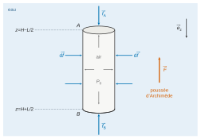
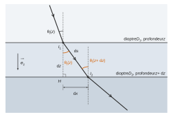
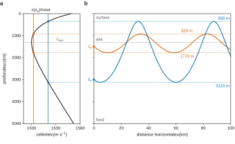

# Banque PT 2026 — Informatique et modélisation de systèmes physiques · Corrigé brut

*Corrigé rédigé par IA, non officiel. Signalez toute erreur.*

Épreuve de 4 h, calculatrice interdite ; applications numériques à un ou deux chiffres significatifs. Données :

- capteur : $H = 4$ km, $R = 2$ cm, $L = 10$ cm ;
- fluide : $P_0 = 10^5$ Pa, $g = 10\ \mathrm{m\,s^{-2}}$, $\mu = 1000\ \mathrm{kg\,m^{-3}}$ ;
- eau de mer : $\gamma = 4\ \Omega^{-1}\mathrm{m^{-1}}$, $\epsilon \approx 80\,\epsilon_0$ ;
- constantes : $\mu_0 \approx 10^{-6}\ \mathrm{H\,m^{-1}}$, $\epsilon_0 \approx 10^{-11}\ \mathrm{F\,m^{-1}}$.

L'axe $\vec e_z$ est vertical **descendant**, et $z$ est la profondeur.

## 1 Propagation des ondes sonores dans les océans

### 1.1 Pression au fond des océans

### Question 1

Pour un fluide au repos de masse volumique uniforme $\mu$, dans le champ de pesanteur uniforme $\vec g$ :

$$\boxed{\overrightarrow{\mathrm{grad}}\,P = \mu\,\vec g}$$

### Question 2

L'axe étant descendant, $\vec g = g\,\vec e_z$. Les projections horizontales montrent que $P$ ne dépend que de $z$. La projection sur $\vec e_z$ donne

$$\frac{\mathrm{d}P}{\mathrm{d}z} = \mu g.$$

Comme $\mu$ et $g$ sont uniformes, on intègre : $P(z) = \mu g z + \text{cte}$. La condition $P(0) = P_0$ à la surface fixe la constante :

$$\boxed{P(z) = P_0 + \mu g z}$$

### Question 3

La force pressante élémentaire exercée par l'eau est $\mathrm{d}\vec f = -P\,\mathrm{d}S\,\vec n$, où $\vec n$ est la normale sortante du cylindre. Sur chaque face horizontale, la pression est uniforme, et la force vaut la pression multipliée par l'aire $S = \pi R^2$.

- Face $A$ (cote $H - L/2$) : $\vec n = -\vec e_z$, l'eau la pousse vers le bas.
- Face $B$ (cote $H + L/2$) : $\vec n = +\vec e_z$, l'eau la pousse vers le haut.

$$\boxed{\vec f_A = \Big[P_0 + \mu g\big(H - \tfrac{L}{2}\big)\Big]\pi R^2\,\vec e_z}$$

$$\boxed{\vec f_B = -\Big[P_0 + \mu g\big(H + \tfrac{L}{2}\big)\Big]\pi R^2\,\vec e_z}$$



### Question 4

Toutes les longueurs sont converties en mètres ($z_A = 3999{,}95$ m, $R = 2 \times 10^{-2}$ m) :

$$\begin{aligned}
P(z_A) &= 10^5 + 10^3 \times 10 \times 3999{,}95\\
&\approx 4{,}0 \times 10^7\ \mathrm{Pa}\\
S &= \pi \times (2 \times 10^{-2})^2\\
&\approx 1{,}26 \times 10^{-3}\ \mathrm{m^2}\\
f_A &= P(z_A)\,S\\
&\approx 4{,}0 \times 10^7 \times 1{,}26 \times 10^{-3}
\end{aligned}$$

$$\boxed{f_A \approx 5 \times 10^4\ \mathrm{N}}$$

La masse $m$ dont le poids vaut cette force est $m = f_A/g \approx 5 \times 10^3$ kg : **environ 5 tonnes** posées sur un disque de 2 cm de rayon.

### Question 5

Un élément de la surface latérale, repéré par $(\varphi, z)$, a pour normale sortante $\vec u_r(\varphi) = \cos\varphi\,\vec e_x + \sin\varphi\,\vec e_y$. Il subit $\mathrm{d}\vec f = -P(z)\,\vec u_r(\varphi)\,R\,\mathrm{d}\varphi\,\mathrm{d}z$. Par conséquent

$$\begin{aligned}
\vec f_C &= -R\int_{H-L/2}^{H+L/2} P(z)\left(\int_0^{2\pi}\vec u_r(\varphi)\,\mathrm{d}\varphi\right)\mathrm{d}z\\
&= \vec 0,
\end{aligned}$$

car les intégrales de $\cos\varphi$ et de $\sin\varphi$ sur un tour sont nulles. Autrement dit, deux éléments diamétralement opposés, à la même profondeur, subissent des forces opposées. **$\vec f_C = \vec 0$.**

### Question 6

Forces de l'eau (le terme $P_0$ se simplifie) :

$$\begin{aligned}
\vec f_A + \vec f_B + \vec f_C &= [P(z_A) - P(z_B)]\,\pi R^2\,\vec e_z\\
&= -\mu g L\,\pi R^2\,\vec e_z
\end{aligned}$$

Forces de l'air intérieur : la pression $P_0$ est uniforme. L'air pousse la face $A$ vers le haut ($-P_0 S\,\vec e_z$) et la face $B$ vers le bas ($+P_0 S\,\vec e_z$), et sa contribution latérale est nulle pour la même raison qu'à la question 5. Sa résultante est donc nulle.

$$\boxed{\vec F = -\mu\,\pi R^2 L\,g\,\vec e_z}$$

C'est une force verticale ascendante, égale en norme au poids de l'eau déplacée : on retrouve la **poussée d'Archimède**. Numériquement, $F \approx 10^3 \times 1{,}26 \times 10^{-3} \times 0{,}1 \times 10$, soit environ 1,3 N, négligeable devant $f_A$ et $f_B$ prises séparément.

### 1.2 Communication acoustique sous-marine

### Question 7

$\theta_r = -\theta_i$ est l'analogue de la **loi de la réflexion** de Snell-Descartes, et $\dfrac{\sin\theta_i}{c_1} = \dfrac{\sin\theta_t}{c_2}$ celui de la **loi de la réfraction** de Snell-Descartes, $n_1\sin\theta_i = n_2\sin\theta_t$. L'indice est ici $n = c_0/c$, inversement proportionnel à la célérité. Le rayon incident, la normale et les rayons réfléchi et transmis sont dans un même plan.

### Question 8

Les dioptres $D_1$, à la profondeur $z$, et $D_2$, à la profondeur $z + \mathrm{d}z$, délimitent une couche homogène. Le rayon transmis en $I_1$ y va en ligne droite jusqu'à $I_2$.



Les normales en $I_1$ et $I_2$ sont toutes deux verticales, donc parallèles. Le segment $I_1I_2$ coupe ces deux parallèles sous des angles alternes-internes égaux : **l'angle de transmission sur $D_1$ est l'angle d'incidence sur $D_2$**, $\theta_t(z) = \theta_i(z + \mathrm{d}z)$.

### Question 9

On note $\theta(z)$ l'angle du rayon avec la verticale dans la couche de célérité $c(z)$, située juste sous le dioptre $z$. D'après la question 8, cet angle est aussi l'angle d'incidence sur le dioptre suivant, en $z + \mathrm{d}z$. La loi de la réfraction sur ce dioptre s'écrit donc

$$\frac{\sin\theta(z)}{c(z)} = \frac{\sin\theta(z + \mathrm{d}z)}{c(z + \mathrm{d}z)},$$

c'est-à-dire $A(z) = A(z + \mathrm{d}z)$. De proche en proche (récurrence sur les couches successives), $A$ garde la même valeur d'un dioptre à l'autre : elle est indépendante de $z$. Sa valeur en $z = 0^+$ donne

$$\boxed{A = \frac{\sin\theta(z)}{c(z)} = \frac{\sin\theta_0}{c_0}}$$

### Question 10

Sur un élément de rayon de longueur $\mathrm{d}s = \sqrt{\mathrm{d}x^2 + \mathrm{d}z^2}$, qui fait l'angle $\theta$ avec la verticale :

$$\boxed{\sin\theta(z) = \frac{\mathrm{d}x}{\sqrt{\mathrm{d}x^2 + \mathrm{d}z^2}}}$$

ce qui équivaut à $\tan\theta = \dfrac{\mathrm{d}x}{\mathrm{d}z}$.

### Question 11

La question 9 donne, avec $n = c_0/c$ :

$$\begin{aligned}
\sin\theta(z) &= \sin\theta_0\,\frac{c(z)}{c_0}\\
&= \frac{\sin\theta_0}{n(z)}
\end{aligned}$$

La question 10 donne :

$$\begin{aligned}
\frac{1}{\sin^2\theta} &= \frac{\mathrm{d}x^2 + \mathrm{d}z^2}{\mathrm{d}x^2}\\
&= 1 + \left(\frac{\mathrm{d}z}{\mathrm{d}x}\right)^2
\end{aligned}$$

On égale les deux expressions de $1/\sin^2\theta$ (avec $\sin\theta_0 \neq 0$) :

$$\boxed{\left(\frac{\mathrm{d}z}{\mathrm{d}x}\right)^2 = \frac{n^2(z)}{\sin^2\theta_0} - 1}$$

### Question 12

On dérive par rapport à $x$, en notant que $n^2$ dépend de $x$ à travers $z(x)$ :

$$2\,\frac{\mathrm{d}z}{\mathrm{d}x}\,\frac{\mathrm{d}^2 z}{\mathrm{d}x^2} = \frac{1}{\sin^2\theta_0}\,\frac{\mathrm{d}(n^2)}{\mathrm{d}z}\,\frac{\mathrm{d}z}{\mathrm{d}x}.$$

Là où $\dfrac{\mathrm{d}z}{\mathrm{d}x} \neq 0$, on simplifie. Aux points isolés où le rayon est horizontal, la relation s'étend par continuité des deux membres. On obtient

$$\boxed{\frac{\mathrm{d}^2 z}{\mathrm{d}x^2} = \frac{1}{2\sin^2\theta_0}\,\frac{\mathrm{d}}{\mathrm{d}z}(n^2)}$$

### Question 13

Avec $n^2 = 1 - \beta z^2$, l'équation de la question 12 devient :

$$\begin{aligned}
\frac{\mathrm{d}(n^2)}{\mathrm{d}z} &= -2\beta z\\
\frac{\mathrm{d}^2 z}{\mathrm{d}x^2} &= -\frac{\beta}{\sin^2\theta_0}\,z
\end{aligned}$$

On pose $\alpha(x) = \dfrac{\mathrm{d}z}{\mathrm{d}x}$, de sorte que $\dfrac{\mathrm{d}\alpha}{\mathrm{d}x} = \dfrac{\mathrm{d}^2 z}{\mathrm{d}x^2}$ :

$$\boxed{\left\{\begin{aligned}\frac{\mathrm{d}z}{\mathrm{d}x} &= \alpha(x)\\ \frac{\mathrm{d}\alpha}{\mathrm{d}x} &= -\frac{\beta}{\sin^2\theta_0}\,z(x)\end{aligned}\right.}$$

Pour $\beta > 0$, c'est un oscillateur harmonique en $x$, de pulsation spatiale $\sqrt{\beta}/|\sin\theta_0|$. Le rayon oscille autour de la profondeur nulle, où l'indice est maximal.

### Question 14

$\alpha = \dfrac{\mathrm{d}z}{\mathrm{d}x} = \dfrac{1}{\tan\theta}$ est la **pente du rayon** : c'est la tangente de l'angle $\dfrac{\pi}{2} - \theta$ que fait le rayon avec l'**horizontale**, comptée positivement quand le rayon descend.

### 1.3 Communication par ondes radio

### Question 15

$$\boxed{\vec j = \gamma\,\vec E}$$

### Question 16

Pour une onde sinusoïdale de pulsation $\omega$, dériver par rapport au temps multiplie l'amplitude par $\omega$ :

$$\begin{aligned}
\left\|\epsilon\,\frac{\partial\vec E}{\partial t}\right\| &= \epsilon\,\omega\,\|\vec E\|\\
\|\vec j\| &= \gamma\,\|\vec E\|
\end{aligned}$$

Le rapport du courant de déplacement au courant de conduction vaut $\epsilon\omega/\gamma$. Il est très petit devant 1 si $\omega \ll \omega_c$, avec la pulsation critique

$$\boxed{\omega_c = \frac{\gamma}{\epsilon}}$$

Application numérique :

$$\begin{aligned}
\omega_c &= \frac{4}{80 \times 10^{-11}}\\
&= 5 \times 10^9\ \mathrm{rad\,s^{-1}}
\end{aligned}$$

soit $f_c = \omega_c/2\pi \approx 8 \times 10^8$ Hz. C'est très largement le cas pour 10 à 100 kHz.

### Question 17

Dans ces conditions, $\overrightarrow{\mathrm{rot}}\,\vec B = \mu_0\gamma\,\vec E$. Avec Maxwell-Faraday, $\overrightarrow{\mathrm{rot}}\,\vec E = -\dfrac{\partial\vec B}{\partial t}$, on obtient

$$\overrightarrow{\mathrm{rot}}\big(\overrightarrow{\mathrm{rot}}\,\vec E\big) = -\frac{\partial}{\partial t}\overrightarrow{\mathrm{rot}}\,\vec B = -\mu_0\gamma\,\frac{\partial\vec E}{\partial t}.$$

Or $\overrightarrow{\mathrm{rot}}\big(\overrightarrow{\mathrm{rot}}\,\vec E\big) = \overrightarrow{\mathrm{grad}}(\mathrm{div}\,\vec E) - \Delta\vec E$, et Maxwell-Gauss donne $\mathrm{div}\,\vec E = \rho/\epsilon = 0$. D'où

$$\boxed{\Delta\vec E - \mu_0\gamma\,\frac{\partial\vec E}{\partial t} = \vec 0}$$

### Question 18

Pour $\underline{\vec E} = E_0\,e^{i(\omega t - \underline k z)}\,\vec e_x$, on a :

$$\begin{aligned}
\Delta\underline{\vec E} &= -\underline k^2\,\underline{\vec E}\\
\frac{\partial\underline{\vec E}}{\partial t} &= i\omega\,\underline{\vec E}
\end{aligned}$$

L'équation de la question 17, valable pour tout $(z, t)$ avec $E_0 \neq 0$, donne la relation de dispersion

$$\underline k^2 = -i\mu_0\gamma\omega.$$

Comme $-i = \left(\dfrac{1-i}{\sqrt 2}\right)^2$, cette équation a exactement deux solutions, opposées :

$$\boxed{\underline k = \pm(1-i)\sqrt{\frac{\mu_0\gamma\omega}{2}}}$$

### Question 19

On pose $\delta = \sqrt{\dfrac{2}{\mu_0\gamma\omega}}$. Pour $\underline k = \dfrac{1-i}{\delta}$, on a $-i\underline k z = -\dfrac{z}{\delta} - i\dfrac{z}{\delta}$, donc

$$\underline{\vec E} = E_0\,e^{i(\omega t - z/\delta)}\,e^{-z/\delta}\,\vec e_x .$$

L'autre racine donnerait un facteur $e^{+z/\delta}$, qui diverge quand $z \to +\infty$ : elle est exclue pour une onde émise en $z = 0$ et se propageant vers les $z$ croissants. Ainsi

$$\boxed{\delta = \sqrt{\frac{2}{\mu_0\gamma\omega}}}$$

Pour $f = 100$ kHz :

$$\begin{aligned}
\omega &= 2\pi f \approx 6{,}3 \times 10^5\ \mathrm{rad\,s^{-1}}\\
\mu_0\gamma\omega &\approx 10^{-6} \times 4 \times 6{,}3 \times 10^5\\
&\approx 2{,}5\ \mathrm{m^{-2}}
\end{aligned}$$

$$\boxed{\delta \approx 0{,}9\ \mathrm{m}}$$

L'épaisseur de peau est de l'ordre du mètre.

### Question 20

Le facteur d'atténuation de l'amplitude après $L = 1$ km vaut

$$\boxed{\begin{aligned}
\frac{E(L)}{E_0} &= e^{-L/\delta}\\
&\approx e^{-1100}\\
&\approx 10^{-480}
\end{aligned}}$$

L'onde est totalement absorbée après quelques mètres : **la communication radio avec un sous-marin à 1 km de profondeur est impossible**.

### Question 21

La longueur d'onde dans le vide vaut :

$$\begin{aligned}
\lambda &= \frac{c}{f}\\
&= \frac{3 \times 10^8}{5 \times 10^{14}}\\
&= 6 \times 10^{-7}\ \mathrm{m}\\
&= 600\ \mathrm{nm}
\end{aligned}$$

Elle est comprise entre 400 et 800 nm : **domaine visible** (orangé).

### Question 22

Les grands fonds océaniques sont **plongés dans l'obscurité** : la lumière du Soleil, onde électromagnétique de ce domaine, est absorbée et diffusée par l'eau et ne dépasse pas quelques centaines de mètres (zone aphotique au-delà, où les plongées profondes doivent emporter leur propre éclairage). Une onde visible ne peut donc pas transmettre un signal à travers 1 km d'eau.

## 2 Modélisation numérique du canal SOFAR

### 2.1 Modèle de propagation des rayons sonores : résolution de l'équation différentielle

### Question 23

$$\boxed{\begin{aligned}
x_{n+1} &= x_n + \mathrm{d}x\\
z_{n+1} &= z_n + a_n\,\mathrm{d}x\\
a_{n+1} &= a_n - A\,z_n\,\mathrm{d}x
\end{aligned}}$$

### Question 24

```python
def rayon_Euler(x0, xf, dx, z0, a0, A):
    # Initialisation des listes
    valeurs_x = [x0]
    valeurs_z = [z0]
    valeurs_a = [a0]
    x, z, a = x0, z0, a0  # Valeurs courantes des variables
    # Schéma d'Euler explicite
    while x < xf:
        x_nouveau = x + dx          # Calcul de x{n+1}
        z_nouveau = z + a * dx      # Calcul de z{n+1}
        a_nouveau = a - A * z * dx  # Calcul de alpha{n+1}
        # Ajout des nouveaux éléments
        valeurs_x.append(x_nouveau)
        valeurs_z.append(z_nouveau)
        valeurs_a.append(a_nouveau)
        # Actualisation des variables
        x, z, a = x_nouveau, z_nouveau, a_nouveau
    return valeurs_x, valeurs_z
```

### Question 25

`a0` représente l'**angle initial du rayon sonore**, c'est-à-dire son angle d'émission par rapport à l'horizontale, compté positivement si le rayon part vers le fond.

Plus précisément, `a0` $= \alpha(x_0)$ est la pente initiale $\dfrac{\mathrm{d}z}{\mathrm{d}x}(x_0)$, donc la tangente de cet angle. Pour un rayon peu incliné, comme dans le canal SOFAR, elle se confond avec l'angle exprimé en radians.

### Question 26

Le pas doit être petit devant l'échelle de variation de la trajectoire, pour que la discrétisation en suive correctement les ondulations, sans multiplier inutilement le nombre de pas et donc le temps de calcul. Sur la figure 3, les sommets sont vers 15 km et 64 km : la période spatiale est $\Lambda \approx 50$ km.

Euler explicite amplifie de plus l'oscillation : l'amplitude est multipliée par $\sqrt{1 + A\,\mathrm{d}x^2}$ à chaque pas, avec $A = (2\pi/\Lambda)^2 \approx 1{,}6 \times 10^{-8}\ \mathrm{m^{-2}}$. Sur $x_f - x_0 = 90$ km, le facteur cumulé vaut environ

$$e^{A\,\mathrm{d}x\,(x_f - x_0)/2}.$$

Il vaut 1,007 pour 10 m, 1,07 pour 100 m et 2 pour 1000 m.

**On propose $\mathrm{d}x \approx 10$ m** : 9000 pas pour 90 km et une dérive de l'amplitude inférieure à 1 %. Un pas de 100 m reste acceptable (dérive d'environ 7 %).

### 2.2 Modèle de propagation des rayons sonores pour des milieux non-uniformes

#### 2.2.1 Gestion des conditions aux limites

### Question 27

On renvoie le rayon dès que le prochain dioptre ($z_I + \text{direction}\times h$) sortirait de $[0, 5000]$ m :

```python
def conditions_limites(z_I, h, direction):
    if direction == 1 and z_I + h > 5000:     # le fond marin réfléchit
        direction = -1
    elif direction == -1 and z_I - h < 0:     # la surface réfléchit
        direction = 1
    return direction
```

#### 2.2.2 Calcul des célérités des deux milieux séparés par le dioptre

### Question 28

Le milieu de départ est du côté opposé au sens de propagation, au centre de la couche, en $z - \text{direction}\times h/2$ ; l'autre milieu est en $z + \text{direction}\times h/2$.

```python
def calculer_celerite(z, h, direction):
    c1 = celerite(z - direction * h / 2)   # couche d'où vient le rayon
    c2 = celerite(z + direction * h / 2)   # couche dans laquelle il entrerait
    return c1, c2
```

#### 2.2.3 Lois de passage entre deux couches de célérités $c_1$ et $c_2$

### Question 29

Dans les deux cas, le segment $IB$ traverse une couche d'épaisseur $h$. Le triangle rectangle de côté vertical $h$ et de côté horizontal $L_2$ a pour angle $\theta_2$ en $I$, mesuré depuis la verticale :

$$L_2 = h\tan\theta_2 .$$

- **Réfraction** : $\sin\theta_2 = \dfrac{c_2}{c_1}\sin\theta_1$, donc
$$\boxed{L_2 = h\tan\theta_2 = \frac{h\,c_2\sin\theta_1}{\sqrt{c_1^2 - c_2^2\sin^2\theta_1}}}$$
- **Réflexion totale** : $\theta_2 = \theta_1$, et $B$ repart dans la couche de départ :
$$\boxed{L_2 = h\tan\theta_1}$$

### Question 30

Soit $\theta_i \in [0, \pi/2[$. Un angle transmis doit vérifier

$$\sin\theta_t = \frac{c_2}{c_1}\sin\theta_i .$$

Un tel angle existe si et seulement si le second membre est au plus égal à 1, c'est-à-dire $\sin\theta_i \le c_1/c_2$.

- Si $c_2 \le c_1$ : la condition est toujours vérifiée ; un rayon transmis existe pour tout angle d'incidence.
- Si $c_2 > c_1$ : on a $c_1/c_2 \in\ ]0, 1[$. Comme le sinus est strictement croissant sur $[0, \pi/2]$, la condition équivaut à $\theta_i \le \arcsin(c_1/c_2)$. Le cas d'égalité donne un rayon rasant ($\theta_t = \pi/2$) : c'est la limite de la réflexion totale.

Il existe donc un rayon transmis si et seulement si

$$\boxed{\theta_i < \theta_c = \arcsin\left(\frac{c_1}{c_2}\right)}$$

Cet angle critique n'a de sens que pour $c_2 > c_1$, c'est-à-dire en allant vers un milieu plus rapide. Si $c_2 \le c_1$, on peut convenir que $\theta_c = \pi/2$.

### Question 31

```python
def angle_critique(c1, c2):
    if c1 >= c2:          # pas de réflexion totale possible
        return pi / 2
    return asin(c1 / c2)
```

### Question 32

```python
theta1 < angle_critique(c1, c2)
```

Grâce à la convention $\theta_c = \pi/2$ si $c_1 \ge c_2$, cette condition est toujours vraie dans ce cas (pour $\theta_1 < \pi/2$), et `asin` n'est jamais appelée hors de son domaine.

### Question 33

L'énoncé demande l'argument `direction`, indispensable pour savoir si $B$ est au-dessus ou au-dessous de $I$, alors que l'extrait de code ne le passe pas. On le conserve en dernier argument, et on corrige l'appel en conséquence.

```python
def refraction(x_I, z_I, theta1, h, c1, c2, direction):
    theta2 = asin(c2 / c1 * sin(theta1))
    x_B = x_I + h * tan(theta2)
    z_B = z_I + direction * h        # B dans la couche suivante
    return theta2, x_B, z_B
```

### Question 34

Pour la même raison, on ajoute `direction`, sans lequel $z_B$ ne peut pas être calculé (incohérence de l'énoncé, signalée).

```python
def reflexion_totale(x_I, z_I, theta1, hauteur_couche, direction):
    theta2 = theta1                                   # loi de la réflexion
    x_B = x_I + hauteur_couche * tan(theta2)
    z_B = z_I - direction * hauteur_couche            # retour dans la couche de départ
    return theta2, x_B, z_B
```

### Question 35

```python
# BLOC2
if not (theta1 < angle_critique(c1, c2)):   # il y a eu réflexion totale
    direction = -direction
valeurs_x.append(x_B)
valeurs_z.append(z_B)
x_I = x_B
z = z + direction * h        # vaut z_B dans les deux cas
z_I = z
theta1 = theta2
direction = conditions_limites(z, h, direction)
```

Après une réflexion, `direction` est inversée avant la mise à jour de `z` : on a alors `z + direction*h` $= z_I - \text{direction}_{\text{avant}}\,h = z_B$. Le test des conditions aux limites porte sur la nouvelle profondeur.

#### 2.2.4 Construction du rayon sonore - Synthèse

### Question 36

Convention : `angle_emission` est compté par rapport à l'horizontale, positivement vers le fond, et supposé non nul ; `y_emission` est la profondeur d'émission, traitée comme un dioptre.

```python
def trajet_rayon(x_emission, y_emission, angle_emission, h, distance_x_max):
    rayon = [(x_emission, y_emission)]          # initialisation de la liste
    x_I, z = x_emission, y_emission             # z : profondeur du dioptre courant
    if angle_emission > 0:
        direction = 1                           # le rayon descend
        theta1 = pi / 2 - angle_emission        # angle par rapport à la verticale
    else:
        direction = -1                          # le rayon remonte
        theta1 = pi / 2 + angle_emission
    direction = conditions_limites(z, h, direction)
    while x_I < x_emission + distance_x_max:
        c1, c2 = calculer_celerite(z, h, direction)
        if theta1 < angle_critique(c1, c2):     # CONDITION_1
            theta2, x_B, z_B = refraction(x_I, z, theta1, h, c1, c2, direction)
        else:
            theta2, x_B, z_B = reflexion_totale(x_I, z, theta1, h, direction)
            direction = -direction
        rayon.append((x_B, z_B))
        x_I = x_B
        z = z + direction * h                   # vaut z_B dans les deux cas
        theta1 = theta2
        direction = conditions_limites(z, h, direction)
    return rayon
```

Avec `celerite = munk`, $h = 10$ m et une émission à 1500 m sous $0{,}05$ rad, le rayon reste entre 920 et 1770 m, comme le prévoit l'invariant $\sin\theta/c$. Émis à 3000 m, il oscille entre 350 et 3110 m (figure 7). Sous $0{,}3$ rad, il se réfléchit en surface et au fond (figure 4).

### 2.3 Choix d'une loi d'évolution de la célérité

#### 2.3.1 Construction d'une base de données de mesures des caractéristiques de l'eau en profondeur

### Question 37

```sql
SELECT m.profondeur, m.temperature, m.salinite
FROM mesures AS m
JOIN regions AS r ON m.id_region = r.id_region
WHERE r.region = 'Region1' AND m.date = '2025-04-17';
```

(La date est supposée stockée au format ISO `AAAA-MM-JJ`.)

### Question 38

```sql
SELECT COUNT(*) AS nb_mesures
FROM mesures AS m
JOIN regions AS r ON m.id_region = r.id_region
JOIN periodes AS p ON m.id_periode = p.id_periode
WHERE r.region = 'Region2' AND p.periode = 'Été';
```

#### 2.3.2 Modèle de célérité grand fond

### Question 39

```python
from math import exp

def munk(z):
    zb = 2 * (z - 1300) / 1300
    return 1500 * (1 + 0.00737 * (zb - 1 + exp(-zb)))
```

(On a `munk(0)` $\approx 1548{,}5$, `munk(1300)` $= 1500$ et `munk(5000)` $\approx 1551{,}9$ m/s.)

### Question 40

Avec $\bar z = \dfrac{2(z - 1300)}{1300}$, on a $\dfrac{\mathrm{d}\bar z}{\mathrm{d}z} = \dfrac{2}{1300}$, donc

$$\boxed{\frac{\mathrm{d}c}{\mathrm{d}z} = 1500 \times 0{,}00737 \times \frac{2}{1300}\left(1 - e^{-\bar z}\right) \approx 1{,}7 \times 10^{-2}\left(1 - e^{-\bar z}\right)\ \mathrm{s^{-1}}}$$

On vérifie que cette dérivée vaut $\approx -0{,}11\ \mathrm{s^{-1}}$ en $z = 0$ et tend vers $0{,}017\ \mathrm{s^{-1}}$ en profondeur (figure 8).

```python
def dmunk(z):
    zb = 2 * (z - 1300) / 1300
    return 1500 * 0.00737 * 2 / 1300 * (1 - exp(-zb))
```

### Question 41

`dmunk` est strictement croissante ($c$ est convexe), négative en 0 et positive en 5000 : son unique zéro est la profondeur du minimum de célérité.

```python
def dichotomie(dmunk, borne_debut, borne_fin, tolerance):
    a, b = borne_debut, borne_fin       # invariant : dmunk(a) < 0 <= dmunk(b)
    while b - a > tolerance:
        m = (a + b) / 2
        if dmunk(m) < 0:
            a = m
        else:
            b = m
    return (a + b) / 2
```

Le nombre d'itérations est $\left\lceil \log_2\big((b - a)/\text{tolerance}\big)\right\rceil$.

### Question 42

La fonction renvoie le milieu d'un intervalle de largeur au plus `tolerance` qui contient la racine : l'erreur est au plus `tolerance/2`. **`tolerance = 20`** (m) garantit donc la précision de 10 m (8 itérations). Le choix prudent `tolerance = 10` convient aussi (9 itérations).

### Question 43

```python
z_min = dichotomie(dmunk, 0, 5000, 20)
c_min = munk(z_min)
print(z_min, c_min)
```

On obtient $z_{\min} \approx 1300$ m (1298,8 m) et $c_{\min} \approx 1500\ \mathrm{m\,s^{-1}}$. La valeur exacte est $z = 1300$ m, où $\bar z = 0$.

### Question 44

Le canal SOFAR est un guide d'onde analogue à une **fibre optique à gradient d'indice** : l'indice acoustique $n = c_0/c$ y est maximal sur un axe. Par la loi de la réfraction ($\sin\theta/c$ constant), un rayon qui s'éloigne de l'axe entre dans des couches plus rapides, se redresse jusqu'à l'horizontale et repart vers l'axe. Il oscille ainsi autour de l'axe sans toucher la surface ni le fond, donc presque sans pertes.

Avec le profil de Munk, l'axe est à la profondeur du minimum de célérité : les ondes sont piégées autour de **$z \approx 1300$ m**. Un rayon émis à la profondeur $z_e$ sous un faible angle $a$ se retourne là où $c(z) = c(z_e)/\cos a$, soit entre 900 et 1800 m environ pour 0,05 rad émis à 1500 m. Le canal s'étend tant que $c(z) < c(0) \approx 1549$ m/s, soit jusqu'à 4800 m environ.



### 2.4 Reconnaissances de signaux acoustiques sous-marins

#### 2.4.1 Représentation des données étudiées

(Aucune question : chaque son est décrit par un couple (fréquence, niveau sonore) et étiqueté Animale ou Anthropique.)

#### 2.4.2 Implémentation des $k$ plus proches voisins

### Question 45

L'algorithme des $k$ plus proches voisins est une méthode d'apprentissage **supervisé** : la base d'apprentissage contient des points (ici fréquence, niveau sonore) dont la classe (Animale ou Anthropique) est connue. Pour classer une nouvelle donnée, on calcule sa distance à chaque point de la base (distance euclidienne par défaut) et on sélectionne les $k$ points les plus proches. On attribue à la nouvelle donnée la classe majoritaire parmi ces $k$ voisins, en départageant les égalités par une règle fixée (choisir $k$ impair, par exemple). Il n'y a pas de phase d'entraînement : tout le calcul a lieu à la prédiction, avec un coût en $O(N)$ distances par requête pour une base de $N$ points.

### Question 46

On choisit $k$ en le testant sur des données étiquetées **non utilisées** pour l'apprentissage (jeu de validation, ou validation croisée) : on retient la valeur qui maximise le taux de bonnes classifications. On part d'un ordre de grandeur usuel, $k \approx \sqrt N$, où $N$ est la taille du jeu d'apprentissage. En classification binaire, on prend $k$ impair pour éviter les égalités de vote.

- **$k$ trop petit** ($k = 1$) : la prédiction dépend d'un seul point, et donc du bruit et des points atypiques (sur-apprentissage, frontière très irrégulière).
- **$k$ trop grand** : le vote mêle des points éloignés, la frontière se lisse à l'excès et, à la limite $k = N$, on prédit toujours la classe majoritaire (sous-apprentissage). Le coût de calcul augmente aussi.

Schéma des trois régimes, dans le plan (fréquence, niveau sonore) :

| $k$ trop petit ($k = 1$) | $k$ bien choisi | $k$ trop grand ($k = N$) |
|---|---|---|
| frontière très découpée, îlots autour de chaque point isolé | frontière régulière, qui suit la séparation des deux nuages | plus de frontière : une seule classe prédite partout |
| sur-apprentissage (*overfitting*) | compromis | sous-apprentissage (*underfitting*) |

### Question 47

```python
def distance_euclidienne(A, B):
    freq_A, dB_A = A
    freq_B, dB_B = B
    return ((freq_A - freq_B) ** 2 + (dB_A - dB_B) ** 2) ** 0.5
```

### Question 48

On effectue $k$ recherches successives du minimum parmi les indices non encore retenus : c'est un tri par sélection arrêté après $k$ étapes, qui compare les valeurs et renvoie leurs indices dans la liste d'origine. La complexité est en $O(kn)$ pour $n$ distances, avec $k \le n$.

```python
def plus_proches(distances, k):
    n = len(distances)
    choisi = [False] * n
    indices = []
    for _ in range(k):
        i_min = -1
        for i in range(n):
            if not choisi[i] and (i_min == -1 or distances[i] < distances[i_min]):
                i_min = i
        choisi[i_min] = True
        indices.append(i_min)
    return indices
```

(Par exemple, `plus_proches([5.0, 1.0, 3.0, 0.5, 4.0, 2.0], 3)` renvoie `[3, 1, 5]`.)

### Question 49

Convention : les lignes sont les classes réelles et les colonnes les classes prédites, dans l'ordre Animale puis Anthropique. Il y a $52 + 13 + 22 + 48 = 135$ sons, dont 65 animaux et 70 anthropiques.

- Précision globale : $\boxed{\dfrac{52 + 48}{135} = \dfrac{100}{135} \approx 74\,\%}$
- Par origine réelle (taux de reconnaissance) : Animale $52/65 = 80\,\%$, Anthropique $48/70 \approx 69\,\%$.
- Par origine prédite (fiabilité d'une prédiction) : Animale $52/74 \approx 70\,\%$, Anthropique $48/61 \approx 79\,\%$.

**Le modèle est correct sans être fiable.** Il fait mieux que le hasard ou que la prédiction de la classe majoritaire (environ 52 %), mais un son sur quatre est mal classé, et 22 sons anthropiques sur 70 passent pour animaux, ce qui est gênant pour une surveillance des nuisances. La figure 11 montre que les erreurs (croix) se concentrent dans la zone où les deux nuages se recouvrent (environ 20 Hz à 10 kHz, 130 à 190 dB : cétacés, navires, éoliennes, opérations pétrolières). Les points isolés, comme la prospection sismique au-dessus de 220 dB ou les sifflements de dauphins au-delà de 10 kHz, sont bien classés.

### Question 50

- **Mettre les grandeurs à l'échelle** : la fréquence varie de 10 Hz à 20 kHz alors que le niveau varie de quelques dizaines de dB, si bien que la distance euclidienne brute ne voit que la fréquence. On travaille plutôt sur $\log_{10} f$ et on centre-réduit les deux variables.
- **Choisir $k$** par validation croisée, et pondérer le vote par l'inverse de la distance.
- **Enrichir la description** des sons (durée, largeur de bande, modulation, descripteurs spectraux) pour séparer la zone de recouvrement.
- **Augmenter et équilibrer la base d'apprentissage**, et évaluer le modèle sur un jeu de test distinct.
