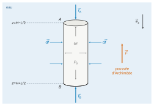
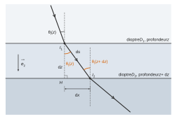
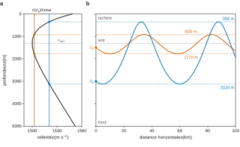

# Banque PT 2026 — Informatique et modélisation de systèmes physiques · Corrigé guidé

*Corrigé rédigé par IA, non officiel. Signalez toute erreur.*

## Présentation du sujet

**Thème.** *Étude et modélisation de phénomènes de communication sous-marine.* Le sujet part d'une question concrète : comment communiquer sous l'eau ? Il en tire une progression qui va de la physique (pourquoi le son et pas la radio) à la simulation numérique (trajectoire des rayons sonores, canal SOFAR), puis aux données (base SQL de mesures, classification de sons par $k$ plus proches voisins).

**Format.** 4 heures, **calculatrice interdite**, 50 questions. Selon le rapport 2026, la partie physique (Q1 à Q22) pèse 40 % du barème et la partie informatique (Q23 à Q50) 60 %. Les applications numériques sont attendues avec un ou deux chiffres significatifs : seul l'ordre de grandeur compte, mais il doit être juste et accompagné de son unité.

**Découpage.**

| Partie | Questions | Contenu | Notions mobilisées |
|---|---|---|---|
| 1.1 Pression au fond des océans | Q1 à Q6 | forces pressantes sur un capteur cylindrique, poussée d'Archimède | statique des fluides, intégrale de surface, symétrie |
| 1.2 Communication acoustique | Q7 à Q14 | loi de Snell-Descartes en milieu stratifié, équation des rayons | optique géométrique, invariant $\sin\theta/c$, dérivation composée |
| 1.3 Ondes radio | Q15 à Q22 | onde plane dans un conducteur ohmique, effet de peau | équations de Maxwell, équation de diffusion, nombres complexes |
| 2.1 Euler | Q23 à Q26 | résolution numérique du système de la Q13 | schéma d'Euler explicite, choix du pas |
| 2.2 Milieux non uniformes | Q27 à Q36 | simulateur de rayon par dioptres successifs | réfraction, réflexion totale, programmation modulaire |
| 2.3 Loi de célérité | Q37 à Q44 | requêtes SQL, profil de Munk, dichotomie | jointures, agrégation, recherche d'un zéro |
| 2.4 Classification | Q45 à Q50 | $k$ plus proches voisins, matrice de confusion | apprentissage supervisé, tri partiel, métriques |

**Difficulté.** Le sujet est long mais rarement difficile. Les pièges sont plutôt de l'ordre de la rigueur : signe des forces (Q3), domaine de définition d'`asin` (Q30 à Q32), cohérence des conventions dans le simulateur (`direction`, angles comptés par rapport à la verticale ou à l'horizontale), lecture d'une matrice de confusion. L'énoncé contient une **incohérence de signatures** (Q33 et Q34 : l'argument `direction` est annoncé pour une fonction mais pas pour l'autre, et l'extrait de code ne le passe à aucune) : il faut la signaler et la trancher, comme le demande la première page.

**Ce qu'a observé le jury en 2026.** Le sujet contenait de nombreuses questions simples, qui permettaient à un candidat moyen de valoriser son cours, et d'autres plus difficiles pour départager les meilleures copies. Certains candidats n'abordent presque pas la partie physique (ou, plus rarement, la partie informatique), « ce qui n'est jamais une bonne idée ». En informatique, les bases de Python sont maîtrisées. Les algorithmes classiques (Euler, dichotomie, distance euclidienne, tri) ne sont écrits sans erreur que par la moitié des candidats environ : les autres trébuchent sur la condition d'arrêt ou sur un test de signe. Le choix des paramètres numériques (pas d'Euler, tolérance de la dichotomie) est rarement justifié, et la partie sur l'intelligence artificielle est la moins bien maîtrisée.

**Questions discriminantes.** D'après le rapport 2026, les questions mal traitées ou peu réussies sont Q11, Q12, Q14, Q21 et Q22 en physique, puis Q26, Q29, Q34, Q36, Q41, Q42, Q44, Q46 et Q48 à Q50 en informatique. La Q25 n'a que 60 % de réussite.

**Questions à ne pas laisser passer.** Q1, Q2, Q7, Q15, Q21 (cours direct, mais la Q21 a été très mal traitée en 2026) ; Q23, Q24, Q37 à Q40, Q45, Q47 (informatique de base) ; Q49 (simples calculs de proportions).

**Gestion du temps.** Les trois sous-parties de la partie 1 sont indépendantes entre elles, de même que les blocs 2.1, 2.2, 2.3 et 2.4. Un ordre raisonnable : partie 1 en 1 h 30, puis 2.1, 2.3 et 2.4 (rapides), et enfin la partie 2.2, la plus longue à écrire proprement.

## Partie 1.1 — Pression au fond des océans

On établit l'ordre de grandeur des efforts sur un capteur à 4 km de profondeur. Les outils : la relation fondamentale de la statique des fluides et un calcul de résultante par symétrie.

### Question 1

> [!INDICATION]
> C'est le résultat de cours de la statique des fluides : équilibre d'une particule de fluide soumise à son poids et aux forces de pression.

#### Solution

Pour un fluide au repos, de masse volumique uniforme $\mu$, dans le champ de pesanteur uniforme $\vec g$ :

$$\boxed{\overrightarrow{\mathrm{grad}}\,P = \mu\,\vec g}$$

> [!JURY]
> Rapport 2026 : « Trop peu de candidats donnent l'expression vectorielle attendue, beaucoup donnent directement une projection avec parfois des erreurs de signe. » On écrit la relation vectorielle ici, et on ne projette qu'à la question 2.

### Question 2

> [!INDICATION]
> Projeter sur $\vec e_z$ en faisant attention à son orientation, puis intégrer avec la condition à la surface.

#### Solution

Avec $\vec e_z$ descendant, $\vec g = g\,\vec e_z$. Les projections horizontales montrent que $P$ ne dépend que de $z$. La projection sur $\vec e_z$ donne

$$\frac{\mathrm{d}P}{\mathrm{d}z} = \mu g.$$

Comme $\mu$ et $g$ sont uniformes, on intègre : $P(z) = \mu g z + \text{cte}$. La condition $P(0) = P_0$ à la surface fixe la constante :

$$\boxed{P(z) = P_0 + \mu g z}$$

> [!PIEGE]
> L'axe est **descendant** dans ce sujet : la pression croît avec $z$, sans signe moins. Avec l'axe ascendant habituel, on écrirait $P = P_0 - \mu g z$.

> [!JURY]
> Le rapport 2026 juge la question bien traitée, mais relève qu'il manque assez souvent des précisions dans la rédaction. On les donne toutes : fluide homogène et $g$ uniforme, pression fonction de $z$ seule, condition à la surface utilisée pour la constante.

### Question 3

> [!INDICATION]
> Sur une face horizontale, la pression est uniforme : la force est la pression multipliée par l'aire, dirigée selon la normale.

> [!INDICATION]
> Un fluide **pousse** toujours la paroi : la force est dirigée de l'eau vers le solide. Situer l'eau par rapport à chaque face.

#### Solution

La force élémentaire est $\mathrm{d}\vec f = -P\,\mathrm{d}S\,\vec n$, où $\vec n$ est la normale sortante du cylindre. Sur une face, $P$ est uniforme et la force vaut $P S$, avec $S = \pi R^2$.

- Face $A$, à la cote $H - L/2$ : l'eau est au-dessus, $\vec n = -\vec e_z$, la face est poussée vers le bas.
- Face $B$, à la cote $H + L/2$ : $\vec n = +\vec e_z$, la face est poussée vers le haut.

$$\boxed{\vec f_A = \Big[P_0 + \mu g\big(H - \tfrac{L}{2}\big)\Big]\pi R^2\,\vec e_z}$$

$$\boxed{\vec f_B = -\Big[P_0 + \mu g\big(H + \tfrac{L}{2}\big)\Big]\pi R^2\,\vec e_z}$$



> [!METHODE]
> Force pressante sur une paroi : $\mathrm{d}\vec f = -P\,\mathrm{d}S\,\vec n_{\text{sortant du solide}}$. Il faut toujours contrôler le sens obtenu sur un schéma.

> [!PIEGE]
> Le rapport 2026 relève « des erreurs surprenantes comme $f = \frac{p}{s}$ ». Une force pressante est un **produit** pression × surface. L'homogénéité le confirme : des pascals multipliés par des mètres carrés donnent des newtons.

### Question 4

> [!INDICATION]
> $L \ll H$ : la profondeur de la face $A$ vaut pratiquement $H$. Et $P_0$ est-il significatif devant $\mu g H$ ?

#### Solution

Toutes les longueurs sont en mètres :

$$\begin{aligned}
P(z_A) &= 10^5 + 10^3 \times 10 \times 3999{,}95\\
&\approx 4{,}0 \times 10^7\ \mathrm{Pa}\\
S &= \pi \times (2 \times 10^{-2})^2\\
&\approx 1{,}3 \times 10^{-3}\ \mathrm{m^2}
\end{aligned}$$

La pression atmosphérique $P_0$ ne représente que 0,25 % de $P(z_A)$. On obtient :

$$\boxed{f_A = P(z_A)\,S \approx 5 \times 10^4\ \mathrm{N}}$$

La masse équivalente est $m = f_A/g \approx 5 \times 10^3$ kg, soit **5 tonnes** sur un disque de 4 cm de diamètre.

> [!METHODE]
> Sans calculatrice, on arrondit tôt : $\pi \times 4 \approx 12{,}6$, puis $4 \times 1{,}26 \approx 5$. Un ou deux chiffres significatifs suffisent.

> [!PIEGE]
> Le rapport 2026 note que l'application numérique « nécessitait des conversions d'unités qui ont été sources d'erreurs ». Il faut passer en mètres avant tout calcul ($R = 2 \times 10^{-2}$ m, $H = 4 \times 10^3$ m), et se souvenir qu'une tonne vaut $10^3$ kg.

### Question 5

> [!INDICATION]
> Sur la paroi latérale, la normale est horizontale et tourne avec l'angle polaire $\varphi$.

> [!INDICATION]
> À profondeur fixée, associer deux éléments de surface diamétralement opposés, ou intégrer $\cos\varphi$ et $\sin\varphi$ sur un tour.

#### Solution

L'élément de paroi $(\varphi, z)$, de normale sortante $\vec u_r(\varphi) = \cos\varphi\,\vec e_x + \sin\varphi\,\vec e_y$, subit $\mathrm{d}\vec f = -P(z)\,\vec u_r\,R\,\mathrm{d}\varphi\,\mathrm{d}z$. Par conséquent

$$\begin{aligned}
\vec f_C &= -R\int_{H-L/2}^{H+L/2} P(z)\left(\int_0^{2\pi}\vec u_r(\varphi)\,\mathrm{d}\varphi\right)\mathrm{d}z\\
&= \vec 0,
\end{aligned}$$

car les intégrales de $\cos\varphi$ et de $\sin\varphi$ sur un tour sont nulles. **La résultante latérale est nulle**, quelle que soit la loi $P(z)$.

> [!JURY]
> L'argument de symétrie a souvent été vu, mais le rapport 2026 précise que « les copies proposant une bonne rédaction ont été davantage récompensées ». Il faut nommer les deux éléments de surface appariés (diamétralement opposés, à la même profondeur, donc à la même pression) ou écrire l'intégrale.

### Question 6

> [!INDICATION]
> Faire le bilan séparément pour l'eau (Q3 et Q5) et pour l'air intérieur, à pression uniforme.

> [!INDICATION]
> Que vaut la résultante des forces exercées par une pression **uniforme** sur une surface fermée ?

#### Solution

- Eau ($P_0$ se simplifie) :

$$\begin{aligned}
\vec f_A + \vec f_B + \vec f_C &= [P(z_A) - P(z_B)]\,\pi R^2\,\vec e_z\\
&= -\mu g L\,\pi R^2\,\vec e_z
\end{aligned}$$

- Air intérieur : il pousse $A$ vers le haut ($-P_0 S\,\vec e_z$) et $B$ vers le bas ($+P_0 S\,\vec e_z$), et sa contribution latérale est nulle. Sa résultante est nulle.

$$\boxed{\vec F = -\mu\,(\pi R^2 L)\,g\,\vec e_z}$$

On reconnaît la **poussée d'Archimède** : une force verticale ascendante, égale au poids du volume d'eau déplacé. Elle vaut $\approx 1{,}3$ N, une quantité minuscule devant les $5 \times 10^4$ N qui s'exercent sur chaque face.

> [!PIEGE]
> L'air intérieur ne change pas la résultante, puisqu'une pression uniforme a une résultante nulle sur une surface fermée. En revanche, il réduit énormément la **différence de pression** entre les deux côtés de chaque paroi : c'est elle qui dimensionne l'épaisseur du capteur, pas la poussée d'Archimède.

## Partie 1.2 — Communication acoustique sous-marine

On transpose l'optique géométrique aux ondes sonores. Dans un milieu stratifié, l'invariant de Snell-Descartes conduit à une équation différentielle de la trajectoire, que la partie 2 résoudra numériquement.

### Question 7

> [!INDICATION]
> Comparer avec les deux lois de l'optique écrites avec les indices $n_1$ et $n_2$. Quel est ici l'équivalent de l'indice ?

#### Solution

$\theta_r = -\theta_i$ est l'analogue de la **loi de la réflexion** de Snell-Descartes, et $\dfrac{\sin\theta_i}{c_1} = \dfrac{\sin\theta_t}{c_2}$ celui de la **loi de la réfraction** de Snell-Descartes, $n_1\sin\theta_i = n_2\sin\theta_t$. L'indice est ici $n = c_0/c$, inversement proportionnel à la célérité.

### Question 8

> [!INDICATION]
> Dessiner deux dioptres horizontaux successifs et le segment de rayon qui les relie. Où sont les normales ?

> [!INDICATION]
> Deux droites parallèles coupées par une sécante : quels angles sont égaux ?

#### Solution



Entre les deux dioptres, le rayon est rectiligne. Les normales en $I_1$ et en $I_2$ sont verticales, donc parallèles, et le segment $I_1I_2$ fait avec elles des angles alternes-internes égaux : $\theta_t(z) = \theta_i(z + \mathrm{d}z)$. **L'angle de transmission sur un dioptre est l'angle d'incidence sur le suivant.**

> [!JURY]
> Le schéma est le plus souvent correct, mais, selon le rapport 2026, « les angles ne sont pas toujours bien indiqués ». On trace les deux normales et on nomme explicitement $\theta_t(z)$ et $\theta_i(z + \mathrm{d}z)$.

### Question 9

> [!INDICATION]
> Écrire la loi de la réfraction au dioptre $z$ en utilisant la question 8 pour renommer les angles.

#### Solution

On note $\theta(z)$ l'angle avec la verticale dans la couche de célérité $c(z)$, juste sous le dioptre $z$. D'après la question 8, c'est aussi l'angle d'incidence sur le dioptre suivant. La loi de la réfraction sur ce dioptre s'écrit

$$\frac{\sin\theta(z)}{c(z)} = \frac{\sin\theta(z + \mathrm{d}z)}{c(z + \mathrm{d}z)},$$

c'est-à-dire $A(z) = A(z + \mathrm{d}z)$. De proche en proche (récurrence sur les couches successives), $A$ garde la même valeur sur tout le trajet. En $z = 0^+$ :

$$\boxed{A = \frac{\sin\theta(z)}{c(z)} = \frac{\sin\theta_0}{c_0}}$$

> [!METHODE]
> Dans un milieu stratifié, $n(z)\sin\theta(z)$ est un **invariant** du rayon. C'est l'outil universel pour le mirage, la fibre à gradient d'indice ou le canal SOFAR.

> [!JURY]
> Le rapport 2026 constate que l'idée « est souvent là mais rarement bien rédigée ». Mentionner explicitement une récurrence, ou un raisonnement de proche en proche d'une couche à la suivante, était bienvenu.

### Question 10

> [!INDICATION]
> Triangle rectangle élémentaire de côtés $\mathrm{d}x$ et $\mathrm{d}z$ ; $\theta$ est mesuré **depuis la verticale**.

#### Solution

$$\boxed{\sin\theta(z) = \frac{\mathrm{d}x}{\sqrt{\mathrm{d}x^2 + \mathrm{d}z^2}}}$$

ce qui équivaut à $\tan\theta = \dfrac{\mathrm{d}x}{\mathrm{d}z}$.

### Question 11

> [!INDICATION]
> Exprimer $\sin\theta(z)$ à l'aide de $n(z)$ grâce à la question 9.

> [!INDICATION]
> Calculer $1/\sin^2\theta$ à partir de la question 10.

#### Solution

Les questions 9 et 10 donnent respectivement :

$$\begin{aligned}
\sin\theta &= \frac{\sin\theta_0\,c}{c_0}\\
&= \frac{\sin\theta_0}{n}\\
\frac{1}{\sin^2\theta} &= 1 + \left(\frac{\mathrm{d}z}{\mathrm{d}x}\right)^2
\end{aligned}$$

On reporte la première dans la seconde :

$$\boxed{\left(\frac{\mathrm{d}z}{\mathrm{d}x}\right)^2 = \frac{n^2(z)}{\sin^2\theta_0} - 1}$$

> [!JURY]
> Question discriminante : d'après le rapport 2026, « assez peu arrivent à la formule correcte ». La Q12, qui en dépend, a été « assez peu abordée ». Il faut repartir proprement des résultats des questions 9 et 10.

### Question 12

> [!INDICATION]
> Dériver par rapport à $x$ : le membre de droite dépend de $x$ à travers $z(x)$.

#### Solution

$$2\,z'\,z'' = \frac{1}{\sin^2\theta_0}\,\frac{\mathrm{d}(n^2)}{\mathrm{d}z}\,z'.$$

Là où $z' \neq 0$, on simplifie par $2z'$. Aux points isolés où le rayon est horizontal (sommets de la trajectoire), le résultat s'étend par continuité des deux membres :

$$\boxed{\frac{\mathrm{d}^2 z}{\mathrm{d}x^2} = \frac{1}{2\sin^2\theta_0}\,\frac{\mathrm{d}}{\mathrm{d}z}(n^2)}$$

> [!PIEGE]
> Au sommet d'une trajectoire, $z' = 0$ mais $z'' \neq 0$ : c'est là que le rayon se retourne. Diviser par $z'$ sans le justifier, ou prétendre que « tout s'annule » en ce point, est faux.

### Question 13

> [!INDICATION]
> Calculer $\mathrm{d}(n^2)/\mathrm{d}z$, puis poser une nouvelle inconnue pour abaisser l'ordre.

#### Solution

Avec $n^2 = 1 - \beta z^2$, l'équation de la question 12 devient :

$$\begin{aligned}
\frac{\mathrm{d}(n^2)}{\mathrm{d}z} &= -2\beta z\\
z'' &= -\frac{\beta}{\sin^2\theta_0}\,z
\end{aligned}$$

On pose $\alpha = z'$, de sorte que $\alpha' = z''$ :

$$\boxed{\left\{\begin{aligned}\frac{\mathrm{d}z}{\mathrm{d}x} &= \alpha(x)\\ \frac{\mathrm{d}\alpha}{\mathrm{d}x} &= -\frac{\beta}{\sin^2\theta_0}\,z(x)\end{aligned}\right.}$$

C'est un oscillateur harmonique en $x$ : le rayon ondule autour de $z = 0$, où l'indice est maximal.

> [!METHODE]
> Toute équation d'ordre 2 se ramène à un système d'ordre 1 en prenant la dérivée comme nouvelle inconnue. C'est le préalable à Euler ou à `odeint`.

> [!JURY]
> Le rapport 2026 demande de faire « attention à expliquer un minimum les calculs effectués » : la dérivée de $n^2$ et le changement d'inconnue doivent apparaître.

### Question 14

> [!INDICATION]
> $\alpha = \mathrm{d}z/\mathrm{d}x$ : relire la question 10 avec l'angle mesuré depuis l'horizontale.

#### Solution

$\alpha = \dfrac{\mathrm{d}z}{\mathrm{d}x} = \dfrac{1}{\tan\theta}$ est la **pente du rayon** : c'est la tangente de l'angle $\dfrac{\pi}{2} - \theta$ que fait le rayon avec l'horizontale, positive quand le rayon descend.

> [!JURY]
> Rapport 2026 : « L'interprétation géométrique demandée est souvent imprécise et / ou fausse. » Il faut dire de quel angle il s'agit (avec l'horizontale, et non avec la verticale) et que $\alpha$ en est la tangente, pas l'angle lui-même.

## Partie 1.3 — Communication par ondes radio

On montre que l'eau de mer, conductrice, absorbe les ondes radio sur une épaisseur de l'ordre du mètre (effet de peau). Les outils : équations de Maxwell, notation complexe, relation de dispersion.

### Question 15

> [!INDICATION]
> Question de cours.

#### Solution

$$\boxed{\vec j = \gamma\,\vec E}$$

### Question 16

> [!INDICATION]
> En régime sinusoïdal, dériver par rapport au temps revient à multiplier l'amplitude par $\omega$. Comparer les deux termes de Maxwell-Ampère.

#### Solution

En norme, le courant de déplacement vaut $\epsilon\omega E$ et le courant de conduction $\gamma E$. Leur rapport vaut $\epsilon\omega/\gamma$, et le courant de déplacement est négligeable si $\omega \ll \omega_c$, avec

$$\boxed{\omega_c = \frac{\gamma}{\epsilon}}$$

Application numérique :

$$\begin{aligned}
\omega_c &= \frac{4}{8 \times 10^{-10}}\\
&= 5 \times 10^9\ \mathrm{rad\,s^{-1}}
\end{aligned}$$

soit $f \ll 8 \times 10^8$ Hz. C'est largement vérifié pour 10 à 100 kHz.

> [!JURY]
> D'après le rapport 2026, les réponses correctes ne vont pas toujours jusqu'à l'application numérique demandée, et d'autres mélangent « aléatoirement les lois de l'électromagnétisme ». Il suffit de comparer les deux termes de Maxwell-Ampère, puis de donner $\omega_c$ et de le comparer aux fréquences étudiées.

### Question 17

> [!INDICATION]
> Prendre le rotationnel de Maxwell-Faraday et utiliser Maxwell-Ampère simplifiée.

> [!INDICATION]
> Formule du double rotationnel, et Maxwell-Gauss avec $\rho = 0$.

#### Solution

Maxwell-Faraday, puis Maxwell-Ampère simplifiée ($\overrightarrow{\mathrm{rot}}\,\vec B = \mu_0\gamma\,\vec E$), donnent :

$$\begin{aligned}
\overrightarrow{\mathrm{rot}}\big(\overrightarrow{\mathrm{rot}}\,\vec E\big) &= -\frac{\partial}{\partial t}\overrightarrow{\mathrm{rot}}\,\vec B\\
&= -\mu_0\gamma\,\frac{\partial\vec E}{\partial t}
\end{aligned}$$

La formule du double rotationnel et Maxwell-Gauss ($\mathrm{div}\,\vec E = \rho/\epsilon = 0$) donnent par ailleurs :

$$\begin{aligned}
\overrightarrow{\mathrm{rot}}\big(\overrightarrow{\mathrm{rot}}\,\vec E\big) &= \overrightarrow{\mathrm{grad}}(\mathrm{div}\,\vec E) - \Delta\vec E\\
&= -\Delta\vec E
\end{aligned}$$

On obtient

$$\boxed{\Delta\vec E - \mu_0\gamma\,\frac{\partial\vec E}{\partial t} = \vec 0}$$

C'est une équation de **diffusion** (une dérivée temporelle d'ordre 1), et non une équation de d'Alembert.

### Question 18

> [!INDICATION]
> En notation complexe, $\Delta \to -\underline k^2$ et $\partial_t \to i\omega$.

> [!INDICATION]
> Pour extraire la racine carrée de $-i$, écrire $-i = e^{-i\pi/2}$.

#### Solution

L'équation de la question 17, valable pour tout $(z, t)$ avec $E_0 \neq 0$, donne la relation de dispersion

$$\underline k^2 = -i\mu_0\gamma\omega.$$

Comme $-i = \left(\dfrac{1-i}{\sqrt 2}\right)^2$, elle a exactement deux solutions, opposées :

$$\boxed{\underline k = \pm(1-i)\sqrt{\frac{\mu_0\gamma\omega}{2}}}$$

> [!JURY]
> Le rapport 2026 note que la relation de dispersion est souvent obtenue, mais que la formulation des solutions manque généralement de rigueur. On donne les deux racines, et on ne choisit entre elles qu'à la question 19, par un argument physique.

### Question 19

> [!INDICATION]
> Séparer partie réelle et partie imaginaire de $-i\underline k z$. Laquelle des deux racines reste bornée quand $z \to +\infty$ ?

#### Solution

On pose $\delta = \sqrt{2/(\mu_0\gamma\omega)}$. Pour $\underline k = (1-i)/\delta$ :

$$e^{-i\underline k z} = e^{-iz/\delta}\,e^{-z/\delta},$$

d'où $\underline{\vec E} = E_0\,e^{i(\omega t - z/\delta)}\,e^{-z/\delta}\,\vec e_x$. L'autre racine donne une amplitude qui diverge quand $z \to +\infty$ : on l'exclut.

$$\boxed{\delta = \sqrt{\frac{2}{\mu_0\gamma\omega}}}$$

Pour $f = 100$ kHz, $\omega \approx 6{,}3 \times 10^5\ \mathrm{rad\,s^{-1}}$ :

$$\begin{aligned}
\delta &\approx \sqrt{\frac{2}{10^{-6} \times 4 \times 6{,}3 \times 10^5}}\\
&\approx 0{,}9\ \mathrm{m}
\end{aligned}$$

> [!METHODE]
> $\delta$ est l'**épaisseur de peau** : elle décroît comme $1/\sqrt{\omega}$, si bien que les très basses fréquences pénètrent mieux. C'est pourquoi les sous-marins sont contactés en VLF ou ELF, avec un débit très faible.

### Question 20

> [!INDICATION]
> Le facteur d'atténuation est $e^{-L/\delta}$. Pour en donner un ordre de grandeur, passer en puissance de 10 ($\ln 10 \approx 2{,}3$).

#### Solution

$$\boxed{\begin{aligned}
\frac{E(L)}{E_0} &= e^{-L/\delta}\\
&\approx e^{-1100}\\
&\approx 10^{-480}
\end{aligned}}$$

L'atténuation est totale : **la radio est inutilisable pour joindre un sous-marin à 1 km de profondeur.**

### Question 21

> [!INDICATION]
> Convertir en longueur d'onde dans le vide.

#### Solution

$$\begin{aligned}
\lambda &= \frac{c}{f}\\
&= \frac{3 \times 10^8}{5 \times 10^{14}}\\
&= 6 \times 10^{-7}\ \mathrm{m}
\end{aligned}$$

Soit 600 nm, entre 400 et 800 nm : **domaine visible**.

> [!PIEGE]
> Question « globalement très mal traitée » selon le rapport 2026 : les domaines gamma, X, UV, IR et radio ont tous été cités, plus souvent que le visible attendu, « sans parler des ondes sonores... ». À retenir : le visible s'étend d'environ $4 \times 10^{14}$ à $7{,}5 \times 10^{14}$ Hz, et une onde sonore n'est pas une onde électromagnétique.

### Question 22

> [!INDICATION]
> Que voit un plongeur, ou un sous-marin, à quelques centaines de mètres de profondeur ?

#### Solution

Les grands fonds sont **dans le noir** : la lumière solaire est absorbée et diffusée par l'eau et ne dépasse pas quelques centaines de mètres (zone aphotique). Une onde visible ne traverse donc pas 1 km d'eau.

> [!JURY]
> L'observation attendue est le fait qu'il fasse sombre sous l'eau, signe que les ondes visibles y sont fortement atténuées. Le rapport 2026 regrette « De trop nombreuses réponses vagues qui n'apportent rien ».

> [!PIEGE]
> Le texte vient de dire que le modèle ohmique ne vaut plus à ces fréquences : il ne faut pas appliquer la formule de $\delta$ à $5 \times 10^{14}$ Hz.

## Partie 2.1 — Résolution de l'équation différentielle par Euler

On résout numériquement le système de la question 13, écrit $z' = \alpha$, $\alpha' = -Az$.

### Question 23

> [!INDICATION]
> Euler explicite : la valeur suivante est la valeur courante plus le pas multiplié par la dérivée **évaluée au point courant**.

#### Solution

$$\boxed{\begin{aligned}
x_{n+1} &= x_n + \mathrm{d}x\\
z_{n+1} &= z_n + a_n\,\mathrm{d}x\\
a_{n+1} &= a_n - A\,z_n\,\mathrm{d}x
\end{aligned}}$$

> [!PIEGE]
> Calculer $a_{n+1}$ avec $z_{n+1}$ déjà mis à jour donne un autre schéma, Euler symplectique, qui n'est pas celui demandé. D'où l'affectation simultanée `x, z, a = ...` dans le code.

### Question 24

> [!INDICATION]
> La boucle tourne tant que l'abscisse courante n'a pas atteint `xf`. Les trois nouvelles valeurs se calculent à partir des anciennes uniquement.

#### Solution

```python
def rayon_Euler(x0, xf, dx, z0, a0, A):
    # Initialisation des listes
    valeurs_x = [x0]
    valeurs_z = [z0]
    valeurs_a = [a0]
    x, z, a = x0, z0, a0  # Valeurs courantes des variables
    # Schéma d'Euler explicite
    while x < xf:
        x_nouveau = x + dx          # Calcul de x{n+1}
        z_nouveau = z + a * dx      # Calcul de z{n+1}
        a_nouveau = a - A * z * dx  # Calcul de alpha{n+1}
        # Ajout des nouveaux éléments
        valeurs_x.append(x_nouveau)
        valeurs_z.append(z_nouveau)
        valeurs_a.append(a_nouveau)
        # Actualisation des variables
        x, z, a = x_nouveau, z_nouveau, a_nouveau
    return valeurs_x, valeurs_z
```

### Question 25

> [!INDICATION]
> Revenir à l'interprétation de $\alpha$ établie à la question 14.

#### Solution

`a0` représente l'**angle initial du rayon sonore**, son angle d'émission par rapport à l'horizontale (positif vers le fond). Plus précisément, `a0` $= \alpha(x_0)$ est la pente initiale du rayon, donc la tangente de cet angle. Pour un rayon peu incliné, elle se confond avec l'angle en radians.

> [!JURY]
> Rapport 2026 : « Il fallait avoir identifié $a_0$ comme l'angle initial du rayon sonore. » La question n'a obtenu que 60 % de réussite, alors qu'elle découle directement de la Q14.

### Question 26

> [!INDICATION]
> Quelle est la longueur caractéristique de la trajectoire sur la figure 3 ? Le pas doit lui être très inférieur.

> [!INDICATION]
> Que devient l'amplitude d'un oscillateur harmonique intégré par Euler explicite ? Calculer le module de la matrice d'itération.

#### Solution

Le pas doit être petit devant l'échelle de variation de la trajectoire, pour en suivre les ondulations, sans multiplier inutilement le nombre de pas. Sur la figure 3, la période spatiale est $\Lambda \approx 50$ km.

Euler explicite amplifie de plus l'oscillation : l'amplitude est multipliée par $\sqrt{1 + A\,\mathrm{d}x^2}$ à chaque pas, avec $A = (2\pi/\Lambda)^2 \approx 1{,}6 \times 10^{-8}\ \mathrm{m^{-2}}$. Sur 90 km, le facteur cumulé vaut environ

$$e^{A\,\mathrm{d}x\,(x_f - x_0)/2}.$$

Il vaut 1,007 pour 10 m, 1,07 pour 100 m et 2 pour 1000 m.

**On propose $\mathrm{d}x \approx 10$ m** : 9000 pas pour 90 km, et une dérive de l'amplitude inférieure à 1 %. Un pas de 100 m reste acceptable (dérive d'environ 7 %).

> [!METHODE]
> Le choix d'un pas répond à deux critères : la **précision** (pas petit devant l'échelle de variation) et le **coût** (nombre de pas). Il faut toujours donner un chiffre justifié par une échelle lue sur l'énoncé.

> [!JURY]
> Question mal traitée en 2026. Le jury attendait une discussion du pas, entre 10 et 1000 m, « afin que la discrétisation capture correctement les variations de la trajectoire, sans engendrer un temps de calcul excessif », en s'appuyant sur les simulations de rayons. Le calcul de dérive ci-dessus montre qu'il vaut mieux rester dans le bas de cette fourchette.

## Partie 2.2 — Propagation dans un milieu non uniforme

On construit un simulateur discret : l'océan est découpé en couches d'épaisseur $h$, et à chaque dioptre le rayon est réfracté ou totalement réfléchi. L'énoncé fixe les noms des fonctions, mais il faut fixer soi-même les conventions et s'y tenir : `direction` vaut $+1$ si le rayon descend et $-1$ s'il remonte ; `theta1` et `theta2` sont mesurés depuis la verticale.

### Question 27

> [!INDICATION]
> La direction ne doit changer que si le rayon descend vers le fond ou remonte vers la surface. Tester le prochain dioptre, pas seulement le dernier.

#### Solution

```python
def conditions_limites(z_I, h, direction):
    if direction == 1 and z_I + h > 5000:     # le fond marin réfléchit
        direction = -1
    elif direction == -1 and z_I - h < 0:     # la surface réfléchit
        direction = 1
    return direction
```

> [!PIEGE]
> Un `if` suivi d'un second `if` indépendant pourrait inverser deux fois la direction si $h$ était grand devant la hauteur d'eau. Le `elif` rend les deux cas exclusifs.

### Question 28

> [!INDICATION]
> Le rayon vient du côté opposé à `direction`. L'énoncé suggère d'évaluer `celerite` au milieu de chaque couche, en $z \pm h/2$.

#### Solution

```python
def calculer_celerite(z, h, direction):
    c1 = celerite(z - direction * h / 2)   # couche d'où vient le rayon
    c2 = celerite(z + direction * h / 2)   # couche dans laquelle il entrerait
    return c1, c2
```

> [!PIEGE]
> Le rapport 2026 insiste sur le sens de propagation : il ne faut pas inverser `c1` et `c2` selon que le rayon monte ou descend. Multiplier le décalage $h/2$ par `direction` traite les deux cas d'un coup, sans écrire deux branches symétriques dont l'une serait fausse.

### Question 29

> [!INDICATION]
> Le segment $IB$ traverse une couche d'épaisseur $h$ : faire de la trigonométrie dans le triangle rectangle correspondant.

> [!INDICATION]
> Seule la valeur de $\theta_2$ diffère entre les deux cas. Pour la réfraction, exprimer $\tan\theta_2$ à partir de $\sin\theta_2$.

#### Solution

Dans les deux cas, le segment $IB$ traverse une couche d'épaisseur $h$. Dans le triangle rectangle de côtés $h$ (vertical) et $L_2$ (horizontal), l'angle en $I$ avec la verticale est $\theta_2$ :

$$L_2 = h\tan\theta_2 .$$

- Réfraction : $\sin\theta_2 = \dfrac{c_2}{c_1}\sin\theta_1$, donc
$$\boxed{L_2 = \frac{h\,c_2\sin\theta_1}{\sqrt{c_1^2 - c_2^2\sin^2\theta_1}}}$$
- Réflexion totale : $\theta_2 = \theta_1$, et $B$ revient dans la couche de départ :
$$\boxed{L_2 = h\tan\theta_1}$$

> [!JURY]
> Question mal traitée en 2026 : « Trop peu de candidats parviennent à exprimer simplement la longueur $L_2$ en fonction de $h$, $c_1$, $c_2$ et $\theta_1$, en particulier dans le cas de la réfraction. » Il suffit d'enchaîner la trigonométrie du triangle rectangle et la loi de Snell-Descartes.

### Question 30

> [!INDICATION]
> Un sinus ne peut pas dépasser 1. Écrire la condition pour que l'équation $\sin\theta_t = \frac{c_2}{c_1}\sin\theta_i$ ait une solution.

> [!INDICATION]
> Distinguer les cas selon le signe de $c_2 - c_1$ : dans l'un d'eux, la condition est toujours vraie.

#### Solution

L'angle transmis doit vérifier $\sin\theta_t = \frac{c_2}{c_1}\sin\theta_i$. Il existe si et seulement si $\sin\theta_i \le c_1/c_2$.

- Si $c_2 \le c_1$ (le rayon va vers un milieu plus lent), c'est toujours vrai : il y a toujours transmission.
- Si $c_2 > c_1$, on a $c_1/c_2 < 1$. Le sinus étant strictement croissant sur $[0, \pi/2]$, la condition s'écrit $\theta_i \le \arcsin(c_1/c_2)$. L'égalité donne un rayon rasant, limite de la réflexion totale.

D'où l'existence d'un rayon transmis si et seulement si

$$\boxed{\theta_i < \theta_c = \arcsin\left(\frac{c_1}{c_2}\right)\qquad (c_2 > c_1)}$$

Si $c_2 \le c_1$, on peut convenir que $\theta_c = \pi/2$.

> [!PIEGE]
> La réflexion totale n'existe qu'en allant vers un milieu **plus rapide** (moins réfringent). C'est exactement l'inverse de l'intuition « le milieu plus lent bloque ». Il faut vérifier ce point sur l'optique : la réflexion totale a lieu du verre vers l'air, pas l'inverse.

### Question 31

> [!INDICATION]
> `asin(c1/c2)` n'est défini que si $c_1 \le c_2$. Que renvoyer dans l'autre cas, pour que la condition de la question suivante reste simple ?

#### Solution

```python
def angle_critique(c1, c2):
    if c1 >= c2:          # pas de réflexion totale possible
        return pi / 2
    return asin(c1 / c2)
```

### Question 32

> [!INDICATION]
> Traduire la question 30 avec la fonction de la question 31.

#### Solution

```python
theta1 < angle_critique(c1, c2)
```

Avec la convention $\theta_c = \pi/2$ quand $c_1 \ge c_2$, cette seule comparaison couvre les deux cas, sans appel hors domaine.

> [!PIEGE]
> Écrire `(c1 <= c2) or theta1 < asin(c1/c2)` inverse les cas. Quand $c_1 > c_2$, `asin(c1/c2)` lève `ValueError`. Quand $c_1 \le c_2$, on force une réfraction impossible, et `asin` de la fonction `refraction` plante à son tour. Il faut tester sa condition sur les deux cas, $c_1 < c_2$ puis $c_1 > c_2$, avant de la recopier dans la synthèse.

### Question 33

> [!INDICATION]
> Où se trouve $B$ par rapport à $I$, en profondeur, selon le sens de propagation ? Quelle information faut-il pour le savoir ?

#### Solution

La question demande l'argument `direction` mais l'extrait de code ne le passe pas. Il est indispensable pour calculer $z_B$ : on le garde en dernier argument et on le signale.

```python
def refraction(x_I, z_I, theta1, h, c1, c2, direction):
    theta2 = asin(c2 / c1 * sin(theta1))
    x_B = x_I + h * tan(theta2)
    z_B = z_I + direction * h        # B dans la couche suivante
    return theta2, x_B, z_B
```

> [!JURY]
> Le rapport 2026 attendait que l'on reprenne l'expression de $L_2$ pour calculer $x_B$ et $z_B$, en tenant compte du sens de propagation via `direction`. Et la première page de l'épreuve demande de signaler toute erreur d'énoncé en expliquant l'initiative prise : une phrase claire, suivie d'une fonction cohérente, vaut mieux qu'un code qui suit à la lettre une signature impossible.

### Question 34

> [!INDICATION]
> Même question qu'en 33 : sans le sens de propagation, peut-on savoir si $B$ est au-dessus ou au-dessous de $I$ ?

#### Solution

On ajoute `direction`, en signalant l'incohérence de l'énoncé. L'inversion de `direction` elle-même est faite dans le BLOC2 (question 35).

```python
def reflexion_totale(x_I, z_I, theta1, hauteur_couche, direction):
    theta2 = theta1                                   # loi de la réflexion
    x_B = x_I + hauteur_couche * tan(theta2)
    z_B = z_I - direction * hauteur_couche            # retour dans la couche de départ
    return theta2, x_B, z_B
```

> [!JURY]
> Le rapport 2026 reconnaît l'incohérence : « Le sujet évoque le changement de direction en cas de réflexion totale, mais la variable direction est absente des arguments de la fonction. » La question a été mal traitée ; quelques candidats seulement ont pensé à mettre à jour `direction`.

### Question 35

> [!INDICATION]
> Après une réflexion totale, le rayon change de sens. Qui doit mettre à jour `direction`, et à quel moment ?

> [!INDICATION]
> Vérifier que `z + direction*h` redonne bien $z_B$ dans les deux branches, une fois `direction` mise à jour.

#### Solution

```python
# BLOC2
if not (theta1 < angle_critique(c1, c2)):   # il y a eu réflexion totale
    direction = -direction
valeurs_x.append(x_B)
valeurs_z.append(z_B)
x_I = x_B
z = z + direction * h        # vaut z_B dans les deux cas
z_I = z
theta1 = theta2
direction = conditions_limites(z, h, direction)
```

Après une réflexion, `z + direction*h` $= z_I - \text{direction}_{\text{avant}}\,h = z_B$. Après une réfraction, on a directement $z_I + \text{direction}\,h = z_B$.

> [!PIEGE]
> Oublier d'inverser `direction` après une réflexion totale (ou oublier `theta1 = theta2`) ne provoque pas d'erreur Python, mais le rayon suivant est calculé du mauvais côté du dioptre. Le bug ne se voit que sur un tracé.

### Question 36

> [!INDICATION]
> Initialiser la liste avec le point d'émission, convertir l'angle d'émission (compté depuis l'horizontale) en angle depuis la verticale, et en déduire la direction initiale à partir de son signe.

> [!INDICATION]
> La boucle reprend l'extrait de l'énoncé (célérités, CONDITION_1, réfraction ou réflexion), puis le BLOC2. La condition d'arrêt porte sur l'abscisse.

#### Solution

Convention : `angle_emission` est compté depuis l'horizontale, positivement vers le fond, et supposé non nul ; `y_emission` est la profondeur d'émission.

```python
def trajet_rayon(x_emission, y_emission, angle_emission, h, distance_x_max):
    rayon = [(x_emission, y_emission)]          # initialisation de la liste
    x_I, z = x_emission, y_emission             # z : profondeur du dioptre courant
    if angle_emission > 0:
        direction = 1                           # le rayon descend
        theta1 = pi / 2 - angle_emission        # angle par rapport à la verticale
    else:
        direction = -1                          # le rayon remonte
        theta1 = pi / 2 + angle_emission
    direction = conditions_limites(z, h, direction)
    while x_I < x_emission + distance_x_max:
        c1, c2 = calculer_celerite(z, h, direction)
        if theta1 < angle_critique(c1, c2):     # CONDITION_1
            theta2, x_B, z_B = refraction(x_I, z, theta1, h, c1, c2, direction)
        else:
            theta2, x_B, z_B = reflexion_totale(x_I, z, theta1, h, direction)
            direction = -direction
        rayon.append((x_B, z_B))
        x_I = x_B
        z = z + direction * h                   # vaut z_B dans les deux cas
        theta1 = theta2
        direction = conditions_limites(z, h, direction)
    return rayon
```

Contrôle avec `celerite = munk` et $h = 10$ m : émis à 1500 m sous $0{,}05$ rad, le rayon reste entre 920 et 1770 m. Ce sont exactement les profondeurs où $c(z) = c(1500)/\cos(0{,}05)$, comme le prévoit l'invariant de la question 9. Émis à 3000 m, il oscille entre 350 et 3110 m, comme sur la figure 7.

> [!METHODE]
> Pour valider un simulateur, on le confronte à un **invariant connu** (ici $\sin\theta/c$) ou à un cas limite (réflexions en surface et au fond pour un angle fort, comme sur la figure 4). Annoncer un test sans l'avoir fait est pire que de ne rien annoncer.

> [!JURY]
> « Question très peu traitée » en 2026. Les points d'attention du jury étaient l'initialisation des variables utiles au calcul du rayon et la boucle conditionnelle qui appelle les fonctions des questions précédentes.

## Partie 2.3 — Choix d'une loi d'évolution de la célérité

Deux blocs indépendants : des requêtes SQL sur trois tables, puis l'étude du profil de Munk (dérivée, dichotomie, interprétation physique).

### Question 37

> [!INDICATION]
> Le nom de la région n'est pas dans `mesures` : il faut une jointure sur la clé étrangère.

#### Solution

```sql
SELECT m.profondeur, m.temperature, m.salinite
FROM mesures AS m
JOIN regions AS r ON m.id_region = r.id_region
WHERE r.region = 'Region1' AND m.date = '2025-04-17';
```

(La date est supposée stockée au format ISO.)

> [!PIEGE]
> Écrire `WHERE id_region = 1` suppose connu un identifiant que l'énoncé ne donne pas. Le filtre doit porter sur le nom.

### Question 38

> [!INDICATION]
> Deux jointures (région et période), puis une fonction d'agrégation.

#### Solution

```sql
SELECT COUNT(*) AS nb_mesures
FROM mesures AS m
JOIN regions AS r ON m.id_region = r.id_region
JOIN periodes AS p ON m.id_periode = p.id_periode
WHERE r.region = 'Region2' AND p.periode = 'Été';
```

> [!PIEGE]
> Une chaîne SQL est comparée caractère par caractère : `'Ete'` ne trouve pas `'Été'`. Il faut recopier la valeur exactement comme l'énoncé l'écrit.

> [!JURY]
> Les deux requêtes SQL sont bien traitées dans l'ensemble, « même si certaines rédactions restent confuses » (rapport 2026). Une jointure explicite par `JOIN … ON`, des alias courts et un filtre par ligne rendent la requête lisible.

### Question 39

> [!INDICATION]
> Traduction directe de la formule. Calculer d'abord $\bar z$ dans une variable locale, et importer `exp`.

#### Solution

```python
from math import exp

def munk(z):
    zb = 2 * (z - 1300) / 1300
    return 1500 * (1 + 0.00737 * (zb - 1 + exp(-zb)))
```

On vérifie que `munk(1300)` $= 1500$ m/s (minimum) et `munk(0)` $\approx 1548{,}5$ m/s.

### Question 40

> [!INDICATION]
> $\bar z$ est une fonction affine de $z$ : dériver la fonction composée.

#### Solution

$$\boxed{\frac{\mathrm{d}c}{\mathrm{d}z} = \frac{1500 \times 0{,}00737 \times 2}{1300}\left(1 - e^{-\bar z}\right) \approx 1{,}7 \times 10^{-2}\left(1 - e^{-\bar z}\right)\ \mathrm{s^{-1}}}$$

```python
def dmunk(z):
    zb = 2 * (z - 1300) / 1300
    return 1500 * 0.00737 * 2 / 1300 * (1 - exp(-zb))
```

On vérifie que cette dérivée vaut $\approx -0{,}11\ \mathrm{s^{-1}}$ en surface, s'annule en 1300 m et tend vers $0{,}017\ \mathrm{s^{-1}}$ en profondeur, comme sur la figure 8.

> [!JURY]
> Le rapport 2026 attendait le calcul analytique de la dérivée, puis son implémentation en Python. Une dérivée approchée par un taux d'accroissement ne répond pas à la question.

### Question 41

> [!INDICATION]
> Le minimum de $c$ est le zéro de $\mathrm{d}c/\mathrm{d}z$. Sur $[0, 5000]$, quel est le signe de `dmunk` aux deux bornes ?

> [!INDICATION]
> Maintenir l'invariant `dmunk(a) < 0 <= dmunk(b)` et couper l'intervalle en deux tant que sa largeur dépasse la tolérance.

#### Solution

```python
def dichotomie(dmunk, borne_debut, borne_fin, tolerance):
    a, b = borne_debut, borne_fin       # invariant : dmunk(a) < 0 <= dmunk(b)
    while b - a > tolerance:
        m = (a + b) / 2
        if dmunk(m) < 0:
            a = m
        else:
            b = m
    return (a + b) / 2
```

Il y a $\lceil \log_2((b - a)/\text{tolerance}) \rceil$ itérations, chacune avec un seul appel à `dmunk`.

> [!METHODE]
> La dichotomie exige un changement de signe sur l'intervalle de départ. Ici, la croissance de `dmunk` (c est convexe) garantit en plus l'unicité du zéro.

> [!PIEGE]
> « Question rarement traitée correctement, alors qu'il s'agit d'un algorithme classique » (rapport 2026). Les erreurs portent sur la condition d'arrêt, qui doit porter sur la **taille de l'intervalle**, et sur le test du signe de `dmunk` : c'est le signe au milieu qui décide quelle moitié garder.

### Question 42

> [!INDICATION]
> La fonction renvoie le **milieu** de l'intervalle final. À quelle distance au plus de la racine se trouve ce milieu ?

#### Solution

L'erreur commise est au plus `tolerance/2`. **`tolerance = 20`** m garantit donc les 10 m demandés (8 itérations). C'est la réponse attendue ; `tolerance = 10` m, plus prudent, est correct mais coûte une itération de plus.

> [!JURY]
> « Question très peu réussie. » Le rapport 2026 tranche : « La tolérance est de 20 m puisque l'on renvoie le milieu de l'intervalle final. »

### Question 43

> [!INDICATION]
> Un appel à `dichotomie` avec les bonnes bornes, puis la célérité en ce point.

#### Solution

```python
z_min = dichotomie(dmunk, 0, 5000, 20)
c_min = munk(z_min)
print(z_min, c_min)
```

On obtient $z_{\min} \approx 1300$ m (1298,8 m) et $c_{\min} \approx 1500$ m/s.

> [!PIEGE]
> Un `return` n'a de sens qu'à l'intérieur d'une fonction. Pour des « instructions », il faut des affectations suivies d'un affichage.

### Question 44

> [!INDICATION]
> Penser à un guide optique dont l'indice est maximal au centre. Où l'indice acoustique $n = c_0/c$ est-il maximal ?

> [!INDICATION]
> Avec l'invariant $\sin\theta/c$, trouver à quelle profondeur un rayon devient horizontal.

#### Solution

Le canal SOFAR fonctionne comme une **fibre optique à gradient d'indice** : $n = c_0/c$ est maximal à la profondeur du minimum de célérité. Un rayon qui s'en éloigne entre dans des couches plus rapides, se redresse jusqu'à l'horizontale et revient vers l'axe. Il oscille ainsi sans toucher ni la surface ni le fond, ce qui limite les pertes.

Avec le profil de Munk, les ondes sont guidées autour de **$z \approx 1300$ m**. Un rayon émis en $z_e$ sous l'angle $a$ se retourne là où $c(z) = c(z_e)/\cos a$ : entre 900 et 1800 m environ pour une émission à 1500 m sous 0,05 rad. Le canal s'étend tant que $c(z) < c(0) \approx 1549$ m/s, soit jusqu'à 4800 m environ.



> [!JURY]
> Question peu abordée et mal traitée en 2026. Le rapport résume la réponse attendue : « Le canal SOFAR agit comme un guide d'onde : les rayons sont piégés autour du minimum de célérité, situé vers 1 300 m. » Le parallèle avec la fibre optique est jugé pertinent.

## Partie 2.4 — Reconnaissance de signaux acoustiques sous-marins

Chaque son est réduit à deux grandeurs (fréquence, niveau sonore) et étiqueté Animale ou Anthropique (sous-partie 2.4.1, sans question). On le classe par $k$ plus proches voisins, puis on évalue la classification.

### Question 45

> [!INDICATION]
> Données étiquetées, distance, sélection des voisins, vote : expliquer ces quatre éléments dans l'ordre.

#### Solution

L'algorithme des $k$ plus proches voisins est une méthode d'apprentissage **supervisé**. La base d'apprentissage contient des points (fréquence, niveau) dont la classe est connue. Pour classer une nouvelle donnée, on calcule sa distance à chaque point de la base, puis on retient les $k$ plus proches. On lui attribue la classe majoritaire parmi ces $k$ voisins, en fixant une règle pour les égalités ($k$ impair, par exemple). Il n'y a pas d'entraînement : tout le calcul a lieu à la prédiction, avec $N$ calculs de distance par requête.

> [!JURY]
> Rapport 2026 : « Peu de candidats expliquent correctement le principe de classification par vote majoritaire des $k$ plus proches voisins. » Les trois étapes attendues sont la distance à chaque point de la base d'apprentissage, la sélection des $k$ plus proches, puis le vote majoritaire.

### Question 46

> [!INDICATION]
> Que se passe-t-il pour $k = 1$, puis pour $k$ égal à la taille de la base ?

> [!INDICATION]
> Comment évaluer honnêtement plusieurs valeurs de $k$ ? Il faut des données qui n'ont pas servi à l'apprentissage.

#### Solution

On compare plusieurs valeurs de $k$ sur un jeu de validation (ou par validation croisée), et on retient celle qui maximise le taux de bonnes réponses. Un ordre de grandeur usuel pour démarrer est $k \approx \sqrt N$, où $N$ est la taille du jeu d'apprentissage. En classification binaire, on prend $k$ impair pour éviter les égalités de vote.

- $k$ trop petit : la prédiction suit le bruit et les points atypiques (sur-apprentissage).
- $k$ trop grand : la frontière se lisse à l'excès et, pour $k = N$, on prédit toujours la classe majoritaire (sous-apprentissage). Le coût de calcul augmente aussi.

Schéma des trois régimes, dans le plan (fréquence, niveau sonore) :

| $k$ trop petit ($k = 1$) | $k$ bien choisi | $k$ trop grand ($k = N$) |
|---|---|---|
| frontière très découpée, îlots autour de chaque point isolé | frontière régulière, qui suit la séparation des deux nuages | plus de frontière : une seule classe prédite partout |
| sur-apprentissage (*overfitting*) | compromis | sous-apprentissage (*underfitting*) |

> [!JURY]
> Question peu abordée et mal traitée en 2026. Selon le rapport, « L'utilisation d'un schéma est appréciée pour illustrer les cas extrêmes ». Il mentionne aussi la règle $k \approx \sqrt N$ et le choix d'un $k$ impair pour éviter les égalités.

### Question 47

> [!INDICATION]
> Dépaqueter les deux tuples, puis appliquer le théorème de Pythagore.

#### Solution

```python
def distance_euclidienne(A, B):
    freq_A, dB_A = A
    freq_B, dB_B = B
    return ((freq_A - freq_B) ** 2 + (dB_A - dB_B) ** 2) ** 0.5
```

> [!PIEGE]
> Le calcul de distance est bien réussi en 2026, mais le rapport relève des erreurs fréquentes pour extraire la fréquence et le niveau en dB des tuples `A` et `B`. La fréquence est la composante d'indice 0, le niveau celle d'indice 1 : dépaqueter les tuples en début de fonction évite toute confusion.

### Question 48

> [!INDICATION]
> Sans tri, il suffit de chercher $k$ fois le minimum parmi les indices pas encore retenus.

> [!INDICATION]
> Un tableau de booléens permet de marquer les indices déjà retenus, sans modifier la liste `distances`.

#### Solution

```python
def plus_proches(distances, k):
    n = len(distances)
    choisi = [False] * n
    indices = []
    for _ in range(k):
        i_min = -1
        for i in range(n):
            if not choisi[i] and (i_min == -1 or distances[i] < distances[i_min]):
                i_min = i
        choisi[i_min] = True
        indices.append(i_min)
    return indices
```

C'est un tri par sélection arrêté après $k$ étapes, de complexité $O(kn)$. Par exemple, `plus_proches([5.0, 1.0, 3.0, 0.5, 4.0, 2.0], 3)` renvoie `[3, 1, 5]`.

> [!PIEGE]
> Remplacer les distances retenues par `0`, ou les supprimer de la liste, décale ou fausse les indices. Il faut renvoyer des **indices dans la liste d'origine**.

> [!JURY]
> Le rapport 2026 rappelle qu'il fallait opérer sur les valeurs pour renvoyer ensuite les indices correspondants, en s'inspirant des tris classiques (tri à bulles, tri par sélection).

### Question 49

> [!INDICATION]
> Fixer et annoncer une convention : lignes = classe réelle, colonnes = classe prédite. La diagonale contient les bonnes réponses.

> [!INDICATION]
> Pour chaque origine, on peut diviser la diagonale par le total de la ligne (sons réellement de cette origine) ou de la colonne (sons prédits de cette origine). Préciser lequel des deux on calcule.

#### Solution

Il y a 135 sons : 65 animaux ($52 + 13$) et 70 anthropiques ($22 + 48$).

- Précision globale : $\boxed{100/135 \approx 74\,\%}$
- Par origine réelle : Animale $52/65 = 80\,\%$, Anthropique $48/70 \approx 69\,\%$.
- Par origine prédite : Animale $52/74 \approx 70\,\%$, Anthropique $48/61 \approx 79\,\%$.

Le modèle fait nettement mieux que le hasard, mais **il n'est pas fiable** : un son sur quatre est mal classé, et 22 sons anthropiques sur 70 sont pris pour des sons animaux. Sur la figure 11, les erreurs se concentrent dans la zone où les deux nuages se recouvrent (de 20 Hz à 10 kHz environ, entre 130 et 190 dB), alors que les sons isolés (prospection sismique très forte, sifflements de dauphins à haute fréquence) sont bien reconnus.

> [!PIEGE]
> Un taux global de 74 % ne dit rien de la classe la plus mal reconnue. Il faut toujours regarder les taux par classe.

> [!JURY]
> Le jury attendait une exploitation chiffrée de la matrice de confusion : « Il ne s'agissait pas de porter un jugement qualitatif sur ses performances » (rapport 2026). La conclusion vient après les taux, et s'appuie sur eux.

### Question 50

> [!INDICATION]
> Regarder les ordres de grandeur des deux variables : laquelle domine la distance euclidienne brute ?

> [!INDICATION]
> Au-delà de la distance, penser au choix de $k$, au vote et aux données elles-mêmes.

#### Solution

- **Mettre les variables à l'échelle** : travailler avec $\log_{10} f$ et centrer-réduire les deux grandeurs. Sinon, des écarts de fréquence de plusieurs milliers de hertz écrasent des écarts de niveau de quelques dizaines de décibels.
- **Optimiser $k$** par validation croisée, et pondérer le vote par l'inverse de la distance.
- **Ajouter des caractéristiques** (durée, largeur de bande, modulation, descripteurs spectraux) pour séparer la zone de recouvrement.
- **Augmenter et équilibrer la base**, et évaluer sur un jeu de test distinct.

> [!METHODE]
> Le $k$ plus proches voisins n'est jamais meilleur que sa distance. La normalisation des variables est le premier réflexe, avant tout réglage de $k$.

> [!JURY]
> Le rapport 2026 cite trois pistes : la normalisation des données (« le niveau des fréquences domine ici celui des décibels »), l'optimisation de $k$ par validation croisée et l'enrichissement des descripteurs.

## Bilan

**Méthodes à retenir.**

- Force pressante : $-P\,\mathrm{d}S\,\vec n_{\text{sortant}}$, et une résultante nulle par symétrie dès qu'on peut apparier les éléments de surface ; poussée d'Archimède.
- Milieu stratifié : l'invariant $n\sin\theta$ donne l'équation de la trajectoire. Le rayon se courbe vers les zones de **faible célérité** (fort indice).
- Conducteur ohmique à basse fréquence : équation de diffusion, $\underline k^2 = -i\mu_0\gamma\omega$, épaisseur de peau $\delta = \sqrt{2/(\mu_0\gamma\omega)}$.
- Euler explicite : écrire les récurrences, mettre à jour toutes les variables simultanément, choisir le pas par rapport à l'échelle de variation. Sur un oscillateur, l'amplitude dérive vers le haut.
- Réfraction : la réflexion totale n'existe que vers un milieu plus rapide, et `asin` impose de vérifier le domaine avant tout appel.
- SQL : jointure sur la clé étrangère, filtre sur la valeur textuelle exacte, `COUNT(*)`.
- Dichotomie : changement de signe, invariant, nombre d'itérations, et lien entre la tolérance et la précision du milieu renvoyé.
- $k$ plus proches voisins : principe, choix de $k$ par validation, normalisation, matrice de confusion lue ligne par ligne et colonne par colonne.

**Questions qui ont fait la différence en 2026.** Selon le rapport, la physique s'est jouée sur les calculs de trajectoire (Q11 à Q14) et sur la culture du spectre (Q21, Q22). L'informatique s'est jouée sur la justification des paramètres numériques (Q26, Q42), la gestion de `direction` dans le simulateur (Q29, Q34, Q36), la dichotomie (Q41), l'interprétation du canal SOFAR (Q44) et toute la partie sur les $k$ plus proches voisins (Q45 à Q50).

**Prérequis à revoir** si des questions ont résisté : statique des fluides et intégrales de surface (Q3 à Q6), lois de Snell-Descartes et réflexion totale (Q7, Q30), équations de Maxwell et notation complexe (Q16 à Q19), domaine des fonctions trigonométriques réciproques en Python (Q31, Q32).

**Questions classiques transposables.** Mirage et fibre à gradient d'indice (Q9 à Q14, Q44), effet de peau (Q16 à Q20), Euler sur un oscillateur harmonique (Q23 à Q26), sélection des $k$ minima sans tri (Q48), métriques d'une matrice de confusion (Q49). Elles reviennent régulièrement dans les épreuves d'informatique et de modélisation.
