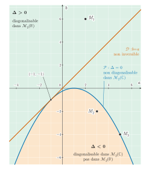

# Banque PT — Mathématiques A 2026 · Corrigé brut

*Corrigé rédigé par IA, non officiel. Signalez toute erreur.*

Épreuve de 4 h, calculatrice interdite, une feuille de papier millimétré à rendre avec la copie.

## Partie A : Quelques matrices

Pour $(a,b)\in\mathbb{R}^2$, la matrice $M(a,b)=\begin{pmatrix}a&b\\1&1\end{pmatrix}$ a pour trace $a+1$ et pour déterminant $a-b$. Son polynôme caractéristique est donc

$$\chi_{M(a,b)}=X^2-(a+1)X+(a-b).$$

On a $M_1=M(2,6)$, $M_2=M(3,-2)$ et $M_3=M(5,-4)$.

### 1.

Soit $\mathbb{K}=\mathbb{R}$ ou $\mathbb{C}$. Une matrice $M\in\mathcal{M}_n(\mathbb{K})$ est trigonalisable dans $\mathcal{M}_n(\mathbb{K})$ si et seulement si son polynôme caractéristique $\chi_M$ est scindé sur $\mathbb{K}$.

$$\boxed{M \text{ trigonalisable dans } \mathcal{M}_n(\mathbb{K}) \iff \chi_M \text{ scindé sur } \mathbb{K}}$$

En particulier, toute matrice de $\mathcal{M}_n(\mathbb{C})$ est trigonalisable dans $\mathcal{M}_n(\mathbb{C})$.

### 2.

On a $\chi_{M_1}=X^2-3X-4=(X-4)(X+1)$. Ce polynôme est scindé sur $\mathbb{R}$ à racines simples : les valeurs propres $4$ et $-1$ sont réelles et distinctes.

Une matrice d'ordre $2$ qui a deux valeurs propres distinctes est diagonalisable. **$M_1$ est donc diagonalisable dans $\mathcal{M}_2(\mathbb{R})$ et dans $\mathcal{M}_2(\mathbb{C})$.**

Chaque valeur propre est simple, donc chaque sous-espace propre est de dimension $1$. Il suffit d'en trouver un vecteur non nul.

- $M_1-4I_2=\begin{pmatrix}-2&6\\1&-3\end{pmatrix}$ et $(3,1)$ est dans son noyau, donc $E_4(M_1)=\mathrm{Vect}\big((3,1)\big)$.
- $M_1+I_2=\begin{pmatrix}3&6\\1&2\end{pmatrix}$ et $(-2,1)$ est dans son noyau, donc $E_{-1}(M_1)=\mathrm{Vect}\big((-2,1)\big)$.

$$\boxed{P_1=\begin{pmatrix}3&-2\\1&1\end{pmatrix},\qquad D_1=\begin{pmatrix}4&0\\0&-1\end{pmatrix}}$$

$P_1$ est inversible car $\det P_1=5\neq0$, et $M_1=P_1D_1P_1^{-1}$.

### 3.

On a $\chi_{M_2}=X^2-4X+5$, de discriminant $-4<0$. Ses racines sont les deux complexes conjugués non réels et distincts $2+i$ et $2-i$.

- Dans $\mathcal{M}_2(\mathbb{C})$, la matrice a deux valeurs propres distinctes : **$M_2$ est diagonalisable dans $\mathcal{M}_2(\mathbb{C})$.**
- $\chi_{M_2}$ n'est pas scindé sur $\mathbb{R}$, donc $M_2$ n'a aucune valeur propre réelle. Elle n'est **pas diagonalisable dans $\mathcal{M}_2(\mathbb{R})$**, ni même trigonalisable dans $\mathcal{M}_2(\mathbb{R})$.

Les deux valeurs propres étant simples, chaque sous-espace propre est de dimension $1$.

Pour $\lambda=2+i$, la première ligne du système $(M_2-\lambda I_2)\binom{x}{y}=0$ s'écrit $(1-i)x-2y=0$. Le vecteur $(2,\,1-i)$ convient. On vérifie la seconde ligne :

$$\begin{aligned}
x+(1-\lambda)y&=2+(-1-i)(1-i)\\
&=2-2\\
&=0.
\end{aligned}$$

Comme $M_2$ est réelle, le conjugué $(2,\,1+i)$ est vecteur propre pour $2-i$.

$$\boxed{P_2=\begin{pmatrix}2&2\\1-i&1+i\end{pmatrix},\qquad D_2=\begin{pmatrix}2+i&0\\0&2-i\end{pmatrix}}$$

On a $\det P_2=2(1+i)-2(1-i)=4i\neq0$, donc $P_2$ est inversible et $M_2=P_2D_2P_2^{-1}$.

### 4. (a)

On a $\chi_{M_3}=X^2-6X+9=(X-3)^2$, donc $3$ est la seule valeur propre.

Si $M_3$ était diagonalisable, elle serait semblable à $3I_2$, donc égale à $P(3I_2)P^{-1}=3I_2$, ce qui est faux.

Autre argument : $M_3-3I_2=\begin{pmatrix}2&-4\\1&-2\end{pmatrix}$ est de rang $1$. Par le théorème du rang, le sous-espace propre $E_3(M_3)$ est de dimension $2-1=1<2$.

Comme $\chi_{M_3}$ est scindé sur $\mathbb{R}$, la question 1 s'applique.

$$\boxed{M_3 \text{ n'est pas diagonalisable dans } \mathcal{M}_2(\mathbb{R}) \text{, mais elle est trigonalisable dans } \mathcal{M}_2(\mathbb{R})}$$

### 4. (b)

On cherche une base $(e_1,e_2)$ telle que $f_3(e_1)=3e_1$ et $f_3(e_2)=e_1+3e_2$. Cela s'écrit

$$\begin{aligned}
(M_3-3I_2)e_1&=0,\\
(M_3-3I_2)e_2&=e_1.
\end{aligned}$$

On prend $e_2=(1,0)$ et l'on pose $e_1=(M_3-3I_2)e_2=(2,1)$. On vérifie :

$$\begin{aligned}
(M_3-3I_2)e_1&=(4-4,\,2-2)=(0,0),\\
M_3e_2&=(5,1)=e_1+3e_2.
\end{aligned}$$

La famille $(e_1,e_2)$ est une base de $\mathbb{R}^2$ : elle compte deux vecteurs et $\det\begin{pmatrix}2&1\\1&0\end{pmatrix}=-1\neq0$.

$$\boxed{\mathcal{B}=\big((2,1),\,(1,0)\big)\ \text{ vérifie }\ \mathrm{Mat}_{\mathcal{B}}(f_3)=T_3}$$

### 5.

On a $\det M(a,b)=a-b$, et une matrice carrée est inversible si et seulement si son déterminant est non nul.

$$\boxed{M(a,b) \text{ inversible} \iff a\neq b}$$

### 6.

$$\begin{aligned}
\Delta(a,b)&=(a+1)^2-4(a-b)\\
&=a^2-2a+1+4b\\
&=(a-1)^2+4b.
\end{aligned}$$

$$\boxed{\Delta(a,b)=(a-1)^2+4b}$$

### 7. (a)

Si $\Delta(a,b)=0$, alors $\chi_{M(a,b)}=(X-\lambda_0)^2$ avec $\lambda_0=\frac{a+1}{2}$.

Si $M(a,b)$ était diagonalisable dans $\mathcal{M}_2(\mathbb{C})$, elle serait semblable à $\lambda_0I_2$. On aurait donc $M(a,b)=P(\lambda_0I_2)P^{-1}=\lambda_0I_2$.

Or le coefficient d'indice $(2,1)$ de $M(a,b)$ vaut $1\neq0$.

**$M(a,b)$ n'est donc pas diagonalisable dans $\mathcal{M}_2(\mathbb{C})$**, ni a fortiori dans $\mathcal{M}_2(\mathbb{R})$. Cet argument vaut pour tous $(a,b)$, y compris $b=0$ ou $a=1$.

### 7. (b)

Si $\Delta(a,b)\neq0$, le polynôme $\chi_{M(a,b)}$ a deux racines complexes distinctes. La matrice a alors deux valeurs propres distinctes dans $\mathbb{C}$, donc elle est diagonalisable dans $\mathcal{M}_2(\mathbb{C})$.

- Si $\Delta(a,b)>0$, les deux valeurs propres sont réelles et distinctes : **$M(a,b)$ est diagonalisable dans $\mathcal{M}_2(\mathbb{R})$ et dans $\mathcal{M}_2(\mathbb{C})$.**
- Si $\Delta(a,b)<0$, les valeurs propres ne sont pas réelles. Une matrice diagonalisable dans $\mathcal{M}_2(\mathbb{R})$ aurait des valeurs propres réelles. **$M(a,b)$ est donc diagonalisable dans $\mathcal{M}_2(\mathbb{C})$ mais pas dans $\mathcal{M}_2(\mathbb{R})$.**

### 8.

Dans le plan muni d'un repère orthonormé, l'abscisse étant $a$ et l'ordonnée $b$, on obtient :

- **$M(a,b)$ non inversible** : la droite $\mathcal{D}$ d'équation $b=a$ ;
- **$M(a,b)$ non diagonalisable dans $\mathcal{M}_2(\mathbb{C})$** : la parabole $\mathcal{P}$ d'équation $b=-\frac{(a-1)^2}{4}$, de sommet $(1,0)$, tournée vers le bas ;
- **$M(a,b)$ diagonalisable dans $\mathcal{M}_2(\mathbb{R})$** : la région ouverte strictement au-dessus de $\mathcal{P}$, où $b>-\frac{(a-1)^2}{4}$ ;
- **diagonalisable dans $\mathcal{M}_2(\mathbb{C})$ mais pas dans $\mathcal{M}_2(\mathbb{R})$** : la région ouverte strictement au-dessous de $\mathcal{P}$, où $b<-\frac{(a-1)^2}{4}$ ;
- le point $(2,6)$ de $M_1$, où $\Delta=25>0$, au-dessus de $\mathcal{P}$ ;
- le point $(3,-2)$ de $M_2$, où $\Delta=-4<0$, au-dessous de $\mathcal{P}$ ;
- le point $(5,-4)$ de $M_3$, où $\Delta=0$, sur $\mathcal{P}$.

La parabole passe par $(-1,-1)$, $(3,-1)$, $(-3,-4)$ et $(5,-4)$.

Comme $\Delta(a,a)=(a+1)^2\geqslant0$, la droite $\mathcal{D}$ est tangente à $\mathcal{P}$ au point $(-1,-1)$ et reste au-dessus de $\mathcal{P}$ partout ailleurs.

Points utiles pour le tracé :

| $a$ | −3 | −1 | 1 | 3 | 5 |
|---|---|---|---|---|---|
| $b$ sur $\mathcal{P}$ | −4 | −1 | 0 | −1 | −4 |
| $b$ sur $\mathcal{D}$ | −3 | −1 | 1 | 3 | 5 |



Sur la feuille millimétrée, on trace les axes avec leur origine et leurs graduations, en unité 1 cm, avec $a\in[-5,7]$ et $b\in[-8,8]$. On hachure les deux régions de deux façons différentes et l'on écrit la légende sur la feuille même.

## Partie B : Un couple de variables aléatoires

On note $c_{i,j}=P(X=x_i,Y=x_j)$, avec $(x_1,x_2,x_3)=(-1,0,1)$.

### 1. (a)

Pour tout $i$, le coefficient d'indice $i$ de $CU$ est

$$\begin{aligned}
(CU)_i&=\sum_{j=1}^3c_{i,j}\\
&=\sum_{j=1}^3P(X=x_i,Y=x_j).
\end{aligned}$$

Comme $Y(\Omega)=\{x_1,x_2,x_3\}$, les événements $(Y=x_1)$, $(Y=x_2)$, $(Y=x_3)$ forment un système complet d'événements. Par la formule des probabilités totales appliquée à ce système, cette somme vaut $P(X=x_i)$.

Le vecteur $CU$ est donc la colonne des $P(X=x_i)$, et $CU=\frac{1}{12}(4,5,3)^\top$.

$$\boxed{\begin{aligned}
P(X=-1)&=\tfrac13\\
P(X=0)&=\tfrac5{12}\\
P(X=1)&=\tfrac14
\end{aligned}}$$

### 1. (b)

Par définition de l'espérance d'une variable finie, et d'après (a),

$$\begin{aligned}
V^\top CU&=\sum_{i=1}^3x_iP(X=x_i)\\
&=E(X).
\end{aligned}$$

$$\boxed{E(X)=-\tfrac13+\tfrac14=-\tfrac1{12}}$$

### 2.

La loi de $Y$ est donnée par le produit $U^\top C$ (ligne des $P(Y=x_j)$), ou de façon équivalente par $C^\top U$. L'espérance est donnée par $E(Y)=U^\top CV$.

$$U^\top C=\tfrac1{12}(4,4,4)=\big(\tfrac13,\tfrac13,\tfrac13\big).$$

$$\boxed{\begin{aligned}
P(Y=-1)&=\tfrac13\\
P(Y=0)&=\tfrac13\\
P(Y=1)&=\tfrac13
\end{aligned}}$$

**$Y$ suit la loi uniforme sur $\{-1,0,1\}$.** Enfin, $CV=\frac1{12}(1,-1,0)^\top$ et $U^\top CV=0$.

$$\boxed{E(Y)=U^\top CV=0}$$

### 3.

On développe le produit :

$$\begin{aligned}
V^\top CV&=\sum_{i=1}^3\sum_{j=1}^3x_i\,c_{i,j}\,x_j\\
&=\sum_{i=1}^3\sum_{j=1}^3x_ix_j\,P(X=x_i,Y=x_j).
\end{aligned}$$

Par la formule de transfert appliquée au couple $(X,Y)$ et à la fonction $(u,v)\mapsto uv$, cette somme est **$E(XY)$**. Avec $CV=\frac1{12}(1,-1,0)^\top$, on obtient :

$$\boxed{V^\top CV=E(XY)=-\tfrac1{12}}$$

### 4.

$$\begin{aligned}
\mathrm{Cov}(X,Y)&=E(XY)-E(X)E(Y)\\
&=-\tfrac1{12}-\big(-\tfrac1{12}\big)\times0.
\end{aligned}$$

$$\boxed{\mathrm{Cov}(X,Y)=-\tfrac1{12}}$$

### 5.

**$X$ et $Y$ ne sont pas indépendantes.** Deux justifications :

1. Si $X$ et $Y$ étaient indépendantes, on aurait $\mathrm{Cov}(X,Y)=0$, ce qui contredit la question 4.
2. $P(X=-1,Y=-1)=c_{1,1}=\frac1{12}$, alors que $P(X=-1)P(Y=-1)=\frac19$.

On peut aussi remarquer que l'indépendance donnerait $C=(CU)(U^\top C)$, matrice de rang $1$. Or les colonnes $(1,2,1)^\top$ et $(2,1,1)^\top$ de $12C$ ne sont pas colinéaires.

### 6.

Les événements $(X=x_i,Y=x_i)$, pour $i\in\{1,2,3\}$, sont deux à deux incompatibles. Leur réunion est $(X=Y)$, puisque $X$ et $Y$ prennent leurs valeurs dans $\{x_1,x_2,x_3\}$. Par additivité,

$$\begin{aligned}
\mathrm{tr}(C)&=\sum_{i=1}^3c_{i,i}\\
&=P(X=Y).
\end{aligned}$$

Numériquement, $c_{1,1}+c_{2,2}+c_{3,3}=\frac{1+2+1}{12}$.

$$\boxed{\begin{aligned}
\mathrm{tr}(C)&=P(X=Y)\\
&=\tfrac13
\end{aligned}}$$

## Partie C : Des variables aléatoires dans une matrice

### 1. (a)

D'après A.5, $M(A,B)$ est inversible si et seulement si $A\neq B$. Les événements $\big(M(A,B)\text{ inversible}\big)$ et $(A\neq B)$ sont donc égaux. Avec $A=X$, $B=Y$ et B.6 :

$$\begin{aligned}
P\big(M(A,B)\text{ inversible}\big)&=1-P(X=Y)\\
&=1-\tfrac13.
\end{aligned}$$

$$\boxed{P\big(M(A,B)\text{ inversible}\big)=\tfrac23}$$

### 1. (b)

D'après A.7, $M(A,B)$ n'est diagonalisable ni dans $\mathcal{M}_2(\mathbb{R})$ ni dans $\mathcal{M}_2(\mathbb{C})$ si et seulement si $\Delta(A,B)=0$, avec $\Delta(A,B)=(A-1)^2+4B$. Sur $\{-1,0,1\}^2$ :

- pour $a=-1$, $4+4b=0$ donne $b=-1$ ;
- pour $a=0$, $1+4b=0$ n'a pas de solution dans $\{-1,0,1\}$ ;
- pour $a=1$, $4b=0$ donne $b=0$.

Les deux événements $(X=-1,Y=-1)$ et $(X=1,Y=0)$ sont incompatibles, donc

$$\begin{aligned}
P\big(\Delta(A,B)=0\big)&=c_{1,1}+c_{3,2}\\
&=\tfrac1{12}+\tfrac1{12}.
\end{aligned}$$

$$\boxed{P\big(\Delta(A,B)=0\big)=\tfrac16}$$

### 2.

Comme $A$ et $B$ sont à valeurs dans $H$, on a l'égalité d'événements $(A=B)=\bigcup_{k\in H}\big((A=k)\cap(B=k)\big)$.

En effet, si $A(\omega)=B(\omega)$, cette valeur commune est un élément $k$ de $H$, et la réciproque est immédiate.

Ces événements sont deux à deux incompatibles, car $(A=k)\cap(A=k')=\varnothing$ pour $k\neq k'$. Ils sont en nombre au plus dénombrable, car $H\subset\mathbb{N}$.

Par $\sigma$-additivité, puis par indépendance de $A$ et $B$ :

$$\begin{aligned}
P(A=B)&=\sum_{k\in H}P\big((A=k)\cap(B=k)\big)\\
&=\boxed{\sum_{k\in H}P(A=k)P(B=k)}.
\end{aligned}$$

### 3. (a)

On note $q=1-p$.

$$\boxed{\begin{aligned}
&A(\Omega)=[\![0;n]\!],\\
&\forall k\in[\![0;n]\!],\ P(A=k)=\binom nk p^kq^{n-k}
\end{aligned}}$$

### 3. (b)

$$\boxed{\begin{aligned}
&B(\Omega)=\mathbb{N}^*,\\
&\forall k\in\mathbb{N}^*,\ P(B=k)=r(1-r)^{k-1}
\end{aligned}}$$

### 3. (c)

$M(A,B)$ est non inversible si et seulement si $A=B$ (A.5). Les variables $A$ et $B$ sont indépendantes et toutes deux à valeurs dans $H=\mathbb{N}$, donc la question 2 s'applique.

On a $P(B=0)=0$, et $P(A=k)=0$ pour $k>n$. Il reste les indices $k\in[\![1;n]\!]$ :

$$\begin{aligned}
P(A=B)&=\sum_{k=1}^n\binom nk p^k(1-p)^{n-k}\,r(1-r)^{k-1}\\
&=\frac{r}{1-r}\sum_{k=1}^n\binom nk\big(p(1-r)\big)^k(1-p)^{n-k}.
\end{aligned}$$

On complète la somme avec le terme $k=0$, qui vaut $(1-p)^n$, et on le retranche. La formule du binôme de Newton, avec $p(1-r)+(1-p)=1-pr$, donne

$$\begin{aligned}
\sum_{k=1}^n\binom nk\big(p(1-r)\big)^k(1-p)^{n-k}&=\big(p(1-r)+1-p\big)^n-(1-p)^n\\
&=(1-pr)^n-(1-p)^n.
\end{aligned}$$

$$\boxed{P\big(M(A,B)\text{ non inversible}\big)=\frac{r}{1-r}\Big[(1-pr)^n-(1-p)^n\Big]}$$

### 4. (a)

$$\boxed{\begin{aligned}
&A(\Omega)=\mathbb{N},\\
&\forall k\in\mathbb{N},\ P(A=k)=e^{-\lambda}\frac{\lambda^k}{k!}
\end{aligned}}$$

### 4. (b)

Si $Z\sim\mathcal{P}(\theta)$, alors pour tout $t\in\mathbb{R}$,

$$\begin{aligned}
G_Z(t)&=\sum_{k\ge0}e^{-\theta}\frac{(\theta t)^k}{k!}\\
&=e^{\theta(t-1)}.
\end{aligned}$$

Les variables $A$ et $C=-B$ sont à valeurs dans $\mathbb{N}$.

Elles sont indépendantes, puisque $C$ est une fonction de $B$ et que $A$ et $B$ sont indépendantes. La fonction génératrice d'une somme de variables indépendantes est le produit des fonctions génératrices :

$$\begin{aligned}
G_{A+C}(t)&=G_A(t)\,G_C(t)\\
&=e^{\lambda(t-1)}e^{\mu(t-1)}\\
&=e^{(\lambda+\mu)(t-1)}.
\end{aligned}$$

La fonction génératrice caractérise la loi d'une variable à valeurs dans $\mathbb{N}$, d'où

$$\boxed{A+C\sim\mathcal{P}(\lambda+\mu)}$$

### 4. (c)

D'après A.5, $M(A,B)$ est inversible si et seulement si $A\neq B$, c'est-à-dire $A+C\neq0$. D'après (b),

$$\begin{aligned}
P\big(M(A,B)\text{ inversible}\big)&=1-P(A+C=0)\\
&=1-e^{-(\lambda+\mu)}.
\end{aligned}$$

$$\boxed{P\big(M(A,B)\text{ inversible}\big)=1-e^{-(\lambda+\mu)}}$$

### 5.

$M(A,B)$ est non inversible si et seulement si $A=B$ (A.5). Les variables $A$ et $B$ sont indépendantes et à valeurs dans $\mathbb{N}$ : on applique la question 2 avec $H=\mathbb{N}$.

$$\begin{aligned}
P(A=B)&=\sum_{k=0}^{+\infty}e^{-\lambda}\frac{\lambda^k}{k!}\,e^{-\mu}\frac{\mu^k}{k!}\\
&=\sum_{k=0}^{+\infty}\frac{(\lambda\mu)^k}{(k!)^2}e^{-(\lambda+\mu)}.
\end{aligned}$$

$$\boxed{P\big(M(A,B)\text{ non inversible}\big)=I}$$

La série converge, puisque ses termes sont positifs et majorés par ceux de la série exponentielle de $\lambda\mu$.

### 6. (a)

Tous les termes de $R_n$ sont positifs, donc $R_n\geqslant0$ et $|R_n|=R_n$.

Pour $k\geqslant n+1$, on a $k!\geqslant(n+1)!$, donc $(k!)^2\geqslant(n+1)!\,k!$. Il vient

$$\begin{aligned}
|R_n|&\leqslant\frac{e^{-(\lambda+\mu)}}{(n+1)!}\sum_{k=n+1}^{+\infty}\frac{(\lambda\mu)^k}{k!}\\
&\leqslant\frac{e^{-(\lambda+\mu)}}{(n+1)!}\sum_{k=0}^{+\infty}\frac{(\lambda\mu)^k}{k!}\\
&=\frac{e^{\lambda\mu-(\lambda+\mu)}}{(n+1)!}.
\end{aligned}$$

La deuxième inégalité vient de ce que l'on ajoute les termes positifs d'indices $0$ à $n$.

$$\boxed{\forall n\geqslant0,\quad |R_n|\leqslant\frac{1}{(n+1)!}e^{\lambda\mu-(\lambda+\mu)}}$$

### 6. (b)

Notons $S_n$ la somme partielle d'indice $n$ de $I$, de sorte que $I-S_n=R_n$.

Dès que le majorant de 6(a) est inférieur ou égal à `eps`, $S_n$ est une valeur approchée de $I$ à `eps` près. Ce majorant tend vers $0$ quand $n$ tend vers l'infini, donc la boucle termine.

```python
from math import exp, factorial

def val_app(eps):
    # n : indice du dernier terme ajouté ; S : somme partielle S_n
    n = 0
    S = exp(-(la + mu))                                   # S_0 : terme k = 0
    # tant que le majorant de |R_n| (question 6.a) dépasse eps, on ajoute un terme
    while exp(la * mu - (la + mu)) / factorial(n + 1) > eps:
        n = n + 1
        S = S + (la * mu) ** n / factorial(n) ** 2 * exp(-(la + mu))   # S devient S_n
    return S                                              # |I - S_n| <= eps
```

Pour $\lambda=1$, $\mu=2$ et `eps = 1e-5`, la boucle s'arrête à $n=7$ et la fonction renvoie $0{,}211712\ldots$

### 6. (c)

Les variables globales `la` et `mu` étant affectées, on ajoute l'instruction :

```python
print(val_app(10**-5))
```

### 7. (a)

$J_i$ prend les valeurs $0$ et $1$ : c'est une variable de Bernoulli. Son paramètre est

$$\begin{aligned}
P(J_i=1)&=P\big(M(A,B)\text{ non inversible}\big)\\
&=I,
\end{aligned}$$

d'après la question 5.

$$\boxed{J_i\sim\mathcal{B}(I)\quad\text{(loi de Bernoulli de paramètre } I)}$$

### 7. (b)

La somme définissant $K_N$ porte sur les $J_k$ (l'indice $J_i$ de l'énoncé est une coquille sans incidence).

Les simulations sont indépendantes, donc $J_1,\dots,J_N$ sont des variables indépendantes, toutes de loi $\mathcal{B}(I)$.

D'après le cours, si $J_1,\dots,J_N$ sont indépendantes de loi de Bernoulli de paramètre $I$, alors $J_1+\dots+J_N$ suit la loi binomiale de paramètres $N$ et $I$.

$$\boxed{K_N\sim\mathcal{B}(N,I)}$$

### 7. (c)

On a $E(K_N)=NI$ et $V(K_N)=NI(1-I)$. Par linéarité de l'espérance et par la relation $V(aZ)=a^2V(Z)$ :

$$\boxed{\begin{aligned}
E(\overline{K_N})&=I\\
V(\overline{K_N})&=\frac{I(1-I)}{N}
\end{aligned}}$$

### 7. (d)

$\overline{K_N}$ est une variable finie, donc elle admet une variance. L'inégalité de Bienaymé-Tchebychev donne, pour tout $\varepsilon>0$,

$$P\big(|\overline{K_N}-I|\geqslant\varepsilon\big)\leqslant\frac{I(1-I)}{N\varepsilon^2}.$$

Par ailleurs, la forme canonique donne la majoration

$$I(1-I)=\frac14-\Big(I-\frac12\Big)^2\leqslant\frac14.$$

$$\boxed{\forall\varepsilon>0,\quad P\big(|\overline{K_N}-I|\geqslant\varepsilon\big)\leqslant\frac1{4N\varepsilon^2}}$$

### 7. (e)

L'événement $\big(I\in[\overline{K_N}-\varepsilon\,;\,\overline{K_N}+\varepsilon]\big)$ est l'événement $\big(|\overline{K_N}-I|\leqslant\varepsilon\big)$.

Il contient l'événement contraire de $\big(|\overline{K_N}-I|\geqslant\varepsilon\big)$, qui est $\big(|\overline{K_N}-I|<\varepsilon\big)$. Par croissance de $P$, puis par 7(d) :

$$\begin{aligned}
P\big(I\in[\overline{K_N}-\varepsilon\,;\,\overline{K_N}+\varepsilon]\big)&\geqslant1-P\big(|\overline{K_N}-I|\geqslant\varepsilon\big)\\
&\geqslant1-\frac1{4N\varepsilon^2}.
\end{aligned}$$

$$\boxed{\forall\varepsilon>0,\quad P\big(I\in[\overline{K_N}-\varepsilon\,;\,\overline{K_N}+\varepsilon]\big)\geqslant1-\frac1{4N\varepsilon^2}}$$

### 7. (f)

On a $N=10^5$ et la réalisation observée de $\overline{K_N}$ vaut

$$\overline{K_N}=\frac{21\,357}{100\,000}=0{,}21357.$$

- Pour $\varepsilon=10^{-2}$ : $\frac{1}{4N\varepsilon^2}=\frac{1}{40}=0{,}025$.

  **Avec une probabilité au moins égale à $0{,}975$, l'intervalle aléatoire $[\overline{K_N}-0{,}01\,;\,\overline{K_N}+0{,}01]$ contient $I$.**

  Pour cette simulation, il vaut $[0{,}20357\,;\,0{,}22357]$ : c'est un intervalle de confiance de $I$ au niveau $97{,}5\,\%$. Arrondi vers l'extérieur, il devient $[0{,}203\,;\,0{,}224]$.
- Pour $\varepsilon=10^{-3}$ : $\frac{1}{4N\varepsilon^2}=2{,}5$, et le minorant $1-2{,}5=-1{,}5$ est négatif. Une probabilité est toujours positive : **l'inégalité ne donne aucune information.**

À titre de contrôle, la valeur calculée en 6(b) est $I\approx0{,}21171$ ; elle appartient bien au premier intervalle.

## Partie D : Un deuxième couple de variables aléatoires

On note $\alpha=\big(P(X=x_i)\big)_{1\le i\le n}$ et $\beta=\big(P(Y=y_j)\big)_{1\le j\le n}$, vus comme vecteurs colonnes.

En généralisant la partie B, on a $QU=\alpha$ et $Q^\top U=\beta$, et les coordonnées de $\alpha$ et de $\beta$ sont de somme $1$.

### 1. (a)

Par indépendance, $q_{i,j}=\alpha_i\beta_j$ pour tous $i,j$, donc $Q=\alpha\beta^\top$.

Toutes les colonnes de $Q$ sont colinéaires à $\alpha$, donc $\mathrm{rg}\,Q\leqslant1$.

De plus, $\alpha\neq0$ et $\beta\neq0$, puisque leurs coordonnées sont de somme $1$. Donc $Q\neq0$ et $\mathrm{rg}\,Q\geqslant1$.

$$\boxed{\mathrm{rg}\,Q=1}$$

### 1. (b)

Le cas $n=1$ est à part : $Q=(1)$, et la seule valeur propre est $1$. On suppose désormais $n\geqslant2$.

- Par le théorème du rang, $\dim\ker Q=n-1\geqslant1$. Donc **$0$ est valeur propre de $Q$, avec un sous-espace propre de dimension $n-1$**. La dimension d'un sous-espace propre est majorée par la multiplicité de la valeur propre, donc cette multiplicité est au moins $n-1$.
- On a $\beta^\top\alpha=\sum_i\alpha_i\beta_i=\sum_iq_{i,i}=\mathrm{tr}\,Q$. Il vient $Q^2=\alpha(\beta^\top\alpha)\beta^\top=\mathrm{tr}(Q)\,Q$.
- Si $Qx=\lambda x$ avec $x\neq0$, on calcule $Q^2x$ de deux façons ($Q^2=\mathrm{tr}(Q)\,Q$) :

  $$\lambda^2x=\mathrm{tr}(Q)\,\lambda x.$$

  Comme $x\neq0$, il vient $\lambda\big(\lambda-\mathrm{tr}(Q)\big)=0$ : **les seules valeurs propres possibles sont $0$ et $\mathrm{tr}\,Q$**.
- $Q$ est trigonalisable dans $\mathcal{M}_n(\mathbb{C})$, donc sa trace est la somme de ses valeurs propres complexes comptées avec multiplicité ; cette somme vaut $\mathrm{tr}\,Q$, d'où $\chi_Q=X^{n-1}\big(X-\mathrm{tr}\,Q\big)$.

$$\boxed{\begin{aligned}
&\text{si } \mathrm{tr}\,Q\neq0 :\ 0 \text{ de multiplicité } n-1 \text{ et } \mathrm{tr}\,Q \text{ de multiplicité } 1\ ;\\
&\text{si } \mathrm{tr}\,Q=0 :\ 0 \text{ seule, de multiplicité } n
\end{aligned}}$$

### 1. (c)

Ici $\mathrm{tr}\,Q=\sum_i\alpha_i\beta_i$, avec $\alpha_i>0$ pour tout $i$, et les $\beta_i$ positifs de somme $1$.

Il existe donc $i_0$ tel que $\beta_{i_0}>0$, ce qui donne $\mathrm{tr}\,Q\geqslant\alpha_{i_0}\beta_{i_0}>0$.

Or $Q\alpha=\alpha(\beta^\top\alpha)=(\mathrm{tr}\,Q)\,\alpha$ avec $\alpha\neq0$. Donc $\mathrm{tr}\,Q$ est valeur propre, et son sous-espace propre est de dimension au moins $1$.

La somme des dimensions des sous-espaces propres vaut alors au moins $(n-1)+1=n$, d'où

$$\boxed{Q \text{ est diagonalisable, semblable à } \mathrm{diag}(\mathrm{tr}\,Q,0,\dots,0)}$$

Pour $n=1$, $Q=(1)$ est diagonale.

### 1. (d)

Prenons $x_i=y_i=i$ pour $i\in[\![1;4]\!]$ et $\Omega=[\![1;4]\!]^2$, muni de la probabilité $P(\{(i,j)\})=a_ib_j$, avec

$$\begin{aligned}
a&=\big(\tfrac12,\tfrac12,0,0\big),\\
b&=\big(0,0,\tfrac12,\tfrac12\big).
\end{aligned}$$

Posons $X(i,j)=x_i$ et $Y(i,j)=y_j$. On a bien $X(\Omega)=Y(\Omega)=\{1,2,3,4\}$.

Les variables $X$ et $Y$ sont indépendantes, avec $P(X=x_i)=a_i$ et $P(Y=y_j)=b_j$.

$X$ suit la loi uniforme sur $\{1,2\}$ et $Y$ la loi uniforme sur $\{3,4\}$, donc aucune n'est constante. On a cependant $P(X=3)=P(X=4)=0$.

$$Q=\frac14\begin{pmatrix}0&0&1&1\\0&0&1&1\\0&0&0&0\\0&0&0&0\end{pmatrix}.$$

Ses coefficients sont positifs, de somme $1$ : c'est bien la matrice d'une loi conjointe, et elle est de rang $1$.

On a $\mathrm{tr}\,Q=0$, donc $Q^2=\mathrm{tr}(Q)\,Q=0$ et $0$ est la seule valeur propre. Si $Q$ était diagonalisable, elle serait semblable à la matrice nulle, donc nulle. Comme $Q\neq0$, **$Q$ n'est pas diagonalisable.**

Cet exemple est nécessairement de ce type. Pour $X$ et $Y$ indépendantes, la non-diagonalisabilité impose $\mathrm{tr}\,Q=0$, donc certaines valeurs $x_i$ doivent être prises avec une probabilité nulle.

### 2.

Supposons $\mathrm{rg}\,Q=1$. L'image de $Q$ est une droite $\mathrm{Vect}(u)$.

Chaque colonne $Qe_j$ s'écrit $v_ju$. On a donc $Q=uv^\top$, avec $u,v\in\mathbb{R}^n$.

On pose $s=\sum_jv_j$ et $t=\sum_iu_i$. En généralisant B.1 et B.2 :

$$\begin{aligned}
\alpha&=QU=u\,(v^\top U)=s\,u,\\
\beta&=Q^\top U=v\,(u^\top U)=t\,v.
\end{aligned}$$

La somme de toutes les probabilités jointes vaut $1$, donc

$$\begin{aligned}
1&=U^\top QU\\
&=(U^\top u)(v^\top U)\\
&=ts.
\end{aligned}$$

Par suite,

$$\begin{aligned}
\alpha\beta^\top&=st\,uv^\top\\
&=Q.
\end{aligned}$$

Autrement dit, pour tous $(i,j)$, $P(X=x_i,Y=y_j)=P(X=x_i)\,P(Y=y_j)$.

$$\boxed{\mathrm{rg}\,Q=1\implies X \text{ et } Y \text{ indépendantes}}$$

Avec 1(a), on obtient l'équivalence : **$X$ et $Y$ sont indépendantes si et seulement si $\mathrm{rg}\,Q=1$.**
