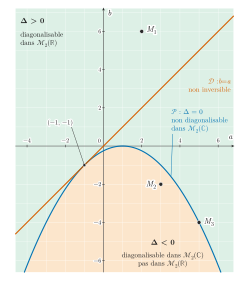

# Banque PT PT — Mathématiques A 2026 · Corrigé guidé

*Corrigé rédigé par IA, non officiel. Signalez toute erreur.*

## Présentation du sujet

**Format.** Épreuve de 4 heures, **calculatrice interdite**. Une feuille de papier millimétré est à rendre avec la copie. Le sujet compte quatre parties et 41 questions élémentaires en comptant chaque sous-question. Les parties A et B sont indépendantes ; les parties C et D réutilisent leurs résultats.

**Le fil conducteur** est la famille de matrices $M(a,b)=\begin{pmatrix}a&b\\1&1\end{pmatrix}$, regardée d'abord avec des coefficients réels, puis avec des coefficients aléatoires.

- **Partie A — Quelques matrices (10 questions).** Réduction de trois matrices explicites d'ordre 2 : une diagonalisable sur $\mathbb{R}$, une diagonalisable seulement sur $\mathbb{C}$, une seulement trigonalisable. On étudie ensuite la famille $M(a,b)$ : inversibilité, discriminant $\Delta(a,b)$ du polynôme caractéristique, diagonalisabilité selon le signe de $\Delta$, puis un tracé dans le plan $(a,b)$.
- **Partie B — Un couple de variables aléatoires (7 questions).** La loi conjointe d'un couple $(X,Y)$ est rangée dans une matrice $C$. Des produits matriciels simples donnent les lois marginales, les espérances, $E(XY)$, la covariance et $P(X=Y)$.
- **Partie C — Des variables aléatoires dans une matrice (19 questions).** Les coefficients $a$ et $b$ deviennent des variables aléatoires $A$ et $B$. On calcule la probabilité que $M(A,B)$ soit inversible ou diagonalisable pour diverses lois (couple de la partie B, binomiale et géométrique, Poisson). Pour deux lois de Poisson, on aboutit à une série $I$, que l'on approche de deux façons : majoration du reste avec un programme Python, puis simulation (méthode de Monte-Carlo) avec l'inégalité de Bienaymé-Tchebychev.
- **Partie D — Un deuxième couple de variables aléatoires (5 questions).** On caractérise l'indépendance de $X$ et $Y$ par le rang de la matrice de leur loi conjointe, et l'on étudie la diagonalisabilité de cette matrice de rang $1$.

**Notions du programme mobilisées.** Polynôme caractéristique, valeurs et sous-espaces propres, critères de diagonalisabilité et de trigonalisabilité, changement de base ; trinôme du second degré ; loi conjointe et lois marginales, formule des probabilités totales, formule de transfert, covariance, indépendance ; lois usuelles (Bernoulli, binomiale, géométrique, Poisson) ; $\sigma$-additivité ; fonctions génératrices ; séries entières de référence (exponentielle) ; inégalité de Bienaymé-Tchebychev ; boucle `while` en Python ; rang, théorème du rang.

**Difficulté et gestion du temps.** Le sujet est de difficulté modérée et très progressif. Beaucoup de questions sont des applications directes du cours, à ne pas laisser passer : A.1 à A.7, B.1 à B.6, C.1, C.3(a)-(b), C.4(a), C.7(a)-(c). Les points qui demandent plus de soin sont C.3(c) (formule du binôme), C.6 (majoration du reste et programme), C.7(d)-(f) (Bienaymé-Tchebychev et interprétation) et toute la partie D, plus abstraite. Le tracé A.8 se prépare au brouillon : il demande un peu de temps, mais il est sûr. Un partage raisonnable : 60 minutes pour A, 35 pour B, 95 pour C et 50 pour D.

**Ce que dit le rapport 2026.** La grande majorité des candidats a traité les parties A à C, et la partie D « a joué son rôle en permettant aux candidats les plus performants de faire la différence ». La question D.2 a été « très peu traitée et jamais avec succès ». Les questions de cours sur les lois usuelles ont été mal sues : 39 % de réponses correctes en C.3(a), 46 % en C.3(b), 51 % en C.4(a). Autres questions discriminantes : A.7(b) (plus du tiers des candidats l'a laissée), B.4 (formule de la covariance connue par 2 candidats sur 5), B.5 (deux méthodes distinctes chez 1 candidat sur 5) et C.4(c) (abordée par moins d'un candidat sur deux). À l'inverse, A.6 est « probablement la question la mieux réussie du sujet ».

**Conseil de présentation.** L'énoncé insiste sur la référence exacte des questions (« les questions non correctement référencées ne seront pas notées ») et invite à encadrer les résultats. Il faut donc numéroter chaque réponse avec sa partie, par exemple « C.3(c) ».

Le rapport 2026 ajoute que les résultats s'encadrent « à l'aide d'une règle », que les fractions doivent être mises sous forme irréductible et qu'il ne faut pas d'abréviation (« proba »). Il demande aussi de rappeler le numéro de la question dont on utilise un résultat.

## Partie A — Quelques matrices

On réduit trois matrices de la même forme, puis on généralise à $M(a,b)$. Tout repose sur le polynôme caractéristique d'une matrice $2\times2$, $\chi_M=X^2-\mathrm{tr}(M)X+\det M$, et sur son discriminant. Pour toute la partie, $\mathrm{tr}\,M(a,b)=a+1$ et $\det M(a,b)=a-b$.

### Question 1

> [!INDICATION]
> Question de cours. Le critère porte sur la façon dont le polynôme caractéristique se factorise sur le corps considéré.

#### Solution

Soit $\mathbb{K}=\mathbb{R}$ ou $\mathbb{C}$.

Une matrice $M\in\mathcal{M}_n(\mathbb{K})$ est trigonalisable dans $\mathcal{M}_n(\mathbb{K})$ si et seulement si son polynôme caractéristique $\chi_M$ est **scindé** sur $\mathbb{K}$, c'est-à-dire produit de facteurs de degré $1$ à coefficients dans $\mathbb{K}$.

$$\boxed{M \text{ trigonalisable dans } \mathcal{M}_n(\mathbb{K}) \iff \chi_M \text{ scindé sur } \mathbb{K}}$$

Tout polynôme est scindé sur $\mathbb{C}$, donc toute matrice complexe est trigonalisable dans $\mathcal{M}_n(\mathbb{C})$.

> [!PIEGE]
> Ne pas confondre avec la diagonalisabilité. « $\chi_M$ scindé » est nécessaire pour être diagonalisable, mais pas suffisant : la matrice $M_3$ de la question 4 en est un contre-exemple.

> [!JURY]
> Rapport 2026 : la propriété est connue d'un peu moins des deux tiers des candidats, et « uniquement la moitié de ceux-ci la présente avec un « si et seulement si », ce qui correspond au terme « caractérisation » ». Une implication seule ne répond pas à la question.

### Question 2

> [!INDICATION]
> Calculez la trace et le déterminant, factorisez $\chi_{M_1}$ et regardez si les racines sont distinctes.

> [!INDICATION]
> Pour chaque valeur propre $\lambda$, une seule ligne de $M_1-\lambda I_2$ suffit à déterminer le noyau. Justifiez d'abord que ce noyau est une droite.

#### Solution

On a $\mathrm{tr}\,M_1=3$ et $\det M_1=2-6=-4$, donc $\chi_{M_1}=X^2-3X-4=(X-4)(X+1)$. Les deux valeurs propres $4$ et $-1$ sont **réelles et distinctes**.

Une matrice d'ordre $2$ qui a deux valeurs propres distinctes est diagonalisable : **$M_1$ est diagonalisable dans $\mathcal{M}_2(\mathbb{R})$, donc aussi dans $\mathcal{M}_2(\mathbb{C})$.**

Chaque valeur propre est simple, donc chaque sous-espace propre est de dimension $1$ : un vecteur non nul du noyau l'engendre.

- $M_1-4I_2=\begin{pmatrix}-2&6\\1&-3\end{pmatrix}$ : la relation $x=3y$ donne le vecteur propre $(3,1)$.
- $M_1+I_2=\begin{pmatrix}3&6\\1&2\end{pmatrix}$ : la relation $x=-2y$ donne le vecteur propre $(-2,1)$.

$$\boxed{P_1=\begin{pmatrix}3&-2\\1&1\end{pmatrix},\qquad D_1=\begin{pmatrix}4&0\\0&-1\end{pmatrix}}$$

$P_1$ est inversible car $\det P_1=5\neq0$, et $M_1=P_1D_1P_1^{-1}$.

> [!METHODE]
> Pour une matrice $2\times2$ de valeur propre $\lambda$, si la première ligne de $M-\lambda I_2$ s'écrit $(\alpha,\beta)\neq(0,0)$, le vecteur $(\beta,-\alpha)$ engendre le noyau. Contrôlez toujours avec la seconde ligne : c'est une vérification gratuite de la valeur propre.

> [!PIEGE]
> La $k$-ième colonne de $P_1$ doit être un vecteur propre associé au $k$-ième coefficient diagonal de $D_1$. Si l'on échange les colonnes de $P_1$, il faut aussi échanger les coefficients de $D_1$.

> [!JURY]
> Rapport 2026 : les candidats ont parfois oublié de répondre à l'une des deux questions (sur $\mathbb{C}$ et sur $\mathbb{R}$). Le jury relève aussi les sous-entendus du type « le polynôme admet 2 racines » (distinctes ? réelles ?), « ce qui posait problème dans ce sujet, puisque c'est sur ces précisions que reposait l'essentiel des justifications ». Il reproche enfin de ne pas justifier la dimension du sous-espace propre, par le rang de la matrice ou par la multiplicité de la valeur propre.

### Question 3

> [!INDICATION]
> Même démarche. Le discriminant de $\chi_{M_2}$ est négatif : quelles conséquences sur $\mathbb{C}$, puis sur $\mathbb{R}$ ?

> [!INDICATION]
> Pour le vecteur propre complexe, résolvez avec la première ligne en choisissant $x$ de façon à éviter les fractions. Le second vecteur propre s'obtient par conjugaison, puisque $M_2$ est réelle.

#### Solution

On a $\mathrm{tr}\,M_2=4$ et $\det M_2=3+2=5$, donc $\chi_{M_2}=X^2-4X+5$. Son discriminant vaut $16-20=-4<0$. Ses racines sont les deux complexes conjugués **non réels et distincts** $2+i$ et $2-i$.

- Dans $\mathbb{C}$, il y a deux valeurs propres distinctes : **$M_2$ est diagonalisable dans $\mathcal{M}_2(\mathbb{C})$.**
- $M_2$ n'a aucune valeur propre réelle. Si elle était diagonalisable dans $\mathcal{M}_2(\mathbb{R})$, les coefficients diagonaux de la matrice diagonale seraient des valeurs propres réelles. **$M_2$ n'est donc pas diagonalisable dans $\mathcal{M}_2(\mathbb{R})$.**

Les deux valeurs propres sont simples, donc chaque sous-espace propre est de dimension $1$.

Pour $\lambda=2+i$, la première ligne de $(M_2-\lambda I_2)\binom xy=0$ s'écrit $(1-i)x-2y=0$, et $x=2$, $y=1-i$ convient. On contrôle avec la seconde ligne :

$$\begin{aligned}
x+(1-\lambda)y&=2+(-1-i)(1-i)\\
&=2+(-1+i-i+i^2)\\
&=2-2\\
&=0.
\end{aligned}$$

Le vecteur propre associé à $2-i$ est le conjugué $(2,1+i)$.

$$\boxed{P_2=\begin{pmatrix}2&2\\1-i&1+i\end{pmatrix},\qquad D_2=\begin{pmatrix}2+i&0\\0&2-i\end{pmatrix}}$$

On a $\det P_2=4i\neq0$, donc $P_2$ est inversible et $M_2=P_2D_2P_2^{-1}$.

> [!METHODE]
> Si $M$ est réelle et $MZ=\lambda Z$, alors $M\overline Z=\overline\lambda\,\overline Z$. Il suffit donc de calculer un seul vecteur propre par paire de valeurs propres conjuguées.

> [!JURY]
> Rapport 2026 : question « nettement moins bien réussie » que la précédente. De très nombreux candidats, bien qu'ayant affirmé que $M_2$ est diagonalisable dans $\mathcal{M}_2(\mathbb{C})$, n'essaient pas de déterminer $P_2$, et certains affirment même que $P_2$ n'existe pas. La diagonalisation complexe se mène exactement comme la réelle.

### Question 4(a)

> [!INDICATION]
> Le polynôme caractéristique a une racine double. Que serait la matrice diagonale semblable à $M_3$ si $M_3$ était diagonalisable ?

> [!INDICATION]
> Pour la trigonalisabilité, il suffit d'appliquer la question 1.

#### Solution

On a $\mathrm{tr}\,M_3=6$ et $\det M_3=5+4=9$, donc $\chi_{M_3}=(X-3)^2$. Si $M_3$ était diagonalisable, on aurait $M_3=P(3I_2)P^{-1}=3I_2$, ce qui est faux.

On peut aussi raisonner ainsi : $M_3-3I_2=\begin{pmatrix}2&-4\\1&-2\end{pmatrix}$ est de rang $1$. Par le théorème du rang, le sous-espace propre $\ker(M_3-3I_2)$ est de dimension $1$, strictement inférieure à $2$.

Enfin, $\chi_{M_3}$ est scindé sur $\mathbb{R}$.

$$\boxed{M_3 \text{ n'est pas diagonalisable dans } \mathcal{M}_2(\mathbb{R}) \text{, mais elle est trigonalisable dans } \mathcal{M}_2(\mathbb{R})}$$

> [!METHODE]
> Une matrice diagonalisable qui n'a qu'une valeur propre $\lambda$ est égale à $\lambda I_n$. C'est l'argument le plus court pour toute matrice non scalaire dont le polynôme caractéristique est $(X-\lambda)^n$.

> [!PIEGE]
> Rapport 2026 : les correcteurs trouvent « trop souvent » l'argument « 3 est valeur propre double donc $M_3$ n'est pas diagonalisable ». Il est faux tel quel, puisque $3I_2$ a aussi $3$ pour valeur propre double. De même, « scindé à racines simples » est une condition suffisante de diagonalisabilité, pas une condition nécessaire et suffisante. Enfin, une matrice diagonalisable est trigonalisable.

> [!JURY]
> Rapport 2026 : là encore, il manque souvent la réponse à l'une des deux parties de la question. Répondez explicitement aux deux : diagonalisable ? trigonalisable ?

### Question 4(b)

> [!INDICATION]
> Traduisez les colonnes de $T_3$ : quelles relations doivent vérifier $f_3(e_1)$ et $f_3(e_2)$ ?

> [!INDICATION]
> Il est plus simple de choisir d'abord $e_2$, hors du noyau de $M_3-3I_2$, puis d'en déduire $e_1$.

#### Solution

On veut $f_3(e_1)=3e_1$ et $f_3(e_2)=e_1+3e_2$, c'est-à-dire

$$\begin{aligned}
(M_3-3I_2)e_1&=0,\\
(M_3-3I_2)e_2&=e_1.
\end{aligned}$$

On choisit $e_2=(1,0)$, qui n'est pas dans le noyau, et l'on pose $e_1=(M_3-3I_2)e_2=(2,1)$. On vérifie :

$$\begin{aligned}
(M_3-3I_2)e_1&=(4-4,\,2-2)=(0,0),\\
M_3e_2&=(5,1)=e_1+3e_2.
\end{aligned}$$

La famille $(e_1,e_2)$ est une base de $\mathbb{R}^2$ : elle compte deux vecteurs et $\det\begin{pmatrix}2&1\\1&0\end{pmatrix}=-1\neq0$.

$$\boxed{\mathcal{B}=\big((2,1),\,(1,0)\big)\ \text{ vérifie }\ \mathrm{Mat}_{\mathcal{B}}(f_3)=\begin{pmatrix}3&1\\0&3\end{pmatrix}}$$

> [!PIEGE]
> Un vecteur propre $e_1$ choisi au hasard, par exemple $(4,2)$, oblige à résoudre $(M_3-3I_2)e_2=e_1$ et peut faire apparaître un coefficient différent de $1$ au-dessus de la diagonale. En partant de $e_2$, on obtient directement un $1$.

> [!JURY]
> Rapport 2026 : question souvent non traitée, et « les candidats ayant trouvé une base convenant ont souvent oublié de justifier qu'il s'agissait bien d'une base ». Une ligne suffit (déterminant non nul, ou deux vecteurs non colinéaires).

### Question 5

> [!INDICATION]
> Une matrice carrée est inversible si et seulement si son déterminant est non nul.

#### Solution

On a $\det M(a,b)=a-b$, et une matrice carrée est inversible si et seulement si son déterminant est non nul.

$$\boxed{M(a,b)\text{ inversible}\iff a\neq b}$$

> [!JURY]
> Rapport 2026 : plus du tiers des candidats présente la condition comme seulement suffisante. Or une phrase en « si ... alors » ne permet pas d'écrire, en partie C, l'égalité entre les événements $\big(M(A,B)\text{ inversible}\big)$ et $(A\neq B)$. L'équivalence est indispensable pour la suite.

### Question 6

> [!INDICATION]
> Écrivez $\chi_{M(a,b)}$ avec la trace et le déterminant, puis cherchez une forme canonique du discriminant qui fasse apparaître un carré.

#### Solution

On a $\chi_{M(a,b)}=X^2-(a+1)X+(a-b)$, donc

$$\begin{aligned}
\Delta(a,b)&=(a+1)^2-4(a-b)\\
&=a^2-2a+1+4b\\
&=(a-1)^2+4b.
\end{aligned}$$

$$\boxed{\Delta(a,b)=(a-1)^2+4b}$$

On contrôle sur $M_1=M(2,6)$ : $\Delta=1+24=25$, et les racines $\frac{3\pm5}{2}$ sont bien $4$ et $-1$.

> [!PIEGE]
> Rapport 2026 : la plupart des erreurs viennent du développement de $(X-a)(X-1)$, de $-4(a-b)$ ou du produit des termes hors diagonale. Passer par la trace et le déterminant limite les fautes de signe.

### Question 7(a)

> [!INDICATION]
> Si $\Delta=0$, il n'y a qu'une valeur propre. Réutilisez l'argument de la question 4(a).

#### Solution

Si $\Delta(a,b)=0$, alors $\chi_{M(a,b)}=(X-\lambda_0)^2$ avec $\lambda_0=\frac{a+1}2$.

Si $M(a,b)$ était diagonalisable dans $\mathcal{M}_2(\mathbb{C})$, elle serait semblable à $\lambda_0I_2$, donc égale à $\lambda_0I_2$. C'est impossible, car son coefficient d'indice $(2,1)$ vaut $1\neq0$.

**$M(a,b)$ n'est donc pas diagonalisable dans $\mathcal{M}_2(\mathbb{C})$**, ni a fortiori dans $\mathcal{M}_2(\mathbb{R})$.

> [!PIEGE]
> Rapport 2026 : une matrice diagonalisable à valeur propre double $\lambda$ est semblable à $\lambda I_2$, « et non à $I_2$ ».
>
> Les candidats qui cherchent le sous-espace propre divisent parfois par $b$ ou par $a-1$ sans étudier les cas $b=0$ ou $a=1$. L'argument ci-dessus évite toute division.

### Question 7(b)

> [!INDICATION]
> Avec deux valeurs propres distinctes dans $\mathbb{C}$, la diagonalisabilité dans $\mathcal{M}_2(\mathbb{C})$ est acquise. Le signe de $\Delta$, qui est un réel, décide de la nature réelle ou non de ces valeurs propres.

#### Solution

Si $\Delta(a,b)\neq0$, la matrice a deux valeurs propres complexes distinctes, donc elle est diagonalisable dans $\mathcal{M}_2(\mathbb{C})$.

- Si $\Delta(a,b)>0$, les valeurs propres sont réelles et distinctes : **$M(a,b)$ est diagonalisable dans $\mathcal{M}_2(\mathbb{R})$ et dans $\mathcal{M}_2(\mathbb{C})$.**
- Si $\Delta(a,b)<0$, les valeurs propres ne sont pas réelles. Une matrice diagonalisable dans $\mathcal{M}_2(\mathbb{R})$ aurait des valeurs propres réelles. **$M(a,b)$ est donc diagonalisable dans $\mathcal{M}_2(\mathbb{C})$, mais pas dans $\mathcal{M}_2(\mathbb{R})$.**

> [!JURY]
> Rapport 2026 : plus du tiers des candidats a fait l'impasse sur cette question, et les réponses sont souvent incomplètes. Il faut traiter les deux signes de $\Delta$ et répondre, dans chaque cas, pour $\mathbb{R}$ et pour $\mathbb{C}$.

### Question 8

> [!INDICATION]
> Chaque ensemble demandé est une droite, une courbe ou une région délimitée par une courbe. Traduisez chaque condition en une équation ou une inéquation en $(a,b)$.

> [!INDICATION]
> Résolvez $\Delta(a,b)=0$ en exprimant $b$ en fonction de $a$. Étudiez aussi la position relative de la droite et de la parabole avec $\Delta(a,a)$.

#### Solution

D'après les questions 5 à 7, dans le plan rapporté au repère $(a,b)$ :

- **$M(a,b)$ non inversible** : la droite $\mathcal{D}$ d'équation $b=a$ ;
- **$M(a,b)$ non diagonalisable dans $\mathcal{M}_2(\mathbb{C})$** : la parabole $\mathcal{P}$ d'équation $b=-\frac{(a-1)^2}4$, de sommet $(1,0)$, d'axe $a=1$, tournée vers le bas ;
- **$M(a,b)$ diagonalisable dans $\mathcal{M}_2(\mathbb{R})$** : la région ouverte strictement au-dessus de $\mathcal{P}$ ;
- **diagonalisable dans $\mathcal{M}_2(\mathbb{C})$ mais pas dans $\mathcal{M}_2(\mathbb{R})$** : la région ouverte strictement au-dessous de $\mathcal{P}$ ;
- le point $(2,6)$ de $M_1$, au-dessus de $\mathcal{P}$, où $\Delta=25$ ;
- le point $(3,-2)$ de $M_2$, au-dessous de $\mathcal{P}$, où $\Delta=-4$ ;
- le point $(5,-4)$ de $M_3$, sur $\mathcal{P}$, où $\Delta=0$.

Comme $\Delta(a,a)=(a+1)^2\geqslant0$, la droite $\mathcal{D}$ est tangente à $\mathcal{P}$ au point $(-1,-1)$ et se trouve au-dessus de $\mathcal{P}$ partout ailleurs.

Les matrices non inversibles sont donc toutes diagonalisables dans $\mathcal{M}_2(\mathbb{R})$, sauf $M(-1,-1)$.

Points utiles pour le tracé :

| $a$ | −3 | −1 | 1 | 3 | 5 |
|---|---|---|---|---|---|
| $b$ sur $\mathcal{P}$ | −4 | −1 | 0 | −1 | −4 |
| $b$ sur $\mathcal{D}$ | −3 | −1 | 1 | 3 | 5 |



Sur la feuille millimétrée, on trace les axes avec l'origine et les graduations, en unité 1 cm, avec $a\in[-5,7]$ et $b\in[-8,8]$. On hachure les deux régions de deux façons différentes au lieu de les teinter, et l'on écrit la légende sur la feuille même.

> [!METHODE]
> Pour représenter un ensemble défini par une condition, on le ramène à une équation ou une inéquation, puis on cherche les points remarquables : sommet, intersections, tangences. La position relative de deux courbes se lit sur le signe d'une différence, ici $\Delta(a,a)$.

> [!PIEGE]
> Les frontières n'appartiennent à aucune des deux régions ouvertes : la parabole elle-même constitue l'ensemble « non diagonalisable dans $\mathcal{M}_2(\mathbb{C})$ ». Il faut le dire sur la légende.

> [!JURY]
> Rapport 2026 : « un nombre très important de candidats ne fait figurer ni repère, ni graduation sur les axes, ce qui est pénalisé ». La parabole est souvent absente et, quand elle est tracée, ne passe pas toujours par le point de $M_3$. Le jury demande aussi la légende sur la même feuille que le dessin, des couleurs ou des hachures distinctes, et un essai préalable au brouillon pour placer l'origine et choisir l'unité.

## Partie B — Un couple de variables aléatoires

La loi conjointe est rangée dans une matrice. Multiplier à droite par $U$ somme les lignes, multiplier à gauche par $U^\top$ somme les colonnes, et multiplier par $V$ pondère par les valeurs. On note $c_{i,j}=P(X=x_i,Y=x_j)$, avec $(x_1,x_2,x_3)=(-1,0,1)$.

### Question 1(a)

> [!INDICATION]
> Écrivez le coefficient $i$ de $CU$ comme une somme, puis reconnaissez une formule du cours qui fait intervenir un système complet d'événements.

#### Solution

Le coefficient d'indice $i$ de $CU$ est

$$\begin{aligned}
(CU)_i&=\sum_{j=1}^3c_{i,j}\\
&=\sum_{j=1}^3P(X=x_i,Y=x_j).
\end{aligned}$$

Comme $Y(\Omega)=\{x_1,x_2,x_3\}$, les événements $(Y=x_1)$, $(Y=x_2)$, $(Y=x_3)$ forment un système complet d'événements. Par la formule des probabilités totales appliquée à ce système, $(CU)_i=P(X=x_i)$.

Ici $CU=\frac1{12}(4,5,3)^\top$.

$$\boxed{\begin{aligned}
P(X=-1)&=\tfrac13\\
P(X=0)&=\tfrac5{12}\\
P(X=1)&=\tfrac14
\end{aligned}}$$

> [!PIEGE]
> Rapport 2026 : « Un système complet d'événements ne peut pas être égal à » $X(\Omega)$, $X$, $(X,Y)$ ou $\{x_1,x_2,x_3\}$. Ce sont les événements $(Y=x_j)$ qui le forment.

> [!JURY]
> Rapport 2026 : « Le sujet demandait d'établir une formule puis d'effectuer un calcul. » Les candidats qui ont trouvé la loi autrement, puis comparé au calcul matriciel, ont été pénalisés. Additionner les cases d'un tableau ne suffit pas : il faut citer la formule des probabilités totales et donner le système complet d'événements utilisé.

### Question 1(b)

> [!INDICATION]
> Utilisez le résultat de (a) et la définition de l'espérance d'une variable finie.

#### Solution

D'après (a) et la définition de l'espérance d'une variable finie,

$$\begin{aligned}
V^\top(CU)&=\sum_ix_iP(X=x_i)\\
&=E(X).
\end{aligned}$$

$$\boxed{E(X)=-\tfrac13+0+\tfrac14=-\tfrac1{12}}$$

L'espérance est négative parce que $X$ vaut $-1$ avec probabilité $\frac13$ et $1$ seulement avec probabilité $\frac14$ ; la valeur $0$ ne contribue pas.

> [!PIEGE]
> Rapport 2026 : un nombre non négligeable de candidats propose pour $E(X)$ un vecteur. Le produit $V^\top CU$ est une matrice $1\times1$, identifiée à un réel. Ne confondez pas non plus la définition de l'espérance avec le théorème de transfert.

### Question 2

> [!INDICATION]
> Échangez les rôles des lignes et des colonnes par rapport à la question 1. Aucune justification n'est demandée.

#### Solution

La loi de $Y$ est donnée par $U^\top C$ (ou par $C^\top U$), et l'espérance par $E(Y)=U^\top CV$.

$$U^\top C=\tfrac1{12}(4,4,4).$$

$$\boxed{\begin{aligned}
P(Y=-1)&=\tfrac13\\
P(Y=0)&=\tfrac13\\
P(Y=1)&=\tfrac13
\end{aligned}}$$

**$Y$ suit la loi uniforme sur $\{-1,0,1\}$.** Avec $CV=\frac1{12}(1,-1,0)^\top$, on obtient :

$$\boxed{E(Y)=U^\top CV=0}$$

> [!JURY]
> Rapport 2026 : « Les copies des candidats ayant reconnu que la loi de $Y$ est la loi uniforme sur $\{-1,0,1\}$ ont été valorisées. » Le jury a trouvé en revanche des produits qui n'existent pas, comme $UV$ : vérifiez les formats avant d'écrire un produit.

### Question 3

> [!INDICATION]
> Développez $V^\top CV$ en somme double. Quelle fonction de $(X,Y)$ voit-on apparaître ?

> [!INDICATION]
> Le théorème à citer est la formule de transfert pour un couple.

#### Solution

On développe le produit :

$$\begin{aligned}
V^\top CV&=\sum_{i,j}x_i\,c_{i,j}\,x_j\\
&=\sum_{i,j}x_ix_j\,P(X=x_i,Y=x_j).
\end{aligned}$$

Par la formule de transfert appliquée au couple $(X,Y)$ et à $(u,v)\mapsto uv$, c'est **$E(XY)$**. On calcule $CV=\frac1{12}(1,-1,0)^\top$, d'où

$$\boxed{V^\top CV=E(XY)=-\tfrac1{12}}$$

> [!METHODE]
> Pour un couple fini dont la loi est rangée dans une matrice $C$, $E\big(f(X)g(Y)\big)=F^\top CG$, avec $F=\big(f(x_i)\big)_i$ et $G=\big(g(y_j)\big)_j$.

> [!JURY]
> Rapport 2026 : les justifications sont souvent absentes, et beaucoup de candidats parlent de l'espérance ou de la variance « du couple $(X,Y)$ », ce qui n'existe pas. Il faut nommer la formule de transfert et la fonction $(u,v)\mapsto uv$.

### Question 4

> [!INDICATION]
> Formule de König-Huygens pour la covariance.

#### Solution

$$\begin{aligned}
\mathrm{Cov}(X,Y)&=E(XY)-E(X)E(Y)\\
&=-\tfrac1{12}-\big(-\tfrac1{12}\big)\times0.
\end{aligned}$$

$$\boxed{\mathrm{Cov}(X,Y)=-\tfrac1{12}}$$

> [!JURY]
> Rapport 2026 : l'expression en fonction de $E(XY)$, $E(X)$ et $E(Y)$ n'est connue que de 2 candidats sur 5. C'est une formule de cours à savoir sans hésiter.

### Question 5

> [!INDICATION]
> Une première justification utilise le résultat de la question 4. Une seconde revient à la définition de l'indépendance pour des variables discrètes.

#### Solution

**$X$ et $Y$ ne sont pas indépendantes.**

1. Deux variables indépendantes ont une covariance nulle. Or $\mathrm{Cov}(X,Y)=-\frac1{12}\neq0$.
2. $P(X=-1,Y=-1)=\frac1{12}$, alors que $P(X=-1)P(Y=-1)=\frac13\cdot\frac13=\frac19$.

> [!PIEGE]
> La réciproque de l'implication (indépendance donc covariance nulle) est fausse. Une covariance nulle ne permettrait pas de conclure à l'indépendance ; c'est la contraposée qui sert ici. Le rapport 2026 note que ce lien est « régulièrement présenté comme une condition nécessaire et suffisante ».

> [!JURY]
> Rapport 2026 : « Seul 1 candidat sur 5 propose deux méthodes distinctes. » Donner deux couples de valeurs qui contredisent la définition ne fait qu'une méthode. De même, $\mathrm{Cov}(X,Y)\neq0$ et $E(XY)\neq E(X)E(Y)$ sont le même argument.

### Question 6

> [!INDICATION]
> Que signifie le coefficient $c_{i,i}$ en termes d'événements ? Décrivez l'événement $(X=Y)$ comme une réunion disjointe.

#### Solution

Les événements $(X=x_i,Y=x_i)$, pour $i\in\{1,2,3\}$, sont deux à deux incompatibles. Leur réunion est $(X=Y)$, puisque la valeur commune est nécessairement l'un des $x_i$. Par additivité,

$$\begin{aligned}
\mathrm{tr}(C)&=\sum_{i=1}^3c_{i,i}\\
&=P(X=Y).
\end{aligned}$$

Numériquement, $c_{1,1}+c_{2,2}+c_{3,3}=\frac{1+2+1}{12}$.

$$\boxed{\begin{aligned}
\mathrm{tr}(C)&=P(X=Y)\\
&=\tfrac13
\end{aligned}}$$

> [!PIEGE]
> La formule $P(X=Y)=\sum_kP(X=k)P(Y=k)$ suppose l'indépendance, qui est fausse ici (question 5). Il faut sommer directement les probabilités jointes.

> [!JURY]
> Rapport 2026 : « Une justification minimale était attendue. » Le jury ajoute que les candidats « ne devraient pas encadrer » $\mathrm{tr}(C)=\frac4{12}$ : on encadre la fraction irréductible.

## Partie C — Des variables aléatoires dans une matrice

Les coefficients $a$ et $b$ deviennent des variables aléatoires.

Les événements « $M(A,B)$ inversible » et « $M(A,B)$ diagonalisable » se traduisent, grâce à la partie A, en $(A\neq B)$ et en conditions sur $\Delta(A,B)$. On calcule leurs probabilités pour plusieurs lois, puis on approche la probabilité $I$ obtenue dans le cas de deux lois de Poisson, par le calcul puis par la simulation.

### Question 1(a)

> [!INDICATION]
> Traduisez l'inversibilité de $M(A,B)$ avec la partie A, puis cherchez dans la partie B la probabilité dont vous avez besoin.

#### Solution

D'après A.5, $M(A,B)$ est inversible si et seulement si $A\neq B$ : les deux événements sont égaux. Avec $A=X$, $B=Y$ et la question B.6 :

$$\begin{aligned}
P\big(M(A,B)\text{ inversible}\big)&=1-P(X=Y)\\
&=1-\mathrm{tr}(C).
\end{aligned}$$

$$\boxed{P\big(M(A,B)\text{ inversible}\big)=\tfrac23}$$

> [!JURY]
> Rapport 2026 : nombreux sont les candidats qui ne voient pas que le calcul a déjà été fait en B.6 et le recommencent. Citez la question, sans refaire le calcul.

### Question 1(b)

> [!INDICATION]
> D'après la partie A, ne pas être diagonalisable dans $\mathcal{M}_2(\mathbb{C})$ équivaut à une équation sur $(A,B)$.

> [!INDICATION]
> Il n'y a que neuf couples de valeurs possibles. Testez-les en fixant la valeur de $A$, puis lisez les probabilités dans la bonne case de $C$ (ligne pour $X$, colonne pour $Y$).

#### Solution

« Non diagonalisable ni dans $\mathcal{M}_2(\mathbb{R})$ ni dans $\mathcal{M}_2(\mathbb{C})$ » équivaut à « non diagonalisable dans $\mathcal{M}_2(\mathbb{C})$ ». D'après A.7, cela équivaut à $\Delta(A,B)=0$, avec $\Delta(A,B)=(A-1)^2+4B$. Pour $(a,b)\in\{-1,0,1\}^2$ :

- $a=-1$ : $4+4b=0$, donc $b=-1$ ;
- $a=0$ : $1+4b=0$, sans solution entière ;
- $a=1$ : $4b=0$, donc $b=0$.

Les événements $(X=-1,Y=-1)$ et $(X=1,Y=0)$ sont incompatibles, d'où

$$\begin{aligned}
P\big(\Delta(A,B)=0\big)&=c_{1,1}+c_{3,2}\\
&=\tfrac1{12}+\tfrac1{12}.
\end{aligned}$$

$$\boxed{P\big(\Delta(A,B)=0\big)=\tfrac16}$$

> [!PIEGE]
> L'indice de ligne correspond à $X$ et l'indice de colonne à $Y$.
>
> Le couple $(X,Y)=(1,0)$ se lit donc en ligne $3$, colonne $2$ : $c_{3,2}$, et non $c_{2,3}$. Ici les deux valeurs coïncident, mais la confusion serait sanctionnée.

> [!JURY]
> Rapport 2026 : les candidats qui traitent la question s'intéressent bien à $P\big(\Delta(A,B)=0\big)$, mais rares sont ceux qui étudient tous les cas, et il en manque souvent (erreur de calcul ou confusion entre $<$ et $\leqslant$). Quelques-uns ont supposé à tort les neuf couples équiprobables.

### Question 2

> [!INDICATION]
> Écrivez l'événement $(A=B)$ comme une réunion d'événements indexée par $H$.

> [!INDICATION]
> Trois points sont à justifier : l'égalité des événements, leur incompatibilité deux à deux, puis l'utilisation de la $\sigma$-additivité (la réunion peut être infinie) et de l'indépendance.

#### Solution

Comme $A$ et $B$ sont à valeurs dans $H$, on a $(A=B)=\bigcup_{k\in H}\big((A=k)\cap(B=k)\big)$. Si $A(\omega)=B(\omega)$, cette valeur est un $k\in H$ ; la réciproque est immédiate.

Pour $k\neq k'$, les événements $(A=k)$ et $(A=k')$ sont disjoints, donc la réunion est disjointe. Elle est au plus dénombrable, car $H\subset\mathbb{N}$.

Par $\sigma$-additivité, puis par indépendance de $A$ et $B$ :

$$\begin{aligned}
P(A=B)&=\sum_{k\in H}P\big((A=k)\cap(B=k)\big)\\
&=\boxed{\sum_{k\in H}P(A=k)P(B=k)}.
\end{aligned}$$

> [!METHODE]
> Pour calculer la probabilité d'un événement qui porte sur deux variables discrètes, on le découpe selon les valeurs de l'une d'elles. C'est la même idée que la formule des probabilités totales.

> [!JURY]
> Rapport 2026 : la seconde égalité (indépendance) est bien justifiée, mais « la première n'est presque jamais justifiée ». C'est elle qui porte la question : égalité des événements, incompatibilité, $\sigma$-additivité.

### Question 3(a)

> [!INDICATION]
> Rappel de cours sur la loi binomiale. N'oubliez pas l'univers-image.

#### Solution

On note $q=1-p$.

$$\boxed{\begin{aligned}
&A(\Omega)=[\![0;n]\!],\\
&P(A=k)=\binom nk p^kq^{n-k}\quad(0\le k\le n)
\end{aligned}}$$

> [!JURY]
> Rapport 2026 : « 39% des candidats uniquement donnent une réponse correcte à cette question de cours. » Le jury invite à définir $q$ quand on l'utilise.

### Question 3(b)

> [!INDICATION]
> Rappel de cours sur la loi géométrique : rang du premier succès.

#### Solution

$$\boxed{\begin{aligned}
&B(\Omega)=\mathbb{N}^*,\\
&P(B=k)=r(1-r)^{k-1}\quad(k\geqslant1)
\end{aligned}}$$

> [!JURY]
> Rapport 2026 : 46 % seulement de réponses correctes. « Les candidats sont invités à respecter les notations de l'énoncé » : le paramètre s'appelle ici $r$, et non $p$.

### Question 3(c)

> [!INDICATION]
> Appliquez la question 2 avec un ensemble $H$ qui contient les valeurs des deux variables. Quels termes de la somme sont nuls ?

> [!INDICATION]
> Faites sortir $\frac{r}{1-r}$ de la somme pour que $(1-r)^{k-1}$ devienne $(1-r)^k$. Le terme général ressemble alors à celui d'un binôme de Newton.

> [!INDICATION]
> Il manque le terme $k=0$ pour obtenir une somme complète : ajoutez-le, puis retranchez-le.

#### Solution

$M(A,B)$ est non inversible si et seulement si $A=B$ (A.5). Les variables $A$ et $B$ sont indépendantes et toutes deux à valeurs dans $H=\mathbb{N}$, donc la question 2 s'applique.

Le terme $k=0$ est nul, car $P(B=0)=0$, et les termes $k>n$ sont nuls, car $P(A=k)=0$. Ainsi

$$\begin{aligned}
P(A=B)&=\sum_{k=1}^n\binom nkp^k(1-p)^{n-k}r(1-r)^{k-1}\\
&=\frac r{1-r}\sum_{k=1}^n\binom nk\big(p(1-r)\big)^k(1-p)^{n-k}.
\end{aligned}$$

On ajoute et l'on retranche le terme $k=0$, qui vaut $(1-p)^n$, puis on applique la formule du binôme :

$$\begin{aligned}
\sum_{k=1}^n\binom nk\big(p(1-r)\big)^k(1-p)^{n-k}&=\big(p(1-r)+1-p\big)^n-(1-p)^n\\
&=(1-pr)^n-(1-p)^n.
\end{aligned}$$

$$\boxed{P\big(M(A,B)\text{ non inversible}\big)=\frac r{1-r}\Big[(1-pr)^n-(1-p)^n\Big]}$$

> [!PIEGE]
> La question 2 suppose que $A$ et $B$ prennent leurs valeurs dans le même ensemble $H$.
>
> Prendre $H=[\![1;n]\!]$ est incorrect, car $A$ peut valoir $0$. On prend $H=\mathbb{N}$ et l'on constate que certains termes sont nuls.

> [!PIEGE]
> Rapport 2026 : faute d'univers-images corrects en (a) et (b), beaucoup de candidats n'ont pas les bonnes bornes de sommation. Le jury relève aussi une formule du binôme mal maîtrisée et des confusions avec la factorisation de $a^n-b^n$.

> [!METHODE]
> Pour une somme de la forme $\sum_k\binom nk a^kb^{n-k}$ dont l'indice ne part pas de $0$, on complète la somme avec les termes manquants, on applique le binôme de Newton, puis on retranche ce qui a été ajouté. On contrôle avec $n=1$ : $P(A=B)=pr$, et la formule donne bien $\frac r{1-r}\big[(1-pr)-(1-p)\big]=pr$.

### Question 4(a)

> [!INDICATION]
> Rappel de cours sur la loi de Poisson.

#### Solution

$$\boxed{\begin{aligned}
&A(\Omega)=\mathbb{N},\\
&P(A=k)=e^{-\lambda}\frac{\lambda^k}{k!}\quad(k\in\mathbb{N})
\end{aligned}}$$

> [!JURY]
> Rapport 2026 : « 51% des candidats uniquement donnent une réponse correcte à cette question de cours. » Ces trois rappels de lois usuelles (C.3(a), C.3(b), C.4(a)) sont des points faciles que la moitié des candidats a perdus.

### Question 4(b)

> [!INDICATION]
> Calculez la fonction génératrice d'une variable de Poisson de paramètre $\theta$ en reconnaissant une série exponentielle.

> [!INDICATION]
> La fonction génératrice d'une somme est le produit des fonctions génératrices, à une condition qu'il faut vérifier pour $A$ et $C$.

#### Solution

Si $Z\sim\mathcal{P}(\theta)$, alors pour tout réel $t$,

$$\begin{aligned}
G_Z(t)&=E(t^Z)\\
&=\sum_{k\ge0}e^{-\theta}\frac{(\theta t)^k}{k!}\\
&=e^{\theta(t-1)}.
\end{aligned}$$

Les variables $A$ et $C=-B$ sont à valeurs dans $\mathbb{N}$.

Elles sont indépendantes, car $C$ est une fonction de $B$ et $A$ et $B$ sont indépendantes. Donc

$$\begin{aligned}
G_{A+C}(t)&=G_A(t)G_C(t)\\
&=e^{\lambda(t-1)}e^{\mu(t-1)}\\
&=e^{(\lambda+\mu)(t-1)}.
\end{aligned}$$

On reconnaît la fonction génératrice de la loi $\mathcal{P}(\lambda+\mu)$, qui caractérise la loi :

$$\boxed{A+C\sim\mathcal{P}(\lambda+\mu)}$$

> [!PIEGE]
> Ici, $C$ désigne $-B$ et non la matrice de la partie B. De plus, $B$ prend ses valeurs dans $-\mathbb{N}$ : on ne peut pas écrire de fonction génératrice pour $B$ elle-même, d'où le passage par $C$.

> [!JURY]
> Rapport 2026 : les candidats ont « trop souvent oublié de citer (et donc de justifier) l'indépendance des variables aléatoires $A$ et $C$ ». Ceux qui l'ont citée l'ont en général bien justifiée. Un produit de Cauchy était inutile pour multiplier les deux fonctions génératrices.

### Question 4(c)

> [!INDICATION]
> Réécrivez l'événement $(A\neq B)$ à l'aide de $A+C$.

#### Solution

D'après A.5, $M(A,B)$ est inversible si et seulement si $A\neq B$, c'est-à-dire $A+C\neq0$. D'après (b),

$$\begin{aligned}
P\big(M(A,B)\text{ inversible}\big)&=1-P(A+C=0)\\
&=1-e^{-(\lambda+\mu)}.
\end{aligned}$$

$$\boxed{P\big(M(A,B)\text{ inversible}\big)=1-e^{-(\lambda+\mu)}}$$

On peut le vérifier directement : comme $A\ge0\ge B$, l'égalité $A=B$ équivaut à $A=B=0$, de probabilité $e^{-\lambda}e^{-\mu}$.

> [!JURY]
> Rapport 2026 : la question « pouvait être faite en admettant le résultat précédent », et pourtant moins d'un candidat sur deux l'aborde. Une question de conséquence se traite même si la précédente a résisté.

### Question 5

> [!INDICATION]
> Même schéma que la question 3(c), avec deux lois de Poisson et $H=\mathbb{N}$.

#### Solution

$M(A,B)$ est non inversible si et seulement si $A=B$ (A.5). Les variables $A$ et $B$ sont indépendantes et à valeurs dans $\mathbb{N}$ : on applique la question 2 avec $H=\mathbb{N}$.

$$\begin{aligned}
P(A=B)&=\sum_{k=0}^{+\infty}e^{-\lambda}\frac{\lambda^k}{k!}\,e^{-\mu}\frac{\mu^k}{k!}\\
&=\sum_{k=0}^{+\infty}\frac{(\lambda\mu)^k}{(k!)^2}e^{-(\lambda+\mu)}.
\end{aligned}$$

$$\boxed{P\big(M(A,B)\text{ non inversible}\big)=I}$$

La série converge, puisque $0\le\frac{(\lambda\mu)^k}{(k!)^2}\le\frac{(\lambda\mu)^k}{k!}$, terme général d'une série exponentielle.

> [!JURY]
> Rapport 2026 : « Trop de candidats utilisent le résultat de la question 2 sans le rappeler... ou refont la démonstration. » On cite la question 2 et l'on vérifie ses hypothèses (indépendance, valeurs dans $\mathbb{N}$).

### Question 6(a)

> [!INDICATION]
> Le reste $R_n$ est positif. Il suffit de le majorer en comparant $(k!)^2$ à une expression où $k!$ n'apparaît qu'une fois.

> [!INDICATION]
> Pour $k\ge n+1$, minorez l'un des deux facteurs $k!$ par une constante indépendante de $k$. Il reste une série exponentielle tronquée, que l'on majore par la série complète.

#### Solution

Tous les termes de $R_n$ sont positifs, donc $R_n\geqslant0$ et $|R_n|=R_n$.

Pour $k\geqslant n+1$, $k!\geqslant(n+1)!$, donc $(k!)^2\geqslant(n+1)!\,k!$. Il vient

$$\begin{aligned}
|R_n|&\le\frac{e^{-(\lambda+\mu)}}{(n+1)!}\sum_{k=n+1}^{+\infty}\frac{(\lambda\mu)^k}{k!}\\
&\le\frac{e^{-(\lambda+\mu)}}{(n+1)!}\sum_{k=0}^{+\infty}\frac{(\lambda\mu)^k}{k!}\\
&=\frac{e^{\lambda\mu-(\lambda+\mu)}}{(n+1)!}.
\end{aligned}$$

La deuxième inégalité vient de ce que l'on ajoute les termes positifs d'indices $0$ à $n$.

$$\boxed{\forall n\geqslant0,\quad|R_n|\leqslant\frac1{(n+1)!}e^{\lambda\mu-(\lambda+\mu)}}$$

> [!METHODE]
> Pour majorer le reste d'une série à termes positifs, on cherche une série de référence dont la somme est connue, ici l'exponentielle, en sacrifiant un peu de précision. Le facteur $\frac1{(n+1)!}$ garantit que le majorant tend vers $0$.

> [!PIEGE]
> Rapport 2026 : « Les valeurs absolues sont mal gérées et finissent souvent par disparaitre sans justification. » Dites pourquoi $|R_n|=R_n$. Le jury signale aussi des inégalités écrites dans le mauvais ordre et une borne inférieure des sommes mal suivie : passer de $\sum_{k\ge n+1}$ à $\sum_{k\ge0}$ demande que les termes ajoutés soient positifs.

### Question 6(b)

> [!INDICATION]
> Si $|R_n|\le\varepsilon$, la somme partielle d'indice $n$ approche $I$ à $\varepsilon$ près. Le reste $R_n$ est inconnu, mais vous disposez d'un majorant calculable.

> [!INDICATION]
> Utilisez une boucle `while` : tant que le majorant de 6(a) dépasse `eps`, on ajoute un terme à la somme partielle. Pensez à initialiser avec le terme $k=0$.

#### Solution

Notons $S_n$ la somme partielle d'indice $n$ de $I$, de sorte que $I-S_n=R_n$.

On s'arrête au premier $n$ pour lequel le majorant de 6(a) est inférieur ou égal à `eps`. Ce majorant tend vers $0$, donc la boucle termine.

```python
from math import exp, factorial

def val_app(eps):
    # n : indice du dernier terme ajouté ; S : somme partielle S_n
    n = 0
    S = exp(-(la + mu))          # S_0 : terme d'indice k = 0
    # tant que le majorant de |R_n| (question 6.a) dépasse eps, on ajoute un terme
    while exp(la * mu - (la + mu)) / factorial(n + 1) > eps:
        n = n + 1
        S = S + (la * mu) ** n / factorial(n) ** 2 * exp(-(la + mu))   # S devient S_n
    return S                     # |I - S_n| <= eps
```

Avec $\lambda=1$, $\mu=2$ et `eps = 1e-5`, la boucle s'arrête à $n=7$ et renvoie $0{,}211712\ldots$

> [!PIEGE]
> On ne peut pas tester $|R_n|$ directement, puisqu'il dépend de $I$, que l'on cherche. Il faut aussi vérifier qu'à la sortie de la boucle, `S` est bien la somme jusqu'à l'indice $n$ pour lequel le test a échoué. Un décalage d'indice entre la somme et le majorant est l'erreur la plus courante.

> [!PIEGE]
> Rapport 2026 : `range(eps)` renvoie une erreur dès que `eps` n'est pas un entier naturel. Le jury relève aussi des tests d'arrêt portant sur la différence de deux termes consécutifs, qui ne garantissent rien ici : le test porte sur le majorant de 6(a).

> [!JURY]
> Rapport 2026 : « commenter un programme ne consiste pas à le paraphraser ». Les commentaires doivent expliquer la démarche et le rôle de chaque variable. Le jury note aussi des erreurs dans les initialisations, dans la place de `n = n+1` et dans le sens de l'inégalité du test.

### Question 6(c)

> [!INDICATION]
> Il suffit d'appeler la fonction avec la bonne valeur de `eps` et d'afficher le résultat.

#### Solution

Une fois `la` et `mu` affectées :

```python
print(val_app(10**-5))
```

> [!JURY]
> Rapport 2026 : « On ne peut pas écrire avec un clavier d'ordinateur » un exposant typographié comme $10^{-5}$ : on écrit `10**-5` ou `1e-5`. Le jury rappelle que `print` fait partie des fonctions exigibles, même si son absence n'a pas été pénalisée cette année.

### Question 7(a)

> [!INDICATION]
> Quelles valeurs prend $J_i$ ? Quelle est la probabilité de l'événement $(J_i=1)$ ?

#### Solution

On a $J_i(\Omega)=\{0,1\}$ : $J_i$ suit une loi de Bernoulli. Son paramètre vaut, d'après la question 5,

$$\begin{aligned}
P(J_i=1)&=P\big(M(A,B)\text{ non inversible}\big)\\
&=I.
\end{aligned}$$

$$\boxed{J_i\sim\mathcal{B}(I)\quad\text{(loi de Bernoulli de paramètre } I)}$$

> [!JURY]
> Rapport 2026 : « Une loi de Bernoulli se justifie grâce à son univers image et le paramètre doit être justifié à l'aide de » $P(J_i=1)$. Le jury souhaite que toutes les lois soient justifiées, même quand l'énoncé ne le demande pas.

### Question 7(b)

> [!INDICATION]
> $K_N$ est une somme de variables de Bernoulli. Quelles hypothèses faut-il vérifier pour reconnaître une loi usuelle ?

#### Solution

La somme définissant $K_N$ porte sur les $J_k$ : l'indice $J_i$ de l'énoncé est une coquille sans incidence.

Les simulations sont indépendantes, donc $J_1,\dots,J_N$ sont indépendantes et toutes de loi $\mathcal{B}(I)$. D'après le cours, une somme de $N$ variables de Bernoulli indépendantes de même paramètre $I$ suit la loi binomiale de paramètres $N$ et $I$ :

$$\boxed{K_N\sim\mathcal{B}(N,I)}$$

> [!JURY]
> Rapport 2026 : il était attendu que soit citée la propriété du cours sur la somme de variables de Bernoulli indépendantes de même paramètre, et « Cette propriété a été peu citée ». Les correcteurs ont souvent eu du mal à trouver le mot « indépendant(e) ». $K_N$ est une variable aléatoire, pas une loi ni une expérience.

### Question 7(c)

> [!INDICATION]
> Espérance et variance de la loi binomiale, puis effet d'un facteur multiplicatif $\frac1N$.

#### Solution

On a $E(K_N)=NI$ et $V(K_N)=NI(1-I)$. Par linéarité de l'espérance et par la relation $V(aZ)=a^2V(Z)$ :

$$\boxed{\begin{aligned}
E(\overline{K_N})&=I\\
V(\overline{K_N})&=\frac{I(1-I)}N
\end{aligned}}$$

> [!PIEGE]
> Le facteur $\frac1N$ s'élève au carré dans la variance. Selon le rapport 2026, la formule donnant $V(aX+b)$ en fonction de $V(X)$ est la moins connue des trois outils de la question.

### Question 7(d)

> [!INDICATION]
> Appliquez l'inégalité de Bienaymé-Tchebychev à $\overline{K_N}$. Le majorant obtenu dépend de $I$, que l'on ne connaît pas.

> [!INDICATION]
> Majorez $x(1-x)$ sur $[0,1]$ par une constante, par exemple avec une forme canonique.

#### Solution

$\overline{K_N}$ est une variable finie, donc elle admet une variance. L'inégalité de Bienaymé-Tchebychev donne, pour tout $\varepsilon>0$,

$$P\big(|\overline{K_N}-I|\geqslant\varepsilon\big)\leqslant\frac{I(1-I)}{N\varepsilon^2}.$$

La forme canonique donne la majoration

$$I(1-I)=\frac14-\Big(I-\frac12\Big)^2\leqslant\frac14.$$

$$\boxed{\forall\varepsilon>0,\quad P\big(|\overline{K_N}-I|\geqslant\varepsilon\big)\leqslant\frac1{4N\varepsilon^2}}$$

> [!METHODE]
> La majoration $p(1-p)\le\frac14$ rend la borne indépendante du paramètre inconnu. C'est ce qui permet de construire un intervalle de confiance pour une proportion inconnue.

> [!JURY]
> Rapport 2026 : l'inégalité de Bienaymé-Tchebychev est correctement écrite, mais l'inégalité $I(1-I)\leqslant\frac14$ « est peu ou mal justifiée ». Une ligne de forme canonique ou l'étude de $x\mapsto x(1-x)$ suffit.

### Question 7(e)

> [!INDICATION]
> Passez à l'événement contraire, puis comparez l'événement obtenu avec l'événement $\big(I\in[\overline{K_N}-\varepsilon;\overline{K_N}+\varepsilon]\big)$.

#### Solution

L'événement $\big(I\in[\overline{K_N}-\varepsilon\,;\,\overline{K_N}+\varepsilon]\big)$ est l'événement $\big(|\overline{K_N}-I|\le\varepsilon\big)$.

Il contient le contraire de $\big(|\overline{K_N}-I|\ge\varepsilon\big)$, qui est $\big(|\overline{K_N}-I|<\varepsilon\big)$. Par croissance de $P$ et par 7(d) :

$$\boxed{P\big(I\in[\overline{K_N}-\varepsilon\,;\,\overline{K_N}+\varepsilon]\big)\geqslant1-\frac1{4N\varepsilon^2}}$$

> [!PIEGE]
> Le contraire de $(|Z|\ge\varepsilon)$ est $(|Z|<\varepsilon)$, et non $(|Z|\le\varepsilon)$. L'inclusion de l'un dans l'autre suffit à conclure, mais elle doit être écrite. Le rapport 2026 reproche justement des inégalités qui passent de larges à strictes « en fonction des besoins des candidats ».

### Question 7(f)

> [!INDICATION]
> Calculez $\overline{K_N}$, puis la borne $1-\frac1{4N\varepsilon^2}$ pour chaque valeur de $\varepsilon$.

> [!INDICATION]
> Une minoration par un nombre négatif apporte-t-elle une information ?

#### Solution

On a $N=10^5$ et la réalisation observée de $\overline{K_N}$ vaut

$$\overline{K_N}=\frac{21\,357}{100\,000}=0{,}21357.$$

- Pour $\varepsilon=10^{-2}$ : $\frac1{4N\varepsilon^2}=\frac1{40}=0{,}025$.

  **L'intervalle aléatoire $[\overline{K_N}-0{,}01\,;\,\overline{K_N}+0{,}01]$ contient $I$ avec une probabilité au moins égale à $0{,}975$.**

  Pour la simulation réalisée, il vaut $[0{,}20357\,;\,0{,}22357]$ : c'est un intervalle de confiance de $I$ au niveau $97{,}5\,\%$.
- Pour $\varepsilon=10^{-3}$ : $\frac1{4N\varepsilon^2}=2{,}5$. Le minorant $1-2{,}5=-1{,}5$ est négatif, alors qu'une probabilité est toujours positive : **l'inégalité ne donne aucune information**.

La valeur calculée en 6(b), $I\approx0{,}21171$, appartient bien au premier intervalle.

> [!PIEGE]
> Si l'on arrondit l'intervalle, il faut l'arrondir vers l'extérieur ($[0{,}203\,;\,0{,}224]$). Écrire $[0{,}204\,;\,0{,}224]$ annonce un intervalle plus étroit que celui que garantit l'inégalité.

> [!JURY]
> Rapport 2026 : l'application numérique est souvent incomplète ou erronée, et l'interprétation « se limite souvent à une paraphrase de la formule ». Pour $\varepsilon=10^{-3}$, il suffit de constater que la borne est triviale. Remettre en cause ses calculs ou réclamer plus de simulations va au-delà de la question.

## Partie D — Un deuxième couple de variables aléatoires

On généralise la partie B à $n$ valeurs : la matrice $Q$ de la loi conjointe est de rang $1$ exactement quand $X$ et $Y$ sont indépendantes.

On note $\alpha=\big(P(X=x_i)\big)_i$ et $\beta=\big(P(Y=y_j)\big)_j$ (colonnes).

En généralisant B.1 et B.2, on a $QU=\alpha$ et $Q^\top U=\beta$, et les coordonnées de $\alpha$ et de $\beta$ sont de somme $1$.

### Question 1(a)

> [!INDICATION]
> Sous l'hypothèse d'indépendance, écrivez $q_{i,j}$ comme un produit, puis $Q$ comme le produit d'une colonne par une ligne.

#### Solution

Par indépendance, $q_{i,j}=\alpha_i\beta_j$, donc $Q=\alpha\beta^\top$. Chaque colonne $\beta_j\alpha$ est colinéaire à $\alpha$, donc $\mathrm{rg}\,Q\le1$.

Comme $\alpha$ et $\beta$ sont non nuls (leurs coordonnées sont de somme $1$), $Q\neq0$, donc $\mathrm{rg}\,Q\geqslant1$.

$$\boxed{\mathrm{rg}\,Q=1}$$

> [!METHODE]
> Une matrice non nulle est de rang $1$ si et seulement si elle s'écrit $uv^\top$, avec $u$ et $v$ des colonnes non nulles. Ce point de vue simplifie tous les calculs de la partie D.

> [!PIEGE]
> Rapport 2026 : les candidats qui montrent correctement que les colonnes sont proportionnelles « oublient d'éliminer la matrice nulle ». Des colonnes proportionnelles donnent seulement $\mathrm{rg}\,Q\le1$. Les formules vagues (« tous les coefficients sont liés aux autres ») ne justifient rien.

### Question 1(b)

> [!INDICATION]
> Le théorème du rang donne la dimension du noyau. Que devient-elle en termes de valeur propre ?

> [!INDICATION]
> Calculez $Q^2$ à l'aide de l'écriture $Q=\alpha\beta^\top$ : vous en déduirez une relation entre $\lambda^2$ et $\lambda$ pour toute valeur propre $\lambda$. Identifiez aussi la trace de $Q$.

#### Solution

Si $n=1$, alors $Q=(1)$ et la seule valeur propre est $1$. On suppose désormais $n\ge2$.

- Par le théorème du rang, $\dim\ker Q=n-1\ge1$. **$0$ est donc valeur propre, avec un sous-espace propre de dimension $n-1$.** Sa multiplicité, au moins égale à cette dimension, vaut donc au moins $n-1$.
- On a $\beta^\top\alpha=\sum_i\alpha_i\beta_i=\mathrm{tr}\,Q$, donc $Q^2=\alpha(\beta^\top\alpha)\beta^\top=\mathrm{tr}(Q)\,Q$.
- Soit $\lambda$ une valeur propre de $Q$ et $x\neq0$ un vecteur propre associé. On calcule $Q^2x$ de deux façons, avec $Qx=\lambda x$ puis avec $Q^2=\mathrm{tr}(Q)\,Q$ :

  $$\lambda^2x=\mathrm{tr}(Q)\,\lambda x.$$

  Comme $x\neq0$, $\lambda\big(\lambda-\mathrm{tr}(Q)\big)=0$ : **toute valeur propre vaut $0$ ou $\mathrm{tr}\,Q$**.
- $Q$ est trigonalisable dans $\mathcal{M}_n(\mathbb{C})$ et sa trace est la somme de ses valeurs propres complexes comptées avec multiplicité (propriété du programme) ; cette somme vaut $\mathrm{tr}\,Q$, d'où $\chi_Q=X^{n-1}\big(X-\mathrm{tr}\,Q\big)$.

$$\boxed{\begin{aligned}
&\text{si }\mathrm{tr}\,Q\neq0 :\ 0 \text{ (multiplicité } n-1) \text{ et } \mathrm{tr}\,Q \text{ (simple)}\ ;\\
&\text{si }\mathrm{tr}\,Q=0 :\ 0 \text{ seule (multiplicité } n)
\end{aligned}}$$

> [!PIEGE]
> Il faut distinguer la dimension du sous-espace propre, qui vaut exactement $n-1$, de la multiplicité dans $\chi_Q$, qui vaut au moins $n-1$ et peut atteindre $n$. Tout le contenu des questions 1(c) et 1(d) se joue sur cette différence.

> [!JURY]
> Rapport 2026 : on lit plus souvent « $Q$ admet $n-1$ (ou $n^2-1$) valeurs propres simples » que « $0$ est valeur propre de $Q$ d'ordre (au moins) $n-1$ ».
>
> La dernière valeur propre est rarement identifiée à $\mathrm{tr}(Q)$, et le cas $\mathrm{tr}(Q)=0$ est souvent oublié.

### Question 1(c)

> [!INDICATION]
> Le noyau fournit déjà $n-1$ vecteurs propres indépendants. Il suffit d'en trouver un dernier, associé à une valeur propre non nulle.

> [!INDICATION]
> Calculez $Q\alpha$. Utilisez ensuite l'hypothèse $P(X=x_i)\neq0$ pour montrer que la trace est strictement positive.

#### Solution

On a $\mathrm{tr}\,Q=\sum_i\alpha_i\beta_i$, avec tous les $\alpha_i$ strictement positifs et les $\beta_i$ positifs de somme $1$.

Il existe donc $i_0$ tel que $\beta_{i_0}>0$, d'où $\mathrm{tr}\,Q\ge\alpha_{i_0}\beta_{i_0}>0$.

Par ailleurs, $Q\alpha=\alpha(\beta^\top\alpha)=(\mathrm{tr}\,Q)\,\alpha$ avec $\alpha\neq0$, donc $\mathrm{tr}\,Q$ est une valeur propre non nulle. Les sous-espaces propres associés à $0$ et à $\mathrm{tr}\,Q$ ont des dimensions dont la somme vaut au moins $(n-1)+1=n$.

$$\boxed{Q\text{ est diagonalisable, semblable à }\mathrm{diag}(\mathrm{tr}\,Q,0,\dots,0)}$$

Pour $n=1$, $Q=(1)$ est diagonale.

> [!PIEGE]
> Rapport 2026 : certains candidats invoquent le théorème spectral. $Q$ n'est pas symétrique en général : ce théorème ne s'applique pas.

### Question 1(d)

> [!INDICATION]
> D'après 1(b), il suffit que $\mathrm{tr}\,Q$ soit nulle pour que $0$ soit la seule valeur propre. Une matrice non nulle dont $0$ est la seule valeur propre n'est pas diagonalisable.

> [!INDICATION]
> Pour que $\sum_iP(X=x_i)P(Y=y_i)=0$ avec $X$ et $Y$ indépendantes, les valeurs de rang $i$ chargées par $X$ et celles chargées par $Y$ doivent être disjointes.

#### Solution

On prend $x_i=y_i=i$ pour $i\in[\![1;4]\!]$ et $\Omega=[\![1;4]\!]^2$, muni de la probabilité $P(\{(i,j)\})=a_ib_j$, avec

$$\begin{aligned}
a&=\big(\tfrac12,\tfrac12,0,0\big),\\
b&=\big(0,0,\tfrac12,\tfrac12\big).
\end{aligned}$$

On pose $X(i,j)=x_i$ et $Y(i,j)=y_j$. Alors $X(\Omega)=Y(\Omega)=\{1,2,3,4\}$ et les variables $X$ et $Y$ sont indépendantes.

$X$ suit la loi uniforme sur $\{1,2\}$ et $Y$ la loi uniforme sur $\{3,4\}$ : aucune n'est constante. On a cependant $P(X=3)=P(X=4)=0$.

$$Q=\frac14\begin{pmatrix}0&0&1&1\\0&0&1&1\\0&0&0&0\\0&0&0&0\end{pmatrix}.$$

Ses coefficients sont positifs, de somme $1$ : c'est bien la matrice d'une loi conjointe, et elle est de rang $1$. On a $\mathrm{tr}\,Q=0$, donc $Q^2=\mathrm{tr}(Q)\,Q=0$.

$0$ est la seule valeur propre de $Q$. Si $Q$ était diagonalisable, elle serait semblable à la matrice nulle, donc nulle. Comme $Q\neq0$, **$Q$ n'est pas diagonalisable.**

> [!PIEGE]
> Un exemple sans valeur de probabilité nulle ne peut pas convenir : d'après 1(c), si tous les $P(X=x_i)$ sont non nuls, $Q$ est diagonalisable. Il faut donc des valeurs prises avec probabilité nulle. Ce n'est pas contradictoire avec $X(\Omega)=\{x_1,\dots,x_4\}$ si l'univers contient des issues de probabilité nulle, comme dans la construction ci-dessus.

> [!JURY]
> Rapport 2026 : les matrices proposées ne pouvaient souvent pas être celles d'une loi conjointe (coefficients plus grands que $1$, somme différente de $1$) et n'étaient pas de rang $1$. « Il convenait également de prouver qu'elles n'étaient pas diagonalisables. » Vérifiez les trois points : loi conjointe, indépendance, non-diagonalisabilité.

### Question 2

> [!INDICATION]
> Une matrice de rang $1$ s'écrit $uv^\top$. Exprimez les lois marginales $QU$ et $Q^\top U$ à l'aide de $u$ et $v$.

> [!INDICATION]
> Calculez aussi $U^\top QU$, la somme de tous les coefficients de $Q$, et comparez $\alpha\beta^\top$ à $Q$.

#### Solution

L'image de $Q$ est une droite $\mathrm{Vect}(u)$. Chaque colonne $Qe_j$ s'écrit $v_ju$, donc $Q=uv^\top$.

On pose $s=\sum_jv_j$ et $t=\sum_iu_i$. En généralisant B.1 et B.2 :

$$\begin{aligned}
\alpha&=QU=s\,u,\\
\beta&=Q^\top U=t\,v.
\end{aligned}$$

La somme de toutes les probabilités jointes vaut $1$, donc

$$\begin{aligned}
1&=U^\top QU\\
&=ts.
\end{aligned}$$

Par suite,

$$\begin{aligned}
\alpha\beta^\top&=st\,uv^\top\\
&=Q.
\end{aligned}$$

Autrement dit, pour tous $(i,j)$, $P(X=x_i,Y=y_j)=P(X=x_i)P(Y=y_j)$.

$$\boxed{\mathrm{rg}\,Q=1\implies X\text{ et }Y\text{ indépendantes}}$$

Avec 1(a) : **$X$ et $Y$ sont indépendantes si et seulement si $\mathrm{rg}\,Q=1$.** On retrouve la partie B : $\mathrm{rg}\,C=2$, et $X$ et $Y$ ne sont pas indépendantes.

> [!METHODE]
> Pour montrer qu'une matrice $Q$ est égale à un produit de marginales, on exprime les marginales à partir de $Q$ (sommes de lignes et de colonnes) et l'on utilise la normalisation (somme totale égale à $1$). Les signes de $u$ et $v$ n'interviennent pas.

> [!JURY]
> Rapport 2026 : « Question très peu traitée et jamais avec succès. » C'est la question la plus discriminante du sujet. L'énoncé autorise à généraliser sans démonstration les résultats de la partie B : $QU$ et $Q^\top U$ donnent les lois marginales.

## Bilan

**Méthodes à retenir.**

- Réduction en dimension 2 : $\chi_M=X^2-\mathrm{tr}(M)X+\det M$. Le signe du discriminant décide de tout : diagonalisable sur $\mathbb{R}$ si $\Delta>0$, seulement sur $\mathbb{C}$ si $\Delta<0$. Si $\Delta=0$, la matrice est diagonalisable seulement si elle est scalaire.
- Une matrice diagonalisable qui n'a qu'une valeur propre $\lambda$ est égale à $\lambda I_n$. Une matrice nilpotente non nulle n'est pas diagonalisable.
- Construction d'une base de trigonalisation de la forme $\begin{pmatrix}\lambda&1\\0&\lambda\end{pmatrix}$ : choisir $e_2\notin\ker(M-\lambda I)$, puis poser $e_1=(M-\lambda I)e_2$.
- Loi conjointe sous forme matricielle : $CU$ et $U^\top C$ donnent les lois marginales, $F^\top CG$ donne $E\big(f(X)g(Y)\big)$, et la trace donne $P(X=Y)$ quand les deux variables ont les mêmes valeurs.
- $P(A=B)=\sum_kP(A=k)P(B=k)$ pour des variables indépendantes : découpage selon les valeurs, $\sigma$-additivité, indépendance.
- Compléter une somme pour faire apparaître un binôme de Newton.
- Fonctions génératrices : la loi d'une somme de variables indépendantes s'obtient par produit.
- Reste d'une série à termes positifs : majorer par une série de référence, puis programmer une boucle `while` arrêtée par le majorant.
- Bienaymé-Tchebychev avec $p(1-p)\le\frac14$ : intervalle de confiance pour une proportion, en interprétant correctement le résultat (borne triviale si $\frac1{4N\varepsilon^2}\ge1$).
- Matrices de rang $1$ : $Q=uv^\top$ et $Q^2=\mathrm{tr}(Q)\,Q$. La diagonalisabilité équivaut à $\mathrm{tr}\,Q\neq0$.

**Questions discriminantes selon le rapport 2026.** D.2 (jamais réussie), la partie D en général, A.7(b), B.4, B.5, C.4(c), et les rappels de lois usuelles C.3(a), C.3(b), C.4(a), réussis par 39 % à 51 % des candidats seulement. Ces rappels de cours sont les points les moins chers de l'épreuve.

**Exigences de rédaction rappelées par le jury.** Énoncer les caractérisations avec « si et seulement si » ; préciser « distinctes », « réelles », « non réelles » quand on parle de racines ; justifier la dimension des sous-espaces propres ; citer la formule des probabilités totales avec son système complet d'événements ; citer et justifier l'indépendance avant d'utiliser une propriété qui la suppose ; rappeler le numéro des questions réutilisées ; fractions irréductibles ; pas d'abréviation.

**Prérequis à revoir.** Critères de diagonalisabilité (valeurs propres distinctes, somme des dimensions des sous-espaces propres), théorème du rang, lois usuelles avec leurs univers-images, formule de transfert, covariance et indépendance, fonction génératrice de la loi de Poisson, inégalité de Bienaymé-Tchebychev.

**Questions classiques transposables.** Diagonalisabilité d'une famille de matrices $2\times2$ paramétrée et sa représentation dans le plan des paramètres ; probabilité que deux variables indépendantes soient égales ; somme de deux variables de Poisson indépendantes ; approximation d'une série par majoration du reste ; méthode de Monte-Carlo et intervalle de confiance par Bienaymé-Tchebychev ; caractérisation de l'indépendance par le rang de la matrice de la loi conjointe.
