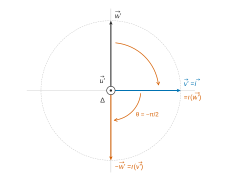
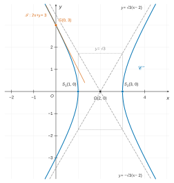
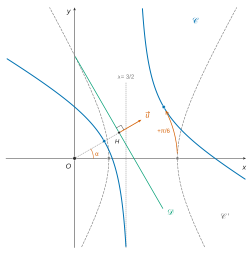
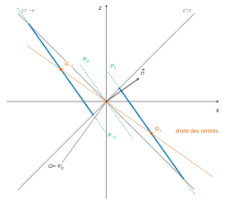

# Banque PT — Mathématiques B 2026 · Corrigé brut

*Corrigé rédigé par IA, non officiel. Signalez toute erreur.*

Épreuve de 4 h, calculatrice interdite, une feuille de papier millimétré à rendre avec la copie. Deux exercices indépendants.

## Premier exercice

Tout $P\in\mathbb{R}_3[X]$ s'écrit de façon unique $P=a+bX+cX^2+dX^3$. On a alors :

$$\begin{aligned}
P(0)&=a, & P'(0)&=b,\\
P''(0)&=2c, & P^{(3)}(0)&=6d.
\end{aligned}$$

### Partie A

#### 1.

La condition $6P(0)=P^{(3)}(0)$ s'écrit $6a=6d$, soit $a=d$.

L'application $\psi:P\mapsto 6P(0)-P^{(3)}(0)$ va de $\mathbb{R}_3[X]$ dans $\mathbb{R}$. Elle est linéaire, comme combinaison linéaire des applications linéaires $P\mapsto P(0)$ et $P\mapsto P^{(3)}(0)$.

Or $H=\ker\psi$. Donc $H$ est un sous-espace vectoriel de l'espace vectoriel $\mathbb{R}_3[X]$ : c'est un espace vectoriel.

De plus :

$$P\in H\iff P=a(1+X^3)+bX+cX^2\ \text{ avec } (a,b,c)\in\mathbb{R}^3.$$

Donc la famille de polynômes $(1+X^3,X,X^2)$, formée d'éléments de $H$, engendre $H$.

Elle est libre : si $a(1+X^3)+bX+cX^2=0$, l'identification des coefficients donne $a=b=c=0$. C'est donc une base de $H$.

$$\boxed{\begin{aligned}
H&=\operatorname{Vect}(1+X^3,\,X,\,X^2),\\
\dim H&=3.
\end{aligned}}$$

Contrôle par le théorème du rang : $\psi(1)=6\neq0$, donc $\psi$ est de rang $1$ et $\dim H=4-1=3$.

#### 2.

Soient $P,Q\in H$ et $\lambda\in\mathbb{R}$. Par linéarité de la dérivation :

$$\begin{aligned}
h(\lambda P+Q)&=(\lambda P+Q)'(0)\\
&=\lambda P'(0)+Q'(0)\\
&=\lambda h(P)+h(Q).
\end{aligned}$$

**Donc $h$ est linéaire.**

Pour tout $P\in H$, $h(P)=P'(0)$ est un nombre réel. Donc $h$ est à valeurs dans $\mathbb{R}$ : c'est une forme linéaire sur $H$.

En particulier, $h$ n'est à valeurs ni dans $H$ ni dans $\mathbb{R}_3[X]$.

Plus précisément, $X\in H$ et $h(X)=1$. Pour tout $t\in\mathbb{R}$, on a donc $h(tX)=t$ : $h$ est surjective.

$$\boxed{h:H\to\mathbb{R}\ \text{est une forme linéaire, et } h(H)=\mathbb{R}.}$$

#### 3.

$f$ est linéaire (admis). Il reste à montrer que $f(H)\subset H$.

Soit $P\in H$. D'après la question 1, $P=a(1+X^3)+bX+cX^2$ avec $(a,b,c)\in\mathbb{R}^3$. Alors $P(0)=a$, $P'(0)=b$ et $P''(0)=2c$, d'où :

$$\begin{aligned}
f(P)&=a(X+X^2)-\frac b2(X^3+X^2-X+1)-\frac c2(X^3-X^2+X+1)\\
&=-\frac{b+c}2+\Big(a+\frac{b-c}2\Big)X+\Big(a-\frac{b-c}2\Big)X^2-\frac{b+c}2X^3.
\end{aligned}$$

$f(P)$ est de degré au plus $3$, et son coefficient constant est égal à son coefficient de $X^3$. Donc $f(P)\in H$.

Ainsi $f(H)\subset H$ : **$f$ est un endomorphisme de $H$.**

En coordonnées dans la base $(1+X^3,X,X^2)$ :

$$f\big(a(1+X^3)+bX+cX^2\big)=-\frac{b+c}2(1+X^3)+\Big(a+\frac{b-c}2\Big)X+\Big(a-\frac{b-c}2\Big)X^2.$$

### Partie B

#### 4.

Un produit scalaire sur $\mathbb{R}_3[X]$ est une application $\varphi:\mathbb{R}_3[X]\times\mathbb{R}_3[X]\to\mathbb{R}$ qui est :

- **bilinéaire** (linéaire par rapport à chaque variable, l'autre étant fixée) ;
- **symétrique** : $\varphi(P,Q)=\varphi(Q,P)$ pour tous $P,Q$ ;
- **définie positive** : $\varphi(P,P)\geqslant0$ pour tout $P$, et $\varphi(P,P)=0\Rightarrow P=0$.

#### 5.

Soient $P,Q_1,Q_2\in\mathbb{R}_3[X]$ et $\lambda\in\mathbb{R}$. On utilise successivement la symétrie, la linéarité par rapport à la première variable, puis la symétrie :

$$\begin{aligned}
\varphi(P,\lambda Q_1+Q_2)&=\varphi(\lambda Q_1+Q_2,P)\\
&=\lambda\varphi(Q_1,P)+\varphi(Q_2,P)\\
&=\lambda\varphi(P,Q_1)+\varphi(P,Q_2).
\end{aligned}$$

Donc $\varphi$ est linéaire par rapport à sa seconde variable. Comme elle l'est par rapport à la première, **$\varphi$ est bilinéaire**.

#### 6.

*Première méthode (coefficients).* Écrivons $P=a+bX+cX^2+dX^3$. Les hypothèses donnent :

$$\begin{aligned}
a&=P(0)=0, & b&=P'(0)=0,\\
2c&=P''(0)=0, & 6d&=P^{(3)}(0)=0.
\end{aligned}$$

Donc $a=b=c=d=0$, et $P=0$.

*Seconde méthode (racine multiple).* Les hypothèses signifient que $0$ est racine de $P$ d'ordre de multiplicité au moins $4$.

Si $P$ était non nul, $X^4$ diviserait $P$, donc on aurait $\deg P\geqslant4$. C'est impossible car $\deg P\leqslant3$. **Donc $P=0$.**

(On peut aussi invoquer la formule de Taylor pour les polynômes : $P=\sum_{k=0}^{3}\frac{P^{(k)}(0)}{k!}X^k=0$.)

#### 7.

Remarque : $\dfrac{P^{(k)}(0)}{k!}$ est le coefficient $p_k$ de $X^k$ dans $P$. Donc, si $q_k$ désigne celui de $Q$ :

$$\varphi(P,Q)=\sum_{k=0}^3 p_kq_k.$$

$X$ et $X^2$ ont un coefficient constant et un coefficient de $X^3$ nuls, donc égaux : $X\in H$ et $X^2\in H$.

Leurs suites de coefficients sont $(0,1,0,0)$ et $(0,0,1,0)$. D'où :

$$\begin{aligned}
\varphi(X,X)&=1,\\
\varphi(X^2,X^2)&=\frac{2^2}{(2!)^2}=1,\\
\varphi(X,X^2)&=0.
\end{aligned}$$

**$X$ et $X^2$ sont deux vecteurs orthogonaux et unitaires de $H$.**

#### 8.

$1+X^3\in H$ (question 1) a pour coefficients $(1,0,0,1)$. Donc :

$$\begin{aligned}
\varphi(1+X^3,X)&=0,\\
\varphi(1+X^3,X^2)&=0,\\
\varphi(1+X^3,1+X^3)&=2.
\end{aligned}$$

Avec la question 7, la famille $\big(\frac{1+X^3}{\sqrt2},X^2,X\big)$ est orthonormée, donc libre. Elle est formée de $3=\dim H$ vecteurs de $H$ : c'est une base orthonormée de $H$. Ses vecteurs sont rangés par degrés décroissants $3,2,1$.

$$\boxed{\mathcal{B}=(e_1,e_2,e_3)=\Big(\frac{1+X^3}{\sqrt2},\ X^2,\ X\Big).}$$

(Le seul autre choix possible pour le premier vecteur est $-\frac{1+X^3}{\sqrt2}$ ; $X^2$ et $X$ sont imposés par l'énoncé.)

#### 9.(a)

Si $(e_1,e_2,e_3)$ est une base orthonormée de $H$, le projeté orthogonal $p_H(Q)$ d'un polynôme $Q$ sur $H$ est :

$$p_H(Q)=\sum_{i=1}^3\varphi(Q,e_i)\,e_i.$$

Les coefficients de $1$ sont $(1,0,0,0)$. Donc $\varphi(1,e_1)=\frac1{\sqrt2}$, et $\varphi(1,e_2)=\varphi(1,e_3)=0$. Ainsi :

$$\boxed{p_H(1)=\frac1{\sqrt2}\cdot\frac{1+X^3}{\sqrt2}=\frac{1+X^3}2.}$$

#### 9.(b)

En dimension finie, $\mathbb{R}_3[X]=H\oplus H^\perp$. Donc $\dim H^\perp=4-3=1$.

Par caractérisation du projeté orthogonal, $1-p_H(1)=\frac{1-X^3}2$ appartient à $H^\perp$, et ce vecteur est non nul.

Vérification directe : les coefficients de $1-X^3$ sont $(1,0,0,-1)$. Ils sont orthogonaux à ceux de $1+X^3$, $X$ et $X^2$.

Un vecteur non nul d'une droite en est une base :

$$\boxed{H^\perp=\operatorname{Vect}(1-X^3),\ \text{de base } (1-X^3).}$$

### Partie C

#### 10.

$\|\vec u\|=\sqrt2$, donc on pose $\vec u\,'=\frac1{\sqrt2}(\vec j-\vec k)$, colinéaire à $\vec u$ et de même sens.

Le vecteur $\vec v\,'=\vec i$ est unitaire et orthogonal à $\vec u\,'$. On pose :

$$\begin{aligned}
\vec w\,'&=\vec u\,'\wedge\vec v\,'\\
&=\frac1{\sqrt2}(\vec j\wedge\vec i-\vec k\wedge\vec i)\\
&=\frac1{\sqrt2}(-\vec k-\vec j)\\
&=-\frac1{\sqrt2}(\vec j+\vec k).
\end{aligned}$$

La base $\mathcal{B}'=(\vec u\,',\vec v\,',\vec w\,')$ est orthonormée directe, et $\vec u\,'$ dirige et oriente $\Delta$.

Dans une telle base, la rotation d'axe orienté par $\vec u\,'$ et d'angle $\theta$ a pour matrice :

$$\begin{pmatrix}1&0&0\\0&\cos\theta&-\sin\theta\\0&\sin\theta&\cos\theta\end{pmatrix}.$$

Ici $\cos\theta=0$ et $\sin\theta=-1$. D'où :

$$\boxed{\begin{aligned}
\mathcal{B}'&=\Big(\tfrac{1}{\sqrt2}(\vec j-\vec k),\ \vec i,\ -\tfrac1{\sqrt2}(\vec j+\vec k)\Big),\\
R'&=\begin{pmatrix}1&0&0\\0&0&1\\0&-1&0\end{pmatrix}.
\end{aligned}}$$

#### 11.

Soit $P$ la matrice de passage de la base canonique à $\mathcal{B}'$ : ses colonnes sont les coordonnées de $\vec u\,'$, $\vec v\,'$, $\vec w\,'$.

Par la formule de changement de base pour un endomorphisme, $R=PR'P^{-1}$. Comme $P$ passe d'une base orthonormée à une autre, elle est orthogonale et $P^{-1}=P^\top$. Donc $R=PR'P^\top$, avec :

$$\begin{aligned}
P&=\begin{pmatrix}0&1&0\\ \frac{1}{\sqrt2}&0&-\frac1{\sqrt2}\\ -\frac1{\sqrt2}&0&-\frac1{\sqrt2}\end{pmatrix},\\
PR'&=\begin{pmatrix}0&0&1\\ \frac1{\sqrt2}&\frac1{\sqrt2}&0\\ -\frac1{\sqrt2}&\frac1{\sqrt2}&0\end{pmatrix}.
\end{aligned}$$

$$\boxed{R=PR'P^\top=\begin{pmatrix}0&-\frac{\sqrt2}2&-\frac{\sqrt2}2\\ \frac{\sqrt2}2&\frac12&-\frac12\\ \frac{\sqrt2}2&-\frac12&\frac12\end{pmatrix}.}$$

Contrôles :

- $R\,\vec u\,'=\vec u\,'$ (l'axe est fixe) ;
- $\operatorname{tr}R=1$, et $1+2\cos\theta=1$ ;
- $R\vec i=\frac{\sqrt2}{2}(\vec j+\vec k)=-\vec w\,'$, qui est bien $r(\vec v\,')$ d'après $R'$.

#### 12.

$R$ est orthogonale, donc $R^\top=R^{-1}$.

**$R^\top$ est canoniquement associée à $r^{-1}$, la rotation d'axe $\Delta$ (orienté par $\vec u$) et d'angle $\frac\pi2$.**

$r$ est la rotation d'angle $-\frac\pi2$, donc $r^4$ est la rotation d'angle $-2\pi$. Ainsi $r^4=\mathrm{id}$ et $R^4=I_3$.

On a $2025=4\times506+1$ et $2026=4\times506+2$. D'où :

- **$R^{2025}=R$ : c'est la rotation $r$ elle-même** (axe $\Delta$ orienté par $\vec u$, angle $-\frac\pi2$) ;
- $R^{2026}=R^2$ est associée à $r^2$, avec :

$$R^2=\begin{pmatrix}-1&0&0\\0&0&-1\\0&-1&0\end{pmatrix}.$$

Deux descriptions de $r^2$ :

1. **la rotation d'axe $\Delta$ et d'angle $\pi$** (demi-tour, ou retournement d'axe $\Delta$) ;
2. **la symétrie orthogonale par rapport à la droite $\Delta=\operatorname{Vect}(\vec j-\vec k)$**, c'est-à-dire parallèlement au plan $\Delta^\perp=\operatorname{Vect}(\vec i,\vec j+\vec k)$. Elle fixe $\vec j-\vec k$ et change $\vec i$ et $\vec j+\vec k$ en leurs opposés, ce qu'on lit sur $R^2$, matrice symétrique et orthogonale.

### Partie D

#### 13.

On applique la formule de la question 3, en coordonnées $(a,b,c)$ dans $(1+X^3,X,X^2)$, et on réécrit chaque image dans $\mathcal{B}$.

Pour $e_1=\frac{1+X^3}{\sqrt2}$, on a $a=\frac1{\sqrt2}$ et $b=c=0$ :

$$f(e_1)=\frac1{\sqrt2}(X+X^2)=\frac1{\sqrt2}e_2+\frac1{\sqrt2}e_3.$$

Pour $e_2=X^2$, on a $c=1$ et $a=b=0$ :

$$\begin{aligned}
f(e_2)&=-\frac12(1+X^3)-\frac12X+\frac12X^2\\
&=-\frac{1}{\sqrt2}e_1+\frac12e_2-\frac12e_3.
\end{aligned}$$

Pour $e_3=X$, on a $b=1$ et $a=c=0$ :

$$\begin{aligned}
f(e_3)&=-\frac12(1+X^3)+\frac12X-\frac12X^2\\
&=-\frac1{\sqrt2}e_1-\frac12e_2+\frac12e_3.
\end{aligned}$$

En rangeant ces coordonnées en colonnes :

$$\boxed{\operatorname{Mat}_{\mathcal{B}}(f)=\begin{pmatrix}0&-\frac{\sqrt2}2&-\frac{\sqrt2}2\\ \frac{\sqrt2}2&\frac12&-\frac12\\ \frac{\sqrt2}2&-\frac12&\frac12\end{pmatrix}=R.}$$

C'est la matrice $R$ de la question 11. Elle est orthogonale de déterminant $1$, et $\mathcal{B}$ est orthonormée : $f$ est une rotation de l'espace euclidien $H$ (orienté par $\mathcal{B}$).

#### 14.

**Existence.** On cherche $\mathcal{B}''=(\varepsilon_1,\varepsilon_2,\varepsilon_3)$, base de $H$, telle que :

$$\begin{aligned}
f(\varepsilon_1)&=\varepsilon_1,\\
f(\varepsilon_2)&=-\varepsilon_3,\\
f(\varepsilon_3)&=\varepsilon_2.
\end{aligned}$$

*Vecteur invariant.* Pour $P=a(1+X^3)+bX+cX^2$, la question 3 montre que $f(P)=P$ équivaut au système :

$$\begin{cases}-\frac{b+c}2=a\\[2pt] a+\frac{b-c}2=b\\[2pt] a-\frac{b-c}2=c\end{cases}$$

Les deux dernières équations donnent $a=\frac{b+c}2$, la première $a=-\frac{b+c}2$. Donc $a=0$ et $c=-b$, et $\ker(f-\mathrm{id})=\operatorname{Vect}(X-X^2)$. On prend $\varepsilon_1=X-X^2$.

*Plan tourné.* On prend $\varepsilon_2=1+X^3$ et $\varepsilon_3=-f(\varepsilon_2)=-(X+X^2)$. Alors $f(\varepsilon_2)=-\varepsilon_3$ par construction. Par la question 13, $f(X)+f(X^2)=-(1+X^3)$, donc $f(\varepsilon_3)=1+X^3=\varepsilon_2$.

*Base.* Dans $(1+X^3,X,X^2)$, les coordonnées de $\varepsilon_1,\varepsilon_2,\varepsilon_3$ forment la matrice :

$$\begin{pmatrix}0&1&0\\1&0&-1\\-1&0&-1\end{pmatrix},\ \text{de déterminant } 2\neq0.$$

C'est donc une base de $H$, et

$$\boxed{\begin{aligned}
\mathcal{B}''&=\big(X-X^2,\ 1+X^3,\ -X-X^2\big),\\
\operatorname{Mat}_{\mathcal{B}''}(f)&=\begin{pmatrix}1&0&0\\0&0&1\\0&-1&0\end{pmatrix}.
\end{aligned}}$$

**Orthogonalité.** Les suites de coefficients sont $(0,1,-1,0)$, $(1,0,0,1)$ et $(0,-1,-1,0)$. Donc :

$$\begin{aligned}
\varphi(\varepsilon_1,\varepsilon_2)&=0,\\
\varphi(\varepsilon_2,\varepsilon_3)&=0,\\
\varphi(\varepsilon_1,\varepsilon_3)&=-1+1=0.
\end{aligned}$$

**$\mathcal{B}''$ est orthogonale pour $\varphi$.** Elle n'est pas normée : chaque vecteur est de norme $\sqrt2$. Divisée par $\sqrt2$, elle devient orthonormée et convient aussi.

Ce n'est pas un hasard du choix : toute base $\mathcal{B}''$ qui convient est orthogonale.

- $\varepsilon_1\in\ker(f-\mathrm{id})=\operatorname{Vect}(X-X^2)$.
- $f^2(\varepsilon_2)=-f(\varepsilon_3)=-\varepsilon_2$, donc $\varepsilon_2\in\ker(f^2+\mathrm{id})$. Ce noyau est $\operatorname{Vect}(1+X^3,X+X^2)$, plan orthogonal à $X-X^2$.
- Enfin $\varepsilon_3=-f(\varepsilon_2)$. Pour $v=\alpha(1+X^3)+\beta(X+X^2)$, on a $f(v)=\alpha(X+X^2)-\beta(1+X^3)$, d'où $\varphi(v,f(v))=2\alpha\beta-2\alpha\beta=0$.

## Deuxième exercice

### Partie A

#### 1.(a)

L'équation $\dfrac{x^2}{a^2}+\dfrac{y^2}{b^2}=1$ est celle d'une **ellipse** de centre $O$, d'axes $(Ox)$ et $(Oy)$.

Ses sommets sont $(\pm a,0)$ et $(0,\pm b)$ ; c'est un cercle si $a=b$.

Paramétrage usuel :

$$\boxed{\begin{cases}x=a\cos t\\ y=b\sin t\end{cases}\qquad t\in[0,2\pi[.}$$

#### 1.(b)

L'équation $\dfrac{x^2}{a^2}-\dfrac{y^2}{b^2}=1$ est celle d'une **hyperbole** de centre $O$, de sommets $(\pm a,0)$, d'asymptotes $y=\pm\frac bax$. Elle est formée de deux branches, $x\geqslant a$ et $x\leqslant-a$.

Paramétrages usuels :

$$\boxed{\text{branche } x>0:\ \begin{cases}x=a\operatorname{ch}t\\ y=b\operatorname{sh}t\end{cases}\qquad\text{branche } x<0:\ \begin{cases}x=-a\operatorname{ch}t\\ y=b\operatorname{sh}t\end{cases}\qquad t\in\mathbb{R}.}$$

On a $\operatorname{ch}^2t-\operatorname{sh}^2t=1$ et $\operatorname{ch}t\geqslant1$. Comme $\operatorname{sh}$ est une bijection de $\mathbb{R}$ sur $\mathbb{R}$, chaque paramétrage décrit exactement sa branche.

#### 2.(a)

La conique de foyer $F$, de directrice $\mathcal{D}$ et d'excentricité $\varepsilon$ est l'ensemble des points $M$ du plan tels que

$$\boxed{MF=\varepsilon\, d(M,\mathcal{D})}$$

où $d(M,\mathcal{D})$ est la distance de $M$ à $\mathcal{D}$.

#### 2.(b)

**C'est une ellipse si $0<\varepsilon<1$, une parabole si $\varepsilon=1$, une hyperbole si $\varepsilon>1$.**

#### 3.

On a $|z'|=|z|$, et, pour $z\neq0$, $\arg z'\equiv\arg z+\theta\ [2\pi]$.

Donc $OM'=OM$ et $(\overrightarrow{OM},\overrightarrow{OM'})\equiv\theta\ [2\pi]$, et $M'=O$ si $M=O$.

**On passe de $M$ à $M'$ par la rotation de centre $O$ et d'angle $\theta$.**

### Partie B

#### 4.(a)

$\vec n=(\sqrt3,1)$ est normal à $\mathcal{D}$, et $\|\vec n\|^2=4$.

Le projeté $M'$ est l'unique point de $\mathcal{D}$ tel que $\overrightarrow{MM'}$ soit colinéaire à $\vec n$.

On écrit donc $M'=M-t\vec n$, avec $t$ réel tel que $M'\in\mathcal{D}$ :

$$\begin{aligned}
M'\in\mathcal{D}&\iff\sqrt3(x-\sqrt3t)+(y-t)=3\\
&\iff t=\frac{\sqrt3x+y-3}4.
\end{aligned}$$

D'où :

$$\boxed{\begin{aligned}
x'&=\frac{x-\sqrt3\,y+3\sqrt3}4,\\
y'&=\frac{-\sqrt3\,x+3y+3}4.
\end{aligned}}$$

#### 4.(b)

On a $e^{i\pi/3}=\frac12+i\frac{\sqrt3}2$, $e^{i\pi/6}=\frac{\sqrt3}2+\frac i2$ et $\bar z=x-iy$. D'où :

$$\bar z\,e^{i\pi/3}=\frac{x+\sqrt3y}2+i\,\frac{\sqrt3x-y}2.$$

Par suite, avec la question 4.(a) :

$$\begin{aligned}
z-\bar z\,e^{i\pi/3}+3e^{i\pi/6}&=\frac{x-\sqrt3y+3\sqrt3}2+i\,\frac{-\sqrt3x+3y+3}2\\
&=2(x'+iy')\\
&=2z'.
\end{aligned}$$

Donc :

$$\boxed{z'=\frac12\Big(z-\bar z\,e^{i\frac\pi3}+3e^{i\frac\pi6}\Big).}$$

#### 5.

On remplace $z'$ par son expression obtenue à la question 4.(b) :

$$\begin{aligned}
z-z'&=z-\frac12\Big(z-\bar z\,e^{i\frac\pi3}+3e^{i\frac\pi6}\Big)\\
&=\frac12 z+\frac12\bar z\,e^{i\frac\pi3}-\frac32e^{i\frac\pi6}.
\end{aligned}$$

$$\boxed{z-z'=\frac12\Big(z+\bar z\,e^{i\frac\pi3}-3e^{i\frac\pi6}\Big).}$$

#### 6.

D'après la question 5 :

$$\Big|z+\bar z\,e^{i\pi/3}-3e^{i\pi/6}\Big|=2|z-z'|=2MM'.$$

Comme $M'$ est le projeté orthogonal de $M$ sur $\mathcal{D}$, $MM'=d(M,\mathcal{D})$. Et $|z|=OM$. Donc :

$$M\in\mathcal{C}\iff OM=2\,d(M,\mathcal{D}).$$

Le point $O$ n'est pas sur $\mathcal{D}$, car $\sqrt3\cdot0+0\neq3$.

D'après la question 2, **$\mathcal{C}$ est la conique de foyer $O$, de directrice $\mathcal{D}:\sqrt3x+y=3$ et d'excentricité $2$ : c'est une hyperbole**, car $2>1$.

### Partie C

#### 7.

Les vecteurs normaux à $\mathcal{D}$ sont les $\lambda(\sqrt3,1)$, $\lambda\neq0$ ; ceux d'abscisse positive correspondent à $\lambda>0$. On prend par exemple $\vec u=\sqrt3\,\vec e_1+\vec e_2$.

Tous ont même direction et même sens que le vecteur unitaire $\frac12(\sqrt3,1)$, qui s'écrit $\big(\cos\frac\pi6,\sin\frac\pi6\big)$. Donc :

$$\boxed{\alpha=(\vec e_1,\vec u)\equiv\frac\pi6\ [2\pi].}$$

#### 8.(a)

Soit $z=e^{i\pi/6}Z$. Alors $|z|=|Z|$ et $\bar z=e^{-i\pi/6}\bar Z$, donc $\bar z\,e^{i\pi/3}=e^{i\pi/6}\bar Z$. Il vient :

$$\begin{aligned}
z+\bar z\,e^{i\pi/3}-3e^{i\pi/6}&=e^{i\pi/6}Z+e^{i\pi/6}\bar Z-3e^{i\pi/6}\\
&=e^{i\pi/6}(Z+\bar Z-3).
\end{aligned}$$

Ce nombre a pour module $|Z+\bar Z-3|$, puisque $|e^{i\pi/6}|=1$. Par définition de $\mathcal{C}'$ puis de $\mathcal{C}$, on obtient une suite d'équivalences :

$$\begin{aligned}
N\in\mathcal{C}'&\iff M\in\mathcal{C}\\
&\iff |z|=\big|z+\bar z\,e^{i\pi/3}-3e^{i\pi/6}\big|\\
&\iff |Z|=|Z+\bar Z-3|.
\end{aligned}$$

$$\boxed{N\in\mathcal{C}'\iff|Z|=|Z+\bar Z-3|.}$$

#### 8.(b)

Avec $Z=x+iy$, on a $Z+\bar Z-3=2x-3$, réel, et $|Z|=\sqrt{x^2+y^2}$. Les deux membres étant positifs, l'égalité équivaut à celle de leurs carrés :

$$\begin{aligned}
N\in\mathcal{C}'&\iff x^2+y^2=(2x-3)^2\\
&\iff x^2+y^2=4x^2-12x+9\\
&\iff 3x^2-12x-y^2+9=0.
\end{aligned}$$

$$\boxed{\mathcal{C}':\ 3x^2-12x-y^2+9=0.}$$

#### 8.(c)

Les équations et coordonnées sont données dans le repère $(O;\vec e_1,\vec e_2)$. On a $3x^2-12x=3(x-2)^2-12$, donc l'équation s'écrit $3(x-2)^2-y^2=3$, soit :

$$(x-2)^2-\frac{y^2}{3}=1.$$

$\mathcal{C}'$ est une hyperbole de centre $\Omega(2,0)$, avec $a=1$ et $b=\sqrt3$. Ses axes de symétrie sont les droites $y=0$ et $x=2$.

L'axe $x=2$ ne la coupe pas, car $-\frac{y^2}{3}=1$ est impossible. L'axe $y=0$ la coupe en $x-2=\pm1$.

$$\boxed{\begin{aligned}
&\text{centre } \Omega(2,0),\\
&\text{sommets } S_1(1,0)\ \text{et}\ S_2(3,0),\\
&\text{asymptotes } y=\sqrt3(x-2)\ \text{et}\ y=-\sqrt3(x-2).
\end{aligned}}$$

Complément : $c=\sqrt{a^2+b^2}=2$, d'où les foyers $(0,0)$ et $(4,0)$.

La directrice associée au foyer $O$ est $x=\frac32$, image de $\mathcal{D}$ par la rotation de centre $O$ et d'angle $-\frac\pi6$.

#### 8.(d)

$G(0,3)\in\mathcal{C}'$, car $0-0-9+9=0$. Posons $\Phi(x,y)=3x^2-12x-y^2+9$. Alors :

$$\begin{aligned}
\nabla\Phi(x,y)&=(6x-12,\,-2y),\\
\nabla\Phi(0,3)&=(-12,\,-6)\neq\vec 0.
\end{aligned}$$

$G$ est donc un point régulier, et la tangente en $G$ est la droite passant par $G$ et normale à $\nabla\Phi(0,3)$ :

$$\begin{aligned}
&-12(x-0)-6(y-3)=0\\
\iff\ &2x+y-3=0.
\end{aligned}$$

$$\boxed{\mathcal{T}:\ 2x+y=3.}$$

#### 9.(a)

Tracé sur papier millimétré, unité 1 cm au moins (2 cm conseillé), repère $(O;\vec e_1,\vec e_2)$ dessiné et axes gradués :

- placer le centre $\Omega(2,0)$ et les sommets $(1,0)$ et $(3,0)$ ;
- tracer les asymptotes $y=\pm\sqrt3(x-2)$. Elles passent par $\Omega$ et par $(3,\pm\sqrt3)\approx(3;\pm1{,}73)$ : ce sont les diagonales du rectangle de construction $[1,3]\times[-\sqrt3,\sqrt3]$ ;
- tracer la branche gauche ($x\leqslant1$). Elle passe par $(1,0)$, à tangente verticale, et par $G(0,3)$ et $(0,-3)$ ;
- tracer la branche droite ($x\geqslant3$), symétrique par rapport à la droite $x=2$. Elle passe par $(3,0)$ et $(4,\pm3)$ ;
- les branches se rapprochent des asymptotes sans les couper ;
- on peut ajouter la tangente $\mathcal{T}:y=3-2x$ en $G$.

Points utiles : $|y|=\sqrt{3\big((x-2)^2-1\big)}$. On a $|y|=3$ pour $x\in\{0,4\}$, et $|y|=\sqrt{24}\approx4{,}9$ pour $x\in\{-1,5\}$.

#### 9.(b)

Par définition de $\mathcal{C}'$, $M\in\mathcal{C}$ si et seulement si le point $N$ d'affixe $Z=e^{-i\pi/6}z$ appartient à $\mathcal{C}'$.

D'après la question 3, $M$ d'affixe $z=e^{i\pi/6}Z$ est l'image de $N$ par la rotation $\rho$ de centre $O$ et d'angle $\frac\pi6$.

Comme $\rho$ est bijective, $\mathcal{C}=\rho(\mathcal{C}')$.

**$\mathcal{C}$ est l'image de $\mathcal{C}'$ par la rotation de centre $O$ et d'angle $\alpha=\frac\pi6$.**

### Partie D

#### 10.

Soit $M(x,y,z)\in\mathcal{C}''$. Alors $z=1$ et $y^2=3x^2-3$, donc :

$$\begin{aligned}
-3x^2+y^2+3z^2&=-3x^2+(3x^2-3)+3\\
&=0.
\end{aligned}$$

Ainsi $M\in S$. Tout point de $\mathcal{C}''$ est un point de $S$ : **$\mathcal{C}''\subset S$.**

#### 11.(a)

$S$ a pour équation $F(x,y,z)=0$, avec $F(x,y,z)=-3x^2+y^2+3z^2$, fonction de classe $C^1$ sur $\mathbb{R}^3$. Son gradient est :

$$\nabla F(x,y,z)=(-6x,\,2y,\,6z).$$

Le gradient est nul si et seulement si ses trois composantes sont nulles, c'est-à-dire si et seulement si $x=y=z=0$. Il ne s'annule donc qu'en $O$, et $O\in S$ car $F(0,0,0)=0$.

Un point de $S$ est régulier si et seulement si le gradient de $F$ y est non nul. Donc :

$$\boxed{\text{les points réguliers de } S \text{ sont les points de } S\setminus\{O\}.}$$

($S$ est un cône de sommet $O$ : l'équation est homogène de degré $2$.)

#### 11.(b)

$F(2,-3,-1)=-12+9+3=0$, donc $J\in S$. Comme $J\neq O$, $J$ est régulier, avec :

$$\nabla F(J)=(-12,-6,-6)=-6\,(2,1,1).$$

Le plan tangent en $J$ passe par $J$ et a pour vecteur normal $(2,1,1)$ :

$$2(x-2)+(y+3)+(z+1)=0.$$

$$\boxed{2x+y+z=0.}$$

(Il passe par le sommet $O$, comme tout plan tangent à un cône.)

#### 12.(a)

L'identité se vérifie en développant :

$$\begin{aligned}
(2x-\sqrt2z)(2x+\sqrt2z)&=4x^2-2z^2,\\
x^2+y^2+z^2-(4x^2-2z^2)&=-3x^2+y^2+3z^2.
\end{aligned}$$

Pour un point de $P_\lambda$, on a $2x+\sqrt2z=\lambda$. On raisonne par équivalence :

$$\begin{aligned}
M\in\mathcal{C}_\lambda&\iff\begin{cases}2x+\sqrt2z=\lambda\\ x^2+y^2+z^2-\lambda(2x-\sqrt2z)=0\end{cases}\\
&\iff\begin{cases}2x+\sqrt2z=\lambda\\ (x-\lambda)^2+y^2+\big(z+\frac{\lambda}{\sqrt2}\big)^2=\frac32\lambda^2.\end{cases}
\end{aligned}$$

*Cas $\lambda\neq0$.* La seconde équation est celle de la sphère $\Sigma_\lambda$ de centre $\Omega_\lambda=\big(\lambda,0,-\frac\lambda{\sqrt2}\big)$ et de rayon $\rho_\lambda=|\lambda|\sqrt{\frac32}>0$.

Or $2\lambda+\sqrt2\cdot\big(-\frac{\lambda}{\sqrt2}\big)=\lambda$, donc $\Omega_\lambda\in P_\lambda$. Un plan passant par le centre d'une sphère la coupe selon un grand cercle. **$\mathcal{C}_\lambda$ est le cercle de $P_\lambda$ de centre $\Omega_\lambda$ et de rayon $\frac{\sqrt6}{2}|\lambda|$.**

*Cas $\lambda=0$.* La seconde équation impose $x=y=z=0$, et $O\in P_0$. Donc $\mathcal{C}_0=\{O\}$, cercle réduit à un point.

$$\boxed{\begin{aligned}
&\lambda\neq0:\ \mathcal{C}_\lambda \text{ est un cercle de rayon } \tfrac{\sqrt6}{2}|\lambda|,\\
&\lambda=0:\ \mathcal{C}_0=\{O\}.
\end{aligned}}$$

**Remarque sur l'énoncé.** L'alternative « vide ou cercle » est inexacte : $\mathcal{C}_\lambda$ n'est jamais vide, et pour $\lambda=0$ il est réduit au point $O$ (cercle de rayon nul). On a démontré le résultat sous cette forme corrigée.

#### 12.(b)

**Non.** Si $S$ était de révolution d'axe $A$, ses sections par les plans orthogonaux à $A$ seraient des cercles **centrés sur $A$**.

Ici, les plans $P_\lambda$ sont tous orthogonaux à $\vec n=(2,0,\sqrt2)$.

Mais les centres $\Omega_\lambda=\lambda\big(1,0,-\frac1{\sqrt2}\big)$ sont sur la droite passant par $O$ et dirigée par $(\sqrt2,0,-1)$. Cette droite n'est pas colinéaire à $\vec n$, puisque $(\sqrt2,0,-1)\cdot(2,0,\sqrt2)=\sqrt2\neq0$.

Les cercles $\mathcal{C}_\lambda$ ne sont donc pas centrés sur une droite orthogonale à leurs plans. L'existence de cette famille de sections circulaires parallèles ne permet pas de conclure que $S$ est de révolution.

Remarque : les sections de $S$ par les plans $x=x_0\neq0$ sont les ellipses $y^2+3z^2=3x_0^2$, non circulaires, donc $S$ n'est pas de révolution d'axe $(Ox)$. Établir que $S$ n'est de révolution autour d'aucun axe relèverait de la classification des quadriques, hors programme en PT ; la question ne le demande pas.

#### 13.

Un point de $\mathcal{C}''$ vérifie $3x^2=3+y^2\geqslant3$, donc $|x|\geqslant1$. Ainsi :

$$\mathcal{C}''_+=\{(x,y,1)\ :\ 3x^2-y^2=3,\ x\geqslant1\}.$$

Un point $M(x,y,z)$ appartient à $\Sigma$ si et seulement s'il existe $M_0(x_0,y_0,1)\in\mathcal{C}''_+$ sur le même cercle d'axe $(Ox)$. Cela signifie $x=x_0$ et $y^2+z^2=y_0^2+1$.

- Si $M\in\Sigma$ : $x=x_0\geqslant1$ et $y^2+z^2=y_0^2+1=(3x^2-3)+1=3x^2-2$.
- Réciproquement, supposons $x\geqslant1$ et $y^2+z^2=3x^2-2$.
  Le point $M_0=\big(x,\sqrt{3x^2-3},1\big)$ est bien défini ($3x^2-3\geqslant0$) et appartient à $\mathcal{C}''_+$. Il vérifie $y_0^2+1=3x^2-2=y^2+z^2$, donc $M\in\Sigma$.

$$\boxed{\Sigma:\quad 3x^2-y^2-z^2=2\quad\text{et}\quad x\geqslant1.}$$

La condition $x\geqslant1$ est indispensable.

L'équation seule décrit les deux nappes d'un hyperboloïde de révolution à deux nappes ($|x|\geqslant\sqrt{2/3}$), alors que $\Sigma$ n'en est que la partie $x\geqslant1$. Sa méridienne est $r=\sqrt{3x^2-2}$ pour $x\geqslant1$ ; elle part du point $(x,r)=(1,1)$.
