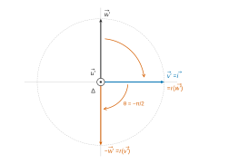
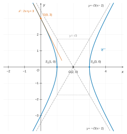
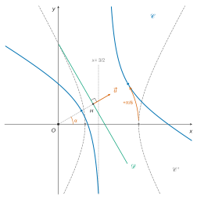
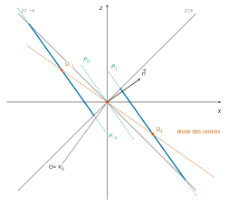

# Banque PT PT — Mathématiques B 2026 · Corrigé guidé

*Corrigé rédigé par IA, non officiel. Signalez toute erreur.*

## Présentation du sujet

**Format.** 4 heures, calculatrice interdite, une feuille de papier millimétré à rendre avec la copie (pour le tracé de la question 9(a) du second exercice). Le sujet comporte deux exercices indépendants et 37 questions en comptant les sous-questions. L'avertissement insiste sur le référencement exact des questions : une réponse mal numérotée n'est pas notée.

**Premier exercice : algèbre linéaire et géométrie euclidienne.** Le rapport 2026 le résume ainsi : on démontre qu'un endomorphisme d'un sous-espace de $\mathbb{R}_3[X]$ est une rotation.

- *Partie A* : on étudie un hyperplan $H$ de $\mathbb{R}_3[X]$ (un noyau de forme linéaire), une forme linéaire $h$ et un endomorphisme $f$ de $H$.
- *Partie B* : on rappelle la définition d'un produit scalaire et on montre que linéarité à gauche et symétrie donnent la bilinéarité. Le produit scalaire $\varphi$ « des dérivées en 0 » est en fait le produit scalaire canonique des coefficients. On construit une base orthonormée de $H$, un projeté orthogonal et $H^\perp$.
- *Partie C* : rotation de $\mathbb{R}^3$ d'axe et d'angle donnés (base adaptée, matrice dans la base canonique, puissances).
- *Partie D* : synthèse. La matrice de $f$ dans la base orthonormée de la partie B est exactement la matrice de la partie C, donc $f$ est une rotation de $H$. On la réduit.

**Second exercice : coniques et quadriques.**

- *Partie A* : questions de cours (ellipse, hyperbole, définition par foyer et directrice, rotation en complexe).
- *Partie B* : on reconnaît une conique définie par une équation en module, grâce au projeté orthogonal sur une droite écrit en complexe.
- *Partie C* : une rotation ramène cette conique à une équation réduite, puis on demande les éléments caractéristiques, une tangente et un tracé.
- *Partie D* (indépendante) : cône $S$ (points réguliers, plan tangent, sections circulaires, révolution) et surface de révolution engendrée par une branche d'hyperbole.

**Notions mobilisées.** Sous-espaces, noyau, rang, matrices d'endomorphisme et changement de base ; produit scalaire, bases orthonormées, projection orthogonale ; rotations vectorielles en dimension 3 ; coniques (équations réduites, définition par foyer et directrice) ; nombres complexes et transformations du plan ; surfaces définies par une équation cartésienne (gradient, plan tangent, surfaces de révolution).

**Difficulté et gestion du temps.** Le sujet est de difficulté moyenne et assez long ; il récompense la précision. Selon le rapport 2026, la grande majorité des candidats a abordé l'ensemble du sujet, et « L'épreuve a permis de bien discriminer les candidats sur l'ensemble du spectre des notes. »

Beaucoup de questions sont des questions de cours ou des calculs directs à ne pas laisser passer : Ex. 1 Q1 à Q7, Q10 ; Ex. 2 Q1, Q2, Q3, Q5, Q7, Q10, Q11.

**Questions discriminantes d'après le rapport 2026.**

- Ex. 1 : l'ensemble d'arrivée de $h$ en Q2 (deux candidats sur cinq seulement) ; Q12, peu traitée à cause de sa position ; Q13 et Q14.
- Ex. 2 : la partie A, pourtant de cours (6 % des candidats y ont tous les points) ; Q4(b), Q8(b) et Q8(c), très peu réussies ; Q12(a) et la restriction $x\geqslant1$ de Q13, vue par une poignée de candidats.

L'énoncé de la question 12(a) du second exercice contient une petite inexactitude (voir plus bas). Comptez environ 1 h 45 pour le premier exercice et 2 h pour le second, tracé compris (15 minutes).

## Premier exercice, partie A — L'hyperplan H, la forme h et l'endomorphisme f

Tout se ramène à écrire $P=a+bX+cX^2+dX^3$. On a alors $P(0)=a$ et $P'(0)=b$, puis $P''(0)=2c$ et $P^{(3)}(0)=6d$. Cette traduction en coefficients sert dans tout l'exercice.

### Question 1

> [!INDICATION]
> Traduisez la condition $6P(0)=P^{(3)}(0)$ sur les coefficients de $P$.

> [!INDICATION]
> $H$ est le noyau d'une application linéaire à valeurs dans $\mathbb{R}$ ; pour la base, isolez les paramètres restés libres.

#### Solution

La condition s'écrit $6a=6d$, soit $a=d$.

L'application $\psi:P\mapsto6P(0)-P^{(3)}(0)$ est linéaire de $\mathbb{R}_3[X]$ dans $\mathbb{R}$, et $H=\ker\psi$. C'est donc un sous-espace vectoriel de $\mathbb{R}_3[X]$, donc un espace vectoriel.

De plus, $P\in H$ si et seulement si $P=a(1+X^3)+bX+cX^2$ avec $(a,b,c)\in\mathbb{R}^3$. La famille de polynômes $(1+X^3,X,X^2)$, formée d'éléments de $H$, engendre donc $H$.

Elle est libre, car $a(1+X^3)+bX+cX^2=0$ donne $a=b=c=0$ par identification. C'est une base de $H$.

$$\boxed{\begin{aligned}
H&=\operatorname{Vect}(1+X^3,X,X^2),\\
\dim H&=3.
\end{aligned}}$$

Contrôle : $\psi\neq0$ car $\psi(1)=6$. Donc $\operatorname{rg}\psi=1$ et $\dim H=4-1=3$.

> [!METHODE]
> Un ensemble défini par une équation linéaire homogène est un noyau : c'est la façon la plus rapide de prouver qu'on a un sous-espace vectoriel, et le théorème du rang donne la dimension (un hyperplan si la forme est non nulle).

> [!PIEGE]
> Proposer la base canonique de $\mathbb{R}_3[X]$, ou une base faite de vecteurs de $\mathbb{R}^4$ : le rapport 2026 relève les deux erreurs. Une base de $H$ est faite de polynômes appartenant à $H$. Autre confusion signalée : faire intervenir $f$, qui n'a rien à faire ici.

> [!JURY]
> Le rapport 2026 juge la caractérisation des sous-espaces vectoriels insuffisamment maîtrisée et note des « ∈ H » écrits sans sujet. Il observe que « Ceux qui utilisent un “sous-espace vectoriel engendré par” s'en sortent mieux. » Pour la base, il ajoute : « Quant à la base, elle n'est pas toujours justifiée ».

### Question 2

> [!INDICATION]
> La dérivation est linéaire ; l'évaluation en $0$ aussi.

> [!INDICATION]
> Que vaut $h(P)$ : un polynôme ou un nombre ? Cherchez ensuite l'image exacte de $h$.

#### Solution

Pour $P,Q\in H$ et $\lambda\in\mathbb{R}$ :

$$\begin{aligned}
h(\lambda P+Q)&=(\lambda P+Q)'(0)\\
&=\lambda P'(0)+Q'(0)\\
&=\lambda h(P)+h(Q).
\end{aligned}$$

Donc $h$ est linéaire.

$h(P)=P'(0)$ est un réel : $h$ est une forme linéaire sur $H$, à valeurs dans $\mathbb{R}$.

Comme $X\in H$ et $h(tX)=t$ pour tout réel $t$, $h$ est surjective :

$$\boxed{h:H\to\mathbb{R},\qquad h(H)=\mathbb{R}.}$$

> [!PIEGE]
> Confondre $P'(0)$ (un nombre) avec $P'$ (un polynôme de $\mathbb{R}_2[X]$). C'est l'erreur la plus répandue : d'après le rapport 2026, un candidat sur cinq répond que $h$ est à valeurs dans $H$.

> [!JURY]
> Pour l'ensemble d'arrivée, le rapport 2026 note que « seuls 2 candidats sur 5 répondent correctement ». Il précise aussi qu'il n'est pas utile de vérifier que l'image de $0$ est nulle : la définition de la linéarité suffit.

### Question 3

> [!INDICATION]
> La linéarité est admise : que reste-t-il à prouver pour parler d'endomorphisme de $H$ ?

> [!INDICATION]
> Calculez $f(P)$ pour $P=a(1+X^3)+bX+cX^2$ quelconque et comparez le coefficient constant et celui de $X^3$.

#### Solution

Il suffit de montrer $f(H)\subset H$. Soit $P\in H$ : par la question 1, $P=a(1+X^3)+bX+cX^2$. On a $P(0)=a$, $P'(0)=b$ et $P''(0)=2c$, d'où :

$$\begin{aligned}
f(P)&=a(X+X^2)-\frac b2(X^3+X^2-X+1)-\frac c2(X^3-X^2+X+1)\\
&=-\frac{b+c}2+\Big(a+\frac{b-c}2\Big)X+\Big(a-\frac{b-c}2\Big)X^2-\frac{b+c}2X^3.
\end{aligned}$$

Le coefficient constant est égal à celui de $X^3$ : $f(P)\in H$. **$f$ est un endomorphisme de $H$.**

En coordonnées dans $(1+X^3,X,X^2)$ :

$$f\big(a(1+X^3)+bX+cX^2\big)=-\frac{b+c}2(1+X^3)+\Big(a+\frac{b-c}2\Big)X+\Big(a-\frac{b-c}2\Big)X^2.$$

> [!METHODE]
> Garder cette formule en coordonnées : elle sert directement aux questions 13 et 14.

> [!PIEGE]
> Trois erreurs relevées par le rapport 2026 : redémontrer la linéarité, qui est admise ; prouver que $f$ est un endomorphisme de $\mathbb{R}_3[X]$ ; partir de $P\in H$ mais calculer en fait avec un $P$ quelconque de $\mathbb{R}_3[X]$. Il faut utiliser la condition $a=d$.

> [!JURY]
> Le rapport 2026 regrette que la base de la question 1 serve si peu : « Rares sont les candidats qui exploitent la base de H trouvée à la question 1. »

## Premier exercice, partie B — Le produit scalaire φ

Après deux questions de cours, on découvre que $\varphi(P,Q)=\sum_k p_kq_k$, où $p_k$ et $q_k$ sont les coefficients de $P$ et $Q$. La base canonique est donc orthonormée et tous les calculs deviennent immédiats.

### Question 4

> [!INDICATION]
> Quatre propriétés : deux « algébriques », deux portant sur $\varphi(P,P)$. N'oubliez pas les ensembles de départ et d'arrivée.

#### Solution

Un produit scalaire sur $\mathbb{R}_3[X]$ est une application $\varphi:\mathbb{R}_3[X]\times\mathbb{R}_3[X]\to\mathbb{R}$ qui est :

- **bilinéaire** ;
- **symétrique** : $\varphi(P,Q)=\varphi(Q,P)$ ;
- **définie positive** : $\varphi(P,P)\geqslant0$, et $\varphi(P,P)=0\Rightarrow P=0$.

> [!PIEGE]
> Donner $\mathbb{R}_3[X]$ comme ensemble d'arrivée, ou oublier le carré cartésien au départ : le rapport 2026 relève régulièrement ces deux erreurs. Autre confusion signalée : donner un exemple de produit scalaire au lieu de la définition.

> [!JURY]
> D'après le rapport 2026, il n'était pas demandé d'expliciter chaque terme, mais « les domaines de définition et d'arrivée de $\varphi$ étaient attendus ». Ils sont rarement donnés.

### Question 5

> [!INDICATION]
> Pour obtenir la linéarité en la seconde variable, faites passer cette variable en première position.

> [!INDICATION]
> La symétrie sert deux fois : avant et après la linéarité à gauche.

#### Solution

Pour $P,Q_1,Q_2\in\mathbb{R}_3[X]$ et $\lambda\in\mathbb{R}$, par symétrie, linéarité à gauche, puis symétrie :

$$\begin{aligned}
\varphi(P,\lambda Q_1+Q_2)&=\varphi(\lambda Q_1+Q_2,P)\\
&=\lambda\varphi(Q_1,P)+\varphi(Q_2,P)\\
&=\lambda\varphi(P,Q_1)+\varphi(P,Q_2).
\end{aligned}$$

$\varphi$ est linéaire en sa seconde variable et, par hypothèse, en la première : **$\varphi$ est bilinéaire.**

> [!METHODE]
> En pratique, pour montrer qu'une forme est un produit scalaire, on prouve la symétrie, puis la linéarité à gauche seulement, puis on conclut à la bilinéarité par cet argument.

> [!JURY]
> Le rapport 2026 rappelle que ce résultat n'est plus explicitement au programme, alors que presque tous les candidats l'utilisent. Il sanctionne la simple reformulation de l'énoncé (« à gauche » au lieu de « première variable ») et note : « Les démonstrations sont parfois incomplètes et/ou confuses, en particulier lors de l'utilisation du caractère symétrique. » Écrivez chaque égalité avec la propriété qui la justifie.

### Question 6

> [!INDICATION]
> Première voie : relier $P^{(k)}(0)$ aux coefficients de $P$.

> [!INDICATION]
> Seconde voie : interprétez les hypothèses en termes de multiplicité de la racine $0$, puis comparez au degré.

#### Solution

*Méthode 1.* Avec $P=a+bX+cX^2+dX^3$, les hypothèses donnent :

$$\begin{aligned}
a&=0, & b&=0,\\
2c&=0, & 6d&=0.
\end{aligned}$$

Donc $P=0$.

*Méthode 2.* $0$ est racine de $P$ d'ordre de multiplicité au moins $4$.

Si $P$ était non nul, $X^4$ diviserait $P$, et on aurait $\deg P\geqslant4$. Or $\deg P\leqslant3$ : **$P=0$**.

(Troisième voie possible : la formule de Taylor $P=\sum_{k=0}^{3}\frac{P^{(k)}(0)}{k!}X^k$.)

> [!PIEGE]
> Écrire « un polynôme de $\mathbb{R}_3[X]$ possède au plus 3 racines » sans préciser qu'il est non nul : le rapport 2026 rappelle que la phrase est alors fausse. De même, « $P$ a 4 racines » est imprécis (lesquelles ? distinctes ?) : il faut parler de la racine $0$ et de sa multiplicité.

> [!JURY]
> La preuve par les coefficients est bien réussie ; selon le rapport 2026, « L'utilisation de la formule de Taylor pour les polynômes a été appréciée. » Deux façons « différentes » doivent reposer sur deux arguments de nature différente.

### Question 7

> [!INDICATION]
> Commencez par vérifier que $X$ et $X^2$ sont bien dans $H$.

> [!INDICATION]
> Que représente $\frac{P^{(k)}(0)}{k!}$ ? Écrivez $\varphi$ à l'aide des coefficients.

#### Solution

$\frac{P^{(k)}(0)}{k!}$ est le coefficient $p_k$ de $X^k$ dans $P$, donc :

$$\varphi(P,Q)=\sum_{k=0}^3p_kq_k.$$

$X$ et $X^2$ ont un coefficient constant et un coefficient de $X^3$ nuls, donc égaux : ils sont dans $H$. Leurs coefficients sont $(0,1,0,0)$ et $(0,0,1,0)$, d'où :

$$\begin{aligned}
\varphi(X,X)&=1,\\
\varphi(X^2,X^2)&=\frac{2\cdot2}{(2!)^2}=1,\\
\varphi(X,X^2)&=0.
\end{aligned}$$

**$X$ et $X^2$ sont deux vecteurs orthogonaux et unitaires de $H$.**

> [!METHODE]
> Repérer qu'un produit scalaire « exotique » est le produit scalaire canonique dans une base bien choisie : ici la base $(1,X,X^2,X^3)$ est orthonormée pour $\varphi$. Si l'on passe aux coordonnées dans $\mathbb{R}^4$, il faut d'abord établir cette identité.

> [!PIEGE]
> Confondre vecteur unitaire (de norme $1$) et polynôme unitaire (de coefficient dominant $1$), ou oublier de prouver le caractère unitaire : deux erreurs relevées par le rapport 2026.

> [!JURY]
> Le rapport 2026 insiste : « Il ne fallait pas oublier de signaler que les deux vecteurs proposés appartenaient à H. »

### Question 8

> [!INDICATION]
> Il manque un seul vecteur, de degré $3$. Pensez à la base trouvée à la question 1.

> [!INDICATION]
> Vérifiez son orthogonalité à $X$ et $X^2$ avant de lancer un procédé de Gram-Schmidt.

#### Solution

$1+X^3\in H$ a pour coefficients $(1,0,0,1)$. Donc il est orthogonal à $X$ et à $X^2$, et $\|1+X^3\|^2=2$.

La famille ci-dessous est orthonormée (donc libre) et compte $3=\dim H$ vecteurs de $H$. Elle est rangée par degrés décroissants :

$$\boxed{\mathcal{B}=(e_1,e_2,e_3)=\Big(\frac{1+X^3}{\sqrt2},\ X^2,\ X\Big).}$$

> [!PIEGE]
> L'ordre est imposé par l'énoncé (degrés décroissants) : $X^2$ vient avant $X$. Le signe de $e_1$ reste libre ; on prend le plus naturel.

> [!JURY]
> Le rapport 2026 accepte Gram-Schmidt, mais relève deux maladresses. Appliqué à $(X,X^2,1+X^3)$, beaucoup refont tous les calculs sans exploiter la question 7. Appliqué à $(1+X^3,X^2,X)$, il n'aboutit à la base demandée que parce que cette famille est déjà orthogonale.

### Question 9(a)

> [!INDICATION]
> Dans une base orthonormée de $H$, le projeté orthogonal a une expression explicite à l'aide des produits scalaires.

#### Solution

Pour une base orthonormée $(e_1,e_2,e_3)$ de $H$, le projeté orthogonal d'un polynôme $Q$ sur $H$ est :

$$p_H(Q)=\sum_{i=1}^3\varphi(Q,e_i)\,e_i.$$

Ici $\varphi(1,e_1)=\frac1{\sqrt2}$ et $\varphi(1,e_2)=\varphi(1,e_3)=0$, d'où :

$$\boxed{p_H(1)=\frac{1+X^3}2.}$$

> [!JURY]
> Le rapport 2026 trouve cette formule encore trop peu connue. « Les correcteurs incitent les candidats à la donner (en définissant leurs notations) même s'ils n'ont pas réussi à répondre à la question précédente. »

### Question 9(b)

> [!INDICATION]
> Quelle est la dimension de $H^\perp$ dans $\mathbb{R}_3[X]$ ?

> [!INDICATION]
> Que sait-on du vecteur $1-p_H(1)$ ?

#### Solution

$\mathbb{R}_3[X]=H\oplus H^\perp$ en dimension finie, donc $\dim H^\perp=4-3=1$.

Le vecteur $1-p_H(1)=\frac{1-X^3}2$ est non nul et appartient à $H^\perp$, par caractérisation du projeté orthogonal. Contrôle direct : ses coefficients $(1,0,0,-1)$ sont orthogonaux à ceux de $1+X^3$, $X$ et $X^2$.

$$\boxed{H^\perp=\operatorname{Vect}(1-X^3).}$$

> [!PIEGE]
> Confondre « une base de l'orthogonal de $H$ » et « une base orthogonale de $H$ », confusion relevée par le rapport 2026. $H^\perp$ se cherche dans $\mathbb{R}_3[X]$ tout entier.

> [!JURY]
> Le rapport 2026 le précise : « Il ne fallait pas oublier de justifier la dimension de l'orthogonal de H. »

## Premier exercice, partie C — Une rotation de l'espace

On construit une base orthonormée directe adaptée à l'axe, on écrit la matrice de cours, puis on revient dans la base canonique par un changement de base orthonormée.

### Question 10

> [!INDICATION]
> Normez $\vec u$ ; choisissez ensuite un vecteur unitaire orthogonal très simple, et complétez par un produit vectoriel.

> [!INDICATION]
> Dans une base orthonormée directe dont le premier vecteur oriente l'axe, la matrice d'une rotation d'angle $\theta$ a une forme connue.

#### Solution

On pose $\vec u\,'=\frac1{\sqrt2}(\vec j-\vec k)$. Le vecteur $\vec v\,'=\vec i$ est unitaire et orthogonal à $\vec u\,'$. On complète par :

$$\begin{aligned}
\vec w\,'&=\vec u\,'\wedge\vec v\,'\\
&=\frac1{\sqrt2}(\vec j\wedge\vec i-\vec k\wedge\vec i)\\
&=-\frac1{\sqrt2}(\vec j+\vec k).
\end{aligned}$$

La base $\mathcal{B}'=(\vec u\,',\vec v\,',\vec w\,')$ est orthonormée directe. Avec $\cos\theta=0$ et $\sin\theta=-1$ :

$$\boxed{R'=\begin{pmatrix}1&0&0\\0&\cos\theta&-\sin\theta\\0&\sin\theta&\cos\theta\end{pmatrix}=\begin{pmatrix}1&0&0\\0&0&1\\0&-1&0\end{pmatrix}.}$$

> [!PIEGE]
> Prendre $\vec w\,'$ « à l'œil » sans vérifier que la base est directe : on obtient alors la rotation d'angle opposé. Autre confusion relevée par le rapport 2026 : donner la matrice de passage de la base canonique à $\mathcal{B}'$ au lieu de la matrice de $r$ dans $\mathcal{B}'$.

> [!JURY]
> Le choix $\vec v\,'=\vec i$ évite tout calcul ; le rapport 2026 note qu'« Il n'est pas rare que la recherche de $\mathcal{B}'$ prenne plus d'une page... ». La base proposée n'est pas toujours orthonormée ni directe, alors qu'il faut le vérifier.

### Question 11

> [!INDICATION]
> Formule de changement de base, avec une matrice de passage orthogonale.

> [!INDICATION]
> Contrôlez votre résultat : l'axe doit être fixe et la trace doit valoir $1+2\cos\theta$.

#### Solution

$P$, de colonnes $\vec u\,',\vec v\,',\vec w\,'$, est orthogonale. La formule de changement de base donne donc $R=PR'P^{-1}=PR'P^\top$, avec :

$$\begin{aligned}
P&=\begin{pmatrix}0&1&0\\ \frac1{\sqrt2}&0&-\frac1{\sqrt2}\\ -\frac1{\sqrt2}&0&-\frac1{\sqrt2}\end{pmatrix},\\
PR'&=\begin{pmatrix}0&0&1\\ \frac1{\sqrt2}&\frac1{\sqrt2}&0\\ -\frac1{\sqrt2}&\frac1{\sqrt2}&0\end{pmatrix}.
\end{aligned}$$

$$\boxed{R=\begin{pmatrix}0&-\frac{\sqrt2}2&-\frac{\sqrt2}2\\ \frac{\sqrt2}2&\frac12&-\frac12\\ \frac{\sqrt2}2&-\frac12&\frac12\end{pmatrix}.}$$

Contrôles : $R\vec u\,'=\vec u\,'$ et $\operatorname{tr}R=1$. De plus $R\vec i=\frac{\sqrt2}2(\vec j+\vec k)$, qui vaut bien $-\vec w\,'=r(\vec v\,')$.

> [!METHODE]
> Pour une rotation donnée par axe et angle : base orthonormée directe adaptée, matrice de cours, puis $R=PR'P^\top$. Le résultat ne dépend pas de la base adaptée choisie.

> [!JURY]
> Selon le rapport 2026, « Les formules de changement de base associées aux endomorphismes restent trop souvent mal connues ou mal utilisées. » Écrivez la formule avec la définition de $P$ avant de calculer.

### Question 12

> [!INDICATION]
> Que vaut $R^\top$ pour une matrice orthogonale ?

> [!INDICATION]
> Quelle est la plus petite puissance de $r$ égale à l'identité ? Réduisez les exposants en conséquence.

> [!INDICATION]
> Une rotation d'angle $\pi$ en dimension 3 se décrit aussi comme une symétrie : laquelle ?

#### Solution

$R^\top=R^{-1}$. **$R^\top$ est associée à $r^{-1}$, la rotation d'axe $\Delta$ (orienté par $\vec u$) et d'angle $\frac\pi2$.**

$r^4$ est la rotation d'angle $-2\pi$, donc $r^4=\mathrm{id}$. Comme $2025\equiv1$ et $2026\equiv2\pmod 4$ :

- **$R^{2025}=R$ : c'est $r$**, rotation d'axe $\Delta$ et d'angle $-\frac\pi2$ ;
- $R^{2026}=R^2$ est associée à $r^2$, avec :

$$R^2=\begin{pmatrix}-1&0&0\\0&0&-1\\0&-1&0\end{pmatrix}.$$

Deux descriptions de $r^2$ :

1. **la rotation d'axe $\Delta$ et d'angle $\pi$ (demi-tour)** ;
2. **la symétrie orthogonale par rapport à la droite $\Delta$** (retournement). Elle fixe $\vec j-\vec k$ et change en leurs opposés les vecteurs du plan $\Delta^\perp=\operatorname{Vect}(\vec i,\vec j+\vec k)$.

> [!PIEGE]
> Réduire l'exposant modulo $2$ au lieu de $4$ : une rotation d'angle $\pm\frac\pi2$ est d'ordre $4$. Pour $R^{2026}$, le rapport 2026 relève aussi l'oubli du mot « orthogonale » et l'emploi de « réflexion » : une réflexion est une symétrie par rapport à un **plan**.

> [!JURY]
> Le rapport 2026 regrette une question délaissée : « Bien que l'on pouvait traiter cette question sans faire les précédentes, elle a été peu traitée, sans doute à cause de sa position. » Les angles doivent être simplifiés (donner $\frac\pi2$, pas $-\frac{2025\pi}2$).

## Premier exercice, partie D — f est une rotation de H

On fait le lien entre les parties B et C : la matrice de $f$ dans $\mathcal{B}$ est exactement $R$.

### Question 13

> [!INDICATION]
> Calculez $f(e_1)$, $f(e_2)$, $f(e_3)$ avec la formule en coordonnées de la question 3.

> [!INDICATION]
> Attention à l'ordre $(e_1,e_2,e_3)=\big(\frac{1+X^3}{\sqrt2},X^2,X\big)$, différent de celui de la question 3.

#### Solution

Avec la formule de la question 3 :

$$\begin{aligned}
f(e_1)&=\frac1{\sqrt2}(X+X^2)=\frac1{\sqrt2}e_2+\frac1{\sqrt2}e_3,\\[4pt]
f(X^2)&=-\frac12(1+X^3)-\frac12X+\frac12X^2=-\frac1{\sqrt2}e_1+\frac12e_2-\frac12e_3,\\[4pt]
f(X)&=-\frac12(1+X^3)+\frac12X-\frac12X^2=-\frac1{\sqrt2}e_1-\frac12e_2+\frac12e_3.
\end{aligned}$$

$$\boxed{\operatorname{Mat}_{\mathcal{B}}(f)=\begin{pmatrix}0&-\frac{\sqrt2}2&-\frac{\sqrt2}2\\ \frac{\sqrt2}2&\frac12&-\frac12\\ \frac{\sqrt2}2&-\frac12&\frac12\end{pmatrix}=R.}$$

Cette matrice, écrite dans une base orthonormée, est orthogonale de déterminant $1$ : $f$ est une rotation de $H$.

> [!PIEGE]
> Écrire les images en lignes au lieu de colonnes, ou garder l'ordre $(1+X^3,X,X^2)$ de la question 3 : on obtient alors une matrice avec deux lignes et deux colonnes échangées.

> [!JURY]
> Le rapport 2026 signale des matrices de taille $2$ ou $4$, voire non carrées, sans qu'aucun candidat remarque l'incohérence avec la question suivante. $H$ est de dimension $3$ : la matrice est carrée d'ordre $3$. Il note aussi des soucis de gestion de $\sqrt2$.

### Question 14

> [!INDICATION]
> Le premier vecteur de $\mathcal{B}''$ est invariant par $f$ : résolvez $f(P)=P$.

> [!INDICATION]
> Pour les deux autres, partez d'un vecteur $\varepsilon_2$ orthogonal au premier et définissez $\varepsilon_3$ à partir de $f(\varepsilon_2)$ en lisant la deuxième colonne de la matrice voulue.

> [!INDICATION]
> Pour l'orthogonalité, demandez-vous si elle dépend du choix fait, en regardant où doivent se trouver $\varepsilon_1$ et $\varepsilon_2$.

#### Solution

On cherche $(\varepsilon_1,\varepsilon_2,\varepsilon_3)$ avec :

$$\begin{aligned}
f(\varepsilon_1)&=\varepsilon_1,\\
f(\varepsilon_2)&=-\varepsilon_3,\\
f(\varepsilon_3)&=\varepsilon_2.
\end{aligned}$$

*Vecteur invariant.* Pour $P=a(1+X^3)+bX+cX^2$, l'égalité $f(P)=P$ équivaut à :

$$\begin{cases}-\frac{b+c}2=a\\[2pt] a+\frac{b-c}2=b\\[2pt] a-\frac{b-c}2=c\end{cases}$$

Les deux dernières équations donnent $a=\frac{b+c}2$. Avec la première, $a=0$ et $c=-b$. Donc $\ker(f-\mathrm{id})=\operatorname{Vect}(X-X^2)$ ; on prend $\varepsilon_1=X-X^2$.

*Plan tourné.* On prend $\varepsilon_2=1+X^3$ et $\varepsilon_3=-f(\varepsilon_2)=-(X+X^2)$. Alors $f(\varepsilon_2)=-\varepsilon_3$. Et, par la question 13 :

$$\begin{aligned}
f(\varepsilon_3)&=-\big(f(X)+f(X^2)\big)\\
&=1+X^3=\varepsilon_2.
\end{aligned}$$

*Base.* Dans $(1+X^3,X,X^2)$, les coordonnées de $\varepsilon_1$, $\varepsilon_2$, $\varepsilon_3$ forment une matrice de déterminant $2\neq0$. C'est une base de $H$, et

$$\boxed{\begin{aligned}
\mathcal{B}''&=(X-X^2,\ 1+X^3,\ -X-X^2),\\
\operatorname{Mat}_{\mathcal{B}''}(f)&=\begin{pmatrix}1&0&0\\0&0&1\\0&-1&0\end{pmatrix}.
\end{aligned}}$$

*Orthogonalité.* Les coefficients sont $(0,1,-1,0)$, $(1,0,0,1)$ et $(0,-1,-1,0)$. Donc :

$$\begin{aligned}
\varphi(\varepsilon_1,\varepsilon_2)&=0,\\
\varphi(\varepsilon_2,\varepsilon_3)&=0,\\
\varphi(\varepsilon_1,\varepsilon_3)&=-1+1=0.
\end{aligned}$$

**$\mathcal{B}''$ est orthogonale.** Chaque vecteur est de norme $\sqrt2$ ; divisée par $\sqrt2$, elle devient orthonormée et convient encore.

Plus généralement, **toute** base qui convient est orthogonale :

- $\varepsilon_1\in\operatorname{Vect}(X-X^2)$ ;
- $f^2(\varepsilon_2)=-\varepsilon_2$ force $\varepsilon_2\in\ker(f^2+\mathrm{id})=\operatorname{Vect}(1+X^3,X+X^2)$, plan orthogonal à $X-X^2$ ;
- pour $v=\alpha(1+X^3)+\beta(X+X^2)$, on a $f(v)=\alpha(X+X^2)-\beta(1+X^3)$, d'où $\varphi(v,f(v))=2\alpha\beta-2\alpha\beta=0$. Donc $\varepsilon_3=-f(\varepsilon_2)$ est orthogonal à $\varepsilon_2$.

> [!METHODE]
> Réduire une rotation de l'espace : l'axe est $\ker(f-\mathrm{id})$, on prend $\varepsilon_2$ dans le plan orthogonal, et le troisième vecteur se lit sur la matrice cible ($\varepsilon_3=-f(\varepsilon_2)$ ici). Une construction explicite, vérifiée, est la meilleure preuve d'existence.

> [!PIEGE]
> Prendre $\varepsilon_3=f(\varepsilon_2)$ : on obtient alors la matrice transposée (le $-1$ et le $1$ échangés).

> [!JURY]
> Le rapport 2026 indique une question peu traitée, faute des résultats précédents, mais plutôt réussie par ceux qui les avaient : elle récompense ceux qui ont mené les questions 3, 8 et 13 jusqu'au bout.

## Deuxième exercice, partie A — Rappels sur les coniques

Trois questions de cours, à traiter vite et sans erreur : elles servent dans les parties B et C.

> [!JURY]
> Cette partie de cours a été très discriminante. Le rapport 2026 constate : « Seuls 6% des candidats ont obtenu la totalité des points de cette partie. » Par question, les taux de réponse complète sont de 20 %, 22 % et 23 %.

### Question 1(a)

> [!INDICATION]
> Reconnaissez l'équation réduite et pensez à $\cos^2+\sin^2=1$.

#### Solution

C'est une **ellipse** de centre $O$, de sommets $(\pm a,0)$ et $(0,\pm b)$ (un cercle si $a=b$). Elle est paramétrée par :

$$\boxed{\begin{cases}x=a\cos t\\ y=b\sin t\end{cases}\qquad t\in[0,2\pi[.}$$

### Question 1(b)

> [!INDICATION]
> Quelle identité entre fonctions hyperboliques ressemble à l'équation ?

> [!INDICATION]
> Une seule de ces fonctions est de signe constant : combien de paramétrages faut-il ?

#### Solution

C'est une **hyperbole** de centre $O$, de sommets $(\pm a,0)$, d'asymptotes $y=\pm\frac bax$, à deux branches :

$$\boxed{x>0:\ \begin{cases}x=a\operatorname{ch}t\\ y=b\operatorname{sh}t\end{cases}\qquad x<0:\ \begin{cases}x=-a\operatorname{ch}t\\ y=b\operatorname{sh}t\end{cases}\qquad t\in\mathbb{R}.}$$

Chaque paramétrage décrit exactement une branche. En effet, $\operatorname{ch}^2-\operatorname{sh}^2=1$ et $\operatorname{ch}\geqslant1$, et $\operatorname{sh}$ est une bijection de $\mathbb{R}$ sur $\mathbb{R}$.

> [!PIEGE]
> Donner le seul paramétrage $(a\operatorname{ch}t,b\operatorname{sh}t)$ : il ne décrit que la branche $x>0$. Selon le rapport 2026, la plupart des candidats ne connaissent ni le mot « paramétrage » ni l'expression « branche d'une hyperbole ».

> [!JURY]
> Le rapport 2026 rappelle : « Dans le paramétrage, il ne faut pas oublier le domaine où évolue le paramètre. »

### Question 2(a)

> [!INDICATION]
> Comparez deux distances : au foyer et à la directrice.

#### Solution

C'est l'ensemble des points $M$ du plan tels que

$$\boxed{MF=\varepsilon\,d(M,\mathcal{D}).}$$

### Question 2(b)

> [!INDICATION]
> Discutez selon la position de $\varepsilon$ par rapport à $1$.

#### Solution

**Ellipse si $0<\varepsilon<1$, parabole si $\varepsilon=1$, hyperbole si $\varepsilon>1$.**

### Question 3

> [!INDICATION]
> Comparez les modules et les arguments de $z$ et $z'$.

#### Solution

On a $|z'|=|z|$, et $\arg z'\equiv\arg z+\theta\ [2\pi]$ si $z\neq0$.

**$M'$ est l'image de $M$ par la rotation de centre $O$ et d'angle $\theta$.**

## Deuxième exercice, partie B — Une conique cachée dans une équation en module

Le projeté orthogonal sur $\mathcal{D}$, écrit en complexe, fait apparaître la distance à $\mathcal{D}$ dans l'équation de $\mathcal{C}$ : on reconnaît la définition par foyer et directrice.

### Question 4(a)

> [!INDICATION]
> Le vecteur $\overrightarrow{MM'}$ est colinéaire à un vecteur normal de $\mathcal{D}$, et $M'$ est sur $\mathcal{D}$.

> [!INDICATION]
> Écrivez $M'=M-t\,\vec n$ et déterminez $t$.

#### Solution

Avec $\vec n=(\sqrt3,1)$ normal à $\mathcal{D}$, on écrit $M'=M-t\vec n$. Comme $M'\in\mathcal{D}$ :

$$\begin{aligned}
&\sqrt3(x-\sqrt3t)+(y-t)=3\\
\iff\ &t=\frac{\sqrt3x+y-3}4.
\end{aligned}$$

D'où :

$$\boxed{\begin{aligned}
x'&=\frac{x-\sqrt3y+3\sqrt3}4,\\
y'&=\frac{-\sqrt3x+3y+3}4.
\end{aligned}}$$

Contrôle : un point de $\mathcal{D}$ est sa propre projection.

> [!PIEGE]
> Diviser par $\|\vec n\|=2$ au lieu de $\|\vec n\|^2=4$.
>
> Avec la formule de projection, le rapport 2026 rappelle qu'il faut projeter $\overrightarrow{AM}$ pour un point $A$ de $\mathcal{D}$, et non $\overrightarrow{OM}$ : $\mathcal{D}$ ne passe pas par $O$.

> [!JURY]
> Le rapport 2026 ouvre la question sur ce constat : « Les caractérisations d'une projection orthogonale sont mal connues. » Il faut en citer une : $M'\in\mathcal{D}$ et $\overrightarrow{MM'}$ normal à $\mathcal{D}$.

### Question 4(b)

> [!INDICATION]
> Développez le membre de droite en parties réelle et imaginaire et comparez avec $x'+iy'$.

#### Solution

On a $e^{i\pi/3}=\frac12+i\frac{\sqrt3}2$ et $e^{i\pi/6}=\frac{\sqrt3}2+\frac i2$. Donc :

$$\bar z\,e^{i\pi/3}=\frac{x+\sqrt3y}2+i\frac{\sqrt3x-y}2.$$

Par suite, avec la question 4(a) :

$$\begin{aligned}
z-\bar z\,e^{i\pi/3}+3e^{i\pi/6}&=\frac{x-\sqrt3y+3\sqrt3}2+i\,\frac{-\sqrt3x+3y+3}2\\
&=2(x'+iy').
\end{aligned}$$

$$\boxed{z'=\frac12\Big(z-\bar z\,e^{i\frac\pi3}+3e^{i\frac\pi6}\Big).}$$

> [!JURY]
> Le rapport 2026 la décrit ainsi : « Très peu traitée même par les candidats ayant réussi la question précédente. » C'est pourtant un simple calcul de parties réelle et imaginaire, et le résultat est donné.

### Question 5

> [!INDICATION]
> Simple soustraction : comparez le résultat avec l'équation de $\mathcal{C}$.

#### Solution

On remplace $z'$ par l'expression de la question 4(b) :

$$\begin{aligned}
z-z'&=z-\frac12\Big(z-\bar z\,e^{i\frac\pi3}+3e^{i\frac\pi6}\Big)\\
&=\frac12z+\frac12\bar z\,e^{i\frac\pi3}-\frac32e^{i\frac\pi6}.
\end{aligned}$$

$$\boxed{z-z'=\frac12\Big(z+\bar z\,e^{i\frac\pi3}-3e^{i\frac\pi6}\Big).}$$

> [!PIEGE]
> Se tromper de signe en développant $-z'$, erreur relevée par le rapport 2026. Écrivez la ligne intermédiaire.

> [!JURY]
> D'après le rapport 2026, tous les candidats remplacent $z'$ par le résultat de la question précédente, mais sans le dire. Citez la question 4(b) : un résultat antérieur s'utilise avec son numéro.

### Question 6

> [!INDICATION]
> Interprétez géométriquement $|z|$ et $|z-z'|$.

> [!INDICATION]
> Vous devez retrouver la relation de la question 2(a) : identifiez foyer, directrice et excentricité.

#### Solution

D'après la question 5 :

$$\big|z+\bar z\,e^{i\pi/3}-3e^{i\pi/6}\big|=2|z-z'|=2MM'.$$

$M'$ étant le projeté orthogonal de $M$ sur $\mathcal{D}$, $MM'=d(M,\mathcal{D})$. Comme $|z|=OM$ :

$$M\in\mathcal{C}\iff OM=2\,d(M,\mathcal{D}).$$

Comme $O\notin\mathcal{D}$, **$\mathcal{C}$ est la conique de foyer $O$, de directrice $\mathcal{D}:\sqrt3x+y=3$, d'excentricité $2$ : une hyperbole.**

> [!PIEGE]
> Donner une nature de conique au hasard, sans la déduire de l'excentricité. Le rapport 2026 précise que cela ne rapporte aucun point, et conseille au moins de vérifier la cohérence avec la question 8(c).

> [!JURY]
> Le rapport 2026 lie l'échec de cette question à celui de la question de cours 2 : sans la définition par foyer et directrice, on ne peut pas conclure. Même parmi ceux qui ont fait le lien, le foyer n'est pas toujours trouvé. Vérifiez aussi que le foyer n'est pas sur la directrice, condition posée à la question 2.

## Deuxième exercice, partie C — Réduction par rotation et tracé

On fait tourner la figure pour rendre la directrice verticale, ce qui donne une équation sans terme $xy$ ; on en lit les éléments caractéristiques.

### Question 7

> [!INDICATION]
> Un vecteur normal se lit sur l'équation de $\mathcal{D}$ ; normez-le et reconnaissez $(\cos\alpha,\sin\alpha)$.

#### Solution

On prend $\vec u=\sqrt3\,\vec e_1+\vec e_2$, normal à $\mathcal{D}$ et d'abscisse positive. Tout autre choix lui est positivement colinéaire.

Il a même sens que le vecteur unitaire $\big(\frac{\sqrt3}2,\frac12\big)=(\cos\frac\pi6,\sin\frac\pi6)$ :

$$\boxed{\alpha\equiv\frac\pi6\ [2\pi].}$$

> [!PIEGE]
> Confondre vecteur normal et vecteur directeur de $\mathcal{D}$, confusion relevée par le rapport 2026. Il faut aussi commencer par donner explicitement $\vec u$.

> [!JURY]
> Le rapport 2026 rappelle : « Connaitre le cosinus d'un angle ne suffit pas à trouver cet angle. » Il faut le cosinus **et** le sinus, et les valeurs usuelles doivent être connues : on n'écrit pas $\alpha=\arccos\frac12$.

### Question 8(a)

> [!INDICATION]
> Remplacez $z$ par $e^{i\alpha}Z$ et $\bar z$ par son conjugué, puis factorisez.

#### Solution

$\bar z=e^{-i\pi/6}\bar Z$, donc $\bar z\,e^{i\pi/3}=e^{i\pi/6}\bar Z$ et :

$$z+\bar z\,e^{i\pi/3}-3e^{i\pi/6}=e^{i\pi/6}(Z+\bar Z-3).$$

Avec $|z|=|Z|$ et $|e^{i\pi/6}|=1$, on obtient, par définition de $\mathcal{C}'$ puis de $\mathcal{C}$ :

$$\begin{aligned}
N\in\mathcal{C}'&\iff M\in\mathcal{C}\\
&\iff|Z|=|Z+\bar Z-3|.
\end{aligned}$$

> [!PIEGE]
> Mal conjuguer $e^{i\alpha}Z$ : son conjugué est $e^{-i\alpha}\bar Z$. Le rapport 2026 signale aussi des $z$ et $Z$ indiscernables sur la copie.

> [!JURY]
> Le rapport 2026 relève que « les candidats oublient soit de raisonner par équivalence soit de justifier leurs équivalences ». Justifiez chaque équivalence (définition de $\mathcal{C}'$, puis de $\mathcal{C}$, puis calcul de module).

### Question 8(b)

> [!INDICATION]
> $Z+\bar Z$ est réel ; élevez au carré en justifiant l'équivalence.

#### Solution

$Z+\bar Z-3=2x-3$. Les deux membres sont positifs, donc l'égalité équivaut à celle des carrés :

$$\begin{aligned}
|Z|=|Z+\bar Z-3|&\iff x^2+y^2=(2x-3)^2\\
&\iff3x^2-12x-y^2+9=0.
\end{aligned}$$

$$\boxed{\mathcal{C}':\ 3x^2-12x-y^2+9=0.}$$

> [!JURY]
> Très peu traitée selon le rapport 2026, qui note un malaise avec le module d'un complexe et des équivalences souvent oubliées. L'argument de positivité justifie le passage au carré.

### Question 8(c)

> [!INDICATION]
> Forme canonique en $x$.

> [!INDICATION]
> Les sommets sont sur les axes de symétrie : lequel des deux coupe vraiment la courbe ?

#### Solution

L'équation s'écrit $3(x-2)^2-y^2=3$, soit :

$$(x-2)^2-\frac{y^2}3=1.$$

C'est une hyperbole de centre $(2,0)$, avec $a=1$ et $b=\sqrt3$, d'axes $y=0$ et $x=2$.

La droite $x=2$ ne coupe pas la courbe ; la droite $y=0$ la coupe en $x=1$ et $x=3$.

$$\boxed{\begin{aligned}
&\text{centre }(2,0),\\
&\text{sommets }(1,0)\text{ et }(3,0),\\
&\text{asymptotes }y=\pm\sqrt3\,(x-2).
\end{aligned}}$$

Contrôle : $c=\sqrt{a^2+b^2}=2$, donc les foyers sont $(0,0)$ et $(4,0)$, et $e=c/a=2$.

On retrouve le foyer $O$ et l'excentricité $2$ de la question 6, la rotation fixant $O$.

> [!METHODE]
> Recouper avec la partie B : une rotation de centre $O$ conserve le foyer $O$ et l'excentricité. C'est un test d'erreur gratuit.

> [!JURY]
> Le rapport 2026 juge que la plupart des copies ne fournissent pas les trois éléments demandés, et dénonce des calculs longs et souvent faux faute d'analyser d'abord la structure de l'équation. Sauf indication contraire, les correcteurs lisent les coordonnées dans le repère $(O;\vec e_1,\vec e_2)$ : précisez le repère si vous en changez.

### Question 8(d)

> [!INDICATION]
> Vérifiez que $G$ est sur la courbe, puis utilisez un vecteur normal fourni par le gradient.

#### Solution

$G\in\mathcal{C}'$ car $-9+9=0$. Avec $\Phi=3x^2-12x-y^2+9$, on a $\nabla\Phi(0,3)=(-12,-6)\neq\vec0$. La tangente en $G$ est donc :

$$\begin{aligned}
&-12x-6(y-3)=0\\
\iff\ &2x+y-3=0.
\end{aligned}$$

$$\boxed{\mathcal{T}:\ 2x+y=3.}$$

> [!PIEGE]
> Confondre avec la tangente à une courbe paramétrée, confusion relevée par le rapport 2026. Ici la courbe est donnée par une équation : le gradient fournit un vecteur normal, comme en 11(b).

> [!JURY]
> Le rapport 2026 rappelle une évidence trop souvent oubliée : « Dans une équation de droite, il y a un signe égal (=). » L'équation doit être simplifiée et de la forme $ax+by=c$ ou $ax+by+c=0$.

### Question 9(a)

> [!INDICATION]
> Commencez par le squelette : repère gradué, centre, sommets, rectangle de construction, asymptotes.

> [!INDICATION]
> Calculez quelques points exacts, par exemple ceux d'abscisse $0$ et $4$.

#### Solution

Sur papier millimétré, avec une unité d'au moins 1 cm (2 cm donne un tracé plus lisible), repère dessiné et axes gradués :

- placer $\Omega(2,0)$ et les sommets $(1,0)$ et $(3,0)$ ;
- tracer les asymptotes $y=\pm\sqrt3(x-2)$, diagonales du rectangle $[1,3]\times[-\sqrt3,\sqrt3]$, avec $\sqrt3\approx1{,}73$ ;
- tracer la branche gauche, à tangente verticale en $(1,0)$, passant par $G(0,3)$ et $(0,-3)$ ;
- tracer la branche droite, symétrique par rapport à $x=2$, passant par $(3,0)$ et $(4,\pm3)$ ;
- les branches se rapprochent des asymptotes sans les couper : $|y|=\sqrt{24}\approx4{,}9$ pour $x=-1$ ou $x=5$ ;
- éventuellement, ajouter la tangente $\mathcal{T}:y=3-2x$ en $G$.

> [!PIEGE]
> Ne pas respecter l'unité imposée, ou tracer sans repère ni graduations : le rapport 2026 sanctionne les deux.

> [!JURY]
> Le rapport 2026 est sévère : « Tous les candidats qui n'ont pas fait apparaitre de repère ou de graduations claires sur les axes ont été pénalisés et cette année, ils ont été très nombreux. » Il ajoute : « Enfin, il serait souhaitable que la courbe se rapproche de ses asymptotes. »

### Question 9(b)

> [!INDICATION]
> Relisez la relation $z=e^{i\alpha}Z$ à la lumière de la question 3.

#### Solution

$M$ d'affixe $z=e^{i\pi/6}Z$ est l'image de $N$ d'affixe $Z$ par la rotation de centre $O$ et d'angle $\frac\pi6$.

Or $N\in\mathcal{C}'\iff M\in\mathcal{C}$, et cette rotation est bijective.

**$\mathcal{C}$ est l'image de $\mathcal{C}'$ par la rotation de centre $O$ et d'angle $\frac\pi6$.**

> [!PIEGE]
> Inverser le sens : c'est $\mathcal{C}'$ qui s'obtient à partir de $\mathcal{C}$ par la rotation d'angle $-\frac\pi6$. Le rapport 2026 note que les candidats hésitent souvent entre $\alpha$ et $-\alpha$.

> [!JURY]
> Selon le rapport 2026, « Il manque très souvent le centre de la rotation ». Une rotation du plan se donne par son centre **et** son angle.

## Deuxième exercice, partie D — Un cône et une surface de révolution

Cette partie est indépendante des précédentes. $S$ est un cône de sommet $O$ ; il admet des sections circulaires, qui ne suffisent pas à le dire de révolution. On finit par une surface de révolution engendrée par une branche d'hyperbole.

### Question 10

> [!INDICATION]
> Partez d'un point quelconque de $\mathcal{C}''$ et montrez qu'il est sur $S$.

#### Solution

Soit $(x,y,z)\in\mathcal{C}''$. Alors $z=1$ et $y^2=3x^2-3$, donc :

$$-3x^2+y^2+3z^2=-3x^2+(3x^2-3)+3=0.$$

Le point est sur $S$. **Donc $\mathcal{C}''\subset S$.**

> [!PIEGE]
> Démontrer l'inclusion dans le mauvais sens, ou prétendre que $S=\mathcal{C}''$ : le rapport 2026 relève les deux, ainsi que des réponses « très mal rédigées ». Une inclusion se prouve en partant d'un point du petit ensemble.

### Question 11(a)

> [!INDICATION]
> Un point de $S=\{F=0\}$ est régulier si le gradient de $F$ n'y est pas nul.

#### Solution

On a $\nabla F=(-6x,2y,6z)$. Le gradient est nul si et seulement si ses **trois** composantes sont nulles, c'est-à-dire en $O$ seulement. Et $O\in S$.

$$\boxed{\text{Points réguliers : } S\setminus\{O\}.}$$

($S$ est un cône de sommet $O$, car son équation est homogène de degré 2.)

> [!PIEGE]
> Trois erreurs relevées par le rapport 2026 : croire qu'un vecteur est non nul si et seulement si **toutes** ses coordonnées sont non nulles ; oublier de vérifier que $O\in S$ ; conclure que les points réguliers sont ceux de $\mathbb{R}^3\setminus\{O\}$, alors qu'on parle de points de $S$.

### Question 11(b)

> [!INDICATION]
> Vérifiez que $J\in S$ et qu'il est régulier, puis prenez le gradient comme vecteur normal.

#### Solution

$F(J)=-12+9+3=0$, donc $J\in S$, et $J\neq O$ est régulier. On a $\nabla F(J)=(-12,-6,-6)=-6(2,1,1)$, d'où :

$$\begin{aligned}
&2(x-2)+(y+3)+(z+1)=0\\
\iff\ &2x+y+z=0.
\end{aligned}$$

$$\boxed{\text{Plan tangent en } J:\ 2x+y+z=0.}$$

Le plan tangent passe par le sommet $O$, comme il se doit pour un cône.

> [!JURY]
> Le rapport 2026 veut une équation de la forme $ax+by+cz+d=0$ aux coefficients les plus simples. Il observe : « La division par 6 a très souvent été faite, celle par −6 un peu moins. »

### Question 12(a)

> [!INDICATION]
> Dans $P_\lambda$, un des deux facteurs de l'identité vaut $\lambda$ : l'équation de $S$ devient celle d'une sphère.

> [!INDICATION]
> Où est le centre de cette sphère par rapport à $P_\lambda$ ? Examinez à part le cas $\lambda=0$.

#### Solution

L'identité se vérifie en développant, car $(2x-\sqrt2z)(2x+\sqrt2z)=4x^2-2z^2$. Sur $P_\lambda$, on raisonne par équivalence :

$$M\in\mathcal{C}_\lambda\iff\begin{cases}2x+\sqrt2z=\lambda\\ (x-\lambda)^2+y^2+\big(z+\frac\lambda{\sqrt2}\big)^2=\frac32\lambda^2.\end{cases}$$

*Cas $\lambda\neq0$.* La seconde équation est celle d'une sphère de centre $\Omega_\lambda=\big(\lambda,0,-\frac\lambda{\sqrt2}\big)$ et de rayon $|\lambda|\sqrt{3/2}$. Comme $2\lambda-\lambda=\lambda$, on a $\Omega_\lambda\in P_\lambda$ : le plan passe par le centre et coupe la sphère selon un grand cercle.

**$\mathcal{C}_\lambda$ est le cercle de $P_\lambda$ de centre $\Omega_\lambda$ et de rayon $\frac{\sqrt6}2|\lambda|$.**

*Cas $\lambda=0$.* La seconde équation impose $x=y=z=0$, donc $\mathcal{C}_0=\{O\}$ (cercle de rayon nul).

**Erreur d'énoncé à signaler :** $\mathcal{C}_\lambda$ n'est jamais vide. C'est un cercle pour $\lambda\neq0$ et le point $O$ pour $\lambda=0$.

> [!METHODE]
> Pour montrer qu'une section plane est un cercle, on l'écrit comme intersection d'une sphère et d'un plan, puis on compare la distance du centre au plan avec le rayon.

> [!PIEGE]
> Prendre l'équation $(x-a)^2+(y-b)^2+(z-c)^2=R^2$ pour celle d'un cercle : c'est une sphère. Le rapport 2026 relève aussi l'oubli de l'équation du plan et l'absence de raisonnement par équivalence.

> [!JURY]
> Le rapport 2026 confirme que $\mathcal{C}_0=\{O\}$, qui n'est donc pas vide. Il note que les rares candidats qui ont changé de base sont arrivés au résultat. Quand un énoncé paraît inexact, on le signale sur la copie et on traite la version corrigée, comme le demande la consigne en tête du sujet.

### Question 12(b)

> [!INDICATION]
> Pour une surface de révolution d'axe $A$, où se trouvent les centres des cercles découpés par les plans orthogonaux à $A$ ?

> [!INDICATION]
> Comparez la droite des centres $\Omega_\lambda$ et la direction normale aux plans $P_\lambda$.

#### Solution

**Non.** Pour une surface de révolution d'axe $A$, les sections par les plans orthogonaux à $A$ sont des cercles centrés sur $A$.

Ici les plans $P_\lambda$ sont orthogonaux à $\vec n=(2,0,\sqrt2)$. Mais les centres $\Omega_\lambda=\lambda\big(1,0,-\frac1{\sqrt2}\big)$ sont sur la droite dirigée par $(\sqrt2,0,-1)$, qui n'est pas colinéaire à $\vec n$.

Les cercles $\mathcal{C}_\lambda$ ne sont pas centrés sur une droite orthogonale à leurs plans : leur existence ne permet pas de conclure.

Remarque : les sections $x=x_0\neq0$ sont les ellipses $y^2+3z^2=3x_0^2$, non circulaires, donc $S$ n'est pas de révolution d'axe $(Ox)$. Établir que $S$ n'est de révolution autour d'aucun axe relèverait de la classification des quadriques, hors programme en PT ; la question ne le demande pas.

> [!PIEGE]
> Conclure « oui » dès qu'on voit des sections circulaires : il faut encore que leurs centres soient sur une droite orthogonale à leurs plans, ce qui n'est pas le cas ici. À l'inverse, le rapport 2026 relève des « non » justifiés par un argument qui exclurait aussi la sphère des surfaces de révolution.

> [!JURY]
> Le rapport 2026 exige une justification : « Toute affirmation doit être accompagnée d'une justification adaptée ». Un « oui » ou un « non » isolé n'est pas pris en compte. Un contre-exemple graphique a été accepté, mais le jury préfère un argument fondé sur la définition d'une surface de révolution.

### Question 13

> [!INDICATION]
> Quelles abscisses prennent les points de $\mathcal{C}''$ ? Précisez $\mathcal{C}''_+$.

> [!INDICATION]
> Un point $M$ est sur $\Sigma$ s'il est sur le même cercle d'axe $(Ox)$ qu'un point de $\mathcal{C}''_+$ : même abscisse, même distance à l'axe.

> [!INDICATION]
> Raisonnez par double inclusion, et n'oubliez pas la contrainte sur $x$.

#### Solution

Sur $\mathcal{C}''$, $3x^2=3+y^2\geqslant3$, donc $|x|\geqslant1$. Ainsi :

$$\mathcal{C}''_+=\{(x,y,1)\ :\ 3x^2-y^2=3,\ x\geqslant1\}.$$

$M(x,y,z)\in\Sigma$ si et seulement s'il existe $(x_0,y_0,1)\in\mathcal{C}''_+$ avec $x=x_0$ et $y^2+z^2=y_0^2+1$.

- Si $M\in\Sigma$ : $x\geqslant1$ et $y^2+z^2=(3x^2-3)+1=3x^2-2$.
- Réciproquement, si $x\geqslant1$ et $y^2+z^2=3x^2-2$, le point $(x,\sqrt{3x^2-3},1)$ est dans $\mathcal{C}''_+$. Il est à la même distance de l'axe que $M$, donc $M\in\Sigma$.

$$\boxed{\Sigma:\quad3x^2-y^2-z^2=2,\qquad x\geqslant1.}$$

La méridienne est $r=\sqrt{3x^2-2}$ pour $x\geqslant1$, issue de $(x,r)=(1,1)$. Le point $(1,0,1)$ décrit le cercle de rayon $1$ du plan $x=1$.

> [!PIEGE]
> Donner l'équation seule : elle décrit un hyperboloïde à deux nappes complet ($|x|\geqslant\sqrt{2/3}$), bien plus grand que $\Sigma$. La condition $x\geqslant1$ fait partie de la réponse.

> [!JURY]
> D'après le rapport 2026, cette dernière question a été abordée par très peu de candidats, et seule une poignée a vu la condition $x\geqslant1$. C'est elle qui fait la différence.

## Bilan

**Méthodes à retenir.**

- Un sous-ensemble défini par une équation linéaire est un noyau ; le théorème du rang en donne la dimension.
- Un produit scalaire défini par une formule inhabituelle est souvent le produit scalaire canonique dans une base cachée : ici $\varphi$ est celui des coefficients.
- Projeté orthogonal dans une base orthonormée : $p_F(x)=\sum\langle x,e_i\rangle e_i$. L'orthogonal d'un hyperplan est dirigé par $x-p_F(x)$.
- Rotations de l'espace : base orthonormée directe adaptée, matrice de cours, $R=PR'P^\top$ ; ordre, transposée, puissances ; une rotation d'angle $\pi$ est le retournement d'axe $\Delta$.
- Réduire une rotation : axe $=\ker(f-\mathrm{id})$, puis un vecteur du plan orthogonal et son image.
- Coniques : la définition par foyer et directrice se reconnaît en complexe dès qu'apparaît un projeté orthogonal ; une rotation conserve foyer et excentricité.
- Surfaces : points réguliers par le gradient ; section plane d'une sphère ; surface de révolution par « même abscisse, même distance à l'axe », sans oublier les contraintes sur le domaine.

**Ce que le rapport 2026 attend partout.** Citer le numéro de la question dont on utilise le résultat ; ne pas confondre les objets (vecteur, polynôme, matrice, courbe, surface) ; maîtriser « si… alors » et « si et seulement si » ; encadrer les résultats. Le rapport le résume : « Une démonstration ne se limite pas à une suite de calculs : une conclusion explicite est attendue. »

**Questions discriminantes.** D'après le rapport 2026 : l'ensemble d'arrivée de $h$ (Ex. 1 Q2), les puissances de $R$ (Q12), la partie A du second exercice (6 % des candidats ont tous les points), les calculs complexes de Q4(b) et Q8(b), les éléments caractéristiques de Q8(c), les sections circulaires de Q12(a) et la restriction $x\geqslant1$ de Q13.

**Prérequis à revoir.** Matrices d'une rotation de l'espace, fonctions hyperboliques et paramétrage des hyperboles, formule du projeté orthogonal sur une droite, équations de sphère, plan tangent à une surface.

**Questions classiques transposables.** Les deux preuves de Q6 (coefficients ou multiplicité de racine), la bilinéarité par symétrie (Q5), les puissances d'une rotation (Q12), la conique définie par foyer et directrice en complexe (partie B), la surface engendrée par la rotation d'une courbe autour d'un axe (Q13) : ces schémas reviennent régulièrement aux concours de la filière PT.
