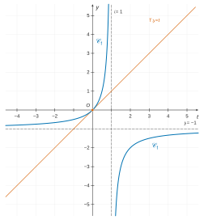

# Banque PT — Mathématiques C 2026 · Corrigé brut

*Corrigé rédigé par IA, non officiel. Signalez toute erreur.*

Épreuve de 4 h, calculatrice interdite, une feuille de papier millimétré à rendre avec la copie.

## Préambule

Dans tout le préambule, $t_0>0$, et pour $t\neq t_0$ :

$$\begin{aligned}
f(t)&=\frac{t}{t_0-t},\\
g(t)&=\frac{t_0}{t_0-t}.
\end{aligned}$$

### Question 1

Les fonctions $f$ et $g$ sont des fonctions rationnelles. Leur dénominateur $t_0-t$ ne s'annule pas sur $\mathbb{R}\setminus\{t_0\}$. Elles sont donc dérivables sur

$$\boxed{D=\mathbb{R}\setminus\{t_0\}=\,]-\infty,t_0[\,\cup\,]t_0,+\infty[}$$

Pour $t\in D$, on écrit le numérateur de $f$ sous la forme $(t-t_0)+t_0$ :

$$\begin{aligned}
f(t)&=\frac{(t-t_0)+t_0}{t_0-t}\\
&=-1+\frac{t_0}{t_0-t}\\
&=g(t)-1.
\end{aligned}$$

Les fonctions $f$ et $g$ diffèrent d'une constante, donc $f'=g'$ sur $D$.

La dérivée de $t\mapsto(t_0-t)^{-1}$ est $t\mapsto(t_0-t)^{-2}$. Ainsi, pour tout $t\in D$ :

$$\boxed{\begin{aligned}
f'(t)&=g'(t)\\
&=\frac{t_0}{(t_0-t)^2}
\end{aligned}}$$

### Question 2

Pour $t\in D$, $f'(t)=\dfrac{t_0}{(t_0-t)^2}>0$ car $t_0>0$.

La fonction $f$ est donc strictement croissante sur $]-\infty,t_0[$ et sur $]t_0,+\infty[$, séparément : $D$ n'est pas un intervalle.

Limites :
- en $\pm\infty$ : pour $t\neq0$, $f(t)=\dfrac{1}{\frac{t_0}{t}-1}$, qui tend vers $-1$ ;
- en $t_0^-$ : le numérateur tend vers $t_0>0$ et $t_0-t\to0^+$, donc $f(t)\to+\infty$ ;
- en $t_0^+$ : le numérateur tend vers $t_0>0$ et $t_0-t\to0^-$, donc $f(t)\to-\infty$.

| $t$ | $-\infty$ | | $t_0^-$ ‖ $t_0^+$ | | $+\infty$ |
|---|---|---|---|---|---|
| $f'(t)$ | | $+$ | ‖ | $+$ | |
| $f(t)$ | −1 | ↗ | +∞ ‖ −∞ | ↗ | −1 |

Les droites $t=t_0$ et $y=-1$ sont asymptotes à la courbe.

### Question 3

On a $f(0)=0$ et $f'(0)=\dfrac{t_0}{t_0^2}=\dfrac1{t_0}$. La tangente en $0$ a pour équation $y=f(0)+f'(0)(t-0)$, soit

$$\boxed{T:\ y=\frac{t}{t_0}}$$

### Question 4

Pour $t_0=1$, $f(t)=\dfrac{t}{1-t}$. La tangente en $0$ est $T:y=t$. L'asymptote verticale est $t=1$, l'asymptote horizontale $y=-1$.

Position relative :

$$\begin{aligned}
f(t)-t&=\frac{t-t(1-t)}{1-t}\\
&=\frac{t^2}{1-t}.
\end{aligned}$$

La courbe est donc **au-dessus de $T$ pour $t<1$** (elle la touche seulement en $0$), et **au-dessous de $T$ pour $t>1$**.

Valeurs utiles pour le tracé (1 cm par unité) :

| t | −4 | −2 | −1 | 0 | 0,5 | 0,75 | 0,9 | 1,1 | 1,5 | 2 | 3 | 5 |
|---|---|---|---|---|---|---|---|---|---|---|---|---|
| f(t) | −0,8 | −0,67 | −0,5 | 0 | 1 | 3 | 9 | −11 | −3 | −2 | −1,5 | −1,25 |

La figure est réduite ; sur la copie, on trace à 1 cm par unité, et la tangente, les deux asymptotes et la courbe figurent sur le même graphique.

La branche gauche ($t<1$) rejoint $y=-1$ par au-dessus en $-\infty$. La branche droite ($t>1$) la rejoint par en dessous, car $f(t)+1=\dfrac{1}{1-t}<0$. La droite $T$ ne rencontre la courbe qu'en l'origine.

La courbe est symétrique par rapport au centre $(1,-1)$, intersection des asymptotes : c'est une hyperbole.

### Question 5

Comme $f=g-1$, il suffit de dériver $g$. Montrons par récurrence sur $n\ge1$ la propriété $(\mathcal{H}_n)$ :

« $g$ est $n$ fois dérivable sur $D$ et, pour tout $t\in D$, $g^{(n)}(t)=\dfrac{n!\,t_0}{(t_0-t)^{n+1}}$ ».

- **Initialisation** : $(\mathcal{H}_1)$ est la question 1.
- **Hérédité** : supposons $(\mathcal{H}_n)$.

La fonction $t\mapsto n!\,t_0\,(t_0-t)^{-(n+1)}$ est dérivable sur $D$, comme composée de fonctions dérivables (une fonction affine, puis une puissance entière négative sur $\mathbb{R}^*$). Donc $g$ est $(n+1)$ fois dérivable sur $D$, et

$$\begin{aligned}
g^{(n+1)}(t)&=n!\,t_0\cdot\big(-(n+1)\big)(t_0-t)^{-(n+2)}\cdot(-1)\\
&=\frac{(n+1)!\,t_0}{(t_0-t)^{n+2}}.
\end{aligned}$$

C'est $(\mathcal{H}_{n+1})$.

Ainsi $f$ est $n$ fois dérivable sur $]-\infty,t_0[$ et sur $]t_0,+\infty[$, et pour $n\ge1$ et $t\neq t_0$ :

$$\boxed{f^{(n)}(t)=\frac{n!\,t_0}{(t_0-t)^{n+1}}}$$

### Question 6

Sur chacun des intervalles $]-\infty,t_0[$ et $]t_0,+\infty[$, la fonction $t\mapsto -t_0\ln|t_0-t|$ est dérivable. Sa dérivée vaut $-t_0\cdot\dfrac{-1}{t_0-t}=g(t)$. La valeur absolue est nécessaire : sur $]t_0,+\infty[$, $t_0-t<0$.

Comme $f=-1+g$, il suffit d'ajouter une primitive de la constante $-1$. Sur chacun des deux intervalles :

$$\boxed{G(t)=-t_0\ln|t_0-t|}$$

$$\boxed{F(t)=-t-t_0\ln|t_0-t|}$$

Ces primitives sont valables sur chacun des deux intervalles, à une constante additive près sur chacun.

### Question 7

**Formule de Taylor-Young.** Soit $n\in\mathbb{N}^*$, $I$ un intervalle de $\mathbb{R}$ et $x_0\in I$.

Soit $\psi$ de classe $\mathcal{C}^n$ sur $I$.

Alors, quand $x\to x_0$ avec $x\in I$ :

$$\boxed{\psi(x)=\sum_{k=0}^{n}\frac{\psi^{(k)}(x_0)}{k!}(x-x_0)^k+o\big((x-x_0)^n\big)}$$

De façon équivalente, quand $h\to0$ avec $x_0+h\in I$ :

$$\psi(x_0+h)=\sum_{k=0}^{n}\frac{\psi^{(k)}(x_0)}{k!}h^k+o(h^n).$$

### Question 8

La fonction $t\mapsto\dfrac1{1-t}$ est définie sur $\boxed{\mathbb{R}\setminus\{1\}}$. C'est la fonction $g$ du préambule pour $t_0=1$.

Elle est de classe $\mathcal{C}^\infty$ sur l'intervalle $I=\,]-\infty,1[$, qui contient $0$.

On calcule ses dérivées en $0$ pour $0\le k\le n$. On a $g(0)=1$, et la question 5 donne, pour $k\ge1$ :

$$g^{(k)}(0)=\frac{k!\cdot1}{(1-0)^{k+1}}=k!.$$

Ainsi $\dfrac{g^{(k)}(0)}{k!}=1$ pour tout $k\in\{0,\dots,n\}$. La formule de Taylor-Young à l'ordre $n$ en $0$ (question 7, sur $I$) donne, quand $t\to0$ :

$$\boxed{\begin{aligned}
\frac1{1-t}&=\sum_{k=0}^n t^k+o(t^n)\\
&=1+t+t^2+\cdots+t^n+o(t^n)
\end{aligned}}$$

Vérification directe :

$$\begin{aligned}
\frac1{1-t}-\sum_{k=0}^nt^k&=\frac{t^{n+1}}{1-t}\\
&=t^n\cdot\frac{t}{1-t},
\end{aligned}$$

et $\dfrac{t}{1-t}\to0$ quand $t\to0$.

### Question 9

La fonction $\ell:t\mapsto\ln(1-t)$ est définie sur $\boxed{]-\infty,1[}$, puisqu'il faut $1-t>0$. Elle y est de classe $\mathcal{C}^\infty$, et $\ell'(t)=-\dfrac1{1-t}$.

**DL de $\ell'$ à l'ordre $n-1$.** Pour $n\ge2$, la question 8 à l'ordre $n-1$ donne

$$\ell'(t)=-\sum_{k=0}^{n-1}t^k+o(t^{n-1}).$$

Pour $n=1$, c'est $\ell'(t)=-1+o(1)$, par continuité de $\ell'$ en $0$.

**Théorème d'intégration des développements limités.** Soit $\ell$ dérivable sur un intervalle contenant $0$, telle que $\ell'$ admette en $0$ un développement limité à l'ordre $n-1$.

Alors $\ell$ admet en $0$ un développement limité à l'ordre $n$. On l'obtient en primitivant terme à terme la partie régulière, la constante étant $\ell(0)$.

Ici $\ell(0)=\ln1=0$, d'où

$$\ell(t)=\ell(0)-\sum_{k=0}^{n-1}\frac{t^{k+1}}{k+1}+o(t^n),$$

soit, quand $t\to0$ :

$$\boxed{\begin{aligned}
\ln(1-t)&=-\sum_{k=1}^n\frac{t^k}{k}+o(t^n)\\
&=-t-\frac{t^2}{2}-\cdots-\frac{t^n}{n}+o(t^n)
\end{aligned}}$$

On peut aussi appliquer directement Taylor-Young à $\ell$. Pour $k\ge1$, $\ell^{(k)}=-g^{(k-1)}$ avec $t_0=1$. D'où $\ell^{(k)}(0)=-(k-1)!$ et $\dfrac{\ell^{(k)}(0)}{k!}=-\dfrac1k$.

## Partie I

### Question 1

Pour $t>0$, comme $(1+t)-t=1$ :

$$h(t)=\frac1{t(1+t)}=\frac1t-\frac1{1+t}.$$

Une primitive de $h$ sur $\mathbb{R}_+^*$ est donc

$$\boxed{H(t)=\ln\frac{t}{1+t}}$$

### Question 2

Soit $n\ge2$. La fonction $h$ est continue et positive sur $[n,+\infty[$, et $h(t)\underset{+\infty}{\sim}\dfrac1{t^2}$.

L'intégrale de Riemann $\int_1^{+\infty}\frac{dt}{t^2}$ converge ($2>1$). Par le théorème de comparaison des intégrales de fonctions positives, l'intégrale $\int_n^{+\infty}h$ **converge**.

Pour $A>n$ :

$$\int_n^A h=H(A)-H(n)=\ln\frac{A}{1+A}-\ln\frac{n}{n+1}.$$

Or $\ln\frac{A}{1+A}\to\ln1=0$ quand $A\to+\infty$. Donc

$$\boxed{\int_n^{+\infty}\frac{dt}{t+t^2}=\ln\Big(1+\frac1n\Big)}$$

### Question 3

Soit $n\ge2$. Pour tout réel $t$, $n+\cos(nt)\ge n-1\ge1>0$.

La fonction $t\mapsto\ln\big(n+\cos(nt)\big)$ est donc définie et dérivable sur $[0,\pi]$, de dérivée $\dfrac{-n\sin(nt)}{n+\cos(nt)}$. Par suite, avec $\cos(n\pi)=(-1)^n$ :

$$\begin{aligned}
-n\int_0^\pi\frac{\sin(nt)}{n+\cos(nt)}\,dt&=\Big[\ln\big(n+\cos(nt)\big)\Big]_0^\pi\\
&=\ln\big(n+\cos(n\pi)\big)-\ln(n+1)\\
&=\ln\frac{n+(-1)^n}{n+1}.
\end{aligned}$$

Avec la question 2 :

$$\begin{aligned}
u_n&=\ln\frac{n+(-1)^n}{n+1}+\ln\frac{n+1}{n}\\
&=\ln\frac{n+(-1)^n}{n},
\end{aligned}$$

soit, pour $n\ge2$ :

$$\boxed{u_n=\ln\Big(1+\frac{(-1)^n}{n}\Big)}$$

### Question 4

On a $\dfrac{(-1)^n}{n}\to0$ et $\ln$ est continue en $1$. Par composition des limites :

$$\boxed{\lim_{n\to+\infty}u_n=0}$$

### Question 5

Notons, à partir d'un même indice initial $n_0$, les sommes partielles

$$\begin{aligned}
A_N&=\sum_{k=n_0}^N a_k,\\
B_N&=\sum_{k=n_0}^N b_k.
\end{aligned}$$

Par hypothèse, elles convergent vers des réels $A$ et $B$. Par linéarité des sommes finies :

$$\sum_{k=n_0}^N(a_k+\lambda b_k)=A_N+\lambda B_N.$$

Le membre de droite converge vers $A+\lambda B$ quand $N\to+\infty$, par opérations sur les limites. La suite des sommes partielles de $\sum(a_n+\lambda b_n)$ converge donc :

$$\boxed{\sum(a_n+\lambda b_n)\ \text{converge, de somme}\ \sum_{n=n_0}^{+\infty} a_n+\lambda\sum_{n=n_0}^{+\infty} b_n}$$

### Question 6

On pose $h=\frac1n\to0$. La question 9 du préambule, avec $t=-x$, donne $\ln(1+x)=x-\dfrac{x^2}2+o(x^2)$ quand $x\to0$. Avec $x=(-1)^nh$, on a $x^2=h^2$ et

$$\begin{aligned}
u_n&=(-1)^nh-\frac{h^2}{2}+o(h^2)\\
&=\frac{(-1)^n}{n}-\frac1{2n^2}+o\Big(\frac1{n^2}\Big).
\end{aligned}$$

Posons $a_n=\dfrac{(-1)^n}{n}$ et $b_n=u_n-a_n$. On a $b_n\sim-\dfrac1{2n^2}$.

- $\sum a_n$ converge par le critère spécial des séries alternées : la suite $\big(\frac1n\big)$ est positive, décroissante et tend vers $0$.
- $\sum b_n$ converge absolument : $|b_n|\sim\dfrac1{2n^2}$, terme d'une série de Riemann convergente (comparaison de séries à termes positifs).
- Par la question 5 avec $\lambda=1$, $\sum u_n=\sum(a_n+b_n)$ **converge**.

Convergence absolue : $|u_n|=\Big|\frac{(-1)^n}{n}+b_n\Big|$ avec $b_n=o(1/n)$, donc $|u_n|\sim\dfrac1n$. La série harmonique diverge. Par comparaison de séries à termes positifs, $\sum|u_n|$ **diverge**.

$$\boxed{\sum_{n\ge2}u_n\ \text{converge mais ne converge pas absolument}}$$

### Question 7

D'après la question 3 :
- pour $n$ pair, $u_n=\ln\dfrac{n+1}{n}$ ;
- pour $n$ impair, $u_n=\ln\dfrac{n-1}{n}$.

**(a)** Récurrence sur $N\ge1$.

Pour $N=1$ : $S_2=u_2=\ln\frac32=\ln\frac{2\cdot1+1}{2\cdot1}$.

Si $S_{2N}=\ln\dfrac{2N+1}{2N}$, alors

$$\begin{aligned}
S_{2N+2}&=S_{2N}+u_{2N+1}+u_{2N+2}\\
&=\ln\frac{2N+1}{2N}+\ln\frac{2N}{2N+1}+\ln\frac{2N+3}{2N+2}\\
&=\ln\frac{2N+3}{2N+2}.
\end{aligned}$$

Donc, pour tout $N\ge1$ :

$$\boxed{S_{2N}=\ln\frac{2N+1}{2N}}$$

On peut aussi séparer les indices pairs et impairs :

$$\begin{aligned}
S_{2N}&=\sum_{k=1}^{N}u_{2k}+\sum_{k=1}^{N-1}u_{2k+1}\\
&=\sum_{k=1}^{N}\big(\ln(2k+1)-\ln(2k)\big)+\sum_{k=1}^{N-1}\big(\ln(2k)-\ln(2k+1)\big)\\
&=\ln(2N+1)-\ln(2N).
\end{aligned}$$

**(b)** Pour $n\ge1$ :

$$\begin{aligned}
u_{2n}&=\ln\frac{2n+1}{2n}>0,\\
u_{2n+1}&=\ln\frac{2n}{2n+1}=-\ln\frac{2n+1}{2n}.
\end{aligned}$$

Les deux termes sont opposés :

$$\boxed{u_{2n+1}=-u_{2n}}$$

**(c)** Soit $N\ge2$. Les indices $2,\dots,2N-1$ se regroupent en $N-1$ paires $(2n,2n+1)$, pour $1\le n\le N-1$. Par (b) :

$$\begin{aligned}
S_{2N-1}&=\sum_{n=1}^{N-1}(u_{2n}+u_{2n+1})\\
&=0.
\end{aligned}$$

$$\boxed{S_{2N-1}=0\quad(N\ge2)}$$

Vérification avec (a) :

$$\begin{aligned}
S_{2N-1}&=S_{2N}-u_{2N}\\
&=\ln\frac{2N+1}{2N}-\ln\frac{2N+1}{2N}\\
&=0.
\end{aligned}$$

**(d)** On a $S_{2N}=\ln\Big(1+\dfrac1{2N}\Big)\to0$ et $S_{2N-1}=0$. Les suites extraites d'indices pairs et impairs de $(S_N)$ convergent vers la même limite $0$, donc $(S_N)$ converge vers $0$ :

$$\boxed{\sum_{n=2}^{+\infty}u_n=0}$$

## Partie II

Pour $n\ge1$ et $x>1$, avec $\ln x>0$ :

$$G_n(x)=\int_0^{+\infty}x^{-nt}t^n\,dt=\int_0^{+\infty}t^ne^{-nt\ln x}\,dt.$$

### Question 1

Soit $x>1$. La fonction $\theta:t\mapsto t^ne^{-nt\ln x}$ est continue et positive sur $[0,+\infty[$. La borne $0$ ne pose pas de problème : la seule borne impropre est $+\infty$.

Comme $n\ln x>0$, les croissances comparées donnent $t^2\theta(t)=t^{n+2}e^{-nt\ln x}\to0$ quand $t\to+\infty$. Donc $\theta(t)=o\big(\frac1{t^2}\big)$ en $+\infty$.

L'intégrale de Riemann $\int_1^{+\infty}\frac{dt}{t^2}$ converge. Par le théorème de comparaison des intégrales de fonctions positives, $\int_1^{+\infty}\theta$ converge, et $\int_0^1\theta$ est l'intégrale d'une fonction continue sur un segment. Donc

$$\boxed{G_n(x)\ \text{converge (absolument) pour tout}\ x>1}$$

### Question 2

Soit $a>1$ et $\Phi(x,t)=t^nx^{-nt}$ sur $[a,+\infty[\times[0,+\infty[$.
- Pour tout $t\ge0$, $x\mapsto\Phi(x,t)$ est continue sur $[a,+\infty[$.
- Pour tout $x\ge a$, $t\mapsto\Phi(x,t)$ est continue sur $[0,+\infty[$.
- Domination : pour $x\ge a$ et $t\ge0$, $-nt\ln x\le-nt\ln a$, donc $0\le\Phi(x,t)\le t^na^{-nt}$.
- Le majorant $t\mapsto t^na^{-nt}$ est continu, positif et indépendant de $x$. Il est intégrable sur $[0,+\infty[$ : son intégrale est $G_n(a)$, convergente par la question 1.

Par le théorème de continuité des intégrales à paramètre :

$$\boxed{G_n\ \text{est continue sur}\ [a,+\infty[}$$

Ceci valant pour tout $a>1$, $G_n$ est continue sur $]1,+\infty[$.

### Question 3

Soit $a>1$. Pour tout $t\ge0$, $x\mapsto\Phi(x,t)=t^ne^{-nt\ln x}$ est de classe $\mathcal{C}^1$ sur $[a,+\infty[$, et

$$\frac{\partial\Phi}{\partial x}(x,t)=-n\,t^{n+1}x^{-nt-1}.$$

Pour $x$ fixé, cette dérivée est continue en $t$. Pour $x\ge a$ et $t\ge0$, $x^{-nt}\le a^{-nt}$ et $x^{-1}\le a^{-1}$, d'où la domination

$$\Big|\frac{\partial\Phi}{\partial x}(x,t)\Big|\le\psi_a(t),$$

où l'on a posé

$$\psi_a(t)=n\,t^{n+1}a^{-nt-1}.$$

Le majorant $\psi_a$ est indépendant de $x$, continu et positif sur $[0,+\infty[$.

Il est intégrable : par croissances comparées, $t^2\psi_a(t)\to0$ en $+\infty$, donc $\psi_a(t)=o(1/t^2)$, et l'intégrale de Riemann $\int_1^{+\infty}\frac{dt}{t^2}$ converge.

Par le théorème de dérivation des intégrales à paramètre, $G_n$ est de classe $\mathcal{C}^1$ sur $[a,+\infty[$, et pour $x\ge a$ :

$$\boxed{\begin{aligned}
G_n'(x)&=-n\int_0^{+\infty}t^{n+1}x^{-nt-1}\,dt\\
&=-\frac nx\int_0^{+\infty}t^{n+1}x^{-nt}\,dt
\end{aligned}}$$

### Question 4

Soit $x>1$ et $n\ge1$. Dans $G_{n+1}(x)=\int_0^{+\infty}t^{n+1}x^{-(n+1)t}\,dt$, on pose $u=\dfrac{(n+1)t}{n}$. C'est un changement de variable affine, bijectif de $[0,+\infty[$ sur lui-même, avec

$$\begin{aligned}
t&=\frac{n}{n+1}u,\\
dt&=\frac{n}{n+1}\,du,\\
(n+1)t&=nu.
\end{aligned}$$

Il vient

$$G_{n+1}(x)=\Big(\frac{n}{n+1}\Big)^{n+2}\int_0^{+\infty}u^{n+1}x^{-nu}\,du.$$

On intègre par parties sur $[0,A]$. On dérive $u\mapsto u^{n+1}$ et on primitive $u\mapsto x^{-nu}=e^{-nu\ln x}$ en $u\mapsto-\dfrac{x^{-nu}}{n\ln x}$ ; ces deux fonctions sont de classe $\mathcal{C}^1$. On obtient

$$\int_0^Au^{n+1}x^{-nu}\,du=\Big[-\frac{u^{n+1}x^{-nu}}{n\ln x}\Big]_0^A+\frac{n+1}{n\ln x}\int_0^Au^nx^{-nu}\,du.$$

Le crochet est nul en $u=0$, car $n+1\ge1$.

En $u=A$, il vaut $-\dfrac{A^{n+1}e^{-nA\ln x}}{n\ln x}$, qui tend vers $0$ quand $A\to+\infty$ par croissances comparées ($n\ln x>0$). Les deux intégrales convergent (question 1). En faisant $A\to+\infty$ :

$$\int_0^{+\infty}u^{n+1}x^{-nu}\,du=\frac{n+1}{n\ln x}G_n(x).$$

Finalement

$$G_{n+1}(x)=\Big(\frac n{n+1}\Big)^{n+2}\frac{n+1}{n}\cdot\frac{G_n(x)}{\ln x},$$

$$\boxed{G_{n+1}(x)=\frac1{\ln x}\Big(\frac n{n+1}\Big)^{n+1}G_n(x)}$$

### Question 5

Avec $c=\ln x>0$, on intègre par parties sur $[0,A]$ :

$$\begin{aligned}
\int_0^Ate^{-ct}\,dt&=\Big[-\frac{te^{-ct}}{c}\Big]_0^A+\frac1c\int_0^Ae^{-ct}\,dt\\
&=-\frac{Ae^{-cA}}{c}+\frac{1-e^{-cA}}{c^2}.
\end{aligned}$$

Quand $A\to+\infty$, le premier terme tend vers $0$ (croissances comparées) et le second vers $\frac1{c^2}$. Le résultat est bien strictement positif, comme l'intégrale d'une fonction positive non nulle :

$$\boxed{G_1(x)=\frac1{(\ln x)^2}}$$

### Question 6

**Produit en cascade.** Les $G_k(x)$ sont strictement positifs : ce sont les intégrales de fonctions continues, positives et non nulles. Pour $n\ge2$, la question 4 donne

$$\begin{aligned}
G_n(x)&=G_1(x)\prod_{k=1}^{n-1}\frac{G_{k+1}(x)}{G_k(x)}\\
&=\frac1{(\ln x)^2}\prod_{k=1}^{n-1}\frac{1}{\ln x}\cdot\frac{k^{k+1}}{(k+1)^{k+1}}\\
&=\frac1{(\ln x)^{n+1}}\prod_{k=1}^{n-1}k\cdot\prod_{k=1}^{n-1}\frac{k^{k}}{(k+1)^{k+1}}.
\end{aligned}$$

Le second produit se télescope, le premier est une factorielle :

$$\prod_{k=1}^{n-1}\frac{k^{k}}{(k+1)^{k+1}}=\frac{1^1}{n^n},$$

$$\prod_{k=1}^{n-1}k=(n-1)!.$$

D'où, pour $n\ge2$ :

$$\begin{aligned}
G_n(x)&=\frac{(n-1)!}{n^n(\ln x)^{n+1}}\\
&=\frac{n!}{(n\ln x)^{n+1}}.
\end{aligned}$$

La formule est encore vraie pour $n=1$ (question 5).

**Récurrence.** Montrons par récurrence sur $n\ge1$ la propriété $(\mathcal{P}_n)$ : « pour tout $x>1$, $G_n(x)=\dfrac{n!}{(n\ln x)^{n+1}}$ ».
- **Initialisation** : $(\mathcal{P}_1)$ est la question 5.
- **Hérédité** : si $(\mathcal{P}_n)$ est vraie, la question 4 donne

$$\begin{aligned}
G_{n+1}(x)&=\frac1{\ln x}\cdot\frac{n^{n+1}}{(n+1)^{n+1}}\cdot\frac{n!}{n^{n+1}(\ln x)^{n+1}}\\
&=\frac{n!}{(n+1)^{n+1}(\ln x)^{n+2}}\\
&=\frac{(n+1)!}{\big((n+1)\ln x\big)^{n+2}},
\end{aligned}$$

c'est-à-dire $(\mathcal{P}_{n+1})$.

Pour $n\ge1$ et $x>1$ :

$$\boxed{\begin{aligned}
G_n(x)&=\frac{n!}{(n\ln x)^{n+1}}\\
&=\frac{(n-1)!}{n^n(\ln x)^{n+1}}
\end{aligned}}$$

### Question 7

Par la question 6, en posant $q=\dfrac1{\ln x}>0$ :

$$\begin{aligned}
\frac{n^nG_n(x)}{(n-1)!}&=\frac1{(\ln x)^{n+1}}\\
&=q^{n+1}.
\end{aligned}$$

La série $\sum_{n\ge1}q^{n+1}$ est géométrique de raison $q>0$. Elle converge si et seulement si $q<1$, c'est-à-dire $\ln x>1$. Pour $q\ge1$, le terme général ne tend pas vers $0$.

$$\boxed{\text{CNS de convergence : } x>e}$$

Dans ce cas, la somme commence au terme $q^2$ :

$$\begin{aligned}
S(x)&=\sum_{n=1}^{+\infty}q^{n+1}\\
&=\frac{q^2}{1-q}.
\end{aligned}$$

$$\boxed{S(x)=\frac{1}{\ln x\,(\ln x-1)}\qquad(x>e)}$$

### Question 8

Pour $k\ge2$, $1+\frac{(-1)^k}{k}>0$. Par la partie I (question 7(a)) :

$$\begin{aligned}
\ln\prod_{k=2}^{2N}\Big(1+\frac{(-1)^k}{k}\Big)&=\sum_{k=2}^{2N}u_k\\
&=S_{2N}\\
&=\ln\frac{2N+1}{2N}.
\end{aligned}$$

Donc

$$\Pi_N=e\Big(1+\frac1{2N}\Big),$$

et $\Pi_N>e>1$. Comme $S_{2N}$ tend vers la somme $\sum_{n\ge2}u_n=0$ de la partie I (question 7(d)), $\ln\Pi_N=1+S_{2N}\to1$, c'est-à-dire $\Pi_N\to e$.

L'entier $n\ge1$ est fixé. La fonction $G_n$ est continue sur $]1,+\infty[$ (question 2, avec par exemple $a=2<e$), en particulier en $e$.

Par composition des limites, $G_n(\Pi_N)\to G_n(e)$. Avec $\ln e=1$ et la question 6 :

$$\boxed{\lim_{N\to+\infty}G_n(\Pi_N)=G_n(e)=\frac{n!}{n^{n+1}}}$$

On peut aussi le voir directement :

$$G_n(\Pi_N)=\frac{n!}{n^{n+1}}\Big(1+\ln\big(1+\tfrac1{2N}\big)\Big)^{-(n+1)}.$$

Remarque : si l'on lit $G_N(\Pi_N)$ (indice lié à $N$), alors $\ln\Pi_N>1$ donne $0<G_N(\Pi_N)<\dfrac{N!}{N^{N+1}}\le\dfrac1N$, et la limite est nulle.

## Partie III

On travaille sur l'ouvert $U=\{(x,y)\in\mathbb{R}^2:\ x\neq y\}$, où $\varphi(x,y)=x^2+y^2-\ln|x-y|$ est de classe $\mathcal{C}^2$.

### Question 1

Sur $U$, quel que soit le signe de $x-y$ :

$$\begin{aligned}
\frac{\partial}{\partial x}\ln|x-y|&=\frac1{x-y},\\
\frac{\partial}{\partial y}\ln|x-y|&=-\frac1{x-y}.
\end{aligned}$$

D'où les dérivées partielles premières :

$$\frac{\partial\varphi}{\partial x}(x,y)=2x-\frac1{x-y},$$

$$\frac{\partial\varphi}{\partial y}(x,y)=2y+\frac1{x-y}.$$

Puis les dérivées secondes :

$$\begin{aligned}
\frac{\partial^2\varphi}{\partial x^2}(x,y)&=2+\frac1{(x-y)^2},\\
\frac{\partial^2\varphi}{\partial y^2}(x,y)&=2+\frac1{(x-y)^2},\\
\frac{\partial^2\varphi}{\partial x\partial y}(x,y)&=\frac{\partial^2\varphi}{\partial y\partial x}(x,y)=-\frac1{(x-y)^2}.
\end{aligned}$$

L'égalité des dérivées croisées est donnée par le théorème de Schwarz ($\varphi$ de classe $\mathcal{C}^2$), et se vérifie directement. Pour tout $(x,y)\in U$ :

$$\boxed{H_\varphi(x,y)=\begin{pmatrix}2+\dfrac1{(x-y)^2}&-\dfrac1{(x-y)^2}\\[2mm]-\dfrac1{(x-y)^2}&2+\dfrac1{(x-y)^2}\end{pmatrix}}$$

### Question 2

Le point $(x_0,y_0)\in U$ est critique si et seulement si $\nabla\varphi(x_0,y_0)=(0,0)$, c'est-à-dire

$$\begin{cases}2x_0=\dfrac1{x_0-y_0}\\[2mm]2y_0=-\dfrac1{x_0-y_0}\end{cases}$$

Si ces deux égalités sont vraies, leur somme donne $x_0+y_0=0$, et la première donne $x_0=\frac1{2(x_0-y_0)}$.

Réciproquement, si $x_0=-y_0=\frac1{2(x_0-y_0)}$, alors $2x_0=\frac1{x_0-y_0}$ et $2y_0=-2x_0=-\frac1{x_0-y_0}$. Donc

$$\boxed{\begin{aligned}
(x_0,y_0)\ \text{critique}\iff{}&x_0=-y_0\\
\text{et}\ &x_0=\frac1{2(x_0-y_0)}
\end{aligned}}$$

ce qui est la condition $x_0=-y_0=\frac1{2(x_0-y_0)}$ de l'énoncé.

### Question 3

Avec $y_0=-x_0$, on a $x_0-y_0=2x_0$, non nul puisque $(x_0,y_0)\in U$. La condition devient $x_0=\dfrac1{4x_0}$, soit $x_0^2=\dfrac14$.

Donc $x_0=\pm\frac12$ et $y_0=-x_0$, ce qui donne deux points :

$$\boxed{(x_0,y_0)=\Big(\frac12,-\frac12\Big)\ \text{ou}\ (x_0,y_0)=\Big(-\frac12,\frac12\Big)}$$

### Question 4

En ces deux points, $(x_0-y_0)^2=1$ et

$$H_\varphi(x_0,y_0)=\begin{pmatrix}3&-1\\-1&3\end{pmatrix}.$$

Cette matrice symétrique réelle a pour déterminant $8>0$ et pour trace $6>0$. Ses deux valeurs propres réelles ont un produit et une somme strictement positifs : elles sont strictement positives. Ce sont $2$ (vecteur propre $(1,1)$) et $4$ (vecteur propre $(1,-1)$).

Le point est critique, $\varphi$ est de classe $\mathcal{C}^2$ sur l'ouvert $U$, et la hessienne y a ses valeurs propres strictement positives. Donc $\varphi$ admet un minimum local strict en ces deux points. Sa valeur est $\frac14+\frac14-\ln1=\frac12$ :

$$\boxed{\varphi\ \text{admet un minimum local en}\ \Big(\tfrac12,-\tfrac12\Big)\ \text{et en}\ \Big(-\tfrac12,\tfrac12\Big),\ \text{de valeur}\ \tfrac12}$$

**Ce minimum est global.** Pour $(x,y)\in U$, on pose $s=|x-y|>0$. Alors

$$x^2+y^2=\frac12\big((x+y)^2+(x-y)^2\big)\ge\frac{s^2}2,$$

donc $\varphi(x,y)\ge\frac{s^2}{2}-\ln s$.

La fonction $s\mapsto\frac{s^2}2-\ln s$ a pour dérivée $s-\frac1s$, négative sur $]0,1]$ et positive sur $[1,+\infty[$. Elle atteint donc son minimum $\frac12$ en $s=1$. Ainsi

$$\varphi(x,y)\ge\frac12\quad\text{pour tout }(x,y)\in U.$$

### Question 5

**Inégalité tirée de $\varphi$.** Pour $r>0$, le point $\big(\frac r2,-\frac r2\big)$ est dans $U$, et $\varphi\big(\frac r2,-\frac r2\big)=\frac{r^2}2-\ln r$. Le minimum global $\varphi\ge\frac12$ de la question 4 donne

$$\ln r\le\frac{r^2-1}{2}\qquad(r>0).\tag{$\star$}$$

Elle vaut pour tout $r>0$ grâce au caractère global du minimum. Avec la seule minoration locale, elle ne vaudrait que pour $r$ voisin de $1$. Cela suffirait pour $n$ assez grand, les premiers termes, en nombre fini, ne changeant pas un $O(N)$.

**Application.** Soit $n\ge2$ et $r_n=1+\frac{(-1)^n}{n}\in\big[\frac23,\frac32\big]$, de sorte que $u_n=\ln r_n$.
- Pour $n$ pair, $u_n>0$ et $(\star)$ avec $r=r_n$ donne $|u_n|=u_n\le\dfrac{r_n^2-1}{2}=\dfrac1n+\dfrac1{2n^2}$.
- Pour $n$ impair, $u_n<0$ et $(\star)$ avec $r=1/r_n$ donne $|u_n|=\ln\dfrac1{r_n}\le\dfrac{r_n^{-2}-1}{2}=\dfrac{2n-1}{2(n-1)^2}$.

Dans les deux cas $|u_n|\le\dfrac2n\le1$.

Pour $n$ impair $\ge3$, cela revient à $(2n-1)n\le4(n-1)^2$, soit $2n^2-7n+4\ge0$, vrai pour $n\ge3$. Donc, pour $N\ge2$ :

$$\sum_{n=2}^N\Big|\ln\Big(1+\frac{(-1)^n}{n}\Big)\Big|\le N-1,$$

$$\boxed{\sum_{n=2}^N\Big|\ln\Big(1+\frac{(-1)^n}n\Big)\Big|=O(N)}$$

On obtient même $O(\ln N)$, puisque $\sum_{n=2}^N\frac2n\le2\ln N$.

**Insuffisance.** La minoration de $\varphi$ ne fournit que des **majorations** de $|u_n|$, au mieux par $\frac2n$, terme général d'une série divergente.

Les sommes partielles de $\sum|u_n|$ sont ainsi majorées par une quantité qui tend vers $+\infty$, en $O(N)$ ou en $O(\ln N)$.

Une telle majoration ne permet de conclure ni à la convergence, qui demanderait des sommes partielles bornées, ni à la divergence, qui demanderait un minorant. La nature de $\sum|u_n|$ ne peut donc pas se déduire de la question 4. C'est l'équivalent $|u_n|\sim\frac1n$ de la partie I (question 6) qui établit la divergence.

$$\boxed{\text{La minoration de }\varphi\text{ ne suffit pas à étudier la convergence de }\sum|u_n|}$$
