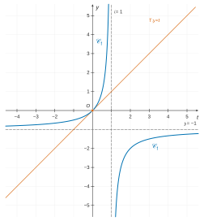

# Banque PT PT — Mathématiques C 2026 · Corrigé guidé

*Corrigé rédigé par IA, non officiel. Signalez toute erreur.*

## Présentation du sujet

**Format.** Épreuve de 4 h, calculatrice interdite, une feuille de papier millimétré à rendre avec la copie (pour le tracé de la question 4 du préambule). L'avertissement insiste sur la présentation et la justification des résultats. Il prévient aussi que les questions mal référencées ne sont pas notées. Il faut donc reprendre exactement la numérotation : Préambule 1 à 9, I.1 à I.7(d), II.1 à II.8, III.1 à III.5.

**Thème.** Le problème est, selon sa propre conclusion, « un peu éclectique ». Il tourne autour d'un même objet numérique, la série

$$\sum_{n\ge2}u_n,\qquad u_n=\ln\Big(1+\frac{(-1)^n}{n}\Big),$$

étudiée sous plusieurs angles : sommes partielles, produits, intégrales à paramètre, fonctions de deux variables.

**Découpage.**

| Bloc | Contenu | Outils |
|---|---|---|
| Préambule (9 q.) | Étude d'une fonction homographique : dérivées, variations, tangente, tracé, dérivée $n$-ième, primitives ; puis Taylor-Young et les développements limités de $\frac1{1-t}$ et $\ln(1-t)$ | Dérivation, récurrence, DL usuels |
| Partie I (10 q.) | On obtient $u_n$ comme somme de deux intégrales, puis on étudie $\sum u_n$ : convergence, non-convergence absolue, somme exacte (nulle) | Intégrales impropres, DL, séries alternées, suites extraites |
| Partie II (8 q.) | Intégrales à paramètre $G_n(x)$ : convergence, continuité, dérivabilité, relation de récurrence, forme close, série géométrique, puis une limite qui réutilise la partie I | Domination, IPP, changement de variable, récurrence |
| Partie III (5 q.) | $\varphi(x,y)=x^2+y^2-\ln\lvert x-y\rvert$ : hessienne, points critiques, minimum ; puis une inégalité tirée de ce minimum, appliquée à $\lvert u_n\rvert$, et ses limites | Calcul différentiel à deux variables |

**Difficulté.** Le sujet est très progressif et assez long. Le préambule et la partie I sont très proches du cours de première année et doivent rapporter beaucoup de points. Le rapport 2026 juge pourtant l'épreuve nettement moins bien réussie que celle de 2025, et met en cause la méconnaissance du cours dès le préambule.

**Questions discriminantes selon le rapport 2026.** La formule de Taylor-Young (préambule 7) est dite « particulièrement discriminante – et donc classante » ; à peine un quart des candidats l'énonce correctement. Les taux de réussite les plus faibles sont :
- préambule 8 (un peu plus d'un dixième) ;
- I.5 (peu de copies) et I.6 (moins d'un dixième) ;
- II.6 et la première moitié de II.7 (environ un dixième), II.8 (un peu plus d'un vingtième) ;
- III.4 (très peu de copies) et III.5.

**À ne pas laisser passer.** Préambule 1, 2, 3, 6, 7 ; I.1 à I.5 et I.7(b) ; II.5, II.7 ; III.1 à III.3. Ce sont des questions courtes qui demandent surtout de la rigueur.

**Gestion du temps (indicative).** Environ 50 min pour le préambule (tracé compris), 60 min pour la partie I, 75 min pour la partie II, 40 min pour la partie III, et 15 min de relecture.

> [!JURY]
> Le rapport 2026 se plaint d'une écriture souvent illisible et de copies trop denses, sans espacement entre les questions. Il conclut : « Nous rappelons également que les traits se tirent à la règle, et que les résultats doivent être encadrés. » Il relève aussi des candidats qui ont essayé de « bricoler le résultat » quand celui-ci était donné : une suite de calculs faux qui aboutit à la formule de l'énoncé ne rapporte rien.

## Préambule

On étudie une fonction homographique et on rassemble les développements limités qui serviront en partie I. Le fil conducteur est l'identité $f=g-1$, qui simplifie presque toutes les questions.

### Question 1

> [!INDICATION]
> Écrire le numérateur $t$ de $f$ sous la forme $(t-t_0)+t_0$.

> [!INDICATION]
> Deux fonctions qui diffèrent d'une constante ont la même dérivée.

#### Solution

Les fonctions $f$ et $g$ sont des fonctions rationnelles. Leur dénominateur $t_0-t$ ne s'annule pas sur $\mathbb{R}\setminus\{t_0\}$. Elles sont donc dérivables sur

$$\boxed{D=\mathbb{R}\setminus\{t_0\}=\,]-\infty,t_0[\,\cup\,]t_0,+\infty[}$$

Pour $t\in D$ :

$$\begin{aligned}
f(t)&=\frac{(t-t_0)+t_0}{t_0-t}\\
&=-1+\frac{t_0}{t_0-t}\\
&=g(t)-1.
\end{aligned}$$

Donc $f'=g'$ sur $D$. En dérivant $(t_0-t)^{-1}$, on obtient pour $t\in D$ :

$$\boxed{\begin{aligned}
f'(t)&=g'(t)\\
&=\frac{t_0}{(t_0-t)^2}
\end{aligned}}$$

> [!METHODE]
> Face à une fraction rationnelle de degré $1$ sur degré $1$, on effectue la « division » : $\frac{t}{t_0-t}=-1+\frac{t_0}{t_0-t}$. Cette écriture sert pour la dérivée, la dérivée $n$-ième, les primitives et les asymptotes.

> [!PIEGE]
> « Coïncider » veut dire « être égales ». Le rapport 2026 cite des copies qui concluent que $f'$ et $g'$ coïncident après avoir trouvé $f'=-g'$ : c'est le signe d'une erreur de calcul, pas d'une coïncidence.

> [!JURY]
> Le domaine de dérivabilité doit être justifié. Le rapport 2026 attend au minimum que « les fonctions sont des fonctions rationnelles dont le dénominateur ne s'annule pas sur $\mathbb{R}\setminus\{t_0\}$ ». Invoquer une composition n'a de sens que si l'on nomme les fonctions composées. Une fonction continue n'est pas pour autant dérivable. Le jury signale enfin la confusion entre le symbole « privé de » $\setminus$ et la barre oblique.

### Question 2

> [!INDICATION]
> Le signe de $f'$ est immédiat ; attention, $D$ n'est pas un intervalle.

> [!INDICATION]
> Pour la limite en $\pm\infty$, diviser numérateur et dénominateur par $t$. En $t_0$, regarder le signe du dénominateur de chaque côté.

#### Solution

Pour $t\in D$, $f'(t)=\dfrac{t_0}{(t_0-t)^2}>0$ car $t_0>0$.

La fonction $f$ est donc strictement croissante sur $]-\infty,t_0[$ et, séparément, sur $]t_0,+\infty[$.

Limites :
- quand $t\to\pm\infty$, $f(t)=\dfrac1{\frac{t_0}{t}-1}\to-1$ ;
- en $t_0^-$ : numérateur $\to t_0>0$, dénominateur $\to0^+$, donc $f(t)\to+\infty$ ;
- en $t_0^+$ : dénominateur $\to0^-$, donc $f(t)\to-\infty$.

| $t$ | $-\infty$ | | $t_0^-$ ‖ $t_0^+$ | | $+\infty$ |
|---|---|---|---|---|---|
| $f'(t)$ | | $+$ | ‖ | $+$ | |
| $f(t)$ | −1 | ↗ | +∞ ‖ −∞ | ↗ | −1 |

> [!PIEGE]
> Écrire « $f$ est croissante sur $\mathbb{R}\setminus\{t_0\}$ » est faux. Pour $t_0=1$, on a $f(0)=0>f(2)=-2$. La monotonie s'énonce intervalle par intervalle.

> [!JURY]
> Le rapport 2026 rappelle que « les bornes doivent figurer sur le tableau de variations et non à part ». Il cite aussi des tableaux aberrants, avec une fonction croissante de $-1$ à $-1$ : un tableau se relit.

### Question 3

> [!INDICATION]
> Équation de la tangente en $a$ : $y=f(a)+f'(a)(t-a)$.

#### Solution

On a $f(0)=0$ et $f'(0)=\dfrac{t_0}{t_0^2}=\dfrac1{t_0}$, donc

$$\boxed{T:\ y=\frac{t}{t_0}}$$

> [!JURY]
> Le rapport 2026 note que de très nombreux candidats ignorent la forme générale de l'équation d'une tangente, notion de classe de Première. Une équation de droite s'écrit $y=\dots$ : les réponses du type $T=\frac{t}{t_0}$, $f(t)=\frac{t}{t_0}$, ou la seule expression $\frac{t}{t_0}$, sont relevées comme incorrectes.

### Question 4

> [!INDICATION]
> Placer d'abord les asymptotes trouvées en question 2, puis la tangente, puis quelques points.

> [!INDICATION]
> Étudier le signe de $f(t)-t$ pour savoir de quel côté de la tangente se trouve la courbe.

#### Solution

Pour $t_0=1$, $f(t)=\dfrac{t}{1-t}$ et la tangente est $T:y=t$. L'asymptote verticale est $t=1$, l'asymptote horizontale $y=-1$.

Position relative :

$$f(t)-t=\frac{t^2}{1-t}.$$

La courbe est au-dessus de $T$ pour $t<1$ (contact en $0$ seulement) et au-dessous pour $t>1$.

| t | −4 | −2 | −1 | 0 | 0,5 | 0,75 | 0,9 | 1,1 | 1,5 | 2 | 3 | 5 |
|---|---|---|---|---|---|---|---|---|---|---|---|---|
| f(t) | −0,8 | −0,67 | −0,5 | 0 | 1 | 3 | 9 | −11 | −3 | −2 | −1,5 | −1,25 |

Sur la copie, on trace à 1 cm par unité, sur un seul graphique. La branche gauche rejoint $y=-1$ par au-dessus en $-\infty$. La branche droite la rejoint par en dessous, car $f(t)+1=\frac1{1-t}<0$. La droite $T$ ne coupe la courbe qu'en $O$.

> [!METHODE]
> Pour un tracé soigné en peu de temps, on procède dans l'ordre : asymptotes, tangentes remarquables, position relative, puis une demi-douzaine de points calculés de tête.

> [!JURY]
> Selon le rapport 2026, beaucoup ont omis la tangente, pourtant demandée et utile au tracé, ou l'ont tracée sur un graphique séparé. « L'asymptote verticale $x = 1$ et l'asymptote horizontale $y = -1$ ne figuraient pas sur un nombre important de tracés. »

### Question 5

> [!INDICATION]
> Grâce à la question 1, il suffit de traiter $g$.

> [!INDICATION]
> Calculer $g''$ et $g'''$ pour deviner la formule, puis la démontrer en incluant l'existence de la dérivée dans l'hypothèse de récurrence.

#### Solution

Comme $f=g-1$, on a $f^{(n)}=g^{(n)}$. Montrons par récurrence sur $n\ge1$ la propriété $(\mathcal H_n)$ :

« $g$ est $n$ fois dérivable sur $D$ et $g^{(n)}(t)=\dfrac{n!\,t_0}{(t_0-t)^{n+1}}$ ».

- **Initialisation** : $(\mathcal H_1)$ est la question 1.
- **Hérédité** : si $(\mathcal H_n)$ est vraie, $t\mapsto n!\,t_0(t_0-t)^{-(n+1)}$ est dérivable sur $D$, et

$$\begin{aligned}
g^{(n+1)}(t)&=n!\,t_0\cdot\big(-(n+1)\big)(t_0-t)^{-(n+2)}\cdot(-1)\\
&=\frac{(n+1)!\,t_0}{(t_0-t)^{n+2}}.
\end{aligned}$$

Pour $n\ge1$ et $t\neq t_0$ :

$$\boxed{f^{(n)}(t)=\frac{n!\,t_0}{(t_0-t)^{n+1}}}$$

> [!PIEGE]
> Les deux signes $-$ (exposant négatif et dérivée de $t_0-t$) se compensent à chaque étape.
>
> En dérivant $(t_0-t)^{-k}$ comme $(t-t_0)^{-k}$, on obtient un faux $(-1)^n$. Le rapport 2026 relève justement des réponses avec des $(-1)^n$, des puissances de $2$ ou des coefficients binomiaux.

### Question 6

> [!INDICATION]
> Une primitive de $\frac1{t_0-t}$ est un logarithme ; attention au signe de $t_0-t$ sur chaque intervalle.

> [!INDICATION]
> Pour $F$, utiliser $f=-1+g$ plutôt que de calculer à nouveau.

#### Solution

Sur chacun des deux intervalles, $\dfrac{d}{dt}\big(-t_0\ln|t_0-t|\big)=\dfrac{t_0}{t_0-t}$. Comme $f=-1+g$, sur chacun des deux intervalles :

$$\boxed{G(t)=-t_0\ln|t_0-t|}$$

$$\boxed{F(t)=-t-t_0\ln|t_0-t|}$$

> [!PIEGE]
> Sur $]t_0,+\infty[$, $t_0-t<0$ et $\ln(t_0-t)$ n'existe pas ; sur $]-\infty,t_0[$, c'est $\ln(t-t_0)$ qui n'existe pas.
>
> La valeur absolue règle les deux cas à la fois. Le signe $-$ devant $t_0$ vient de la dérivée de $t_0-t$ ; le rapport 2026 note qu'il est souvent oublié.

> [!JURY]
> Le rapport 2026 insiste : « $t \mapsto -t_0 \ln(t - t_0)$ ne peut pas convenir sur $]-\infty, t_0[$ ». Pour $F$, peu de copies ont pensé à écrire $f=-1+g$ ; beaucoup se sont lancées dans des calculs longs qui n'aboutissaient pas.

### Question 7

> [!INDICATION]
> Question de cours : énoncer précisément l'hypothèse de régularité et la conclusion.

#### Solution

Soit $n\in\mathbb{N}^*$, $I$ un intervalle et $x_0\in I$.

Si $\psi$ est de classe $\mathcal C^n$ sur $I$, alors, quand $x\to x_0$ avec $x\in I$ :

$$\boxed{\psi(x)=\sum_{k=0}^n\frac{\psi^{(k)}(x_0)}{k!}(x-x_0)^k+o\big((x-x_0)^n\big)}$$

Avec $x=x_0+h$, quand $h\to0$ :

$$\psi(x_0+h)=\sum_{k=0}^n\frac{\psi^{(k)}(x_0)}{k!}h^k+o(h^n).$$

> [!PIEGE]
> Ne pas confondre avec la formule de Taylor avec reste intégral, qui demande $\mathcal C^{n+1}$ et donne une égalité exacte. Ne pas oublier les $k!$. Le membre de gauche est $\psi(x)$ ou $\psi(x_0+h)$, jamais $\psi(x_0)$.

> [!JURY]
> Le rapport 2026 juge cette question « très classante » : à peine un quart des candidats l'a réussie.
>
> Erreurs relevées : une égalité sans terme d'erreur entre $\psi$ et sa partie polynomiale ; des restes en $o(n)$ ou $o(\psi^n)$.
>
> Le jury rappelle qu'à l'ordre $n$, « le reste – le terme d'erreur – est un $o(x^n)$ et non un $o(x^{n+1})$ ». Ce n'est pas non plus un $o(x^k)$ avec l'indice de sommation $k$.

### Question 8

> [!INDICATION]
> Reconnaître $\frac1{1-t}$ parmi les fonctions déjà étudiées.

> [!INDICATION]
> C'est $g$ pour $t_0=1$ : la question 5 donne toutes ses dérivées en $0$.

#### Solution

La fonction $t\mapsto\frac1{1-t}$ est définie sur $\boxed{\mathbb R\setminus\{1\}}$ ; c'est $g$ avec $t_0=1$.

Elle est de classe $\mathcal C^\infty$ sur l'intervalle $]-\infty,1[$, qui contient $0$.

Dérivées en $0$, pour $0\le k\le n$ : $g(0)=1$, et pour $k\ge1$ la question 5 donne $g^{(k)}(0)=\frac{k!\cdot1}{1^{k+1}}=k!$.

Ainsi $\frac{g^{(k)}(0)}{k!}=1$ pour tout $k$.

Taylor-Young en $0$ à l'ordre $n$ donne, quand $t\to0$ :

$$\boxed{\frac1{1-t}=\sum_{k=0}^nt^k+o(t^n)}$$

On peut aussi vérifier directement : $\dfrac1{1-t}-\displaystyle\sum_{k=0}^nt^k=t^n\cdot\dfrac{t}{1-t}$, et $\dfrac{t}{1-t}\to0$.

> [!METHODE]
> La somme géométrique $\sum_{k=0}^nt^k=\frac{1-t^{n+1}}{1-t}$ donne le reste exact $\frac{t^{n+1}}{1-t}$. C'est la façon la plus rapide d'obtenir ce DL quand l'énoncé n'impose pas Taylor-Young.

> [!PIEGE]
> Écrire $\frac1{1-t}=\sum_{k=0}^nt^k$, sans le $o(t^n)$, est faux pour $t\neq0$.
>
> Autres erreurs relevées par le rapport 2026 : une somme commençant à $k=1$, des signes alternés $(-1)^k$, des factorielles qui ne se simplifient pas. Et la variable reste $t$ : passer à $x$ par habitude est sanctionné comme un manque de rigueur.

> [!JURY]
> L'énoncé demandait de détailler. Le jury attendait l'application de la question 7, donc le calcul des dérivées $k$-ièmes en $0$ pour $0\le k\le n$. Le rapport 2026 : « A peine plus d'un dixième des candidats ont répondu correctement à cette question. »

### Question 9

> [!INDICATION]
> La dérivée de $\ln(1-t)$ est, au signe près, la fonction de la question 8.

> [!INDICATION]
> Primitiver un développement limité fait gagner un ordre. Penser au cas $n=1$, qui demande un DL à l'ordre $0$.

#### Solution

La fonction $\ell:t\mapsto\ln(1-t)$ est définie sur $\boxed{]-\infty,1[}$. Elle y est de classe $\mathcal C^\infty$, de dérivée $\ell'(t)=-\frac1{1-t}$.

Le DL de $\ell'$ à l'ordre $n-1$ en $0$ est $-\sum_{k=0}^{n-1}t^k+o(t^{n-1})$.

C'est la question 8 si $n\ge2$ ; pour $n=1$, c'est $-1+o(1)$ par continuité.

On applique le théorème d'intégration des développements limités. Ses hypothèses sont vérifiées : $\ell$ est dérivable sur un intervalle contenant $0$, et $\ell'$ admet un DL à l'ordre $n-1$ en $0$.

Donc $\ell$ admet un DL à l'ordre $n$, obtenu en primitivant terme à terme, avec la constante $\ell(0)=\ln1=0$. Quand $t\to0$ :

$$\boxed{\ln(1-t)=-\sum_{k=1}^n\frac{t^k}{k}+o(t^n)}$$

Variante : Taylor-Young directement, avec $\ell^{(k)}(0)=-(k-1)!$ pour $k\ge1$.

> [!PIEGE]
> La constante de primitivation est la valeur de la fonction en $0$ (ici $0$) : il ne faut pas l'oublier, même nulle.
>
> Le décalage d'indice $t^k\mapsto\frac{t^{k+1}}{k+1}$ est une source fréquente d'erreurs. Un contrôle de signe suffit à écarter $t-\frac{t^2}2-\cdots$ ou $1-t-\cdots$ : $\ln(1-t)<0$ pour $t\in\,]0,1[$.

> [!JURY]
> Environ la moitié des candidats a réussi. Le rapport 2026 précise : « Il suffisait d'appliquer le théorème d'intégration des développements limités (ce qui n'a été que rarement justifié). » Nommer ce théorème, et vérifier ses hypothèses, fait la différence. L'autre moitié a souvent oublié le terme de reste en $o$.

## Partie I

On obtient $u_n=\ln\big(1+\frac{(-1)^n}{n}\big)$ comme somme de deux intégrales. On montre ensuite que $\sum u_n$ est semi-convergente, puis on calcule sa somme exacte.

### Question 1

> [!INDICATION]
> Factoriser le dénominateur et décomposer en éléments simples.

#### Solution

Pour $t>0$ :

$$h(t)=\frac1{t(1+t)}=\frac1t-\frac1{1+t}.$$

Donc, sur $\mathbb R_+^*$ :

$$\boxed{H(t)=\ln\frac{t}{1+t}}$$

> [!JURY]
> Le rapport 2026 relève des expressions non simplifiées du type $\ln(t+t^2)-2\ln(1+t)$. Elles sont justes, mais la forme $\ln\frac{t}{1+t}$ sert directement à la question suivante.

### Question 2

> [!INDICATION]
> D'abord la convergence, par un équivalent en $+\infty$ ; ensuite la valeur, avec $H$.

#### Solution

$h$ est continue et positive sur $[n,+\infty[$, et $h(t)\sim\frac1{t^2}$ en $+\infty$. L'intégrale de Riemann $\int_1^{+\infty}\frac{dt}{t^2}$ converge. Par comparaison de fonctions positives, $\int_n^{+\infty}h$ **converge**.

Pour $A>n$, $\int_n^Ah=\ln\frac{A}{1+A}-\ln\frac n{n+1}$, et $\ln\frac{A}{1+A}\to0$ quand $A\to+\infty$. Donc

$$\boxed{\int_n^{+\infty}\frac{dt}{t+t^2}=\ln\frac{n+1}{n}}$$

> [!METHODE]
> Dès qu'on dispose d'une primitive explicite, la limite de $H(A)$ prouve à elle seule la convergence et donne la valeur ; le rapport 2026 accepte explicitement cet argument. L'argument par équivalent reste la réponse la plus sûre quand l'énoncé sépare « étudier la convergence » et « calculer ».

> [!PIEGE]
> Le rapport 2026 signale des usages faux de la notation $o$ : en $+\infty$, $\frac1{t+t^2}$ n'est évidemment pas un $o\big(\frac1{t+t^2}\big)$. Écrire un équivalent, $\frac1{t+t^2}\sim\frac1{t^2}$, est plus simple et plus sûr.

### Question 3

> [!INDICATION]
> L'intégrande $\frac{\sin(nt)}{n+\cos(nt)}$ est, à une constante près, de la forme $\frac{u'}{u}$.

> [!INDICATION]
> Vérifier que $n+\cos(nt)$ ne s'annule pas, puis utiliser $\cos(n\pi)=(-1)^n$.

#### Solution

Pour $n\ge2$, $n+\cos(nt)\ge n-1>0$, et $\dfrac{d}{dt}\ln\big(n+\cos(nt)\big)=\dfrac{-n\sin(nt)}{n+\cos(nt)}$. Donc

$$-n\int_0^\pi\frac{\sin(nt)\,dt}{n+\cos(nt)}=\ln\big(n+(-1)^n\big)-\ln(n+1).$$

Avec la question 2 :

$$\begin{aligned}
u_n&=\ln\frac{n+(-1)^n}{n+1}+\ln\frac{n+1}{n}\\
&=\ln\frac{n+(-1)^n}{n},
\end{aligned}$$

$$\boxed{u_n=\ln\Big(1+\frac{(-1)^n}{n}\Big)}$$

> [!PIEGE]
> Le changement de variable $s=nt$ est inutile et déplace la borne en $n\pi$. Reconnaître directement la forme $\frac{u'}{u}$ est plus rapide.

> [!JURY]
> Le rapport 2026 relève des copies qui ont voulu reconstituer la réponse à partir du résultat donné par l'énoncé, en posant des égalités fausses entre l'intégrale et $\ln(n+\cos(n\pi))$ ou $\ln(n+1)-\ln n$. Un calcul doit partir de la définition de $u_n$.

### Question 4

> [!INDICATION]
> Continuité du logarithme en $1$.

#### Solution

$\frac{(-1)^n}{n}\to0$ et $\ln$ est continue en $1$. Par composition des limites :

$$\boxed{\lim_{n\to+\infty}u_n=0}$$

> [!PIEGE]
> Cette limite nulle est nécessaire à la convergence de $\sum u_n$, mais elle ne la prouve pas.

> [!JURY]
> La composition des limites suffit ; un encadrement suivi du théorème des gendarmes est juste mais plus long. Le rapport 2026 : « Nous rappelons que $\ln 1 = 0$, et qu'il est mieux de donner la réponse simplifiée. »

### Question 5

> [!INDICATION]
> Revenir à la définition : une série converge si la suite de ses sommes partielles converge.

#### Solution

Notons $A_N$ et $B_N$ les sommes partielles de $\sum a_n$ et $\sum b_n$, depuis un même indice $n_0$.

Par hypothèse, $A_N\to A$ et $B_N\to B$.

Par linéarité des sommes finies, la somme partielle de $\sum(a_n+\lambda b_n)$ est

$$C_N=A_N+\lambda B_N.$$

Elle converge vers $A+\lambda B$ par opérations sur les limites. Donc

$$\boxed{\sum(a_n+\lambda b_n)\ \text{converge, de somme}\ \sum a_n+\lambda\sum b_n}$$

> [!PIEGE]
> Écrire d'emblée $\sum(a_n+\lambda b_n)=\sum a_n+\lambda\sum b_n$ suppose ce qu'il faut démontrer : cette égalité de sommes n'a de sens qu'une fois la convergence acquise. On raisonne sur les sommes partielles, qui sont des sommes finies.

> [!JURY]
> Le rapport 2026 indique que la question n'a été réussie que par peu de copies : « De très nombreux candidats manipulent les séries comme si elles étaient des réels ». La réponse attendue tient en deux lignes : linéarité des sommes partielles, puis passage à la limite.

### Question 6

> [!INDICATION]
> Développer $\ln(1+x)$ à l'ordre $2$ avec $x=(-1)^nh$, où $h=\frac1n$.

> [!INDICATION]
> Séparer $u_n$ en un terme alterné de référence et un reste absolument convergent, puis utiliser la question 5. Pour la convergence absolue, chercher un équivalent de $|u_n|$.

#### Solution

Avec $\ln(1+x)=x-\frac{x^2}2+o(x^2)$ (préambule 9) et $x=\frac{(-1)^n}{n}$ :

$$u_n=\frac{(-1)^n}{n}-\frac1{2n^2}+o\Big(\frac1{n^2}\Big).$$

On pose $a_n=\frac{(-1)^n}{n}$ et $b_n=u_n-a_n$, de sorte que $b_n\sim-\frac1{2n^2}$.
- $\sum a_n$ converge par le critère spécial des séries alternées : $\frac1n$ décroît vers $0$.
- $\sum b_n$ converge absolument, par comparaison à $\sum\frac1{n^2}$.
- Par la question 5, $\sum u_n$ **converge**.

Comme $b_n=o(1/n)$, on a $|u_n|\sim\frac1n$. Par comparaison à la série harmonique, $\sum|u_n|$ **diverge**.

$$\boxed{\sum u_n\ \text{est convergente mais pas absolument convergente}}$$

> [!PIEGE]
> L'équivalent $u_n\sim\frac{(-1)^n}{n}$ ne permet pas de conclure : la comparaison par équivalents ne vaut que pour des séries de signe constant. Il faut un développement à l'ordre $2$, avec un reste en $O\big(\frac1{n^2}\big)$.

> [!PIEGE]
> Le critère spécial ne s'applique pas directement à $\sum u_n$ : les $u_n$ ne sont pas de la forme $(-1)^n v_n$ avec $(v_n)$ décroissante. Le rapport 2026 relève des copies qui cherchent à montrer que $(u_n)$ décroît, alors que ses termes changent de signe.

> [!JURY]
> Le rapport 2026 : « Moins d'un dixième des copies ont traité correctement cette question. » Il précise qu'il suffisait d'utiliser la question 5, et que la convergence absolue a été mieux traitée.

> [!METHODE]
> Schéma standard pour $\sum\big(\frac{(-1)^n}{n^\alpha}+\cdots\big)$ : développement asymptotique jusqu'à un reste absolument convergent, série alternée de référence, puis linéarité.

### Question 7(a)

> [!INDICATION]
> Écrire $u_n$ selon la parité de $n$.

> [!INDICATION]
> Séparer les termes d'indices pairs et impairs, ou faire une récurrence sur $N$ en ajoutant deux termes à chaque étape.

#### Solution

Pour $n$ pair, $u_n=\ln\frac{n+1}{n}$ ; pour $n$ impair, $u_n=\ln\frac{n-1}{n}$.

Récurrence sur $N\ge1$.
- $N=1$ : $S_2=u_2=\ln\frac32$.
- Si $S_{2N}=\ln\frac{2N+1}{2N}$, alors

$$\begin{aligned}
S_{2N+2}&=S_{2N}+u_{2N+1}+u_{2N+2}\\
&=\ln\frac{2N+1}{2N}+\ln\frac{2N}{2N+1}+\ln\frac{2N+3}{2N+2}\\
&=\ln\frac{2N+3}{2N+2}.
\end{aligned}$$

$$\boxed{S_{2N}=\ln\frac{2N+1}{2N}\qquad(N\ge1)}$$

Variante, en séparant indices pairs et impairs :

$$\begin{aligned}
S_{2N}&=\sum_{k=1}^{N}\big(\ln(2k+1)-\ln(2k)\big)+\sum_{k=1}^{N-1}\big(\ln(2k)-\ln(2k+1)\big)\\
&=\ln(2N+1)-\ln(2N).
\end{aligned}$$

> [!JURY]
> Environ un quart de réussite. Le rapport 2026 refuse le seul mot « télescopage » suivi du résultat de l'énoncé : ce n'est pas une démonstration. Il demande aussi des parenthèses de délimitation : on écrit $\sum_{k=1}^n\big(\ln(k+1)-\ln k\big)$, et non $\sum_{k=1}^n\ln(k+1)-\ln k$.

### Question 7(b)

> [!INDICATION]
> Utiliser les expressions selon la parité ; « comparer » peut aller jusqu'à une égalité.

#### Solution

Pour $n\ge1$ :

$$\begin{aligned}
u_{2n}&=\ln\frac{2n+1}{2n},\\
u_{2n+1}&=\ln\frac{2n}{2n+1}=-u_{2n}.
\end{aligned}$$

$$\boxed{u_{2n+1}=-u_{2n}\quad(n\ge1)}$$

En particulier $u_{2n}>0>u_{2n+1}$.

> [!JURY]
> Moins d'un tiers de réussite. Le rapport 2026 : « Il fallait simplement remarquer que $u_{2n+1}$ et $u_{2n}$ étaient opposés. » S'arrêter aux signes, $u_{2n+1}\le0\le u_{2n}$, ne va pas au bout du calcul.

### Question 7(c)

> [!INDICATION]
> Regrouper les termes de $S_{2N-1}$ par paires consécutives en commençant à l'indice $2$.

#### Solution

Pour $N\ge2$, par (b) :

$$\begin{aligned}
S_{2N-1}&=\sum_{n=1}^{N-1}(u_{2n}+u_{2n+1})\\
&=0.
\end{aligned}$$

$$\boxed{S_{2N-1}=0}$$

On retrouve ce résultat par (a), puisque $S_{2N-1}=S_{2N}-u_{2N}$ et $u_{2N}=\ln\frac{2N+1}{2N}=S_{2N}$.

> [!PIEGE]
> Le rapport 2026 relève l'égalité fausse $S_{2N-1}=-S_{2N}$, écrite par un nombre important de candidats. Elle ne découle pas de (b) : la relation $u_{2n+1}=-u_{2n}$ porte sur les termes, pas sur les sommes partielles.

### Question 7(d)

> [!INDICATION]
> Étudier séparément les sommes partielles d'indices pairs et d'indices impairs.

#### Solution

On a $S_{2N}=\ln\big(1+\frac1{2N}\big)\to0$ et $S_{2N-1}=0$. Les deux suites extraites tendent vers $0$, donc $S_N\to0$ :

$$\boxed{\sum_{n=2}^{+\infty}u_n=0}$$

> [!METHODE]
> Si $(S_{2N})$ et $(S_{2N+1})$ convergent vers la même limite, $(S_N)$ converge vers cette limite. C'est l'outil naturel pour les séries dont les termes se compensent deux à deux.

> [!JURY]
> Moins d'un cinquième de réussite selon le rapport 2026, qui note de nombreuses réponses justes appuyées sur des justifications fausses, comme $S_{2N-1}=-S_{2N}$. Le résultat seul ne rapporte rien.

## Partie II

On étudie une famille d'intégrales à paramètre : convergence, régularité par domination, puis calcul exact par une relation de récurrence. On termine en reliant le résultat à la partie I.

### Question 1

> [!INDICATION]
> Écrire $x^{-nt}=e^{-nt\ln x}$ et noter le signe de $\ln x$.

> [!INDICATION]
> Comparer à $\frac1{t^2}$ en $+\infty$ par croissances comparées, puis conclure par un théorème de comparaison.

#### Solution

Pour $x>1$, $\ln x>0$. L'intégrande $\theta(t)=t^ne^{-nt\ln x}$ est continue et positive sur $[0,+\infty[$ : la seule borne impropre est $+\infty$.

Par croissances comparées, $t^2\theta(t)=t^{n+2}e^{-nt\ln x}\to0$ quand $t\to+\infty$. Donc $\theta(t)=o(1/t^2)$ en $+\infty$.

L'intégrale de Riemann $\int_1^{+\infty}\frac{dt}{t^2}$ converge. Par le théorème de comparaison des intégrales de fonctions positives, $\int_1^{+\infty}\theta$ converge. Sur $[0,1]$, $\theta$ est continue. Donc

$$\boxed{G_n(x)\ \text{converge pour tout}\ x>1}$$

> [!PIEGE]
> Majorer l'intégrande par $t^n$ ne mène à rien : $\int_0^{+\infty}t^n\,dt$ diverge. De même, $x^{-nt}t^n$ n'est pas équivalent à $x^{-nt}$, et il n'est pas un $o(e^{-t})$ en général (prendre $n\ln x<1$). Le rapport 2026 relève ces trois erreurs.

> [!JURY]
> Environ la moitié de réussite. Le rapport 2026 demande de justifier le $o(1/t^2)$ par les croissances comparées, puis de ne pas s'arrêter là : les candidats concluent souvent « sans rappeler le théorème de comparaison sur les intégrales de fonctions positives et le fait que l'intégrale de Riemann $\int_1^{+\infty} \frac{dt}{t^2}$ est convergente ».

### Question 2

> [!INDICATION]
> Appliquer le théorème de continuité des intégrales à paramètre : il faut une domination indépendante de $x$.

> [!INDICATION]
> Pour $x\ge a$ et $t\ge0$, comparer $x^{-nt}$ et $a^{-nt}$.

#### Solution

Soit $\Phi(x,t)=t^nx^{-nt}$. Pour $t\ge0$ fixé, $x\mapsto\Phi(x,t)$ est continue sur $[a,+\infty[$.

Pour $x$ fixé, $t\mapsto\Phi(x,t)$ est continue sur $[0,+\infty[$.

Pour $x\ge a>1$ et $t\ge0$, on a $\ln x\ge\ln a$, donc

$$0\le\Phi(x,t)\le t^na^{-nt}.$$

Le majorant est indépendant de $x$, continu, positif, et intégrable sur $[0,+\infty[$ : son intégrale est $G_n(a)$, convergente par la question 1. Par le théorème de continuité des intégrales à paramètre :

$$\boxed{G_n\ \text{est continue sur}\ [a,+\infty[}$$

Ceci valant pour tout $a>1$, $G_n$ est continue sur $]1,+\infty[$.

> [!METHODE]
> On travaille sur $[a,+\infty[$ et non sur $]1,+\infty[$ : au voisinage de $1$, aucune domination uniforme n'existe, car $t^nx^{-nt}\to t^n$ quand $x\to1$. La continuité étant locale, la réunion $]1,+\infty[=\bigcup_{a>1}[a,+\infty[$ suffit.

> [!JURY]
> Environ la moitié de réussite. Le théorème doit être cité : le rapport 2026 écrit « à condition de le citer ». La domination doit être écrite, et le jury attend que l'on dise que la fonction dominante est intégrable. Il relève des fonctions dominantes qui ne l'étaient pas.

### Question 3

> [!INDICATION]
> Même démarche avec le théorème de dérivation : calculer $\frac{\partial\Phi}{\partial x}$, puis dominer.

#### Solution

On a $\dfrac{\partial\Phi}{\partial x}(x,t)=-n\,t^{n+1}x^{-nt-1}$, continue en $x$ et en $t$. Pour $x\ge a$ :

$$\Big|\frac{\partial\Phi}{\partial x}(x,t)\Big|\le n\,t^{n+1}a^{-nt-1}.$$

Ce majorant est indépendant de $x$, continu et positif. Il est intégrable sur $[0,+\infty[$ : par croissances comparées, il est $o(1/t^2)$ en $+\infty$, et $\int_1^{+\infty}\frac{dt}{t^2}$ converge.

Par le théorème de dérivation des intégrales à paramètre, $G_n$ est de classe $\mathcal C^1$ sur $[a,+\infty[$, et pour $x\ge a$ :

$$\boxed{G_n'(x)=-n\int_0^{+\infty}t^{n+1}x^{-nt-1}\,dt}$$

> [!PIEGE]
> Dériver $x^{-nt}$ par rapport à $x$, et non par rapport à $t$ : $\frac{\partial}{\partial x}x^{-nt}=-nt\,x^{-nt-1}$. Une valeur absolue se majore par une quantité positive ; le rapport 2026 relève des majorations par des quantités négatives.

> [!JURY]
> Environ un quart de réussite. Le rapport 2026 reproche d'appliquer le théorème « de façon *subliminale* », sans le nommer, et de dominer par une fonction « $\varphi(t)$ qui est intégrable » sans l'expliciter. Il attend une justification de l'intégrabilité du majorant, par exemple par les croissances comparées et la comparaison à $\int_1^{+\infty}\frac{dt}{t^2}$.

### Question 4

> [!INDICATION]
> Après le changement de variable suggéré, l'exposant de $x$ devient celui de $G_n$, mais pas encore la puissance de $u$.

> [!INDICATION]
> Une intégration par parties fait baisser la puissance de $u$ d'une unité.

#### Solution

Avec $u=\frac{(n+1)t}{n}$, bijection affine de $[0,+\infty[$ sur lui-même :

$$\begin{aligned}
t&=\frac{n}{n+1}u,\\
dt&=\frac n{n+1}\,du,\\
(n+1)t&=nu.
\end{aligned}$$

Donc

$$G_{n+1}(x)=\Big(\frac n{n+1}\Big)^{n+2}\int_0^{+\infty}u^{n+1}x^{-nu}\,du.$$

IPP sur $[0,A]$, en dérivant $u^{n+1}$ et en primitivant $x^{-nu}=e^{-nu\ln x}$ en $-\frac{x^{-nu}}{n\ln x}$ :

$$\int_0^Au^{n+1}x^{-nu}\,du=\Big[-\frac{u^{n+1}x^{-nu}}{n\ln x}\Big]_0^A+\frac{n+1}{n\ln x}\int_0^Au^nx^{-nu}\,du.$$

Le crochet est nul en $0$. En $A$, il vaut $-\frac{A^{n+1}e^{-nA\ln x}}{n\ln x}$, qui tend vers $0$ quand $A\to+\infty$ par croissances comparées. On obtient

$$\int_0^{+\infty}u^{n+1}x^{-nu}\,du=\frac{n+1}{n\ln x}G_n(x),$$

puis

$$\boxed{G_{n+1}(x)=\frac1{\ln x}\Big(\frac n{n+1}\Big)^{n+1}G_n(x)}$$

> [!PIEGE]
> Faire l'IPP sur un segment $[0,A]$, puis passer à la limite. Un crochet déclaré nul sans justification est sanctionné. Le facteur $\ln x$ vient de la primitive de $e^{-nu\ln x}$ : il doit apparaître dans le calcul, pas surgir à la fin.

> [!JURY]
> Environ un cinquième de réussite. Le rapport 2026 exige que le détail du calcul figure à sa place : « Souvent aussi, ce crochet est mentionné nul, mais sans aucune justification. » Les copies qui ont ignoré l'indication et sont parties de $G_n$ se sont souvent perdues dans les calculs.

### Question 5

> [!INDICATION]
> Une intégration par parties avec $c=\ln x>0$.

#### Solution

Avec $c=\ln x>0$, une IPP sur $[0,A]$ donne

$$\int_0^Ate^{-ct}\,dt=-\frac{Ae^{-cA}}c+\frac{1-e^{-cA}}{c^2}.$$

Le membre de droite tend vers $\frac1{c^2}$ quand $A\to+\infty$ :

$$\boxed{G_1(x)=\frac1{(\ln x)^2}}$$

> [!PIEGE]
> $G_1(x)$ est l'intégrale d'une fonction continue, positive et non nulle : il est strictement positif. Le rapport 2026 relève des valeurs négatives, nulles, égales à $1$ ou à $\frac1{x^2}$. Un contrôle de signe aurait suffi à les écarter.

### Question 6

> [!INDICATION]
> Écrire $G_n$ comme $G_1$ multiplié par les quotients successifs $\frac{G_{k+1}}{G_k}$, $k=1,\dots,n-1$.

> [!INDICATION]
> Dans le produit des $\frac{k^{k+1}}{(k+1)^{k+1}}$, séparer $k^{k+1}=k\cdot k^k$ : une partie télescope, l'autre donne une factorielle. Confirmer ensuite par récurrence.

#### Solution

Les $G_k(x)$ sont strictement positifs. Pour $n\ge2$ :

$$\begin{aligned}
G_n(x)&=G_1(x)\prod_{k=1}^{n-1}\frac{G_{k+1}(x)}{G_k(x)}\\
&=\frac{1}{(\ln x)^{n+1}}\prod_{k=1}^{n-1}k\cdot\prod_{k=1}^{n-1}\frac{k^k}{(k+1)^{k+1}}\\
&=\frac{(n-1)!}{n^n(\ln x)^{n+1}}.
\end{aligned}$$

**Récurrence.** On montre $(\mathcal P_n)$ : « pour tout $x>1$, $G_n(x)=\dfrac{n!}{(n\ln x)^{n+1}}$ ».
- **Initialisation** : $(\mathcal P_1)$ est la question 5.
- **Hérédité** : si $(\mathcal P_n)$ est vraie, la question 4 donne

$$\begin{aligned}
G_{n+1}(x)&=\frac{1}{\ln x}\cdot\frac{n^{n+1}}{(n+1)^{n+1}}\cdot\frac{n!}{n^{n+1}(\ln x)^{n+1}}\\
&=\frac{n!}{(n+1)^{n+1}(\ln x)^{n+2}}\\
&=\frac{(n+1)!}{\big((n+1)\ln x\big)^{n+2}}.
\end{aligned}$$

Pour $n\ge1$ et $x>1$ :

$$\boxed{G_n(x)=\frac{n!}{(n\ln x)^{n+1}}}$$

> [!METHODE]
> Pour une suite définie par $v_{n+1}=\rho_n v_n$, on a $v_n=v_1\prod_{k=1}^{n-1}\rho_k$. On simplifie le produit, souvent par télescopage ; la récurrence sert ensuite à valider la formule trouvée.

> [!PIEGE]
> Garder une valeur fausse de $G_1$, surtout négative, sans réagir : le rapport 2026 y voit un manque de recul. On écrit aussi $x\times(-y)$, avec parenthèses, et non $x\times-y$.

> [!JURY]
> Environ un dixième de réussite. L'énoncé exigeait une récurrence explicite, et le rapport 2026 sanctionne les copies qui se contentent d'écrire « par récurrence évidente » : initialisation et hérédité doivent être rédigées.

### Question 7

> [!INDICATION]
> Simplifier le terme général avec la question 6 avant toute chose.

#### Solution

On pose $q=\frac1{\ln x}>0$. Par la question 6 :

$$\begin{aligned}
\frac{n^nG_n(x)}{(n-1)!}&=\frac{n^n}{(n-1)!}\cdot\frac{n!}{n^{n+1}(\ln x)^{n+1}}\\
&=\frac1{(\ln x)^{n+1}}\\
&=q^{n+1}.
\end{aligned}$$

C'est une série géométrique de raison $q>0$. Elle converge si et seulement si $q<1$, c'est-à-dire $\ln x>1$ :

$$\boxed{x>e}$$

Pour $q\ge1$, il y a divergence grossière. Si $x>e$ :

$$\begin{aligned}
S(x)&=\sum_{n=1}^{+\infty}q^{n+1}\\
&=\frac{q^2}{1-q},
\end{aligned}$$

$$\boxed{S(x)=\frac1{\ln x\,(\ln x-1)}\qquad(x>e)}$$

> [!PIEGE]
> La série commence à $q^2$ et non à $q^0$ : la somme vaut $\frac{q^2}{1-q}$ et non $\frac1{1-q}$. Le rapport 2026 note que beaucoup ont mal géré ce décalage d'indice.

> [!PIEGE]
> De $\frac1{\ln x}<1$, avec $x>1$, on tire $\ln x>1$, soit $x>e$. Le rapport 2026 relève la réponse fausse $\frac1e<x<e$, issue d'une manipulation incorrecte de l'inégalité.

### Question 8

> [!INDICATION]
> Passer au logarithme dans le produit : on retrouve une somme partielle de la partie I.

> [!INDICATION]
> Conclure par continuité de $G_n$ (question 2) au point limite.

#### Solution

Chaque facteur $1+\frac{(-1)^k}{k}$ est strictement positif, et par I.7(a) :

$$\begin{aligned}
\ln\prod_{k=2}^{2N}\Big(1+\frac{(-1)^k}k\Big)&=S_{2N}\\
&=\ln\frac{2N+1}{2N}.
\end{aligned}$$

Donc $\Pi_N=e\big(1+\frac1{2N}\big)>e>1$. Comme $S_{2N}$ tend vers la somme nulle de la série (I.7(d)), $\Pi_N\to e$.

Pour $n$ fixé, $G_n$ est continue en $e$ (question 2). Par composition des limites :

$$\boxed{\lim_{N\to+\infty}G_n(\Pi_N)=G_n(e)=\frac{n!}{n^{n+1}}}$$

Remarque : si l'énoncé voulait dire $G_N(\Pi_N)$, on aurait $0<G_N(\Pi_N)\le\frac{N!}{N^{N+1}}\le\frac1N$, et la limite serait nulle.

> [!METHODE]
> Quand un produit $\prod(1+a_k)$ apparaît, on passe au logarithme : il devient une série $\sum\ln(1+a_k)$.

> [!JURY]
> Le rapport 2026 attend deux ingrédients : la somme de la série de la partie I et la continuité de $G_n$. « Un peu plus d'un vingtième des candidats ont correctement traité cette question. » C'est la question la moins réussie de la partie II.

## Partie III

On revient à la série $\sum|u_n|$ par le calcul différentiel à deux variables. Le minimum de $\varphi$ donne une inégalité entre $\ln$ et un polynôme, qu'on applique aux $u_n$. On en voit ensuite les limites.

### Question 1

> [!INDICATION]
> Les dérivées de $\ln|x-y|$ ne dépendent pas du signe de $x-y$.

#### Solution

Sur l'ouvert $U=\{x\neq y\}$, $\varphi$ est de classe $\mathcal C^2$, et

$$\frac{\partial\varphi}{\partial x}=2x-\frac1{x-y},$$

$$\frac{\partial\varphi}{\partial y}=2y+\frac1{x-y}.$$

En dérivant encore, avec l'égalité des dérivées croisées (théorème de Schwarz) :

$$\boxed{H_\varphi(x,y)=\begin{pmatrix}2+\dfrac1{(x-y)^2}&-\dfrac1{(x-y)^2}\\[2mm]-\dfrac1{(x-y)^2}&2+\dfrac1{(x-y)^2}\end{pmatrix}}$$

> [!PIEGE]
> $\frac{\partial}{\partial y}\big(-\ln|x-y|\big)=+\frac1{x-y}$ : le signe $-$ de la dérivée intérieure se compense avec le $-$ devant le logarithme. Le rapport 2026 relève surtout un signe $-$ oublié dans la dérivée croisée, ou ajouté dans les dérivées $\frac{\partial^2\varphi}{\partial x^2}$ et $\frac{\partial^2\varphi}{\partial y^2}$.

> [!JURY]
> Un peu moins de la moitié de réussite. Le rapport 2026 note des candidats gênés par la valeur absolue, certains donnant deux hessiennes selon que $x<y$ ou $y<x$. Une seule matrice suffit : la dérivée de $s\mapsto\ln|s|$ est $\frac1s$ pour tout $s\neq0$.

### Question 2

> [!INDICATION]
> Écrire le système $\nabla\varphi=0$, l'additionner, et ne pas oublier la réciproque.

#### Solution

Le point $(x_0,y_0)\in U$ est critique si et seulement si

$$\begin{cases}2x_0=\dfrac1{x_0-y_0}\\[2mm]2y_0=-\dfrac1{x_0-y_0}\end{cases}$$

La somme donne $y_0=-x_0$ et la première équation donne $x_0=\frac1{2(x_0-y_0)}$. Réciproquement, ces deux relations redonnent les deux équations.

$$\boxed{\begin{aligned}
(x_0,y_0)\ \text{critique}\iff{}&x_0=-y_0\\
\text{et}\ &x_0=\frac1{2(x_0-y_0)}
\end{aligned}}$$

> [!PIEGE]
> Le gradient est un vecteur, $\nabla\varphi=\big(\frac{\partial\varphi}{\partial x},\frac{\partial\varphi}{\partial y}\big)$, et non le scalaire $\frac{\partial\varphi}{\partial x}+\frac{\partial\varphi}{\partial y}$, confusion relevée par le rapport 2026. Environ 60 % des candidats ont réussi cette question.

### Question 3

> [!INDICATION]
> Remplacer $y_0$ par $-x_0$ dans la seconde égalité.

#### Solution

On a $x_0-y_0=2x_0\neq0$. L'égalité $x_0=\frac1{4x_0}$ donne $x_0^2=\frac14$, donc deux points :

$$\boxed{(x_0,y_0)\in\Big\{\Big(\tfrac12,-\tfrac12\Big),\Big(-\tfrac12,\tfrac12\Big)\Big\}}$$

> [!PIEGE]
> Environ un cinquième de réussite seulement. Le rapport 2026 relève la réponse partielle $\big(\frac12,-\frac12\big)$, qui oublie le second point, et des réponses non finalisées du type $x=\pm\frac12$, qui ne donnent pas $y_0$. On simplifie aussi $\sqrt4$ en $2$.

### Question 4

> [!INDICATION]
> Évaluer la hessienne aux points trouvés et en déterminer le signe des valeurs propres.

> [!INDICATION]
> Pour aller plus loin : $x^2+y^2\ge\frac12(x-y)^2$ ramène l'étude de $\varphi$ à une fonction d'une seule variable.

#### Solution

En ces points, $(x_0-y_0)^2=1$, donc

$$H_\varphi(x_0,y_0)=\begin{pmatrix}3&-1\\-1&3\end{pmatrix}.$$

Son déterminant vaut $8>0$ et sa trace $6>0$. Ses deux valeurs propres réelles ont un produit et une somme positifs : elles sont strictement positives (ce sont $2$ et $4$).

En un point critique d'une fonction $\mathcal C^2$ sur un ouvert, une hessienne à valeurs propres strictement positives donne un minimum local strict :

$$\boxed{\varphi\ \text{admet un minimum local en}\ (\pm\tfrac12,\mp\tfrac12),\ \text{de valeur}\ \tfrac12}$$

**Ce minimum est global.** Avec $s=|x-y|$, on a $x^2+y^2=\frac12\big((x+y)^2+s^2\big)\ge\frac{s^2}2$.

Donc $\varphi(x,y)\ge\frac{s^2}2-\ln s\ge\frac12$, la dernière inégalité venant de l'étude de $s\mapsto\frac{s^2}{2}-\ln s$, minimale en $s=1$.

> [!METHODE]
> En dimension $2$, une matrice symétrique de déterminant $>0$ et de trace $>0$ a ses deux valeurs propres $>0$. C'est le calcul le plus rapide.

> [!JURY]
> Le rapport 2026 dit que très peu de candidats ont réussi. Souvent la hessienne était fausse, « Ou alors, la réponse n'est pas finalisée (pas de calcul du déterminant et de la trace de la matrice). » Le jury salue les copies qui ont utilisé un développement limité d'ordre $2$ au voisinage du point.

### Question 5

> [!INDICATION]
> Choisir un point de la forme $\big(\frac r2,-\frac r2\big)$ pour faire apparaître $\ln r$ dans $\varphi$.

> [!INDICATION]
> Prendre $r=r_n=1+\frac{(-1)^n}{n}$ quand $u_n>0$, et $r=\frac1{r_n}$ quand $u_n<0$.

> [!INDICATION]
> Pour la seconde partie, se demander quel type d'inégalité sur $|u_n|$ permettrait de conclure à la convergence, et quel type à la divergence.

#### Solution

Pour $r>0$, $\varphi\big(\frac r2,-\frac r2\big)=\frac{r^2}2-\ln r$. Le minimum global de la question 4 donne $\frac{r^2}2-\ln r\ge\frac12$, d'où

$$\ln r\le\frac{r^2-1}2.\tag{$\star$}$$

Cette inégalité vaut pour tout $r>0$, parce que le minimum est global. Avec la seule minoration locale, elle ne vaudrait que pour $r$ voisin de $1$, donc pour $n$ assez grand ci-dessous ; cela suffirait encore pour un $O(N)$.

Avec $r_n=1+\frac{(-1)^n}{n}$ et $u_n=\ln r_n$ :
- $n$ pair : $0<u_n\le\frac{r_n^2-1}2=\frac1n+\frac1{2n^2}\le\frac2n$ ;
- $n$ impair : $0<-u_n=\ln\frac1{r_n}\le\frac{2n-1}{2(n-1)^2}\le\frac2n$, car $2n^2-7n+4\ge0$ pour $n\ge3$.

Donc $|u_n|\le\frac2n\le1$ et

$$\begin{aligned}
\sum_{n=2}^N\Big|\ln\Big(1+\frac{(-1)^n}n\Big)\Big|&\le N-1\\
&=O(N),
\end{aligned}$$

et même $O(\ln N)$.

**Insuffisance.** La question 4 ne fournit que des majorations de $|u_n|$, au mieux par $\frac2n$, terme d'une série divergente.

Pour prouver la convergence de $\sum|u_n|$, il faudrait des sommes partielles bornées, ou un majorant sommable. Pour prouver sa divergence, il faudrait un minorant non sommable. Aucun des deux n'est obtenu : une majoration en $O(N)$ est vraie pour toute suite bornée et ne dit rien de la nature de la série. C'est l'équivalent $|u_n|\sim\frac1n$ (I.6) qui donne la divergence.

$$\boxed{\text{La minoration de }\varphi\text{ ne suffit pas à étudier la convergence de }\sum|u_n|}$$

> [!PIEGE]
> Croire qu'un majorant en $O(N)$, ou un majorant terme à terme non sommable, prouve la divergence. Un majorant ne prouve jamais une divergence.

> [!JURY]
> Question jugée « plus délicate » par le rapport 2026, selon lequel « il fallait déjà montrer que le minimum local $\varphi(x_0, y_0)$ était un minimum global », par exemple en étudiant les limites de $\varphi$ aux bords du domaine. Seules de très bonnes copies l'ont fait. L'inégalité $\varphi\ge\frac12$ établie en question 4 répond à cette exigence.

> [!METHODE]
> L'inégalité $(\star)$ est une inégalité de convexité du même type que $\ln r\le r-1$. Elle est souvent utile pour encadrer $\ln(1+\varepsilon)$, mais elle ne donne qu'une borne d'un seul côté.

## Bilan

**Méthodes à retenir.**
- Division d'une fraction homographique ($f=g-1$) avant de dériver ou de primitiver.
- Dérivée $n$-ième par récurrence, avec l'existence de la dérivée incluse dans l'hypothèse.
- Primitivation d'un développement limité : gain d'un ordre, constante égale à la valeur en $0$, théorème nommé.
- Série semi-convergente : développement asymptotique, série alternée de référence, reste absolument convergent et linéarité.
- Sommes partielles paires et impaires ; produits ramenés à des sommes par le logarithme.
- Intégrales à paramètre : théorème cité, domination sur $[a,+\infty[$ par une fonction intégrable, puis extension à $]1,+\infty[$.
- Relation de récurrence par changement de variable et IPP, puis produit en cascade.
- Extremums à deux variables : gradient, hessienne, déterminant et trace.

**Ce que le rapport 2026 met en avant.** La connaissance exacte du cours est ce qui a le plus classé les candidats : Taylor-Young (préambule 7), DL usuels avec leur reste (préambule 8 et 9), linéarité des séries (I.5), énoncés des théorèmes sur les intégrales à paramètre (II.2 et II.3). Le jury sanctionne les résultats donnés par l'énoncé et reconstitués par des calculs faux, ainsi que les récurrences déclarées évidentes sans être rédigées.

**Prérequis à revoir.** Équation de tangente, DL usuels, croissances comparées, critère spécial des séries alternées, théorèmes de continuité et de dérivation sous le signe intégral, condition du second ordre pour les extremums.

**Questions transposables.** I.6 (nature de $\sum\ln(1+\frac{(-1)^n}{n^\alpha})$), I.7 (sommes télescopiques), II.4 à II.6 (intégrales $\int_0^{+\infty}t^ne^{-\lambda t}\,dt=\frac{n!}{\lambda^{n+1}}$, ici avec $\lambda=n\ln x$), III.4 (recherche d'extremum et passage du local au global par une inégalité).
