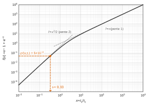
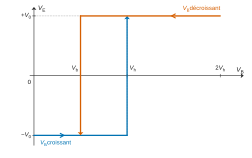
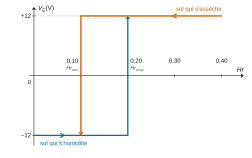
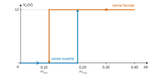
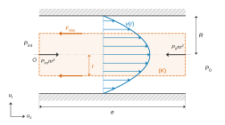
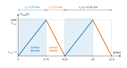

# Banque PT PT — Physique A 2026 · Corrigé brut

*Corrigé rédigé par IA, non officiel. Signalez toute erreur.*

Épreuve de 4 h, calculatrice interdite. Sujet : *Système automatique d'irrigation maraîchère*. Les applications numériques sont menées à la main, avec un ou deux chiffres significatifs. Les pressions sont lues comme des pressions absolues, avec $P_0=1{,}0$ bar.

## I. Arroser juste quand il faut

### 1. Connaître son sol par décantation fractionnée

**Système** : une particule sphérique de rayon $r$, de volume $\mathcal V=\frac43\pi r^3$ et de masse $m=\rho_0\mathcal V$. **Référentiel** : celui du bocal, lié au laboratoire et supposé galiléen. L'axe $(Oz)$ est vertical **descendant**.

### Question 1

- Poids, $\vec P=m\vec g$, dirigé vers le bas, donc selon $+\vec e_z$.
- Poussée d'Archimède : opposée au poids du fluide déplacé, de volume $\mathcal V$ car la particule est totalement immergée.
- Force de frottement fluide, donnée par l'énoncé, opposée à la vitesse.

$$\boxed{\begin{aligned}
\vec P&=\tfrac43\pi r^3\rho_0\,g\,\vec e_z\\
\vec\Pi&=-\tfrac43\pi r^3\rho_e\,g\,\vec e_z\\
\vec F&=-6\pi\eta r\,v_z\,\vec e_z
\end{aligned}}$$

### Question 2

On applique la deuxième loi de Newton au système {particule} dans le référentiel du bocal, galiléen, sous l'action des trois forces de la question 1. En projection sur $\vec e_z$ :

$$\tfrac43\pi r^3\rho_0\frac{\mathrm dv_z}{\mathrm dt}=\tfrac43\pi r^3(\rho_0-\rho_e)g-6\pi\eta r\,v_z$$

En divisant par la masse $\frac43\pi r^3\rho_0$ :

$$\boxed{\frac{\mathrm dv_z}{\mathrm dt}+\frac{9\eta}{2\rho_0r^2}\,v_z=\Big(1-\frac{\rho_e}{\rho_0}\Big)g}$$

La vitesse limite est la solution constante ($\mathrm dv_z/\mathrm dt=0$) :

$$\boxed{v_\ell=\frac{2r^2(\rho_0-\rho_e)\,g}{9\eta}}$$

Comme $\rho_0>\rho_e$, **$v_\ell>0$** : la vitesse limite est dirigée selon $+\vec e_z$, vers le fond du bocal ; les particules sédimentent.

### Question 3

L'équation s'écrit $\dfrac{\mathrm dv_z}{\mathrm dt}+\dfrac{v_z}{\tau_c}=\dfrac{v_\ell}{\tau_c}$ avec

$$\boxed{\tau_c=\frac{2\rho_0r^2}{9\eta}}$$

C'est bien un temps : $\mathrm{kg\cdot m^{-3}\cdot m^2/(Pa\cdot s)}=\mathrm s$. On vérifie aussi que $v_\ell=(1-\rho_e/\rho_0)\,g\,\tau_c$.

La solution générale est la somme de la solution de l'équation homogène et de la solution particulière constante :

$$v_z(t)=A\,e^{-t/\tau_c}+v_\ell$$

La condition initiale $v_z(0)=0$ s'écrit $A+v_\ell=0$, donc $A=-v_\ell$ :

$$\boxed{v_z(t)=v_\ell\big(1-e^{-t/\tau_c}\big)}$$

### Question 4

On intègre $\dot z=v_z$ avec la condition initiale $z(0)=0$ :

$$\begin{aligned}
z(t)&=\int_0^t v_\ell\big(1-e^{-u/\tau_c}\big)\,\mathrm du\\
&=\boxed{v_\ell\Big[t+\tau_c\big(e^{-t/\tau_c}-1\big)\Big]}
\end{aligned}$$

Pour $t\ll\tau_c$, $z\simeq v_\ell t^2/(2\tau_c)$ : mouvement uniformément accéléré. Pour $t\gg\tau_c$, $z\simeq v_\ell(t-\tau_c)$ : mouvement uniforme à la vitesse limite.

### Question 5

Par définition de $\tau_s$, $z(\tau_s)=p$, soit d'après la question 4 :

$$\boxed{v_\ell\Big[\tau_s+\tau_c\big\{\exp(-\tau_s/\tau_c)-1\big\}\Big]=p}$$

On pose $x=\tau_s/\tau_c$ et on divise par $v_\ell\tau_c$. L'équation devient $f(x)=\dfrac{p}{v_\ell\tau_c}$, avec $f(x)=x-1+e^{-x}$ : c'est la fonction de la figure 3.

### Question 6

Pour les sables, $\tau_c=0{,}9$ s et $p/(v_\ell\tau_c)=5\times10^{-2}$. On cherche $x$ tel que $f(x)=5\times10^{-2}$. Démarche sur l'annexe :

1. placer l'ordonnée $5\times10^{-2}$, entre les décades $10^{-2}$ et $10^{-1}$ (cinquième trait de la décade) ;
2. tracer l'horizontale correspondante jusqu'à la courbe ;
3. abaisser la verticale depuis ce point et lire l'abscisse : $x\approx0{,}33$ (entre le troisième et le quatrième trait de la décade $[10^{-1},1]$) ;
4. revenir à $\tau_s=x\,\tau_c$.

$$\begin{aligned}
\tau_s&=x\,\tau_c\approx0{,}33\times0{,}9\ \mathrm s\\
\tau_s^{\text{sables}}&\approx\boxed{0{,}3\ \mathrm s}
\end{aligned}$$

Contrôle : pour $x\ll1$, $f(x)\simeq x^2/2$ (pente 2 en log-log), d'où $x\simeq\sqrt{0{,}1}\approx0{,}32$, cohérent.

On note que $\tau_s<\tau_c$ : le grain de sable touche le fond avant d'avoir atteint sa vitesse limite. On ne peut donc pas écrire $\tau_s=p/v_\ell$.

### Question 7

Pour $x\gg1$, $e^{-x}\ll1$ et $1\ll x$, donc

$$\boxed{f(x)\simeq x}$$

En échelle log-log, cette approximation s'écrit $\log f\simeq\log x$ : une droite de **pente 1** passant par les points $(10^k,10^k)$.

Le seul fait de voir une droite ne suffit pas : une droite en log-log traduit n'importe quelle loi de puissance $f\simeq Kx^n$. Il faut vérifier les deux paramètres sur la figure 3.

- Pente : pour $x\gtrsim10$, la courbe monte d'une décade d'ordonnée par décade d'abscisse, donc $n=1$.
- Coefficient : la courbe passe par $(10^2,10^2)$, $(10^3,10^3)$ et $(10^4,10^4)$, donc $K=1$.

L'approximation $f(x)\simeq x$ est confirmée pour $x\gtrsim10^2$. L'écart relatif $1/x$ vaut 10 % en $x=10$ ($f(10)\approx9$), où elle est encore grossière.

### Question 8

Pour les limons et les argiles, $p/(v_\ell\tau_c)=5\times10^{6}$ et $8\times10^{11}$, très grands devant 1. La solution vérifie donc $x\gg1$, et la question 7 donne $x\simeq p/(v_\ell\tau_c)$, d'où

$$\tau_s=x\,\tau_c\simeq\frac{p}{v_\ell}$$

$$\begin{aligned}
\tau_s^{\text{limons}}&\simeq5\times10^{6}\times9\times10^{-5}\ \mathrm s\approx\boxed{4{,}5\times10^{2}\ \mathrm s\approx7{,}5\ \text{min}}\\
\tau_s^{\text{argiles}}&\simeq8\times10^{11}\times2\times10^{-7}\ \mathrm s\approx\boxed{1{,}6\times10^{5}\ \mathrm s\approx44\ \mathrm h}
\end{aligned}$$

### Question 9

Pendant la durée $\tau_s^{\text{s}}\approx0{,}3$ s du dépôt des sables, les argiles sont en régime de vitesse limite dès le début, car $\tau_c^{\text{a}}=2\times10^{-7}\ \mathrm s\ll\tau_s^{\text{s}}$. La question 4 donne alors

$$\begin{aligned}
\epsilon&=v_\ell^{\text{a}}\big[\tau_s^{\text{s}}+\tau_c^{\text{a}}\big(e^{-\tau_s^{\text{s}}/\tau_c^{\text{a}}}-1\big)\big]\\
&\simeq v_\ell^{\text{a}}\,\tau_s^{\text{s}}
\end{aligned}$$

On fait apparaître la donnée du tableau $p/(v_\ell^{\text a}\tau_c^{\text a})$, qui élimine $v_\ell^{\text a}$ :

$$\begin{aligned}
\frac{\epsilon}{p}&\simeq\frac{\tau_s^{\text{s}}}{\tau_c^{\text{a}}}\cdot\frac{v_\ell^{\text{a}}\tau_c^{\text{a}}}{p}\\
&=\boxed{\frac{\tau_s^{\text{s}}}{\tau_s^{\text{a}}}}\\
&\simeq\frac{0{,}3}{2\times10^{-7}\times8\times10^{11}}\\
&\approx\boxed{2\times10^{-6}}
\end{aligned}$$

Quand tous les sables sont déposés, les argiles n'ont parcouru qu'une fraction $2\times10^{-6}$ de la hauteur : elles sont encore en suspension dans toute la colonne. De même, les limons ont parcouru $\tau_s^{\text{s}}/\tau_s^{\text{l}}\approx0{,}3/450\approx7\times10^{-4}$ de la hauteur.

**Les dépôts sont successifs dans le temps et ne se mélangent pas : la sédimentation fractionnée sépare efficacement les trois familles de particules.**

### Question 10

Le dépôt le plus lent est celui des argiles : $\tau_s^{\text{argiles}}\approx1{,}6\times10^{5}$ s, soit environ 44 h. Or $72\ \mathrm h\approx2{,}6\times10^{5}\ \mathrm s>\tau_s^{\text{argiles}}$.

**Attendre 72 h garantit que toutes les particules minérales, argiles comprises, se sont déposées** : les épaisseurs des strates traduisent alors la composition du sol. La marge (facteur 1,6) couvre la dispersion des tailles : les argiles ont une taille inférieure à 2 µm, parfois inférieure au micromètre retenu, et $\tau_s\propto r^{-2}$.

### 2. Teneur en eau d'un sol

L'énoncé décrit un sol **conducteur** de conductivité $\gamma_{\text{sol}}$ : la sonde est étudiée comme une résistance traversée par un courant de conduction.

### Question 11

Le générateur idéal impose $V_d-V_g=U$ entre les armatures : la flèche $U$ et la charge $+Q$ désignent l'armature de droite comme borne positive. Avec $V_g=0$ :

$$\boxed{V_d=U}$$

### Question 12

**Condition.** Les effets de bord sont négligeables si les armatures peuvent être assimilées à des plans infinis, c'est-à-dire si l'écartement est petit devant leurs dimensions (condition homogène, entre longueurs) :

$$\boxed{c\ll a\quad\text{et}\quad c\ll b}$$

Ici $c/a\approx0{,}08$ et $c/b=0{,}1$ : l'approximation est acceptable.

**Invariances.** Dans ce modèle, la distribution de charges est invariante par toute translation selon $\vec u_y$ et selon $\vec u_z$ : $V$ et $\vec E$ ne dépendent que de $x$.

**Symétries.** Soit $M$ un point quelconque de l'espace inter-électrodes. Deux plans passant par $M$ sont des plans de symétrie de la distribution de charges :

- le plan passant par $M$ et parallèle à $(\vec u_x,\vec u_y)$ ;
- le plan passant par $M$ et parallèle à $(\vec u_x,\vec u_z)$.

Le champ électrique en $M$ appartient à tout plan de symétrie des charges passant par $M$. Il appartient donc à leur intersection, la droite passant par $M$ dirigée par $\vec u_x$.

$$\boxed{\begin{aligned}
\vec E&=E(x)\,\vec u_x\\
V(x,y,z)&=V(x)
\end{aligned}}$$

### Question 13

Équation de Poisson pour le potentiel, champ scalaire :

$$\Delta V+\frac{\rho_{\text{ch}}}{\varepsilon_0}=0$$

Le sol étant électriquement neutre, la densité volumique de charge est nulle, $\rho_{\text{ch}}=0$. Comme $V$ ne dépend que de $x$ :

$$\begin{aligned}
\frac{\mathrm d^2V}{\mathrm dx^2}&=0\\
V(x)&=Ax+B
\end{aligned}$$

Les conditions aux limites $V(0)=V_g=0$ et $V(c)=V_d=U$ donnent $B=0$ et $A=U/c$ :

$$\boxed{V(x)=\frac{U}{c}\,x}$$

### Question 14

Le champ dérive du potentiel de la question 13 :

$$\begin{aligned}
\vec E&=-\overrightarrow{\mathrm{grad}}\,V\\
&=-\frac{\mathrm dV}{\mathrm dx}\,\vec u_x\\
&=\boxed{-\frac{U}{c}\,\vec u_x}
\end{aligned}$$

Champ uniforme, dirigé de l'armature de droite (potentiel $U$) vers celle de gauche (potentiel nul).

### Question 15

Loi d'Ohm locale dans le sol : le vecteur densité de courant est uniforme,

$$\vec j=\gamma_{\text{sol}}\vec E=-\gamma_{\text{sol}}\frac Uc\,\vec u_x$$

**Orientation.** On oriente une section droite $\Sigma$ (aire $ab$) de l'espace inter-électrodes par la normale $\vec n=-\vec u_x$, c'est-à-dire **de l'armature de droite vers celle de gauche** à travers le sol. Dans le circuit extérieur, ce sens va du générateur vers l'armature de droite (convention générateur pour la source).

$$\begin{aligned}
I&=\iint_\Sigma\vec j\cdot\vec n\,\mathrm dS\\
&=\gamma_{\text{sol}}\frac Uc\,ab\\
&=\boxed{\frac{\gamma_{\text{sol}}\,ab\,U}{c}}\ (>0)
\end{aligned}$$

### Question 16

Le sol est un dipôle soumis à $U$ et traversé par $I$ en convention récepteur :

$$\begin{aligned}
R&=\frac UI\\
&=\boxed{\frac{c}{\gamma_{\text{sol}}\,ab}=\frac{\rho_{\text{sol}}\,c}{ab}}
\end{aligned}$$

### Question 17

D'après $\vec j=\gamma\vec E$, $[\gamma]=\dfrac{\mathrm{A\cdot m^{-2}}}{\mathrm{V\cdot m^{-1}}}=\mathrm{A\cdot V^{-1}\cdot m^{-1}}$ :

$$\boxed{\gamma_{\text{sol}}\ \text{s'exprime en}\ \mathrm{S\cdot m^{-1}}=\Omega^{-1}\cdot\mathrm m^{-1}}$$

La résistivité s'exprime donc en $\Omega\cdot\mathrm m$.

### Question 18

En prenant le logarithme, le modèle s'écrit

$$\ln(\rho_{\text{sol}}/\rho_0)=\alpha\cdot\frac1{Hr}+\beta$$

Il prédit une relation **affine** entre $\ln(\rho_{\text{sol}}/\rho_0)$ et $1/Hr$. Le graphe de droite de la figure 5 montre que les points, malgré leur dispersion, se répartissent autour d'une droite : le modèle est compatible avec les mesures. Le graphe de gauche montre une décroissance rapide puis un palier, compatible avec une exponentielle de $1/Hr$.

La droite tracée passe par $(2\,;\,0{,}25)$ et $(10\,;\,2{,}0)$ :

$$\begin{aligned}
\alpha&=\frac{2{,}0-0{,}25}{10-2}\approx0{,}22\\
\beta&=0{,}25-2\alpha\approx-0{,}2
\end{aligned}$$

$$\boxed{\alpha\approx0{,}22\quad\text{et}\quad\beta\approx-0{,}2}\ (\text{sans dimension})$$

Contrôle sur le graphe de gauche : le modèle donne $\rho/\rho_0=e^{2{,}2-0{,}2}\approx7{,}4$ à $Hr=0{,}1$ et $e^{1{,}1-0{,}2}\approx2{,}5$ à $Hr=0{,}2$, en accord avec les points.

### Question 19

D'après les questions 16 et 18,

$$R(Hr)=\frac{c\,\rho_0}{ab}\exp\Big(\frac{\alpha}{Hr}+\beta\Big)$$

Comme $\alpha>0$, $R$ est une fonction **décroissante** de $Hr$ : un sol plus humide conduit mieux. Le maximum sur $[Hr_{\min},Hr_{\max}]$ est donc atteint en $Hr_{\min}$ et le minimum en $Hr_{\max}$ :

$$\boxed{\begin{aligned}
R_{\min}&=\frac{c\,\rho_0}{ab}\exp\Big(\frac{\alpha}{Hr_{\max}}+\beta\Big)\\
R_{\max}&=\frac{c\,\rho_0}{ab}\exp\Big(\frac{\alpha}{Hr_{\min}}+\beta\Big)
\end{aligned}}$$

Remarque : $R_{\max}/R_{\min}=\exp[\alpha(10-5)]=e^{1{,}1}\approx3$, en accord avec les valeurs $5\ \Omega$ et $15\ \Omega$ de la sous-partie 3.

### Question 20

Le sol humide est un électrolyte : les porteurs de charge sont des ions. Sous tension **continue**, les ions migrent toujours dans le même sens et s'accumulent au voisinage des électrodes (polarisation, double couche). Le sol n'y est plus électriquement neutre : une charge volumique apparaît et écrante le champ.

L'hypothèse d'électroneutralité, sur laquelle reposent l'équation de Laplace, le champ uniforme et l'expression de $R$ (Q13 à Q16), tombe. La tension de polarisation fausse la mesure, qui dérive dans le temps. De plus, les réactions électrochimiques aux électrodes (électrolyse de l'eau, corrosion) altèrent les électrodes et le sol.

Sous tension **sinusoïdale** de valeur moyenne nulle, le sens de migration s'inverse à chaque demi-période. Le déplacement des ions pendant $1/(2f)=2{,}5$ ms est infime : il n'y a pas d'accumulation nette, le sol reste neutre en moyenne et les électrodes ne sont pas polarisées. Le modèle ohmique reste valable à chaque instant.

La fréquence de 200 Hz reste assez basse pour que l'approximation des régimes quasi stationnaires s'applique : la longueur d'onde, de l'ordre de $10^6$ m, est bien supérieure à la taille de la sonde. Le courant de déplacement reste négligeable devant le courant de conduction : le sol se comporte comme une résistance pure.

**La tension alternative évite la polarisation et l'électrolyse, qui détruiraient l'électroneutralité du sol et fausseraient la mesure de $R$.**

### 3. Signal de commande de l'électrovanne

Les ALI sont idéaux : courants d'entrée nuls, $-V_0\le s\le V_0$. L'entrée $+$ de l'ALI 3 est reliée à $D$, son entrée $-$ à $C$.

### Question 21

L'ALI 1 étant idéal, son courant d'entrée est nul, $i_+=0$ : la loi des nœuds en $A$ montre que $R$ et $R_3$ sont parcourues par le même courant, elles sont en série. Cette justification ne dépend pas du régime de l'ALI. Le pont diviseur alimenté par $V_0$ donne

$$\boxed{V_A=\frac{R_3}{R+R_3}\,V_0}$$

L'ALI 1 est bouclé sur son entrée inverseuse (rétroaction négative) : il fonctionne en régime linéaire, $V_+=V_-$, soit $V_B=V_A$ :

$$\boxed{V_B=\frac{R_3}{R+R_3}\,V_0}$$

### Question 22

L'ALI 1 est monté en **suiveur** ($V_B=V_A$, gain unité : il n'amplifie pas, la division de tension est faite par le pont $R$–$R_3$). Son intérêt est l'**adaptation d'impédance**. Son impédance d'entrée infinie ne prélève aucun courant au pont $R$–$R_3$, dont la tension n'est donc pas modifiée par le bloc 3. Son impédance de sortie nulle impose $V_B$ quel que soit le courant demandé par le bloc 3.

### Question 23

L'entrée $-$ de l'ALI 3 n'absorbe aucun courant : $R_4$ et $R_5$ sont en série et

$$\boxed{V_C=\frac{R_5}{R_4+R_5}\,V_0}$$

### Question 24

La sortie de l'ALI 3 est reliée par $R_2$ à son entrée **non inverseuse**, et son entrée inverseuse est fixée par le bloc 2 : la rétroaction est positive, **l'ALI 3 ne fonctionne pas en régime linéaire**. Il est saturé :

$$\begin{aligned}
V_E&=+V_0\ \text{si}\ \varepsilon=V_D-V_C>0\\
V_E&=-V_0\ \text{si}\ \varepsilon<0
\end{aligned}$$

Loi des nœuds en $D$, le courant d'entrée $i_+$ étant nul, avec $\alpha=R_1/R_2$ :

$$\begin{aligned}
\frac{V_B-V_D}{R_1}+\frac{V_E-V_D}{R_2}&=0\\
V_D&=\frac{R_2V_B+R_1V_E}{R_1+R_2}\\
&=\boxed{\frac{V_B+\alpha V_E}{1+\alpha}}
\end{aligned}$$

**Sortie à $+V_0$.** L'état se maintient tant que $V_D>V_C$, c'est-à-dire tant que

$$V_B>(1+\alpha)V_C-\alpha V_0$$

Quand $V_B$ décroît sous cette valeur, $\varepsilon$ devient négatif et $V_E$ bascule à $-V_0$.

**Sortie à $-V_0$.** L'état se maintient tant que $V_D<V_C$, c'est-à-dire tant que

$$V_B<(1+\alpha)V_C+\alpha V_0$$

Quand $V_B$ dépasse cette valeur, $V_E$ bascule à $+V_0$.

$$\boxed{\begin{aligned}
V_b&=(1+\alpha)V_C-\alpha V_0\\
V_h&=(1+\alpha)V_C+\alpha V_0
\end{aligned}}$$

### Question 25

Cycle d'hystérésis rectangulaire de comparateur non inverseur, en fonction de $V_B$ porté en abscisse (on suppose $0<V_b<V_h$, ce que confirmera la question 27) :

| Domaine de $V_B$ | $V_B$ croissant | $V_B$ décroissant |
|---|---|---|
| $0\le V_B<V_b$ | $-V_0$ | $-V_0$ (bascule de $+V_0$ à $-V_0$ en $V_B=V_b$) |
| $V_b<V_B<V_h$ | $-V_0$ | $+V_0$ |
| $V_h<V_B\le2V_h$ | $+V_0$ (bascule de $-V_0$ à $+V_0$ en $V_B=V_h$) | $+V_0$ |

Le cycle est parcouru dans le sens trigonométrique. Il est centré sur $V_B=(V_b+V_h)/2=(1+\alpha)V_C>0$, et non sur l'axe des ordonnées.

### Question 26

Par différence et par somme des expressions de la question 24 :

$$\begin{aligned}
V_h-V_b&=2\alpha V_0\\
\alpha&=\boxed{\frac{V_h-V_b}{2V_0}}
\end{aligned}$$

$$\begin{aligned}
V_h+V_b&=2(1+\alpha)V_C\\
V_C&=\boxed{\frac{V_h+V_b}{2(1+\alpha)}}
\end{aligned}$$

### Question 27

$V_B=\dfrac{R_3}{R+R_3}V_0$ est une fonction décroissante de $R$.

- Sol sec ($Hr<Hr_{\min}$) : $R>R_{\max}$, donc petites valeurs de $V_B$. L'ouverture doit se produire quand $V_B$ passe sous $V_b$, d'où $V_b=V_B(R_{\max})$.
- Sol humide ($Hr>Hr_{\max}$) : $R<R_{\min}$, donc grandes valeurs de $V_B$. La fermeture se produit quand $V_B$ dépasse $V_h$, d'où $V_h=V_B(R_{\min})$.

$$\boxed{\begin{aligned}
V_b&=\frac{R_3}{R_{\max}+R_3}\,V_0\\
V_h&=\frac{R_3}{R_{\min}+R_3}\,V_0
\end{aligned}}$$

Avec $R_3=5\ \Omega$, $R_{\max}=15\ \Omega$, $R_{\min}=5\ \Omega$ et $V_0=12$ V :

$$\begin{aligned}
V_b&=\frac{5}{20}\times12\ \mathrm V=\boxed{3{,}0\ \mathrm V}\\
V_h&=\frac{5}{10}\times12\ \mathrm V=\boxed{6{,}0\ \mathrm V}
\end{aligned}$$

### Question 28

D'après la question 26 :

$$\begin{aligned}
\alpha&=\frac{6{,}0-3{,}0}{2\times12}=\boxed{0{,}125}\\
V_C&=\frac{9{,}0}{2\times1{,}125}\ \mathrm V=\boxed{4{,}0\ \mathrm V}
\end{aligned}$$

L'énoncé fixe $R_1=R_5=1$ kΩ et demande « les valeurs à choisir pour $R_1$ et $R_4$ ». $R_1$ étant déjà fixé, c'est une erreur d'énoncé, que l'on signale : on détermine $R_2$ et $R_4$.

$$\begin{aligned}
R_2&=\frac{R_1}{\alpha}=8\,R_1\\
\frac{R_5}{R_4+R_5}&=\frac{V_C}{V_0}=\frac13\\
R_4&=2\,R_5
\end{aligned}$$

$$\boxed{\begin{aligned}
R_2&=8{,}0\ \mathrm{k\Omega}\\
R_4&=2{,}0\ \mathrm{k\Omega}
\end{aligned}}$$

Si l'on lit au contraire $R_2=1$ kΩ fixé, alors $R_1=\alpha R_2=125\ \Omega$ ; $R_4=2$ kΩ est inchangé.

### Question 29

$R$ est décroissante en $Hr$ (Q19) et $V_B$ décroissante en $R$ (Q21).

Donc $V_B$ est une fonction **croissante** de $Hr$, qui tend vers 0 quand le sol s'assèche complètement (alors $R\to\infty$).

Par construction des seuils (Q27) :

- $V_B=V_b$ équivaut à $R=R_{\max}$, donc à $Hr=Hr_{\min}=0{,}10$ ;
- $V_B=V_h$ équivaut à $R=R_{\min}$, donc à $Hr=Hr_{\max}=0{,}20$.

Le cycle garde donc la même orientation que celui de la question 25 :

| Domaine de $Hr$ | $Hr$ croissant (sol qui s'humidifie) | $Hr$ décroissant (sol qui s'assèche) |
|---|---|---|
| $0<Hr<0{,}10$ | $-12$ V | $-12$ V (bascule à $-12$ V en $Hr=0{,}10$) |
| $0{,}10<Hr<0{,}20$ | $-12$ V | $+12$ V |
| $0{,}20<Hr\le0{,}40$ | $+12$ V (bascule à $+12$ V en $Hr=0{,}20$) | $+12$ V |

**Basculements en $Hr=0{,}20$ (vers $+12$ V) et $Hr=0{,}10$ (vers $-12$ V).**

### Question 30

La diode idéale (figure 7) a deux états :

- passante : $U_D=0$ et $I\ge0$ ;
- bloquée : $I=0$ et $U_D\le0$.

Ici $U_D=V_E-V_F$, et $I$ est compté de $E$ vers $F$.

$R_C$ relie $F$ à la masse, donc $I=V_F/R_C$.

**Cas $V_E=+V_0$.** Si la diode était bloquée, on aurait $I=0$, donc $V_F=0$ et $U_D=V_0>0$ : impossible. Elle est passante : $V_F=V_E=V_0$ et $I=V_0/R_C>0$, cohérent.

**Cas $V_E=-V_0$.** Si la diode était passante, on aurait $V_F=-V_0$ et $I=-V_0/R_C<0$ : impossible. Elle est bloquée : $I=0$, $V_F=0$ et $U_D=-V_0<0$, cohérent.

$$\boxed{\begin{aligned}
V_E=+12\ \mathrm V&\Rightarrow V_F=+12\ \mathrm V\\
V_E=-12\ \mathrm V&\Rightarrow V_F=0
\end{aligned}}$$

### Question 31

En composant les questions 29 et 30, on obtient le même cycle qu'à la question 29, avec les niveaux $0$ (au lieu de $-12$ V) et $+12$ V.

| Domaine de $Hr$ | $Hr$ croissant | $Hr$ décroissant |
|---|---|---|
| $0<Hr<0{,}10$ | $0$ | $0$ |
| $0{,}10<Hr<0{,}20$ | $0$ | $12$ V |
| $0{,}20<Hr\le0{,}40$ | $12$ V | $12$ V |

Vérification sur un cycle complet :

- partant d'un sol humide, $V_F=12$ V : la vanne est fermée ;
- le sol s'assèche, $V_F$ reste à 12 V jusqu'à $Hr=0{,}10$, où il passe à 0 : la vanne s'ouvre, l'arrosage se déclenche quand $Hr$ passe sous $Hr_{\min}$ ;
- le sol s'humidifie, $V_F$ reste nul jusqu'à $Hr=0{,}20$, où il passe à 12 V : la vanne se ferme, l'arrosage s'interrompt quand $Hr$ dépasse $Hr_{\max}$.

**L'électrovanne est correctement commandée et $Hr$ est maintenue entre 0,10 et 0,20.**

## II. Arroser juste où il faut

Pore : cylindre de rayon $R=d/2=10\ \mu$m et de longueur $e=1$ mm. Différence de pression :

$$\begin{aligned}
\Delta P&=P_{\text{int}}-P_0\\
&=0{,}5\ \text{bar}=5\times10^{4}\ \mathrm{Pa}
\end{aligned}$$

### Question 32

Le nombre de Reynolds compare les effets inertiels (transport de quantité de mouvement par l'écoulement) aux effets visqueux :

$$Re=\frac{\rho VL}{\eta}$$

avec $\rho=1{,}0\ \mathrm{kg\cdot L^{-1}}=1{,}0\times10^{3}\ \mathrm{kg\cdot m^{-3}}$, $V$ une vitesse caractéristique et $L$ la dimension transverse de l'écoulement, ici $L=d$.

Pour une sortie au goutte à goutte, on choisit une vitesse de l'ordre de $V\approx1\ \mathrm{mm\cdot s^{-1}}$ :

$$\begin{aligned}
Re&=\frac{10^{3}\times10^{-3}\times2\times10^{-5}}{10^{-3}}\\
&\approx\boxed{2\times10^{-2}}\ (\text{sans dimension})
\end{aligned}$$

Même avec $V=1\ \mathrm{m\cdot s^{-1}}$, ordre de grandeur de la vitesse moyenne calculée a posteriori à la question 39, $Re\approx20$.

### Question 33

D'après le calcul de la question 32, $Re$ est très inférieur à la valeur critique d'environ $2\times10^3$ : **l'écoulement est laminaire**, dominé par la viscosité. Avec l'estimation « goutte à goutte » ($Re\ll1$), il est même rampant ; avec la vitesse moyenne de la question 39 ($Re\approx12$), il reste laminaire.

### Question 34

Le champ eulérien $\vec v(M,t)$ donne la vitesse du fluide en chaque point fixe $M$. La vitesse d'une particule de fluide est la valeur de ce champ au point qu'elle occupe à l'instant considéré. La stationnarité du champ ne suffit donc pas : si la particule se déplaçait vers des points où le champ est différent, sa vitesse changerait. Il faut suivre la particule.

- **Trajectoire.** Le champ $\vec v=v(r)\,\vec u_z$ n'a ni composante radiale ni composante orthoradiale : $r$ et $\theta$ de la particule restent constants. Elle se déplace sur une droite parallèle à l'axe : le mouvement est **rectiligne**.
- **Vitesse.** Le long de cette droite, $r$ est fixé, et le champ ne dépend ni de $z$ ni du temps (écoulement stationnaire). La particule garde la vitesse $v(r)\,\vec u_z$ : le mouvement est **uniforme**.

**Chaque particule de fluide a un mouvement rectiligne uniforme** : son vecteur vitesse $v(r)\,\vec u_z$ est constant au cours de son déplacement, donc son accélération est nulle.

### Question 35

$(\mathcal K)$ est fermé : il est formé des mêmes particules de fluide, qui ont toutes une vitesse constante d'après la question 34. Sa quantité de mouvement $\vec p_{\mathcal K}=\sum m_i\vec v_i$ est donc constante :

$$\boxed{\frac{\mathrm d\vec p_{\mathcal K}}{\mathrm dt}=\vec0}$$

### Question 36

Théorème de la résultante cinétique appliqué au système fermé $(\mathcal K)$ dans le référentiel du tuyau, supposé galiléen :

$$\boxed{\frac{\mathrm d\vec p_{\mathcal K}}{\mathrm dt}=\vec F_{p,\text{entrée}}+\vec F_{p,\text{sortie}}+\vec F_{p,\text{lat}}+\vec F_{\text{visc}}+m_{\mathcal K}\vec g}$$

Le premier membre est nul d'après la question 35. Les forces sont :

- les forces de pression sur les sections d'entrée et de sortie (disques de rayon $r$) ;
- les forces de pression sur la surface latérale (radiales, de résultante nulle) ;
- la force de viscosité exercée sur la surface latérale par le fluide situé en $r'>r$ ;
- le poids.

### Question 37

- $\eta$ est la viscosité dynamique du fluide (Pa·s).
- $\dfrac{\mathrm dv}{\mathrm dr}$ est le taux de cisaillement (en $\mathrm s^{-1}$) : une dérivée **spatiale** de la vitesse, qui mesure le glissement des couches de fluide les unes sur les autres, et non une accélération.
- $\eta\dfrac{\mathrm dv}{\mathrm dr}$ est la contrainte tangentielle (force par unité de surface, en Pa) exercée à travers la surface latérale.
- $S=2\pi re$ est l'aire de la surface latérale de $(\mathcal K)$, par laquelle s'exerce cette force.

**Signe.** La force est exercée sur $(\mathcal K)$ par le fluide extérieur ($r'>r$), à travers la surface latérale de normale sortante $\vec u_r$. Elle s'oppose au cisaillement local entre les deux couches, c'est-à-dire qu'elle tend à égaliser leurs vitesses :

- si le fluide extérieur va plus vite ($\mathrm dv/\mathrm dr>0$), il entraîne $(\mathcal K)$ : force selon $+\vec u_z$, motrice ;
- s'il va moins vite ($\mathrm dv/\mathrm dr<0$), il le retient : force selon $-\vec u_z$.

Dans les deux cas, la composante de la force sur $\vec u_z$ a le signe de $\mathrm dv/\mathrm dr$. Il faut donc prendre le signe $+$, quel que soit le sens du mouvement de $(\mathcal K)$ :

$$\boxed{\vec F_{\text{visc}}=+\eta\,\frac{\mathrm dv}{\mathrm dr}\,2\pi re\,\vec u_z}$$

Ici, la vitesse décroît de l'axe vers la paroi immobile : $\mathrm dv/\mathrm dr<0$ et la force freine $(\mathcal K)$.

Contrôle : la projection du bilan sur $\vec u_z$ redonne l'équation de l'énoncé.

$$0=(P_{\text{int}}-P_0)\pi r^2+\eta\frac{\mathrm dv}{\mathrm dr}2\pi re$$

### Question 38

Le fluide visqueux adhère à la paroi immobile du pore : la condition aux limites est prise **à la paroi**, en $r=R$ (condition d'adhérence, ou de non-glissement), et non sur l'axe.

$$\boxed{v(R)=0}$$

On intègre $\dfrac{\mathrm dv}{\mathrm dr}=-\dfrac{r}{2\eta}\dfrac{P_{\text{int}}-P_0}{e}$, avec une constante d'intégration $K$ :

$$v(r)=-\frac{P_{\text{int}}-P_0}{4\eta e}\,r^2+K$$

La condition $v(R)=0$ donne $K=\dfrac{P_{\text{int}}-P_0}{4\eta e}R^2$, d'où

$$\boxed{v(r)=\frac{P_{\text{int}}-P_0}{4\eta e}\big(R^2-r^2\big)}$$

Profil parabolique (Poiseuille), maximal sur l'axe :

$$v(0)=\frac{5\times10^{4}\times10^{-10}}{4\times10^{-6}}\ \mathrm{m\cdot s^{-1}}=1{,}25\ \mathrm{m\cdot s^{-1}}$$

### Question 39

Le débit est le flux de $\vec v$ à travers la section droite du pore, un disque de rayon $R$. En coordonnées polaires, l'élément de surface est $\mathrm dS=r\,\mathrm dr\,\mathrm d\theta$ :

$$\begin{aligned}
D_1&=\int_0^{2\pi}\!\!\int_0^R v(r)\,r\,\mathrm dr\,\mathrm d\theta\\
&=2\pi\,\frac{P_{\text{int}}-P_0}{4\eta e}\int_0^R\big(R^2r-r^3\big)\,\mathrm dr\\
&=2\pi\,\frac{P_{\text{int}}-P_0}{4\eta e}\cdot\frac{R^4}{4}
\end{aligned}$$

$$\boxed{D_1=\frac{\pi(P_{\text{int}}-P_0)R^4}{8\eta e}}$$

Application numérique ($R=10^{-5}$ m, $\Delta P=5\times10^4$ Pa, $\eta=10^{-3}$ Pa·s, $e=10^{-3}$ m) :

$$\begin{aligned}
D_1&=\frac{\pi\times5\times10^{4}\times10^{-20}}{8\times10^{-6}}\ \mathrm{m^3\cdot s^{-1}}\\
&=\frac{5\pi}{8}\times10^{-10}\ \mathrm{m^3\cdot s^{-1}}\\
&\approx\boxed{2{,}0\times10^{-10}\ \mathrm{m^3\cdot s^{-1}}}
\end{aligned}$$

Soit $0{,}2\ \mu$L par seconde, et une vitesse moyenne $D_1/(\pi R^2)\approx0{,}6\ \mathrm{m\cdot s^{-1}}$.

### Question 40

Avec $n_t$ pores identiques par mètre de tuyau, $D_{\text{lin}}=n_tD_1$ :

$$\boxed{n_t=\frac{D_{\text{lin}}}{D_1}=\frac{8\eta e\,D_{\text{lin}}}{\pi(P_{\text{int}}-P_0)R^4}}$$

Conversion du débit linéique :

$$\begin{aligned}
D_{\text{lin}}&=6{,}0\ \mathrm{L\cdot min^{-1}\cdot m^{-1}}\\
&=\frac{6{,}0\times10^{-3}}{60}\ \mathrm{m^3\cdot s^{-1}\cdot m^{-1}}\\
&=1{,}0\times10^{-4}\ \mathrm{m^3\cdot s^{-1}\cdot m^{-1}}
\end{aligned}$$

$$\begin{aligned}
n_t&=\frac{1{,}0\times10^{-4}}{2{,}0\times10^{-10}}\ \mathrm{m^{-1}}\\
&\approx\boxed{5\times10^{5}\ \mathrm{m^{-1}}}
\end{aligned}$$

## III. Dimensionnement du système de pompage

### 1. Choix de la pompe

Données : $D_p=1000\ \mathrm{L\cdot min^{-1}}=\dfrac{1}{60}\ \mathrm{m^3\cdot s^{-1}}\approx1{,}7\times10^{-2}\ \mathrm{m^3\cdot s^{-1}}$ ; on prend $g\approx9{,}8\ \mathrm{m\cdot s^{-2}}$ et $\rho=1{,}0\times10^3\ \mathrm{kg\cdot m^{-3}}$. Référentiel terrestre supposé galiléen ; écoulement stationnaire, incompressible et homogène (énoncé).

### Question 41

La vitesse débitante $U$ à travers une section $\Sigma$ est la vitesse uniforme qui donnerait le même débit volumique : $D_p=\iint_\Sigma\vec v\cdot\mathrm d\vec S=U\Sigma$. C'est la moyenne de la vitesse normale sur la section. Avec $\Sigma=\pi\delta^2/4$ :

$$\boxed{U_B=\frac{4D_p}{\pi\delta^2}}$$

$$\begin{aligned}
U_B&=\frac{4\times1{,}7\times10^{-2}}{\pi\times10^{-2}}\ \mathrm{m\cdot s^{-1}}\\
&\approx\boxed{2{,}1\ \mathrm{m\cdot s^{-1}}}
\end{aligned}$$

### Question 42

Dans le **montage B**, la pompe est au niveau du sol et doit aspirer l'eau.

On applique la relation de Bernoulli entre deux points :

- la surface libre $A_0$ : pression $P_0$, vitesse négligeable (Q43), cote $-h$ ;
- l'entrée $B$ de la pompe : cote $0$, vitesse $U_B$.

Conditions d'application : écoulement parfait, stationnaire, incompressible et homogène, dans le référentiel terrestre galiléen, le long d'une ligne de courant allant de $A_0$ à $B$, sans machine entre ces deux points.

$$P_B=P_0-\rho gh-\frac12\rho U_B^2$$

Les pertes de charge, négligées ici, ne feraient qu'abaisser encore $P_B$. D'où une majoration indépendante de la pompe :

$$\begin{aligned}
P_B&\le P_0-\rho gh\\
&=1{,}0\times10^{5}-2{,}45\times10^{5}\ \mathrm{Pa}\\
&\approx-1{,}5\times10^{5}\ \mathrm{Pa}
\end{aligned}$$

Une pression absolue négative est absurde. En réalité, l'eau se vaporiserait (cavitation) dès que la pression atteindrait la pression de vapeur saturante, de quelques kPa, et la colonne d'eau se romprait. La hauteur d'aspiration est limitée à $P_0/(\rho g)\approx10$ m $<h=25$ m, quelle que soit la puissance de la pompe.

**Le montage B ne peut pas fonctionner.** Dans le montage A, la pompe immergée est sous la surface libre : la pression à son entrée dépasse $P_0$, et la pompe refoule l'eau vers le haut. **Seul le montage A convient.**

Le scientifique italien est **Torricelli** (1643) : son expérience du tube de mercure explique la limite d'aspiration par la pression atmosphérique.

### Question 43

En régime stationnaire, la conservation du débit sur la section du puits donne

$$v_{A_0}=\frac{D_p}{S}=\frac{1{,}7\times10^{-2}}{1}\ \mathrm{m\cdot s^{-1}}\approx1{,}7\times10^{-2}\ \mathrm{m\cdot s^{-1}}$$

**La vitesse en $A_0$ est négligeable** (environ 130 fois plus petite qu'en conduite). Entre $A_0$ et $D$ (au niveau du sol, vitesse $U_B$ dans la conduite), on compare numériquement les variations massiques :

$$\begin{aligned}
\Delta e_c&\simeq\frac{U_B^2}{2}\approx2{,}2\ \mathrm{J\cdot kg^{-1}}\\
\Delta e_p&=gh\approx2{,}45\times10^{2}\ \mathrm{J\cdot kg^{-1}}\\
\frac{\Delta e_c}{\Delta e_p}&\approx10^{-2}\ll1
\end{aligned}$$

**La variation d'énergie cinétique est négligeable devant la variation d'énergie potentielle.**

### Question 44

On applique la relation de Bernoulli généralisée (bilan d'énergie mécanique avec une machine) entre $A_0$ et $D$. Hypothèses : écoulement stationnaire, incompressible et homogène, pertes de charge négligées, variation d'énergie cinétique négligée (Q43). La puissance reçue par le fluide de la pompe vaut

$$\mathcal P=D_p\big[(P_D-P_{A_0})+\rho g(z_D-z_{A_0})\big]$$

Avec $P_D=P_{\max}$, $P_{A_0}=P_0$ et $z_D-z_{A_0}=h$ :

$$\boxed{\mathcal P=D_p\big[(P_{\max}-P_0)+\rho gh\big]}$$

Numériquement, $P_{\max}-P_0=5{,}0\times10^{5}$ Pa et $\rho gh=2{,}45\times10^{5}$ Pa, d'où

$$\begin{aligned}
\mathcal P&=\frac{7{,}45\times10^{5}}{60}\ \mathrm W\\
&\approx\boxed{1{,}2\times10^{4}\ \mathrm W}
\end{aligned}$$

### Question 45

$$\begin{aligned}
Re&=\frac{\rho U_B\delta}{\eta}\\
&=\frac{10^{3}\times2{,}1\times0{,}1}{10^{-3}}\\
&\approx\boxed{2\times10^{5}}
\end{aligned}$$

$Re\gg2\times10^{3}$ : **l'écoulement dans la conduite est turbulent.** Le modèle de la partie II (profil de Poiseuille, débit proportionnel à $\Delta P$) suppose un écoulement laminaire : **il ne peut pas être utilisé** pour calculer les pertes de charge dans la conduite.

### Question 46

Les conversions sont en série, donc $\mathcal P=\eta_{\text{méca}}\,\eta_{\text{élec}}\,\mathcal P_{\text{élec}}$ :

$$\boxed{\mathcal P_{\text{élec}}=\frac{\mathcal P}{\eta_{\text{élec}}\,\eta_{\text{méca}}}}$$

$$\begin{aligned}
\mathcal P_{\text{élec}}&=\frac{1{,}24\times10^{4}}{0{,}49}\ \mathrm W\\
&\approx\boxed{2{,}5\times10^{4}\ \mathrm W}
\end{aligned}$$

### 2. Vase d'expansion

### Question 47

Les évolutions étant lentes, le gaz passe par une suite d'états d'équilibre interne : l'évolution est **quasi statique** et l'équation d'état s'applique à chaque instant.

La cuve métallique est en contact thermique avec l'atmosphère, à température constante $T_0$. Les évolutions étant lentes devant le temps des échanges thermiques à travers la paroi, la température du gaz reste égale à $T_0$ **à chaque instant** : l'évolution est **quasi isotherme** à $T_0$. C'est plus qu'une évolution monotherme, qui imposerait seulement un échange avec un unique thermostat, sans fixer la température du gaz en cours d'évolution.

Conséquence, pour le gaz parfait (loi de Boyle-Mariotte) :

$$PV_{\text{gaz}}=nRT_0=\text{cte}$$

### Question 48

La cuve est indéformable et le piston sépare le gaz de l'eau : $V_{\text{gaz}}=V_{\text{tot}}-V_{\text{eau}}$.

- À $P_{\min}$, le volume d'eau est minimal : $V_{\text{eau}}=V_{\min}$, $V_{\text{gaz}}=V_{\text{tot}}-V_{\min}$.
- À $P_{\max}$, le volume d'eau est maximal : $V_{\text{eau}}=V_{\max}$, $V_{\text{gaz}}=V_{\text{tot}}-V_{\max}$.

L'évolution étant isotherme :

$$\begin{aligned}
P_{\min}(V_{\text{tot}}-V_{\min})&=P_{\max}(V_{\text{tot}}-V_{\max})\\
V_{\text{tot}}-V_{\max}&=\alpha(V_{\text{tot}}-V_{\min})
\end{aligned}$$

$$\boxed{\Delta V=(1-\alpha)(V_{\text{tot}}-V_{\min})}$$

avec $\Delta V=V_{\max}-V_{\min}$ et $\alpha=P_{\min}/P_{\max}$.

### Question 49

$\Delta V$ est une fonction décroissante de $V_{\min}\ge0$ : il est maximal pour $V_{\min}=0$. Le gaz occupe alors tout le volume $V_{\text{tot}}$ à la pression $P_{\min}$ et à la température $T_0$ :

$$\boxed{n_{\text{gaz}}=\frac{P_{\min}V_{\text{tot}}}{RT_0}}$$

$$\begin{aligned}
n_{\text{gaz}}&=\frac{1{,}5\times10^{5}\times2{,}0}{8\times293}\ \mathrm{mol}\\
&=\frac{3{,}0\times10^{5}}{2{,}34\times10^{3}}\ \mathrm{mol}\\
&\approx\boxed{1{,}3\times10^{2}\ \mathrm{mol}}
\end{aligned}$$

Dans ces conditions, $\alpha=1{,}5/6=0{,}25$ et $\Delta V=(1-\alpha)V_{\text{tot}}=1{,}5\times10^{3}$ L.

### Question 50

L'arrosage est continu, au débit $D_{\text{arr}}=LD_{\text{lin}}=100\times6=600\ \mathrm{L\cdot min^{-1}}$. Le volume d'eau du vase varie de $\Delta V=1500$ L à chaque phase.

**Pompe allumée.** Le vase se remplit au débit net $D_p-D_{\text{arr}}=400\ \mathrm{L\cdot min^{-1}}$ :

$$\begin{aligned}
\tau_1&=\frac{\Delta V}{D_p-D_{\text{arr}}}=\frac{1500}{400}\ \text{min}\\
&=\boxed{3{,}75\ \text{min}}
\end{aligned}$$

**Pompe éteinte.** Le vase se vide au débit $D_{\text{arr}}$ :

$$\begin{aligned}
\tau_2&=\frac{\Delta V}{D_{\text{arr}}}=\frac{1500}{600}\ \text{min}\\
&=\boxed{2{,}5\ \text{min}}
\end{aligned}$$

Confrontation chiffrée aux préconisations :

- phase « pompe allumée » : $\tau_1=3{,}75$ min $<4$ min, **respecté** ;
- durée entre deux allumages successifs : la période du cycle vaut $\tau_1+\tau_2=6{,}25$ min $>6$ min, **respecté**.

**Les préconisations sont respectées, mais de justesse.** Si l'on interprétait la seconde préconisation comme portant sur la seule durée d'arrêt $\tau_2=2{,}5$ min, elle ne serait pas respectée.
