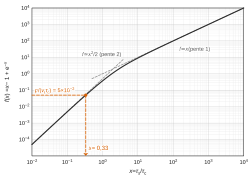
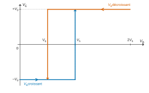
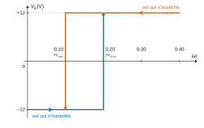
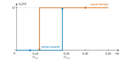
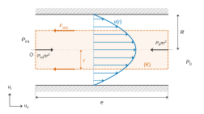
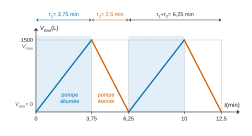

# Banque PT PT — Physique A 2026 · Corrigé guidé

*Corrigé rédigé par IA, non officiel. Signalez toute erreur.*

## Présentation du sujet

**Format.** Épreuve de 4 heures, **calculatrice interdite**, 12 pages d'énoncé et **50 questions**, plus une annexe à rendre obligatoirement (la reproduction de la figure 3, à compléter à la question 6). Les résultats numériques sans unité ou avec une unité fausse ne sont pas comptés, et les résultats non justifiés non plus.

**Thème.** Un *système automatique d'irrigation maraîchère*, suivi de bout en bout : connaître le sol, mesurer son humidité, commander une électrovanne, distribuer l'eau par un tuyau microporeux, la pomper et la stocker dans un vase d'expansion.

**Découpage.** Trois parties annoncées comme totalement indépendantes.

- *Partie I — Arroser juste quand il faut (Q1 à Q31).*
  - Sous-partie 1 (Q1 à Q10) : chute d'une particule dans l'eau avec frottement de Stokes, vitesse limite, temps de sédimentation, lecture d'une courbe en échelle log-log, conclusion sur le « test du bocal ».
  - Sous-partie 2 (Q11 à Q20) : sonde conductimétrique à électrodes planes. Invariances et symétries, équation de Poisson, loi d'Ohm locale, résistance, linéarisation d'un modèle empirique, intérêt d'une excitation alternative.
  - Sous-partie 3 (Q21 à Q31) : électronique de conditionnement. Pont diviseur, suiveur, comparateur à hystérésis, dimensionnement des résistances, diode idéale, vérification du fonctionnement.
- *Partie II — Arroser juste où il faut (Q32 à Q40).* Nombre de Reynolds, écoulement de Poiseuille établi par un bilan de quantité de mouvement sur un système fermé, débit d'un pore, densité de pores.
- *Partie III — Dimensionnement du système de pompage (Q41 à Q50).* Vitesse débitante, limite d'aspiration d'une pompe, puissance par un bilan énergétique, nombre de Reynolds en conduite, rendements ; puis le vase d'expansion : gaz parfait en évolution isotherme, volume stockable, durée des cycles de pompage.

**Notions du programme mobilisées.** Deuxième loi de Newton, équation différentielle linéaire du premier ordre ; lecture de graphes log-log ; invariances et symétries, équation de Poisson, potentiel et champ, loi d'Ohm locale, résistance d'un conducteur ; ALI idéal en régime linéaire et en saturation, diviseur de tension, loi des nœuds en termes de potentiels, diode idéale ; nombre de Reynolds, viscosité, description eulérienne, écoulement de Poiseuille, débit volumique ; relation de Bernoulli et bilan d'énergie avec une machine ; modèle du gaz parfait, évolutions quasi statiques et isothermes.

**Ce que dit le rapport 2026.** Le jury juge que le sujet « a permis un classement satisfaisant des candidats », mais il insiste sur « un manque récurrent d'honnêteté scientifique : de nombreux théorèmes sont invoqués sans que leurs hypothèses d'application soient précisées, et trop de résultats sont affirmés sans la moindre justification ». Il rappelle que « L'application d'un théorème ou d'une relation suppose impérativement de définir préalablement le système étudié, le référentiel et les hypothèses validant la formule employée. » Il ajoute : « Le jury rappelle qu'une réponse non justifiée, ou un résultat numérique sans unité, ne peut être récompensé. » Il vise aussi l'homogénéité des expressions et les ordres de grandeur, en particulier « la valeur de la masse volumique de l'eau, qui vaut 1 000 kg·m⁻³ en unités SI ». Enfin, « Les résultats et les valeurs numériques encadrés ou soulignés restent appréciés des correcteurs. »

**Bilan du jury par sous-partie.** I.1 « plutôt bien traitée » ; I.2 « plus difficile » ; I.3 « plutôt bien réussie » ; partie II « diversement traitée » ; III.1 « globalement mal traitée » ; III.2 « peu abordée, peut-être parce que située en fin d'épreuve ».

**Questions discriminantes.** D'après le rapport 2026, la question 9 « était la plus discriminante ». Il signale aussi comme mal réussies : les questions 6 et 7 (échelle logarithmique), 12 (condition sur les effets de bord), 14 (théorème de Gauss utilisé à la place du gradient), 25 (tracé du cycle), 32 (Reynolds), 34 (« très mal traitée »), 37 (signe de la force de viscosité), 42 et 43 (Bernoulli, comparaison numérique) et 47 (isotherme et monotherme).

**Difficulté et gestion du temps.** Le sujet est long mais très guidé. Les questions sûres à ne pas laisser passer : Q1 à Q5, Q8, Q11, Q13, Q14, Q16, Q17, Q21 à Q23, Q26, Q27, Q30, Q38, Q39, Q41, Q44, Q46, Q48, Q49. Comme les parties sont indépendantes, on peut commencer par la partie III, courte et calculatoire, que beaucoup de candidats n'ont pas atteinte. Partage possible : 1 h 45 pour la partie I, 50 min pour la partie II, 1 h pour la partie III, et 25 min de relecture.

**Deux points de l'énoncé à connaître.** À la question 28, « en déduire les valeurs à choisir pour $R_1$ et $R_4$ » contient une erreur d'énoncé, reconnue par le jury ($R_1$ est déjà fixé) : il faut la signaler et poursuivre avec $R_2$ et $R_4$. Dans tout le sujet, les pressions sont à lire comme absolues ($P_0=1$ bar).

## Partie I — Arroser juste quand il faut

### 1. Connaître son sol par décantation fractionnée

On modélise la chute d'une particule sphérique dans l'eau. Toute la sous-partie repose sur une seule équation différentielle du premier ordre et sur le fait que la vitesse limite varie comme $r^2$, ce qui trie les particules par taille.

### Question 1

> [!INDICATION]
> Trois forces : une à distance, deux exercées par le fluide. Écrivez-les en vecteurs, en tenant compte du sens de $\vec e_z$.

> [!INDICATION]
> Le volume de fluide déplacé est celui de la particule entière, puisqu'elle est totalement immergée.

#### Solution

L'axe $(Oz)$ est descendant. Pour une particule de volume $\mathcal V=\frac43\pi r^3$, les trois forces sont le poids, la poussée d'Archimède et la force de frottement fluide :

$$\boxed{\begin{aligned}
\vec P&=\tfrac43\pi r^3\rho_0\,g\,\vec e_z\\
\vec\Pi&=-\tfrac43\pi r^3\rho_e\,g\,\vec e_z\\
\vec F&=-6\pi\eta r\,v_z\,\vec e_z
\end{aligned}}$$

> [!PIEGE]
> Avec un axe descendant, le poids est selon $+\vec e_z$. Une erreur de signe ici rend la vitesse limite négative et se propage jusqu'à la question 9.

> [!JURY]
> Rapport 2026 : « Le bilan des forces (questions 1-2) est en général correctement mené, même si le poids n'est pas toujours nommé avec rigueur (on lit parfois « pesanteur » ou « gravité ») ». On écrit donc « poids ».

### Question 2

> [!INDICATION]
> Commencez par nommer le système et le référentiel. Puis deuxième loi de Newton projetée sur $\vec e_z$, et division par la masse pour obtenir une forme canonique.

> [!INDICATION]
> La vitesse limite est la solution constante de l'équation. Son signe se discute à partir de l'hypothèse faite sur les masses volumiques.

#### Solution

**Système** : la particule. **Référentiel** : celui du bocal, supposé galiléen. La deuxième loi de Newton, projetée sur $\vec e_z$, donne

$$\tfrac43\pi r^3\rho_0\frac{\mathrm dv_z}{\mathrm dt}=\tfrac43\pi r^3(\rho_0-\rho_e)g-6\pi\eta r\,v_z$$

soit, en divisant par la masse,

$$\boxed{\frac{\mathrm dv_z}{\mathrm dt}+\frac{9\eta}{2\rho_0r^2}\,v_z=\Big(1-\frac{\rho_e}{\rho_0}\Big)g}$$

En régime permanent, $\mathrm dv_z/\mathrm dt=0$ :

$$\boxed{v_\ell=\frac{2r^2(\rho_0-\rho_e)\,g}{9\eta}}$$

Comme $\rho_0>\rho_e$, $v_\ell>0$ : la vitesse limite est dirigée vers le fond du bocal.

> [!METHODE]
> Pour un premier ordre $\dot v+v/\tau=\text{cte}$, la limite s'obtient sans résoudre, en annulant la dérivée. On lit ensuite directement $\tau$ comme l'inverse du coefficient de $v$.

> [!JURY]
> Rapport 2026 : le jury « déplore cependant un nombre important de copies dans lesquelles le principe fondamental de la dynamique est appliqué sans que le système ni le référentiel aient été explicitement définis : ces préalables sont indispensables ».

### Question 3

> [!INDICATION]
> Mettez l'équation sous la forme $\dot v_z+v_z/\tau_c=v_\ell/\tau_c$.

> [!INDICATION]
> Solution générale = solution de l'équation homogène + solution particulière constante, puis condition initiale écrite explicitement.

#### Solution

$$\boxed{\tau_c=\frac{2\rho_0r^2}{9\eta}}$$

On vérifie que c'est un temps ($\mathrm{kg\cdot m^{-3}\cdot m^2/(Pa\cdot s)}=\mathrm s$) et que $v_\ell=(1-\rho_e/\rho_0)\,g\,\tau_c$.

La solution générale est $v_z(t)=Ae^{-t/\tau_c}+v_\ell$. La condition initiale $v_z(0)=0$ s'écrit $A+v_\ell=0$, d'où $A=-v_\ell$ :

$$\boxed{v_z(t)=v_\ell\big(1-e^{-t/\tau_c}\big)}$$

> [!PIEGE]
> Le coefficient de $v_z$ fait intervenir la masse de la particule, donc $\rho_0$, pas $\rho_0-\rho_e$.
>
> L'énoncé le signale en demandant $\tau_c$ « en fonction de $\rho_0$, $r$ et $\eta$ ».

> [!JURY]
> Rapport 2026 : « les constantes d'intégration sont fréquemment laissées sans détermination, ou justifiées de façon hâtive sans que les conditions initiales soient explicitement écrites. Certains candidats perdent également des points en n'exprimant pas ces grandeurs en fonction des paramètres demandés par l'énoncé. »

Remarque : les valeurs de $\tau_c$ du tableau correspondent à $\rho_0\approx10^3\ \mathrm{kg\cdot m^{-3}}$. Pour les limons, avec $\rho_0=10^3\ \mathrm{kg\cdot m^{-3}}$ :

$$\frac{2\rho_0r^2}{9\eta}=\frac{2\times10^3\times(2\times10^{-5})^2}{9\times10^{-3}}\ \mathrm s\approx9\times10^{-5}\ \mathrm s$$

Cette valeur est celle de l'eau, incompatible avec $\rho_0>\rho_e$ ; pour un minéral ($\rho_0\approx2{,}6\times10^3$), les $\tau_c$ seraient environ 2,6 fois plus grands. On utilise néanmoins le tableau tel qu'il est donné : les conclusions des questions 8 à 10 n'en dépendent pas qualitativement.

### Question 4

> [!INDICATION]
> Intégrez $v_z$ entre $0$ et $t$, en utilisant la condition initiale sur $z$.

#### Solution

Avec $z(0)=0$ :

$$\begin{aligned}
z(t)&=\int_0^tv_\ell\big(1-e^{-u/\tau_c}\big)\mathrm du\\
&=\boxed{v_\ell\Big[t+\tau_c\big(e^{-t/\tau_c}-1\big)\Big]}
\end{aligned}$$

Contrôles : pour $t\ll\tau_c$, un développement à l'ordre 2 donne $z\simeq v_\ell t^2/(2\tau_c)=\frac12(1-\rho_e/\rho_0)g\,t^2$. Pour $t\gg\tau_c$, $z\simeq v_\ell(t-\tau_c)$.

### Question 5

> [!INDICATION]
> Traduisez la définition de $\tau_s$ par une équation sur $z$.

> [!INDICATION]
> Divisez ensuite par $v_\ell\tau_c$ pour faire apparaître la fonction $f$ de la figure 3.

#### Solution

$z(\tau_s)=p$ s'écrit

$$\boxed{v_\ell\Big[\tau_s+\tau_c\big\{\exp(-\tau_s/\tau_c)-1\big\}\Big]=p}$$

Avec $x=\tau_s/\tau_c$, l'équation devient $f(x)=x-1+e^{-x}=\dfrac{p}{v_\ell\tau_c}$. Elle n'a pas de solution exprimable avec les fonctions usuelles : d'où la résolution graphique qui suit.

> [!METHODE]
> Adimensionner une équation transcendante ramène tous les cas (ici trois tailles de particules) à une seule courbe universelle, qu'on lit une fois pour toutes.

### Question 6

> [!INDICATION]
> D'après la question 5, quelle ordonnée faut-il chercher sur la courbe ? Elle est donnée dans le tableau.

> [!INDICATION]
> Sur une échelle logarithmique, $5\times10^{-2}$ est au cinquième trait de la décade $[10^{-2},10^{-1}]$. Tracez une horizontale, puis une verticale, sur l'annexe.

> [!INDICATION]
> Pour contrôler la lecture, cherchez l'équivalent de $f$ quand $x\ll1$.

#### Solution

Pour les sables, on cherche $x$ tel que $f(x)=p/(v_\ell\tau_c)=5\times10^{-2}$. Sur l'annexe :

1. placer l'ordonnée $5\times10^{-2}$ ;
2. tracer l'horizontale jusqu'à la courbe ;
3. abaisser la verticale et lire $x\approx0{,}33$ ;
4. en déduire $\tau_s=x\,\tau_c$.

$$\begin{aligned}
\tau_s&\approx0{,}33\times0{,}9\ \mathrm s\\
\tau_s^{\text{sables}}&\approx\boxed{0{,}3\ \mathrm s}
\end{aligned}$$

Contrôle : $e^{-x}=1-x+x^2/2+o(x^2)$ donne $f(x)\simeq x^2/2$ pour $x\ll1$, d'où $x\simeq\sqrt{0{,}1}\approx0{,}32$. Ici $\tau_s<\tau_c$ : le sable atteint le fond avant d'avoir atteint sa vitesse limite.

> [!PIEGE]
> Écrire $\tau_s=p/v_\ell$ pour les sables est faux : cette formule suppose le régime de vitesse limite atteint, ce qui n'est pas le cas ici. C'est justement pour cela que l'énoncé fait passer par la courbe.

> [!JURY]
> La question demande d'expliciter toutes les étapes et de compléter l'annexe : une valeur lue sans tracé ni démarche ne suffit pas. Le rapport 2026 note que « plusieurs erreurs de lecture sur la figure 3 ont été constatées : il convient de manipuler les axes logarithmiques avec soin ».

### Question 7

> [!INDICATION]
> Que devient $e^{-x}$ quand $x$ est grand ? Traduisez le résultat en échelle log-log.

> [!INDICATION]
> Une droite en log-log représente une loi de puissance $Kx^n$. Quels sont les deux paramètres à vérifier sur la figure ?

#### Solution

Pour $x\gg1$, $e^{-x}\ll1$ et $1\ll x$ :

$$\boxed{f(x)\simeq x}$$

En log-log, cela s'écrit $\log f\simeq\log x$ : une droite de pente 1 passant par les points $(10^k,10^k)$. Voir une droite ne suffit pas, car toute loi $f\simeq Kx^n$ en donne une. On vérifie donc deux choses sur la figure 3 :

- la pente : pour $x\gtrsim10$, la courbe monte d'une décade par décade, donc $n=1$ ;
- le coefficient : elle passe par $(10^2,10^2)$ et $(10^4,10^4)$, donc $K=1$.

L'approximation est confirmée pour $x\gtrsim10^2$. L'écart relatif vaut $1/x$, soit 10 % en $x=10$.

> [!JURY]
> Rapport 2026 : « Les réponses aux questions 6 et 7 font apparaître chez de trop nombreux candidats un manque de maîtrise de l'échelle logarithmique. En particulier, observer une droite en échelle log-log ne permet pas de confirmer l'approximation f(x)=x à x grand. »

> [!METHODE]
> En échelle log-log, une loi de puissance $y=Kx^n$ est une droite de pente $n$ ; le coefficient $K$ se lit sur l'ordonnée en $x=1$ (ou sur un point quelconque).
>
> Ici, pente 2 pour $x\ll1$ ($f\simeq x^2/2$) et pente 1 avec $K=1$ pour $x\gg1$.

### Question 8

> [!INDICATION]
> Les valeurs de $p/(v_\ell\tau_c)$ du tableau pour les limons et les argiles sont-elles grandes ou petites devant 1 ? Quelle approximation s'applique ?

> [!INDICATION]
> Inutile de chercher sur le graphe, qui s'arrête à $10^4$.

#### Solution

Pour les limons ($5\times10^6$) et les argiles ($8\times10^{11}$), $x\gg1$, donc $x\simeq p/(v_\ell\tau_c)$ et $\tau_s\simeq p/v_\ell$ : la particule parcourt le bocal à sa vitesse limite.

$$\begin{aligned}
\tau_s^{\text{limons}}&\approx5\times10^{6}\times9\times10^{-5}\ \mathrm s\approx\boxed{4{,}5\times10^{2}\ \mathrm s\approx7{,}5\ \text{min}}\\
\tau_s^{\text{argiles}}&\approx8\times10^{11}\times2\times10^{-7}\ \mathrm s\approx\boxed{1{,}6\times10^{5}\ \mathrm s\approx44\ \mathrm h}
\end{aligned}$$

### Question 9

> [!INDICATION]
> Pendant les quelque 0,3 s du dépôt des sables, les argiles ont-elles atteint leur vitesse limite ? Comparez à leur $\tau_c$.

> [!INDICATION]
> Formez $\epsilon/p$ et faites apparaître la grandeur $p/(v_\ell\tau_c)$ des argiles, donnée dans le tableau, pour éliminer $v_\ell$ qui n'est pas connu.

#### Solution

Les argiles ont $\tau_c^{\text a}=2\times10^{-7}\ \mathrm s\ll\tau_s^{\text s}\approx0{,}3$ s : elles sont à leur vitesse limite presque dès le départ et parcourent $\epsilon\simeq v_\ell^{\text a}\tau_s^{\text s}$. Donc

$$\begin{aligned}
\frac{\epsilon}{p}&\simeq\frac{\tau_s^{\text s}}{\tau_c^{\text a}}\Big/\frac{p}{v_\ell^{\text a}\tau_c^{\text a}}\\
&=\boxed{\frac{\tau_s^{\text s}}{\tau_s^{\text a}}}\\
&\simeq\frac{0{,}3}{2\times10^{-7}\times8\times10^{11}}\\
&\approx\boxed{2\times10^{-6}}
\end{aligned}$$

Quand les sables sont tous déposés, les argiles n'ont quasiment pas bougé (les limons non plus : fraction $0{,}3/450\approx7\times10^{-4}$). **Les dépôts se font successivement, sans se mélanger : la sédimentation fractionnée sépare efficacement les particules.**

> [!PIEGE]
> Ne pas confondre $\tau_s^{\text s}\approx0{,}3$ s (temps de dépôt des sables) et $\tau_c^{\text s}=0{,}9$ s (temps caractéristique des sables). Et une valeur de $\epsilon/p$ sans phrase de conclusion ne répond pas à la question.

> [!JURY]
> Rapport 2026 : « La question 9, qui demandait une analyse comparative des temps de sédimentation, était la plus discriminante ; elle exigeait du recul afin de faire des approximations raisonnables. A défaut, les candidats se sont perdus dans leurs calculs. » L'approximation clé est ici $\tau_c^{\text a}\ll\tau_s^{\text s}$, qui évite de manipuler l'exponentielle.

### Question 10

> [!INDICATION]
> Quel est le dépôt le plus lent ? Comparez sa durée à 72 h.

#### Solution

Le dépôt le plus lent est celui des argiles, $\tau_s\approx1{,}6\times10^5$ s, soit environ 44 h, inférieur à $72\ \mathrm h\approx2{,}6\times10^5$ s.

**Attendre 72 h garantit que toutes les particules minérales, argiles comprises, sont déposées** : on peut alors mesurer les épaisseurs des strates. La marge (facteur 1,6) couvre la dispersion des tailles : une argile plus fine que le micromètre retenu met beaucoup plus longtemps, car $\tau_s\propto r^{-2}$.

### 2. Teneur en eau d'un sol

La sonde a la géométrie d'un condensateur plan, mais elle est plongée dans un milieu **conducteur** : c'est une résistance. On l'établit par la chaîne classique : symétries, Poisson, champ, loi d'Ohm locale, intensité. On exploite ensuite un modèle empirique de résistivité.

> [!PIEGE]
> Rapport 2026 : « L'erreur la plus fréquente a consisté à traiter le dispositif comme un condensateur (avec un diélectrique dans l'espace inter-électrode), alors que l'énoncé évoquait explicitement la conductivité du sol et orientait clairement vers le raisonnement sur une résistance. »

### Question 11

> [!INDICATION]
> Que fixe un générateur idéal de f.é.m. $U$ ? Quelle armature est reliée à sa borne positive (voir la charge $+Q$) ?

#### Solution

Le générateur impose $V_d-V_g=U$ et $V_g=0$ :

$$\boxed{V_d=U}$$

### Question 12

> [!INDICATION]
> Négliger les effets de bord revient à traiter des armatures infinies. Comparez $c$ à $a$ et $b$ : la condition doit comparer des longueurs entre elles.

> [!INDICATION]
> Invariances par translation pour les variables, plans de symétrie des charges passant par le point $M$ où l'on cherche le champ pour sa direction.

#### Solution

**Condition** :

$$\boxed{c\ll a\quad\text{et}\quad c\ll b}$$

Ici $c/a\approx0{,}08$ et $c/b=0{,}1$ : l'approximation est raisonnable.

**Invariances** : avec des armatures infinies, la distribution de charges est invariante par translation selon $\vec u_y$ et $\vec u_z$, donc $V$ ne dépend que de $x$.

**Symétries** : pour tout point $M$, les plans passant par $M$ et parallèles à $(\vec u_x,\vec u_y)$ et à $(\vec u_x,\vec u_z)$ sont plans de symétrie des charges. $\vec E(M)$ appartient à ces deux plans, donc est porté par $\vec u_x$ :

$$\boxed{\begin{aligned}
\vec E&=E(x)\,\vec u_x\\
V(x,y,z)&=V(x)
\end{aligned}}$$

> [!PIEGE]
> Rapport 2026 : les plans de symétrie « doivent passer par le point d'observation M et non par le point O, erreur très fréquente ». Pour la condition sur les effets de bord, le jury relève des « conditions non homogènes (ab ≫ c ou encore 1≫c) » : on compare une longueur à une longueur.

> [!PIEGE]
> Le champ électrique est contenu dans les plans de symétrie des charges et perpendiculaire aux plans d'antisymétrie (c'est l'inverse pour le champ magnétique). Et ce sont les sources (les charges) qu'on étudie, pas « le système ».

### Question 13

> [!INDICATION]
> Rappelez l'équation de Poisson : sur quel objet agit le laplacien, et quelle densité figure au second membre ? Puis utilisez l'hypothèse d'électroneutralité.

> [!INDICATION]
> Avec $V=V(x)$, le laplacien se réduit à une dérivée seconde. Deux conditions aux limites fixent les deux constantes.

#### Solution

Équation de Poisson, pour le potentiel scalaire $V$ et la densité volumique de charge $\rho_{\text{ch}}$ :

$$\Delta V+\frac{\rho_{\text{ch}}}{\varepsilon_0}=0$$

Le sol étant neutre, $\rho_{\text{ch}}=0$, donc $\mathrm d^2V/\mathrm dx^2=0$ et $V=Ax+B$. Avec $V(0)=0$ et $V(c)=U$ :

$$\boxed{V(x)=\frac Uc\,x}$$

> [!JURY]
> Rapport 2026 : « La formule de Poisson n'est pas toujours bien connue : on la voit apparaître avec un champ E à la place de la densité volumique de charge ρ, voire avec des objets vectoriels là où le laplacien agit sur un scalaire. »

### Question 14

> [!INDICATION]
> Le potentiel vient d'être établi : le champ s'en déduit directement.

#### Solution

$$\begin{aligned}
\vec E&=-\overrightarrow{\mathrm{grad}}\,V=-\frac{\mathrm dV}{\mathrm dx}\vec u_x\\
&=\boxed{-\frac Uc\,\vec u_x}
\end{aligned}$$

Champ uniforme, orienté vers les potentiels décroissants (de droite à gauche).

> [!JURY]
> Rapport 2026 : « un nombre significatif de candidats a appliqué le théorème de Gauss pour obtenir le champ, alors qu'il suffisait d'utiliser la relation E = −grad(V) à partir du potentiel établi à la question précédente. » Le rapport relève aussi que cette relation « est écrite avec une flèche sur V plutôt que sur le gradient » : $V$ est un scalaire.

### Question 15

> [!INDICATION]
> Loi d'Ohm locale pour obtenir $\vec j$, puis flux de $\vec j$ à travers une section droite.

> [!INDICATION]
> Choisissez l'orientation de la surface et dites-la : le signe de $I$ en dépend. Prendre l'orientation dans le sens réel du courant donne $I>0$.

#### Solution

Loi d'Ohm locale :

$$\vec j=\gamma_{\text{sol}}\vec E=-\gamma_{\text{sol}}\frac Uc\,\vec u_x$$

On oriente la section $\Sigma$, d'aire $ab$, par $\vec n=-\vec u_x$, c'est-à-dire de l'armature de droite vers l'armature de gauche à travers le sol :

$$\begin{aligned}
I&=\iint_\Sigma\vec j\cdot\vec n\,\mathrm dS\\
&=\boxed{\frac{\gamma_{\text{sol}}\,ab\,U}{c}}
\end{aligned}$$

### Question 16

> [!INDICATION]
> Définition de la résistance d'un dipôle en convention récepteur.

#### Solution

$$\begin{aligned}
R&=\frac UI\\
&=\boxed{\frac{c}{\gamma_{\text{sol}}ab}=\frac{\rho_{\text{sol}}\,c}{ab}}
\end{aligned}$$

C'est la résistance d'un barreau de longueur $c$ et de section $ab$. Ici $c/(ab)\approx0{,}83\ \mathrm{m^{-1}}$.

> [!METHODE]
> Chaîne classique pour une résistance : $V$ (Laplace) $\to\vec E\to\vec j=\gamma\vec E\to I=\iint\vec j\cdot\mathrm d\vec S\to R=U/I$. Elle s'applique aussi en géométrie cylindrique ou sphérique.

### Question 17

> [!INDICATION]
> Partez de $\vec j=\gamma\vec E$ et des unités de $j$ et de $E$.

#### Solution

$[\gamma]=\mathrm{A\cdot m^{-2}}/(\mathrm{V\cdot m^{-1}})$ :

$$\boxed{\gamma_{\text{sol}}\ \text{en}\ \mathrm{S\cdot m^{-1}}=\Omega^{-1}\cdot\mathrm m^{-1}}$$

### Question 18

> [!INDICATION]
> Prenez le logarithme du modèle proposé : quelle relation prévoit-il entre $\ln(\rho_{\text{sol}}/\rho_0)$ et $1/Hr$ ?

> [!INDICATION]
> Lisez deux points bien placés de la droite tracée (pas des points de mesure), éloignés l'un de l'autre, de préférence sur des intersections de la grille.

#### Solution

$\ln(\rho_{\text{sol}}/\rho_0)=\alpha\,(1/Hr)+\beta$ : le modèle prévoit une relation affine. Le graphe de droite montre que les points se répartissent autour d'une droite : le modèle est acceptable, malgré la dispersion des mesures.

La droite passe par $(2\,;\,0{,}25)$ et $(10\,;\,2{,}0)$ :

$$\begin{aligned}
\alpha&\approx\frac{2{,}0-0{,}25}{8}\approx\boxed{0{,}22}\\
\beta&\approx0{,}25-2\times0{,}22\approx\boxed{-0{,}2}
\end{aligned}$$

Les deux coefficients sont sans dimension. Contrôle sur le graphe de gauche : le modèle donne $\rho/\rho_0\approx e^{2}\approx7{,}4$ à $Hr=0{,}1$ et $e^{0{,}9}\approx2{,}5$ à $Hr=0{,}2$, en accord avec les points.

> [!PIEGE]
> L'axe horizontal commence à $1/Hr=1$ : $\beta$ est l'ordonnée extrapolée en $1/Hr=0$, pas l'ordonnée lue au bord du cadre.

### Question 19

> [!INDICATION]
> Combinez les questions 16 et 18, puis étudiez le sens de variation en $Hr$.

> [!INDICATION]
> Une fonction décroissante atteint son maximum à la borne inférieure de l'intervalle.

#### Solution

$$R(Hr)=\frac{c\rho_0}{ab}\exp\Big(\frac\alpha{Hr}+\beta\Big)$$

Avec $\alpha>0$, $R$ est **décroissante** en $Hr$ :

$$\boxed{\begin{aligned}
R_{\min}&=\frac{c\rho_0}{ab}\exp\Big(\frac\alpha{Hr_{\max}}+\beta\Big)\\
R_{\max}&=\frac{c\rho_0}{ab}\exp\Big(\frac\alpha{Hr_{\min}}+\beta\Big)
\end{aligned}}$$

> [!METHODE]
> Même quand aucune application numérique n'est demandée, un rapport sans dimension se calcule vite et sert de contrôle : $R_{\max}/R_{\min}=e^{5\alpha}\approx e^{1{,}1}\approx3$, exactement le rapport $15\ \Omega/5\ \Omega$ de la sous-partie 3.

### Question 20

> [!INDICATION]
> Le sol humide conduit grâce à des ions. Que font des ions soumis à un champ constant pendant longtemps, au voisinage d'électrodes métalliques ?

> [!INDICATION]
> Pensez à l'accumulation de charges près des électrodes (que devient la neutralité ?) et aux réactions électrochimiques. Puis : pourquoi l'alternatif supprime-t-il ces effets, et pourquoi 200 Hz plutôt qu'une très haute fréquence ?

#### Solution

Sous tension **continue**, les ions migrent toujours dans le même sens et s'accumulent au voisinage des électrodes. Il se forme des couches chargées : le sol n'est plus neutre près des électrodes, et l'équation de Laplace, le champ uniforme et l'expression de $R$ (Q13 à Q16) ne s'appliquent plus. La polarisation des électrodes fait dériver la mesure dans le temps, et l'électrolyse (réactions d'oxydoréduction aux électrodes) corrode les électrodes et modifie le sol.

Sous tension **sinusoïdale**, le sens de migration s'inverse toutes les 2,5 ms : les ions oscillent sur une distance infime, aucune charge ne s'accumule, le sol reste neutre et le modèle ohmique reste valable à chaque instant.

La fréquence de 200 Hz reste basse : l'approximation des régimes quasi stationnaires s'applique (longueur d'onde d'environ $10^6$ m) et le courant de déplacement est négligeable devant le courant de conduction. Le sol se comporte donc en résistance pure.

**L'excitation alternative préserve l'électroneutralité du sol, sur laquelle repose le calcul de $R$, et protège les électrodes.**

> [!JURY]
> Rapport 2026 : « La question 20 appelait un recul certain. Le jury a fait preuve de bienveillance sur sa notation lorsque la proposition de réponse du candidat faisait scientifiquement sens. » L'énoncé demande en outre de discuter l'électroneutralité : on relie le choix de l'alternatif à la validité du modèle des questions 13 à 16.

### 3. Signal de commande de l'électrovanne

On convertit $R$ en tension (bloc 1), on fabrique une référence (bloc 2), on compare avec hystérésis (bloc 3) et on met en forme pour l'électrovanne (bloc 4). Outils : ALI idéal en régime linéaire et en saturation, diode idéale.

### Question 21

> [!INDICATION]
> Quel courant entre dans l'entrée $+$ d'un ALI idéal ? Écrivez la loi des nœuds en $A$.

> [!INDICATION]
> Pour $V_B$, regardez sur quelle entrée l'ALI 1 est rebouclé, et déduisez-en son régime.

#### Solution

L'ALI est idéal, donc $i_+=0$ : la loi des nœuds en $A$ montre que $R$ et $R_3$ sont traversées par le même courant. Elles sont en série. Pont diviseur :

$$\boxed{V_A=\frac{R_3}{R+R_3}V_0}$$

La sortie de l'ALI 1 est reliée à son entrée $-$ (rétroaction négative) : régime linéaire, $V_+=V_-$, soit

$$\boxed{V_B=V_A=\frac{R_3}{R+R_3}V_0}$$

> [!PIEGE]
> Rapport 2026 : « il n'est pas rare de rencontrer à la question 21 que R et R3 sont en série car l'ALI est linéaire ». La mise en série vient de l'**idéalité** (courant d'entrée nul), pas du régime linéaire ; le régime linéaire sert ensuite, pour $V_B=V_A$.

### Question 22

> [!INDICATION]
> Le gain vaut 1 : l'intérêt n'est donc pas d'amplifier. Que se passerait-il si l'on reliait directement $A$ au bloc 3 ?

#### Solution

C'est un **montage suiveur**. Il réalise une **adaptation d'impédance** :

- son impédance d'entrée infinie ne charge pas le pont $R$–$R_3$, dont la tension reste $R_3V_0/(R+R_3)$ quel que soit l'étage suivant ;
- son impédance de sortie nulle impose $V_B$ quel que soit le courant demandé par $R_1$.

> [!PIEGE]
> Rapport 2026 : sur le suiveur, « on lit parfois qu'il « amplifie » (alors que le bloc 1 réalise une division de la tension) ».

### Question 23

> [!INDICATION]
> Même raisonnement qu'à la question 21, avec l'entrée $-$ de l'ALI 3.

#### Solution

$i_-=0$ : $R_4$ et $R_5$ sont en série et

$$\boxed{V_C=\frac{R_5}{R_4+R_5}V_0}$$

### Question 24

> [!INDICATION]
> Sur quelle entrée la sortie de l'ALI 3 est-elle rebouclée ? Une rétroaction positive permet-elle le régime linéaire ?

> [!INDICATION]
> Exprimez $V_D$ par la loi des nœuds en $D$ (ou par le théorème de Millman). Puis, pour chaque état de sortie, écrivez l'**inégalité** qui le maintient.

> [!INDICATION]
> Partant de $V_E=+V_0$, c'est une diminution de $V_B$ qui peut provoquer le basculement ; partant de $V_E=-V_0$, une augmentation.

#### Solution

La sortie est rebouclée par $R_2$ sur l'entrée **non inverseuse** : rétroaction positive, l'ALI 3 **ne fonctionne pas en régime linéaire**. Il est saturé : $V_E=\pm V_0$ selon le signe de $\varepsilon=V_D-V_C$.

Loi des nœuds en $D$ ($i_+=0$), avec $\alpha=R_1/R_2$ :

$$\begin{aligned}
\frac{V_B-V_D}{R_1}+\frac{V_E-V_D}{R_2}&=0\\
V_D&=\boxed{\frac{V_B+\alpha V_E}{1+\alpha}}
\end{aligned}$$

**Si $V_E=+V_0$**, l'état dure tant que $V_D>V_C$, soit tant que

$$V_B>(1+\alpha)V_C-\alpha V_0$$

En dessous, la sortie bascule vers $-V_0$.

**Si $V_E=-V_0$**, l'état dure tant que $V_D<V_C$, soit tant que

$$V_B<(1+\alpha)V_C+\alpha V_0$$

Au-dessus, la sortie bascule vers $+V_0$.

$$\boxed{\begin{aligned}
V_b&=(1+\alpha)V_C-\alpha V_0\\
V_h&=(1+\alpha)V_C+\alpha V_0
\end{aligned}}$$

> [!METHODE]
> Pour tout comparateur à hystérésis : (1) justifier la saturation par la rétroaction positive ; (2) exprimer $\varepsilon$ en fonction de l'entrée et de la sortie ; (3) écrire, pour chacune des deux valeurs de la sortie, l'inégalité sur $\varepsilon$ qui la maintient. Les deux seuils naissent de ce que $\varepsilon$ dépend de la sortie.

> [!PIEGE]
> Écrire $V_+=V_-$ pour l'ALI 3 est la faute qui fait perdre toute la sous-partie : cette égalité ne vaut qu'en régime linéaire, assuré par une rétroaction négative.

> [!JURY]
> Rapport 2026 : « La question 24 a donné lieu à quelques flottements : des candidats ont raisonné avec des égalités au lieu d'inégalités, ou ont « ajusté » les signes pour faire coller le résultat aux questions suivantes. »

### Question 25

> [!INDICATION]
> Trois zones : $V_B<V_b$, $V_b<V_B<V_h$, $V_B>V_h$. Dans la zone centrale, l'état dépend de l'histoire. Indiquez le sens de parcours par des flèches.

#### Solution

Cycle rectangulaire de comparateur non inverseur, $V_B$ en abscisse :

| Domaine de $V_B$ | $V_B$ croissant | $V_B$ décroissant |
|---|---|---|
| $0\le V_B<V_b$ | $-V_0$ | $-V_0$ (bascule en $V_b$) |
| $V_b<V_B<V_h$ | $-V_0$ | $+V_0$ |
| $V_h<V_B\le2V_h$ | $+V_0$ (bascule en $V_h$) | $+V_0$ |

Sur la copie, portez $\pm V_0$, $V_b$, $V_h$ sur les axes et des flèches de parcours sur les verticales. Le cycle est parcouru dans le sens trigonométrique et centré sur $(V_b+V_h)/2>0$.

> [!JURY]
> Rapport 2026 : « Le tracé du cycle d'hystérésis (question 25) reste un point faible : beaucoup de candidats produisent ce qui ressemble à un chronogramme (tout en étiquetant l'axe des abscisses V_b), ou un cycle dont le sens de parcours est incorrect ou omis, ou encore un cycle centré sur l'axe des ordonnées. »

### Question 26

> [!INDICATION]
> Faites la différence puis la somme des deux expressions de la question 24.

#### Solution

Par différence :

$$\begin{aligned}
V_h-V_b&=2\alpha V_0\\
\alpha&=\boxed{\frac{V_h-V_b}{2V_0}}
\end{aligned}$$

Par somme :

$$\begin{aligned}
V_h+V_b&=2(1+\alpha)V_C\\
V_C&=\boxed{\frac{V_h+V_b}{2(1+\alpha)}}
\end{aligned}$$

La largeur du cycle fixe $\alpha$, son centre fixe ensuite $V_C$ : c'est la démarche de dimensionnement des questions 27 et 28.

### Question 27

> [!INDICATION]
> $V_B$ augmente-t-elle ou diminue-t-elle quand $R$ augmente ? Un sol sec correspond-il à $R$ grand ou petit ?

> [!INDICATION]
> Associez chaque seuil de tension ($V_b$, $V_h$) à la valeur de $R$ ($R_{\min}$ ou $R_{\max}$) qui lui correspond, puis utilisez la question 21.

#### Solution

$V_B=R_3V_0/(R+R_3)$ décroît quand $R$ croît.

- Sol sec : $R>R_{\max}$, donc $V_B$ petit. Il faut ouvrir la vanne quand $V_B$ passe sous $V_b$, donc $V_b=V_B(R_{\max})$.
- Sol humide : $R<R_{\min}$, donc $V_B$ grand. Fermeture quand $V_B$ dépasse $V_h$, donc $V_h=V_B(R_{\min})$.

$$\boxed{\begin{aligned}
V_b&=\frac{R_3}{R_{\max}+R_3}V_0=3{,}0\ \mathrm V\\
V_h&=\frac{R_3}{R_{\min}+R_3}V_0=6{,}0\ \mathrm V
\end{aligned}}$$

> [!PIEGE]
> Le seuil **bas** de tension correspond à la résistance **maximale**. L'affectation inverse donnerait $V_b>V_h$, ce qui est impossible pour ce montage : c'est le contrôle à faire.

> [!JURY]
> Rapport 2026 : « Les calculs des tensions seuils V_b et V_h (questions 27 et 28) sont en général bien menés. Le jury déplore néanmoins un manque de justifications appuyées sur les propriétés des ALI. »

### Question 28

> [!INDICATION]
> Appliquez les relations de la question 26. Puis lisez attentivement la fin de la question : une des résistances citées est à la fois donnée et demandée.

#### Solution

$$\begin{aligned}
\alpha&=\frac{6-3}{24}=\boxed{0{,}125}\\
V_C&=\frac{9}{2\times1{,}125}\ \mathrm V=\boxed{4{,}0\ \mathrm V}
\end{aligned}$$

L'énoncé fixe $R_1=R_5=1$ kΩ et demande « $R_1$ et $R_4$ » : on signale l'erreur d'énoncé et on détermine $R_2$ et $R_4$.

$$\begin{aligned}
R_2&=\frac{R_1}{\alpha}=\boxed{8{,}0\ \mathrm{k\Omega}}\\
\frac{R_5}{R_4+R_5}&=\frac{V_C}{V_0}=\frac13\\
R_4&=2R_5=\boxed{2{,}0\ \mathrm{k\Omega}}
\end{aligned}$$

Avec l'autre lecture ($R_2=1$ kΩ fixé), $R_1=125\ \Omega$ ; $R_4$ ne change pas. Contrôle : le centre du cycle $(1+\alpha)V_C=4{,}5$ V est bien la moyenne de 3 V et 6 V.

> [!JURY]
> Rapport 2026 : « La question 28 présentait une erreur d'énoncé. R_1 étant fourni, c'est le calcul de R_2 qui était attendu. » Et : « Le jury a accepté comme correcte toute réponse adaptée. » L'en-tête du sujet le prévoit : on signale l'erreur sur la copie et on explique la lecture retenue.

### Question 29

> [!INDICATION]
> Composez les monotonies : $Hr\mapsto R$ (question 19), puis $R\mapsto V_B$ (question 21). Le cycle est-il conservé ou retourné ?

> [!INDICATION]
> À quelles valeurs de $Hr$ correspondent $V_B=V_b$ et $V_B=V_h$ ? Regardez comment les seuils ont été construits à la question 27.

#### Solution

$R$ décroît avec $Hr$ et $V_B$ décroît avec $R$. Donc $V_B$ est une fonction **croissante** de $Hr$, et le cycle garde son orientation.

D'après la construction des seuils, $V_B=V_b$ pour $Hr=Hr_{\min}=0{,}10$ et $V_B=V_h$ pour $Hr=Hr_{\max}=0{,}20$.

| Domaine de $Hr$ | $Hr$ croissant | $Hr$ décroissant |
|---|---|---|
| $0<Hr<0{,}10$ | $-12$ V | $-12$ V (bascule en 0,10) |
| $0{,}10<Hr<0{,}20$ | $-12$ V | $+12$ V |
| $0{,}20<Hr\le0{,}40$ | $+12$ V (bascule en 0,20) | $+12$ V |

**Basculements en $Hr=0{,}20$ (montée vers $+12$ V) et en $Hr=0{,}10$ (descente vers $-12$ V).**

### Question 30

> [!INDICATION]
> Méthode des états supposés : faites une hypothèse sur l'état de la diode, déduisez $V_F$ et le courant, puis vérifiez la cohérence avec la caractéristique.

> [!INDICATION]
> $R_C$ relie $F$ à la masse : si aucun courant ne passe, que vaut $V_F$ ?

#### Solution

Diode passante : $U_D=V_E-V_F=0$ avec $I\ge0$. Diode bloquée : $I=0$ avec $U_D\le0$. Et $I=V_F/R_C$.

- $V_E=+12$ V : bloquée donnerait $V_F=0$ et $U_D=12$ V $>0$, contradiction. Passante : $V_F=12$ V, $I=12/R_C>0$, cohérent.
- $V_E=-12$ V : passante donnerait $I=-12/R_C<0$, contradiction. Bloquée : $V_F=0$, $U_D=-12$ V $<0$, cohérent.

$$\boxed{\begin{aligned}
V_E=+12\ \mathrm V&\Rightarrow V_F=12\ \mathrm V\\
V_E=-12\ \mathrm V&\Rightarrow V_F=0
\end{aligned}}$$

> [!METHODE]
> Pour un composant à plusieurs états (diode idéale, ALI saturé), on suppose un état, on calcule, on vérifie les inégalités de cet état. Un seul état doit être cohérent.

### Question 31

> [!INDICATION]
> Remplacez $-12$ V par 0 dans le cycle de la question 29. Puis déroulez un cycle complet d'assèchement et d'arrosage en vous rappelant qu'une tension nulle **ouvre** la vanne.

#### Solution

| Domaine de $Hr$ | $Hr$ croissant | $Hr$ décroissant |
|---|---|---|
| $0<Hr<0{,}10$ | $0$ | $0$ |
| $0{,}10<Hr<0{,}20$ | $0$ | $12$ V |
| $0{,}20<Hr\le0{,}40$ | $12$ V | $12$ V |

Déroulons un cycle :

- sol humide : $V_F=12$ V, vanne fermée ;
- en s'asséchant, le sol garde $V_F=12$ V jusqu'à $Hr=0{,}10$, où $V_F$ tombe à 0 : la vanne s'ouvre, l'arrosage démarre ;
- le sol s'humidifie, $V_F$ reste nul jusqu'à $Hr=0{,}20$, où il passe à 12 V : la vanne se ferme.

**L'électrovanne est correctement commandée : $Hr$ reste entre 0,10 et 0,20.**

> [!PIEGE]
> L'électrovanne est ouverte à tension **nulle**. Associer « 12 V » à « arrosage » conduit à conclure à l'envers.

L'hystérésis évite que la vanne ne s'ouvre et ne se ferme sans cesse autour d'un seuil unique sous l'effet du bruit de mesure.

## Partie II — Arroser juste où il faut

On établit la loi de Poiseuille dans un pore par un bilan de quantité de mouvement sur un système fermé, puis on en déduit le nombre de pores par mètre de tuyau. Pressions absolues : $\Delta P=P_{\text{int}}-P_0=0{,}5$ bar. Le rapport 2026 rappelle que « Le sujet présentait volontairement peu de développements calculatoires afin de laisser plus de place à la physique. Dans ce contexte, le jury avait à cœur que les calculs demandés soient particulièrement soignés. »

### Question 32

> [!INDICATION]
> $Re$ compare des effets inertiels et des effets visqueux. Quelle longueur caractéristique choisir pour un pore ?

> [!INDICATION]
> Choisissez une vitesse « goutte à goutte » (de l'ordre du millimètre par seconde, par exemple) et justifiez-la. Convertissez la masse volumique en unités SI et faites le calcul des puissances de dix avec soin.

#### Solution

$$Re=\frac{\rho VL}{\eta}$$

avec $L=d=20\ \mu$m et $\rho=1{,}0\ \mathrm{kg\cdot L^{-1}}=10^3\ \mathrm{kg\cdot m^{-3}}$. Avec $V\approx1\ \mathrm{mm\cdot s^{-1}}$ :

$$\begin{aligned}
Re&=\frac{10^3\times10^{-3}\times2\times10^{-5}}{10^{-3}}\\
&\approx\boxed{2\times10^{-2}}
\end{aligned}$$

Remarque : la question 39 montre que la vitesse moyenne réelle dans un pore est d'environ $0{,}6\ \mathrm{m\cdot s^{-1}}$, ce qui donne $Re\approx12$. La conclusion de la question 33 n'en est pas changée.

> [!PIEGE]
> Rapport 2026 : le calcul de $Re$ est « source d'erreurs fréquentes et étonnantes : expression écrite à l'envers, unité farfelue, valeur de la masse volumique de l'eau prise à 1 ou 10⁻³ kg·m⁻³ au lieu de 10³ kg·m⁻³, ou choix d'une vitesse d'écoulement franchement baroque ». L'énoncé donne $\rho$ en $\mathrm{kg\cdot L^{-1}}$ : la conversion est le piège.

### Question 33

> [!INDICATION]
> Comparez à la valeur critique de transition en conduite cylindrique.

#### Solution

D'après la valeur calculée, $Re\ll2\times10^3$ : **écoulement laminaire**, dominé par la viscosité. Il est même rampant si $Re\ll1$ ; avec la vitesse de la question 39, $Re\approx12$, il reste nettement laminaire.

> [!JURY]
> Rapport 2026 : « Le jury déplore par ailleurs des affirmations infondées du type « l'écoulement est laminaire » sans calcul préalable du nombre de Reynolds : cette absence d'honnêteté scientifique est sanctionnée. »

### Question 34

> [!INDICATION]
> Le champ eulérien donne la vitesse en des **points fixes**. Pour la vitesse d'une particule, il faut la suivre : vers quels points se déplace-t-elle ?

> [!INDICATION]
> Le champ a-t-il une composante radiale ? Que devient alors la distance $r$ d'une particule à l'axe ? Le champ dépend-il de $z$ ?

#### Solution

Le champ eulérien $\vec v(M,t)$ donne la vitesse du fluide en chaque point fixe $M$. La vitesse d'une particule est la valeur de ce champ au point qu'elle occupe : si elle se déplaçait vers des points où le champ est différent, sa vitesse changerait, même en régime stationnaire.

- $\vec v=v(r)\vec u_z$ n'a ni composante radiale ni composante orthoradiale : la particule garde ses $r$ et $\theta$, elle se déplace sur une droite parallèle à l'axe. Mouvement **rectiligne**.
- Sur cette droite, $r$ est fixé et le champ ne dépend ni de $z$ ni de $t$ : la particule garde la vitesse $v(r)\vec u_z$. Mouvement **uniforme**.

La particule garde donc un vecteur vitesse constant au cours de son déplacement : son accélération est nulle.

> [!PIEGE]
> Rapport 2026 : « La question 34 a été très mal traitée, beaucoup de candidats considérant que, le champ eulérien des vitesses étant indépendant du temps, il est trivial que la vitesse de la particule le soit également. » Contre-exemple : dans un convergent en régime stationnaire, le champ ne dépend pas du temps, mais chaque particule accélère en entrant dans la partie étroite.

> [!PIEGE]
> Le fluide n'accélère pas, alors qu'il est « poussé » par la différence de pression : les forces de pression sont exactement compensées par les forces de viscosité.

### Question 35

> [!INDICATION]
> Un système fermé est formé des mêmes particules. Que vaut l'accélération de chacune d'elles ?

#### Solution

Chaque particule de $(\mathcal K)$ a une vitesse constante, donc la somme $\vec p_{\mathcal K}=\sum m_i\vec v_i$ l'est aussi :

$$\boxed{\frac{\mathrm d\vec p_{\mathcal K}}{\mathrm dt}=\vec0}$$

### Question 36

> [!INDICATION]
> Listez les forces de surface sur chaque partie de la frontière (deux disques, une surface latérale), puis les forces de volume.

#### Solution

Théorème de la résultante cinétique pour le système fermé $(\mathcal K)$, dans le référentiel du tuyau supposé galiléen, avec $\mathrm d\vec p_{\mathcal K}/\mathrm dt=\vec0$ (Q35) :

$$\boxed{\vec0=\vec F_{p,\text{entrée}}+\vec F_{p,\text{sortie}}+\vec F_{p,\text{lat}}+\vec F_{\text{visc}}+m_{\mathcal K}\vec g}$$

Les forces sont :

- les forces de pression sur les deux sections (disques de rayon $r$) ;
- les forces de pression latérales, radiales, de résultante nulle ;
- la force de viscosité exercée par le fluide extérieur ($r'>r$) sur la surface latérale ;
- le poids.

> [!PIEGE]
> Rapport 2026 : « on constate fréquemment une confusion entre le théorème de la résultante cinétique d'une part, et le théorème de l'énergie cinétique ou le théorème du moment cinétique d'autre part ». Le théorème de la résultante cinétique est une équation **vectorielle** sur la quantité de mouvement.

> [!PIEGE]
> La surface latérale de $(\mathcal K)$ est au contact du fluide, pas de la paroi : c'est le fluide extérieur qui exerce la force de viscosité.

### Question 37

> [!INDICATION]
> Identifiez la contrainte tangentielle et l'aire sur laquelle elle s'exerce. Quelle est l'unité de $\mathrm dv/\mathrm dr$ ?

> [!INDICATION]
> Pour le signe, ne raisonnez pas sur le mouvement de $(\mathcal K)$. Demandez-vous ce que fait la couche extérieure sur la couche intérieure si elle va plus vite, puis si elle va moins vite.

#### Solution

- $\eta$ est la viscosité dynamique (Pa·s).
- $\mathrm dv/\mathrm dr$ est le taux de cisaillement, en $\mathrm s^{-1}$ : une dérivée spatiale, pas une accélération.
- $\eta\,\mathrm dv/\mathrm dr$ est la contrainte tangentielle (en Pa).
- $S=2\pi re$ est l'aire latérale de $(\mathcal K)$.

**Signe.** La force est exercée sur $(\mathcal K)$ par le fluide extérieur, à travers la surface de normale sortante $\vec u_r$. Elle s'oppose au cisaillement local : elle tend à égaliser les vitesses des deux couches.

- Si le fluide extérieur va plus vite ($\mathrm dv/\mathrm dr>0$), il entraîne $(\mathcal K)$ : force selon $+\vec u_z$, motrice.
- S'il va moins vite ($\mathrm dv/\mathrm dr<0$), il le retient : force selon $-\vec u_z$.

Dans les deux cas, la force a le signe de $\mathrm dv/\mathrm dr$ : on prend le signe $+$.

$$\boxed{\vec F_{\text{visc}}=+\eta\frac{\mathrm dv}{\mathrm dr}\,2\pi re\,\vec u_z}$$

Ici, la vitesse décroît de l'axe vers la paroi immobile : $\mathrm dv/\mathrm dr<0$, et la force freine $(\mathcal K)$.

Contrôle : projeté sur $\vec u_z$, le bilan redonne l'équation de l'énoncé.

$$0=(P_{\text{int}}-P_0)\pi r^2+\eta\frac{\mathrm dv}{\mathrm dr}2\pi re$$

> [!PIEGE]
> Rapport 2026 : « Plusieurs candidats invoquent à tort, afin de justifier le signe de l'expression, une force qui s'opposerait au mouvement du cylindre (K), alors qu'il s'agit en réalité de s'opposer au cisaillement local entre les couches de fluide ; cette nuance est essentielle, les forces de cisaillement pouvant être motrices. » Le rapport ajoute : « Le terme dv/dr est par ailleurs parfois assimilé à une accélération ».

> [!METHODE]
> Le signe d'une force de viscosité se trouve physiquement : la couche la plus rapide entraîne la plus lente, la plus lente freine la plus rapide. Avec la normale sortante $\vec u_r$, la force du fluide extérieur sur le fluide intérieur s'écrit $+\eta\,(\mathrm dv/\mathrm dr)\,S\,\vec u_z$, quel que soit le signe de $\mathrm dv/\mathrm dr$.

### Question 38

> [!INDICATION]
> Que vaut la vitesse d'un fluide visqueux au contact d'une paroi immobile ? Où se trouve cette paroi ?

#### Solution

Condition d'adhérence (non-glissement) à la paroi immobile, en $r=R$ :

$$\boxed{v(R)=0}$$

En intégrant l'équation de l'énoncé, $v(r)=-\dfrac{P_{\text{int}}-P_0}{4\eta e}r^2+K$. La condition $v(R)=0$ fixe $K$, d'où

$$\boxed{v(r)=\frac{P_{\text{int}}-P_0}{4\eta e}\big(R^2-r^2\big)}$$

Profil parabolique, $v(0)=1{,}25\ \mathrm{m\cdot s^{-1}}$.

> [!PIEGE]
> Rapport 2026 : erreurs fréquentes sur la constante d'intégration, « souvent conséquence d'un choix d'une condition aux limites incorrecte — la vitesse est nulle sur la paroi (condition d'adhérence) et non au centre du tuyau, comme l'écrivent certains ».

### Question 39

> [!INDICATION]
> Débit = flux de la vitesse à travers la section droite. Écrivez l'élément de surface en coordonnées polaires.

> [!INDICATION]
> Pour l'application numérique, utilisez le rayon $R=10\ \mu$m (et non le diamètre) et une différence de pression en pascals.

#### Solution

Élément de surface en coordonnées polaires : $\mathrm dS=r\,\mathrm dr\,\mathrm d\theta$.

$$\begin{aligned}
D_1&=\int_0^{2\pi}\!\!\int_0^Rv(r)\,r\,\mathrm dr\,\mathrm d\theta\\
&=2\pi\,\frac{P_{\text{int}}-P_0}{4\eta e}\int_0^R\big(R^2r-r^3\big)\,\mathrm dr\\
&=\boxed{\frac{\pi(P_{\text{int}}-P_0)R^4}{8\eta e}}
\end{aligned}$$

$$\begin{aligned}
D_1&=\frac{\pi\times5\times10^4\times10^{-20}}{8\times10^{-6}}\ \mathrm{m^3\cdot s^{-1}}\\
&\approx\boxed{2{,}0\times10^{-10}\ \mathrm{m^3\cdot s^{-1}}}
\end{aligned}$$

> [!PIEGE]
> Rapport 2026 : « l'élément de surface en coordonnées polaires est r dr dθ et non simplement dr dθ ». Oublier le facteur $r$ donne un débit en $R^3$, non homogène à un débit volumique.

> [!METHODE]
> Le débit varie comme $R^4$ (loi de Hagen-Poiseuille) : doubler le diamètre multiplie le débit par 16. Le débit est aussi proportionnel à $\Delta P$, d'où la notion de résistance hydraulique.

### Question 40

> [!INDICATION]
> Le débit linéique est le produit du débit d'un pore par le nombre de pores par mètre. Attention à la conversion des $\mathrm{L\cdot min^{-1}\cdot m^{-1}}$.

#### Solution

$$\boxed{n_t=\frac{D_{\text{lin}}}{D_1}=\frac{8\eta e\,D_{\text{lin}}}{\pi(P_{\text{int}}-P_0)R^4}}$$

Avec $D_{\text{lin}}=6{,}0\times10^{-3}/60=1{,}0\times10^{-4}\ \mathrm{m^3\cdot s^{-1}\cdot m^{-1}}$ :

$$\begin{aligned}
n_t&\approx\frac{1{,}0\times10^{-4}}{2{,}0\times10^{-10}}\ \mathrm{m^{-1}}\\
&\approx\boxed{5\times10^{5}\ \mathrm{m^{-1}}}
\end{aligned}$$

Ces pores sont répartis sur toute la surface du tuyau, pas sur une seule ligne : pour un tuyau de quelques centimètres de périmètre, cela fait environ un pore tous les 0,3 mm, ce qui est plausible.

## Partie III — Dimensionnement du système de pompage

### 1. Choix de la pompe

On dimensionne la pompe par un bilan d'énergie, après avoir montré qu'une pompe en surface ne peut pas aspirer l'eau à 25 m. $D_p=1/60\ \mathrm{m^3\cdot s^{-1}}$.

> [!JURY]
> Rapport 2026 : « Cette sous-partie a été globalement mal traitée. La relation de Bernoulli est en général connue, mais les conditions d'application ne sont jamais rappelées. » Chaque emploi de Bernoulli commence donc par ses hypothèses : écoulement parfait (ou pertes négligées), stationnaire, incompressible et homogène, référentiel galiléen, le long d'une ligne de courant.

### Question 41

> [!INDICATION]
> Définissez la vitesse débitante à partir du débit volumique à travers une section.

#### Solution

La vitesse débitante est la vitesse uniforme qui donnerait le même débit : $D_p=U\,\Sigma$, c'est la moyenne de la vitesse sur la section.

$$\begin{aligned}
U_B&=\frac{4D_p}{\pi\delta^2}\\
&\approx\frac{4\times1{,}7\times10^{-2}}{3{,}14\times10^{-2}}\ \mathrm{m\cdot s^{-1}}\\
&\approx\boxed{2{,}1\ \mathrm{m\cdot s^{-1}}}
\end{aligned}$$

### Question 42

> [!INDICATION]
> Dans quel montage la pompe doit-elle aspirer l'eau ? Appliquez la relation de Bernoulli, hypothèses comprises, entre la surface libre et l'entrée de la pompe.

> [!INDICATION]
> Calculez la pression à l'entrée de la pompe en pression absolue et comparez-la à zéro. Puis : quelle hauteur maximale peut-on aspirer avec la pression atmosphérique ?

#### Solution

Montage B. On applique Bernoulli entre $A_0$ (pression $P_0$, vitesse négligeable, 25 m sous le sol) et l'entrée $B$ de la pompe (au niveau du sol). Hypothèses : écoulement parfait, stationnaire, incompressible, homogène, le long d'une ligne de courant, sans machine entre $A_0$ et $B$.

$$\begin{aligned}
P_B&=P_0-\rho gh-\tfrac12\rho U_B^2\\
&<P_0-\rho gh\approx1{,}0\times10^5-2{,}45\times10^5\ \mathrm{Pa}\\
&\approx-1{,}45\times10^5\ \mathrm{Pa}
\end{aligned}$$

Une pression absolue négative est impossible : l'eau se vaporiserait bien avant (cavitation) et la colonne se romprait. Les pertes de charge ne feraient qu'aggraver le résultat. La hauteur d'aspiration est limitée à $P_0/(\rho g)\approx10$ m, quelle que soit la puissance de la pompe.

**Le montage B ne peut pas fonctionner ; on retient le montage A (pompe immergée, qui refoule l'eau).** Le scientifique italien est **Torricelli** (1643), qui a expliqué cette limite par la pression atmosphérique.

> [!PIEGE]
> Raisonner en pression relative masque l'absurdité ($-1{,}5$ bar relatif ne choque pas). C'est la pression absolue qui ne peut pas être négative.

> [!JURY]
> Rapport 2026 : « Si les candidats ont pensé à utiliser Bernoulli pour la question 42, leur conclusion n'est que rarement pertinente. » Le jury ajoute que « la limite classique de fonctionnement d'une pompe émergée ne semble pas connue, pas plus que le nom de celui à qui on l'attribue ». Parmi les réponses fausses relevées figurent Bernoulli, De Vinci, Venturi et Galilée.

### Question 43

> [!INDICATION]
> Conservation du débit sur la section du puits. Puis comparez **numériquement** $U_B^2/2$ à $gh$.

#### Solution

$v_{A_0}=D_p/S\approx1{,}7\times10^{-2}\ \mathrm{m\cdot s^{-1}}$ : **vitesse négligeable**. Entre $A_0$ et $D$, variations massiques :

$$\begin{aligned}
\Delta e_c&\simeq\frac{U_B^2}{2}\approx2{,}2\ \mathrm{J\cdot kg^{-1}}\\
\Delta e_p&=gh\approx245\ \mathrm{J\cdot kg^{-1}}\\
\frac{\Delta e_c}{\Delta e_p}&\approx1\ \%\ll1
\end{aligned}$$

**La variation d'énergie cinétique est négligeable.**

> [!JURY]
> Rapport 2026 : « il fallait également comparer numériquement les variations d'énergie cinétique et potentielle massiques : conclure à la négligeabilité du terme cinétique sur les seules formules littérales n'est pas acceptable ».

### Question 44

> [!INDICATION]
> Bilan d'énergie mécanique (relation de Bernoulli généralisée avec une pompe) entre deux points où la pression est connue. Rappelez ses hypothèses.

> [!INDICATION]
> Choisissez $A_0$ (pression $P_0$) et $D$ (pression $P_{\max}$). Quelle est la dénivellation entre ces deux points ?

#### Solution

Relation de Bernoulli généralisée entre $A_0$ et $D$, pour un écoulement stationnaire, incompressible et homogène, sans pertes de charge et en négligeant l'énergie cinétique (Q43) :

$$\boxed{\mathcal P=D_p\big[(P_{\max}-P_0)+\rho gh\big]}$$

$$\begin{aligned}
\mathcal P&=\frac{5{,}0\times10^5+2{,}45\times10^5}{60}\ \mathrm W\\
&\approx\boxed{1{,}2\times10^4\ \mathrm W}
\end{aligned}$$

> [!PIEGE]
> La dénivellation utile est $h=25$ m (de la surface libre au sol), pas $h+h'=28$ m : l'eau est puisée à la surface libre, où la pression est connue.

### Question 45

> [!INDICATION]
> Même formule qu'à la question 32, avec la vitesse débitante et le diamètre de la conduite.

#### Solution

$$\begin{aligned}
Re&=\frac{\rho U_B\delta}{\eta}\\
&\approx\frac{10^3\times2{,}1\times0{,}1}{10^{-3}}\approx\boxed{2\times10^5}
\end{aligned}$$

$Re\gg2\times10^3$ : **écoulement turbulent.** Le modèle de la partie II, qui suppose un écoulement laminaire, **ne peut pas** servir à évaluer les pertes de charge dans la conduite.

### Question 46

> [!INDICATION]
> Deux conversions successives : les rendements se multiplient. La puissance électrique doit être plus grande que la puissance utile.

#### Solution

$$\begin{aligned}
\mathcal P_{\text{élec}}&=\frac{\mathcal P}{\eta_{\text{élec}}\eta_{\text{méca}}}\\
&=\frac{1{,}24\times10^4}{0{,}49}\ \mathrm W\approx\boxed{2{,}5\times10^4\ \mathrm W}
\end{aligned}$$

Ordre de grandeur : 25 kW pour un débit de $60\ \mathrm{m^3\cdot h^{-1}}$, soit environ 0,4 kWh par mètre cube pompé.

### 2. Vase d'expansion

Le gaz du vase joue le rôle d'un ressort : on calcule le volume d'eau qu'il peut stocker et la durée des cycles de la pompe. Le rapport 2026 constate que cette sous-partie a été « peu abordée » : elle est pourtant courte et accessible.

### Question 47

> [!INDICATION]
> Deux conséquences : l'une vient de la lenteur seule, l'autre de la lenteur combinée au contact thermique avec l'atmosphère.

#### Solution

Évolutions lentes : le gaz passe par des états d'équilibre interne, l'évolution est **quasi statique**.

Contact thermique avec l'atmosphère à $T_0$ constante : l'évolution étant lente devant les échanges thermiques à travers la paroi, le gaz reste à $T_0$ à chaque instant. L'évolution est **quasi isotherme** à $T_0$, d'où $PV_{\text{gaz}}=nRT_0=\text{cte}$.

> [!PIEGE]
> Isotherme n'est pas monotherme : monotherme signifie seulement que le système échange de la chaleur avec un unique thermostat, sans que sa propre température reste fixée. Ici, c'est la lenteur qui rend l'évolution isotherme.

> [!JURY]
> Rapport 2026 : « on note une confusion persistante entre transformation isotherme et monotherme ». Le jury précise le raisonnement attendu : « la transformation est ici lente, donc quasi-isotherme à la température extérieure ; ce raisonnement est rarement clairement formulé ».

### Question 48

> [!INDICATION]
> Faites un schéma du vase avec les trois volumes : total, gaz, eau. Le gaz occupe le volume que l'eau laisse libre. Écrivez la loi de Boyle-Mariotte entre les deux états extrêmes.

#### Solution

$V_{\text{gaz}}=V_{\text{tot}}-V_{\text{eau}}$, avec $V_{\text{eau}}=V_{\min}$ à $P_{\min}$ et $V_{\text{eau}}=V_{\max}$ à $P_{\max}$. La loi de Boyle-Mariotte donne

$$P_{\min}(V_{\text{tot}}-V_{\min})=P_{\max}(V_{\text{tot}}-V_{\max})$$

d'où, avec $\alpha=P_{\min}/P_{\max}$,

$$\boxed{\Delta V=(1-\alpha)(V_{\text{tot}}-V_{\min})}$$

Contrôle : si $V_{\min}=V_{\text{tot}}$ (pas de gaz), $\Delta V=0$.

> [!PIEGE]
> Rapport 2026 : « Les questions 48 à 50 ont par ailleurs souffert d'une confusion entre les différents volumes en jeu : volume total du vase, volume de gaz, volume d'eau... Une figure simple aurait permis à de nombreux candidats d'éviter ces erreurs. »

### Question 49

> [!INDICATION]
> Pour quelle valeur de $V_{\min}$ le volume $\Delta V$ est-il maximal ? Dans quel état (pression, volume) connaît-on alors complètement le gaz ?

#### Solution

$\Delta V$ décroît avec $V_{\min}$ : il est maximal pour $V_{\min}=0$. Le gaz occupe alors $V_{\text{tot}}$ sous $P_{\min}$ à $T_0$ :

$$\begin{aligned}
n_{\text{gaz}}&=\frac{P_{\min}V_{\text{tot}}}{RT_0}\\
&=\frac{1{,}5\times10^5\times2{,}0}{8\times293}\ \mathrm{mol}\approx\boxed{1{,}3\times10^2\ \mathrm{mol}}
\end{aligned}$$

Et $\Delta V=0{,}75\times2000\ \mathrm L=1{,}5\times10^3$ L.

> [!PIEGE]
> Convertir les litres en m³ et les degrés Celsius en kelvins. Et utiliser un couple cohérent ($P_{\min}$ avec $V_{\text{tot}}$, ou $P_{\max}$ avec 500 L), pas $P_{\max}$ avec $V_{\text{tot}}$.

### Question 50

> [!INDICATION]
> Le vase reçoit le débit de la pompe quand elle tourne et fournit en permanence le débit d'arrosage. Faites un bilan de volume pour chaque phase.

> [!INDICATION]
> Pendant la phase « pompe allumée », le vase se remplit au débit **net**. Pour la seconde préconisation, demandez-vous ce que mesure la durée « entre deux allumages successifs ».

#### Solution

Débit d'arrosage continu : $D_{\text{arr}}=LD_{\text{lin}}=600\ \mathrm{L\cdot min^{-1}}$.

$$\begin{aligned}
\tau_1&=\frac{\Delta V}{D_p-D_{\text{arr}}}=\frac{1500}{400}\ \text{min}=\boxed{3{,}75\ \text{min}}\\
\tau_2&=\frac{\Delta V}{D_{\text{arr}}}=\frac{1500}{600}\ \text{min}=\boxed{2{,}5\ \text{min}}
\end{aligned}$$

Confrontation chiffrée :

- pompe allumée : $3{,}75$ min $<4$ min, **respecté** ;
- entre deux allumages : la période vaut $\tau_1+\tau_2=6{,}25$ min $>6$ min, **respecté**.

**Les préconisations sont respectées, de justesse.** Si la seconde préconisation visait la seule durée d'arrêt ($2{,}5$ min), elle ne le serait pas ; il est prudent de le signaler.

> [!PIEGE]
> Oublier que l'arrosage continue pendant le remplissage donne $\tau_1=1500/1000=1{,}5$ min, et la conclusion est fausse.

> [!JURY]
> Rapport 2026 : « la dernière question invitait à une vérification chiffrée des préconisations du constructeur : se contenter d'affirmer « les préconisations sont respectées » sans calcul dessert le candidat ».

## Bilan

**Questions discriminantes (rapport 2026).** La question 9 est « la plus discriminante » : elle demande de choisir la bonne approximation ($\tau_c\ll\tau_s$) avant de calculer. Les autres points faibles relevés par le jury sont la lecture des axes logarithmiques (Q6, Q7), la condition homogène et les plans de symétrie passant par $M$ (Q12), le gradient plutôt que Gauss (Q14), le tracé du cycle (Q25), la description eulérienne (Q34), le signe de la force de viscosité (Q37), les hypothèses de Bernoulli et la comparaison numérique (Q42, Q43), et la distinction isotherme-monotherme (Q47).

**Méthodes à retenir.**

- Premier ordre : système et référentiel d'abord, forme canonique, constante de temps, valeur limite, puis solution complète avec la condition initiale écrite ; contrôles asymptotiques.
- Résolution graphique en log-log : adimensionner, lire une courbe universelle, reconnaître les pentes **et** les coefficients des lois de puissance.
- Électrostatique : invariances puis symétries (plans passant par $M$), Poisson ou Laplace, conditions aux limites ; chaîne $V\to\vec E\to\vec j\to I\to R$.
- Linéariser un modèle empirique (logarithme, changement de variable) pour le tester et en lire les coefficients.
- ALI : courant d'entrée nul par idéalité ; régime linéaire si rétroaction négative ($V_+=V_-$), saturation si rétroaction positive ; seuils d'un comparateur à hystérésis par des inégalités sur $\varepsilon$ ; diode idéale par la méthode des états supposés.
- Description eulérienne : suivre la particule pour obtenir son accélération ; la stationnarité du champ ne suffit pas.
- Poiseuille : bilan de quantité de mouvement sur un cylindre de fluide, signe de la force de viscosité par le cisaillement, adhérence à la paroi, débit en $R^4$ avec $\mathrm dS=r\,\mathrm dr\,\mathrm d\theta$.
- Bernoulli, simple ou généralisée : hypothèses rappelées, puis bilan entre deux points de pression connue ; comparaisons de termes faites numériquement ; rendements en série.
- Gaz parfait isotherme (Boyle-Mariotte), schéma des volumes, bilans de volume pour des cycles de stockage.

**Prérequis à revoir.** Développements limités de $e^{-x}$ ; échelles logarithmiques ; règles de symétrie du champ électrique ; équation de Poisson ; ALI idéal et diode idéale ; descriptions eulérienne et lagrangienne ; nombre de Reynolds et ses valeurs critiques ; relation de Bernoulli et ses hypothèses ; pression absolue et pression relative ; isotherme, monotherme, adiabatique.

**Questions classiques transposables.** Vitesse limite d'une bille dans un fluide visqueux (viscosimètre à chute de bille) ; résistance d'un conducteur entre deux électrodes ; comparateur à hystérésis (thermostat, régulation tout-ou-rien) ; loi de Poiseuille et résistance hydraulique ; limite d'aspiration de 10 m (Torricelli) ; ballon tampon ou vase d'expansion d'un circuit de chauffage.
