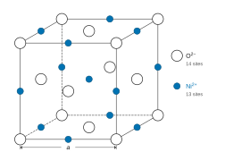
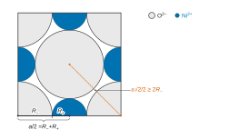

# Banque PT PT — Physique B - Chimie 2026 · Corrigé brut

*Corrigé rédigé par IA, non officiel. Signalez toute erreur.*

Épreuve de 2 h, calculatrice interdite, 28 questions réparties en trois parties indépendantes. Les applications numériques sont menées à la main, comme le jour du concours. On note $\dfrac{RT\ln 10}{F} = 0{,}06\ \text{V}$ à 298 K (donnée de l'énoncé).

## Partie I - Autour du colorant

### Q1.

Pour un élément du bloc p, le nombre d'électrons de valence se lit sur sa position dans le tableau périodique fourni : il vaut le numéro de colonne moins 10.

- C ($Z=6$, 2e période, colonne 14) : **4 électrons de valence** ;
- N ($Z=7$, 2e période, colonne 15) : **5 électrons de valence** ;
- S ($Z=16$, 3e période, colonne 16) : **6 électrons de valence**.

Soufre et oxygène sont dans la même colonne et ont le même nombre d'électrons de valence.

### Q2.

Nombre total d'électrons de valence de $\mathrm{SCN^-}$ : $6 + 4 + 5 + 1 = 16$, soit 8 doublets.

Le squelette imposé $\mathrm{S{-}C{\equiv}N}$ compte 4 doublets liants (1 pour S–C, 3 pour C≡N). Il reste 4 doublets non liants, placés pour respecter l'octet :

- C est engagé dans 4 liaisons : octet atteint, aucun doublet non liant ;
- N est engagé dans 3 liaisons : **1 doublet non liant** ;
- S est engagé dans 1 liaison : **3 doublets non liants**.

Charges formelles $q = n_{\text{valence}} - n_{\text{électrons non liants}} - n_{\text{liaisons}}$ :

$$\begin{aligned}
q(\mathrm S) &= 6 - 6 - 1 = -1 \\
q(\mathrm C) &= 4 - 0 - 4 = 0 \\
q(\mathrm N) &= 5 - 2 - 3 = 0
\end{aligned}$$

La somme vaut bien $-1$, charge de l'ion.

**Schéma de Lewis : trois doublets non liants et la charge négative sur le soufre, un doublet non liant sur l'azote, aucun sur le carbone.**

### Q3.

Le spectre présente une bande intense à environ 310 nm (ultraviolet) et deux bandes de faible intensité : l'une vers 390 nm (limite violet/ultraviolet, $A \approx 0{,}28$), l'autre vers 530 nm ($A \approx 0{,}30$), qui est la plus haute dans le domaine visible (400–800 nm).

$$\boxed{\lambda_{\max,\text{vis}} \approx 530\ \text{nm}}$$

### Q4.

Le colorant absorbe essentiellement autour de 530 nm, dans le vert, et un peu dans le violet vers 400 nm. En revanche, son absorbance est quasi nulle au-delà de 620 nm environ : les radiations rouges sont transmises. La couleur perçue est la couleur complémentaire de la couleur absorbée ; le complémentaire du vert sur le cercle chromatique est le rouge (magenta). **Le colorant absorbe le vert et transmet le rouge : il apparaît rouge.**

### Q5.

À $\lambda_{\max,\text{vis}} \approx 530$ nm, on lit $A \approx 0{,}30$ pour $c_1 = 2{,}7\times10^{-4}\ \text{mol·L}^{-1}$. Comme $A$ est sans dimension :

$$\begin{aligned}
k &= \frac{A}{c_1} \\
&= \frac{0{,}30}{2{,}7\times10^{-4}} \\
&= \frac{1}{9}\times10^{4} \\
&\approx 1{,}1\times10^{3}
\end{aligned}$$

$$\boxed{k \approx 1{,}1\times10^{3}\ \text{L·mol}^{-1}}$$

Par la loi de Beer-Lambert, $k = \varepsilon\,\ell$ : avec une cuve de $\ell = 1$ cm, $\varepsilon \approx 1{,}1\times10^{3}\ \text{L·mol}^{-1}\text{·cm}^{-1}$.

## Partie II - Autour de l'oxyde conducteur

### II.1 - Le dioxyde de titane

### Q6.

$\Delta_r G^\circ_1(T) = -RT\ln K^\circ_1(T)$ et, en supposant $\Delta_r H^\circ_1$ et $\Delta_r S^\circ_1$ indépendants de $T$ (hypothèse du programme), $\Delta_r G^\circ_1(T) = \Delta_r H^\circ_1 - T\,\Delta_r S^\circ_1$. D'où :

$$\boxed{K^\circ_1(T) = \exp\left(-\frac{\Delta_r G^\circ_1}{RT}\right) = \exp\left(\frac{\Delta_r S^\circ_1}{R} - \frac{\Delta_r H^\circ_1}{RT}\right)}$$

### Q7.

Loi de Hess pour $\mathrm{R_{(s)} = A_{(s)}}$ :

$$\begin{aligned}
\Delta_r H^\circ_1 &= \Delta_f H^\circ(\mathrm A) - \Delta_f H^\circ(\mathrm R) \\
&= -940{,}1 - (-945{,}1)
\end{aligned}$$

$$\boxed{\Delta_r H^\circ_1 = +5{,}0\ \text{kJ·mol}^{-1}}$$

$\Delta_r H^\circ_1 > 0$ : **la réaction (R1) est endothermique.**

### Q8.

$$\Delta_r S^\circ_1 = S^\circ_m(\mathrm A) - S^\circ_m(\mathrm R) = 50 - 50$$

$$\boxed{\Delta_r S^\circ_1 = 0\ \text{J·K}^{-1}\text{·mol}^{-1}}$$

Commentaire : l'entropie standard de réaction mesure la variation de désordre entre produits et réactifs. Ici, un solide cristallisé se transforme en un autre solide de même formule, sans gaz consommé ni produit, et chaque espèce reste seule dans sa phase : les deux états sont aussi ordonnés l'un que l'autre. D'où une entropie standard de réaction très faible, nulle à la précision des données.

La valeur exactement nulle tient à l'arrondi des données. Seul l'ordre de grandeur est significatif : il est très petit devant les quelque $100\ \text{J·K}^{-1}\text{·mol}^{-1}$ d'une réaction qui produit une mole de gaz.

Cohérence avec la valeur annoncée :

$$\ln K^\circ_1 = -\frac{5{,}0\times10^3}{8{,}31\times298} \approx -2{,}0$$

soit $K^\circ_1 \approx e^{-2} \approx 0{,}13$.

### Q9.

**L'activité d'un solide seul dans sa phase vaut 1**, quelle que soit sa quantité, tant qu'il est présent.

### Q10.

Les deux solides sont présents ($n_0 = 1$ mol chacun), chacun seul dans sa phase :

$$\begin{aligned}
Q_{r,i} &= \frac{a(\mathrm A)}{a(\mathrm R)} \\
&= \frac{1}{1} = 1
\end{aligned}$$

$Q_{r,i} = 1 > K^\circ_1 = 0{,}13$ : **le système évolue dans le sens indirect**, c'est-à-dire de l'anatase vers le rutile ($\mathrm A \to \mathrm R$).

### Q11.

Tant que les deux solides coexistent, leurs activités valent 1 et ne dépendent pas des quantités de matière. Le quotient réactionnel reste donc égal à 1 pendant toute l'évolution : **$Q_r = 1$ ne varie pas au cours de la réaction.**

### Q12.

D'après Q11, $Q_r = 1$ tant que les deux phases sont présentes. Il reste donc strictement supérieur à $K^\circ_1 = 0{,}13$ : la condition d'équilibre $Q_r = K^\circ_1$ ne peut jamais être atteinte.

L'évolution se fait dans le sens indirect, $\mathrm{A_{(s)} \to R_{(s)}}$ (Q10), et rien ne peut l'arrêter avant la disparition totale de l'anatase : **la transformation est totale**.

Avec l'avancement $\xi$ compté dans le sens direct :

$$\begin{aligned}
n(\mathrm R) &= n_0 - \xi \\
n(\mathrm A) &= n_0 + \xi
\end{aligned}$$

L'évolution s'arrête quand l'anatase est épuisée, pour $\xi_{\text{final}} = -n_0$ :

$$\boxed{n(\mathrm A)_f = 0}$$

$$\boxed{n(\mathrm R)_f = 2n_0 = 2\ \text{mol}}$$

**L'état final n'est pas un état d'équilibre chimique** : la transformation est totale et s'arrête par disparition d'une phase (rupture d'équilibre). Le système final, réduit au seul rutile, ne vérifie pas $Q_r = K^\circ_1$, la grandeur $Q_r$ n'étant même plus définie faute d'anatase.

### Q13.

La coexistence des deux phases à l'équilibre impose $Q_r = K^\circ_1$ avec $Q_r = 1$ (Q11) :

$$\boxed{K^\circ_1 = 1}$$

ce qui équivaut à $\Delta_r G^\circ_1 = 0$. Les deux variétés ne coexistent à l'équilibre qu'à une température bien précise (température de transition).

### Q14.

Relation de Van't Hoff :

$$\boxed{\frac{\mathrm d \ln K^\circ}{\mathrm d T} = \frac{\Delta_r H^\circ}{RT^2}}$$

Ici $\Delta_r H^\circ_1 > 0$ : $K^\circ_1$ est une fonction croissante de $T$. Pour faire passer $K^\circ_1$ de 0,13 à 1, **il faut augmenter la température à partir de 298 K.**

Remarque : avec les données arrondies ($\Delta_r S^\circ_1 = 0$), $K^\circ_1 = \exp\left(-\dfrac{\Delta_r H^\circ_1}{RT}\right)$ reste strictement inférieur à 1 pour toute température finie et ne fait que tendre vers 1 quand $T$ augmente. Le modèle ne donne donc qu'un sens d'évolution ; la température de coexistence $T = \Delta_r H^\circ_1/\Delta_r S^\circ_1$ n'est définie que si $\Delta_r S^\circ_1 > 0$.

### Q15.

La cellule utilise l'anatase. Dans le modèle, (R1) est endothermique : une élévation de température augmente $K^\circ_1$ et réduit l'écart entre $Q_r = 1$ et $K^\circ_1$, donc déplace l'équilibre dans le sens de formation de l'anatase. **La cellule doit être élaborée à haute température** pour favoriser l'anatase.

Avec les données de l'énoncé, $K^\circ_1$ reste inférieur à 1 à toute température : l'anatase n'est jamais rigoureusement la phase stable, la haute température ne fait que la défavoriser moins. Sa présence effective relève alors d'un blocage cinétique (forme métastable), point que le sujet ne demande pas de développer.

### II.2 - L'oxyde de nickel

### Q16.

Maille cubique d'arête $a$ (structure de type chlorure de sodium). Coordonnées réduites (en unités de $a$) :

| Ions | Positions dans la maille | Nombre de sites représentés |
|---|---|---|
| $\mathrm{O^{2-}}$ (réseau CFC) | 8 sommets $(0,0,0)\ldots$ et 6 centres de faces $(\tfrac12,\tfrac12,0)$, $(\tfrac12,0,\tfrac12)$, $(0,\tfrac12,\tfrac12)\ldots$ | 14 |
| $\mathrm{Ni^{2+}}$ (sites octaédriques) | 12 milieux d'arêtes $(\tfrac12,0,0)\ldots$ et centre du cube $(\tfrac12,\tfrac12,\tfrac12)$ | 13 |

Les deux espèces alternent le long de chaque arête.

### Q17.

- $\mathrm{O^{2-}}$ : $8\times\tfrac18 + 6\times\tfrac12 = 1 + 3 = 4$ ;
- $\mathrm{Ni^{2+}}$ : $12\times\tfrac14 + 1 = 3 + 1 = 4$.

$$\boxed{N(\mathrm{O^{2-}}) = 4}$$

$$\boxed{N(\mathrm{Ni^{2+}}) = 4}$$

Le rapport 1:1 est celui de la formule NiO, et la maille est électriquement neutre : $4\times(+2) + 4\times(-2) = 0$.

### Q18.

La maille contient 4 motifs NiO, de masse $\dfrac{4\,[M(\mathrm{Ni}) + M(\mathrm O)]}{N_A}$, dans un volume $a^3$ :

$$\boxed{\rho = \frac{4\,[M(\mathrm{Ni}) + M(\mathrm O)]}{N_A\,a^3}}$$

Application numérique, avec $a = 418\ \text{pm} = 4{,}18\times10^{-8}\ \text{cm}$ :

$$\begin{aligned}
4{,}18^2 &\approx 17{,}5 \\
4{,}18^3 &\approx 73 \\
a^3 &\approx 7{,}3\times10^{-23}\ \text{cm}^3
\end{aligned}$$

Alors, avec $M(\mathrm{Ni}) + M(\mathrm O) = 75\ \text{g·mol}^{-1}$ :

$$\begin{aligned}
\rho &= \frac{4\times75}{6{,}02\times10^{23}\times7{,}3\times10^{-23}} \\
&= \frac{300}{44}\ \text{g·cm}^{-3}
\end{aligned}$$

$$\boxed{\rho \approx 6{,}8\ \text{g·cm}^{-3} = 6{,}8\times10^{3}\ \text{kg·m}^{-3}}$$

Regard critique : la valeur est plusieurs fois supérieure à celle de l'eau et du même ordre que celle des métaux de transition et de leurs oxydes (quelques $\text{g·cm}^{-3}$ ; la valeur tabulée pour NiO est voisine de $6{,}7\ \text{g·cm}^{-3}$). Elle est donc cohérente. Une erreur de conversion du picomètre décalerait le résultat d'un facteur $10^{6}$ au moins, ce qui donnerait une valeur absurde pour un solide.

### Q19.

Les plus proches voisins de signes opposés sont un anion au sommet et le cation au milieu de l'arête adjacente, distants de $a/2$. La condition de contact (attraction anion-cation maximale) impose le contact sur l'arête :

$$\frac a2 = R_- + R_+$$

d'où

$$\boxed{a = 2\,(R_- + R_+)}$$

Pour que la structure soit stable, les anions ne doivent pas s'interpénétrer. Sur la demi-diagonale d'une face, deux anions voisins sont distants de $a\sqrt2/2$, d'où la condition :

$$\frac{a\sqrt2}{2} \geq 2R_-$$

Combinée avec la relation précédente, elle donne $R_+/R_- \geq \sqrt2 - 1 \approx 0{,}41$.

### Q20.

Le cation au centre du cube a pour plus proches voisins les 6 anions des centres de faces, à la distance $a/2$ : octaèdre régulier. De même, l'anion au centre d'une face a pour plus proches voisins le cation au centre de la maille, celui au centre de la maille voisine et les 4 cations aux milieux des arêtes de cette face, tous à $a/2$ : 6 cations.

$$\boxed{\text{coordinence } \mathrm{O^{2-}/Ni^{2+}} = 6}$$

$$\boxed{\text{coordinence } \mathrm{Ni^{2+}/O^{2-}} = 6}$$

La structure est de coordinence 6-6.

C'est cohérent avec l'occupation des sites octaédriques et avec la stœchiométrie 1:1.

## Partie III - Autour de l'électrolyte

### Q21.

Nombres d'oxydation de l'iode : $-\mathrm I$ dans $\mathrm{I^-}$, $-\tfrac13$ (en moyenne) dans $\mathrm{I_3^-}$, $+\mathrm V$ dans $\mathrm{IO_3^-}$. Plus le nombre d'oxydation est élevé, plus le domaine est haut dans le diagramme ; l'espèce de nombre d'oxydation intermédiaire n'existe que pour pH < 8,4 environ (elle se dismute au-delà).

$$\boxed{\mathrm A : \mathrm{IO_3^-},\qquad \mathrm B : \mathrm{I_3^-},\qquad \mathrm C : \mathrm{I^-}}$$

### Q22.

Couple $\mathrm{IO_3^-/I^-}$ :

$$\mathrm{IO_3^-} + 6\,\mathrm H^+ + 6\,e^- = \mathrm{I^-} + 3\,\mathrm{H_2O}$$

Formule de Nernst :

$$\begin{aligned}
E &= E^\circ(\mathrm{IO_3^-/I^-}) + \frac{0{,}06}{6}\log\frac{[\mathrm{IO_3^-}]\,[\mathrm H^+]^6}{[\mathrm{I^-}]\,c^{\circ 6}} \\
&= E^\circ - 0{,}06\,\mathrm{pH} + 0{,}01\log\frac{[\mathrm{IO_3^-}]}{[\mathrm{I^-}]}
\end{aligned}$$

Sur la frontière, $[\mathrm{IO_3^-}] = [\mathrm{I^-}] = C_t$, le dernier terme est nul :

$$\boxed{\text{pente} = -0{,}06\ \text{V par unité de pH}}$$

Vérification graphique : la frontière passe par $E \approx 0{,}60$ V à pH 8,4 et par $E \approx 0{,}26$ V à pH 14, d'où

$$\frac{0{,}26 - 0{,}60}{14 - 8{,}4} = \frac{-0{,}34}{5{,}6} \approx -0{,}06\ \text{V}$$

par unité de pH, en accord avec la formule de Nernst.

### Q23.

Couple $\mathrm{I_3^-/I^-}$ (frontière B/C horizontale à $E = 0{,}60$ V) :

$$\mathrm{I_3^-} + 2\,e^- = 3\,\mathrm{I^-}$$

$$E = E^\circ(\mathrm{I_3^-/I^-}) + \frac{0{,}06}{2}\log\frac{[\mathrm{I_3^-}]\,c^{\circ 2}}{[\mathrm{I^-}]^3}$$

Sur la frontière, $[\mathrm{I_3^-}] = [\mathrm{I^-}] = C_t = 1{,}0\times10^{-1}\ \text{mol·L}^{-1}$. Les coefficients stœchiométriques étant différents, le terme logarithmique ne s'annule pas :

$$\begin{aligned}
\log\frac{C_t}{C_t^{3}} &= -2\log C_t = 2 \\
0{,}60 &= E^\circ + 0{,}03\times2
\end{aligned}$$

$$\boxed{E^\circ(\mathrm{I_3^-/I^-}) = 0{,}60 - 0{,}06 = 0{,}54\ \text{V}}$$

Le potentiel de la frontière horizontale (0,60 V) n'est donc pas le potentiel standard du couple.

### Q24.

- Prélèvement de $V_0 = 20{,}0$ mL d'électrolyte : **pipette jaugée de 20,0 mL** (munie d'une propipette).
- Solution titrante : **burette graduée** (25 mL).

### Q25.

$$\mathrm{I_3^-} + 2\,e^- = 3\,\mathrm{I^-}$$

$$2\,\mathrm{S_2O_3^{2-}} = \mathrm{S_4O_6^{2-}} + 2\,e^-$$

$$\boxed{\mathrm{I_3^-}_{(aq)} + 2\,\mathrm{S_2O_3^{2-}}_{(aq)} = 3\,\mathrm{I^-}_{(aq)} + \mathrm{S_4O_6^{2-}}_{(aq)}}$$

Conservation vérifiée : 3 I, 4 S, 6 O, charge $-5$ de chaque côté.

### Q26.

À l'équilibre, les potentiels de Nernst des deux couples sont égaux (concentrations rapportées à $c^\circ$) :

$$\begin{aligned}
E^\circ_1 + 0{,}03\log\frac{[\mathrm{I_3^-}]}{[\mathrm{I^-}]^3} &= E^\circ_2 + 0{,}03\log\frac{[\mathrm{S_4O_6^{2-}}]}{[\mathrm{S_2O_3^{2-}}]^2} \\
E^\circ_1 - E^\circ_2 &= 0{,}03\log\frac{[\mathrm{I^-}]^3\,[\mathrm{S_4O_6^{2-}}]}{[\mathrm{I_3^-}]\,[\mathrm{S_2O_3^{2-}}]^2} \\
E^\circ_1 - E^\circ_2 &= \frac{0{,}06}{2}\log K^\circ
\end{aligned}$$

avec $E^\circ_1 = E^\circ(\mathrm{I_3^-/I^-}) = 0{,}54$ V (Q23) et $E^\circ_2 = E^\circ(\mathrm{S_4O_6^{2-}/S_2O_3^{2-}}) = 0{,}08$ V. Pour $n = 2$ électrons échangés :

$$\begin{aligned}
\log K^\circ &= \frac{2\,(E^\circ_1 - E^\circ_2)}{0{,}06} \\
&= \frac{2\times(0{,}54 - 0{,}08)}{0{,}06} \\
&= \frac{0{,}92}{0{,}06} \approx 15{,}3
\end{aligned}$$

$$\boxed{K^\circ \approx 10^{15} \ (\approx 2\times10^{15})}$$

$K^\circ \gg 10^4$ : la réaction est quantitative (totale), condition nécessaire pour servir de réaction de titrage (elle est aussi rapide, l'équivalence étant repérée par la décoloration ou à l'empois d'amidon).

### Q27.

À l'équivalence, les réactifs ont été introduits dans les proportions stœchiométriques de l'équation de Q25 (2 thiosulfates pour 1 triiodure) :

$$n(\mathrm{I_3^-})_0 = \frac{n(\mathrm{S_2O_3^{2-}})_{\text{versé}}}{2} = \frac{c_2\,V_{\text{eq}}}{2}$$

d'où

$$\begin{aligned}
[\mathrm{I_3^-}] &= \frac{c_2\,V_{\text{eq}}}{2\,V_0} \\
&= \frac{1{,}0\times10^{-1}\times8{,}1}{2\times20{,}0} \\
&= \frac{0{,}81}{40}
\end{aligned}$$

$$\boxed{[\mathrm{I_3^-}] \approx 2{,}0\times10^{-2}\ \text{mol·L}^{-1}}$$

### Q28.

Après ajout de la première goutte, en supposant qu'aucun précipité ne se forme, et en négligeant la dilution ($V_{\text{goutte}} = 0{,}050$ mL $\ll V'_0 = 10{,}0$ mL) :

$$\begin{aligned}
[\mathrm{Ag^+}] &\approx \frac{c_3\,V_{\text{goutte}}}{V'_0} \\
&= \frac{5{,}0\times10^{-1}\times5{,}0\times10^{-2}}{10{,}0} \\
&= 2{,}5\times10^{-3}\ \text{mol·L}^{-1}
\end{aligned}$$

$$[\mathrm{I^-}] \approx 4{,}8\times10^{-1}\ \text{mol·L}^{-1}$$

Quotient de réaction de la dissolution $\mathrm{AgI_{(s)} = Ag^+ + I^-}$ :

$$\begin{aligned}
Q &= \frac{[\mathrm{Ag^+}][\mathrm{I^-}]}{c^{\circ 2}} \\
&\approx 2{,}5\times10^{-3}\times4{,}8\times10^{-1} \\
&\approx 1{,}2\times10^{-3}
\end{aligned}$$

$Q \approx 1{,}2\times10^{-3} > K_s = 8{,}52\times10^{-17}$ : la solution serait sursaturée en AgI. La réaction de dissolution évolue donc dans le sens indirect, c'est-à-dire dans le sens de la précipitation. **Le précipité d'iodure d'argent se forme dès la première goutte.**
