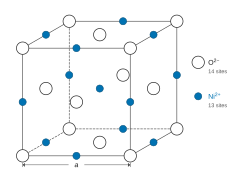
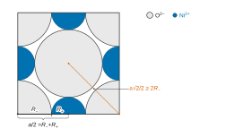

# Banque PT PT — Physique B - Chimie 2026 · Corrigé guidé

*Corrigé rédigé par IA, non officiel. Signalez toute erreur.*

## Présentation du sujet

Malgré son intitulé, l'épreuve est entièrement consacrée à la chimie. Elle dure 2 heures, **sans calculatrice**, et comporte 28 questions réparties en trois parties indépendantes. Le fil directeur est la **cellule solaire à colorant** (cellule de Grätzel), dont on étudie successivement les trois constituants.

- **Partie I — Autour du colorant (Q1 à Q5).** Schéma de Lewis de l'ion thiocyanate, puis exploitation d'un spectre d'absorption UV-visible : maximum dans le visible, couleur perçue, coefficient de la loi de Beer-Lambert. Questions de cours rapides.
- **Partie II — Autour de l'oxyde conducteur (Q6 à Q20).** C'est la partie la plus longue.
  - II.1 (Q6 à Q15) : équilibre entre deux variétés solides de $\mathrm{TiO_2}$ (rutile et anatase). Grandeurs standard de réaction, activité d'un solide seul dans sa phase, quotient réactionnel constant, **rupture d'équilibre**, relation de Van't Hoff.
  - II.2 (Q16 à Q20) : cristallographie de l'oxyde de nickel, structure de type NaCl. Schéma de maille, population, masse volumique, condition de contact, coordinence.
- **Partie III — Autour de l'électrolyte (Q21 à Q28).** Diagramme E-pH de l'iode (attribution des domaines, pente, potentiel standard), titrage iodométrique du triiodure par le thiosulfate, puis test de précipitation de AgI.

**Notions mobilisées** : électrons de valence lus dans le tableau périodique et schéma de Lewis ; spectrophotométrie et loi de Beer-Lambert ; $\Delta_r H^\circ$ et $\Delta_r S^\circ$ indépendants de $T$, $\Delta_r G^\circ = -RT\ln K^\circ$, loi de Hess ; critère d'évolution $Q_r$ / $K^\circ$ ; cristallographie des solides ioniques (CFC, sites octaédriques) ; formule de Nernst et diagrammes E-pH ; titrages et produit de solubilité.

**Difficulté** : modeste et très proche du cours. La seule vraie subtilité conceptuelle est le bloc Q10 à Q13 sur les solides purs, qu'il faut avoir compris une fois pour toutes. Les pièges sont ponctuels : la bande UV en Q3, le facteur stœchiométrique dans Nernst en Q23, le facteur 2 à l'équivalence en Q27, la conversion d'unité en Q18.

**Questions à ne pas laisser passer** : Q1, Q2, Q7, Q8, Q9, Q17, Q18, Q21, Q24, Q25, Q27. Elles relèvent du cours et du calcul direct.

**Questions discriminantes selon le rapport 2026** : le jury juge très bien traitées Q6, Q7, Q9, Q16 et Q17. Il signale en revanche comme mal traitées ou rarement bien menées Q12 (caractère total de la transformation), Q14 (usage de Van't Hoff), Q18 (application numérique et regard critique), Q23 (potentiel standard), Q26 (constante d'équilibre redox) et Q27 (facteur 2) ; Q20 et Q28 ont été peu traitées. Ce sont des questions de cours : elles font la différence.

> [!JURY]
> Rapport 2026, remarques générales : « seule une réponse correctement justifiée et argumentée permet d'obtenir l'intégralité des points attribués à une question. Tout résultat numérique doit être accompagné de son unité et, lorsque cela est pertinent, faire l'objet d'une analyse critique. » Le jury apprécie aussi les expressions littérales encadrées et les résultats numériques mis en évidence.

**Gestion du temps** : sans calculatrice, préparer des calculs simples (les données sont choisies pour cela : $0{,}30/2{,}7\times10^{-4} = 10^4/9$, $0{,}92/0{,}06 \approx 15$). Compter environ 15 min pour la partie I, 55 min pour la partie II (dont un schéma soigné en Q16) et 40 min pour la partie III, en gardant 10 min de relecture.

## Partie I — Autour du colorant

On commence par la structure électronique du ligand thiocyanate, puis on exploite le spectre d'absorption du complexe de ruthénium. Outils : lecture du tableau périodique, règle de l'octet, charges formelles, couleurs complémentaires, loi de Beer-Lambert.

### Question 1

> [!INDICATION]
> Repérer chaque élément dans le tableau périodique fourni en fin de sujet.

> [!INDICATION]
> Pour un élément du bloc p, le numéro de colonne donne directement le nombre d'électrons de valence.

#### Solution

Pour un élément du bloc p, le nombre d'électrons de valence vaut le numéro de colonne moins 10 :

- C ($Z=6$, 2e période, colonne 14) : **4 électrons de valence** ;
- N ($Z=7$, 2e période, colonne 15) : **5 électrons de valence** ;
- S ($Z=16$, 3e période, colonne 16) : **6 électrons de valence**.

> [!PIEGE]
> Pour le soufre, seuls comptent les électrons de la dernière période (la troisième) : 6 électrons de valence, comme l'oxygène situé au-dessus de lui, et non 16.

### Question 2

> [!INDICATION]
> Compter le nombre total d'électrons de valence de l'ion, sans oublier la charge.

> [!INDICATION]
> Le squelette impose déjà les doublets liants ; répartir les doublets restants pour respecter l'octet, puis calculer les charges formelles.

#### Solution

Total : $6 + 4 + 5 + 1 = 16$ électrons, soit 8 doublets. Le squelette $\mathrm{S{-}C{\equiv}N}$ utilise 4 doublets liants ; il reste 4 doublets non liants :

- C (4 liaisons) : aucun doublet non liant ;
- N (3 liaisons) : **1 doublet non liant** ;
- S (1 liaison) : **3 doublets non liants**.

Charges formelles ($n_{\text{valence}} - n_{\text{électrons non liants}} - n_{\text{liaisons}}$) :

$$\begin{aligned}
q(\mathrm S) &= 6 - 6 - 1 = -1 \\
q(\mathrm C) &= 4 - 0 - 4 = 0 \\
q(\mathrm N) &= 5 - 2 - 3 = 0
\end{aligned}$$

**La charge négative est portée par le soufre.**

> [!METHODE]
> Toujours conclure un schéma de Lewis par le calcul des charges formelles : leur somme doit redonner la charge de l'édifice.

> [!PIEGE]
> L'ion thiocyanate possède une autre forme mésomère ($\mathrm{S{=}C{=}N^-}$, charge sur l'azote). Ici le squelette est imposé par la figure 1 : il faut donc placer la charge sur S, et non raisonner sur l'électronégativité. Oublier l'électron apporté par la charge conduit à 15 électrons, nombre impair : le schéma devient impossible.

> [!JURY]
> Rapport 2026 : « Le lien entre cette question et la question précédente a très rarement été fait. » Le jury relève aussi des schémas qui ne respectent pas l'enchaînement de la figure 1 et un décompte des électrons de valence peu maîtrisé en présence d'une charge. Partir explicitement des valeurs de Q1.

### Question 3

> [!INDICATION]
> Repérer les différents maxima du spectre et situer chacun par rapport au domaine visible.

> [!INDICATION]
> La bande la plus intense est hors du domaine demandé.

#### Solution

Le spectre présente une bande intense vers 310 nm (UV) et deux bandes faibles, vers 390 nm (limite violet/UV, $A \approx 0{,}28$) et vers 530 nm ($A \approx 0{,}30$). Le maximum dans le visible est :

$$\boxed{\lambda_{\max,\text{vis}} \approx 530\ \text{nm}}$$

> [!PIEGE]
> Répondre 310 nm (maximum absolu) : cette bande est dans l'ultraviolet.

> [!JURY]
> Rapport 2026 : « Une grande partie des copies ne tient pas compte de l'intervalle du visible et propose une longueur d'onde dans le domaine UV. » Rappeler l'intervalle du visible (environ 400 à 800 nm) avant de lire le spectre.

### Question 4

> [!INDICATION]
> Une solution colorée prend la couleur complémentaire de celle qu'elle absorbe.

> [!INDICATION]
> Regarder aussi dans quel domaine de longueurs d'onde l'absorbance devient quasi nulle.

#### Solution

Le colorant absorbe dans le vert (vers 530 nm) et un peu dans le violet (vers 400 nm), tandis que son absorbance est quasi nulle au-delà de 620 nm environ : les radiations rouges sont transmises. Le complémentaire du vert est le rouge (magenta) sur le cercle chromatique. **Le colorant apparaît donc rouge.**

> [!METHODE]
> Pour justifier une couleur à partir d'un spectre, donner les deux arguments : le domaine absorbé (et sa complémentaire) et le domaine transmis.

> [!PIEGE]
> La bande intense vers 310 nm est dans l'ultraviolet, non dans l'infrarouge, et n'intervient pas dans la couleur perçue. Le rapport 2026 relève de nombreuses réponses confondant le domaine UV et le domaine des infrarouges.

### Question 5

> [!INDICATION]
> Lire l'absorbance au maximum retenu en Q3 et utiliser la concentration indiquée sous la figure.

> [!INDICATION]
> $A$ est sans dimension : l'unité de $k$ s'en déduit.

#### Solution

À 530 nm, $A \approx 0{,}30$ pour $c_1 = 2{,}7\times10^{-4}\ \text{mol·L}^{-1}$ :

$$\begin{aligned}
k &= \frac{A}{c_1} \\
&= \frac{0{,}30}{2{,}7\times10^{-4}} \\
&= \frac{10^4}{9} \approx 1{,}1\times10^3
\end{aligned}$$

$$\boxed{k \approx 1{,}1\times10^{3}\ \text{L·mol}^{-1}}$$

D'après la loi de Beer-Lambert, $k = \varepsilon\,\ell$ : pour une cuve de 1 cm, $\varepsilon \approx 1{,}1\times10^3\ \text{L·mol}^{-1}\text{·cm}^{-1}$.

> [!METHODE]
> Sans calculatrice, simplifier : $0{,}30/2{,}7 = 1/9 \approx 0{,}11$.

## Partie II — Autour de l'oxyde conducteur

### II.1 - Le dioxyde de titane

On étudie la transformation allotropique rutile = anatase. Toute la sous-partie repose sur une idée : un solide seul dans sa phase a une activité égale à 1, donc le quotient réactionnel ne dépend pas des quantités. On en tire la notion de rupture d'équilibre, puis l'effet de la température par la relation de Van't Hoff.

### Question 6

> [!INDICATION]
> Relier $K^\circ$ à l'enthalpie libre standard de réaction.

> [!INDICATION]
> Supposer ensuite $\Delta_r H^\circ$ et $\Delta_r S^\circ$ indépendants de $T$ pour écrire $\Delta_r G^\circ$ en fonction de $\Delta_r H^\circ$ et $\Delta_r S^\circ$.

#### Solution

$\Delta_r G^\circ_1(T) = -RT\ln K^\circ_1(T)$ et, avec $\Delta_r H^\circ_1$ et $\Delta_r S^\circ_1$ indépendants de $T$, $\Delta_r G^\circ_1(T) = \Delta_r H^\circ_1 - T\,\Delta_r S^\circ_1$ :

$$\boxed{K^\circ_1(T) = \exp\left(\frac{\Delta_r S^\circ_1}{R} - \frac{\Delta_r H^\circ_1}{RT}\right)}$$

> [!JURY]
> Il faut énoncer l'hypothèse utilisée : $\Delta_r H^\circ$ et $\Delta_r S^\circ$ indépendants de la température.

### Question 7

> [!INDICATION]
> Loi de Hess : produits moins réactifs, avec les enthalpies standard de formation.

#### Solution

$$\begin{aligned}
\Delta_r H^\circ_1 &= \Delta_f H^\circ(\mathrm A) - \Delta_f H^\circ(\mathrm R) \\
&= -940{,}1 - (-945{,}1)
\end{aligned}$$

$$\boxed{\Delta_r H^\circ_1 = +5{,}0\ \text{kJ·mol}^{-1}}$$

$\Delta_r H^\circ_1 > 0$ : **réaction endothermique.**

> [!PIEGE]
> Inverser l'ordre « produits moins réactifs » change le signe, et donc les conclusions de Q14 et Q15.

### Question 8

> [!INDICATION]
> Même calcul avec les entropies molaires standard.

> [!INDICATION]
> Pour le commentaire, se demander ce qui fait habituellement varier fortement l'entropie au cours d'une réaction.

#### Solution

$$\begin{aligned}
\Delta_r S^\circ_1 &= S^\circ_m(\mathrm A) - S^\circ_m(\mathrm R) \\
&= 50 - 50
\end{aligned}$$

$$\boxed{\Delta_r S^\circ_1 = 0\ \text{J·K}^{-1}\text{·mol}^{-1}}$$

L'entropie standard de réaction mesure la variation de désordre. Ici, un solide cristallisé se transforme en un autre solide de même formule, sans gaz consommé ni produit, chaque espèce restant seule dans sa phase : le désordre varie très peu. L'entropie de réaction est donc très faible, nulle à la précision des données.

Vérification :

$$\ln K^\circ_1 = -\frac{5{,}0\times10^3}{8{,}31\times298} \approx -2{,}0$$

donc $K^\circ_1 \approx e^{-2} \approx 0{,}13$, valeur annoncée par l'énoncé.

> [!METHODE]
> Le signe et l'ordre de grandeur de $\Delta_r S^\circ$ se prévoient par la variation de la quantité de gaz : quasi nul sans gaz, de l'ordre de $\pm 100$ à $200\ \text{J·K}^{-1}\text{·mol}^{-1}$ par mole de gaz créée ou consommée.

> [!JURY]
> Selon le rapport 2026, le calcul est réussi dans la majorité des copies, mais « l'interprétation de la valeur nulle de ∆rS°1 a donné lieu à des explications confuses dans de nombreux cas ». Un argument suffit, s'il est net : deux phases condensées, aucune variation de la quantité de gaz.

### Question 9

> [!INDICATION]
> Question de cours sur l'activité.

#### Solution

**L'activité d'un solide seul dans sa phase vaut 1**, indépendamment de sa quantité, tant qu'il est présent.

### Question 10

> [!INDICATION]
> Écrire $Q_r$ avec les activités, puis appliquer Q9.

> [!INDICATION]
> Comparer à $K^\circ_1$ et appliquer le critère d'évolution.

#### Solution

$$\begin{aligned}
Q_{r,i} &= \frac{a(\mathrm A)}{a(\mathrm R)} \\
&= \frac{1}{1} = 1
\end{aligned}$$

$Q_{r,i} = 1 > K^\circ_1 = 0{,}13$ : **évolution dans le sens indirect** (anatase vers rutile).

> [!PIEGE]
> Les quantités égales ($n_0 = 1$ mol de chaque) n'interviennent pas dans $Q_r$ : le système n'est pas « à l'équilibre par symétrie ».

### Question 11

> [!INDICATION]
> De quoi dépendent les activités des deux espèces ?

#### Solution

Tant que les deux solides coexistent, leurs activités valent 1 quelles que soient les quantités restantes. **$Q_r$ reste égal à 1 pendant toute la transformation.**

### Question 12

> [!INDICATION]
> $Q_r$ peut-il rejoindre $K^\circ_1$ ? Que se passe-t-il alors ?

> [!INDICATION]
> Introduire un avancement et chercher ce qui arrête la transformation.

#### Solution

D'après Q11, $Q_r = 1$ tant que les deux phases sont présentes : il reste strictement supérieur à $K^\circ_1 = 0{,}13$, et la condition d'équilibre ne peut jamais être atteinte.

L'évolution se fait dans le sens indirect, $\mathrm{A_{(s)} \to R_{(s)}}$ (Q10), et rien ne l'arrête avant la disparition de l'anatase : **la transformation est totale**.

Avec l'avancement $\xi$ compté dans le sens direct :

$$\begin{aligned}
n(\mathrm R) &= n_0 - \xi \\
n(\mathrm A) &= n_0 + \xi
\end{aligned}$$

L'évolution s'arrête pour $\xi = -n_0$ :

$$\boxed{n(\mathrm A)_f = 0}$$

$$\boxed{n(\mathrm R)_f = 2\ \text{mol}}$$

**L'état final n'est pas un état d'équilibre** : la transformation est totale et s'arrête par disparition d'une phase (rupture d'équilibre).

> [!METHODE]
> Lorsqu'une réaction ne fait intervenir que des solides purs (ou des espèces d'activité fixée), $Q_r$ est constant : soit $Q_r = K^\circ$ et le système est à l'équilibre quelles que soient les quantités, soit la transformation est totale.

> [!PIEGE]
> Confondre état final et état d'équilibre. Un état final n'est un état d'équilibre que si $Q_r = K^\circ$ y est vérifié avec toutes les espèces présentes.

> [!JURY]
> Rapport 2026 : « L'aspect total de la transformation a rarement été correctement justifié, et la transformation a souvent été écrite dans le mauvais sens. » Rappeler le sens trouvé en Q10 (anatase consommée, rutile formé) et justifier le caractère total par l'impossibilité d'atteindre $Q_r = K^\circ_1$.

### Question 13

> [!INDICATION]
> Pour que les deux phases coexistent à l'équilibre, quelle égalité doit être satisfaite pendant la coexistence ?

#### Solution

La coexistence à l'équilibre impose $Q_r = K^\circ_1$ avec $Q_r = 1$ :

$$\boxed{K^\circ_1 = 1}$$

ce qui équivaut à $\Delta_r G^\circ_1 = 0$.

Cette égalité n'est réalisée qu'à une température particulière, la température de transition entre les deux variétés.

### Question 14

> [!INDICATION]
> La relation de Van't Hoff relie la dérivée de $\ln K^\circ$ par rapport à $T$ à une grandeur standard calculée plus haut.

> [!INDICATION]
> Faut-il augmenter ou diminuer $K^\circ_1$ pour atteindre la valeur de Q13 ?

#### Solution

$$\boxed{\frac{\mathrm d \ln K^\circ}{\mathrm d T} = \frac{\Delta_r H^\circ}{RT^2}}$$

$\Delta_r H^\circ_1 > 0$ : $K^\circ_1$ croît avec $T$. Pour faire passer $K^\circ_1$ de 0,13 à 1, **il faut augmenter la température.**

Remarque : avec $\Delta_r S^\circ_1 = 0$, $K^\circ_1 = \exp\left(-\dfrac{\Delta_r H^\circ_1}{RT}\right) < 1$ pour toute température finie : $K^\circ_1$ tend vers 1 sans l'atteindre. Avec les données arrondies, le modèle ne fournit donc qu'un sens de variation, pas une température de coexistence.

> [!PIEGE]
> Écrire la relation de Van't Hoff sans préciser la grandeur dérivée ($\ln K^\circ$ et non $K^\circ$) ni le dénominateur $RT^2$.

> [!JURY]
> Rapport 2026 : la relation est connue dans la plupart des cas, mais « son utilisation pour déterminer le sens d'évolution nécessaire de la température a été rarement bien menée ». Enchaîner les trois étapes : valeur cible de $K^\circ_1$ (Q13), signe de $\Delta_r H^\circ_1$ (Q7), sens de variation de $K^\circ_1$ avec $T$.

### Question 15

> [!INDICATION]
> Quelle variété est utilisée dans la cellule ? Dans quel sens de (R1) est-elle produite ?

> [!INDICATION]
> Raisonner sur le sens de variation de $K^\circ_1$ avec $T$ établi en Q14.

#### Solution

La cellule utilise l'anatase, produit de (R1) dans le sens direct, qui est endothermique. Une élévation de température augmente $K^\circ_1$ et favorise le sens direct, donc la formation d'anatase. **La cellule doit être élaborée à haute température.**

Avec les données de l'énoncé, $K^\circ_1$ reste inférieur à 1 à toute température : l'anatase est seulement moins défavorisée à haute température. Sa conservation à l'issue de l'élaboration relève de la cinétique (forme métastable), aspect que le sujet ne demande pas d'approfondir.

> [!PIEGE]
> Parler de « proportion d'anatase à l'équilibre » : pour deux solides purs non miscibles, il n'existe pas d'équilibre de composition variable (voir Q12).

### II.2 - L'oxyde de nickel

Cristallographie d'un solide ionique de type NaCl. On construit la maille, on dénombre, on calcule la masse volumique, puis on traduit la condition de contact anion-cation.

### Question 16

> [!INDICATION]
> Placer d'abord les anions selon un réseau cubique à faces centrées.

> [!INDICATION]
> Les sites octaédriques d'une maille CFC sont au centre du cube et aux milieux des arêtes.

#### Solution

Maille cubique d'arête $a$, coordonnées réduites :

| Ions | Positions | Nombre de sites représentés |
|---|---|---|
| $\mathrm{O^{2-}}$ | 8 sommets et 6 centres de faces | 14 |
| $\mathrm{Ni^{2+}}$ | 12 milieux d'arêtes et centre du cube | 13 |

Les deux espèces alternent le long de chaque arête et de chaque direction $\langle 100 \rangle$.

> [!PIEGE]
> Oublier les anions des centres de faces, ou placer un anion au centre du cube : ce site est occupé par un cation. Un schéma doit être cohérent avec le dénombrement de la question suivante.

### Question 17

> [!INDICATION]
> Chaque site est partagé entre plusieurs mailles : sommet, face, arête, centre.

#### Solution

- $\mathrm{O^{2-}}$ : $8\times\tfrac18 + 6\times\tfrac12 = 4$ ;
- $\mathrm{Ni^{2+}}$ : $12\times\tfrac14 + 1 = 4$.

$$\boxed{N(\mathrm{O^{2-}}) = N(\mathrm{Ni^{2+}}) = 4}$$

Rapport 1:1, conforme à la formule NiO, et maille électriquement neutre.

> [!METHODE]
> Toujours confronter la population de la maille à la formule chimique et à l'électroneutralité : c'est le contrôle du schéma.

### Question 18

> [!INDICATION]
> Masse des motifs contenus dans la maille divisée par le volume de la maille.

> [!INDICATION]
> Choisir des unités cohérentes : g/mol et cm donnent directement des g/cm³.

#### Solution

$$\boxed{\rho = \frac{4\,[M(\mathrm{Ni}) + M(\mathrm O)]}{N_A\,a^3}}$$

Avec $a = 4{,}18\times10^{-8}$ cm :

$$a^3 \approx 73\times10^{-24}\ \text{cm}^3 = 7{,}3\times10^{-23}\ \text{cm}^3$$

$$\begin{aligned}
\rho &= \frac{4\times75}{6{,}02\times10^{23}\times7{,}3\times10^{-23}} \\
&= \frac{300}{44} \approx 6{,}8\ \text{g·cm}^{-3}
\end{aligned}$$

$$\boxed{\rho \approx 6{,}8\times10^{3}\ \text{kg·m}^{-3}}$$

Regard critique : la valeur est plusieurs fois celle de l'eau et du même ordre que celle des métaux de transition et de leurs oxydes (quelques $\text{g·cm}^{-3}$ ; la valeur tabulée pour NiO est voisine de $6{,}7\ \text{g·cm}^{-3}$). Elle est cohérente.

> [!PIEGE]
> Les conversions : $1\ \text{pm} = 10^{-12}\ \text{m} = 10^{-10}\ \text{cm}$. Une erreur se répercute au cube, et la masse molaire en $\text{g·mol}^{-1}$ ne se combine qu'avec des centimètres pour donner des $\text{g·cm}^{-3}$.

> [!JURY]
> Rapport 2026 : l'application numérique a souvent été absente ou erronée par erreur de conversion. « Le jury rappelle que les candidats et candidates doivent avoir un regard critique sur les valeurs numériques obtenues et être capables d'identifier une valeur incohérente, ce qui n'a quasiment jamais été fait. » Une phrase de commentaire sur l'ordre de grandeur suffit.

### Question 19

> [!INDICATION]
> Chercher la plus courte distance anion-cation dans la maille.

> [!INDICATION]
> Elle se trouve sur une arête.

#### Solution

Un anion au sommet et le cation au milieu de l'arête sont distants de $a/2$ ; le contact anion-cation impose :

$$\frac a2 = R_- + R_+$$

d'où

$$\boxed{a = 2\,(R_- + R_+)}$$

Complément : les anions ne doivent pas s'interpénétrer. Deux anions voisins sont à $a\sqrt2/2$ (demi-diagonale de face), d'où :

$$\frac{a\sqrt2}{2} \geq 2R_-$$

soit $R_+/R_- \geq \sqrt2 - 1 \approx 0{,}41$.

> [!PIEGE]
> Reprendre la condition $a\sqrt2 = 4R$ d'un métal CFC compact : dans un cristal ionique, le contact se fait entre ions de signes opposés.

### Question 20

> [!INDICATION]
> Choisir un ion bien placé dans la maille (le cation central par exemple) et compter ses plus proches voisins de signe opposé.

#### Solution

Le cation au centre du cube a 6 anions aux centres des faces, à $a/2$ : environnement octaédrique. Réciproquement, l'anion au centre d'une face a pour voisins les 4 cations des milieux des arêtes de cette face et les cations au centre des deux mailles qui partagent cette face, tous à $a/2$.

$$\boxed{\text{coordinence 6-6}}$$

Cohérent avec l'occupation de sites octaédriques et la stœchiométrie 1:1.

> [!JURY]
> Rapport 2026 : « Question peu traitée et peu justifiée. » Un nombre sans dénombrement explicite des plus proches voisins, avec leur distance, ne rapporte pas tous les points.

## Partie III — Autour de l'électrolyte

L'électrolyte contient le couple $\mathrm{I_3^-/I^-}$. On exploite d'abord le diagramme E-pH de l'iode, puis on dose le triiodure par iodométrie et on vérifie qu'un titrage des iodures par précipitation est envisageable. Outils : nombres d'oxydation, formule de Nernst, constante d'équilibre redox, relation à l'équivalence, produit de solubilité.

### Question 21

> [!INDICATION]
> Calculer le nombre d'oxydation de l'iode dans chaque espèce.

> [!INDICATION]
> Plus une espèce est oxydée, plus son domaine se situe haut dans le diagramme.

#### Solution

N.O. de l'iode : $-\mathrm I$ dans $\mathrm{I^-}$, $-\tfrac13$ en moyenne dans $\mathrm{I_3^-}$, $+\mathrm V$ dans $\mathrm{IO_3^-}$.

$$\boxed{\mathrm A : \mathrm{IO_3^-},\qquad \mathrm B : \mathrm{I_3^-},\qquad \mathrm C : \mathrm{I^-}}$$

Le domaine B, de N.O. intermédiaire, disparaît au-delà de pH 8,4 environ : $\mathrm{I_3^-}$ s'y dismute en $\mathrm{IO_3^-}$ et $\mathrm{I^-}$.

> [!PIEGE]
> Le nombre d'oxydation moyen de l'iode dans $\mathrm{I_3^-}$ est fractionnaire ($-\tfrac13$) : ce n'est pas une erreur de calcul. Le rapport 2026 note que ce point a gêné certaines copies, alors que la méthode d'attribution des domaines était maîtrisée.

### Question 22

> [!INDICATION]
> Écrire la demi-équation du couple $\mathrm{IO_3^-/I^-}$ en milieu acide.

> [!INDICATION]
> La pente vaut $-0{,}06\,h/n$, où $h$ est le nombre de protons et $n$ le nombre d'électrons.

#### Solution

$$\mathrm{IO_3^-} + 6\,\mathrm H^+ + 6\,e^- = \mathrm{I^-} + 3\,\mathrm{H_2O}$$

$$E = E^\circ(\mathrm{IO_3^-/I^-}) - 0{,}06\,\mathrm{pH} + \frac{0{,}06}{6}\log\frac{[\mathrm{IO_3^-}]}{[\mathrm{I^-}]}$$

Sur la frontière, les deux concentrations valent $C_t$ :

$$\boxed{\text{pente} = -0{,}06\ \text{V par unité de pH}}$$

Vérification sur la figure : $\dfrac{0{,}26 - 0{,}60}{14 - 8{,}4} \approx -0{,}06$ V par unité de pH.

> [!PIEGE]
> Utiliser la portion de droite située à gauche du point triple : c'est la frontière A/B ($\mathrm{IO_3^-/I_3^-}$), de pente $-0{,}06\times18/16 \approx -0{,}068$ V par unité de pH.

> [!JURY]
> Rapport 2026 : la pente est obtenue par la formule de Nernst dans la plupart des copies, mais « de nombreuses copies proposent une unité absente ou erronée ». Le jury déplore aussi que certaines copies répondent à cette question très classique par une lecture graphique, souvent fausse, sans utiliser la formule de Nernst. La lecture graphique ne sert que de vérification.

### Question 23

> [!INDICATION]
> La frontière B/C est horizontale : écrire Nernst pour le couple $\mathrm{I_3^-/I^-}$ et y imposer la convention de tracé.

> [!INDICATION]
> Les coefficients stœchiométriques des deux espèces diffèrent : le terme logarithmique n'est pas nul sur la frontière.

#### Solution

$$\mathrm{I_3^-} + 2\,e^- = 3\,\mathrm{I^-}$$

$$E = E^\circ + \frac{0{,}06}{2}\log\frac{[\mathrm{I_3^-}]}{[\mathrm{I^-}]^3}$$

Sur la frontière, $[\mathrm{I_3^-}] = [\mathrm{I^-}] = C_t = 10^{-1}\ \text{mol·L}^{-1}$, donc :

$$\begin{aligned}
\log\frac{C_t}{C_t^3} &= 2 \\
0{,}60 &= E^\circ + 0{,}06
\end{aligned}$$

$$\boxed{E^\circ(\mathrm{I_3^-/I^-}) = 0{,}54\ \text{V}}$$

> [!PIEGE]
> Répondre 0,60 V en lisant directement le diagramme : le potentiel de frontière n'est égal au potentiel standard que si le terme logarithmique s'annule.

> [!JURY]
> Rapport 2026 : « Cette question a globalement été mal traitée dans la plupart des copies, en assimilant directement la valeur du potentiel de la frontière horizontale au potentiel standard du couple. » C'est l'une des questions les plus discriminantes de la partie III.

### Question 24

> [!INDICATION]
> Volume fixe et précis, d'une part ; volume variable mesuré, d'autre part.

#### Solution

- Prélèvement de 20,0 mL : **pipette jaugée de 20,0 mL** (avec propipette).
- Ajout du titrant : **burette graduée** (25 mL).

> [!PIEGE]
> Une éprouvette graduée n'est pas assez précise pour un prélèvement qui sert ensuite au calcul d'une concentration.

> [!JURY]
> Rapport 2026 : « Cette question d'apparence simple a été moyennement réussie, traduisant un manque de connaissance des éléments de verrerie classiques. » Nommer précisément : pipette jaugée, burette graduée.

### Question 25

> [!INDICATION]
> Écrire les deux demi-équations et combiner pour éliminer les électrons.

#### Solution

$$\mathrm{I_3^-} + 2\,e^- = 3\,\mathrm{I^-}$$

$$2\,\mathrm{S_2O_3^{2-}} = \mathrm{S_4O_6^{2-}} + 2\,e^-$$

$$\boxed{\mathrm{I_3^-} + 2\,\mathrm{S_2O_3^{2-}} = 3\,\mathrm{I^-} + \mathrm{S_4O_6^{2-}}}$$

Contrôle : 3 I, 4 S, 6 O et charge $-5$ de chaque côté.

### Question 26

> [!INDICATION]
> À l'équilibre, les potentiels des deux couples sont égaux.

> [!INDICATION]
> Faire intervenir le nombre d'électrons échangés dans l'équation bilan et l'écart des potentiels standard.

#### Solution

À l'équilibre, en égalant les potentiels de Nernst des couples $\mathrm{I_3^-/I^-}$ ($E^\circ_1 = 0{,}54$ V) et $\mathrm{S_4O_6^{2-}/S_2O_3^{2-}}$ ($E^\circ_2 = 0{,}08$ V) :

$$\begin{aligned}
E^\circ_1 + 0{,}03\log\frac{[\mathrm{I_3^-}]}{[\mathrm{I^-}]^3} &= E^\circ_2 + 0{,}03\log\frac{[\mathrm{S_4O_6^{2-}}]}{[\mathrm{S_2O_3^{2-}}]^2} \\
E^\circ_1 - E^\circ_2 &= \frac{0{,}06}{2}\log K^\circ
\end{aligned}$$

$$\begin{aligned}
\log K^\circ &= \frac{2\,(0{,}54 - 0{,}08)}{0{,}06} \\
&= \frac{0{,}92}{0{,}06} \approx 15{,}3
\end{aligned}$$

$$\boxed{K^\circ \approx 2\times10^{15}}$$

$K^\circ \gg 10^4$ : réaction quantitative, donc adaptée à un titrage (elle est par ailleurs rapide).

> [!METHODE]
> Pour une réaction redox échangeant $n$ électrons, $\log K^\circ = \dfrac{n\,(E^\circ_1 - E^\circ_2)}{0{,}06}$, où $E^\circ_1$ est le potentiel standard du couple dont l'oxydant est réactif et $E^\circ_2$ celui du couple dont le réducteur est réactif. Le résultat de Q23 sert directement ici : une erreur en Q23 se répercute.

> [!JURY]
> Rapport 2026 : « La formule de la constante d'équilibre pour une transformation redox n'est pas connue dans la plupart des cas et les tentatives de la redémontrer aboutissent peu. » La formule est à connaître ; la démonstration ci-dessus (égalité des potentiels à l'équilibre) tient en deux lignes.

### Question 27

> [!INDICATION]
> Écrire la relation à l'équivalence à partir de l'équation bilan de Q25.

#### Solution

À l'équivalence, $n(\mathrm{I_3^-})_0 = \dfrac{n(\mathrm{S_2O_3^{2-}})_{\text{versé}}}{2}$ :

$$\begin{aligned}
[\mathrm{I_3^-}] &= \frac{c_2\,V_{\text{eq}}}{2\,V_0} \\
&= \frac{1{,}0\times10^{-1}\times8{,}1}{2\times20{,}0} \\
&= \frac{0{,}81}{40}
\end{aligned}$$

$$\boxed{[\mathrm{I_3^-}] \approx 2{,}0\times10^{-2}\ \text{mol·L}^{-1}}$$

> [!PIEGE]
> Oublier le facteur 2 de la stœchiométrie : on trouverait une concentration deux fois trop grande.

> [!JURY]
> Rapport 2026 : « Question globalement mal traitée, la plupart des copies oublient le facteur 2 correspondant au coefficient stoechiométrique. » Écrire la relation à l'équivalence en quantités de matière avant de passer aux concentrations.

### Question 28

> [!INDICATION]
> Calculer les concentrations juste après l'ajout d'une goutte, en supposant qu'aucun précipité ne s'est formé.

> [!INDICATION]
> Comparer le quotient de réaction de la dissolution de AgI au produit de solubilité.

#### Solution

En négligeant la dilution ($0{,}050\ \text{mL} \ll 10{,}0\ \text{mL}$) :

$$\begin{aligned}
[\mathrm{Ag^+}] &\approx \frac{c_3\,V_{\text{goutte}}}{V'_0} \\
&= \frac{0{,}50\times0{,}050}{10{,}0} \\
&= 2{,}5\times10^{-3}\ \text{mol·L}^{-1}
\end{aligned}$$

$$[\mathrm{I^-}] \approx 0{,}48\ \text{mol·L}^{-1}$$

Quotient de réaction de la dissolution $\mathrm{AgI_{(s)} = Ag^+ + I^-}$ :

$$\begin{aligned}
Q &= [\mathrm{Ag^+}][\mathrm{I^-}] \\
&\approx 2{,}5\times10^{-3}\times0{,}48 \\
&\approx 1{,}2\times10^{-3}
\end{aligned}$$

$Q \gg K_s = 8{,}52\times10^{-17}$ : la solution serait sursaturée, et la dissolution évolue dans le sens indirect, celui de la précipitation. **Le précipité AgI apparaît dès la première goutte.**

> [!METHODE]
> Test de précipitation : calculer le quotient de réaction de la dissolution comme si le solide n'existait pas. Si $Q > K_s$, le solide se forme ; si $Q < K_s$, il n'apparaît pas.

> [!PIEGE]
> Inverser le critère en confondant précipitation et dissolution : $K_s$ est la constante de la **dissolution**. $Q > K_s$ signifie que la dissolution est impossible et que le solide se forme.

> [!JURY]
> Rapport 2026 : « Question très peu traitée et ayant donné lieu à des raisonnements erronés, notamment en confondant la précipitation et la dissolution. » Énoncer l'hypothèse (absence de précipité), l'approximation (dilution négligée) et le critère de comparaison avant de conclure.

## Bilan

**Méthodes à retenir**

- Schéma de Lewis : compter les électrons de valence de l'édifice (charge comprise), placer les doublets, vérifier l'octet, conclure par les charges formelles.
- Spectre d'absorption : la couleur perçue est la complémentaire de la couleur absorbée et correspond au domaine transmis ; $A = k\,c$ avec $k = \varepsilon\,\ell$.
- Solides purs : activité égale à 1, donc $Q_r$ constant. Soit équilibre indifférent aux quantités ($Q_r = K^\circ$), soit **transformation totale par rupture d'équilibre**.
- Van't Hoff : le signe de $\Delta_r H^\circ$ donne le sens de variation de $K^\circ$ avec $T$.
- Structure NaCl : anions en CFC, cations dans tous les sites octaédriques, 4 motifs par maille, contact anion-cation sur l'arête, coordinence 6-6.
- Diagramme E-pH : attribution par les nombres d'oxydation ; pente $-0{,}06\,h/n$ ; potentiel standard obtenu en écrivant Nernst avec la convention de tracé.
- Titrage : équation bilan, $K^\circ$ pour valider le caractère quantitatif, relation à l'équivalence avec les coefficients stœchiométriques.
- Précipitation : comparer $Q$ et $K_s$.

**Questions discriminantes** : d'après le rapport 2026, la différence s'est faite sur Q12, Q14, Q18, Q23, Q26, Q27 et Q28, toutes proches du cours. Les erreurs relevées sont des réflexes non acquis : sens et caractère total d'une transformation, exploitation de Van't Hoff, regard critique sur une valeur numérique, terme logarithmique non nul sur une frontière, formule de $K^\circ$ redox, coefficient stœchiométrique à l'équivalence.

**Prérequis à revoir** : électrons de valence et tableau périodique, charges formelles, hypothèse $\Delta_r H^\circ$ et $\Delta_r S^\circ$ indépendants de $T$, cristallographie des solides ioniques (sites interstitiels, conditions de contact et de non-contact), formule de Nernst avec coefficients stœchiométriques différents.

**Questions classiques transposables** : la rupture d'équilibre (Q10 à Q12) se retrouve avec la décomposition du carbonate de calcium à pression de $\mathrm{CO_2}$ imposée ou avec la dissolution complète d'un solide peu abondant ; la détermination d'un $E^\circ$ à partir d'une frontière (Q23) se pose dès qu'oxydant et réducteur n'ont pas le même coefficient stœchiométrique ; le test de précipitation (Q28) précède tout titrage par précipitation (dosage des chlorures par la méthode de Mohr, par exemple).
