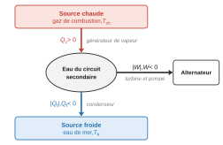
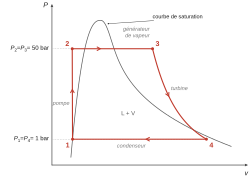
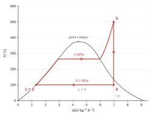
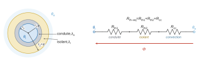
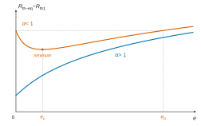

# Banque PT 2026 — Physique B (thermodynamique) · Corrigé brut

*Corrigé rédigé par IA, non officiel. Signalez toute erreur.*

Épreuve de 2 h, calculatrice interdite, document réponse 1 (diagramme $(T,s)$ de l'eau et tableau) à rendre. Thème : le procédé MESMA de propulsion anaérobie des sous-marins.

## Partie 1 : Description thermodynamique du cycle

### Q1

**Système** : l'eau (fluide caloporteur) du circuit secondaire. On suit une masse donnée sur un cycle complet, ce qui en fait un système fermé qui revient à son état initial.

**Convention** : les échanges sont comptés algébriquement, positivement quand ils sont reçus par l'eau. Le signe obtenu indique ensuite le **sens réel** du transfert : positif si l'eau reçoit effectivement l'énergie, négatif si elle la cède.

- $Q_c$ est reçu dans le **générateur de vapeur**, l'échangeur où les gaz de combustion éthanol/oxygène (source chaude, à $T_{ch}$) chauffent l'eau : $Q_c>0$ ;
- $Q_f$ est reçu dans le **condenseur**, au contact de la source froide (eau de mer) à $T_{fr}$ : $Q_f<0$, car l'eau cède de la chaleur ;
- $W$ est le travail reçu, échangé avec l'arbre de la turbine (et de la pompe) : $W<0$, car le dispositif est moteur.

Sur le schéma, les flèches donnent le sens réel des transferts : $Q_c$ entre dans l'eau, $|Q_f|$ et $|W|$ en sortent. Le bilan s'écrit $|W|=Q_c-|Q_f|$.

### Q2

Le premier principe sur un cycle ($\Delta U=0$) donne $W+Q_c+Q_f=0$.

Le second principe sur un cycle ($\Delta S=0$), pour un fonctionnement réversible ($S_{\text{créée}}=0$) avec deux thermostats, donne $\dfrac{Q_c}{T_{ch}}+\dfrac{Q_f}{T_{fr}}=0$, soit $Q_f=-Q_c\,\dfrac{T_{fr}}{T_{ch}}$.

Le rendement est le rapport entre l'énergie utile, le travail fourni $-W>0$, et l'énergie coûteuse, le transfert $Q_c$ reçu de la source chaude :
$$\begin{aligned}
\eta&=\frac{-W}{Q_c}\\
&=\frac{Q_c+Q_f}{Q_c}\\
&=1+\frac{Q_f}{Q_c}
\end{aligned}$$

Avec la relation tirée du second principe :
$$\boxed{\eta_C=1-\frac{T_{fr}}{T_{ch}}}$$

### Q3

On convertit en kelvins : $T_{ch}=773$ K et $T_{fr}=373$ K.
$$\begin{aligned}
\eta_C&=1-\frac{373}{773}\\
&\approx1-0{,}48
\end{aligned}$$

$$\boxed{\eta_C\approx0{,}52}$$

### Q4

Pour un cycle irréversible, le second principe s'écrit $0=\dfrac{Q_c}{T_{ch}}+\dfrac{Q_f}{T_{fr}}+S_{\text{créée}}$, d'où $Q_f=-T_{fr}\left(\dfrac{Q_c}{T_{ch}}+S_{\text{créée}}\right)$. On en déduit :
$$\begin{aligned}
\eta&=1+\frac{Q_f}{Q_c}\\
&=1-\frac{T_{fr}}{T_{ch}}-\frac{T_{fr}\,S_{\text{créée}}}{Q_c}
\end{aligned}$$

$$\boxed{\eta=1-\frac{T_{fr}}{T_{ch}}-\frac{T_{fr}\,S_{\text{créée}}}{Q_c}}$$

Le terme irréversible est homogène : $T_{fr}\,S_{\text{créée}}$ est une énergie, comme $Q_c$.

Comme $S_{\text{créée}}\ge0$, on a $\eta\le\eta_C$, avec égalité seulement pour un cycle réversible.

### Q5

**Système** : on se donne un volume de contrôle fixe, par exemple un composant entre sa section d'entrée $E$ et sa section de sortie $S$. On définit le système fermé $\Sigma$ :
- à l'instant $t$, c'est le fluide contenu dans ce volume, augmenté de la masse $\delta m$ qui va entrer pendant $\mathrm{d}t$ ;
- à l'instant $t+\mathrm{d}t$, c'est le fluide contenu dans ce volume, augmenté de la masse $\delta m$ sortie.

La masse sortie est égale à la masse entrée, puisque le régime est stationnaire.

On applique le premier principe à $\Sigma$. Le travail des forces de pression en amont et en aval vaut $(P_ev_e-P_sv_s)\,\delta m$. On obtient, par unité de masse :
$$\boxed{\Delta h+\Delta\!\left(\frac{c^2}{2}\right)+g\,\Delta z=w_u+q}$$

Les termes sont les suivants :
- $h=u+Pv$ est l'enthalpie massique ;
- $c$ est la vitesse d'ensemble du fluide et $z$ son altitude ;
- $w_u$ est le travail massique **utile**, échangé avec les parties mobiles (arbre de pompe ou de turbine), hors forces de pression d'entrée et de sortie ;
- $q$ est le transfert thermique massique reçu.

Si l'on néglige l'énergie cinétique et la pesanteur :
$$\boxed{h_s-h_e=w_u+q}$$

Cela donne, pour chaque élément du circuit :
- dans la pompe et la turbine, adiabatiques : $\Delta h=w_u$ ;
- dans le générateur et le condenseur, sans pièce mobile : $\Delta h=q$.

### Q6

On modélise l'eau liquide par une phase condensée incompressible et indilatable. Son entropie massique vaut alors $s=c\ln T+\text{cste}$ et ne dépend que de $T$. La compression 1→2 est isentropique, donc $s_2=s_1$, d'où :
$$\boxed{T_2=T_1=100\ ^\circ\text{C}}$$

L'enthalpie varie peu : $h_2-h_1=v\,(P_2-P_1)\approx10^{-3}\times49\times10^5\approx5$ kJ·kg⁻¹, donc $h_2\approx445$ kJ·kg⁻¹.

### Q7

- Le générateur de vapeur est isobare, donc $\boxed{P_3=P_2=50\text{ bar}}$.
- Le condenseur est isobare, donc $\boxed{P_4=P_1=1\text{ bar}}$.
- L'état 4 est un mélange liquide-vapeur en équilibre sous 1 bar, à la même pression que l'état 1, qui est un liquide saturé à 100 °C. Or la température d'équilibre ne dépend que de la pression, donc $\boxed{T_4=T_1=100\ ^\circ\text{C}}$. La température de vaporisation de l'eau sous 1 bar vaut bien environ 100 °C.

**Allure du cycle dans le diagramme $(P,v)$**, avec $P$ en ordonnée, $v$ en abscisse et la courbe de saturation en cloche :
- le point 1 est sur la branche liquide de la cloche, à $P=1$ bar ;
- 1→2 est un segment quasi vertical (le liquide est quasi incompressible) qui monte jusqu'à 50 bar, à gauche de la cloche ;
- 2→3 est l'isobare horizontale à 50 bar. Elle comporte l'échauffement du liquide jusqu'à la courbe d'ébullition, puis le palier de vaporisation sous la cloche (à environ 264 °C), puis la surchauffe de la vapeur jusqu'à 500 °C, à droite de la cloche ;
- 3→4 est la détente isentropique, une courbe décroissante plus raide qu'une isotherme. Elle entre dans la cloche et s'arrête au point 4, près de la branche vapeur ;
- 4→1 est le palier horizontal à 1 bar sous la cloche, de 4 jusqu'à 1.

Le cycle est parcouru dans le sens horaire, ce qui correspond à un cycle moteur.

### Q8

Pour un gaz parfait, $\mathrm{d}h=c_p\,\mathrm{d}T=T\,\mathrm{d}s+v\,\mathrm{d}P$. Sur une isobare, $\mathrm{d}T/T=\mathrm{d}s/c_p$. Si $c_p$ est constant :
$$\boxed{T=T_0\exp\!\left(\frac{s-s_0}{c_p}\right)}$$

Les isobares sont donc des exponentielles croissantes. Comme $(\partial s/\partial P)_T=-r/P<0$, les isobares de haute pression sont décalées vers la gauche.

Pour un gaz parfait, $h$ ne dépend que de $T$ (deuxième loi de Joule) : les isenthalpes sont des isothermes, donc des **droites horizontales** dans le diagramme $(T,s)$. À entropie élevée, c'est-à-dire à basse pression et loin de la courbe de saturation, la vapeur d'eau se comporte comme un gaz parfait. Les isenthalpes du diagramme y deviennent **horizontales**, comme on le voit en haut à droite du document réponse.

### Q9

Placement des points sur le document réponse 1 :

| Point | Position sur le diagramme $(T,s)$ |
|---|---|
| 1 | Sur la courbe d'ébullition (branche gauche), à $T=100$ °C et $s_1=1{,}3$ kJ·kg⁻¹·K⁻¹. |
| 2 | À la verticale de 1 ($s_2=s_1$), à $T_2=100$ °C, sur l'isobare 5 MPa. Dans le domaine liquide, les isobares se confondent pratiquement avec la courbe d'ébullition, donc 2 est quasiment confondu avec 1. |
| 3 | Intersection de l'isobare 5 MPa et de l'isotherme 500 °C, nettement à droite de la cloche, vers $s_3\approx7{,}0$ kJ·kg⁻¹·K⁻¹. L'isobare 5 MPa (50 bar) est la courbe repérée « 5 » sur l'échelle des pressions en haut du diagramme, entre les isobares 10 MPa et 2 MPa. |
| 4 | À la verticale de 3 ($s_4=s_3$, détente adiabatique réversible), sur l'isotherme 100 °C, dans la cloche, entre la courbe $q=0{,}9$ et la courbe de rosée. |

Le cycle se compose de quatre portions :
- 1→2 est réduit à un point ;
- 2→3 suit l'isobare 5 MPa : montée le long de la courbe d'ébullition jusqu'à environ 264 °C, palier horizontal de vaporisation dans la cloche jusqu'à la courbe de rosée, puis montée exponentielle dans la vapeur sèche jusqu'à 500 °C ;
- 3→4 est un segment vertical ;
- 4→1 est un segment horizontal à 100 °C.

### Q10

L'état 2 est un **liquide comprimé** (sous-refroidi) : à 50 bar, la température de saturation (environ 264 °C) dépasse largement $T_2=100$ °C. L'état 3 est une **vapeur sèche surchauffée**, puisque $500$ °C est supérieur à la température de saturation à 50 bar.

Tableau complété par lecture graphique :

| | 1 | 2 | 3 | 4 |
|---|---|---|---|---|
| $h$ (kJ·kg⁻¹) | 440 | $\approx445$ | $\approx3430$ | 2550 |
| $s$ (kJ·kg⁻¹·K⁻¹) | 1,3 | 1,3 | $\approx7{,}0$ | $\approx7{,}0$ |
| état | liquide saturé | liquide comprimé | vapeur sèche surchauffée | mélange liquide-vapeur |

### Q11

L'entropie est une grandeur extensive. Pour un mélange de titre massique en vapeur $x$ à la température $T$ :
$$\boxed{s(T)=x\,s_V(T)+(1-x)\,s_l(T)}$$

On en déduit le titre :
$$x=\frac{s-s_l}{s_V-s_l}$$

La détente est adiabatique et réversible, donc $s_4=s_3\approx7{,}0$ kJ·kg⁻¹·K⁻¹. Avec les données à $T_4=T_1$ :
$$\begin{aligned}
x_4&=\frac{s_4-s_l(T_1)}{s_V(T_1)-s_l(T_1)}\\
&=\frac{7{,}0-1{,}3}{7{,}3-1{,}3}\\
&=\frac{5{,}7}{6{,}0}
\end{aligned}$$

$$\boxed{x_4\approx0{,}95}$$

L'aide numérique de l'énoncé, $5{,}8/6{,}3\approx0{,}92$, ne correspond pas aux valeurs $s_l=1{,}3$ et $s_V=7{,}3$ fournies, dont la différence vaut 6,0. Elle conduirait à $x_4\approx0{,}92$. Les deux valeurs restent dans l'incertitude de lecture.

**Lecture directe** : le point 4 se trouve sur l'isotherme 100 °C, entre la courbe $q=0{,}9$ et la courbe de vapeur saturée, un peu plus près de la courbe $0{,}9$. On lit $x_4\approx0{,}93$ à $0{,}95$, ce qui concorde avec le calcul.

### Q12

D'après le premier principe industriel, sans travail utile, on a $q=\Delta h$.

Générateur de vapeur (2→3) :
$$\begin{aligned}
q_{23}&=h_3-h_2\\
&\approx3430-445
\end{aligned}$$

$$\boxed{q_{23}\approx2{,}99\times10^3\ \text{kJ·kg}^{-1}>0}$$

Condenseur (4→1) :
$$\begin{aligned}
q_{41}&=h_1-h_4\\
&=440-2550
\end{aligned}$$

$$\boxed{q_{41}\approx-2{,}11\times10^3\ \text{kJ·kg}^{-1}<0}$$

Les signes sont ceux annoncés en Q1, avec la même convention (transfert reçu par l'eau) : $q_{23}$ correspond à $Q_c>0$ et $q_{41}$ à $Q_f<0$. Le fluide reçoit effectivement de la chaleur de la source chaude et en cède réellement à la source froide (l'eau de mer), ce qui est cohérent avec un moteur.

### Q13

Sur un cycle, $\Delta h=0$, donc $w_{\text{cycle}}+q_{23}+q_{41}=0$ :
$$\begin{aligned}
w_{\text{cycle}}&=-(q_{23}+q_{41})\\
&\approx-(2985-2110)
\end{aligned}$$

$$\boxed{w_{\text{cycle}}\approx-875\ \text{kJ·kg}^{-1}}$$

Dans la turbine, adiabatique :
$$\begin{aligned}
w_T&=h_4-h_3\\
&\approx2550-3430
\end{aligned}$$

$$\boxed{w_T\approx-880\ \text{kJ·kg}^{-1}}$$

Les deux grandeurs portent sur le même cycle de Rankine : l'écart ne vient pas d'une irréversibilité. Le travail du cycle comprend aussi le travail reçu dans la pompe :
$$w_P=h_2-h_1\approx+5\ \text{kJ·kg}^{-1}$$

On a donc $w_{\text{cycle}}=w_T+w_P$, et $|w_{\text{cycle}}|<|w_T|$ : une partie du travail fourni par la turbine est consommée pour comprimer l'eau. Ce travail de pompe reste faible (moins de 1 % de $|w_T|$), car on comprime un liquide de faible volume massique.

### Q14

À la sortie de la turbine, le fluide est un **mélange liquide-vapeur** de titre $x_4\approx0{,}95$, soit environ 5 % de liquide en masse sous forme de gouttelettes. Ces gouttelettes, entraînées à grande vitesse, heurtent les aubes de la turbine. Elles provoquent une **érosion** et des chocs mécaniques sur les derniers étages, favorisent la corrosion et dégradent le rendement de la détente. C'est pourquoi on limite l'humidité en fin de détente (surchauffe, resurchauffe).

### Q15

Le rendement est le travail utile fourni par le fluide divisé par la chaleur reçue de la source chaude :
$$\eta=\frac{-w_{\text{cycle}}}{q_{23}}$$

Application numérique :
$$\eta\approx\frac{875}{2985}\approx0{,}29$$

$$\boxed{\eta\approx0{,}3}$$

On a $\eta\approx0{,}3<\eta_C\approx0{,}52$, ce qui est conforme à Q4 : le cycle réel crée de l'entropie. L'irréversibilité principale se situe dans le générateur de vapeur. L'eau y reçoit de la chaleur alors que sa température varie de 100 °C à 500 °C, au contact d'une source à $T_{ch}$ : l'écart de température est fini. Au condenseur, au contraire, l'échange se fait à 100 °C, la température de la source froide.

### Q16

On remonte la chaîne de conversion :
- puissance électrique : $P_e=P_{\text{méca}}/0{,}8=250$ kW ;
- puissance mécanique fournie par la turbine à l'alternateur : $P_T=P_e/0{,}95\approx263$ kW ;
- débit massique d'eau : $P_T=D_m\,|w_T|$.

$$D_m=\frac{P_{\text{méca}}}{0{,}8\times0{,}95\times|w_T|}$$

Application numérique, avec les puissances en kW et le travail en kJ·kg⁻¹ :
$$D_m\approx\frac{263}{880}$$

$$\boxed{D_m\approx0{,}3\ \text{kg·s}^{-1}}$$

Le résultat est le même avec le travail net du cycle (875 kJ·kg⁻¹).

## Partie 2 : Utilisation de l'oxygène liquide

### Q17

**Homogénéité.** Le logarithme est sans dimension. D'après la loi de Fourier, $\vec{j}_Q=-\lambda\,\overrightarrow{\mathrm{grad}}\,T$, la conductivité $\lambda_a$ s'exprime en W·m⁻¹·K⁻¹. Donc $\lambda_aL$ s'exprime en W·K⁻¹ et $R_{th1}$ en K·W⁻¹. C'est bien l'unité d'une résistance thermique, rapport d'un écart de température à un flux.

**Pertinence.**
- $R_{th1}\propto1/\lambda_a$ : à écart de température donné, un matériau plus conducteur laisse passer un flux plus grand, donc isole moins bien.
- $R_{th1}\propto1/L$ : une conduite plus longue offre une surface de contact plus grande, donc un flux plus grand. Des tronçons placés côte à côte se comportent comme des résistances en parallèle.
- $R_{th1}$ croît avec $r_2/r_1$, donc avec l'épaisseur de la paroi que la chaleur doit traverser.
- Pour une paroi mince d'épaisseur $\varepsilon=r_2-r_1\ll r_1$, on a $\ln(r_2/r_1)\approx\varepsilon/r_1$. On retrouve la résistance $\varepsilon/(\lambda S)$ d'un mur plan de surface $S=2\pi r_1L$ :
$$R_{th1}\approx\frac{\varepsilon}{\lambda_a\,2\pi r_1L}$$

**Isolant**, de rayon intérieur $r_2$, de rayon extérieur $r_2+e$ et de conductivité $\lambda_i$ :
$$\boxed{R_{th2}=\frac{\ln\!\left(\dfrac{r_2+e}{r_2}\right)}{2\pi\lambda_iL}}$$

### Q18

D'après la loi de Newton, $P=h_{ext}S\,(T_{ext}-T_S)=\dfrac{T_{ext}-T_S}{R_{cc}}$, où $S=2\pi(r_2+e)L$ est la surface extérieure de l'isolant :
$$\boxed{R_{cc}=\frac{1}{2\pi h_{ext}(r_2+e)L}}$$

Le même flux $\Phi$ traverse successivement la conduite, l'isolant puis la couche d'air, en régime stationnaire et sans accumulation aux interfaces. Les trois résistances sont donc en série :
$$\boxed{R_{th-eq}=\frac{\ln(r_2/r_1)}{2\pi\lambda_aL}+\frac{\ln\!\left(\frac{r_2+e}{r_2}\right)}{2\pi\lambda_iL}+\frac{1}{2\pi h_{ext}(r_2+e)L}}$$

### Q19

Le flux est compté positivement de l'extérieur vers l'oxygène :
$$\Phi=\frac{\theta_e-\theta_i}{R_{th-eq}}$$

Avec l'expression de Q18 :
$$\boxed{\Phi=\frac{2\pi L\,(\theta_e-\theta_i)}{\dfrac{\ln(r_2/r_1)}{\lambda_a}+\dfrac{\ln\left(1+e/r_2\right)}{\lambda_i}+\dfrac{1}{h_{ext}(r_2+e)}}}$$

Avec la valeur fournie $R_{th-eq}=1{,}0$ K·W⁻¹, on obtient $\Phi=205/1{,}0\approx2\times10^2$ W, qui entrent dans l'oxygène.

### Q20

Seuls les deux derniers termes de $R_{th-eq}$ dépendent de $e$. On pose $r=r_2+e$ :
$$\frac{\mathrm{d}R_{th-eq}}{\mathrm{d}e}=\frac{1}{2\pi L}\left(\frac{1}{\lambda_i r}-\frac{1}{h_{ext}r^2}\right)=\frac{1}{2\pi L\,\lambda_i r^2}\left(r-\frac{\lambda_i}{h_{ext}}\right)$$

La dérivée s'annule pour le **rayon critique** $r_c=\lambda_i/h_{ext}$, ce qui s'écrit aussi $\alpha=\dfrac{h_{ext}r_2}{\lambda_i}=\dfrac{r_2}{r_c}$.

- **Cas $\alpha>1$**, soit $r_2>r_c$ : pour tout $e\ge0$, on a $r>r_c$. La résistance $R_{th-eq}$ est donc **strictement croissante** en $e$ et augmente indéfiniment, de façon logarithmique.
- **Cas $\alpha<1$**, soit $r_2<r_c$ : la résistance **décroît** pour $0\le e<e_c$, passe par un **minimum** en $e_c$, puis croît. L'épaisseur critique vaut :
$$\begin{aligned}
e_c&=r_c-r_2\\
&=r_2\left(\frac1\alpha-1\right)
\end{aligned}$$

### Q21

Une fine couche supplémentaire d'isolant, d'épaisseur $\mathrm{d}e$ posée sur le rayon $r_2$, a deux effets opposés :
- elle ajoute une résistance de conduction $\dfrac{\mathrm{d}e}{2\pi\lambda_i r_2L}$ ;
- elle agrandit la surface d'échange avec l'air, ce qui diminue la résistance de convection de $\dfrac{\mathrm{d}e}{2\pi h_{ext}r_2^2L}$.

Le rapport du premier effet au second vaut $\alpha=h_{ext}r_2/\lambda_i$. Le nombre $\alpha$ indique donc quel phénomène limite le transfert thermique : la conduction dans l'isolant si $\alpha>1$, la convection à la surface extérieure si $\alpha<1$, c'est-à-dire si $h_{ext}<\lambda_i/r_2$.

- **Si $\alpha>1$**, l'isolant est **toujours utile** : toute épaisseur augmente $R_{th-eq}$ et diminue le flux entrant. C'est le cas usuel pour une conduite de quelques centimètres de rayon, puisque $r_c=\lambda_i/h_{ext}$ vaut de l'ordre de quelques millimètres pour un bon isolant ($\lambda_i\sim0{,}04$ W·m⁻¹·K⁻¹ et $h_{ext}\sim10$ W·m⁻²·K⁻¹).
- **Si $\alpha<1$**, la déperdition à la surface est limitante et une couche mince d'isolant est **néfaste**. L'augmentation de la surface d'échange convective l'emporte sur la résistance de conduction ajoutée, et le flux augmente. L'isolant ne devient utile qu'au-delà d'une épaisseur $e_0>e_c$ telle que $R_{th-eq}(e_0)=R_{th-eq}(0)$. Pour isoler, il faut alors choisir une épaisseur nettement supérieure à $e_0$, ou un matériau de plus faible $\lambda_i$, ce qui augmente $\alpha$.

### Q22

D'autres effets sont à surveiller :
- la **vaporisation** partielle de l'oxygène dans la conduite (point chaud, chute de pression, cavitation), qui donne un écoulement diphasé, perturbe le débit et la mesure, et peut créer des bouchons de vapeur ;
- le **givre** et la condensation de l'humidité de l'air sur les parois froides ;
- la **contraction thermique** de la conduite à −185 °C, qui crée des contraintes aux brides et aux supports ;
- la **fragilisation** des matériaux à basse température (transition ductile-fragile) ;
- le **risque d'incendie**. L'oxygène n'est pas lui-même inflammable : c'est un **comburant** puissant, qui entretient et accélère la combustion des matériaux **combustibles** à son contact (graisses, joints, isolants organiques). Il faut donc exclure les graisses, choisir des matériaux compatibles et surveiller les fuites ;
- les **pertes de charge** et l'étanchéité.

### Q23

On suppose la vitesse uniforme sur chaque section. L'écoulement étant **stationnaire**, la masse contenue entre les sections A et B ne varie pas : le débit massique se conserve.
$$\rho_A\,u\,S=\rho_B\,v\,s$$

Le fluide étant de plus **incompressible**, $\rho_A=\rho_B=\rho_d$, et c'est le débit volumique qui se conserve :
$$uS=vs$$

$$\boxed{v=\frac{S}{s}\,u}$$

On a $v>u$ puisque $s<S$.

### Q24

Conditions d'application : écoulement **stationnaire** d'un fluide **parfait** (non visqueux), **incompressible** et homogène, sans pièce mobile ni échange thermique, entre deux points d'une même **ligne de courant**. Sous ces conditions :
$$\boxed{P+\frac12\rho c^2+\rho g z=\text{cste le long d'une ligne de courant}}$$

### Q25

On applique Bernoulli entre A et B, sur une même ligne de courant et à la même altitude puisque le débitmètre est horizontal :
$$P_A+\frac12\rho_du^2=P_B+\frac12\rho_dv^2$$

Avec $v=uS/s$ :
$$\begin{aligned}
P_A-P_B&=\frac12\rho_d\left(v^2-u^2\right)\\
&=\frac12\rho_du^2\,\frac{S^2-s^2}{s^2}
\end{aligned}$$

$$\boxed{u=s\sqrt{\frac{2(P_A-P_B)}{\rho_d\,(S^2-s^2)}}}$$

### Q26

$$\boxed{D_m=\rho_dSu=Ss\sqrt{\frac{2\rho_d(P_A-P_B)}{S^2-s^2}}}$$

Application numérique, en unités SI :
- $S=27\times10^{-4}$ m² et $s=3\times10^{-4}$ m² ;
- $P_A-P_B=0{,}044$ bar $=4{,}4\times10^3$ Pa ;
- $\rho_d=1100$ kg·m⁻³.

Comme $(s/S)^2=1/81$, on peut écrire $S^2-s^2\approx S^2$. L'erreur vaut environ 1 % sur $S^2$ et 0,6 % sur $D_m$. On obtient alors $D_m\approx s\sqrt{2\rho_d\Delta P}$, que l'on calcule à la main :
$$\begin{aligned}
2\rho_d\Delta P&=2\times1100\times4400\\
&\approx9{,}7\times10^6\ \text{kg}^2\cdot\text{m}^{-4}\cdot\text{s}^{-2}\\
\sqrt{2\rho_d\Delta P}&\approx3{,}1\times10^3\ \text{kg}\cdot\text{m}^{-2}\cdot\text{s}^{-1}
\end{aligned}$$

La dernière ligne utilise $3{,}1^2=9{,}61\approx9{,}7$. D'où :
$$\begin{aligned}
D_m&\approx3\times10^{-4}\times3{,}1\times10^3\\
&\approx0{,}93\ \text{kg·s}^{-1}
\end{aligned}$$

Sans l'approximation $S^2-s^2\approx S^2$, on trouverait $0{,}94$ kg·s⁻¹.

$$\boxed{D_m\approx1\ \text{kg·s}^{-1}}$$

### Q27

Pour un fluide réel, visqueux, deux types de pertes de charge apparaissent :
- des **pertes de charge régulières**, dues au frottement visqueux le long des parois (cylindre d'entrée, convergent, col, divergent) ;
- des **pertes de charge singulières**, dues aux changements de section, surtout dans le **divergent**, où l'écoulement peut se détacher des parois et former des tourbillons. Le convergent en provoque peu.

La pression en aval ne remonte donc pas à $P_A$, et la relation de Q26 surestime légèrement le débit.

## Évolution de la température le long de la conduite

### Q28

**Système** : la tranche de fluide comprise entre $x$ et $x+\mathrm{d}x$, en régime permanent.

La résistance thermique est inversement proportionnelle à la longueur. Une tranche de longueur $\mathrm{d}x$ a donc pour résistance $R_{th-eq}L/\mathrm{d}x$, et elle reçoit de l'extérieur la puissance :
$$\delta\Phi=\frac{\theta_e-\theta(x)}{R_{th-eq}\,L}\,\mathrm{d}x$$

Le premier principe industriel s'applique sans travail utile, en négligeant l'énergie cinétique et la pesanteur. Pour un liquide, $\mathrm{d}h=c_{dio}\,\mathrm{d}\theta$. On obtient $D_m\,c_{dio}\,[\theta(x+\mathrm{d}x)-\theta(x)]=\delta\Phi$, soit :
$$\boxed{\frac{\mathrm{d}\theta}{\mathrm{d}x}+\frac{\theta}{D_m\,c_{dio}\,R_{th-eq}\,L}=\frac{\theta_e}{D_m\,c_{dio}\,R_{th-eq}\,L}}$$

### Q29

L'équation s'écrit $\dfrac{\mathrm{d}\theta}{\mathrm{d}x}+\dfrac{\theta}{\delta}=\dfrac{\theta_e}{\delta}$, avec :
$$\boxed{\delta=D_m\,c_{dio}\,R_{th-eq}\,L}$$

Vérification d'homogénéité : le produit $D_m\,c_{dio}\,R_{th-eq}$ s'exprime en (kg·s⁻¹)(J·kg⁻¹·K⁻¹)(K·s·J⁻¹), donc il est sans dimension, et $\delta$ est bien une longueur.

Application numérique : $\delta=1\times1{,}7\times10^3\times1{,}0\times2$, donc
$$\boxed{\delta\approx3{,}4\times10^3\ \text{m}\approx3\ \text{km}}$$

### Q30

Avec $\theta(0)=\theta_i$, la solution est $\theta(x)=\theta_e+(\theta_i-\theta_e)\,e^{-x/\delta}$. La variation sur la longueur $L$ vaut donc :
$$\boxed{\Delta\theta=\theta(L)-\theta_i=(\theta_e-\theta_i)\left(1-e^{-L/\delta}\right)}$$

Elle est négligeable lorsque $L\ll\delta$. On a alors, au premier ordre en $L/\delta$ :
$$\begin{aligned}
\Delta\theta&\approx(\theta_e-\theta_i)\,\frac{L}{\delta}\\
&=\frac{\theta_e-\theta_i}{D_m\,c_{dio}\,R_{th-eq}}
\end{aligned}$$

Application numérique : $L/\delta\approx6\times10^{-4}$, d'où
$$\Delta\theta\approx\frac{205}{1700}$$

$$\boxed{\Delta\theta\approx0{,}12\ \text{K}}$$

**Conclusion** : sur les quelques mètres de conduite d'un sous-marin, l'oxygène se réchauffe d'un dixième de kelvin environ. Il reste bien en dessous de sa température d'ébullition, qui est d'environ −183 °C sous 1 bar et plus élevée sous pression. Les conduites isolées du procédé MESMA ($R_{th-eq}=1$ K·W⁻¹) remplissent leur rôle : l'oxygène arrive liquide au vaporisateur, à température quasi uniforme. Cela valide aussi l'hypothèse $\theta_i$ uniforme des questions Q17 à Q21.
