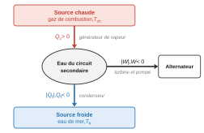
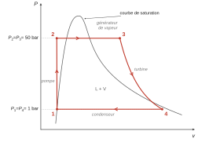
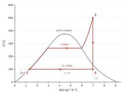
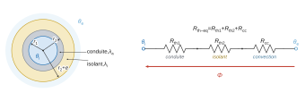
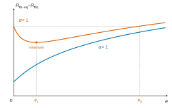

# Banque PT PT — Physique B (thermodynamique) 2026 · Corrigé guidé

*Corrigé rédigé par IA, non officiel. Signalez toute erreur.*

## Présentation du sujet

Le sujet porte sur le procédé **MESMA** (Module d'Énergie Sous-Marin Autonome), un système de propulsion anaérobie. Une chambre de combustion éthanol/oxygène liquide chauffe le circuit secondaire d'eau, qui décrit un **cycle de Rankine** : pompe, générateur de vapeur, turbine et condenseur refroidi par l'eau de mer. L'épreuve dure 2 h, **sans calculatrice**. Le diagramme $(T,s)$ de l'eau figure sur un document réponse à rendre. Les données utiles sont regroupées à la fin de chaque partie, et l'énoncé fournit des aides de calcul ($373/773\approx0{,}48$, $5{,}8/6{,}3\approx0{,}92$).

Découpage :

- **Partie 1, Q1 à Q16 : description thermodynamique du cycle.**
  - Q1 à Q4 : modèle du moteur ditherme de Carnot, avec la démonstration du rendement de Carnot et le rendement réel en présence d'entropie créée.
  - Q5 à Q16 : étude détaillée avec le premier principe industriel. On place le cycle dans les diagrammes $(P,v)$ et $(T,s)$, on lit les valeurs manquantes, on calcule le titre en sortie de turbine, les transferts et travaux massiques, le rendement, puis le débit d'eau nécessaire pour 200 kW de propulsion.
- **Partie 2, Q17 à Q30 : utilisation de l'oxygène liquide.**
  - Q17 à Q22 : résistances thermiques en série et rayon critique d'isolation.
  - Q23 à Q27 : débitmètre de Venturi (conservation du débit, Bernoulli, pertes de charge).
  - Q28 à Q30 : bilan enthalpique sur une tranche de conduite, qui donne une équation différentielle du premier ordre et une longueur caractéristique.

**Notions mobilisées.** Le sujet fait appel aux premier et second principes sur un cycle, au premier principe industriel, aux changements d'état et au titre en vapeur, aux diagrammes $(P,v)$ et $(T,s)$, au modèle du gaz parfait et à celui de la phase condensée, à la conduction thermique et aux résistances thermiques, à la loi de Newton, à la relation de Bernoulli et à la résolution d'une équation différentielle linéaire du premier ordre.

**Difficulté et longueur.** Le sujet est long pour 2 h (30 questions), mais très proche du cours. Les points délicats sont la lecture du diagramme $(T,s)$ (Q9 à Q11), la discussion du rayon critique (Q20 et Q21) et le passage de la résistance globale à la résistance d'une tranche (Q28).

**Questions à ne pas laisser passer.** Q2, Q3, Q5, Q7, Q12, Q13, Q15, Q16, Q17, Q18, Q23 à Q26, Q29 et Q30 sont des applications directes du cours.

**Ce qu'en dit le rapport 2026.** Le jury juge le sujet long, mais permettant à chacun de traiter les points qu'il maîtrise le mieux. Il trouve l'ensemble des copies assez faible. Il classe les questions ainsi :
- Q1 à Q8, Q11, Q14 et Q17 à Q19 ont été traitées par presque tous les candidats ;
- Q9, Q10, Q12 et Q13 ont été traitées, mais avec énormément d'erreurs : une rédaction juste y fait déjà la différence ;
- Q15, Q16, Q20, Q21 et Q28 à Q30 ont été peu traitées, et généralement fausses lorsqu'elles l'étaient. Ce sont les questions les plus discriminantes.

Les reproches généraux portent sur des applications numériques rarement faites alors qu'elles rapportaient des points, sur les unités (J confondu avec K, kJ·kg⁻¹ avec kJ·mol⁻¹ ou kJ), sur la confusion entre débit, puissance et énergie, sur le vocabulaire (isentropique ou isenthalpique, stationnaire, laminaire, incompressible) et sur les conventions de signe. Le jury reproche aussi des démonstrations arrangées pour tomber sur le résultat attendu, par exemple un signe moins apparu en cours de calcul. Il demande d'encadrer les résultats et de souligner les mots-clés.

**Gestion du temps.** Comptez environ 1 h 05 pour la partie 1 et 55 min pour la partie 2. Les trois blocs de la partie 2 sont presque indépendants : Q28 à Q30 n'utilisent que les valeurs **données** $R_{th-eq}=1$ K/W et $D_m=1$ kg/s.

## Partie 1 — Description thermodynamique du cycle

On commence par le modèle idéal de Carnot, puis on décrit le cycle réel point par point à l'aide du premier principe industriel et du diagramme $(T,s)$. Les questions s'enchaînent : une erreur sur un état (Q7 à Q10) se propage jusqu'à Q16.

### Question 1

> [!INDICATION]
> Choisissez un système fermé qui revient à son état initial, puis repérez où il est en contact avec la source chaude et avec la source froide.

> [!INDICATION]
> Utilisez la convention « reçu par le système ». Pour un moteur, demandez-vous quels échanges sont effectivement cédés par le fluide.

#### Solution

Le système est l'eau du circuit secondaire, suivie sur un cycle complet. C'est un système fermé qui revient à son état initial.

Convention : tous les échanges sont comptés positivement quand ils sont reçus par l'eau. Le signe obtenu donne ensuite le sens réel du transfert.

- $Q_c$ est le transfert thermique reçu dans le **générateur de vapeur**, l'échangeur où la source chaude (gaz de combustion, à $T_{ch}$) chauffe l'eau : $Q_c>0$.
- $Q_f$ est le transfert thermique reçu dans le **condenseur**, de la part de l'eau de mer (source froide, à $T_{fr}$) : $Q_f<0$.
- $W$ est le travail reçu par l'intermédiaire des arbres de la turbine et de la pompe : $W<0$, car le dispositif est moteur.

> [!PIEGE]
> Ne confondez pas les composants avec les sources. Le générateur de vapeur et le condenseur sont des échangeurs. Les thermostats sont les gaz chauds et l'eau de mer.

> [!JURY]
> Le rapport 2026 reproche des copies où la différence entre sens conventionnel et sens réel n'est pas explicitée, où le système est mal identifié et où $Q_c$ n'est pas rattaché à l'échangeur. Écrivez la convention en une phrase, nommez le composant de chaque échange, et faites un schéma dont les flèches sont légendées.

### Question 2

> [!INDICATION]
> Écrivez les deux principes sur un cycle, en remarquant que $U$ et $S$ sont des fonctions d'état.

> [!INDICATION]
> Réversible signifie $S_{\text{créée}}=0$. Avec un thermostat, l'entropie échangée s'écrit $Q/T$.

#### Solution

Premier principe sur un cycle : $W+Q_c+Q_f=0$.

Second principe sur un cycle réversible : $\dfrac{Q_c}{T_{ch}}+\dfrac{Q_f}{T_{fr}}=0$.

Le rendement compare le travail fourni $-W>0$ au transfert $Q_c$ reçu de la source chaude :
$$\begin{aligned}
\eta&=\frac{-W}{Q_c}\\
&=1+\frac{Q_f}{Q_c}
\end{aligned}$$

Avec la relation tirée du second principe, $Q_f/Q_c=-T_{fr}/T_{ch}$ :
$$\boxed{\eta_C=1-\frac{T_{fr}}{T_{ch}}}$$

> [!METHODE]
> Pour toute machine ditherme, la démarche est toujours la même : définir le rendement ou l'efficacité, puis éliminer $W$ avec le premier principe et un des $Q$ avec le second.

> [!PIEGE]
> Le rapport 2026 relève des erreurs de signe entre chaleur ou travail reçus et fournis, et des copies qui donnent l'efficacité d'une pompe à chaleur. Pour un moteur, l'énergie utile est le travail **fourni**, $-W$, et l'énergie coûteuse est $Q_c$.

### Question 3

> [!INDICATION]
> Les températures thermodynamiques s'expriment en kelvins. L'énoncé fournit le rapport utile.

#### Solution

On a $T_{ch}=773$ K et $T_{fr}=373$ K, donc :
$$\begin{aligned}
\eta_C&=1-\frac{373}{773}\\
&\approx1-0{,}48
\end{aligned}$$

$$\boxed{\eta_C\approx0{,}52}$$

> [!PIEGE]
> Si l'on garde les degrés Celsius, on trouve $1-100/500=0{,}8$, ce qui est faux. Le rapport 2026 signale beaucoup d'erreurs de conversion en kelvins sur cette question.

### Question 4

> [!INDICATION]
> Reprenez Q2 en ajoutant $S_{\text{créée}}\ge0$ dans le bilan d'entropie.

#### Solution

Le bilan d'entropie s'écrit $0=\dfrac{Q_c}{T_{ch}}+\dfrac{Q_f}{T_{fr}}+S_{\text{créée}}$, donc $Q_f=-T_{fr}\left(\dfrac{Q_c}{T_{ch}}+S_{\text{créée}}\right)$. On en déduit :
$$\boxed{\eta=1-\frac{T_{fr}}{T_{ch}}-\frac{T_{fr}\,S_{\text{créée}}}{Q_c}}$$

Comme $S_{\text{créée}}\ge0$, on a $\eta\le\eta_C$. L'égalité n'a lieu que pour un cycle réversible.

> [!PIEGE]
> Le rapport 2026 note deux défauts fréquents. Le terme réversible doit être exactement le rendement de Carnot trouvé en Q2 : s'il diffère, il y a une erreur. Le terme irréversible doit être homogène : sans le facteur $T_{fr}$ devant $S_{\text{créée}}$, on divise des J·K⁻¹ par des J.

### Question 5

> [!INDICATION]
> Le système à définir est un système **fermé** construit à partir d'un volume de contrôle fixe, en tenant compte de la masse qui entre et de celle qui sort pendant $\mathrm{d}t$.

> [!INDICATION]
> Le travail des forces de pression en entrée et en sortie se regroupe avec $u$ pour former $h$.

#### Solution

On fixe un volume de contrôle, par exemple un composant entre son entrée $E$ et sa sortie $S$. On définit le système fermé $\Sigma$ :
- à l'instant $t$, le fluide contenu dans ce volume et la masse $\delta m$ qui va entrer pendant $\mathrm{d}t$ ;
- à l'instant $t+\mathrm{d}t$, le fluide contenu dans le volume et la masse $\delta m$ qui vient de sortir.

En régime permanent, le contenu du volume de contrôle ne change pas. On applique le premier principe à $\Sigma$. Le travail des forces de pression d'entrée et de sortie vaut $(P_ev_e-P_sv_s)\delta m$. On obtient :
$$\boxed{\Delta h+\Delta\!\left(\frac{c^2}{2}\right)+g\Delta z=w_u+q}$$

Les termes sont les suivants :
- $h$ est l'enthalpie massique ;
- $c$ est la vitesse d'ensemble et $z$ l'altitude ;
- $w_u$ est le travail utile massique, fourni par les parties mobiles ;
- $q$ est le transfert thermique massique.

Dans le circuit, on néglige l'énergie cinétique et la pesanteur, ce qui donne $\boxed{\Delta h=w_u+q}$. Dans les échangeurs, $\Delta h=q$. Dans la pompe et la turbine, adiabatiques, $\Delta h=w_u$.

> [!METHODE]
> Pour chaque composant, posez-vous deux questions : y a-t-il une pièce mobile, ce qui donne $w_u\ne0$ ? Y a-t-il un échange thermique, ce qui donne $q\ne0$ ? La réponse donne immédiatement la forme du bilan.

> [!PIEGE]
> Le rapport 2026 relève une confusion entre $U$ et $H$, et des copies qui mélangent la forme massique, la forme en débit massique et la forme en débit volumique. Choisissez une écriture, ici par unité de masse, et tenez-vous-y.

### Question 6

> [!INDICATION]
> Quel modèle du programme décrit un liquide ? De quelles variables dépend alors son entropie ?

> [!INDICATION]
> La compression dans la pompe est isentropique.

#### Solution

On modélise l'eau liquide par une phase condensée incompressible et indilatable. Son entropie s'écrit $s=c\ln T+\text{cste}$ et ne dépend que de $T$. Comme $s_2=s_1$, on a $\boxed{T_2=T_1=100\ ^\circ\text{C}}$.

L'enthalpie augmente seulement de $v\Delta P\approx10^{-3}\times49\times10^5\approx5$ kJ·kg⁻¹, donc $h_2\approx445$ kJ·kg⁻¹.

> [!PIEGE]
> Les lois de Laplace ne s'appliquent pas à un liquide : elles concernent le gaz parfait. Selon le rapport 2026, beaucoup de candidats les ont pourtant appliquées ici, et ceux qui ont bien pris le modèle de phase condensée ont eu du mal à conclure qu'une transformation isentropique y est isotherme.

### Question 7

> [!INDICATION]
> Le générateur de vapeur et le condenseur sont des échangeurs isobares.

> [!INDICATION]
> Dans un mélange diphasé à l'équilibre, la pression et la température ne sont pas indépendantes.

#### Solution

Les échangeurs sont isobares, donc $\boxed{P_3=P_2=50\text{ bar}}$ et $\boxed{P_4=P_1=1\text{ bar}}$.

L'état 4 est un mélange liquide-vapeur sous 1 bar. Sa température est la température d'équilibre sous cette pression, la même que celle du liquide saturé de l'état 1 : $\boxed{T_4=T_1=100\ ^\circ\text{C}}$.

**Diagramme $(P,v)$**, avec la cloche de saturation :
- 1 est sur la branche liquide, à 1 bar ;
- 1→2 est presque vertical, jusqu'à 50 bar ;
- 2→3 suit l'isobare horizontale à 50 bar : échauffement du liquide, palier de vaporisation sous la cloche (à environ 264 °C), puis surchauffe jusqu'à 500 °C, hors de la cloche à droite ;
- 3→4 est la détente isentropique, une courbe descendante qui rentre dans la cloche ;
- 4→1 est le palier horizontal de condensation à 1 bar.

Le cycle est parcouru dans le sens horaire, comme tout cycle moteur.

> [!PIEGE]
> Dans le diagramme $(P,v)$, l'écart entre 1 et 2 est presque invisible. Le volume massique du liquide vaut environ $10^{-3}$ m³/kg, alors que celui de la vapeur en 4 vaut environ 1,6 m³/kg.

> [!JURY]
> Le rapport 2026 rappelle qu'un diagramme de Clapeyron porte $P$ en fonction de $v$, et non de $T$. Il note : « Les cycles moteurs sont parfois dessinés à l’envers (sens anti-horaire). » Il reproche aussi l'absence de la courbe de saturation, des points 2, 3 et 4 mal placés par rapport à elle, et des isentropiques ou isothermes mal représentées. Tracez la cloche, placez chaque point par rapport à elle et fléchez le cycle.

### Question 8

> [!INDICATION]
> Partez de l'identité $\mathrm{d}h=T\mathrm{d}s+v\mathrm{d}P$ et de la loi de Joule $\mathrm{d}h=c_p\mathrm{d}T$.

> [!INDICATION]
> Pour un gaz parfait, de quoi dépend $h$ ? Que deviennent alors les courbes $h=\text{cste}$ ?

#### Solution

Pour un gaz parfait, sur une isobare, $c_p\,\mathrm{d}T=T\,\mathrm{d}s$, d'où $\boxed{T=T_0\,e^{(s-s_0)/c_p}}$. Ce sont des exponentielles croissantes. Comme $(\partial s/\partial P)_T=-r/P$, les isobares de plus haute pression sont plus à gauche.

Toujours pour un gaz parfait, $h=h(T)$ : les isenthalpes sont des isothermes, donc horizontales. À entropie élevée (basse pression, loin de la cloche), la vapeur se comporte comme un gaz parfait, et les isenthalpes du diagramme y deviennent **horizontales**.

> [!METHODE]
> La pente d'une isobare dans le diagramme $(T,s)$ vaut $T/c_p$. Dans le diagramme d'un fluide réel, retenez la correspondance suivante : là où les isenthalpes sont horizontales, le fluide se comporte comme un gaz parfait.

> [!JURY]
> Le rapport 2026 juge la question plutôt réussie quand elle est traitée, mais signale l'oubli de la constante d'intégration : « Il aurait suffi de vérifier l’homogénéité de la formule obtenue. » Un $\ln T$ ou un $e^{s/c_p}$ sans référence $T_0$, $s_0$ n'est pas homogène.

### Question 9

> [!INDICATION]
> Placez d'abord les points connus par $(T,\text{état})$ : 1 et le niveau 100 °C de 4. Placez ensuite 3 à l'intersection d'une isobare et d'une isotherme.

> [!INDICATION]
> Pour les transformations isentropiques, demandez-vous quel type de segment elles donnent dans ce diagramme.

#### Solution

Placement des points :
- **1** : sur la courbe d'ébullition, à 100 °C ($s_1=1{,}3$ kJ·kg⁻¹·K⁻¹).
- **2** : à la verticale de 1 ($s_2=s_1$, $T_2=T_1$), sur l'isobare 5 MPa. Il est pratiquement confondu avec 1, car les isobares du liquide se confondent avec la courbe d'ébullition.
- **3** : à l'intersection de l'isobare 5 MPa et de l'isotherme 500 °C, à droite de la cloche ($s_3\approx7{,}0$ kJ·kg⁻¹·K⁻¹). L'isobare 5 MPa (50 bar) est la courbe repérée « 5 » sur l'échelle des pressions en haut du diagramme, entre 10 MPa et 2 MPa.
- **4** : à la verticale de 3, sur le palier à 100 °C, dans la cloche, entre la courbe $q=0{,}9$ et la courbe de rosée.

Le cycle se décrit ainsi :
- 2→3 suit l'isobare 5 MPa : le long de la courbe d'ébullition jusqu'à environ 264 °C, puis un palier horizontal dans la cloche, puis une montée dans la vapeur sèche ;
- 3→4 est vertical ;
- 4→1 est horizontal.

> [!PIEGE]
> Une isentropique est **verticale** dans le diagramme $(T,s)$. Si le point 4 n'est pas à l'aplomb du point 3, le titre de Q11 sera faux.

> [!JURY]
> Selon le rapport 2026, la question est généralement ratée pour les points 3 et 4, l'isobare 5 MPa est mal identifiée, et beaucoup de candidats n'expliquent pas comment ils placent les points. Le jury ajoute : « Cette question méritait un temps certain pour pouvoir ensuite traiter les questions suivantes ». Justifiez chaque point par la courbe qui le porte (isobare, isotherme, verticale), puis exploitez-les dans la suite.

### Question 10

> [!INDICATION]
> Comparez la température de chaque état à la température de saturation sous sa pression.

> [!INDICATION]
> Pour $h_3$, utilisez l'isenthalpe qui passe par le point 3 et l'échelle de droite.

#### Solution

L'état 2 est un **liquide comprimé** : $100\ ^\circ$C est inférieur à $T_{\text{sat}}(50\text{ bar})\approx264\ ^\circ$C. L'état 3 est une **vapeur sèche surchauffée**.

| | 1 | 2 | 3 | 4 |
|---|---|---|---|---|
| $h$ (kJ·kg⁻¹) | 440 | $\approx445$ | $\approx3430$ | 2550 |
| $s$ (kJ·kg⁻¹·K⁻¹) | 1,3 | 1,3 | $\approx7{,}0$ | $\approx7{,}0$ |
| état | liquide saturé | liquide comprimé | vapeur surchauffée | mélange liquide-vapeur |

> [!METHODE]
> Une lecture graphique s'annonce avec sa précision, ici environ ±30 kJ/kg et ±0,1 kJ·kg⁻¹·K⁻¹. Les arrondis demandés ensuite en tiennent compte.

### Question 11

> [!INDICATION]
> L'entropie est extensive : le mélange se décompose en $x$ kg de vapeur saturée et $1-x$ kg de liquide saturé.

> [!INDICATION]
> Que vaut $s_4$, compte tenu de la nature de la détente dans la turbine ?

#### Solution

Le mélange se décompose en vapeur saturée et liquide saturé, donc :
$$\boxed{s=x\,s_V(T)+(1-x)\,s_l(T)}$$

La détente est isentropique, donc $s_4=s_3\approx7{,}0$ kJ·kg⁻¹·K⁻¹. On en déduit :
$$\begin{aligned}
x_4&=\frac{s_4-s_l}{s_V-s_l}\\
&=\frac{7{,}0-1{,}3}{7{,}3-1{,}3}
\end{aligned}$$

$$\boxed{x_4\approx0{,}95}$$

L'aide de l'énoncé, $5{,}8/6{,}3\approx0{,}92$, n'est pas cohérente avec $s_V-s_l=6{,}0$. Elle donne une valeur voisine, dans la précision de lecture.

Lecture directe : sur le palier à 100 °C, le point 4 se trouve entre la courbe $q=0{,}9$ et la courbe de rosée, ce qui donne $x\approx0{,}93$ à $0{,}95$. Le calcul et la lecture concordent.

> [!PIEGE]
> Le titre se calcule avec les valeurs de $s_l$ et $s_V$ à la température **du point 4**, ici 100 °C, et non à celle du point 3.

> [!JURY]
> Le rapport 2026 regrette des calculs inutilement compliqués et des comparaisons non faites, ou réduites à une formule vague du type « c’est similaire ». Énoncez la lecture graphique (sur quelle courbe de titre tombe le point, entre lesquelles), puis donnez l'écart avec le calcul.

### Question 12

> [!INDICATION]
> Appliquez Q5 à un échangeur, qui ne comporte pas de pièce mobile.

#### Solution

Dans le générateur de vapeur :
$$\begin{aligned}
q_{23}&=h_3-h_2\\
&\approx3430-445
\end{aligned}$$

$$\boxed{q_{23}\approx2{,}99\times10^3\ \text{kJ·kg}^{-1}>0}$$

Dans le condenseur :
$$\begin{aligned}
q_{41}&=h_1-h_4\\
&=440-2550
\end{aligned}$$

$$\boxed{q_{41}\approx-2{,}11\times10^3\ \text{kJ·kg}^{-1}<0}$$

Ces signes sont ceux annoncés en Q1 pour $Q_c$ et $Q_f$, avec la même convention. Le fluide reçoit réellement de la chaleur côté chaud et en cède côté froid, à l'eau de mer : c'est bien le fonctionnement d'un moteur.

> [!JURY]
> Le rapport 2026 constate que peu de candidats vérifient les signes, et juge appréciable le lien explicite avec Q1. Une phrase suffit : elle rapporte des points.

### Question 13

> [!INDICATION]
> Que vaut $\Delta h$ sur un cycle complet ?

> [!INDICATION]
> Quels composants échangent un travail utile ? Ce n'est pas seulement la turbine.

#### Solution

Sur un cycle, $\Delta h=0$, donc :
$$w_{\text{cycle}}=-(q_{23}+q_{41})$$

$$\boxed{w_{\text{cycle}}\approx-875\ \text{kJ·kg}^{-1}}$$

Dans la turbine :
$$w_T=h_4-h_3$$

$$\boxed{w_T\approx-880\ \text{kJ·kg}^{-1}}$$

La différence vient de la **pompe** : $w_P=h_2-h_1\approx+5$ kJ·kg⁻¹, et $w_{\text{cycle}}=w_T+w_P$. On a donc $|w_{\text{cycle}}|<|w_T|$ : une petite part du travail de la turbine sert à comprimer l'eau. Ce travail est faible, car comprimer un liquide coûte peu.

> [!METHODE]
> Le travail de compression d'un liquide se calcule par $v\Delta P$. C'est tout l'intérêt du cycle de Rankine : on comprime un liquide et non un gaz.

> [!PIEGE]
> Le rapport 2026 signale que l'écart est souvent introuvable ou mal justifié, que certains obtiennent $|w_{\text{tot}}|>|w_{\text{turb}}|$ sans s'en étonner, et que d'autres invoquent l'irréversibilité. Or les deux travaux sont calculés sur le même cycle de Rankine : « On ne compare pas des cycles entre eux ». L'écart est le travail reçu dans la pompe, et rien d'autre.

### Question 14

> [!INDICATION]
> Utilisez la valeur de $x_4$ trouvée en Q11 et pensez à ce que deviennent des gouttes projetées à grande vitesse.

#### Solution

À la sortie de la turbine, le fluide est un **mélange liquide-vapeur** ($x_4\approx0{,}95$, soit environ 5 % de liquide). Les gouttelettes frappent les aubes à grande vitesse. Elles provoquent une **érosion** des derniers étages, favorisent la corrosion, créent des vibrations et des balourds, et dégradent le rendement de la détente. En pratique, on limite l'humidité en fin de détente, par exemple en augmentant la surchauffe ou en ajoutant une resurchauffe.

> [!JURY]
> Le rapport 2026 reproche un vocabulaire trop courant, qui se contente de dire que le liquide abîme la machine. Le jury attend des raisons liées aux propriétés du liquide : impacts de gouttes, érosion, corrosion. Dans le rapport, ce commentaire est placé sous le numéro Q15.

### Question 15

> [!INDICATION]
> Le rendement est l'énergie utile sur l'énergie coûteuse. Quelle chaleur paie-t-on ?

> [!INDICATION]
> Pour la comparaison, relisez Q4 : où le cycle réel crée-t-il de l'entropie ?

#### Solution

$$\eta=\frac{-w_{\text{cycle}}}{q_{23}}$$

Application numérique :
$$\eta\approx\frac{875}{2985}\approx0{,}29$$

$$\boxed{\eta\approx0{,}3}$$

On trouve $\eta\approx0{,}3<\eta_C\approx0{,}52$. Le cycle réel est irréversible, avec $S_{\text{créée}}>0$ au sens de Q4. Dans le générateur, l'eau est chauffée de 100 °C à 500 °C au contact d'une source à $T_{ch}$, donc à travers un écart de température fini. Au condenseur, l'échange se fait au contraire à la température de la source froide.

> [!PIEGE]
> Le rendement à calculer est $|w_{\text{cycle}}|/q_{23}$ et non $|w_T|/q_{23}$. Ici les deux s'arrondissent à 0,3, mais la définition doit être la bonne.

> [!PIEGE]
> Le rapport 2026 relève énormément d'erreurs de calcul et de signe, et des copies qui trouvent un rendement réel supérieur au rendement de Carnot. C'est impossible d'après Q4 : un tel résultat doit vous arrêter. Dans le rapport, ce commentaire est placé sous le numéro Q14.

### Question 16

> [!INDICATION]
> Remontez la chaîne de conversion : propulsion, puis électricité, puis arbre de la turbine. Chaque rendement divise.

> [!INDICATION]
> Une puissance s'obtient comme un débit massique multiplié par un travail massique.

#### Solution

On remonte la chaîne :
- puissance électrique : $P_e=200/0{,}8=250$ kW ;
- puissance fournie par la turbine : $P_T=250/0{,}95\approx263$ kW.

Comme $P_T=D_m|w_T|$ :
$$D_m=\frac{P_{\text{méca}}}{0{,}8\times0{,}95\times|w_T|}$$

Application numérique :
$$D_m\approx\frac{263}{880}$$

$$\boxed{D_m\approx0{,}3\ \text{kg·s}^{-1}}$$

Le résultat est identique avec le travail net du cycle.

> [!METHODE]
> En régime permanent, une puissance est toujours le produit d'un débit massique (en kg/s) par une grandeur massique (en J/kg). Gardez ce réflexe pour toutes les machines thermiques.

> [!JURY]
> Le rapport 2026 note que peu de candidats maîtrisent la notion de rendement et son usage. Il écrit aussi, en remarque générale : « Beaucoup de candidats ne savent pas qu’un moteur permet de récupérer un travail utile. » Chaque rendement est le rapport de la puissance utile à la puissance coûteuse : on divise donc pour remonter de la propulsion vers la turbine.

## Partie 2 — Utilisation de l'oxygène liquide

On étudie l'acheminement de l'oxygène liquide à −185 °C en trois blocs. Le premier porte sur l'isolation, avec les résistances thermiques et le rayon critique. Le deuxième porte sur la mesure du débit par un tube de Venturi, avec la relation de Bernoulli. Le troisième porte sur le réchauffement le long de la conduite, avec un bilan sur une tranche et une équation différentielle.

### Question 17

> [!INDICATION]
> Rappelez l'unité d'une conductivité thermique et celle d'une résistance thermique.

> [!INDICATION]
> Pour la pertinence, demandez-vous dans quel sens chaque paramètre devrait faire varier la résistance. Examinez aussi la limite d'une paroi mince.

#### Solution

**Homogénéité.** $\ln(r_2/r_1)$ est sans dimension. D'après la loi de Fourier, $\lambda_a$ s'exprime en W·m⁻¹·K⁻¹, donc $\lambda_aL$ s'exprime en W·K⁻¹ et $R_{th1}$ en K·W⁻¹. La formule est homogène.

**Pertinence.**
- $R_{th1}$ décroît quand $\lambda_a$ augmente : à écart de température donné, un bon conducteur laisse passer plus de flux, donc isole mal.
- $R_{th1}$ décroît quand $L$ augmente : la surface de contact augmente, comme des résistances mises en parallèle.
- $R_{th1}$ croît avec $r_2/r_1$, donc avec l'épaisseur que la chaleur doit traverser.
- Pour une paroi mince, $R_{th1}\approx\dfrac{r_2-r_1}{\lambda_a\,2\pi r_1L}$, ce qui est la résistance d'un mur plan.

Pour l'isolant :
$$\boxed{R_{th2}=\frac{\ln\!\left(\frac{r_2+e}{r_2}\right)}{2\pi\lambda_iL}}$$

> [!METHODE]
> Vérifier la pertinence d'une formule consiste à étudier les sens de variation et les cas limites, par exemple la paroi mince qui redonne le mur plan $e/(\lambda S)$.

> [!JURY]
> Le rapport 2026 relève que beaucoup de candidats ignorent les unités d'une résistance et d'une conductivité thermiques, et concluent par « c’est logique ». Il précise : « La logique ne dispense pas de faire un petit raisonnement sur la surface de contact, l’épaisseur d’isolant, etc. » Pour $R_{th2}$, les erreurs viennent du choix des rayons : l'isolant va de $r_2$ à $r_2+e$.

### Question 18

> [!INDICATION]
> Écrivez la loi de Newton sous la forme « écart de température / résistance ». Quelle est la surface en contact avec l'air ?

> [!INDICATION]
> Les trois résistances sont traversées par le même flux : quelle association est-ce ?

#### Solution

La surface en contact avec l'air est $S=2\pi(r_2+e)L$, d'où :
$$\boxed{R_{cc}=\frac{1}{2\pi h_{ext}(r_2+e)L}}$$

Les trois résistances sont en série, puisque le même flux les traverse en régime stationnaire :
$$\boxed{R_{th-eq}=\frac{\ln(r_2/r_1)}{2\pi\lambda_aL}+\frac{\ln(1+e/r_2)}{2\pi\lambda_iL}+\frac{1}{2\pi h_{ext}(r_2+e)L}}$$

> [!PIEGE]
> La surface de convection est la surface **extérieure de l'isolant**, de rayon $r_2+e$, et non celle de la conduite. C'est précisément ce qui produit l'effet de rayon critique. Le rapport 2026 relève justement des erreurs sur cette surface latérale : mauvais rayon, ou volume écrit à la place de la surface.

### Question 19

> [!INDICATION]
> Appliquez la loi d'Ohm thermique et précisez le sens du flux.

#### Solution

$$\Phi=\frac{\theta_e-\theta_i}{R_{th-eq}}$$

Avec l'expression de Q18 :
$$\boxed{\Phi=\frac{2\pi L(\theta_e-\theta_i)}{\dfrac{\ln(r_2/r_1)}{\lambda_a}+\dfrac{\ln(1+e/r_2)}{\lambda_i}+\dfrac{1}{h_{ext}(r_2+e)}}}$$

Le flux est positif de l'air vers l'oxygène. Avec $R_{th-eq}=1{,}0$ K·W⁻¹, on obtient $\Phi\approx205$ W.

### Question 20

> [!INDICATION]
> Seuls deux termes dépendent de $e$. Dérivez-les par rapport à $e$.

> [!INDICATION]
> Factorisez la dérivée pour faire apparaître le signe de $(r_2+e)-\lambda_i/h_{ext}$, puis comparez $r_2$ à $\lambda_i/h_{ext}$.

#### Solution

On pose $r=r_2+e$. La dérivée vaut :
$$\frac{\mathrm{d}R_{th-eq}}{\mathrm{d}e}=\frac{1}{2\pi L\lambda_ir^2}\left(r-\frac{\lambda_i}{h_{ext}}\right)$$

Elle s'annule pour $r_c=\lambda_i/h_{ext}$. On remarque que $\alpha=r_2/r_c$.

- **$\alpha>1$** : $r>r_c$ pour tout $e\ge0$, donc $R_{th-eq}$ est **strictement croissante** en $e$.
- **$\alpha<1$** : $R_{th-eq}$ **décroît** jusqu'à l'épaisseur critique $e_c=r_c-r_2$, où elle atteint un **minimum**, puis croît. On a aussi $e_c=r_2(1/\alpha-1)$.

Dans le cas $\alpha<1$, la courbe repasse au niveau de $R_{th-eq}(0)$ pour une épaisseur $e_0>e_c$.

> [!JURY]
> Le rapport 2026 écrit à propos de cette question : « Traité par très peu de candidats (moins de 5% des copies). » La dérivée est le plus souvent ratée. C'est une question discriminante : la factorisation par $1/(2\pi L\lambda_ir^2)$ ramène tout à l'étude du signe de $r-r_c$.

### Question 21

> [!INDICATION]
> Rappelez-vous que l'isolant sert à **diminuer** le flux entrant, donc à **augmenter** $R_{th-eq}$. Interprétez physiquement les deux effets antagonistes d'une couche d'isolant.

#### Solution

Une fine couche d'isolant d'épaisseur $\mathrm{d}e$, posée sur le rayon $r_2$, a deux effets opposés :
- elle ajoute une résistance de conduction $\dfrac{\mathrm{d}e}{2\pi\lambda_i r_2L}$ ;
- elle agrandit la surface au contact de l'air, ce qui diminue la résistance de convection de $\dfrac{\mathrm{d}e}{2\pi h_{ext}r_2^2L}$.

Le rapport du premier effet au second vaut $\alpha$. Ce nombre désigne donc le phénomène qui limite le transfert : la conduction dans l'isolant si $\alpha>1$, la convection à la surface si $\alpha<1$.

- **$\alpha>1$** : l'isolant est toujours utile, et plus il est épais, plus le flux est faible. C'est le cas d'une conduite de quelques centimètres de rayon avec un bon isolant, car $r_c\sim0{,}04/10=4$ mm.
- **$\alpha<1$** : une couche mince **augmente** le flux. La surface convective supplémentaire l'emporte sur la résistance de conduction ajoutée. L'isolant ne devient utile qu'au-delà d'une épaisseur $e_0>e_c$ telle que $R_{th-eq}(e_0)=R_{th-eq}(0)$. Il faut alors une forte épaisseur, ou un isolant de plus faible $\lambda_i$, ce qui augmente $\alpha$.

> [!PIEGE]
> Isoler n'est pas toujours bénéfique : autour d'un fil fin, une gaine améliore le refroidissement. Le cas $\alpha<1$ est contre-intuitif mais réel.

> [!JURY]
> Selon le rapport 2026, peu de candidats ont compris que $\alpha$ identifie le phénomène limitant, et certains choisissent une des deux conditions au hasard, sans justification. Le jury explique que si la déperdition à la surface est limitante, $h_{ext}<\lambda_i/r_2$, ajouter de l'isolant n'augmente pas forcément la résistance, du moins pour de faibles épaisseurs. Partez des deux effets antagonistes, puis concluez.

### Question 22

> [!INDICATION]
> Pensez au fluide lui-même (changement d'état), à la paroi (matériaux, dimensions), à l'air ambiant et à la sécurité.

#### Solution

Plusieurs effets sont à surveiller :
- la **vaporisation** locale de l'oxygène (point chaud, chute de pression, cavitation), qui donne un écoulement diphasé, des bouchons de vapeur et fausse la mesure de débit ;
- le **givrage** et la condensation de l'humidité sur la paroi extérieure ;
- la **contraction thermique** et les contraintes associées ;
- la **fragilisation** des matériaux aux basses températures ;
- le **risque d'incendie ou d'explosion**. L'oxygène n'est pas inflammable : c'est un **comburant**, qui entretient et accélère la combustion des matériaux **combustibles** à son contact (graisses, joints). Il faut donc éviter les graisses et surveiller les fuites ;
- les **pertes de charge** et l'étanchéité.

> [!PIEGE]
> Le rapport 2026 constate que la plupart des candidats se sont focalisés sur l'inflammabilité du dioxygène : « Les notions de comburant et combustibles ne sont pas assimilées (programme du collège). » Le dioxygène ne brûle pas, il fait brûler. Pensez aussi aux effets thermiques et mécaniques de la liste.

### Question 23

> [!INDICATION]
> Quelle grandeur se conserve le long d'un tube de courant pour un fluide incompressible en régime permanent ?

#### Solution

On suppose la vitesse uniforme sur chaque section. En régime **stationnaire**, la masse contenue entre A et B ne varie pas : le débit massique se conserve.
$$\rho_A\,uS=\rho_B\,vs$$

Le fluide étant **incompressible**, $\rho_A=\rho_B$, et c'est alors le débit volumique qui se conserve :
$$uS=vs$$

$$\boxed{v=\frac{S}{s}\,u}$$

On a bien $v>u$, puisque $s<S$.

> [!PIEGE]
> Le rapport 2026 relève des débits volumiques écrits $u/S$ ou $v/s$, des confusions entre $S$ et $s$, et surtout des justifications par la seule stationnarité, « ce qui est insuffisant sans l’hypothèse d’incompressibilité ». La stationnarité donne la conservation du débit **massique** ; l'incompressibilité permet de passer au débit **volumique**.

### Question 24

> [!INDICATION]
> Énumérez les hypothèses portant sur le fluide, sur l'écoulement et sur le trajet entre les deux points.

#### Solution

Pour un fluide **parfait**, **incompressible** et homogène, en écoulement **stationnaire**, le long d'une **ligne de courant**, sans machine ni échange thermique :
$$\boxed{P+\tfrac12\rho c^2+\rho gz=\text{cste}}$$

> [!METHODE]
> La relation de Bernoulli est un bilan d'énergie mécanique par unité de volume. Chaque hypothèse supprime un terme : l'absence de viscosité supprime les pertes de charge, la stationnarité le terme instationnaire, l'absence de machine le travail utile.

> [!JURY]
> Le rapport 2026 note l'oubli très fréquent de l'incompressibilité ou de la stationnarité. L'irrotationnalité, invoquée par certains, n'est pas nécessaire le long d'une ligne de courant. Le jury relève aussi des erreurs d'unités et une masse volumique oubliée ou mal placée : chaque terme s'exprime en pascals.

### Question 25

> [!INDICATION]
> Appliquez Bernoulli entre A et B, qui sont à la même altitude, puis éliminez $v$ avec Q23.

#### Solution

Entre A et B, sur une même ligne de courant et à la même altitude, avec $v=uS/s$ :
$$\begin{aligned}
P_A-P_B&=\frac12\rho_d(v^2-u^2)\\
&=\frac12\rho_du^2\,\frac{S^2-s^2}{s^2}
\end{aligned}$$

$$\boxed{u=s\sqrt{\frac{2(P_A-P_B)}{\rho_d(S^2-s^2)}}}$$

> [!PIEGE]
> Selon le rapport 2026, les erreurs les plus fréquentes sont l'oubli des carrés sur les sections et l'oubli de la racine carrée finale. Vérifiez l'unité : $\sqrt{\text{Pa}/(\text{kg·m}^{-3})}$ est une vitesse, et $s/\sqrt{S^2-s^2}$ est sans dimension.

### Question 26

> [!INDICATION]
> Le débit massique vaut $D_m=\rho_dSu$. Pour le calcul sans calculatrice, comparez $s^2$ à $S^2$.

#### Solution

$$\boxed{D_m=Ss\sqrt{\frac{2\rho_d(P_A-P_B)}{S^2-s^2}}}$$

Comme $(s/S)^2=1/81$, l'approximation $S^2-s^2\approx S^2$ ne modifie $D_m$ que d'environ 0,6 %. On obtient alors, en unités SI :
$$\begin{aligned}
D_m&\approx s\sqrt{2\rho_d\Delta P}\\
&=3\times10^{-4}\sqrt{2\times1100\times4400}\\
&\approx3\times10^{-4}\sqrt{9{,}7\times10^6}\\
&\approx3\times10^{-4}\times3{,}1\times10^3\\
&\approx0{,}93\ \text{kg·s}^{-1}
\end{aligned}$$

La racine s'obtient à la main, car $3{,}1^2=9{,}61$. Sans l'approximation, on trouverait $0{,}94$ kg·s⁻¹. D'où :
$$\boxed{D_m\approx1\ \text{kg·s}^{-1}}$$

> [!PIEGE]
> Convertissez soigneusement les unités : $0{,}044$ bar $=4400$ Pa et $27$ cm² $=27\times10^{-4}$ m².

> [!JURY]
> Le rapport 2026 relève des formules de débit très variées et des calculs « manipulés » pour obtenir le résultat fourni. En remarque générale, il cite justement des candidats qui trichent sur les démonstrations « en ne faisant pas réellement les applications numériques (par ex. Q26) ». Posez chaque étape du calcul, même si le résultat est donné.

### Question 27

> [!INDICATION]
> On distingue deux familles de pertes de charge. Dans quelle partie du Venturi l'écoulement risque-t-il de se détacher des parois ?

#### Solution

Le dispositif entraîne deux types de pertes :
- des pertes de charge **régulières**, par frottement visqueux le long des parois ;
- des pertes de charge **singulières**, aux changements de section, surtout dans le **divergent**, où l'écoulement peut se détacher des parois et former des tourbillons.

La pression ne remonte donc pas entièrement en aval. Le débit réel est un peu inférieur à celui que donne la formule de Q26.

> [!PIEGE]
> Selon le rapport 2026, les qualificatifs régulier et singulier sont souvent inversés, et peu de candidats voient que le changement de section crée une perte de charge. Régulière : le long d'une conduite droite, proportionnelle à sa longueur. Singulière : localisée sur un accident de parcours (convergent, divergent, coude).

## Évolution de la température le long de la conduite

### Question 28

> [!INDICATION]
> Faites un bilan d'enthalpie en régime permanent sur la tranche de fluide entre $x$ et $x+\mathrm{d}x$.

> [!INDICATION]
> La résistance thermique d'une conduite est inversement proportionnelle à sa longueur. Déduisez-en la résistance d'une tranche de longueur $\mathrm{d}x$.

#### Solution

La tranche $[x,x+\mathrm{d}x]$ a pour résistance $R_{th-eq}L/\mathrm{d}x$. Elle reçoit donc :
$$\delta\Phi=\frac{\theta_e-\theta}{R_{th-eq}L}\,\mathrm{d}x$$

Le premier principe industriel s'applique avec $w_u=0$ et $\mathrm{d}h=c_{dio}\mathrm{d}\theta$ : $D_mc_{dio}\,\mathrm{d}\theta=\delta\Phi$. On obtient :
$$\boxed{\frac{\mathrm{d}\theta}{\mathrm{d}x}+\frac{\theta}{D_mc_{dio}R_{th-eq}L}=\frac{\theta_e}{D_mc_{dio}R_{th-eq}L}}$$

> [!PIEGE]
> La résistance d'une tranche plus courte est plus **grande** ($R_{th-eq}L/\mathrm{d}x$), car la conductance est proportionnelle à la longueur. Si l'on écrit $R_{th-eq}\,\mathrm{d}x/L$, le flux reçu par la tranche varierait en $1/\mathrm{d}x$ et ne tendrait pas vers zéro avec l'épaisseur de la tranche : le bilan n'a plus de sens.

> [!JURY]
> Le rapport 2026 note que beaucoup de candidats redémontrent l'équation de la diffusion thermique, hors sujet ici, et que peu font un bilan bien mené en utilisant l'hypothèse de régime permanent. Il relève aussi la confusion entre puissance et énergie, et une résistance globale rarement ramenée à une tranche de longueur $\mathrm{d}x$.

### Question 29

> [!INDICATION]
> Mettez l'équation sous forme canonique $\theta'+\theta/\delta=\cdots$.

#### Solution

On identifie $\boxed{\delta=D_mc_{dio}R_{th-eq}L}$. Cette grandeur est homogène à une longueur, car $D_mc_{dio}R_{th-eq}$ s'exprime en (kg·s⁻¹)(J·kg⁻¹·K⁻¹)(K·s·J⁻¹) et est donc sans dimension. Le rapport 2026 signale que cette vérification d'homogénéité manque dans les rares copies qui traitent la question.

Application numérique : $\delta=1\times1700\times1{,}0\times2$, donc $\boxed{\delta\approx3{,}4\ \text{km}}$.

### Question 30

> [!INDICATION]
> Résolvez l'équation avec la condition $\theta(0)=\theta_i$, puis comparez $L$ à $\delta$.

> [!INDICATION]
> Pour $L\ll\delta$, développez l'exponentielle au premier ordre.

#### Solution

La solution est $\theta(x)=\theta_e+(\theta_i-\theta_e)e^{-x/\delta}$, d'où :
$$\boxed{\Delta\theta=(\theta_e-\theta_i)\left(1-e^{-L/\delta}\right)}$$

Cette variation est négligeable si $L\ll\delta$. On a alors $\Delta\theta\approx(\theta_e-\theta_i)L/\delta$.

Application numérique : $\Delta\theta\approx205\times\dfrac{2}{3400}\approx0{,}12$ K.

**Conclusion** : sur quelques mètres de conduite, l'oxygène se réchauffe d'environ 0,1 K. Il reste liquide, nettement sous sa température d'ébullition (environ −183 °C sous 1 bar). Les conduites isolées du procédé MESMA conviennent, et l'hypothèse $\theta_i$ uniforme des questions Q17 à Q21 est justifiée.

> [!METHODE]
> Vérification rapide : $\Delta\theta\approx\Phi/(D_mc_{dio})=205/1700$. On retrouve le bilan global « puissance entrante = débit × capacité × échauffement ». La longueur $\delta$ ne sert qu'à juger si la linéarisation est légitime.

## Bilan

**Méthodes à retenir.**
- Les deux principes sur un cycle donnent le rendement de Carnot, puis le rendement réel avec $S_{\text{créée}}$. C'est le cadre de comparaison de toute machine thermique.
- Le premier principe industriel s'écrit $\Delta h=w_u+q$ et s'applique composant par composant. Pour une pompe ou une turbine, $q=0$. Pour un échangeur, $w_u=0$.
- Dans le diagramme $(T,s)$, une isentropique est verticale et un palier de changement d'état est horizontal. Le titre se calcule par $x=(s-s_l)/(s_V-s_l)$.
- Les résistances thermiques en série s'ajoutent. La surface de convection se prend à l'extérieur de l'isolant, ce qui fait apparaître le rayon critique $\lambda_i/h_{ext}$.
- Pour un Venturi, on combine la conservation du débit et la relation de Bernoulli.
- Pour un bilan sur une tranche $\mathrm{d}x$, on obtient une équation différentielle du premier ordre et une longueur caractéristique, que l'on compare à la taille du système.

**Ce qui a départagé les copies en 2026.** D'après le rapport, le placement des points 3 et 4 dans le diagramme $(T,s)$ (Q9), dont dépend toute la suite, l'écart entre travail du cycle et travail de turbine (Q13), le rendement et la chaîne des rendements (Q15, Q16), le rayon critique (Q20, Q21) et le bilan sur une tranche de conduite (Q28 à Q30). Ce sont aussi les questions les moins traitées : un candidat qui les aborde proprement se distingue nettement. Le jury insiste enfin sur trois habitudes : faire réellement les applications numériques, avec leur unité ; vérifier les signes et l'homogénéité ; employer le vocabulaire exact (isentropique, isenthalpique, stationnaire, incompressible).

**Prérequis à revoir.** Le modèle de phase condensée ($s=c\ln T$), les lois de Joule pour le gaz parfait, la lecture d'un diagramme $(T,s)$ (isobares, isenthalpes, courbes de titre) et l'exploitation d'une résistance thermique fournie (coquille cylindrique, analogie électrique).

**Questions classiques transposables.** Le cycle de Rankine se retrouve dans les centrales thermiques et nucléaires. Le rayon critique d'isolation s'applique aux câbles électriques et aux canalisations. Le Venturi sert aussi pour les carburateurs et les débitmètres. Le réchauffement d'un fluide dans une conduite isolée se traite comme un échangeur à paroi.
