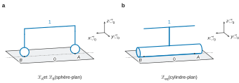
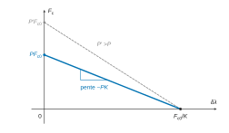
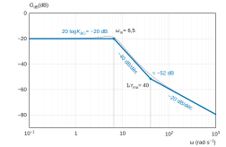
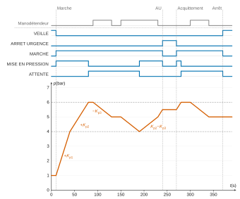

# Banque PT PT — Sciences industrielles A 2026 · Corrigé brut

*Corrigé rédigé par IA, non officiel. Signalez toute erreur.*

Épreuve de 5 h, calculatrice interdite. Support : exosquelette d'assistance du poignet.

Notations de l'énoncé (annexe C) : $\alpha=(\vec x_0,\vec x_1)$ autour de $\vec z_0=\vec z_1$ (flexion-extension). L'angle $\beta=(\vec z_1,\vec z_2)=(\vec x_1,\vec x_2)$ est pris autour de $\vec y_1=\vec y_2$ (déviation radio-ulnaire).

Changement de base utile :

$$\begin{aligned}
\vec z_1&=\cos\beta\,\vec z_2-\sin\beta\,\vec x_2\\
\vec x_1&=\cos\beta\,\vec x_2+\sin\beta\,\vec z_2
\end{aligned}$$

## Partie A — Étude mécanique de l'ensemble main, poignet et avant-bras

### Question 1

Par composition des rotations, projetée dans la base 2 :

$$\begin{aligned}
\vec\Omega(2/0)&=\dot\alpha\,\vec z_0+\dot\beta\,\vec y_1\\
&=-\dot\alpha\sin\beta\,\vec x_2+\dot\beta\,\vec y_2+\dot\alpha\cos\beta\,\vec z_2
\end{aligned}$$

Les axes des deux pivots se coupent en $O$, donc $O$ est fixe dans le mouvement de 2 par rapport à 0 et $\vec V(O,2/0)=\vec 0$. On a alors $\vec\sigma(O,2/0)=\mathbb I(O,2)\,\vec\Omega(2/0)$, la matrice d'inertie étant diagonale dans la base 2 :

$$\boxed{\vec\sigma(O,2/0)=-A_2\,\dot\alpha\sin\beta\,\vec x_2+B_2\,\dot\beta\,\vec y_2+C_2\,\dot\alpha\cos\beta\,\vec z_2}$$

### Question 2

$O$ étant fixe dans $\mathcal R_0$, le moment dynamique est la dérivée du moment cinétique :

$$\begin{aligned}
\vec\delta(O,2/0)&=\left[\dfrac{\mathrm d\vec\sigma(O,2/0)}{\mathrm dt}\right]_{\mathcal R_0}\\
&=\left[\dfrac{\mathrm d\vec\sigma(O,2/0)}{\mathrm dt}\right]_{\mathcal R_2}+\vec\Omega(2/0)\wedge\vec\sigma(O,2/0)
\end{aligned}$$

On note $(\omega_x,\omega_y,\omega_z)$ les composantes de $\vec\Omega(2/0)$ dans la base 2. Celles de $\vec\sigma(O,2/0)$ sont alors $(A_2\omega_x,B_2\omega_y,C_2\omega_z)$.

Projection sur $\vec y_2$, avec $\omega_x\omega_z=-\dot\alpha^2\sin\beta\cos\beta$ :

$$\begin{aligned}
\left[\dfrac{\mathrm d\vec\sigma}{\mathrm dt}\right]_{\mathcal R_2}\cdot\vec y_2&=B_2\,\ddot\beta\\
\big(\vec\Omega\wedge\vec\sigma\big)\cdot\vec y_2&=\omega_z\,A_2\omega_x-\omega_x\,C_2\omega_z\\
&=(A_2-C_2)\,\omega_x\omega_z\\
&=(C_2-A_2)\,\dot\alpha^2\sin\beta\cos\beta
\end{aligned}$$

$$\boxed{\vec\delta(O,2/0)\cdot\vec y_2=B_2\,\ddot\beta+(C_2-A_2)\,\dot\alpha^2\sin\beta\cos\beta}$$

### Question 3

Force de coupe : glisseur en $P$, avec $\vec{OP}=L_3\vec x_2-L_4\vec z_2$.

$$\begin{aligned}
\vec M(O,F_c\to2)&=\vec{OP}\wedge F_c\,\vec x_2\\
&=(L_3\vec x_2-L_4\vec z_2)\wedge F_c\,\vec x_2\\
&=-L_4F_c\,\vec y_2
\end{aligned}$$

Pesanteur : glisseur en $G_2$, avec $\vec{OG_2}=L_1\vec x_2-L_2\vec z_2$ et $\vec z_0=\cos\beta\,\vec z_2-\sin\beta\,\vec x_2$.

$$\begin{aligned}
\vec M(O,g\to2)&=\vec{OG_2}\wedge(-m_2g\,\vec z_0)\\
&=-m_2g\,(L_1\vec x_2-L_2\vec z_2)\wedge(\cos\beta\,\vec z_2-\sin\beta\,\vec x_2)\\
&=-m_2g\,\big(-L_1\cos\beta+L_2\sin\beta\big)\,\vec y_2\\
&=m_2g\,(L_1\cos\beta-L_2\sin\beta)\,\vec y_2
\end{aligned}$$

(On a utilisé $\vec x_2\wedge\vec z_2=-\vec y_2$ et $\vec z_2\wedge\vec x_2=\vec y_2$.)

$$\boxed{\mathcal F_{F_c\to2}=\left\{\begin{matrix}F_c\,\vec x_2\\ -L_4F_c\,\vec y_2\end{matrix}\right\}_O}$$

$$\boxed{\mathcal F_{g\to2}=\left\{\begin{matrix}-m_2g\,\vec z_0\\ m_2g\,(L_1\cos\beta-L_2\sin\beta)\,\vec y_2\end{matrix}\right\}_O}$$

### Question 4

On isole l'ensemble 2. Actions extérieures :

- liaison pivot $1\to2$ d'axe $(O,\vec y_1)$, supposée parfaite, donc $\vec M(O,1\to2)\cdot\vec y_1=0$ ;
- force de coupe et pesanteur (Q3) ;
- couple musculaire $C_1\vec y_1$.

Théorème du moment dynamique en $O$, fixe dans $\mathcal R_0$ galiléen, projeté sur $\vec y_1=\vec y_2$ :

$$B_2\ddot\beta+(C_2-A_2)\dot\alpha^2\sin\beta\cos\beta=C_1-L_4F_c+m_2g\,(L_1\cos\beta-L_2\sin\beta)$$

$$\boxed{C_1=B_2\ddot\beta+(C_2-A_2)\,\dot\alpha^2\sin\beta\cos\beta+L_4F_c-m_2g\,(L_1\cos\beta-L_2\sin\beta)}$$

### Question 5

Quasi-statique : $\ddot\beta=0$ et $\dot\alpha=0$. On prend $\cos\beta\approx1$, $\sin\beta=\sin(-\pi/18)\approx-0{,}17$ et $g\approx10\ \mathrm{m\,s^{-2}}$.

$$\begin{aligned}
L_4F_c&=0{,}2\times30\\
&=6\ \mathrm{N\,m}\\[4pt]
m_2g\,(L_1\cos\beta-L_2\sin\beta)&\approx5\times(0{,}1+0{,}05\times0{,}17)\\
&\approx0{,}54\ \mathrm{N\,m}
\end{aligned}$$

$$\begin{aligned}
C_1&=L_4F_c-m_2g\,(L_1\cos\beta-L_2\sin\beta)\\
&\approx6-0{,}54
\end{aligned}$$

$$\boxed{C_1\approx5{,}5\ \mathrm{N\,m}}$$

L'énoncé écrit $\sin\beta\approx0{,}17$ alors que $\beta<0$. Avec cette valeur, on obtient $5{,}54$ N·m : même résultat à deux chiffres.

### Question 6

$\beta=-10^\circ$ est une déviation radiale, côté négatif de la Figure 5. La courbe y donne $C_{max}\approx11{,}5$ N·m.

L'exigence Id 1.1 limite l'effort de l'opérateur à 20 % de sa capacité :

$$\begin{aligned}
C_{adm}&=0{,}2\times C_{max}\\
&=0{,}2\times11{,}5\\
&=2{,}3\ \mathrm{N\,m}
\end{aligned}$$

On a $C_{adm}<C_1$ : seul, l'opérateur ne respecte pas l'exigence. Le couple total $C_1$ se partage entre l'opérateur, limité à $C_{adm}$, et l'exosquelette, qui fournit le complément :

$$\begin{aligned}
C_{exo}&\ge C_1-C_{adm}\\
&\approx5{,}5-2{,}3
\end{aligned}$$

$$\boxed{C_{exo}\ \ge\ 3{,}2\ \mathrm{N\,m}}$$

## Partie B — Étude de la configuration mécanique de l'exosquelette

### Question 7

Deux pivots en série, d'axes concourants en $O$ pour le bras et en $O_e$ pour l'orthèse. La vitesse est nulle au point commun aux deux axes :

$$\boxed{\mathcal V_{2/0}=\left\{\begin{matrix}\dot\alpha\,\vec z_0+\dot\beta\,\vec y_1\\ \vec 0\end{matrix}\right\}_O}$$

$$\boxed{\mathcal V_{5/3}=\left\{\begin{matrix}\dot\gamma\,\vec z_3+\dot\delta\,\vec y_4\\ \vec 0\end{matrix}\right\}_{O_e}}$$

### Question 8

Avec 3 encastré sur 0 et 5 encastré sur 2, la boucle $0-1-2-5-4-3-0$ comporte quatre pivots.

- Les mouvements $2/0$ et $5/3$ sont des rotations autour d'un point fixe, $O$ et $O_e$ respectivement. Il faut d'abord $O_e=O$.
- Les directions $\vec z_0$ et $\vec z_3$ sont liées au même solide $\{0,3\}$. Les directions $\vec y_1$ et $\vec y_4$ sont liées au même solide $\{2,5\}$. Leur position relative est fixée au montage.
- Si $(O_e,\vec y_4)$ n'est pas confondu avec $(O,\vec y_1)$, le solide 2 doit garder deux de ses directions orthogonales à $\vec z_0$. La rotation $\beta$ est alors bloquée et la boucle n'a plus qu'une mobilité. Le même raisonnement vaut pour les axes $\vec z_3$ et $\vec z_0$.

Chaque pivot de l'orthèse doit donc être coaxial au pivot anatomique correspondant :

$$\boxed{(O_e,\vec z_3)\equiv(O,\vec z_0)\quad\text{et}\quad(O_e,\vec y_4)\equiv(O,\vec y_1)}$$

Ces deux coaxialités impliquent $O_e=O$. Ce sont des conditions de réglage (position et orientation), indépendantes du temps, et rien de plus n'est nécessaire : les deux rotations de la main restent libres. Elles correspondent à $\mathcal R_4=\mathcal R_1$.

### Question 9

Graphe : 4 classes d'équivalence ($\{0,3\}$, 1, $\{2,5\}$, 4) et 4 pivots.

$$\begin{aligned}
\gamma&=4-4+1\\
&=1\ \text{boucle}\\
E_c&=6\gamma=6\\
N_c&=4
\end{aligned}$$

Fermeture cinématique en $O=O_e$, avec $\vec z_4=\vec z_3=\vec z_0$ et $\vec y_4=\vec y_1$ :

$$(\dot\alpha-\dot\gamma)\,\vec z_0+(\dot\beta-\dot\delta)\,\vec y_1=\vec 0$$

Cette équation de résultante donne 2 équations indépendantes. Les équations de moment sont identiquement nulles, car tous les axes passent par $O$. Donc $r_c=2$ et :

$$\begin{aligned}
m&=N_c-r_c\\
&=2\\[4pt]
h&=6\gamma-r_c\\
&=6-2
\end{aligned}$$

$$\boxed{h=4}$$

Vérification statique, avec $n=4$ classes :

$$\begin{aligned}
N_s&=4\times5\\
&=20\\
E_s&=6\,(n-1)\\
&=18\\
h&=N_s-E_s+m\\
&=20-18+2\\
&=4
\end{aligned}$$

Conséquences : le montage n'est possible sans effort que si les conditions géométriques de Q8 sont exactement réalisées. C'est impossible en pratique (tolérances, centre articulaire du poignet mal défini et variable d'un opérateur à l'autre). Les défauts se traduisent par des efforts parasites dans l'orthèse et sur le poignet : gêne, points de pression, aggravation du risque de TMS. L'exigence d'adaptation à la morphologie (Id 1.3.1) n'est pas tenue.

### Question 10

Approche cinématique, en $A$, dans la base $(\vec x_0,\vec y_0,\vec z_0)$ :

$$\mathcal V_{1/0}=\left\{\begin{matrix}p\,\vec x_0+q\,\vec y_0+r\,\vec z_0\\ u\,\vec x_0+v\,\vec y_0+w\,\vec z_0\end{matrix}\right\}_A$$

Liaison $\mathcal L_A$, ponctuelle de normale $\vec z_0$ en $A$ : $\vec V(A,1/0)\cdot\vec z_0=0$, donc $w=0$.

Liaison $\mathcal L_B$ : on transporte la vitesse en $B$, avec $\vec{BA}=-L\,\vec x_0$.

$$\begin{aligned}
\vec V(B,1/0)&=\vec V(A,1/0)+\vec{BA}\wedge\vec\Omega(1/0)\\
&=u\,\vec x_0+(v+Lr)\,\vec y_0+(w-Lq)\,\vec z_0
\end{aligned}$$

La condition $\vec V(B,1/0)\cdot\vec z_0=0$ donne, avec $w=0$ et $L\neq0$, $q=0$.

$$\mathcal V_{eq}=\left\{\begin{matrix}p & u\\ 0 & v\\ r & 0\end{matrix}\right\}_{A,(\vec x_0,\vec y_0,\vec z_0)}$$

Quatre mobilités : deux translations dans le plan $(\vec x_0,\vec y_0)$, la rotation autour de $\vec z_0$ et la rotation autour de $(A,\vec x_0)$.

$$\boxed{\mathcal L_{eq}=\text{liaison cylindre-plan (linéaire rectiligne) de droite de contact }(A,\vec x_0)\text{ et de normale }\vec z_0}$$

Approche statique équivalente : la somme des glisseurs $Z_A\vec z_0$ en $A$ et $Z_B\vec z_0$ en $B$ donne en $A$ le torseur $\{Z\,\vec z_0\ ;\ M\,\vec y_0\}$. Il a deux inconnues, d'où la même liaison.

### Question 11

Schémas à compléter sur le plan de 0 (cahier réponse) :



- **Avec $\mathcal L_A$ et $\mathcal L_B$** : sphères liées à 1 par les tiges, tangentes au plan en $A$ et en $B$ (normale $\vec z_0$).
- **Avec $\mathcal L_{eq}$** : cylindre lié à 1, d'axe parallèle à $\vec x_0$, en contact suivant la droite $(AB)=(A,\vec x_0)$.

### Question 12

Graphe de la Figure 8 : 6 solides et 6 liaisons (4 pivots, 2 cylindre-plan).

$$\begin{aligned}
\gamma&=6-6+1\\
&=1\\
E_c&=6\\
N_c&=4\times1+2\times4\\
&=12
\end{aligned}$$

Rang de la fermeture cinématique :

- **Translations.** Celles de la cylindre-plan 0/3 engendrent le plan $\perp\vec z_1$, celles de la cylindre-plan 5/2 le plan $\perp\vec y_1$. Ensemble, elles engendrent tout $\mathbb R^3$.
- **Rotations.** Les directions disponibles sont $\vec z_1$ (pivots 0/1, 3/4 et normale de 0/3) et $\vec y_1$ (pivots 1/2, 4/5 et normale de 5/2). S'y ajoutent $\vec y_3$ et $\vec z_5$, directions des droites de contact.
- En configuration quelconque, $\vec y_3\neq\vec y_1$ dans le plan $\perp\vec z_1$. Les directions de rotation engendrent alors $\mathbb R^3$.

Donc $r_c=6$ :

$$\begin{aligned}
m&=N_c-r_c\\
&=6\\[4pt]
h&=6\gamma-r_c\\
&=6-6
\end{aligned}$$

$$\boxed{h=0}$$

Vérification statique :

$$\begin{aligned}
N_s&=4\times5+2\times2\\
&=24\\
E_s&=6\times5\\
&=30\\
h&=N_s-E_s+m\\
&=24-30+6\\
&=0
\end{aligned}$$

Les 6 mobilités se répartissent en 2 utiles ($\alpha$ et $\beta$ de la main) et 4 internes (glissements et rotations du brassard et du gant), qui absorbent les écarts de position.

**Aucune contrainte de montage** : l'orthèse se met en place sans effort quelle que soit la morphologie, Id 1.3.1 est validée. Les deux mouvements du poignet restent libres, Id 1.3.2 est validée.

Dans la position singulière où brassard et gant sont parfaitement alignés ($\vec y_3=\vec y_1$ et $\vec z_5=\vec z_1$), le rang tombe à 5 et $h=1$.

### Question 13

Relation de Chasles, avec $\beta=0$ :

$$\begin{aligned}
\vec{A_1B_1}&=\vec{A_1O_b}+\vec{O_bO}+\vec{OO_g}+\vec{O_gB_1}\\
&=R_v\,\vec y_0+L_b\,\vec x_0+L_g\,\vec x_1-R_v\,\vec y_1
\end{aligned}$$

Avec $\vec x_1=\cos\alpha\,\vec x_0+\sin\alpha\,\vec y_0$ et $\vec y_1=-\sin\alpha\,\vec x_0+\cos\alpha\,\vec y_0$ :

$$\vec{A_1B_1}=(L_b+L_g\cos\alpha+R_v\sin\alpha)\,\vec x_0+\big(R_v(1-\cos\alpha)+L_g\sin\alpha\big)\,\vec y_0$$

$$\boxed{\lambda_1=\sqrt{L_b^2+L_g^2+2R_v^2(1-\cos\alpha)+2R_vL_g\sin\alpha+2L_b\,(L_g\cos\alpha+R_v\sin\alpha)}}$$

Contrôle : $\alpha=0$ donne $\lambda_1=L_b+L_g$.

### Question 14

Les ancrages du muscle 4 sont les symétriques de ceux du muscle 2 par rapport à l'axe du bras : $\vec{O_bA_4}=-R_v\vec z_0$ et $\vec{O_gB_4}=-R_v\vec z_2$. On passe donc du muscle 2 au muscle 4 en changeant $R_v$ en $-R_v$ dans (B.1) :

$$\boxed{\lambda_4=\sqrt{2R_v^2+L_b^2+L_g^2-2R_v\,(L_g\sin\beta+R_v\cos\beta)+2L_b\,(L_g\cos\beta-R_v\sin\beta)\cos\alpha}}$$

On reconnaît $\lambda_4(\alpha,\beta)=\lambda_2(\alpha,-\beta)$.

### Question 15

À $\alpha=0$, $\lambda_{2-max}$ correspond au maximum de $\lambda_2^2(\beta)$, donc à un zéro de sa dérivée :

$$\frac{\mathrm d\lambda_2^2}{\mathrm d\beta}=2R_v\,(L_g\cos\beta+R_v\sin\beta)+2L_b\,(R_v\cos\beta-L_g\sin\beta)$$

On prend la moitié de cette dérivée :

$$\boxed{f(\beta)=R_v(L_b+L_g)\cos\beta+(R_v^2-L_bL_g)\sin\beta}$$

$$f'(\beta)=-R_v(L_b+L_g)\sin\beta+(R_v^2-L_bL_g)\cos\beta$$

Contrôle :

$$\begin{aligned}
\tan\beta^\ast&=\dfrac{R_v(L_b+L_g)}{L_bL_g-R_v^2}\\
&=\dfrac{8790}{18400}\approx0{,}48
\end{aligned}$$

soit $\beta^\ast\approx25^\circ$.

### Question 16

$$\boxed{\beta_{n+1}=\beta_n-\frac{f(\beta_n)}{f'(\beta_n)}}$$

```python
def newton(f, fp, beta_0, eps=10**-8):
    beta = beta_0
    n = 0
    while abs(f(beta)) > eps and n < 100:   # garde-fou sur le nombre d'itérations
        beta = beta - f(beta) / fp(beta)
        n = n + 1
    return beta
```

Application avec les valeurs de l'énoncé ($R_v=30$ mm, $L_g=100$ mm, $L_b=193$ mm), en partant de $\beta_0=0{,}4$ rad.

On obtient $\beta^\ast\approx0{,}445$ rad, soit $25{,}5^\circ$, et $\lambda_2\approx0{,}300$ m.

### Question 17

On écrit (B.1) sous la forme $\lambda_2^2=g(\beta)+h(\beta)\cos\alpha$, avec :

$$\begin{aligned}
g(\beta)&=2R_v^2+L_b^2+L_g^2+2R_v\,(L_g\sin\beta-R_v\cos\beta)\\
h(\beta)&=2L_b\,(L_g\cos\beta+R_v\sin\beta)
\end{aligned}$$

- **Courbes superposées.** $\alpha$ n'intervient que par $\cos\alpha$, fonction paire. Donc $\lambda_2(-\alpha,\beta)=\lambda_2(\alpha,\beta)$ : les courbes $\pm\alpha$ sont superposées.
- **Maximum en $\alpha=0$.** On a $h(\beta)>0$ pour $-73{,}3^\circ<\beta<106{,}7^\circ$, là où $\tan\beta>-L_g/R_v$. C'est le cas autour du maximum ($\beta\approx25^\circ$).
- À $\beta$ fixé dans cet intervalle, $\lambda_2^2$ est donc maximal quand $\cos\alpha$ l'est, c'est-à-dire pour $\alpha=0$.
- Hors de cet intervalle, l'ordre des courbes s'inverse. Toutes se croisent en $\beta\approx-73^\circ$ et $\beta\approx107^\circ$, où $h=0$, comme on le voit sur la Figure 12.

Remarque : le texte qui accompagne la Figure 12, et l'énoncé de Q18 dans le cahier réponses, appellent $\beta$ l'angle de flexion/extension et $\alpha$ celui de déviation, à l'inverse de l'annexe C et de l'énoncé de Q18 dans le sujet. On garde le paramétrage de l'annexe C, cohérent avec (B.1).

### Question 18

Sur la Figure 12, courbe $\alpha=0$ : $\lambda_{2-max}\approx30$ cm, pour $\beta\approx25^\circ$.

Le muscle ne pouvant pas s'allonger au-delà de sa longueur nominale, on prend $\lambda_0=\lambda_{2-max}=30$ cm. La contraction maximale du DMSP-5 est de 20 % (Tableau 3), d'où :

$$\begin{aligned}
\lambda_{2-min}&=0{,}8\times30\\
&=24\ \mathrm{cm}
\end{aligned}$$

La courbe $\alpha=0$ coupe $\lambda_2=24$ cm en :

$$\boxed{\beta\in[-52^\circ\ ;\ +103^\circ]\ \text{(muscle 2 seul)}}$$

Le muscle antagoniste 4, avec $\lambda_4(\beta)=\lambda_2(-\beta)$, impose de même $\beta\in[-103^\circ\,;\,52^\circ]$. La paire limite donc le débattement à :

$$\boxed{\beta\in[-52^\circ\ ;\ +52^\circ]}$$

- Id 1.2.3.1 (au moins 45°) : $52^\circ>45^\circ$ de chaque côté, **satisfaite**.
- Id 1.2.3.2 (au plus 60°) : satisfaite grâce au montage antagoniste, puisque $52^\circ<60^\circ$. Le muscle 2 seul autoriserait 103° côté positif, ce qui ne la respecterait pas.

## Partie C — Étude de l'actionnement mécanique d'une articulation

### Question 19

Homogénéité de $F_c=P\,(F_{c0}-K\,\delta\lambda)$, avec $F_c$ en N, $P$ en Pa et $\delta\lambda$ en m :

$$\boxed{F_{c0}\ \text{en m}^2\ (\mathrm{N\,Pa^{-1}}),\qquad K\ \text{en m}\ (\mathrm{N\,Pa^{-1}\,m^{-1}})}$$

### Question 20

À $P$ constante, $F_c$ est une fonction affine décroissante de $\delta\lambda$. Le point d'annulation $\delta\lambda=F_{c0}/K$ ne dépend pas de $P$. Une pression plus forte donne une droite plus haute et plus pentue, qui passe par ce même point.



| Élément du tracé | Valeur |
|---|---|
| Ordonnée à l'origine | $P\,F_{c0}$ |
| Pente | $-P\,K$ |
| Abscisse d'annulation | $F_{c0}/K$ |

### Question 21

Lignes 1 à 15 conservées telles que fournies ; complément :

```python
P_exp = 2 * 10**5                  # 2 bar = 2.10^5 Pa

def F_c(x, P):
    """Force théorique linéarisée F = P.(Fc0 - K.x)"""
    return P * (Fc0 - K * x)

x = np.linspace(min(data[0, :]), max(data[0, :]), 100)   # même plage que l'essai
plt.plot(x, F_c(x, P_exp), label='Théorique')
plt.xlabel('Contraction du muscle (m)')
plt.ylabel('Force (N)')
```

suivi des lignes 30 et 31 (`plt.legend()`, `plt.show()`).

Remarques. Le `plt.show()` de la ligne 12 affiche la courbe expérimentale seule ; pour superposer les deux courbes sur une même figure, il faut le supprimer. L'énoncé place la force en première colonne alors que le code fourni utilise `data[0, :]` comme contraction : on suit le code imposé.

### Question 22

À l'état initial, chaque muscle est contracté de la moitié de la contraction maximale :

$$\begin{aligned}
\delta\lambda_0&=\tfrac12\times0{,}20\,\lambda_0\\
&=0{,}10\,\lambda_0
\end{aligned}$$

Une rotation $\theta$ contracte un muscle de $R\theta$ et détend l'autre de $R\theta$. Les deux butées sont $0{,}20\,\lambda_0$ (contraction maximale) et $0$ (longueur de repos). Elles donnent $R\,\theta_{max}=0{,}10\,\lambda_0$.

L'exigence $\theta_{max}\ge0{,}75$ rad impose :

$$\begin{aligned}
R&\le\frac{0{,}10\,\lambda_0}{0{,}75}\\
&=\frac{0{,}03}{0{,}75}\\
&=0{,}04\ \mathrm m
\end{aligned}$$

$$\boxed{R\le40\ \mathrm{mm}}$$

$R$ est le rayon d'une poulie **équivalente** d'un modèle linéaire ($\delta\lambda=R\theta$).

$R_v=30$ mm est la distance d'ancrage réelle dans une géométrie non linéaire (B.1). Le bras de levier $\mathrm d\lambda_2/\mathrm d\beta$ ne vaut $R_v$ qu'en $\beta=0$ ; il varie avec l'angle et dépend aussi de $L_b$ et $L_g$.

Les deux grandeurs n'ont donc pas de raison d'être égales. $R_v=30$ mm respecte bien $R\le40$ mm (il donnerait $\theta_{max}\approx1$ rad).

### Question 23

Les muscles ne peuvent que tirer ; ils agissent de part et d'autre de la poulie, à la distance $R$ de l'axe. Le muscle 2, alimenté à $P_0+\delta P$, fait tourner dans le sens de $\theta$ positif :

$$\boxed{C_{mp}=R\,(F_{tot_2}-F_{tot_1})}$$

avec $\delta\lambda_2=\delta\lambda_0+R\theta$ et $\delta\lambda_1=\delta\lambda_0-R\theta$.

### Question 24

On isole la poulie, d'inertie $J$ autour de son axe fixe dans $\mathcal R_0$ galiléen. Actions : couple des muscles $C_{mp}$, liaison pivot parfaite (moment nul sur l'axe), pesanteur négligée. Théorème du moment dynamique sur l'axe :

$$\begin{aligned}
J\,\frac{\mathrm d^2\theta}{\mathrm dt^2}&=C_{mp}\\
&=R\,(F_{tot_2}-F_{tot_1})
\end{aligned}$$

$$\boxed{J\,\frac{\mathrm d^2\theta}{\mathrm dt^2}=R\,(F_{tot_2}-F_{tot_1})}$$

### Question 25

On applique (C.3) à chaque muscle, avec $P_2=P_0+\delta P$ et $P_1=P_0-\delta P$. Les vitesses de contraction sont $\dfrac{\mathrm d\delta\lambda_2}{\mathrm dt}=R\dot\theta$ et $\dfrac{\mathrm d\delta\lambda_1}{\mathrm dt}=-R\dot\theta$. On pose $A=F_{c0}-K\delta\lambda_0$.

$$\begin{aligned}
F_{tot_2}&=(P_0+\delta P)(A-KR\theta)-\mu R\dot\theta\\
F_{tot_1}&=(P_0-\delta P)(A+KR\theta)+\mu R\dot\theta
\end{aligned}$$

Les termes croisés en $\delta P\,KR\theta$ se compensent exactement :

$$F_{tot_2}-F_{tot_1}=-2P_0KR\,\theta+2A\,\delta P-2\mu R\,\dot\theta$$

D'où, avec Q24 :

$$\boxed{J\frac{\mathrm d^2\theta}{\mathrm dt^2}=-2R\left(\mu R\frac{\mathrm d\theta}{\mathrm dt}+P_0KR\,\theta+(K\delta\lambda_0-F_{c0})\,\delta P\right)}$$

C'est (C.4) à un facteur $R$ près dans le terme visqueux. (C.4) tel qu'imprimé n'est pas homogène : $\mu\dot\theta$ est en N·m⁻¹ quand les autres termes de la parenthèse sont en N. On signale cette erreur d'énoncé et on garde la forme homogène. Avec la forme imprimée, il suffit de remplacer $\mu R$ par $\mu$ dans la suite.

### Question 26

Conditions initiales nulles : $\theta$ et $\delta P$ sont des écarts autour de l'équilibre initial. La transformée de Laplace de l'équation de Q25 donne :

$$\Theta(p)\,\big(Jp^2+2\mu R^2p+2P_0KR^2\big)=2R\,(F_{c0}-K\delta\lambda_0)\,\Delta P(p)$$

$$\boxed{H(p)=\frac{\Theta(p)}{\Delta P(p)}=\frac{2R\,(F_{c0}-K\delta\lambda_0)}{Jp^2+2\mu R^2\,p+2P_0KR^2}}$$

Avec (C.4) imprimé, le dénominateur contient $2\mu R\,p$ au lieu de $2\mu R^2p$.

### Question 27

On divise numérateur et dénominateur par $2P_0KR^2$ et on identifie :

$$\boxed{\begin{aligned}
K_m&=\frac{F_{c0}-K\delta\lambda_0}{P_0KR}\\
\omega_m&=R\sqrt{\frac{2P_0K}{J}}\\
\xi_m&=\frac{\mu R}{\sqrt{2P_0KJ}}
\end{aligned}}$$

$K_m$ est en rad·Pa⁻¹, $\omega_m$ en rad·s⁻¹ et $\xi_m$ sans dimension. Avec (C.4) imprimé, on obtiendrait $\xi_m=\mu/\sqrt{2P_0KJ}$, non homogène.

### Question 28

La courbe du modèle ne part pas de zéro et l'échelon n'est pas appliqué à $t=0$ : on travaille sur les variations. $\theta$ passe de $0{,}06$ rad à $\theta_\infty\approx0{,}62$ rad, soit $\Delta\theta\approx0{,}56$ rad pour $\delta P_0=6$ bar.

Gain :

$$\begin{aligned}
K_m&=\frac{\Delta\theta}{\delta P_0}\\
&=\frac{0{,}56}{6}
\end{aligned}$$

$$\boxed{K_m\approx9{,}3\times10^{-2}\ \mathrm{rad\,bar^{-1}}=9{,}3\times10^{-7}\ \mathrm{rad\,Pa^{-1}}}$$

Amortissement : premier maximum à $\approx0{,}735$ rad.

$$\begin{aligned}
D_1&=\frac{0{,}735-0{,}62}{0{,}56}\\
&\approx0{,}20
\end{aligned}$$

La Figure 37 donne alors $\boxed{\xi_m\approx0{,}45}$.

Pulsation : l'échelon est appliqué vers $t\approx1{,}9$ s. La sortie entre définitivement dans la bande $0{,}62\pm0{,}028$ rad vers $t\approx2{,}7$ s, d'où $T_{r5\%}\approx0{,}8$ s. La Figure 38 donne, à $\xi=0{,}45$, $T_{r5\%}\,\omega_m\approx5{,}3$ :

$$\begin{aligned}
\omega_m&\approx\frac{5{,}3}{0{,}8}\\
&\approx6{,}6\ \mathrm{rad\,s^{-1}}
\end{aligned}$$

$$\boxed{\omega_m\approx6{,}5\ \mathrm{rad\,s^{-1}}}$$

(à la précision de la lecture, qui donne 6,5 à 6,6 rad/s).

Contrôle par l'instant du premier maximum :

$$\begin{aligned}
t_p&=\frac{\pi}{\omega_m\sqrt{1-\xi_m^2}}\\
&\approx0{,}54\ \mathrm s
\end{aligned}$$

après l'échelon, soit $t\approx2{,}4$ s, conforme à la courbe.

## Partie D — Étude de l'asservissement des mouvements de déviation radio-ulnaire

### Question 29

Neuf cases du diagramme de blocs internes :

| Case (position sur l'ibd) | Flux | Nature |
|---|---|---|
| Entrée « Air » du groupe pneumatique | air aspiré | **M** |
| Entrée « Énergie électrique » du groupe pneumatique | énergie électrique du secteur | **E** |
| Liaison groupe pneumatique (bus « énergie pneumatique ») → manodétendeur flexion | air comprimé | **E** |
| Microcontrôleur → manodétendeur flexion | tension de consigne | **I** |
| Manodétendeur extension → échappement | air rejeté | **M** |
| Capteur de déviation radio-ulnaire → microcontrôleur | signal de mesure | **I** |
| Muscle de déviation ulnaire → gant | action mécanique (traction) | **E** |
| Manodétendeur extension → muscle extension | air sous pression régulée | **E** |
| « Mouvement de flexion-extension » ↔ capteur de flexion-extension | action/mouvement mécanique de la main | **E** |

### Question 30

| Composant | Nom générique | Fonction générique |
|---|---|---|
| Manodétendeur | préactionneur (modulateur d'énergie) | moduler (distribuer) l'énergie pneumatique sur ordre de la partie commande |
| Capteur de déviation radio-ulnaire | capteur | acquérir une grandeur physique (effort main/gant) et la convertir en signal |
| Muscle | actionneur | convertir l'énergie pneumatique en énergie mécanique |
| Groupe pneumatique | source d'énergie (alimentation) | alimenter : produire et stocker l'énergie pneumatique à partir de l'énergie électrique |
| Micro-contrôleur | unité de traitement | traiter : comparer mesure et consigne, élaborer la commande |

### Question 31

Le bloc « Amplificateur/Manodétendeur » a pour entrée $U_c$ (0 à 5 V en sortie du microcontrôleur) et pour sortie une pression de 0 à 6 bar :

$$\begin{aligned}
K_{mano}&=\frac{6\ \mathrm{bar}}{5\ \mathrm V}\\
&=1{,}2\ \mathrm{bar\,V^{-1}}
\end{aligned}$$

$$\boxed{K_{mano}=1{,}2\ \mathrm{bar\,V^{-1}}}$$

Le manodétendeur seul (consigne 0–10 V) a un gain de 0,6 bar/V, et l'amplificateur un gain de 2.

### Question 32

Décodage de la désignation (Figure 39) :

- VEAB : manodétendeur proportionnel ;
- L : raccordement direct, imposé par l'énoncé ;
- 26 : 3 voies ;
- D9 : 0,03–6 bar, seule plage couvrant 6 bar ;
- Q4 : raccord enfichable 4 mm, seul proposé en version L ;
- V1 : consigne en tension 0–10 V ;
- 1 : 24 V CC ; R1 : connecteur M8.

$$\boxed{\texttt{VEAB-L-26-D9-Q4-V1-1R1}\quad(\text{référence }8046299)}$$

### Question 33

On part de (D.2) et on développe au premier ordre en $\delta\theta\ll1$ : $\cos\delta\theta=1+o(\delta\theta)$ et $\sin\delta\theta=\delta\theta+o(\delta\theta)$.

$$\begin{aligned}
x_b^2&=R_m^2+2a^2+R_g^2-2\,(R_mR_g+a^2)\cos\delta\theta+2a\,(R_g-R_m)\sin\delta\theta\\
&\approx R_m^2+2a^2+R_g^2-2\,(R_mR_g+a^2)+2a\,(R_g-R_m)\,\delta\theta\\
&=(R_g-R_m)^2+2a\,(R_g-R_m)\,\delta\theta\\
&=(R_g-R_m)^2\,(1+u)
\end{aligned}$$

avec $u=\dfrac{2a\,\delta\theta}{R_g-R_m}$. Les termes en $a^2$ se compensent.

Comme $R_g-R_m>0$ (donnée de (D.3)), $x_b=(R_g-R_m)\sqrt{1+u}$. Pour $|u|\ll1$, $\sqrt{1+u}\approx1+u/2$ :

$$\begin{aligned}
x_b&\approx(R_g-R_m)\left(1+\frac{a\,\delta\theta}{R_g-R_m}\right)\\
&=R_g-R_m+a\,\delta\theta
\end{aligned}$$

$$\boxed{x_b(\delta\theta)\approx R_g-R_m+a\,\delta\theta}$$

L'hypothèse est raisonnable : $\delta\theta$ traduit la seule souplesse de la main dans le gant (quelques degrés), donc $|u|\ll1$.

### Question 34

Points d'application : $\vec{OG_b}=R_g\vec x_5+a\,\vec z_5$ et $\vec{OG_h}=R_g\vec x_5+(a+L)\,\vec z_5$. Les forces sont portées par $\vec x_5$ ; seule la composante sur $\vec z_5$ du vecteur position donne un moment, car $\vec z_5\wedge\vec x_5=\vec y_5$.

Avec $x_h=R_g-R_m+(a+L)\,\delta\theta$ et $x_b=R_g-R_m+a\,\delta\theta$ :

$$\begin{aligned}
C_{mg}&=(a+L)\big[k(\ell_{r0}-x_h)-f\dot x_h\big]+a\big[k(\ell_{r0}-x_b)-f\dot x_b\big]\\
&=k\,(2a+L)\,(\ell_{r0}-R_g+R_m)-k\big[(a+L)^2+a^2\big]\delta\theta-f\big[(a+L)^2+a^2\big]\dot{\delta\theta}
\end{aligned}$$

Par identification :

$$\boxed{\begin{aligned}
C_{eq}&=k\,(2a+L)\,(\ell_{r0}-R_g+R_m)\\
A_{mg}&=k\big[(a+L)^2+a^2\big]\\
B_{mg}&=f\big[(a+L)^2+a^2\big]
\end{aligned}}$$

### Question 35

$\delta C_{mg}=-A_{mg}\,\delta\theta-B_{mg}\,\dot{\delta\theta}$. Avec des conditions initiales nulles :

$$\boxed{H_{mg}(p)=\frac{\Delta C_{mg}(p)}{\Delta\Theta(p)}=-A_{mg}\left(1+\frac{B_{mg}}{A_{mg}}\,p\right)}$$

Pour $\Delta C_{gm}=-\Delta C_{mg}$, on en déduit :

$$\begin{aligned}
K_{ma}&=A_{mg}\\
\tau_{ma}&=\frac{B_{mg}}{A_{mg}}\\
&=\frac fk
\end{aligned}$$

### Question 36

$FTBO(p)=\dfrac{K_pK_{BO}(1+\tau_{ma}p)}{D(p)}$, avec $K_{BO}=K_{mano}K_mK_{ma}$ et $D(p)=1+\dfrac{2\xi_m}{\omega_m}p+\dfrac{p^2}{\omega_m^2}$.

Équation caractéristique $D(p)+K_pK_{BO}(1+\tau_{ma}p)=0$ :

$$\frac{p^2}{\omega_m^2}+\left(\frac{2\xi_m}{\omega_m}+K_pK_{BO}\tau_{ma}\right)p+1+K_pK_{BO}=0$$

Pour un polynôme de degré 2, la stabilité équivaut à des coefficients tous strictement positifs :

- $K_p>-1/K_{BO}$ ;
- $K_p>-\dfrac{2\xi_m}{\omega_m\tau_{ma}K_{BO}}$.

Avec les constantes de (D.5), $\omega_m\tau_{ma}\approx0{,}16<2\xi_m=0{,}9$ : la première condition l'emporte.

$$\boxed{K_p>-\frac{1}{K_{BO}}\quad(\text{tout }K_p>0\text{ convient})}$$

### Question 37

Relations lues sur la Figure 21, avec $C(p)=K_p$ :

$$\begin{aligned}
\Theta&=\frac{K_mK_{mano}}{D(p)}\,C\,\varepsilon-\frac{C_{dec}}{2P_0KR^2}\\
\Delta\Theta&=\Theta-\Theta_{op}\\
\Delta C_{gm}&=K_{ma}(1+\tau_{ma}p)\,\Delta\Theta\\
\varepsilon&=\Delta C^\ast_{gm}-\Delta C_{gm}
\end{aligned}$$

On élimine $\Theta$, $\Delta\Theta$ et $\varepsilon$, puis on identifie avec (D.4) :

$$\boxed{K_{dec}=\frac{1}{2P_0KR^2}}$$

$$\boxed{H_p(p)=\frac{K_{ma}(1+\tau_{ma}p)\left(1+\dfrac{2\xi_m}{\omega_m}p+\dfrac{p^2}{\omega_m^2}\right)}{1+K_pK_{BO}+\left(\dfrac{2\xi_m}{\omega_m}+K_pK_{BO}\tau_{ma}\right)p+\dfrac{p^2}{\omega_m^2}}}$$

### Question 38

Conditions : $\Delta C^\ast_{gm}=0$, $\Theta_{op}=0$ et $C_{dec}(p)=C_{dec0}/p$. D'après (D.4), $\varepsilon=-\Delta C_{gm}=H_p(p)\,K_{dec}\,C_{dec}(p)$.

Le système est stable (Q36, $K_p>0$) : on peut appliquer le théorème de la valeur finale.

$$\begin{aligned}
E_{rs}&=\lim_{p\to0}p\,\varepsilon(p)\\
&=H_p(0)\,K_{dec}\,C_{dec0}
\end{aligned}$$

$$\boxed{E_{rs}=\frac{K_{ma}}{1+K_pK_{BO}}\cdot\frac{C_{dec0}}{2P_0KR^2}\neq0}$$

L'exigence Id 1.4.2.1 (erreur nulle pour un échelon d'effort de découpe) **n'est pas respectée** : la perturbation est un échelon et il n'y a aucun intégrateur en amont de son point d'entrée (correcteur proportionnel, bloc des muscles de classe 0).

### Question 39

Avec $C(p)=K_i\dfrac{1+T_ip}{T_ip}$ :

$$H_p(p)=\frac{K_{ma}(1+\tau_{ma}p)\,D(p)\,T_ip}{T_ip\,D(p)+K_iK_{BO}(1+T_ip)(1+\tau_{ma}p)}$$

Quand $p\to0$, le numérateur tend vers 0 et le dénominateur vers $K_iK_{BO}\neq0$ : $H_p(0)=0$. Le système étant supposé stable, le théorème de la valeur finale s'applique :

$$\boxed{E_{rs}=H_p(0)\,K_{dec}\,C_{dec0}=0}$$

Le correcteur apporte un intégrateur, placé en amont du point d'entrée de la perturbation : il suffit pour annuler l'erreur due à une perturbation en échelon.

### Question 40

Conditions : $\Delta C^\ast_{gm}=0$, $\Theta_{op}(p)=\Omega_0/p^2$, correcteur PI. Dans le modèle de la Figure 21, $\Theta_{op}$ agit sur la sortie par $-K_{ma}(1+\tau_{ma}p)\,\Theta_{op}$. On note $G(p)=K_{BO}(1+\tau_{ma}p)/D(p)$.

$$E_{regs}(p)=\frac{K_{ma}(1+\tau_{ma}p)}{1+C(p)G(p)}\cdot\frac{\Omega_0}{p^2}$$

Au voisinage de 0, $1+C(p)G(p)\sim\dfrac{K_iK_{BO}}{T_ip}$. Le système étant supposé stable :

$$\begin{aligned}
E_{regs}&=\lim_{p\to0}p\,E_{regs}(p)\\
&=\lim_{p\to0}\frac{K_{ma}\,T_ip}{K_iK_{BO}}\cdot\frac{\Omega_0}{p}
\end{aligned}$$

$$\boxed{E_{regs}=\frac{K_{ma}\,T_i\,\Omega_0}{K_i\,K_{BO}}\ :\ \text{erreur finie non nulle}}$$

L'exigence Id 1.4.2.2 (erreur nulle pour un mouvement en rampe de la main) **n'est pas respectée** : pour une perturbation en rampe, une seule intégration en amont de la perturbation ne suffit pas, il en faut deux.

Le bloc $\dfrac{1}{K_{ma}(1+\tau_{ma}p)}$ de la Figure 22 est incohérent avec la Figure 21. En le prenant tel quel, on trouve $\dfrac{T_i\Omega_0}{K_{ma}K_iK_{BO}}$ : même conclusion.

### Question 41

$$FTBO_{nc}(p)=\frac{K_{BO}(1+\tau_{ma}p)}{1+\frac{2\xi_m}{\omega_m}p+\frac{p^2}{\omega_m^2}}$$

Données : $20\log K_{BO}=-20$ dB, $\omega_m=6{,}5$ rad/s et $1/\tau_{ma}=40$ rad/s.



| Domaine | Pente | Points |
|---|---|---|
| $\omega<6{,}5$ rad/s | 0 dB/déc | $-20$ dB |
| $6{,}5<\omega<40$ rad/s | $-40$ dB/déc | $\approx-52$ dB à 40 rad/s |
| $\omega>40$ rad/s | $-20$ dB/déc | $\approx-80$ dB à $10^3$ rad/s |

À 40 rad/s : $-20-40\log(40/6{,}5)\approx-52$ dB. La courbe réelle passe $0{,}9$ dB au-dessus de l'asymptote en $\omega_m$, puisque $\xi_m=0{,}45$.

### Question 42

Id 1.4.1.1 : $M_\varphi\ge45^\circ$, soit $\varphi(\omega_{0dB})\ge-135^\circ$. Sur la Figure 23, la phase ne dépasse $-135^\circ$ que dans la bosse centrée vers $1{,}4\times10^2$ rad/s (maximum $\approx-128^\circ$) :

$$\boxed{\omega_{0dB}\in[\,75\ ;\ 2{,}8\times10^2\,]\ \mathrm{rad\,s^{-1}}}$$

Id 1.4.3.1 impose en plus $\omega_{0dB}\ge90$ rad/s :

$$\boxed{\omega_{0dB}\in[\,90\ ;\ 2{,}8\times10^2\,]\ \mathrm{rad\,s^{-1}}}$$

### Question 43

Changer $K_{i2}$ translate le gain de $20\log K_{i2}$. Le gain décroît avec $\omega$, donc $K_{i2}$ est minimal pour la plus petite pulsation admissible :

$$\boxed{\omega_{0dB}=90\ \mathrm{rad\,s^{-1}}}$$

Figure 24 : $G_{dB}(90)\approx-50$ dB pour $K_{i2}=1$, d'où :

$$\boxed{K_{i2}=10^{50/20}\approx3\times10^2}$$

### Question 44

Avec $K_{i2}$ doublé, le gain est relevé de 6 dB : $\omega_{0dB}\approx1{,}6\times10^2$ rad/s et la phase y vaut $\approx-129^\circ$.

| Id | Exigence | Constat | Verdict |
|---|---|---|---|
| 1.4.1 | stabilité | réponse de la Figure 25 convergente | satisfaite |
| 1.4.1.1 | $M_\varphi\ge45^\circ$ | $M_\varphi\approx51^\circ$ | satisfaite |
| 1.4.1.2 | $M_G\ge6$ dB | la phase passe par $-180^\circ$ vers 8 et 17 rad/s, où le gain vaut environ $+30$ à $+50$ dB : il faut diviser le gain par plus de 30 dB pour déstabiliser | satisfaite |
| 1.4.1.3 | dépassement $\le20\,\%$ | pic $\approx12{,}8$ N·m pour 10 N·m, $D_1\approx28\,\%$ | **non satisfaite** |
| 1.4.2.1 | erreur nulle, échelon de découpe | valeur finale 10 N·m | satisfaite |
| 1.4.2.2 | erreur nulle, rampe de la main | écart transitoire de $0{,}25$ N·m à $t=1$ s, puis retour à 10 N·m pendant la rampe | satisfaite |
| 1.4.3.1 | $\omega_{0dB}\ge90$ rad/s | $\approx1{,}6\times10^2$ rad/s | satisfaite |
| 1.4.3.2 | $T_{r5\%}<100$ ms | entrée dans $[9{,}5\,;\,10{,}5]$ N·m vers $t\approx0{,}55$ s, $T_{r5\%}\approx50$ ms | satisfaite |

**Toutes les exigences de performance sont satisfaites sauf Id 1.4.1.3 (dépassement d'environ 28 %).**

## Partie E — Étude du groupe pneumatique

### Question 45

Compression isentropique : $p_1V_1^\gamma=p_2V_2^\gamma$.

$$\boxed{p_2=p_1\left(\frac{V_1}{V_2}\right)^\gamma=p_1\,\tau^\gamma}$$

Application numérique :

$$\begin{aligned}
\tau&=\frac{26{,}25}{7}\\
&=3{,}75\\[4pt]
p_2&\approx1\times3{,}75^{1,4}\\
&\approx6{,}4\ \mathrm{bar}
\end{aligned}$$

$$\boxed{\tau=3{,}75\qquad p_2\approx6{,}4\ \mathrm{bar}}$$

(Figure 28 : $3{,}75^{1,4}\approx6{,}4$.)

### Question 46

La quantité de gaz est constante pendant la compression :

$$\begin{aligned}
\frac{p_1V_1}{T_1}&=\frac{p_2V_2}{T_2}\\
\frac{T_2}{T_1}&=\frac{p_2}{p_1}\cdot\frac{V_2}{V_1}\\
&=\tau^\gamma\cdot\tau^{-1}
\end{aligned}$$

$$\boxed{T_2=T_1\,\tau^{\gamma-1}}$$

Application numérique, avec $3{,}75^{0,4}\approx1{,}7$ (Figure 28) :

$$\begin{aligned}
T_2&\approx293\times1{,}7\\
&\approx4{,}98\times10^2\ \mathrm K
\end{aligned}$$

$$\boxed{T_2\approx5{,}0\times10^2\ \mathrm K\approx2{,}2\times10^2\ ^\circ\mathrm C}$$

Contrôle de vraisemblance : $T_2>T_1$ (une compression adiabatique échauffe le gaz), et quelque 220 °C pour un taux de compression de 3,75 est un ordre de grandeur courant en sortie de compresseur non refroidi.

**Le refroidisseur est nécessaire** : les muscles DMSP sont limités à 60 °C (Tableau 3), et le sécheur et les joints exigent un air refroidi.

### Question 47

Figure 29 : de $p=1$ bar à $t=0$ à $p=4$ bar vers $t=30$ s, puis une droite qui atteint $\approx6$ bar vers $t\approx70$ s.

$$\begin{aligned}
K_{p1}&=\frac{4-1}{30}\\
&=0{,}10\ \mathrm{bar\,s^{-1}}\\[4pt]
K_{p2}&\approx\frac{6-4}{70-30}\\
&\approx0{,}05\ \mathrm{bar\,s^{-1}}
\end{aligned}$$

$$\boxed{K_{p1}=0{,}10\ \mathrm{bar\,s^{-1}}\qquad K_{p2}\approx0{,}05\ \mathrm{bar\,s^{-1}}}$$

### Question 48

Instants relevés (graduation de 10 s) : Marche à 10 s ; manodétendeurs ouverts sur $[90\,;130]$, $[150\,;230]$ et $[300\,;340]$ s ; AU à 240 s ; acquittement à 270 s ; Arrêt à 370 s.

Règles tirées du diagramme d'états et de (E.1) :

- MISE EN PRESSION : la pompe fonctionne, pente $+K_{p1}$ si $p<4$ bar, $+K_{p2}$ si $p\ge4$ bar ;
- ATTENTE, VEILLE, ARRET URGENCE : compresseur arrêté ;
- manodétendeurs ouverts : la pente $-K_{p3}=-0{,}025$ bar/s s'ajoute ;
- passage en ATTENTE quand $p$ atteint 6 bar, retour en MISE EN PRESSION quand $p$ redescend à 4 bar ;
- à l'acquittement, retour dans MARCHE par l'état initial et, comme $p<6$ bar, en MISE EN PRESSION.

| $t$ (s) | État | Manod. | $\mathrm dp/\mathrm dt$ (bar/s) | $p$ (bar) |
|---|---|---|---|---|
| 0 – 10 | VEILLE | fermés | 0 | 1 |
| 10 – 40 | MARCHE / MISE EN PRESSION | fermés | +0,10 | 1 → 4 |
| 40 – 80 | MARCHE / MISE EN PRESSION | fermés | +0,05 | 4 → 6 |
| 80 – 90 | MARCHE / ATTENTE | fermés | 0 | 6 |
| 90 – 130 | MARCHE / ATTENTE | ouverts | −0,025 | 6 → 5 |
| 130 – 150 | MARCHE / ATTENTE | fermés | 0 | 5 |
| 150 – 190 | MARCHE / ATTENTE | ouverts | −0,025 | 5 → 4 |
| 190 – 230 | MARCHE / MISE EN PRESSION | ouverts | +0,05 − 0,025 = +0,025 | 4 → 5 |
| 230 – 240 | MARCHE / MISE EN PRESSION | fermés | +0,05 | 5 → 5,5 |
| 240 – 270 | ARRET URGENCE | fermés | 0 | 5,5 |
| 270 – 280 | MARCHE / MISE EN PRESSION | fermés | +0,05 | 5,5 → 6 |
| 280 – 300 | MARCHE / ATTENTE | fermés | 0 | 6 |
| 300 – 340 | MARCHE / ATTENTE | ouverts | −0,025 | 6 → 5 |
| 340 – 370 | MARCHE / ATTENTE | fermés | 0 | 5 |
| après 370 | VEILLE | fermés | 0 | 5 |



La courbe $p(t)$ est la ligne brisée des valeurs du tableau. Chaque ligne d'état est haute sur les intervalles où l'état est actif ; MARCHE couvre MISE EN PRESSION et ATTENTE.
