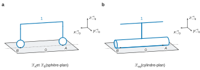
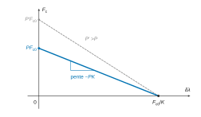
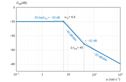
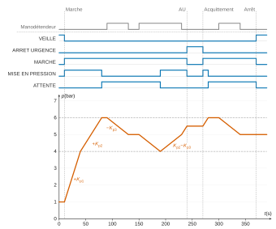

# Banque PT PT — Sciences industrielles A 2026 · Corrigé guidé

*Corrigé rédigé par IA, non officiel. Signalez toute erreur.*

## Présentation du sujet

**Format.** Épreuve de 5 heures, **calculatrice interdite**, aucun document. Les réponses se rédigent uniquement dans le cahier réponses. Le sujet compte **48 questions** et six annexes : diagramme d'états du compresseur, diagrammes d'exigences, paramétrages, catalogue des muscles FESTO DMSP, abaques du second ordre, catalogue des manodétendeurs VEAB.

L'énoncé insiste sur les applications numériques sans calculatrice : il faut savoir arrondir intelligemment ($g\approx10$, $\pi^2\approx10$…). Le rapport 2026 rappelle qu'on attend une valeur décimale avec son unité, comparée au cahier des charges, et non une fraction brute.

**Thème.** Un exosquelette d'avant-bras et de poignet qui assiste les opérateurs de découpe de viande, pour réduire les troubles musculo-squelettiques. Deux paires de muscles pneumatiques antagonistes actionnent la flexion-extension et la déviation radio-ulnaire. Des capteurs d'effort entre la main et le gant permettent d'asservir l'assistance.

**Découpage.** Cinq parties indépendantes, dont l'énoncé donne le poids relatif.

- *Partie A (Q1 à Q6, 40 min)* : dynamique du solide sur l'ensemble {main + couteau}, couple de déviation radio-ulnaire nécessaire, comparaison avec la capacité de l'opérateur (règle des 20 %).
- *Partie B (Q7 à Q18, 1 h 10)* : torseurs cinématiques, conditions de compatibilité orthèse/bras, hyperstatisme, liaison équivalente, puis loi entrée-sortie géométrique des muscles (longueurs, méthode de Newton en Python, lecture d'abaque, exigences de débattement).
- *Partie C (Q19 à Q28, 1 h 10)* : modèle du muscle de McKibben, code Python de comparaison théorie/essai, poulie antagoniste, équation du mouvement, fonction de transfert du second ordre et identification sur une réponse indicielle.
- *Partie D (Q29 à Q44, 1 h 10)* : chaîne fonctionnelle (ibd, composants), manodétendeur, modèle visco-élastique de l'interface main/gant, puis performances de l'asservissement d'effort avec correcteurs P, PI et PI double à avance de phase, et validation des exigences sur Bode et sur une simulation.
- *Partie E (Q45 à Q48, 30 min)* : compression isentropique, température de refoulement, remplissage de l'accumulateur et chronogramme à partir d'un diagramme d'états.

**Notions du programme mobilisées.** Torseurs cinématique, cinétique, dynamique et d'actions mécaniques ; théorème du moment dynamique ; liaisons normalisées, liaison équivalente, mobilité et hyperstatisme ; fermeture géométrique ; méthode de Newton en Python et tracés avec numpy/matplotlib ; transformée de Laplace, systèmes du premier et du second ordre, abaques ; stabilité, précision, rapidité, diagrammes de Bode, marges ; SysML (exigences, ibd, stm) ; chaînes d'information et d'énergie ; thermodynamique du gaz parfait (loi de Laplace).

**Difficulté et gestion du temps.** Sujet long mais très guidé, avec beaucoup de résultats intermédiaires donnés. Selon le rapport 2026, toutes les questions étaient faisables et la longueur adaptée à la durée ; l'épreuve est jugée classante.

- *Questions sûres à ne pas laisser passer* : Q1 à Q5, Q7, Q10, Q13, Q19, Q20, Q24, Q31, Q32, Q35, Q45, Q47.
- *Questions que le rapport 2026 signale comme discriminantes* : Q6 (confusion entre couple de l'opérateur et couple d'assistance), Q8 (hypothèses géométriques trop fortes), Q14 (30 % des candidats voient la symétrie), Q16 (8 % des candidats ont tous les points sur Newton), Q17 (parité du cosinus), Q25 (seul un tiers relève l'erreur d'énoncé), Q28 (décalage en ordonnée oublié), Q29 (31 % des points), Q30 (14 % des points), Q33 (démonstration exigée), Q38 à Q40 (position des intégrateurs), Q46 (température non commentée).
- *Autres questions qui font la différence* : Q9 et Q12 (hyperstatisme justifié), Q18, Q34, Q37, Q42 à Q44, Q48.

**Points de l'énoncé à connaître.**

1. L'équation (C.4) n'est pas homogène : il manque un facteur $R$, le terme visqueux doit s'écrire $\mu R\,\dot\theta$ dans la parenthèse. Le rapport 2026 le confirme et précise que le jury a accepté les différentes réponses dans la suite.
2. Le texte de la Figure 12, et l'énoncé de Q18 dans le cahier réponses, appellent $\beta$ l'angle de flexion/extension, à l'inverse de l'annexe C et de l'énoncé de Q18 dans le sujet. Il faut garder le paramétrage de l'annexe C, cohérent avec (B.1).
3. Le bloc de $\Theta_{op}$ de la Figure 22 devrait valoir $K_{ma}(1+\tau_{ma}p)$ et non son inverse.
4. À Q5, $\sin(-\pi/18)\approx-0{,}17$ : l'énoncé oublie le signe.

L'énoncé demande de signaler ce type d'erreur sur la copie et de poursuivre.

## Partie A — Étude mécanique de l'ensemble main, poignet et avant-bras

On cherche le couple que l'opérateur doit fournir autour de l'axe de déviation radio-ulnaire pendant une coupe, puis la part que l'exosquelette doit prendre en charge. Outils : changement de base, moment cinétique en un point fixe, théorème du moment dynamique projeté sur l'axe d'une liaison.

Changement de base de référence pour toute la partie :

$$\begin{aligned}
\vec z_1&=\cos\beta\,\vec z_2-\sin\beta\,\vec x_2\\
\vec x_1&=\cos\beta\,\vec x_2+\sin\beta\,\vec z_2
\end{aligned}$$

### Question 1

> [!INDICATION]
> Commencer par écrire $\vec\Omega(2/0)$ par composition des rotations, puis se demander si $O$ est un point fixe.

> [!INDICATION]
> La matrice d'inertie n'est diagonale que dans la base 2 : y projeter $\vec z_0$ avant de multiplier.

#### Solution

Par composition des rotations, projetée dans la base 2 :

$$\begin{aligned}
\vec\Omega(2/0)&=\dot\alpha\,\vec z_0+\dot\beta\,\vec y_1\\
&=-\dot\alpha\sin\beta\,\vec x_2+\dot\beta\,\vec y_2+\dot\alpha\cos\beta\,\vec z_2
\end{aligned}$$

Les deux axes de pivot se coupent en $O$, donc $O$ est fixe dans le mouvement $2/0$ et $\vec V(O,2/0)=\vec 0$. Ainsi $\vec\sigma(O,2/0)=\mathbb I(O,2)\,\vec\Omega(2/0)$ :

$$\boxed{\vec\sigma(O,2/0)=-A_2\,\dot\alpha\sin\beta\,\vec x_2+B_2\,\dot\beta\,\vec y_2+C_2\,\dot\alpha\cos\beta\,\vec z_2}$$

> [!PIEGE]
> Multiplier la matrice exprimée dans la base 2 par un vecteur exprimé dans la base 0 ou 1. Toujours projeter dans la base où la matrice est donnée.

> [!JURY]
> Le rapport 2026 note que les candidats qui n'utilisent pas les bases adaptées, ou qui confondent expression vectorielle et projection dans une base, se retrouvent vite bloqués en cinématique et en dynamique. Il ajoute que de nombreux candidats ne maîtrisent pas le calcul d'un moment cinétique ou dynamique, objet des premières questions.

### Question 2

> [!INDICATION]
> En un point fixe, le moment dynamique est la dérivée du moment cinétique dans le référentiel galiléen.

> [!INDICATION]
> Dériver dans la base 2 puis ajouter $\vec\Omega(2/0)\wedge\vec\sigma$ ; ne calculer que la composante sur $\vec y_2$.

#### Solution

$O$ étant fixe dans $\mathcal R_0$ :

$$\begin{aligned}
\vec\delta(O,2/0)&=\left[\dfrac{\mathrm d\vec\sigma(O,2/0)}{\mathrm dt}\right]_{\mathcal R_0}\\
&=\left[\dfrac{\mathrm d\vec\sigma(O,2/0)}{\mathrm dt}\right]_{\mathcal R_2}+\vec\Omega(2/0)\wedge\vec\sigma(O,2/0)
\end{aligned}$$

On note $(\omega_x,\omega_y,\omega_z)$ les composantes de $\vec\Omega(2/0)$ dans la base 2, et $\omega_x\omega_z=-\dot\alpha^2\sin\beta\cos\beta$. Projection sur $\vec y_2$ :

$$\begin{aligned}
\left[\dfrac{\mathrm d\vec\sigma}{\mathrm dt}\right]_{\mathcal R_2}\cdot\vec y_2&=B_2\,\ddot\beta\\
\big(\vec\Omega\wedge\vec\sigma\big)\cdot\vec y_2&=\omega_z\,A_2\omega_x-\omega_x\,C_2\omega_z\\
&=(A_2-C_2)\,\omega_x\omega_z\\
&=(C_2-A_2)\,\dot\alpha^2\sin\beta\cos\beta
\end{aligned}$$

$$\boxed{\vec\delta(O,2/0)\cdot\vec y_2=B_2\,\ddot\beta+(C_2-A_2)\,\dot\alpha^2\sin\beta\cos\beta}$$

> [!METHODE]
> Contrôle rapide : le terme gyroscopique s'annule si $A_2=C_2$, si $\beta=0$ ou si $\dot\alpha=0$. Un résultat qui ne passe pas ces tests est faux.

### Question 3

> [!INDICATION]
> Les deux actions sont des glisseurs : transporter le moment avec $\vec M(O)=\vec{OM}\wedge\vec R$.

> [!INDICATION]
> Pour la pesanteur, exprimer $\vec z_0$ dans la base 2 avant de faire le produit vectoriel.

#### Solution

Force de coupe, appliquée en $P$ ; $L_3$ disparaît car cette composante est colinéaire à la force :

$$\begin{aligned}
\vec M(O,F_c\to2)&=(L_3\vec x_2-L_4\vec z_2)\wedge F_c\,\vec x_2\\
&=-L_4F_c\,\vec y_2
\end{aligned}$$

Pesanteur, appliquée en $G_2$, avec $\vec z_0=\cos\beta\,\vec z_2-\sin\beta\,\vec x_2$ :

$$\begin{aligned}
\vec M(O,g\to2)&=(L_1\vec x_2-L_2\vec z_2)\wedge\big(-m_2g\,\vec z_0\big)\\
&=-m_2g\,(L_1\vec x_2-L_2\vec z_2)\wedge(\cos\beta\,\vec z_2-\sin\beta\,\vec x_2)\\
&=-m_2g\,\big(-L_1\cos\beta+L_2\sin\beta\big)\,\vec y_2\\
&=m_2g\,(L_1\cos\beta-L_2\sin\beta)\,\vec y_2
\end{aligned}$$

$$\boxed{\mathcal F_{F_c\to2}=\left\{\begin{matrix}F_c\,\vec x_2\\ -L_4F_c\,\vec y_2\end{matrix}\right\}_O}$$

$$\boxed{\mathcal F_{g\to2}=\left\{\begin{matrix}-m_2g\,\vec z_0\\ m_2g\,(L_1\cos\beta-L_2\sin\beta)\,\vec y_2\end{matrix}\right\}_O}$$

> [!PIEGE]
> Les signes du moment de pesanteur. On a $\vec x_2\wedge\vec z_2=-\vec y_2$ : un ordre de produit inversé ou un $\vec z_0$ mal projeté change le signe du résultat. Contrôle physique : pour $\beta=0$, le poids, en avant de $O$ selon $\vec x_2$, donne un moment $m_2gL_1\,\vec y_2$.

> [!JURY]
> Rapport 2026 : « Environ un tiers des candidats commet une ou des fautes de signes lors du calcul des actions de pesanteur au point demandé. »

### Question 4

> [!INDICATION]
> Quel théorème, projeté sur quel axe, élimine l'inconnue de la liaison pivot $1/2$ ?

> [!INDICATION]
> Isoler 2, appliquer le théorème du moment dynamique en $O$ et projeter sur $\vec y_1$, en disant que la liaison est parfaite.

#### Solution

On isole 2 dans $\mathcal R_0$ galiléen. Actions extérieures : liaison pivot $1\to2$ parfaite d'axe $(O,\vec y_1)$, dont le moment sur $\vec y_1$ est nul ; force de coupe ; pesanteur ; couple $C_1\vec y_1$.

Théorème du moment dynamique en $O$, projeté sur $\vec y_2=\vec y_1$ :

$$B_2\ddot\beta+(C_2-A_2)\dot\alpha^2\sin\beta\cos\beta=C_1-L_4F_c+m_2g\,(L_1\cos\beta-L_2\sin\beta)$$

$$\boxed{C_1=B_2\ddot\beta+(C_2-A_2)\,\dot\alpha^2\sin\beta\cos\beta+L_4F_c-m_2g\,(L_1\cos\beta-L_2\sin\beta)}$$

> [!METHODE]
> Pour obtenir l'équation de mouvement ou le couple moteur d'une liaison pivot : isoler le solide aval, écrire le moment dynamique en un point de l'axe, projeter sur l'axe. On obtient une seule équation, sans inconnue de liaison.

### Question 5

> [!INDICATION]
> Annuler les termes dynamiques, puis faire l'application numérique avec des arrondis simples.

#### Solution

Quasi-statique : $\ddot\beta=0$ et $\dot\alpha=0$. Avec $\cos\beta\approx1$ et $\sin\beta\approx-0{,}17$ :

$$\begin{aligned}
L_4F_c&=0{,}2\times30\\
&=6\ \mathrm{N\,m}\\[4pt]
m_2g\,(L_1\cos\beta-L_2\sin\beta)&\approx5\times0{,}11\\
&\approx0{,}54\ \mathrm{N\,m}
\end{aligned}$$

$$\begin{aligned}
C_1&=L_4F_c-m_2g\,(L_1\cos\beta-L_2\sin\beta)\\
&\approx6-0{,}54
\end{aligned}$$

$$\boxed{C_1\approx5{,}5\ \mathrm{N\,m}}$$

L'effort de coupe domine ; la pesanteur aide un peu. Avec le signe imprimé ($\sin\beta\approx+0{,}17$), on trouverait 5,54 N·m : même résultat à deux chiffres, mais il faut signaler l'incohérence de signe.

> [!JURY]
> Le rapport 2026 rappelle qu'une valeur décimale est attendue, avec son unité et son ordre de grandeur : « Une valeur décimale exacte ou approchée est quasiment toujours attendue. »

### Question 6

> [!INDICATION]
> Dans quel sens se lit l'axe de la Figure 5 (radial négatif, ulnaire positif) ? Où se situe $\beta=-\pi/18$ ?

> [!INDICATION]
> Appliquer l'exigence Id 1.1 à la capacité lue. Le couple total de Q5 se partage entre l'opérateur et l'exosquelette.

#### Solution

À $-10^\circ$ (déviation radiale), la Figure 5 donne $C_{max}\approx11{,}5$ N·m. L'exigence Id 1.1 limite l'effort de l'opérateur à 20 % de sa capacité :

$$\begin{aligned}
C_{adm}&=0{,}2\times C_{max}\\
&=0{,}2\times11{,}5\\
&=2{,}3\ \mathrm{N\,m}
\end{aligned}$$

On a $C_{adm}<C_1=5{,}5$ N·m : l'opérateur seul ne respecte pas l'exigence. L'opérateur ne doit fournir que $C_{adm}$ ; l'exosquelette fournit le reste :

$$\begin{aligned}
C_{exo}&\ge C_1-C_{adm}\\
&\approx5{,}5-2{,}3
\end{aligned}$$

$$\boxed{C_{exo}\ge3{,}2\ \mathrm{N\,m}}$$

> [!PIEGE]
> Lire l'abscisse $+10^\circ$ (environ 14 N·m) : on se trompe de côté et on sous-estime le besoin d'assistance. Autre erreur : répondre $C_{adm}$ (ce que peut fournir l'opérateur) ou $C_1$ (le couple total) au lieu de leur différence.

> [!JURY]
> Rapport 2026 : « Beaucoup de candidats ont confondu le couple fourni par l'opérateur et le couple requis pour l'assistance. » Le jury souligne que c'est cette question qui justifie toute l'étude.

## Partie B — Étude de la configuration mécanique de l'exosquelette

On vérifie que l'orthèse peut suivre la main sans la contraindre (compatibilité cinématique, hyperstatisme, recherche d'un montage isostatique), puis on relie l'orientation de la main à la longueur des muscles pour vérifier le débattement. Outils : torseurs cinématiques, fermeture de chaîne, rang d'un système, liaisons équivalentes, fermeture géométrique, méthode de Newton.

### Question 7

> [!INDICATION]
> Composer les torseurs de deux pivots en série ; choisir comme point de réduction le point commun aux deux axes.

#### Solution

$$\boxed{\mathcal V_{2/0}=\left\{\begin{matrix}\dot\alpha\,\vec z_0+\dot\beta\,\vec y_1\\ \vec 0\end{matrix}\right\}_O}$$

$$\boxed{\mathcal V_{5/3}=\left\{\begin{matrix}\dot\gamma\,\vec z_3+\dot\delta\,\vec y_4\\ \vec 0\end{matrix}\right\}_{O_e}}$$

La vitesse est nulle en $O$ (resp. $O_e$), point commun aux deux axes.

### Question 8

> [!INDICATION]
> Avec les encastrements, on a une boucle de quatre pivots. À quelles conditions une telle boucle garde-t-elle deux mobilités ?

> [!INDICATION]
> Repérer quelles directions sont liées au même solide : $\vec z_0$ et $\vec z_3$ d'une part, $\vec y_1$ et $\vec y_4$ d'autre part. Leur position relative est fixée par le montage, pas par le mouvement.

#### Solution

- Les mouvements $2/0$ et $5/3$ sont des rotations autour d'un point fixe : il faut $O_e=O$.
- Les directions $\vec z_0$ et $\vec z_3$ sont liées à $\{0,3\}$ ; les directions $\vec y_1$ et $\vec y_4$ sont liées à $\{2,5\}$.
- Si $(O_e,\vec y_4)$ n'est pas confondu avec $(O,\vec y_1)$, le solide 2 doit garder deux de ses directions orthogonales à $\vec z_0$. La rotation $\beta$ est bloquée et la boucle n'a plus qu'une mobilité.

Il faut donc que chaque pivot de l'orthèse soit coaxial au pivot anatomique correspondant :

$$\boxed{(O_e,\vec z_3)\equiv(O,\vec z_0)\quad\text{et}\quad(O_e,\vec y_4)\equiv(O,\vec y_1)}$$

Ces conditions sont minimales : elles impliquent $O_e=O$ et laissent libres les deux rotations. C'est l'hypothèse $\mathcal R_4=\mathcal R_1$ utilisée ensuite par l'énoncé.

> [!PIEGE]
> Croire que l'arc (angle $\gamma$) peut « aligner » $\vec y_4$ sur $\vec y_1$ : ces deux directions appartiennent au même solide $\{2,5\}$, leur angle ne change jamais. Autre piège : répondre $\dot\gamma=\dot\alpha$ et $\dot\delta=\dot\beta$, qui sont des relations cinématiques et non des conditions géométriques.

> [!JURY]
> Rapport 2026, sur la partie B.2 : « Beaucoup de candidats ont apporté des hypothèses trop fortes pour l'étude géométrique ce qui revenait souvent à bloquer les mouvements de l'orthèse et par conséquent, également ceux de l'opérateur. » Une condition est minimale si elle ne retire aucune des deux mobilités de la main : à vérifier avant de conclure.

### Question 9

> [!INDICATION]
> Compter boucles, équations et inconnues cinématiques, puis calculer le rang de la fermeture, sans le supposer.

> [!INDICATION]
> Tous les axes passent par le même point : que deviennent les équations de moment ?

#### Solution

4 classes et 4 pivots :

$$\begin{aligned}
\gamma&=4-4+1\\
&=1\\
E_c&=6\\
N_c&=4
\end{aligned}$$

Fermeture en $O$ :

$$(\dot\alpha-\dot\gamma)\,\vec z_0+(\dot\beta-\dot\delta)\,\vec y_1=\vec 0$$

Elle donne 2 équations ; les équations de moment sont identiquement nulles. Donc $r_c=2$ et :

$$\begin{aligned}
m&=N_c-r_c\\
&=2\\[4pt]
h&=6\gamma-r_c\\
&=6-2
\end{aligned}$$

$$\boxed{h=4}$$

Conséquences : montage impossible sans contraintes, sauf alignement parfait, irréalisable car le centre articulaire varie avec la morphologie. D'où des efforts parasites dans l'orthèse et sur le poignet, de l'inconfort et un risque de TMS accru ; Id 1.3.1 n'est pas tenue. D'où la recherche d'un modèle isostatique.

> [!METHODE]
> Vérifier par l'approche statique : $N_s=20$, $E_s=18$, puis $h=N_s-E_s+m=4$. Deux méthodes concordantes valent mieux qu'une formule appliquée sans rang.

### Question 10

> [!INDICATION]
> Approche cinématique : écrire un torseur général au point $A$ et traduire chaque ponctuelle par une vitesse normale nulle.

> [!INDICATION]
> Transporter la vitesse de $A$ en $B$ avec $\vec{AB}=L\vec x_0$, puis identifier la liaison à partir des composantes restantes.

#### Solution

Torseur cinématique général en $A$ :

$$\mathcal V_{1/0}=\left\{\begin{matrix}p\,\vec x_0+q\,\vec y_0+r\,\vec z_0\\ u\,\vec x_0+v\,\vec y_0+w\,\vec z_0\end{matrix}\right\}_A$$

En $A$, la vitesse normale est nulle : $w=0$. En $B$ :

$$\begin{aligned}
\vec V(B,1/0)&=\vec V(A,1/0)+\vec{BA}\wedge\vec\Omega(1/0)\\
&=u\,\vec x_0+(v+Lr)\,\vec y_0+(w-Lq)\,\vec z_0
\end{aligned}$$

La vitesse normale en $B$ est nulle, d'où $q=0$.

$$\mathcal V_{eq}=\left\{\begin{matrix}p & u\\ 0 & v\\ r & 0\end{matrix}\right\}_{A,(\vec x_0,\vec y_0,\vec z_0)}$$

$$\boxed{\mathcal L_{eq}=\text{cylindre-plan (linéaire rectiligne), droite de contact }(A,\vec x_0),\text{ normale }\vec z_0}$$

> [!PIEGE]
> Donner seulement le nom de la liaison. Une liaison se définit par sa nature **et** ses éléments géométriques (ici la droite de contact et la normale).

> [!JURY]
> Le rapport 2026 indique que les candidats étaient libres de choisir la méthode, cinématique ou statique, l'une étant plus laborieuse que l'autre. Le choix compte moins que la rigueur demandée par l'énoncé.

### Question 11

> [!INDICATION]
> Utiliser les symboles normalisés : sphère sur plan pour la ponctuelle, cylindre couché sur plan pour la cylindre-plan.

#### Solution



- Premier schéma : sphères liées à 1, en contact en $A$ et en $B$ avec le plan de 0, normale $\vec z_0$.
- Second schéma : cylindre lié à 1, d'axe parallèle à $\vec x_0$, génératrice de contact $(AB)$.

### Question 12

> [!INDICATION]
> Même démarche qu'en Q9 sur le graphe de la Figure 8 : compter, puis calculer le rang en séparant les directions de translation et de rotation disponibles.

> [!INDICATION]
> Les translations des deux cylindre-plan couvrent-elles tout l'espace ? Et les directions de rotation, en configuration quelconque ($\vec y_3\neq\vec y_1$) ?

#### Solution

6 solides et 6 liaisons (4 pivots, 2 cylindre-plan) :

$$\begin{aligned}
\gamma&=1\\
E_c&=6\\
N_c&=4+2\times4\\
&=12
\end{aligned}$$

- Translations : plan $\perp\vec z_1$ (liaison 0/3) et plan $\perp\vec y_1$ (liaison 5/2). Elles engendrent $\mathbb R^3$.
- Rotations : directions $\vec z_1$, $\vec y_1$, $\vec y_3$ et $\vec z_5$. Elles engendrent $\mathbb R^3$ dès que $\vec y_3\neq\vec y_1$.

Donc $r_c=6$ :

$$\begin{aligned}
m&=N_c-r_c\\
&=6\\[4pt]
h&=6\gamma-r_c\\
&=6-6
\end{aligned}$$

$$\boxed{h=0}$$

Aucune contrainte de montage : Id 1.3.1 (adaptation aux différents opérateurs) et Id 1.3.2 (compatibilité avec les mouvements) sont validées. Les 6 mobilités se répartissent en 2 utiles ($\alpha$, $\beta$) et 4 internes de réglage.

> [!PIEGE]
> Confondre « nombre de contraintes de montage » ($h$) et mobilité ($m$). Signaler aussi que dans la position singulière parfaitement alignée ($\vec y_3=\vec y_1$, $\vec z_5=\vec z_1$), le rang tombe à 5 et $h=1$.

### Question 13

> [!INDICATION]
> Relation de Chasles de $A_1$ à $B_1$, avec $\beta=0$.

> [!INDICATION]
> Tout projeter dans la base 0 avant d'élever au carré.

#### Solution

$$\begin{aligned}
\vec{A_1B_1}&=L_b\,\vec x_0+R_v\,\vec y_0+L_g\,\vec x_1-R_v\,\vec y_1\\
&=(L_b+L_g\cos\alpha+R_v\sin\alpha)\,\vec x_0+\big(R_v(1-\cos\alpha)+L_g\sin\alpha\big)\,\vec y_0
\end{aligned}$$

$$\boxed{\lambda_1=\sqrt{L_b^2+L_g^2+2R_v^2(1-\cos\alpha)+2R_vL_g\sin\alpha+2L_b\,(L_g\cos\alpha+R_v\sin\alpha)}}$$

> [!METHODE]
> Contrôles systématiques d'une fermeture géométrique : homogénéité (tout est une longueur au carré) et cas particulier ($\alpha=0$ donne $L_b+L_g$).

### Question 14

> [!INDICATION]
> Pas de nouveau calcul : comparer les points d'ancrage des muscles 2 et 4. Quel paramètre change de signe ?

#### Solution

$\vec{O_bA_4}=-R_v\vec z_0$ et $\vec{O_gB_4}=-R_v\vec z_2$ : les ancrages du muscle 4 sont les symétriques de ceux du muscle 2. Le muscle 4 se déduit donc du muscle 2 par $R_v\to-R_v$ dans (B.1).

$$\boxed{\lambda_4=\sqrt{2R_v^2+L_b^2+L_g^2-2R_v\,(L_g\sin\beta+R_v\cos\beta)+2L_b\,(L_g\cos\beta-R_v\sin\beta)\cos\alpha}}$$

Soit $\lambda_4(\alpha,\beta)=\lambda_2(\alpha,-\beta)$.

> [!JURY]
> Rapport 2026 : « Seulement 30% des candidats ont identifié cette symétrie et de fait répondu simplement à la question. » Une question qui demande un « raisonnement simple » appelle une symétrie ou un changement de signe, pas une nouvelle fermeture géométrique.

### Question 15

> [!INDICATION]
> Un maximum d'une fonction dérivable est un zéro de sa dérivée. La remarque de l'énoncé permet de travailler sur $\lambda_2^2$.

#### Solution

À $\alpha=0$, on prend la moitié de la dérivée de $\lambda_2^2$ par rapport à $\beta$ :

$$\boxed{f(\beta)=R_v(L_b+L_g)\cos\beta+(R_v^2-L_bL_g)\sin\beta}$$

$$f'(\beta)=-R_v(L_b+L_g)\sin\beta+(R_v^2-L_bL_g)\cos\beta$$

Contrôle : $\tan\beta^\ast=8790/18400\approx0{,}48$, d'où $\beta^\ast\approx25^\circ$.

### Question 16

> [!INDICATION]
> La récurrence s'obtient en remplaçant la courbe par sa tangente en $\beta_n$.

> [!INDICATION]
> Respecter la signature et le critère d'arrêt imposés (sur $|f(\beta)|$) ; prévoir un garde-fou sur le nombre d'itérations.

#### Solution

$$\boxed{\beta_{n+1}=\beta_n-\frac{f(\beta_n)}{f'(\beta_n)}}$$

```python
def newton(f, fp, beta_0, eps=10**-8):
    beta = beta_0
    n = 0
    while abs(f(beta)) > eps and n < 100:   # garde-fou
        beta = beta - f(beta) / fp(beta)
        n = n + 1
    return beta
```

Avec les valeurs numériques de l'énoncé et $\beta_0=0{,}4$ rad, on obtient $\beta^\ast\approx0{,}445$ rad, soit $25{,}5^\circ$.

> [!PIEGE]
> Arrêter sur $|\beta_{n+1}-\beta_n|$ alors que l'énoncé impose un critère sur $|f(\beta)|$, ou oublier la valeur par défaut `eps=10**-8`.

> [!JURY]
> Rapport 2026 : « Seulement 8% des candidats ont obtenu l'intégralité des points en proposant une méthode de Newton programmée en langage Python. » Le jury ajoute que quelques candidats ont rédigé avec succès une version récursive : une écriture récursive correcte est acceptée.

### Question 17

> [!INDICATION]
> Isoler dans (B.1) la seule façon dont $\alpha$ intervient.

> [!INDICATION]
> Quelle propriété du cosinus explique la superposition ? Puis étudier le signe du coefficient qui multiplie $\cos\alpha$.

#### Solution

On écrit $\lambda_2^2=g(\beta)+h(\beta)\cos\alpha$, avec $h(\beta)=2L_b(L_g\cos\beta+R_v\sin\beta)$.

- Le cosinus est pair : les courbes $\alpha$ et $-\alpha$ sont superposées.
- On a $h(\beta)>0$ pour $-73{,}3^\circ<\beta<106{,}7^\circ$, donc au voisinage du maximum.
- À $\beta$ fixé, $\lambda_2$ est alors maximal quand $\cos\alpha$ est maximal, c'est-à-dire pour $\alpha=0$.

Toutes les courbes se croisent là où $h$ s'annule ($\beta\approx-73^\circ$ et $\approx107^\circ$), et l'ordre s'inverse au-delà, comme sur la Figure 12.

> [!PIEGE]
> Invoquer la périodicité du cosinus pour expliquer la superposition : c'est la **parité** ($\cos(-\alpha)=\cos\alpha$) qui joue.
>
> Autre point : le texte de la Figure 12, et l'énoncé de Q18 dans le cahier réponses, nomment $\beta$ l'angle de flexion/extension, contrairement à l'annexe C. On garde l'annexe C (cohérente avec (B.1)) et on le signale.

> [!JURY]
> Rapport 2026 : « Beaucoup de candidat ont alors confondu périodicité et parité de la fonction cosinus. » Le jury note que la plupart savent en revanche que le cosinus est maximal en 0.

### Question 18

> [!INDICATION]
> Le muscle ne peut pas s'allonger au-delà de sa longueur nominale : quelle longueur nominale choisir ? Puis appliquer la contraction maximale du catalogue pour la taille 5.

> [!INDICATION]
> Lire les deux intersections de la courbe $\alpha=0$ avec la longueur minimale, puis penser au muscle antagoniste (Q14).

#### Solution

$\lambda_{2-max}\approx30$ cm (vers $\beta\approx25^\circ$), pris comme longueur nominale. Contraction maximale de 20 % :

$$\begin{aligned}
\lambda_{2-min}&=0{,}8\times30\\
&=24\ \mathrm{cm}
\end{aligned}$$

Intersections de la courbe $\alpha=0$ avec 24 cm :

$$\boxed{\beta\in[-52^\circ\ ;\ +103^\circ]\ \text{pour le muscle 2 seul}}$$

Le muscle 4 impose symétriquement $[-103^\circ\,;\,52^\circ]$. La paire limite donc le débattement :

$$\boxed{\beta\in[-52^\circ\ ;\ +52^\circ]}$$

Id 1.2.3.1 ($\ge45^\circ$) est satisfaite. Id 1.2.3.2 ($\le60^\circ$) est satisfaite grâce au montage antagoniste ; le muscle 2 seul autoriserait 103°.

> [!PIEGE]
> Prendre 25 % de contraction (valable pour les tailles 10 à 40 seulement) ou appliquer les 20 % à une autre longueur que la longueur nominale.

## Partie C — Étude de l'actionnement mécanique d'une articulation

On modélise le muscle de McKibben (loi force-pression-contraction), on le compare à un essai par un script Python, puis on met en équation une articulation entraînée par deux muscles antagonistes sur une poulie, jusqu'à une fonction de transfert du second ordre identifiée sur une réponse indicielle. Outils : analyse dimensionnelle, théorème du moment dynamique, transformée de Laplace, abaques du second ordre.

### Question 19

> [!INDICATION]
> Écrire l'homogénéité de (C.2) en partant des unités de $F_c$, $P$ et $\delta\lambda$, sans se fier aux noms des paramètres.

#### Solution

$[P\,F_{c0}]=\mathrm N$ avec $[P]=\mathrm{Pa}=\mathrm{N\,m^{-2}}$, et $[K\,\delta\lambda]=[F_{c0}]$.

$$\boxed{F_{c0}\ \text{en m}^2\ (\mathrm{N\,Pa^{-1}}),\qquad K\ \text{en m}\ (\mathrm{N\,Pa^{-1}\,m^{-1}})}$$

> [!PIEGE]
> « Force isométrique unitaire » et « raideur apparente » font répondre N et N/m : c'est faux, car ces paramètres sont multipliés par la pression.

### Question 20

> [!INDICATION]
> À pression constante, $F_c$ est une fonction affine de $\delta\lambda$ : repérer ordonnée à l'origine, pente et point d'annulation.

#### Solution

Droite décroissante, dont le point d'annulation $\delta\lambda=F_{c0}/K$ ne dépend pas de $P$. Une pression plus élevée donne une droite plus haute et plus pentue, passant par le même point : c'est l'allure en faisceau de la Figure 36 de l'énoncé.



| Élément | Valeur |
|---|---|
| Ordonnée à l'origine | $P\,F_{c0}$ |
| Pente | $-P\,K$ |
| Abscisse d'annulation | $F_{c0}/K$ |

### Question 21

> [!INDICATION]
> Trois choses à écrire : la pression de l'essai en pascals, la fonction théorique, un tableau de contractions sur la plage de l'essai.

> [!INDICATION]
> Une fonction écrite avec des opérations numpy s'applique directement à un tableau.

#### Solution

```python
P_exp = 2 * 10**5                  # 2 bar = 2.10^5 Pa

def F_c(x, P):
    """Force théorique linéarisée F = P.(Fc0 - K.x)"""
    return P * (Fc0 - K * x)

x = np.linspace(min(data[0, :]), max(data[0, :]), 100)
plt.plot(x, F_c(x, P_exp), label='Théorique')
plt.xlabel('Contraction du muscle (m)')
plt.ylabel('Force (N)')
```

puis `plt.legend()` et `plt.show()` (lignes 30 et 31).

Le `plt.show()` de la ligne 12 ferme la première figure ; pour superposer les courbes, il faut le retirer. L'énoncé annonce la force en première colonne alors que le code fourni prend `data[0, :]` comme contraction : on suit le code et on signale l'ambiguïté.

> [!PIEGE]
> Écrire `P_exp = 2` : la courbe théorique est $10^5$ fois trop petite.

### Question 22

> [!INDICATION]
> À l'état initial, chaque muscle est contracté de la moitié de la contraction maximale. Quelle variation de longueur produit une rotation $\theta$ de la poulie ?

> [!INDICATION]
> L'un des muscles atteint sa contraction maximale pendant que l'autre revient à sa longueur de repos : en déduire $\theta_{max}$, puis la condition sur $R$.

#### Solution

On a $\delta\lambda_0=0{,}10\,\lambda_0$, et une rotation $\theta$ fait varier les contractions de $\pm R\theta$. Les butées donnent $R\,\theta_{max}=0{,}10\,\lambda_0$. Avec $\theta_{max}\ge0{,}75$ rad :

$$\begin{aligned}
R&\le\frac{0{,}10\times0{,}30}{0{,}75}\\
&=0{,}04\ \mathrm m
\end{aligned}$$

$$\boxed{R\le40\ \mathrm{mm}}$$

$R$ est le rayon d'une poulie équivalente d'un modèle linéaire ($\delta\lambda=R\theta$).

$R_v=30$ mm est une distance d'ancrage dans la géométrie réelle, non linéaire (B.1), où le bras de levier varie avec l'angle et dépend aussi de $L_b$ et $L_g$. Les deux ne coïncident pas ; $R_v=30$ mm respecte la condition.

> [!PIEGE]
> Oublier le facteur 1/2 (état initial à mi-contraction) ou le sens de l'inégalité : une amplitude « au moins » égale à 45° impose un rayon « au plus » égal à 40 mm.

### Question 23

> [!INDICATION]
> Les muscles ne font que tirer, de part et d'autre de la poulie : les deux moments sont de signes opposés. Choisir le signe en cohérence avec (C.4).

#### Solution

Le muscle 2 (alimenté à $P_0+\delta P$) entraîne la poulie dans le sens de $\theta$ positif :

$$\boxed{C_{mp}=R\,(F_{tot_2}-F_{tot_1})}$$

avec $\delta\lambda_2=\delta\lambda_0+R\theta$ et $\delta\lambda_1=\delta\lambda_0-R\theta$.

### Question 24

> [!INDICATION]
> Système isolé, référentiel, bilan des actions, théorème : les quatre éléments d'une mise en équation.

#### Solution

On isole la poulie, en rotation autour d'un axe fixe dans le référentiel de l'avant-bras supposé galiléen. Liaison pivot parfaite, pesanteur négligée. Théorème du moment dynamique sur l'axe :

$$\begin{aligned}
J\,\ddot\theta&=C_{mp}\\
&=R\,(F_{tot_2}-F_{tot_1})
\end{aligned}$$

$$\boxed{J\,\ddot\theta=R\,(F_{tot_2}-F_{tot_1})}$$

### Question 25

> [!INDICATION]
> Écrire $F_{tot_1}$ et $F_{tot_2}$ avec (C.3), en dérivant $\delta\lambda_1$ et $\delta\lambda_2$ par rapport au temps.

> [!INDICATION]
> Poser $A=F_{c0}-K\delta\lambda_0$, développer, soustraire. Puis vérifier l'homogénéité du résultat donné.

#### Solution

Avec $\dfrac{\mathrm d\delta\lambda_2}{\mathrm dt}=R\dot\theta$ et $\dfrac{\mathrm d\delta\lambda_1}{\mathrm dt}=-R\dot\theta$ :

$$\begin{aligned}
F_{tot_2}&=(P_0+\delta P)(A-KR\theta)-\mu R\dot\theta\\
F_{tot_1}&=(P_0-\delta P)(A+KR\theta)+\mu R\dot\theta
\end{aligned}$$

Les termes croisés en $\delta P\,KR\theta$ se compensent :

$$F_{tot_2}-F_{tot_1}=-2P_0KR\,\theta+2A\,\delta P-2\mu R\,\dot\theta$$

$$\boxed{J\ddot\theta=-2R\big(\mu R\,\dot\theta+P_0KR\,\theta+(K\delta\lambda_0-F_{c0})\,\delta P\big)}$$

On retrouve (C.4), sauf pour le terme visqueux. Dans (C.4) imprimé, $\mu\dot\theta$ est en N·m⁻¹ quand les autres termes sont en N : il manque un facteur $R$. Il s'agit d'une erreur d'énoncé, à signaler. La suite peut être menée avec la forme homogène, ou avec la forme imprimée en remplaçant $\mu R$ par $\mu$.

> [!PIEGE]
> Faire disparaître un facteur $R$ en silence pour retomber sur le résultat donné. Quand le résultat imposé ne correspond pas au calcul, on vérifie l'homogénéité et on le dit.

> [!JURY]
> Rapport 2026 : « S'il manquait un paramètre dimensionnel (R) dans la formule à retrouver, il est surprenant de constater que 2/3 des candidats ayant traité la question présentent un résultat identique à celui donné dans le sujet ». Seul un tiers a signalé l'erreur ou donné la bonne version. Le jury précise qu'il « a tenu compte des différentes réponses possibles par la suite ».

> [!METHODE]
> Lecture physique : $2\mu R^2$ est un amortissement, $2P_0KR^2$ une raideur de rappel proportionnelle à la pression de précharge (c'est la compliance de l'exigence Id 1.2.2), et le terme en $\delta P$ est le forçage.

### Question 26

> [!INDICATION]
> Transformée de Laplace à conditions initiales nulles : $\theta$ et $\delta P$ sont des écarts autour de l'équilibre.

#### Solution

$$\Theta(p)\,\big(Jp^2+2\mu R^2p+2P_0KR^2\big)=2R\,(F_{c0}-K\delta\lambda_0)\,\Delta P(p)$$

$$\boxed{H(p)=\frac{\Theta(p)}{\Delta P(p)}=\frac{2R\,(F_{c0}-K\delta\lambda_0)}{Jp^2+2\mu R^2\,p+2P_0KR^2}}$$

Avec (C.4) imprimé, on aurait $2\mu R\,p$ au dénominateur. Le gain est positif car $F_{c0}-K\delta\lambda_0>0$ : le muscle tire encore à l'état initial.

### Question 27

> [!INDICATION]
> Diviser numérateur et dénominateur par le terme constant du dénominateur, puis identifier.

#### Solution

$$\boxed{\begin{aligned}
K_m&=\frac{F_{c0}-K\delta\lambda_0}{P_0KR}\\
\omega_m&=R\sqrt{\frac{2P_0K}{J}}\\
\xi_m&=\frac{\mu R}{\sqrt{2P_0KJ}}
\end{aligned}}$$

$\xi_m$ est bien sans dimension ($\mu$ en N·s·m⁻¹, $J$ en kg·m²). Augmenter la précharge $P_0$ rend l'articulation plus rapide, car $\omega_m\propto\sqrt{P_0}$, mais moins amortie, car $\xi_m\propto1/\sqrt{P_0}$.

### Question 28

> [!INDICATION]
> Gain par la variation de la sortie rapportée à l'échelon, amortissement par le premier dépassement relatif, pulsation par le temps de réponse à 5 % réduit.

> [!INDICATION]
> La courbe ne part pas de zéro et l'échelon n'est pas appliqué à $t=0$ : travailler sur les variations et compter les durées à partir de l'instant de l'échelon.

#### Solution

Gain, avec $\Delta\theta\approx0{,}62-0{,}06=0{,}56$ rad pour 6 bar :

$$\begin{aligned}
K_m&=\frac{0{,}56}{6}\\
&\approx9{,}3\times10^{-2}\ \mathrm{rad\,bar^{-1}}
\end{aligned}$$

Amortissement :

$$\begin{aligned}
D_1&\approx\frac{0{,}735-0{,}62}{0{,}56}\\
&\approx20\,\%
\end{aligned}$$

La Figure 37 donne $\xi_m\approx0{,}45$.

Pulsation : $T_{r5\%}\approx2{,}7-1{,}9\approx0{,}8$ s. La Figure 38 donne à $\xi=0{,}45$ un temps réduit $T_{r5\%}\,\omega_m\approx5{,}3$, d'où $\omega_m\approx6{,}5$ rad/s.

$$\boxed{K_m\approx9{,}3\times10^{-2}\ \mathrm{rad\,bar^{-1}}\qquad\xi_m\approx0{,}45\qquad\omega_m\approx6{,}5\ \mathrm{rad\,s^{-1}}}$$

> [!METHODE]
> Contrôle indépendant par l'instant du premier maximum : $t_p=\pi/(\omega_m\sqrt{1-\xi_m^2})\approx0{,}54$ s après l'échelon, conforme à la courbe. Les valeurs trouvées sont celles de (D.5).

> [!PIEGE]
> Calculer $K_m$ avec $0{,}62/6$, ou $D_1$ avec $(0{,}735-0{,}62)/0{,}62$ : on oublie le décalage initial de $0{,}06$ rad.
>
> De même, mesurer $T_{r5\%}$ depuis $t=0$ et non depuis l'échelon.

> [!JURY]
> Rapport 2026 : « La plupart des candidats n'a pas tenu compte de l'offset se contentant de lire la valeur maximale atteinte et la valeur atteinte en régime permanent. » Le jury note que le décalage temporel a été mieux pris en compte pour le temps de réponse à 5 %.

## Partie D — Étude de l'asservissement des mouvements de déviation radio-ulnaire

On décrit d'abord la chaîne fonctionnelle (flux, composants, choix du manodétendeur), puis on modélise l'interface visco-élastique main/gant, et on étudie les performances de l'asservissement d'effort avec trois correcteurs de complexité croissante. Outils : SysML, chaînes d'information et d'énergie, linéarisation, schémas-blocs, critère de stabilité, théorème de la valeur finale, Bode, marges.

### Question 29

> [!INDICATION]
> Pour chaque case, demander ce qui circule : de l'air (matière), une puissance (énergie) ou un signal de faible puissance destiné au traitement (information).

> [!INDICATION]
> Les flux qui partent du microcontrôleur ou qui y arrivent sont des informations.

#### Solution

| Case | Flux | Nature |
|---|---|---|
| Air → groupe pneumatique | air aspiré | M |
| Énergie électrique → groupe pneumatique | énergie du secteur | E |
| Groupe pneumatique → manodétendeur flexion | air comprimé (énergie pneumatique) | E |
| Microcontrôleur → manodétendeur flexion | consigne en tension | I |
| Manodétendeur extension → échappement | air rejeté | M |
| Capteur de déviation radio-ulnaire → microcontrôleur | mesure | I |
| Muscle de déviation ulnaire → gant | effort de traction | E |
| Manodétendeur extension → muscle extension | air sous pression régulée | E |
| Mouvement de flexion-extension ↔ capteur | action mécanique de la main | E |

> [!PIEGE]
> Classer l'air comprimé qui alimente un actionneur en « matière » : ce qui compte est l'énergie pneumatique transportée. Seuls l'air aspiré et l'air rejeté sont des flux de matière.

> [!JURY]
> Rapport 2026 : « Le jury n'a pu octroyer que 31% des points disponibles pour cette question. » Question courte mais discriminante : la nature d'un flux se décide case par case, pas au jugé.

### Question 30

> [!INDICATION]
> Placer chaque composant dans la chaîne d'énergie (alimenter, moduler, convertir, transmettre) ou la chaîne d'information (acquérir, traiter, communiquer).

#### Solution

| Composant | Nom générique | Fonction générique |
|---|---|---|
| Manodétendeur | préactionneur | moduler (distribuer) l'énergie pneumatique |
| Capteur de déviation radio-ulnaire | capteur | acquérir l'effort main/gant |
| Muscle | actionneur | convertir l'énergie pneumatique en énergie mécanique |
| Groupe pneumatique | source d'énergie | alimenter (produire et stocker l'air comprimé) |
| Micro-contrôleur | unité de traitement | traiter (comparer, corriger, commander) |

> [!JURY]
> Rapport 2026 : « seulement 14% des points disponibles ont été obtenus par les candidats au moment de déterminer les éléments de la chaine fonctionnelle et le nom générique associé ». Le jury rappelle que ces fonctions génériques figurent explicitement au programme de la filière PT : c'est du cours.

### Question 31

> [!INDICATION]
> Bien identifier l'entrée du bloc $H_{mano}$ : la tension du microcontrôleur ou celle de l'amplificateur ?

#### Solution

L'entrée $U_c$ est la sortie du microcontrôleur (0 à 5 V), la sortie une pression de 0 à 6 bar :

$$\begin{aligned}
K_{mano}&=\frac{6\ \mathrm{bar}}{5\ \mathrm V}\\
&=1{,}2\ \mathrm{bar\,V^{-1}}
\end{aligned}$$

$$\boxed{K_{mano}=1{,}2\ \mathrm{bar\,V^{-1}}}$$

### Question 32

> [!INDICATION]
> Décoder champ par champ la désignation (Figure 39) à partir des données du texte, puis vérifier que la référence existe (Figure 40).

#### Solution

Raccordement direct (L), 3 voies (26), plage 0,03–6 bar (D9), consigne en tension 0–10 V (V1), raccord enfichable 4 mm (Q4, seul proposé en version L), 24 V CC, connecteur M8 :

$$\boxed{\texttt{VEAB-L-26-D9-Q4-V1-1R1}\ (\text{référence }8046299)}$$

### Question 33

> [!INDICATION]
> Développement limité au premier ordre en $\delta\theta$ des fonctions trigonométriques, puis mise en facteur de $(R_g-R_m)^2$.

> [!INDICATION]
> Terminer par $\sqrt{1+u}\approx1+u/2$, en disant pourquoi $u$ est petit et pourquoi $R_g-R_m>0$.

#### Solution

Au premier ordre en $\delta\theta\ll1$ : $\cos\delta\theta\approx1$ et $\sin\delta\theta\approx\delta\theta$. Dans (D.2) :

$$\begin{aligned}
x_b^2&=R_m^2+2a^2+R_g^2-2\,(R_mR_g+a^2)\cos\delta\theta+2a\,(R_g-R_m)\sin\delta\theta\\
&\approx R_m^2+2a^2+R_g^2-2\,(R_mR_g+a^2)+2a\,(R_g-R_m)\,\delta\theta\\
&=(R_g-R_m)^2+2a\,(R_g-R_m)\,\delta\theta\\
&=(R_g-R_m)^2\,(1+u)
\end{aligned}$$

avec $u=\dfrac{2a\,\delta\theta}{R_g-R_m}$ ; les termes en $a^2$ se compensent.

Comme $R_g-R_m>0$, on a $x_b=(R_g-R_m)\sqrt{1+u}$. Pour $|u|\ll1$ :

$$\begin{aligned}
x_b&\approx(R_g-R_m)\left(1+\frac u2\right)\\
&=R_g-R_m+a\,\delta\theta
\end{aligned}$$

$$\boxed{x_b(\delta\theta)\approx R_g-R_m+a\,\delta\theta}$$

L'approximation est légitime car $\delta\theta$, due à la seule souplesse de la main, reste petit.

> [!METHODE]
> Un développement limité « au premier ordre » se mène en deux temps : linéariser chaque fonction de $\delta\theta$, puis linéariser la racine en se ramenant à $\sqrt{1+u}$ avec $u$ petit. On écrit chaque étape.

> [!JURY]
> Rapport 2026, sur la partie D.2.2 : « La formule étant à démontrer les points n'ont pas été attribués aux démonstrations superficielles. » Écrire directement le résultat de l'énoncé, ou un « on linéarise » sans calcul, ne rapporte rien.

### Question 34

> [!INDICATION]
> Calculer le moment en $O$ de chacune des deux forces : elles sont portées par $\vec x_5$, seule la composante de $\vec{OG}$ sur $\vec z_5$ compte.

> [!INDICATION]
> Remplacer $x_h$ et $x_b$ par leurs expressions au premier ordre, développer et ranger les termes constant, en $\delta\theta$ et en $\dot{\delta\theta}$.

#### Solution

Avec $\vec z_5\wedge\vec x_5=\vec y_5$, $x_h=R_g-R_m+(a+L)\,\delta\theta$ et $x_b=R_g-R_m+a\,\delta\theta$ :

$$\begin{aligned}
C_{mg}&=(a+L)\big[k(\ell_{r0}-x_h)-f\dot x_h\big]+a\big[k(\ell_{r0}-x_b)-f\dot x_b\big]\\
&=k(2a+L)(\ell_{r0}-R_g+R_m)-k\big[(a+L)^2+a^2\big]\delta\theta-f\big[(a+L)^2+a^2\big]\dot{\delta\theta}
\end{aligned}$$

$$\boxed{\begin{aligned}
C_{eq}&=k(2a+L)(\ell_{r0}-R_g+R_m)\\
A_{mg}&=k\big[(a+L)^2+a^2\big]\\
B_{mg}&=f\big[(a+L)^2+a^2\big]
\end{aligned}}$$

> [!METHODE]
> Contrôle avec (D.5) : $B_{mg}/A_{mg}=f/k$, qui est bien la constante $\tau_{ma}$ donnée comme rapport d'un frottement visqueux sur une raideur.

### Question 35

> [!INDICATION]
> Travailler sur l'écart à $C_{eq}$, passer en Laplace et mettre le terme constant du polynôme à 1.

#### Solution

$$\boxed{H_{mg}(p)=-A_{mg}\left(1+\frac{B_{mg}}{A_{mg}}\,p\right)}$$

Le signe moins (la main s'oppose à l'écart angulaire) disparaît avec $\Delta C_{gm}=-\Delta C_{mg}$. On en déduit $K_{ma}=A_{mg}$ et $\tau_{ma}=f/k$.

### Question 36

> [!INDICATION]
> Écrire l'équation caractéristique $1+FTBO(p)=0$ avec $C(p)=K_p$.

> [!INDICATION]
> Pour un polynôme de degré 2, quelle est la condition nécessaire et suffisante de stabilité ?

#### Solution

$$\frac{p^2}{\omega_m^2}+\left(\frac{2\xi_m}{\omega_m}+K_pK_{BO}\tau_{ma}\right)p+1+K_pK_{BO}=0$$

Tous les coefficients doivent être strictement positifs :

- $K_p>-1/K_{BO}$ ;
- $K_p>-2\xi_m/(\omega_m\tau_{ma}K_{BO})$.

La première est la plus contraignante, car $\omega_m\tau_{ma}<2\xi_m$.

$$\boxed{K_p>-\frac{1}{K_{BO}}\quad(\text{tout }K_p>0\text{ convient})}$$

### Question 37

> [!INDICATION]
> Écrire une relation par bloc et par sommateur de la Figure 21, puis éliminer les grandeurs intermédiaires.

> [!INDICATION]
> Identifier terme à terme avec (D.4) : $K_{dec}$ est le coefficient de $C_{dec}$ placé au même endroit que $\Theta_{op}$.

#### Solution

On note $A=K_{mano}K_m/D(p)$ et $B=K_{ma}(1+\tau_{ma}p)$. L'élimination donne :

$$\Delta C_{gm}\,(1+ABC)=ABC\,\Delta C^\ast_{gm}-B\left(\dfrac{C_{dec}}{2P_0KR^2}+\Theta_{op}\right)$$

$$\boxed{K_{dec}=\frac{1}{2P_0KR^2}}$$

$$\boxed{H_p(p)=\frac{K_{ma}(1+\tau_{ma}p)\left(1+\dfrac{2\xi_m}{\omega_m}p+\dfrac{p^2}{\omega_m^2}\right)}{1+K_pK_{BO}+\left(\dfrac{2\xi_m}{\omega_m}+K_pK_{BO}\tau_{ma}\right)p+\dfrac{p^2}{\omega_m^2}}}$$

$K_{dec}$ est l'inverse de la raideur pneumatique de (C.4).

### Question 38

> [!INDICATION]
> Exprimer l'erreur en fonction de la perturbation seule, puis appliquer le théorème de la valeur finale.

> [!INDICATION]
> Avant d'appliquer ce théorème, vérifier ses conditions : système stable (Q36) et entrée de nature connue (échelon).

#### Solution

Avec $\Delta C^\ast_{gm}=0$ et $\Theta_{op}=0$, l'erreur vaut $\varepsilon=H_p(p)\,K_{dec}\,C_{dec}(p)$, avec $C_{dec}(p)=C_{dec0}/p$. Le système est stable pour $K_p>0$ :

$$\begin{aligned}
E_{rs}&=\lim_{p\to0}p\,\varepsilon(p)\\
&=H_p(0)\,K_{dec}\,C_{dec0}
\end{aligned}$$

$$\boxed{E_{rs}=\frac{K_{ma}}{1+K_pK_{BO}}\cdot\frac{C_{dec0}}{2P_0KR^2}\neq0}$$

Id 1.4.2.1 n'est **pas respectée** : aucun intégrateur en amont de l'entrée de la perturbation. Augmenter $K_p$ réduit l'erreur sans l'annuler.

> [!JURY]
> Le rapport 2026 observe que l'erreur en régulation est plus technique à obtenir que l'erreur en poursuite : « Les candidats sont invités à bien étudier les conditions d'applications des formules de cours et les hypothèses associées. » La formule de l'erreur statique en fonction de la classe de la FTBO ne vaut que pour une entrée de consigne, pas pour une perturbation.

### Question 39

> [!INDICATION]
> Reprendre $H_p(p)$ avec le correcteur PI et examiner sa limite en 0.

#### Solution

$$H_p(p)=\frac{K_{ma}(1+\tau_{ma}p)\,D(p)\,T_ip}{T_ip\,D(p)+K_iK_{BO}(1+T_ip)(1+\tau_{ma}p)}$$

Quand $p\to0$, $H_p(p)\to0$. Si le système est stable, le théorème de la valeur finale s'applique :

$$\boxed{E_{rs}=0}$$

L'intégrateur est en amont de la perturbation, et celle-ci est un échelon.

> [!METHODE]
> La règle « un intégrateur annule l'erreur » ne vaut que pour un intégrateur placé **en amont** du point d'entrée de la perturbation, et pour une perturbation en échelon. Le justifier par la limite de la fonction de transfert de perturbation.

> [!JURY]
> Rapport 2026 : « Or trop de candidats se contentent de dire qu'avec un intégrateur l'erreur sera nulle. Encore faut-il connaitre le nombre d'intégrateurs en amont de la perturbation et la nature de la perturbation. »

### Question 40

> [!INDICATION]
> Écrire l'erreur due à $\Theta_{op}$ seul, avec $\Theta_{op}(p)=\Omega_0/p^2$, et chercher un équivalent en 0.

> [!INDICATION]
> Combien d'intégrations en amont de la perturbation faut-il pour une rampe ?

#### Solution

Avec le modèle de la Figure 21 :

$$E_{regs}(p)=\frac{K_{ma}(1+\tau_{ma}p)}{1+C(p)G(p)}\cdot\frac{\Omega_0}{p^2}$$

Au voisinage de 0, $1+C(p)G(p)\sim\dfrac{K_iK_{BO}}{T_ip}$. Le système étant supposé stable :

$$\begin{aligned}
E_{regs}&=\lim_{p\to0}p\,E_{regs}(p)\\
&=\frac{K_{ma}T_i\Omega_0}{K_iK_{BO}}
\end{aligned}$$

$$\boxed{E_{regs}=\frac{K_{ma}T_i\Omega_0}{K_iK_{BO}}\ :\ \text{finie, non nulle}}$$

Id 1.4.2.2 **non respectée** : il faut une seconde intégration, d'où le correcteur PI double.

> [!PIEGE]
> Reprendre la conclusion de Q39 (« il y a un intégrateur, donc l'erreur est nulle ») sans regarder la nature de la perturbation : pour une rampe, un intégrateur en amont ne donne qu'une erreur finie.
>
> Le bloc de $\Theta_{op}$ dans la Figure 22 est l'inverse de ce que donne la Figure 21 ; avec la figure telle quelle, on obtient $T_i\Omega_0/(K_{ma}K_iK_{BO})$. La conclusion est la même, mais il faut signaler l'incohérence.

### Question 41

> [!INDICATION]
> Identifier le gain statique en dB et les deux pulsations de cassure, puis les pentes successives.

#### Solution

Gain statique : $20\log K_{BO}=-20$ dB. Cassures à $\omega_m=6{,}5$ rad/s (second ordre, $-40$ dB/déc) et à $1/\tau_{ma}=40$ rad/s (zéro, $+20$ dB/déc).



| Domaine | Pente | Points |
|---|---|---|
| $\omega<6{,}5$ | 0 | $-20$ dB |
| $6{,}5<\omega<40$ | $-40$ dB/déc | $\approx-52$ dB à 40 rad/s |
| $\omega>40$ | $-20$ dB/déc | $\approx-80$ dB à $10^3$ rad/s |

> [!PIEGE]
> Partir de 0 dB alors que $K_{BO}=0{,}1$.

### Question 42

> [!INDICATION]
> Traduire la marge de phase en une condition sur la phase de la FTBO à $\omega_{0dB}$.

> [!INDICATION]
> Chercher sur la Figure 23 tout l'intervalle où cette condition est vérifiée (il a deux bornes), puis ajouter l'exigence de bande passante.

#### Solution

$M_\varphi\ge45^\circ$ équivaut à $\varphi(\omega_{0dB})\ge-135^\circ$. C'est vérifié seulement dans la bosse de phase, dont le maximum vaut $\approx-128^\circ$ vers 140 rad/s :

$$\boxed{\omega_{0dB}\in[75\ ;\ 2{,}8\times10^2]\ \mathrm{rad\,s^{-1}}}$$

Avec l'exigence Id 1.4.3.1 ($\omega_{0dB}\ge90$ rad/s) :

$$\boxed{\omega_{0dB}\in[90\ ;\ 2{,}8\times10^2]\ \mathrm{rad\,s^{-1}}}$$

### Question 43

> [!INDICATION]
> Que fait $K_{i2}$ sur le diagramme de gain ? Le gain étant décroissant, quelle pulsation demande le moins de gain ?

#### Solution

Le gain est translaté de $20\log K_{i2}$ ; $K_{i2}$ est minimal pour la plus petite pulsation admissible :

$$\boxed{\omega_{0dB}=90\ \mathrm{rad\,s^{-1}}}$$

Figure 24 : $G_{dB}(90)\approx-50$ dB, donc :

$$\boxed{K_{i2}=10^{50/20}\approx3\times10^2}$$

> [!PIEGE]
> Convertir avec $10^{G/10}$ (rapport de puissances) au lieu de $10^{G/20}$.

### Question 44

> [!INDICATION]
> Faire la liste de toutes les exigences de la branche Id 1.4 (stabilité, précision, rapidité) et trouver pour chacune la donnée qui permet de conclure (Bode ou simulation).

> [!INDICATION]
> Le dépassement et le temps de réponse se mesurent sur la réponse à l'échelon de 10 N·m appliqué à 0,5 s ; la précision en rampe se lit entre 1 et 2 s.

#### Solution

Avec $K_{i2}$ doublé, $\omega_{0dB}\approx1{,}6\times10^2$ rad/s.

| Id | Constat | Verdict |
|---|---|---|
| 1.4.1 stabilité | réponse convergente | oui |
| 1.4.1.1 $M_\varphi\ge45^\circ$ | phase $\approx-129^\circ$, $M_\varphi\approx51^\circ$ | oui |
| 1.4.1.2 $M_G\ge6$ dB | phase à $-180^\circ$ vers 8 et 17 rad/s, gain de $+30$ à $+50$ dB à ces pulsations | oui |
| 1.4.1.3 dépassement $\le20\,\%$ | pic $\approx12{,}8$ N·m pour 10 N·m : $\approx28\,\%$ | **non** |
| 1.4.2.1 erreur nulle (couteau) | valeur finale 10 N·m | oui |
| 1.4.2.2 erreur nulle (rampe) | écart transitoire $\approx0{,}25$ N·m, puis retour à 10 N·m | oui |
| 1.4.3.1 $\omega_{0dB}\ge90$ rad/s | $\approx160$ rad/s | oui |
| 1.4.3.2 $T_{r5\%}<100$ ms | $\approx50$ ms | oui |

Seule l'exigence Id 1.4.1.3 n'est pas satisfaite.

> [!PIEGE]
> Mesurer le temps de réponse à partir de $t=0$ au lieu de l'instant de l'échelon, ou calculer le dépassement par rapport à 12,8 au lieu de la variation de 10 N·m.

## Partie E — Étude du groupe pneumatique

On vérifie la source d'énergie : pression maximale et température de refoulement du compresseur, vitesse de remplissage de l'accumulateur, puis évolution de la pression pilotée par le diagramme d'états. Outils : gaz parfait, loi de Laplace, lecture de pentes, stm.

### Question 45

> [!INDICATION]
> Compression isentropique d'un gaz parfait : quelle grandeur se conserve ?

#### Solution

$$\boxed{p_2=p_1\left(\frac{V_1}{V_2}\right)^\gamma=p_1\tau^\gamma}$$

Application numérique, avec $3{,}75^{1,4}\approx6{,}4$ lu sur la Figure 28 :

$$\begin{aligned}
\tau&=\frac{26{,}25}{7}\\
&=3{,}75\\[4pt]
p_2&\approx1\times6{,}4\\
&\approx6{,}4\ \mathrm{bar}
\end{aligned}$$

$$\boxed{p_2\approx6{,}4\ \mathrm{bar}}$$

Résultat cohérent avec le seuil de 6 bar du diagramme d'états.

### Question 46

> [!INDICATION]
> Combiner $pV=nRT$ (quantité de gaz constante) et le résultat de Q45 pour éliminer les pressions.

> [!INDICATION]
> Une fois la valeur obtenue, la confronter à ce qu'on sait : une compression adiabatique échauffe le gaz, et les composants en aval ont des limites de température.

#### Solution

$$\begin{aligned}
\frac{T_2}{T_1}&=\frac{p_2V_2}{p_1V_1}\\
&=\tau^\gamma\,\tau^{-1}
\end{aligned}$$

$$\boxed{T_2=T_1\tau^{\gamma-1}}$$

Avec $\tau^{0,4}\approx1{,}7$ (Figure 28) :

$$\begin{aligned}
T_2&\approx293\times1{,}7\\
&\approx4{,}98\times10^2\ \mathrm K
\end{aligned}$$

$$\boxed{T_2\approx5{,}0\times10^2\ \mathrm K\approx2{,}2\times10^2\ ^\circ\mathrm C}$$

La valeur est plausible : elle est supérieure à $T_1$, et de l'ordre de ce qu'on mesure en sortie d'un compresseur non refroidi.

Le refroidisseur est nécessaire : les muscles sont limités à 60 °C (Tableau 3), et le sécheur comme les joints demandent un air refroidi.

> [!PIEGE]
> Lire $x^\gamma$ au lieu de $x^{\gamma-1}$ sur la Figure 28 (on trouverait près de 1 900 K), oublier la conversion en degrés Celsius demandée, ou soustraire 273 dans le mauvais sens.

> [!JURY]
> Rapport 2026 : « De nombreuses valeurs aberrantes de température ont été trouvées sans pour autant être accompagnées de commentaires judicieux. » Le jury demande, dans ses conseils, de vérifier qu'un résultat est « plausible pour sa valeur numérique » : une température de plusieurs milliers de kelvins doit faire reprendre le calcul.

### Question 47

> [!INDICATION]
> Deux pentes sur la Figure 29, chacune mesurée sur son propre intervalle de temps.

#### Solution

$$\begin{aligned}
K_{p1}&=\frac{4-1}{30}\\
&=0{,}10\ \mathrm{bar\,s^{-1}}\\[4pt]
K_{p2}&\approx\frac{6-4}{70-30}\\
&\approx0{,}05\ \mathrm{bar\,s^{-1}}
\end{aligned}$$

$$\boxed{K_{p1}=0{,}10\ \mathrm{bar\,s^{-1}}\qquad K_{p2}\approx0{,}05\ \mathrm{bar\,s^{-1}}}$$

### Question 48

> [!INDICATION]
> Relever précisément les instants des événements (graduation de 10 s), puis suivre le diagramme d'états : quels états font tourner la pompe, quels seuils provoquent les transitions ?

> [!INDICATION]
> Quand la pompe fonctionne et que les manodétendeurs sont ouverts, les deux pentes s'additionnent. Après l'acquittement, on revient dans MARCHE par l'état initial.

#### Solution

Événements : Marche à 10 s ; manodétendeurs ouverts sur $[90;130]$, $[150;230]$ et $[300;340]$ s ; AU à 240 s ; acquittement à 270 s ; Arrêt à 370 s.

| $t$ (s) | État | $\mathrm dp/\mathrm dt$ (bar/s) | $p$ (bar) |
|---|---|---|---|
| 0 – 10 | VEILLE | 0 | 1 |
| 10 – 40 | MISE EN PRESSION | +0,10 | 1 → 4 |
| 40 – 80 | MISE EN PRESSION | +0,05 | 4 → 6 |
| 80 – 90 | ATTENTE | 0 | 6 |
| 90 – 130 | ATTENTE, manod. ouverts | −0,025 | 6 → 5 |
| 130 – 150 | ATTENTE | 0 | 5 |
| 150 – 190 | ATTENTE, manod. ouverts | −0,025 | 5 → 4 |
| 190 – 230 | MISE EN PRESSION, manod. ouverts | +0,025 | 4 → 5 |
| 230 – 240 | MISE EN PRESSION | +0,05 | 5 → 5,5 |
| 240 – 270 | ARRET URGENCE | 0 | 5,5 |
| 270 – 280 | MISE EN PRESSION | +0,05 | 5,5 → 6 |
| 280 – 300 | ATTENTE | 0 | 6 |
| 300 – 340 | ATTENTE, manod. ouverts | −0,025 | 6 → 5 |
| 340 – 370 | ATTENTE | 0 | 5 |
| après 370 | VEILLE | 0 | 5 |



Chaque ligne d'état est haute sur les intervalles où l'état est actif ; MARCHE couvre MISE EN PRESSION et ATTENTE.

> [!PIEGE]
> Oublier l'hystérésis (relance à 4 bar, arrêt à 6 bar), oublier la superposition pompe + consommation sur $[190;230]$, ou faire chuter la pression pendant l'arrêt d'urgence alors que les manodétendeurs sont fermés.

> [!JURY]
> Rapport 2026 : « 83 candidats ont obtenu la totalité des points en remplissant sans erreur le chronogramme donné. » Le rapport ne donne pas l'effectif total ; il indique ailleurs qu'au moins 83 candidats ont eu tous les points à chaque question, ce qui place ce chronogramme parmi les questions les moins souvent réussies en entier.

## Bilan

**Méthodes à retenir.**

- Moment cinétique en un point fixe, $\vec\sigma=\mathbb I\,\vec\Omega$ dans la base où la matrice est diagonale ; moment dynamique projeté sur l'axe d'une pivot pour obtenir un couple moteur sans inconnue de liaison (Q1 à Q4).
- Conditions géométriques de montage minimales, hyperstatisme par le **rang** de la fermeture, contrôle par l'approche statique, liaison équivalente rigoureuse (Q8 à Q12).
- Fermeture géométrique projetée dans une seule base, symétries pour éviter un calcul (Q13, Q14) ; Newton en Python avec le critère d'arrêt imposé (Q16).
- Analyse dimensionnelle et vérification d'homogénéité d'un résultat donné, quitte à signaler une erreur d'énoncé (Q19, Q25).
- Identification d'un second ordre sur les **variations** de la sortie, durées comptées depuis l'échelon, contrôle par $t_p$ (Q28).
- Développement limité rédigé étape par étape (Q33).
- Précision vis-à-vis d'une perturbation : nombre d'intégrateurs en amont du point d'entrée et nature de la perturbation (Q38 à Q40).
- Réglage par la marge de phase sur un Bode corrigé, et validation exigence par exigence (Q42 à Q44).
- Contrôle de vraisemblance de toute valeur numérique, en particulier d'une température (Q46).

**Ce que le rapport 2026 met en avant.** Les questions les moins réussies sont des questions de cours ou de lecture : fonctions génériques de la chaîne fonctionnelle (Q30, 14 % des points), nature des flux (Q29, 31 %), méthode de Newton (Q16, 8 % de copies au maximum), symétrie entre muscles (Q14, 30 %). Le jury insiste aussi sur la confusion entre couple de l'opérateur et couple d'assistance (Q6), sur l'erreur d'énoncé de (C.4) que deux tiers des candidats ont recopiée (Q25), et sur l'offset de la réponse indicielle (Q28). Il conseille de lire tout le sujet en début d'épreuve (environ 20 minutes), de vérifier dimension et plausibilité de chaque résultat, et de détailler les raisonnements : une réponse fausse avec un raisonnement juste rapporte souvent une partie des points.

**Prérequis à revoir.** Changements de base et produit vectoriel ; théorème de la valeur finale et ses conditions d'application ; tracé asymptotique de Bode ; lecture des abaques du second ordre ; diagrammes SysML (ibd, stm, req) ; chaînes d'information et d'énergie et leurs fonctions génériques ; loi de Laplace pour le gaz parfait.

**Questions classiques transposables.** Hyperstatisme d'une boucle de pivots concourants, liaison équivalente à deux ponctuelles, muscles ou vérins antagonistes sur poulie, erreur statique due à une perturbation avec P puis PI, choix d'un composant sur catalogue, chronogramme tiré d'un diagramme d'états avec hystérésis.
