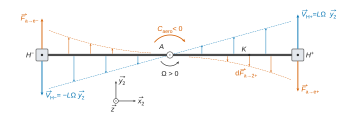
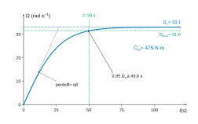
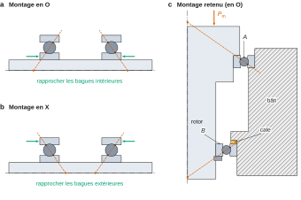
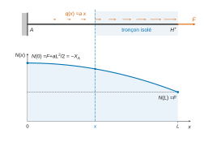
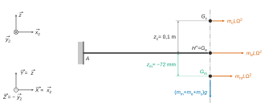

# Banque PT PT — Sciences industrielles B 2026 · Corrigé brut

*Corrigé rédigé par IA, non officiel. Signalez toute erreur.*

Épreuve de 6 h, sans calculatrice ni document. Support : centrifugeuse de précision Exail CTR-20 pour la calibration d'accéléromètres. Données de l'annexe N utilisées :

| Grandeur | Valeur | Grandeur | Valeur |
|---|---|---|---|
| $L$ | $1\ \text{m}$ | $E$ | $2{,}0\times10^{11}\ \text{Pa}$ |
| $\Gamma_{max}$ | $1000\ \text{m·s}^{-2}$ | $\rho$ | $8000\ \text{kg·m}^{-3}$ |
| $M_{tot}$ | $1500\ \text{kg}$ | $\alpha_{th}$ | $10\times10^{-6}\ \text{K}^{-1}$ |
| $R_P$ | $0{,}5\ \text{m}$ | $h_m$ | $100\ \text{mm}$ |
| $\Delta m$ | $0{,}05\ \text{kg}$ | $m_m$ | $40\ \text{kg}$ |
| $\rho_a$ | $1{,}2\ \text{kg·m}^{-3}$ | $pas$ | $4\ \text{mm·tr}^{-1}$ |
| $k$ | $15{,}6$ | $\eta$ | $0{,}75$ |
| $T$ | $20\ \text{s}$ | | |

Les applications numériques sont faites avec $g \approx 9{,}81\ \text{m·s}^{-2}$ (une valeur de $10$ reste dans la tolérance de quelques pourcents annoncée par l'énoncé).

---

## Partie I — Caractéristiques de la centrifugeuse

### I.1 — Gamme d'accélération centripète

**Question 1.** $A$ est sur l'axe de la pivot $(O,\vec z)$, donc $\vec V_{A,2/0} = \vec 0$, et $\vec\Omega_{2/0} = \Omega\,\vec z$. On a $\vec{AM^+} = L\vec x_2 + y_c^+\vec y_2 + z_c^+\vec z$, d'où

$$\begin{aligned}
\vec V_{M^+,2/0} &= \Omega\vec z \wedge \left(L\vec x_2 + y_c^+\vec y_2 + z_c^+\vec z\right)\\
&= -\Omega(t)\,y_c^+\,\vec x_2 + \Omega(t)\,L\,\vec y_2
\end{aligned}$$

$$\boxed{\vec V_{M^+,2/0} = -\Omega(t)\,y_c^+\,\vec x_2 + \Omega(t)\,L\,\vec y_2}$$

**Question 2.** On dérive dans $(0)$. Les vecteurs de la base mobile vérifient :

$$\begin{aligned}
\left.\frac{d\vec x_2}{dt}\right|_0 &= \Omega\,\vec y_2\\
\left.\frac{d\vec y_2}{dt}\right|_0 &= -\Omega\,\vec x_2
\end{aligned}$$

D'où

$$\vec\Gamma_{M^+,2/0} = \dot\Omega\left(L\vec y_2 - y_c^+\vec x_2\right) + \Omega\left(-L\Omega\vec x_2 - y_c^+\Omega\vec y_2\right)$$

$$\boxed{\begin{aligned}
\vec\Gamma_{M^+,2/0}\cdot\vec x_2 &= -L\Omega^2 - y_c^+\dot\Omega\\
\vec\Gamma_{M^+,2/0}\cdot\vec y_2 &= L\dot\Omega - y_c^+\Omega^2\\
\vec\Gamma_{M^+,2/0}\cdot\vec z_2 &= 0
\end{aligned}}$$

**Question 3.** En régime permanent $\dot\Omega = 0$, donc

$$\boxed{\Gamma_{M^+} = \vec\Gamma_{M^+,2/0}\cdot\vec x_2 = -L\,\Omega^2}$$

L'accélération mesurée a pour module $L\Omega^2$ et est dirigée vers l'axe ; le décalage latéral $y_c^+$ n'intervient plus.

**Question 4.** On écrit $|\Gamma_{M^+}| = L\Omega_{max}^2 = |\Gamma_{max}|$ :

$$\boxed{\Omega_{max} = \sqrt{\frac{|\Gamma_{max}|}{L}}}$$

A.N. en $\text{rad·s}^{-1}$, puis conversion en $\text{tr·min}^{-1}$ par le facteur $60/(2\pi) \approx 9{,}55$ :

$$\begin{aligned}
\Omega_{max} &= \sqrt{1000} = 10\sqrt{10} \approx 31{,}6\ \text{rad·s}^{-1}\\
N_{max} &= \frac{60}{2\pi}\,\Omega_{max} \approx 9{,}55\times 31{,}6 \approx 302\ \text{tr·min}^{-1}
\end{aligned}$$

$$\boxed{\Omega_{max} \approx 31{,}6\ \text{rad·s}^{-1} \approx 302\ \text{tr·min}^{-1}}$$

### I.2 — Temps de montée en régime

**Question 5.** Le moteur est en prise directe (pas de réducteur) : son rotor tourne à $\Omega$ et son inertie s'ajoute telle quelle.

$$\begin{aligned}
J_b &= 2\int_0^L \frac{m_b}{L}x^2\,dx = \frac{2}{3}m_bL^2\\
J_e &= 2(m_e+m_c)L^2
\end{aligned}$$

$$\boxed{\begin{aligned}
J_b &= \tfrac23\, m_bL^2\\
J_e &= 2(m_e+m_c)L^2\\
J_{eq} &= J_r + \tfrac23\, m_bL^2 + 2(m_e+m_c)L^2
\end{aligned}}$$

**Question 6.** Pour $\Omega > 0$, la vitesse de l'étuve est $\vec V_{H^+,2^+/0} = \Omega\vec z\wedge L\vec x_2 = L\Omega\,\vec y_2$, selon $+\vec y_2$. La traînée s'oppose au mouvement de l'étuve par rapport à l'air immobile : elle est selon $-\vec y_2$. Comme $\frac12\rho_aS_eC_{x,e}\|\vec V\|^2 > 0$ :

$$\boxed{\varepsilon_e = -1}$$

**Question 7.** Changement de point depuis $A$ :

$$\begin{aligned}
\vec V_{K,2/0} &= \vec V_{A,2/0} + \Omega\vec z\wedge x\vec x_2\\
&= x\,\Omega\,\vec y_2
\end{aligned}$$

$$\boxed{\vec V_{K,2/0} = x\,\Omega\,\vec y_2}$$

**Question 8.** Avec $\varepsilon_e = -1$ et $\|\vec V_{H^+}\| = L\Omega$, la force vaut $\vec F_{a\to e^+} = -\frac12\rho_aS_eC_{x,e}L^2\Omega^2\,\vec y_2$. Elle est appliquée en $H^+$, avec $\vec{AH^+} = L\vec x_2$ :

$$\vec M_{A,a\to e^+} = L\vec x_2\wedge\left(-\tfrac12\rho_aS_eC_{x,e}L^2\Omega^2\,\vec y_2\right)$$

$$\boxed{\vec M_{A,a\to e^+} = -\frac12\,\rho_a\,S_e\,C_{x,e}\,L^3\,\Omega^2\,\vec z}$$

**Question 9.** L'effort élémentaire $d\vec F_{a\to2^+} = -\frac12\rho_aH_bC_{x,b}\,x^2\Omega^2\,dx\,\vec y_2$ s'applique en $K$, avec $\vec{AK} = x\vec x_2$ :

$$\boxed{d\vec M_{A,a\to2^+} = -\frac12\,\rho_a\,H_b\,C_{x,b}\,\Omega^2\,x^3\,dx\;\vec z}$$

Intégration sur $[0,L]$ :

$$\boxed{\vec M_{A,a\to2^+} = -\frac18\,\rho_a\,H_b\,C_{x,b}\,\Omega^2\,L^4\;\vec z}$$

**Question 10.** Côté $(2^-)$ et $(e^-)$, l'effort change de signe (facteur $-\varepsilon_e$) et le bras de levier aussi ($\vec{AH^-} = -L\vec x_2$, $\vec{AK} = -x\vec x_2$). Les moments sont donc identiques à ceux du côté $+$ :

$$C_{aero} = 2\left(-\tfrac12\rho_aS_eC_{x,e}L^3\Omega^2\right) + 2\left(-\tfrac18\rho_aH_bC_{x,b}L^4\Omega^2\right)$$

$$\boxed{C_{aero} = -\rho_a\,\Omega^2L^3\left(S_eC_{x,e} + \frac{H_b\,C_{x,b}\,L}{4}\right)}$$

**Question 11.** On isole l'ensemble tournant {rotor, double-bras, étuves, chargements}. On applique le théorème du moment dynamique en $A$, projeté sur $\vec z$ (pivot parfaite, poids de moment nul sur $\vec z$) :

$$J_{eq}\,\dot\Omega = C_m + C_{aero}$$

En divisant par $J_{eq}$, on obtient $\dot\Omega + A\Omega^2 = B$ avec

$$\boxed{\begin{aligned}
A &= \frac{\rho_aL^3}{J_{eq}}\left(S_eC_{x,e} + \frac{H_bC_{x,b}L}{4}\right)\\
B &= \frac{C_m}{J_{eq}}
\end{aligned}}$$

L'équation est **non linéaire** à cause du terme en $\Omega^2$.

**Question 12.** Avec $\Omega = \alpha\tanh(\beta t)$ et $\frac{1}{\cosh^2} = 1 - \tanh^2$ (déduit de $\cosh^2 - \sinh^2 = 1$) :

$$\begin{aligned}
\dot\Omega &= \alpha\beta\left(1 - \tanh^2(\beta t)\right)\\
&= \alpha\beta - \frac{\beta}{\alpha}\,\Omega^2
\end{aligned}$$

En reportant, $\alpha\beta + \left(A - \frac{\beta}{\alpha}\right)\Omega^2 = B$ pour tout $t$. Il faut donc $\beta = A\alpha$ et $\alpha\beta = B$ :

$$\boxed{\begin{aligned}
\alpha &= \sqrt{\frac{B}{A}}\\
\beta &= \sqrt{AB}\\
\lim_{t\to+\infty}\Omega(t) &= \Omega_\infty = \sqrt{\frac{B}{A}}
\end{aligned}}$$

**Question 13.** Critères de choix :

- exigence 1.1.1.0 : atteindre $\Omega_{max} \approx 31{,}6\ \text{rad·s}^{-1}$ ($302\ \text{tr·min}^{-1}$), donc $\Omega_\infty \geq 31{,}6\ \text{rad·s}^{-1}$ ;
- exigence 1.4.3.1 : 95 % de la vitesse maximale en moins de 50 s, donc $t_{95\%} \leq 50\ \text{s}$ ;
- moteur en prise directe : le couple $C_m$ doit être disponible jusqu'à $302\ \text{tr·min}^{-1}$, donc $N_{lim} \geq 302\ \text{tr·min}^{-1}$ (zone à couple constant) ;
- fonctionnement prolongé (10 h par jour, montée de 50 s puis maintien en vitesse) : on raisonne sur le couple permanent $C_{S1}$ et sur $N_{lim,S1}$.

Lecture du tableau de l'annexe D :

| $C_m$ (N·m) | $\Omega_\infty$ (rad/s) | $t_{95\%}$ (s) | Verdict |
|---|---|---|---|
| 425 | 31,31 | 52,42 | $\Omega_\infty < 31{,}6$ : vitesse insuffisante |
| 450 | 32,22 | 50,94 | $t_{95\%} > 50$ : montée trop lente |
| 475 | 33,10 | 49,58 | les deux exigences sont satisfaites |

Il faut donc $C_m \geq 475\ \text{N·m}$. Le temps $t_{95\%}$ du tableau est relatif à $\Omega_\infty$, un peu supérieur à $\Omega_{max}$ : le critère est légèrement plus sévère que l'exigence, il va dans le sens de la sécurité.

Filtre sur le catalogue : $C_{S1} \geq 475\ \text{N·m}$ et $N_{lim,S1} \geq 302\ \text{tr·min}^{-1}$. Tous les moteurs ont $C_{S1} \geq 510\ \text{N·m}$ : le couple n'est pas discriminant. Seules ont $N_{lim,S1} \geq 302$ les références 295-150-13 (405), 365-100-10 (510), 365-150-15 (330) et 445-100-12 (405).

$$\boxed{\text{TKH 295-150-13, TKH 365-100-10, TKH 365-150-15, TKH 445-100-12}}$$

Le TKH 295-150-13, de plus faible couple nominal ($790\ \text{N·m}$), est le moins surdimensionné.

---

## Partie II — Validation de l'exigence de sécurité (exigence 1.3)

### II.1 — Détection d'un défaut de chargement

**Question 14.** Barycentre des deux masses ponctuelles, avec $\vec{OM^\pm} = \pm L\vec x_2 + y_c^\pm\vec y_2 + (H + z_c^\pm)\vec z$ :

$$\vec{OG_m} = \frac{m_c^+\vec{OM^+} + m_c^-\vec{OM^-}}{m_c^+ + m_c^-}$$

$$\boxed{\begin{aligned}
x_G &= \frac{(m_c^+ - m_c^-)\,L}{m_c^+ + m_c^-}\\
y_G &= \frac{m_c^+y_c^+ + m_c^-y_c^-}{m_c^+ + m_c^-}\\
z_G &= H + \frac{m_c^+z_c^+ + m_c^-z_c^-}{m_c^+ + m_c^-}
\end{aligned}}$$

**Question 15.** Mobilités et composantes transmises :

- ponctuelle de normale $(P_1,\vec z)$ : seule $Z_{P_1}$ est transmise ;
- rotule de centre $P_2$ : résultante quelconque, moment nul en $P_2$ ;
- sphère-cylindre d'axe $(P_3,\vec y)$ : translation selon $\vec y$ et rotations libres, donc $Y_{P_3} = 0$ et moment nul en $P_3$.

$$\boxed{\{\mathcal T^{P_1}_{0\to1}\} = \begin{Bmatrix} 0 & 0\\ 0 & 0\\ Z_{P_1} & 0\end{Bmatrix}_{P_1,\mathcal B}}$$

$$\boxed{\{\mathcal T^{P_2}_{0\to1}\} = \begin{Bmatrix} X_{P_2} & 0\\ Y_{P_2} & 0\\ Z_{P_2} & 0\end{Bmatrix}_{P_2,\mathcal B}}$$

$$\boxed{\{\mathcal T^{P_3}_{0\to1}\} = \begin{Bmatrix} X_{P_3} & 0\\ 0 & 0\\ Z_{P_3} & 0\end{Bmatrix}_{P_3,\mathcal B}}$$

Soit $1 + 3 + 2 = 6$ inconnues : la liaison équivalente (encastrement) est isostatique.

**Question 16.** On isole la centrifugeuse complète $E$ = {châssis (1), double-bras (2), étuves, chargements $m_c^+$ et $m_c^-$}. Actions extérieures : pesanteur et actions du sol en $P_1$, $P_2$, $P_3$.

La rotation étant très lente, l'étude est statique. On applique à $E$ le **principe fondamental de la statique** : théorème de la résultante statique et théorème du moment statique (en $O$ par exemple), soit 6 équations pour 6 inconnues. Pour $Z_{P_1}$ seule, il suffit du théorème du moment statique en un point de la droite $(P_2P_3)$, projeté sur $\vec y$.

**Question 17.** Si $y_c^+ = y_c^- = 0$, alors $B_{P_1} = 0$ et $Z_{P_1} = Z_{P_1}^0 + A_{P_1}\cos\theta$. L'effort oscille autour de $Z_{P_1}^0$ avec l'amplitude

$$\boxed{\Delta F = |A_{P_1}| = \frac{2\,L\,\Delta m\,g}{3\,R_P}}$$

A.N. :

$$\Delta F = \frac{2\times1\times0{,}05\times9{,}81}{3\times0{,}5} \approx 0{,}65\ \text{N}$$

soit $1{,}3\ \text{N}$ crête à crête.

**Question 18.** Avec $m_c^\pm \ll M_{tot}$, l'oscillation est négligeable devant la valeur moyenne, et les trois pieds équirépartis portent chacun un tiers du poids :

$$\boxed{F_{max} \approx Z_{P_1}^0 \approx \frac{M_{tot}\,g}{3}}$$

A.N. :

$$F_{max} \approx \frac{1500\times9{,}81}{3} \approx 4{,}9\times10^3\ \text{N}$$

**Question 19.** La charge maximale du capteur doit dépasser $F_{max} \approx 4{,}9\ \text{kN}$ : FSH04169 ($2235\ \text{N}$) et FSH04171 ($4450\ \text{N}$) sont exclus.

Parmi les capteurs admissibles, on retient celui de plus petite étendue de mesure. Il donne la meilleure résolution relative sur $\Delta F \approx 0{,}65\ \text{N}$, soit environ $7\times10^{-5}$ de la pleine échelle. Il est aussi le plus raide (flèche $2{,}5\times10^{-2}\ \text{mm}$), ce qui ne perturbe pas l'appui :

$$\boxed{\text{FSH04173 (charge maximale } 8900\ \text{N)}}$$

### II.2 — Réalisation et durée de vie de la liaison pivot

**Question 20.** Le roulement A, en haut, reprend l'essentiel de la charge axiale $P_m$ (poids de l'ensemble mobile) : d'après la suite, $F_A = 18\,000\ \text{N}$ contre $F_B = 3000\ \text{N}$.

À largeur égale (20 mm), un plus grand diamètre loge plus de billes, d'où une capacité supérieure : $C_A = 36{,}1\ \text{kN}$ contre $C_B = 26{,}5\ \text{kN}$.

La disposition étagée facilite aussi le montage. Le roulement A passe sur le rotor au-delà de la portée de B (alésage 360 mm contre 200 mm). Le rotor équipé de ses deux roulements s'introduit par le haut dans le bâti, puisque B (diamètre extérieur 240 mm) traverse le logement de A (alésage 400 mm). Enfin, le grand diamètre est imposé par le rotor creux, de grand diamètre, du moteur couple.

**Question 21.** En O (lignes de pression divergentes, sommets des cônes de pression à l'extérieur), la précharge s'obtient en rapprochant les bagues intérieures, ce qui revient à éloigner les bagues extérieures. En X (lignes convergentes), on rapproche les bagues extérieures, ce qui revient à éloigner les bagues intérieures. Le réglage se fait sur les bagues serrées, dont la position axiale est fixée par épaulement, écrou ou cale :

| Montage | Bagues serrées | Rapprocher bagues int. | Rapprocher bagues ext. | Éloigner bagues int. | Éloigner bagues ext. |
|---|---|:-:|:-:|:-:|:-:|
| O | Intérieures | X | | | |
| O | Extérieures | | | | X |
| X | Intérieures | | | X | |
| X | Extérieures | | X | | |

**Question 22.** **Montage en O.** Justification :

- la charge $P_m$ (vers le bas) doit être reprise par le grand roulement A : l'énoncé précise qu'elle comprime A et décharge B. La bague extérieure de A s'appuie donc sur le bâti par en dessous, et celle de B par au-dessus. Les épaulements du bâti sont entre les deux roulements et les lignes de pression divergent, ce qui définit un montage en O. C'est aussi ce que représentent les symboles de la figure 14 (appuis du bâti sous A et au-dessus de B) ;
- les bagues extérieures étant serrées dans le bâti, la cale glissée entre la bague extérieure de B et l'épaulement du bâti situé au-dessus repousse cette bague vers le bas. Elle **éloigne les bagues extérieures**, ce qui est bien la précharge d'un montage en O (ligne « O, extérieures » de la question 21) ;
- le montage en O offre en outre le plus grand écartement des sommets des cônes de pression, donc la meilleure rigidité au basculement, cohérente avec la recherche de rigidité.

**Question 23.** L'arbre étant rigide, l'épaisseur $p$ de la cale est absorbée par les deux écrasements. Sans effort extérieur, l'arbre est en équilibre sous les deux actions axiales opposées des roulements :

$$\boxed{\begin{aligned}
\delta_A^0 + \delta_B^0 &= p\\
F_A^0 &= F_B^0
\end{aligned}}$$

Avec $\delta_A^0 = F_A^0/k_A$ et $\delta_B^0 = F_B^0/k_B$, en notant $F^0$ l'effort commun :

$$p = F^0\left(\frac{1}{k_A} + \frac{1}{k_B}\right) = \frac{F^0}{k_{eq}}$$

$$\boxed{F_A^0 = F_B^0 = k_{eq}\,p}$$

**Question 24.** Le déplacement $\delta$ comprime $A$ et décharge $B$ ; l'équilibre axial de l'arbre sous $P_m$ donne la troisième relation :

$$\boxed{\begin{aligned}
\delta_A &= \delta_A^0 + \delta\\
\delta_B &= \delta_B^0 - \delta\\
P_m &= F_A - F_B
\end{aligned}}$$

On en tire $F_A = k_{eq}p + k_A\delta$ et $F_B = k_{eq}p - k_B\delta$, donc $P_m = (k_A + k_B)\,\delta$. Comme $k_{eq} = \frac{k_Ak_B}{k_A + k_B}$ :

$$\begin{aligned}
\frac{k_A}{k_A + k_B} &= \frac{k_{eq}}{k_B}\\
\frac{k_B}{k_A + k_B} &= \frac{k_{eq}}{k_A}
\end{aligned}$$

$$\boxed{\begin{aligned}
F_A &= k_{eq}\,p + \frac{k_{eq}}{k_B}\,P_m\\
F_B &= k_{eq}\,p - \frac{k_{eq}}{k_A}\,P_m
\end{aligned}}$$

**Question 25.** La condition $F_B = F_B^{min}$ donne $k_{eq}\,p = F_B^{min} + \frac{k_{eq}}{k_A}P_m$ :

$$\boxed{p = \frac{F_B^{min}}{k_{eq}} + \frac{P_m}{k_A}}$$

**Question 26.** Roulements à billes : $L_{10} = (C/P_{eq})^3$ en millions de tours, avec $P_{eq} = 0{,}33\,F_{axiale}$. Avec $F_B = F_B^{min}$ et, par l'équilibre de l'arbre, $F_A = F_B^{min} + P_m$ :

$$\boxed{\begin{aligned}
L_A &= \left(\frac{C_A}{0{,}33\,(F_B^{min} + P_m)}\right)^3\\
L_B &= \left(\frac{C_B}{0{,}33\,F_B^{min}}\right)^3
\end{aligned}}\quad\text{(millions de tours)}$$

**Question 27.** Charges équivalentes et rapports :

$$\begin{aligned}
P_{eq,A} &= 0{,}33\times18\,000 = 5940\ \text{N}, & C_A/P_{eq,A} &\approx 6{,}08\\
P_{eq,B} &= 0{,}33\times3000 = 990\ \text{N}, & C_B/P_{eq,B} &\approx 26{,}8
\end{aligned}$$

$$\boxed{\begin{aligned}
L_A &\approx 2{,}2\times10^2\ \text{millions de tours}\\
L_B &\approx 1{,}9\times10^4\ \text{millions de tours}
\end{aligned}}$$

**Question 28.** Le roulement $A$ est le plus critique. À $\Omega_{moy} = 20\ \text{rad·s}^{-1}$, soit $20/(2\pi) \approx 3{,}18\ \text{tr·s}^{-1}$, pendant $12\ \text{h} = 43\,200\ \text{s}$ par jour, le nombre de tours quotidien vaut $N_{jour} \approx 1{,}38\times10^5\ \text{tr}$. Avec la notation $L_h$ du cahier réponse, exprimée ici en jours :

$$\begin{aligned}
L_h &= \frac{L_A}{N_{jour}} \approx \frac{224\times10^6}{1{,}38\times10^5}\\
&\approx 1{,}6\times10^3\ \text{jours}
\end{aligned}$$

$$\boxed{L_h \approx 1{,}6\times10^3\ \text{jours} \approx 4{,}5\ \text{ans}}$$

Commentaire : environ 4 à 5 ans d'usage quotidien intensif (6 à 7 ans en jours ouvrés), alors que $L_{10}$ correspond à 10 % de défaillances. C'est court pour une machine de ce prix : prévoir une maintenance planifiée de $A$, réduire sa charge ou choisir un roulement de plus forte capacité. Comme $L_A \propto F_A^{-3}$, baisser la précharge $F_B^{min}$ allonge sensiblement la durée de vie. Le roulement $B$, à $1{,}9\times10^4$ millions de tours, est très largement dimensionné.

---

## Partie III — Précision de l'accélération imposée (exigence 1.1.1)

### III.1 — Allongement du bras sous chargement centrifuge

**Question 29.** Le bras est solidaire de l'arbre : liaison encastrement, six composantes transmissibles.

$$\boxed{\{\mathcal T^{A}_{1\to2^+}\} = \begin{Bmatrix} X_A & L_A\\ Y_A & M_A\\ Z_A & N_A\end{Bmatrix}_{A,\mathcal B_2}}$$

Pour le chargement étudié (axial, sans pesanteur), seule $X_A$ sera non nulle.

**Question 30.** On isole le bras $(2^+)$. Il est soumis à l'action de $(1)$ en $A$, à la charge linéique $a\,x\,\vec x_2$ et à l'effort $F\vec x_2$ en $x = L$.

On applique le principe fondamental de la statique, plus précisément le **théorème de la résultante statique en projection sur $\vec x_2$**, qui donne directement $X_A$.

**Question 31.** La résultante de la charge linéique, qui croît linéairement avec $x$, s'obtient par intégration :

$$\begin{aligned}
X_A + \int_0^L a\,x\,dx + F &= 0\\
X_A + \frac{aL^2}{2} + F &= 0
\end{aligned}$$

$$\boxed{X_A = -\left(\frac{aL^2}{2} + F\right)}$$

**Question 32.** Le torseur de cohésion est celui des actions extérieures appliquées au tronçon aval $[x, L]$ :

$$\begin{aligned}
N(x) &= \int_x^L a\,s\,ds + F\\
&= \frac{a}{2}\left(L^2 - x^2\right) + F
\end{aligned}$$

$$\boxed{N(x) = \frac{a}{2}\left(L^2 - x^2\right) + F}$$

Le bras est partout tendu ; $N(0) = -X_A$ et $N(L) = F$.

**Question 33.** Loi de Hooke, avec une contrainte uniforme $\sigma = N/S_b$ et la déformation $\varepsilon = u'(x)$ :

$$\boxed{N(x) = E\,S_b\,u'(x)}$$

**Question 34.** Encastrement en $A$ : $\boxed{u(0) = 0}$. On intègre ensuite

$$u'(x) = \frac{1}{ES_b}\left(F + \frac{aL^2}{2} - \frac{a}{2}x^2\right)$$

$$\boxed{\begin{aligned}
A_0 &= 0\\
A_1 &= \frac{1}{ES_b}\left(F + \frac{aL^2}{2}\right)\\
A_3 &= -\frac{a}{6\,E\,S_b}
\end{aligned}}$$

**Question 35.** Avec $u(0) = 0$ :

$$\begin{aligned}
\Delta L &= u(L)\\
&= \frac{1}{ES_b}\left(FL + \frac{aL^3}{2} - \frac{aL^3}{6}\right)
\end{aligned}$$

$$\boxed{\Delta L = \frac{L}{E\,S_b}\left(F + \frac{a\,L^2}{3}\right)}$$

**Question 36.** À $\Omega$ fixé, $\Gamma_c(\tilde L) = \tilde L\,\Omega^2$, donc

$$\begin{aligned}
e_\Gamma &= \frac{(L + \Delta L)\,\Omega^2 - L\,\Omega^2}{L\,\Omega^2}\\
&= \frac{\Delta L}{L}
\end{aligned}$$

$$\boxed{e_\Gamma = \frac{\Delta L}{L}}$$

**Question 37.** Avec $m_e^+ + m_c^+ \approx 0$, l'expression fournie donne $\Delta L = \dfrac{\rho\,L^3\Omega^2}{3E}$, donc

$$\boxed{e_{\Gamma 0} = \frac{\rho\,L^2\,\Omega^2}{3\,E}}$$

A.N. à $\Omega = 30\ \text{rad·s}^{-1}$ :

$$\begin{aligned}
e_{\Gamma0} &= \frac{8000\times1\times900}{3\times2\times10^{11}}\\
&= 1{,}2\times10^{-5} = 12\ \text{ppm}
\end{aligned}$$

L'exigence 1.1.1.0 impose une précision de 10 ppm, soit une erreur relative de $10^{-5}$ ; c'est bien ce que traduit l'illustration du cahier des charges, $0{,}001\,g$ d'erreur pour $100\,g$.

Ici $1{,}2\times10^{-5} > 10^{-5}$ : **l'exigence n'est pas respectée**, même dans ce cas idéal et à une vitesse inférieure à $\Omega_{max}$ (à $\Omega_{max}$, on aurait environ 13 ppm). Ce résultat ne dépend pas de la section $S_b$, seulement de $\rho/E$ et de $L^2\Omega^2$.

### III.2 — Allongement du bras sous chargement thermique

**Question 38.** La déformation thermique est homogène, donc $\Delta L_{th} = \varepsilon_{th}\,L = \alpha_{th}\,\Delta T\,L$ :

$$\boxed{e_{\Gamma th} = \alpha_{th}\,\Delta T}$$

A.N. :

$$\begin{aligned}
e_{\Gamma th} &= 10\times10^{-6}\times10\\
&= 1{,}0\times10^{-4} = 100\ \text{ppm}
\end{aligned}$$

### III.3 — Conclusion et préconisations

**Question 39.** **Non.** Les deux effets allongent le bras et s'ajoutent. L'effet centrifuge vaut au moins $12$ ppm (équipage supposé sans masse, l'effet réel étant plus grand). L'effet thermique, prépondérant, atteint $100$ ppm pour $\Delta T = 10\ ^\circ\text{C}$. Le total, environ $110$ ppm, dépasse plus de dix fois les $10$ ppm exigés, et chacun des deux effets dépasse à lui seul la tolérance.

**Question 40.** Il faut soit compenser ces erreurs, soit modifier la structure :

- **compenser** l'erreur centrifuge, déterministe, en corrigeant la consigne de vitesse à partir du modèle $\Delta L(\Omega)$ ou d'un étalonnage ;
- **compenser** l'erreur thermique, dominante, en mesurant la température du bras pour corriger de même ;
- **modifier la structure** pour réduire les causes : isolation thermique entre étuve et bras et régulation de l'enceinte ; matériau de bras à faible dilatation et à faible rapport $\rho/E$ (composite à fibres de carbone par exemple ; l'Invar ne réduit que la dilatation) ;
- le plus robuste est de **mesurer directement** la distance axe–capteur en rotation (mesure optique ou laser) et d'en tenir compte dans la calibration.

Augmenter la section $S_b$ ne sert à rien : $e_{\Gamma0}$ ne dépend pas de $S_b$.

---

## Partie IV — Proposition d'une évolution technique

**Question 41.** Le capteur ne mesure que la projection de l'accélération sur son axe $\vec n'$, incliné de $\psi$ par rapport à $\vec x_2$. Le développement limité de $\cos$ à l'ordre 2 donne :

$$\begin{aligned}
\tilde\Gamma &= \Gamma\,\vec x_2\cdot\vec n' = \Gamma\cos\psi\\
&\approx \Gamma\left(1 - \frac{\psi^2}{2}\right)
\end{aligned}$$

$$\boxed{\tilde\Gamma \approx \Gamma\left(1 - \frac{\psi^2}{2}\right)}$$

**Question 42.** On en déduit l'erreur relative et sa valeur absolue :

$$\boxed{\begin{aligned}
\frac{\tilde\Gamma - \Gamma}{\Gamma} &= -\frac{\psi^2}{2}\\
\left|\frac{\tilde\Gamma - \Gamma}{\Gamma}\right| &= \frac{\psi^2}{2}
\end{aligned}}$$

La condition $\frac{\psi^2}{2} \leq 10^{-5}$ donne $\psi \leq \sqrt{2\times10^{-5}} = \sqrt{20}\times10^{-3}$, soit

$$\boxed{\psi_{max} \approx 4{,}5\times10^{-3}\ \text{rad} \approx 0{,}26^\circ}$$

**Question 43.** Chaque masse $m_i$ ($i \in \{m, e, c\}$), de centre $G_i$ tel que $\vec{H^+G_i} = z_i\vec z$, subit $m_iL\Omega^2\vec x_2 - m_ig\,\vec z$.

Le poids est porté par la droite $(H^+,\vec z)$ et n'a pas de moment en $H^+$. L'effort centrifuge donne $z_i\vec z\wedge m_iL\Omega^2\vec x_2 = m_iz_iL\Omega^2\,\vec y_2$. D'où

$$\boxed{\begin{aligned} X &= (m_m + m_e + m_c)\,L\,\Omega^2, & L_{H^+} &= 0\\ Y &= 0, & M_{H^+} &= L\,\Omega^2\,(m_mz_m + m_ez_e + m_cz_c)\\ Z &= -(m_m + m_e + m_c)\,g, & N_{H^+} &= 0\end{aligned}}$$

Les cotes $z_i$ sont algébriques : $z_e$ est négative sur la figure 21, et $z_m$ peut l'être.

**Question 44.** Problème $(P_1)$, convention : torseur des actions du tronçon aval $[x, L]$ sur le tronçon amont. Le tronçon aval ne porte que le couple $C\vec Z$ :

$$\boxed{\begin{aligned}
N &= 0, & M_t &= 0\\
T_Y &= 0, & M_{fY} &= 0\\
T_Z &= 0, & M_{fZ} &= C
\end{aligned}}$$

Sollicitation : **flexion** seule (flexion pure). Ni traction ou compression, ni cisaillement, ni torsion.

**Question 45.** Hypothèse de Bernoulli, $\psi_1 = \frac{dy_1}{dx}$, et loi de comportement en flexion $M_{fZ} = EI_{GZ}\,\frac{d^2y_1}{dx^2}$ :

$$\boxed{M_{fZ}(x) = E\,I_{GZ}\,\frac{d\psi_1}{dx}(x)}$$

**Question 46.** Une seule intégration, donc une seule condition aux limites : l'encastrement en $A$, $\boxed{\psi_1(0) = 0}$ (seule case à cocher). Avec $\psi_1' = C/(EI_{GZ})$ constant :

$$\psi_1(x) = \frac{C\,x}{E\,I_{GZ}}$$

$$\boxed{\psi_1(L) = \frac{C\,L}{E\,I_{GZ}}}$$

**Question 47.** Problème $(P_2)$ : le tronçon aval porte $F\vec Y$ en $H^+$, de moment en $G$ égal à $\vec{GH^+}\wedge F\vec Y = (L - x)\vec X\wedge F\vec Y = F(L - x)\vec Z$ :

$$\boxed{\begin{aligned}
N &= 0, & M_t &= 0\\
T_Y &= F, & M_{fY} &= 0\\
T_Z &= 0, & M_{fZ} &= F\,(L - x)
\end{aligned}}$$

Sollicitations : **flexion** et **cisaillement** (flexion simple).

**Question 48.** On dérive $y_2(x) = \dfrac{F}{6EI_{GZ}}(3Lx^2 - x^3)$ :

$$\boxed{\begin{aligned}
\psi_2(x) &= \frac{F}{2\,E\,I_{GZ}}\,x\,(2L - x)\\
\psi_2(L) &= \frac{F\,L^2}{2\,E\,I_{GZ}}
\end{aligned}}$$

**Question 49.** Par superposition :

$$\boxed{\psi = \psi_1(L) + \psi_2(L) = \frac{C\,L}{E\,I_{GZ}} + \frac{F\,L^2}{2\,E\,I_{GZ}}}$$

Avec $\vec Y = \vec z_2$ et $\vec Z = -\vec y_2$ : l'effort transverse selon $\vec Y$ est la composante $Z$ du torseur (IV.1), et le couple selon $\vec Z$ est l'opposé de $M_{H^+}$ :

$$\boxed{\begin{aligned}
F &= Z = -(m_m + m_e + m_c)\,g\\
C &= -M_{H^+} = -L\,\Omega^2\,(m_mz_m + m_ez_e + m_cz_c)
\end{aligned}}$$

**Question 50.** En reportant $F$ et $C$ et en mettant $-L^2/(EI_{GZ})$ en facteur :

$$\psi = -\frac{L^2}{EI_{GZ}}\left[\frac{(m_m + m_e + m_c)\,g}{2} + (m_mz_m + m_ez_e + m_cz_c)\,\Omega^2\right]$$

$$\boxed{\begin{aligned}
A &= \frac{(m_c + m_e + m_m)\,g}{2}\\
B &= m_c\,z_c + m_e\,z_e + m_m\,z_m
\end{aligned}}$$

**Question 51.** La rotation s'annule si et seulement si $A + B\Omega^2 = 0$ :

$$\boxed{z_m = -\frac{1}{m_m}\left[\frac{(m_c + m_e + m_m)\,g}{2\,\Omega^2} + m_e\,z_e + m_c\,z_c\right]}$$

A.N. avec $z_e = 0$, $z_c = 0{,}1\ \text{m}$, $m_e = 100\ \text{kg}$, $m_c = 20\ \text{kg}$, $m_m = 40\ \text{kg}$ et $\Omega = 30\ \text{rad·s}^{-1}$ :

$$\begin{aligned}
\frac{160\times9{,}81}{2\times900} &\approx 0{,}87\ \text{kg·m}\\
m_ez_e + m_cz_c &= 0 + 20\times0{,}1 = 2\ \text{kg·m}\\
z_m &\approx -\frac{2{,}87}{40}
\end{aligned}$$

$$\boxed{z_m \approx -7{,}2\times10^{-2}\ \text{m} = -72\ \text{mm}}$$

La masse doit être placée sous l'axe du bras. Avec une demi-course $h_m = 100\ \text{mm}$ (course $z_m \in [-100, 100]\ \text{mm}$), la position est **réalisable**, avec 28 mm de marge. Comme $z_m$ dépend de $\Omega$, la masse doit être repositionnée à chaque vitesse ; la condition $|z_m| \leq 0{,}1\ \text{m}$ impose ici $\Omega \gtrsim 20\ \text{rad·s}^{-1}$.

**Question 52.** Une relation par étage de la chaîne :

$$\begin{aligned}
\omega_m &= \omega_{mot}/k & &\text{(réducteur)}\\
r_m\,\omega_m &= r_r\,\omega_r & &\text{(courroie sans glissement)}\\
V &= \frac{pas}{2\pi}\,\omega_r & &\text{(vis-écrou, } pas \text{ par tour, } \omega_r \text{ en rad/s)}
\end{aligned}$$

$$\boxed{V = \frac{pas}{2\pi}\,\frac{r_m}{k\,r_r}\,\omega_{mot}}$$

La course totale $2h_m$ est parcourue en $T$, donc $V = 2h_m/T$ :

$$\begin{aligned}
\omega_{mot} &= \frac{2\pi\,k\,r_r}{r_m\,pas}\cdot\frac{2h_m}{T}\\
&= \frac{4\pi\,h_m\,k\,r_r}{T\,pas\,r_m}
\end{aligned}$$

$$\boxed{\omega_{mot} = \frac{4\pi\,h_m\,k\,r_r}{T\,pas\,r_m}\ \ (\text{rad·s}^{-1})}$$

**Question 53.** Bilan de puissance en régime permanent, avec $V/\omega_{mot} = \frac{pas\,r_m}{2\pi\,k\,r_r}$ :

$$\eta\,c_{mot}\,\omega_{mot} = m_m\,g\,V$$

$$\boxed{\begin{aligned}
c_{mot} &= \frac{m_m\,g\,pas\,r_m}{2\pi\,\eta\,k\,r_r}\\
P_{mot} &= \frac{m_m\,g}{\eta}\cdot\frac{2h_m}{T}
\end{aligned}}$$

A.N. :

$$P_{mot} = \frac{392\times0{,}2/20}{0{,}75} \approx 5{,}2\ \text{W}$$

Avec $r_m = r_r$, on trouve aussi les valeurs suivantes (contrôle : $c_{mot}\,\omega_{mot} \approx 5{,}2\ \text{W}$) :

$$\begin{aligned}
c_{mot} &\approx \frac{392\times4\times10^{-3}}{2\pi\times0{,}75\times15{,}6} \approx 2{,}1\times10^{-2}\ \text{N·m} = 21\ \text{N·mm}\\
\omega_{mot} &\approx 245\ \text{rad·s}^{-1} \approx 2340\ \text{tr·min}^{-1}
\end{aligned}$$

**Question 54.** En tours : la vis fait $\frac{2h_m}{T\,pas}$ tours par seconde, le moteur $K$ fois plus. En $\text{tr·min}^{-1}$, avec $h_m$ en mm et $T$ en s :

$$\begin{aligned}
\omega_{mot} &= \frac{120\,h_m}{T}\cdot\frac{K}{pas}\\
X_\omega &= \frac{120\,h_m}{T} = \frac{120\times100}{20}
\end{aligned}$$

$$\boxed{X_\omega = 600}$$

Pour le couple, avec $m_mg$ en N et $pas$ en $\text{mm·tr}^{-1}$, $c_{mot}$ sort en N·mm :

$$\begin{aligned}
X_c &= \frac{m_m\,g}{2\pi\,\eta}\\
&= \frac{392{,}4}{2\pi\times0{,}75}
\end{aligned}$$

$$\boxed{X_c \approx 83}$$

Contrôle : $\omega_{mot} = 600\times15{,}6/4 = 2340\ \text{tr·min}^{-1}$ et $c_{mot} = 83\times4/15{,}6 \approx 21\ \text{N·mm}$.

**Question 55.** Comparaison besoin / capacité :

| Critère | Besoin | Annexe M | Conclusion |
|---|---|---|---|
| Vitesse moteur | $2340\ \text{tr·min}^{-1}$ | $4000\ \text{tr·min}^{-1}$ nominale | convient |
| Couple moteur | $21\ \text{N·mm}$ | $29{,}5\ \text{N·mm}$ nominal, $150\ \text{N·mm}$ au démarrage | convient |
| Puissance | $5{,}2\ \text{W}$ | $10\ \text{W}$ | convient |
| Couple en sortie de réducteur | $21\times15{,}6\times0{,}81 \approx 270\ \text{N·mm}$ | $700\ \text{N·mm}$ permanent | convient |
| Rapport de réduction | $k = 15{,}6$ | GPX 22, 2 étages, $k = 15{,}6$ | cohérent |

Toutes les grandeurs sont dans le domaine nominal avec marge : l'association DCX 22 L + GPX 22 + codeur convient. Le rendement global $\eta = 0{,}75$ est compatible avec les 81 % du réducteur si courroie et vis ont ensemble un rendement d'environ 0,93.

**Question 56.** Le codeur est sur l'arbre moteur : une impulsion vaut $1/N_{imp}$ tour moteur, soit $1/(k\,N_{imp})$ tour de vis ($r_m = r_r$) :

$$\begin{aligned}
\Delta z_{cod} &= \frac{pas}{k\,N_{imp}}\\
&= \frac{4}{15{,}6\times1024}
\end{aligned}$$

$$\boxed{\Delta z_{cod} \approx 2{,}5\times10^{-4}\ \text{mm}}$$

Le jeu de $1^\circ$ est en sortie de réducteur et se transmet tel quel à la vis :

$$\boxed{\Delta z_{red} = \frac{pas}{360} \approx 1{,}1\times10^{-2}\ \text{mm}}$$

Le jeu du réducteur domine (environ 45 fois la résolution du codeur) : améliorer le codeur ne sert à rien. Il faut un réducteur à jeu réduit (épicycloïdal de précision, réducteur harmonique), un rattrapage de jeu (précharge de la transmission, écrou à rattrapage de jeu), ou un capteur de position placé en aval du jeu (codeur sur la vis ou capteur linéaire sur la masse), pour que le jeu soit compris dans la boucle d'asservissement.
