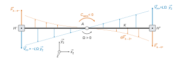
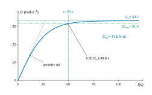
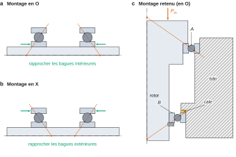
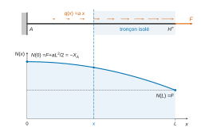
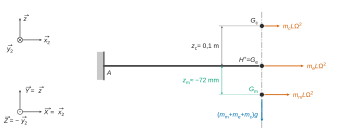

# Banque PT PT — Sciences industrielles B 2026 · Corrigé guidé

*Corrigé rédigé par IA, non officiel. Signalez toute erreur.*

## Présentation du sujet

**Support.** Une centrifugeuse de précision (Exail CTR-20) sert à calibrer des accéléromètres. Un double-bras de longueur $L = 1\ \text{m}$ tourne autour d'un axe vertical. Le capteur placé en bout de bras subit une accélération centripète $\Gamma = L\Omega^2$, que l'on veut connaître à **10 ppm** près jusqu'à environ **100 g**.

Presque tout le sujet découle de cette relation : pour garantir $\Gamma$ à 10 ppm, il faut maîtriser $\Omega$, la distance réelle axe–capteur et l'orientation de l'axe sensible.

**Découpage.** Quatre parties indépendantes (l'énoncé en annonce trois puis en décrit quatre). Les durées sont celles conseillées par l'énoncé, les poids ceux que donne le rapport du jury 2026 :

| Partie | Contenu | Questions | Durée conseillée | Poids |
|---|---|---|---|---|
| I | Cinématique du point, traînée aérodynamique, équation de mise en vitesse, choix d'un moteur couple | Q1–Q13 | 1 h 30 | 24 % |
| II | Statique sur trois appuis (détection d'un balourd de 50 g), montage de roulements à contact oblique préchargé, durée de vie | Q14–Q28 | 1 h | 28 % |
| III | RDM en traction : allongement centrifuge et dilatation thermique du bras, conclusion sur l'exigence de précision | Q29–Q40 | 1 h 30 | 20 % |
| IV | Inclinaison du capteur par flexion, RDM en flexion par superposition, masse mobile de correction, chaîne moteur–réducteur–courroie–vis | Q41–Q56 | 1 h 30 | 28 % |

Une lecture préalable de 30 min est conseillée par l'énoncé. Le rapport 2026 insiste dans le même sens : « Une lecture complète du sujet en début d'épreuve est conseillée afin de bien s'en imprégner. »

**Notions mobilisées.** Champ des vitesses d'un solide, dérivation vectorielle en base mobile, moment d'une force, intégration d'actions réparties, théorème du moment dynamique autour d'un axe fixe, équation différentielle non linéaire, liaisons normalisées et torseurs transmissibles, isostatisme, principe fondamental de la statique, montages de roulements en O et en X, précharge, durée de vie $L_{10}$, torseur de cohésion, loi de Hooke en traction et en flexion, superposition, transmission de puissance avec rendement, résolution d'un codeur et jeu d'un réducteur.

**Difficulté.** Le sujet est long (56 questions) mais très guidé : la plupart des résultats intermédiaires sont donnés, ce qui permet de reprendre une partie en cours de route. Les applications numériques se font sans calculatrice, avec une tolérance de quelques pourcents. Le rapport 2026 précise que cette tolérance ne joue que si le calcul demande une approximation : un résultat exact attendu doit être exact.

**Questions discriminantes d'après le rapport 2026.** Les taux de réussite publiés désignent les points où les copies se séparent :

| Questions | Constat du jury |
|---|---|
| Q4 (A.N. en rad/s puis tr/min) | totalement juste pour 35 % des candidats |
| Q6–Q11 | erreurs de signe, d'intégration, de produit vectoriel |
| Q13 (choix du moteur) | 20 % vont au bout |
| Q21–Q22 (montage en O ou en X) | 20 % de réponses satisfaisantes |
| Q23–Q25 (précharge) | près de 80 % d'échec complet pour certaines |
| Q26–Q28 (durée de vie) | 10 % de réponses justes, A.N. comprise |
| Q31–Q32 (réaction en A, effort normal) | 30 % de réussite |
| Q37 (A.N. et conclusion en ppm) | 15 % de réussite |
| Q38–Q40 (thermique, conclusion) | 15 % de réussite |
| Q52–Q56 (chaîne électromécanique) | aucun point pour près de 80 % des candidats |

**Questions à ne pas laisser passer.** Q3, Q4, Q5, Q7, Q15, Q16, Q18, Q29–Q38, Q41–Q42, Q44–Q48 sont des applications directes du cours. Q26–Q28 se traitent sans les questions précédentes, puisque les efforts sont donnés. Q52–Q56 sont faciles et indépendantes du reste : le rapport note qu'elles ont été très peu abordées.

**Gestion du temps.** Les quatre parties sont indépendantes. Si la technologie des roulements n'est pas un point fort, traiter II.2 en dernier, mais ne pas sauter Q23–Q28, qui sont du calcul pur sur ressorts puis une formule de cours. Garder du temps pour la fin de la partie IV.

---

## Partie I — Caractéristiques de la centrifugeuse

On calcule l'accélération vue par le capteur, on en déduit la vitesse à atteindre, puis on dimensionne le moteur à partir d'un modèle d'inertie et de pertes aérodynamiques. Outils : cinématique du solide, moments, théorème du moment dynamique.

### Question 1

> [!INDICATION]
> $M^+$ est un point du solide $(2)$, qui est en rotation autour d'un axe fixe.

> [!INDICATION]
> Utiliser la relation de changement de point du champ des vitesses à partir d'un point de l'axe, puis les produits vectoriels de la base directe $(\vec x_2, \vec y_2, \vec z)$.

#### Solution

$A$ appartient à l'axe de la liaison pivot, donc $\vec V_{A,2/0} = \vec 0$, et $\vec\Omega_{2/0} = \Omega\,\vec z$. On a $\vec{AM^+} = L\vec x_2 + y_c^+\vec y_2 + z_c^+\vec z$, d'où

$$\begin{aligned}
\vec V_{M^+,2/0} &= \vec V_{A,2/0} + \Omega\vec z\wedge\vec{AM^+}\\
&= \Omega\left(L\,\vec z\wedge\vec x_2 + y_c^+\,\vec z\wedge\vec y_2\right)
\end{aligned}$$

Comme $\vec z\wedge\vec x_2 = \vec y_2$ et $\vec z\wedge\vec y_2 = -\vec x_2$ :

$$\boxed{\vec V_{M^+,2/0} = -\Omega(t)\,y_c^+\,\vec x_2 + \Omega(t)\,L\,\vec y_2}$$

La cote $z_c^+$, portée par l'axe de rotation, ne contribue pas.

> [!PIEGE]
> Dériver « composante par composante » $\vec{AM^+}$ en oubliant que la base $(\vec x_2, \vec y_2)$ tourne donne une vitesse nulle, ce qui est absurde.

### Question 2

> [!INDICATION]
> Dériver le résultat de Q1 par rapport au temps dans le repère $(0)$.

> [!INDICATION]
> Il faut dériver à la fois les composantes, qui dépendent de $\Omega(t)$, et les vecteurs $\vec x_2$, $\vec y_2$, qui tournent à la vitesse $\Omega$ autour de $\vec z$.

#### Solution

Les vecteurs de la base mobile vérifient :

$$\begin{aligned}
\left.\frac{d\vec x_2}{dt}\right|_0 &= \Omega\,\vec y_2\\
\left.\frac{d\vec y_2}{dt}\right|_0 &= -\Omega\,\vec x_2
\end{aligned}$$

En partant de $\vec V = \Omega(L\vec y_2 - y_c^+\vec x_2)$ :

$$\vec\Gamma_{M^+,2/0} = \dot\Omega\left(L\vec y_2 - y_c^+\vec x_2\right) + \Omega\left(-L\Omega\,\vec x_2 - y_c^+\Omega\,\vec y_2\right)$$

$$\boxed{\begin{aligned}
\vec\Gamma_{M^+,2/0}\cdot\vec x_2 &= -L\Omega^2 - y_c^+\dot\Omega\\
\vec\Gamma_{M^+,2/0}\cdot\vec y_2 &= L\dot\Omega - y_c^+\Omega^2\\
\vec\Gamma_{M^+,2/0}\cdot\vec z_2 &= 0
\end{aligned}}$$

> [!METHODE]
> Pour un point d'un solide en rotation autour d'un axe fixe, on retrouve toujours un terme centripète $-\Omega^2\vec{HM}$ ($H$ projeté sur l'axe) et un terme tangentiel $\dot\Omega\,\vec z\wedge\vec{HM}$. On peut s'en servir pour contrôler le calcul : ici $\vec{HM} = L\vec x_2 + y_c^+\vec y_2$.

### Question 3

> [!INDICATION]
> Que vaut $\dot\Omega$ en régime permanent ?

#### Solution

En régime permanent $\Omega$ est constant, $\dot\Omega = 0$ :

$$\boxed{\Gamma_{M^+} = -L\,\Omega^2}$$

L'accélération a pour module $L\Omega^2$ et est dirigée vers l'axe. Le décalage latéral $y_c^+$ du capteur n'intervient plus : seule compte la distance $L$ selon l'axe de mesure.

### Question 4

> [!INDICATION]
> Inverser la relation de Q3 en module, puis convertir sans calculatrice.

> [!INDICATION]
> $\sqrt{1000} = 10\sqrt{10}$ ; pour passer en tr/min, multiplier par $60/(2\pi)$.

#### Solution

$$\boxed{\Omega_{max} = \sqrt{\frac{|\Gamma_{max}|}{L}}}$$

A.N. en $\text{rad·s}^{-1}$, puis en $\text{tr·min}^{-1}$ :

$$\begin{aligned}
\Omega_{max} &= 10\sqrt{10} \approx 31{,}6\ \text{rad·s}^{-1}\\
N_{max} &= \frac{60}{2\pi}\,\Omega_{max} \approx 9{,}55\times31{,}6 \approx 302\ \text{tr·min}^{-1}
\end{aligned}$$

$$\boxed{\Omega_{max} \approx 31{,}6\ \text{rad·s}^{-1} \approx 302\ \text{tr·min}^{-1}}$$

Contrôle : $1000\ \text{m·s}^{-2} \approx 102\,g$, ce qui correspond bien à la gamme de 0 à 100 g.

> [!PIEGE]
> Le facteur de conversion rad/s vers tr/min est $60/(2\pi) \approx 9{,}55$, pas son inverse. Un résultat de 3 tr/min devrait alerter.

> [!JURY]
> Le rapport 2026 signale que les premiers calculs de cinématique ont été plutôt bien traités, « mis à part l'application numérique à faire dans différentes unités qui n'a été totalement juste que pour 35% des candidats ». Les deux valeurs, en rad/s et en tr/min, sont attendues, chacune avec son unité.

### Question 5

> [!INDICATION]
> Pour $J_b$, l'intégrale est donnée : il suffit de la calculer. Pour les étuves, une masse ponctuelle à la distance $d$ de l'axe a pour moment d'inertie $md^2$.

> [!INDICATION]
> Le moteur est en prise directe : quel est le rapport de réduction entre rotor et bras ?

#### Solution

$$\begin{aligned}
J_b &= 2\int_0^L\frac{m_b}{L}x^2\,dx = \frac{2m_b}{L}\cdot\frac{L^3}{3}\\
&= \frac23\, m_bL^2\\
J_e &= 2(m_e + m_c)L^2
\end{aligned}$$

Le rotor tourne à la même vitesse que le bras (rapport 1), son inertie s'ajoute telle quelle :

$$\boxed{J_{eq} = J_r + \frac23 m_bL^2 + 2(m_e + m_c)L^2}$$

> [!PIEGE]
> Les deux facteurs 2 (deux bras, deux étuves) sont les seules occasions d'erreur. Ne pas diviser $J_r$ par un carré de rapport de réduction : il n'y a pas de réducteur.

### Question 6

> [!INDICATION]
> Dans quel sens se déplace l'étuve $(e^+)$ quand $\Omega > 0$ ? Dans quel sens agit une force de traînée ?

#### Solution

Pour $\Omega > 0$, $\vec V_{H^+,2^+/0} = \Omega\vec z\wedge L\vec x_2 = L\Omega\,\vec y_2$, dirigée selon $+\vec y_2$. La traînée s'oppose au mouvement de l'étuve par rapport à l'air immobile, elle est donc dirigée selon $-\vec y_2$. Le facteur $\frac12\rho_aS_eC_{x,e}\|\vec V\|^2$ étant positif :

$$\boxed{\varepsilon_e = -1}$$

> [!JURY]
> La question demande de cocher une case et de justifier. L'énoncé prévient que « les résultats non justifiés ne seront pas pris en compte » : une case cochée sans phrase de justification ne répond qu'à la moitié de la question.

### Question 7

> [!INDICATION]
> Même démarche qu'en Q1, avec $\vec{AK} = x\vec x_2$.

#### Solution

$$\begin{aligned}
\vec V_{K,2/0} &= \vec V_{A,2/0} + \Omega\vec z\wedge x\vec x_2\\
&= x\,\Omega\,\vec y_2
\end{aligned}$$

$$\boxed{\vec V_{K,2/0} = x\,\Omega\,\vec y_2}$$

La vitesse croît linéairement le long du bras, donc la pression dynamique croît en $x^2$.

### Question 8

> [!INDICATION]
> Écrire d'abord la force avec $\varepsilon_e = -1$ et $\|\vec V_{H^+}\| = L\Omega$, puis son moment en $A$ par un produit vectoriel.

#### Solution

La force et son moment en $A$ s'écrivent :

$$\begin{aligned}
\vec F_{a\to e^+} &= -\frac12\rho_aS_eC_{x,e}L^2\Omega^2\,\vec y_2\\
\vec M_{A,a\to e^+} &= \vec{AH^+}\wedge\vec F_{a\to e^+} = L\vec x_2\wedge\vec F_{a\to e^+}
\end{aligned}$$

$$\boxed{\vec M_{A,a\to e^+} = -\frac12\,\rho_a\,S_e\,C_{x,e}\,L^3\,\Omega^2\,\vec z}$$

Le moment est opposé à la rotation : c'est bien un couple résistant. Contrôle d'unité : $\text{kg·m}^{-3}\cdot\text{m}^2\cdot\text{m}^3\cdot\text{s}^{-2} = \text{N·m}$.

### Question 9

> [!INDICATION]
> Le tronçon de longueur $dx$ en $K$ subit un effort élémentaire de même forme qu'en Q8 ; son bras de levier est $x$.

> [!INDICATION]
> L'intégrande final est en $x^3$ : un $x^2$ vient de la vitesse au carré, un $x$ du bras de levier.

#### Solution

Avec $\varepsilon_e = -1$ et $\|\vec V_K\|^2 = x^2\Omega^2$ :

$$\begin{aligned}
d\vec F_{a\to2^+} &= -\frac12\rho_aH_bC_{x,b}\,x^2\Omega^2\,dx\,\vec y_2\\
d\vec M_{A,a\to2^+} &= x\vec x_2\wedge d\vec F_{a\to2^+}
\end{aligned}$$

$$\boxed{d\vec M_{A,a\to2^+} = -\frac12\,\rho_a\,H_b\,C_{x,b}\,\Omega^2\,x^3\,dx\;\vec z}$$

On intègre sur $[0, L]$ :

$$\begin{aligned}
\vec M_{A,a\to2^+} &= -\frac12\rho_aH_bC_{x,b}\Omega^2\int_0^Lx^3dx\;\vec z\\
&= -\frac18\,\rho_a\,H_b\,C_{x,b}\,\Omega^2\,L^4\;\vec z
\end{aligned}$$

$$\boxed{\vec M_{A,a\to2^+} = -\frac18\,\rho_a\,H_b\,C_{x,b}\,\Omega^2\,L^4\;\vec z}$$

> [!METHODE]
> Pour une action répartie, on écrit toujours le moment élémentaire (bras de levier compris) avant d'intégrer. Intégrer d'abord la force, puis multiplier par une distance « moyenne », est faux dès que la répartition n'est pas uniforme.

### Question 10

> [!INDICATION]
> Pour le côté $(2^-)$, $(e^-)$, comparer le signe de l'effort (le facteur $-\varepsilon_e$) et celui du bras de levier.

#### Solution

Côté $-$, l'effort change de signe et le bras de levier aussi ($\vec{AH^-} = -L\vec x_2$) : le moment est le même que côté $+$. Les deux côtés s'ajoutent :

$$C_{aero} = 2\left(-\frac12\rho_aS_eC_{x,e}L^3\Omega^2\right) + 2\left(-\frac18\rho_aH_bC_{x,b}L^4\Omega^2\right)$$

$$\boxed{C_{aero} = -\rho_a\,\Omega^2L^3\left(S_eC_{x,e} + \frac{H_b\,C_{x,b}\,L}{4}\right)}$$

> [!PIEGE]
> Par symétrie, la **résultante** des actions de l'air est nulle, mais pas leur **moment**. Conclure $C_{aero} = 0$ est un contresens.

> [!JURY]
> Sur Q6 à Q11, le rapport 2026 note que plus de 80 % des candidats réussissent les premières questions, mais que « les résultats se dégradent dans la suite, notamment à cause d'erreurs de signe, d'intégration, ou dans les produits vectoriels ». Il demande aussi des résultats simplifiés et mis en forme : la factorisation par $\rho_a\Omega^2L^3$ ci-dessus en est un exemple.

### Question 11

> [!INDICATION]
> Isoler tout ce qui tourne et appliquer le théorème du moment dynamique en $A$, projeté sur l'axe de rotation.

> [!INDICATION]
> Pour un solide en rotation autour d'un axe fixe, la projection du moment dynamique sur l'axe vaut $J\dot\Omega$. Diviser ensuite par $J_{eq}$ pour obtenir la forme imposée.

#### Solution

On isole {rotor, double-bras, étuves, chargements}. Les actions extérieures ayant un moment sur $\vec z$ sont le couple moteur et le couple aérodynamique (pivot parfaite ; le poids, parallèle à l'axe, a un moment nul sur $\vec z$) :

$$J_{eq}\,\dot\Omega = C_m - \rho_a\Omega^2L^3\left(S_eC_{x,e} + \frac{H_bC_{x,b}L}{4}\right)$$

$$\boxed{\begin{aligned}
A &= \frac{\rho_aL^3}{J_{eq}}\left(S_eC_{x,e} + \frac{H_bC_{x,b}L}{4}\right)\\
B &= \frac{C_m}{J_{eq}}
\end{aligned}}$$

L'équation est **non linéaire** : elle contient le carré de l'inconnue $\Omega$.

> [!METHODE]
> Une équation différentielle est linéaire si l'inconnue et ses dérivées n'y apparaissent qu'au premier degré. Un frottement fluide quadratique la rend non linéaire : pas de fonction de transfert, d'où le recours à une solution analytique particulière (Q12) ou à des simulations (annexe D).

### Question 12

> [!INDICATION]
> Injecter la forme proposée dans l'équation et exprimer $\dot\Omega$ en fonction de $\Omega$.

> [!INDICATION]
> La relation $\cosh^2 - \sinh^2 = 1$ permet d'écrire $\frac{1}{\cosh^2}$ en fonction de $\tanh^2$. On identifie ensuite le terme constant et le terme en $\Omega^2$.

#### Solution

$$\begin{aligned}
\dot\Omega &= \frac{\alpha\beta}{\cosh^2(\beta t)}\\
&= \alpha\beta\left(1 - \tanh^2(\beta t)\right)\\
&= \alpha\beta - \frac{\beta}{\alpha}\,\Omega^2
\end{aligned}$$

En reportant dans $\dot\Omega + A\Omega^2 = B$, on obtient $\alpha\beta + \left(A - \frac{\beta}{\alpha}\right)\Omega^2 = B$ pour tout $t$.

Comme $\Omega$ prend une infinité de valeurs, $\frac{\beta}{\alpha} = A$ et $\alpha\beta = B$. D'où $\alpha^2 = B/A$ et $\beta^2 = AB$ :

$$\boxed{\begin{aligned}
\alpha &= \sqrt{\frac{B}{A}}\\
\beta &= \sqrt{AB}\\
\lim_{t\to+\infty}\Omega(t) &= \sqrt{\frac{B}{A}}
\end{aligned}}$$

Contrôle : $\Omega_\infty$ annule $\dot\Omega$, c'est l'équilibre entre couple moteur et couple aérodynamique.

> [!JURY]
> Le rapport 2026 rappelle que, « Bien que non-linéaire, la solution analytique pouvait être trouvée (la forme de la solution étant donnée dans le sujet) ». Il suffit d'injecter la forme proposée et d'identifier : aucune technique de résolution n'est attendue.

### Question 13

> [!INDICATION]
> Traduire chaque exigence en une condition sur les colonnes du tableau de l'annexe D, puis chercher le plus petit couple qui les satisfait toutes.

> [!INDICATION]
> Côté catalogue, deux grandeurs comptent : le couple disponible et la vitesse jusqu'à laquelle il est disponible. Se demander aussi quel régime (S1 ou S6) correspond au fonctionnement réel.

#### Solution

Critères :

- exigence 1.1.1.0 : $\Omega_\infty \geq \Omega_{max} \approx 31{,}6\ \text{rad·s}^{-1}$ ;
- exigence 1.4.3.1 : 95 % de la vitesse maximale en moins de 50 s, soit $t_{95\%} \leq 50\ \text{s}$ ;
- prise directe : le couple doit être disponible jusqu'à $302\ \text{tr·min}^{-1}$, soit $N_{lim} \geq 302\ \text{tr·min}^{-1}$ ;
- fonctionnement prolongé (montée en vitesse, puis maintien, 10 h par jour) : couple permanent $C_{S1}$ et $N_{lim,S1}$.

Lecture du tableau de l'annexe D :

| $C_m$ (N·m) | $\Omega_\infty$ (rad/s) | $t_{95\%}$ (s) | Verdict |
|---|---|---|---|
| 425 | 31,31 | 52,42 | vitesse insuffisante |
| 450 | 32,22 | 50,94 | montée trop lente |
| 475 | 33,10 | 49,58 | convient |

Il faut donc $C_m \geq 475\ \text{N·m}$. Le temps $t_{95\%}$ est mesuré par rapport à $\Omega_\infty$, légèrement supérieur à $\Omega_{max}$ : le critère est un peu plus sévère que l'exigence, donc sûr.

Catalogue : tous les moteurs ont $C_{S1} \geq 510\ \text{N·m}$, le couple n'est donc pas discriminant. La vitesse limite l'est : seules les références suivantes ont $N_{lim,S1} \geq 302\ \text{tr·min}^{-1}$.

$$\boxed{\text{TKH 295-150-13 (405), TKH 365-100-10 (510), TKH 365-150-15 (330), TKH 445-100-12 (405)}}$$

Le TKH 295-150-13 ($C_{S1} = 790\ \text{N·m}$) est le moins surdimensionné.

> [!PIEGE]
> Filtrer sur le seul couple conduit à proposer des moteurs dont le couple commence à chuter avant la vitesse de service. Pour un moteur en prise directe, la vitesse du moteur est celle de la charge.

> [!METHODE]
> Choisir un moteur, c'est vérifier le point de fonctionnement (couple, vitesse) dans la zone permise du constructeur, en régime continu si le fonctionnement est continu.

> [!JURY]
> Le rapport 2026 constate que « seulement 20% des candidats concluent correctement cette partie en allant au bout du choix de moteur ». La question demande à la fois les critères et les références : une liste de critères sans références retenues, ou l'inverse, reste incomplète.

---

## Partie II — Validation de l'exigence de sécurité (exigence 1.3)

II.1 relie le défaut d'équilibrage à l'effort mesuré sous un pied (statique, isostatisme). II.2 conçoit le guidage du bras : choix du montage de roulements, précharge modélisée par des ressorts, durée de vie. D'après le rapport 2026, la partie a été moins bien traitée que la première à cause de II.2 : 30 % des candidats seulement obtiennent plus de la moitié des points de la partie II.

### Question 14

> [!INDICATION]
> Barycentre de deux points pondérés, exprimé dans la base $(\vec x_2, \vec y_2, \vec z)$ à partir de $O$.

#### Solution

Avec $\vec{OM^\pm} = \pm L\vec x_2 + y_c^\pm\vec y_2 + (H + z_c^\pm)\vec z$ :

$$\vec{OG_m} = \frac{m_c^+\vec{OM^+} + m_c^-\vec{OM^-}}{m_c^+ + m_c^-}$$

$$\boxed{\begin{aligned}
x_G &= \frac{(m_c^+ - m_c^-)\,L}{m_c^+ + m_c^-}\\
y_G &= \frac{m_c^+y_c^+ + m_c^-y_c^-}{m_c^+ + m_c^-}\\
z_G &= H + \frac{m_c^+z_c^+ + m_c^-z_c^-}{m_c^+ + m_c^-}
\end{aligned}}$$

Le signe $-L$ du bras $(2^-)$ fait apparaître la différence des masses : c'est le déséquilibre à détecter.

### Question 15

> [!INDICATION]
> Pour chaque liaison, lister les mobilités : à chaque mobilité correspond une composante nulle du torseur transmissible.

> [!INDICATION]
> Pour la sphère-cylindre d'axe $(P_3, \vec y)$, la translation libre est celle selon l'axe.

#### Solution

- Ponctuelle de normale $(P_1, \vec z)$ : seule la composante normale est transmise.
- Rotule de centre $P_2$ : résultante quelconque, moment nul en $P_2$.
- Sphère-cylindre d'axe $(P_3,\vec y)$ : translation selon $\vec y$ et trois rotations libres.

$$\boxed{\{\mathcal T^{P_1}_{0\to1}\} = \begin{Bmatrix} 0 & 0\\ 0 & 0\\ Z_{P_1} & 0\end{Bmatrix}_{P_1,\mathcal B}}$$

$$\boxed{\{\mathcal T^{P_2}_{0\to1}\} = \begin{Bmatrix} X_{P_2} & 0\\ Y_{P_2} & 0\\ Z_{P_2} & 0\end{Bmatrix}_{P_2,\mathcal B}}$$

$$\boxed{\{\mathcal T^{P_3}_{0\to1}\} = \begin{Bmatrix} X_{P_3} & 0\\ 0 & 0\\ Z_{P_3} & 0\end{Bmatrix}_{P_3,\mathcal B}}$$

Il y a $1 + 3 + 2 = 6$ inconnues pour 6 équations : la liaison équivalente encastrement est isostatique. Les efforts aux pieds ne dépendent donc pas des défauts de planéité du sol, ce qui rend la mesure en $P_1$ exploitable.

### Question 16

> [!INDICATION]
> Quel système isoler pour que les seules inconnues soient les actions du sol sur les trois pieds ?

#### Solution

On isole la centrifugeuse entière $E$ = {châssis (1), double-bras (2), étuves, chargements $m_c^+$ et $m_c^-$}. Elle est soumise à la pesanteur et aux actions du sol en $P_1$, $P_2$, $P_3$.

La rotation étant très lente, l'étude est statique. On applique le **principe fondamental de la statique** (théorème de la résultante statique et théorème du moment statique en $O$, par exemple), soit 6 équations pour 6 inconnues.

Pour obtenir $Z_{P_1}$ seule, il suffit du théorème du moment statique en un point de la droite $(P_2P_3)$, projeté sur $\vec y$ : les actions en $P_2$ et $P_3$ n'y interviennent pas.

> [!JURY]
> Il est attendu de nommer précisément le système isolé, le théorème utilisé et, pour un théorème du moment, le point et la direction de projection.

> [!PIEGE]
> Isoler le seul châssis (1) ferait apparaître en plus les inconnues de la pivot avec le bras.

### Question 17

> [!INDICATION]
> Avec $y_c^\pm = 0$, un des deux termes variables disparaît. Que mesure le capteur quand $\theta$ varie de $0$ à $2\pi$ ?

#### Solution

Avec $y_c^+ = y_c^- = 0$, on a $B_{P_1} = 0$ et $Z_{P_1} = Z_{P_1}^0 + A_{P_1}\cos\theta$. L'effort oscille à la fréquence de rotation, avec l'amplitude

$$\boxed{\Delta F = |A_{P_1}| = \frac{2\,L\,\Delta m\,g}{3\,R_P}}$$

A.N. :

$$\Delta F = \frac{2\times1\times0{,}05\times9{,}81}{1{,}5} \approx 0{,}65\ \text{N}$$

soit $1{,}3\ \text{N}$ crête à crête.

> [!METHODE]
> L'information utile est dans la **modulation** périodique du signal, pas dans sa valeur moyenne. C'est pourquoi on fait tourner le bras lentement pendant la mesure.

### Question 18

> [!INDICATION]
> Si le chargement est négligeable et l'ensemble équilibré, comment le poids se répartit-il sur trois pieds équirépartis ?

#### Solution

Avec $m_c^\pm \ll M_{tot}$, l'oscillation est négligeable devant la valeur moyenne, et par symétrie chaque pied porte un tiers du poids :

$$\boxed{F_{max} \approx \frac{M_{tot}\,g}{3}}$$

A.N. :

$$F_{max} \approx 500\times9{,}81 \approx 4{,}9\times10^3\ \text{N}$$

soit environ 5 kN. Rapport signal sur charge : $0{,}65/4900 \approx 1{,}3\times10^{-4}$. La mesure est exigeante.

### Question 19

> [!INDICATION]
> Deux exigences s'opposent : le capteur doit supporter $F_{max}$, mais une étendue de mesure trop grande dégrade la résolution relative.

#### Solution

Il faut une charge maximale supérieure à 4,9 kN : FSH04169 (2235 N) et FSH04171 (4450 N) sont exclus. Parmi FSH04173 (8900 N), FSH04175 (22 250 N) et FSH04177 (44 500 N), on retient le capteur de plus petite étendue :

$$\boxed{\text{FSH04173}}$$

C'est celui qui donne la meilleure résolution relative sur $\Delta F$ (environ $7\times10^{-5}$ de la pleine échelle), avec un coefficient de sécurité d'environ 1,8 sur la charge statique. Il est aussi le plus raide (flèche $2{,}5\times10^{-2}\ \text{mm}$), donc il ne modifie pas la géométrie d'appui. Sa fréquence propre (6300 Hz) est sans rapport avec la rotation très lente de la procédure.

> [!METHODE]
> En métrologie, on choisit le plus petit calibre compatible avec la charge maximale, pas le plus grand.

> [!JURY]
> Cette sous-partie est la mieux réussie de la partie II : d'après le rapport 2026, « plus de 50% des candidats vont jusqu'à un choix judicieux de capteur ». Le choix doit s'appuyer sur les deux valeurs calculées, l'effort moyen à supporter et l'oscillation à détecter.

### Question 20

> [!INDICATION]
> Quel roulement porte l'essentiel du poids de l'ensemble mobile ? Comparer les capacités de charge de l'annexe I.

> [!INDICATION]
> Penser aussi à l'ordre d'assemblage : comment introduit-on le rotor équipé de ses roulements dans le bâti de la figure 13 ?

#### Solution

- **Charge** : le roulement A reprend l'essentiel de la charge axiale $P_m$ (plus loin, $F_A = 18\,000\ \text{N}$ contre $F_B = 3000\ \text{N}$). À largeur égale (20 mm), un plus grand diamètre loge plus de billes : $C_A = 36{,}1\ \text{kN}$ contre $C_B = 26{,}5\ \text{kN}$.
- **Montage** : le rotor et le bâti sont étagés. A passe sur le rotor au-delà de la portée de B (alésage 360 mm contre 200 mm), et le rotor équipé s'introduit par le haut dans le bâti, puisque B (diamètre extérieur 240 mm) traverse le logement de A (alésage 400 mm).
- **Architecture** : le rotor creux du moteur couple a un grand diamètre, que le roulement A épouse.

### Question 21

> [!INDICATION]
> Commencer par dessiner les lignes de pression d'un montage en O (divergentes) et d'un montage en X (convergentes).

> [!INDICATION]
> Pour un roulement à contact oblique, la précharge comprime les billes entre les deux bagues le long de la ligne de pression. Chercher quel déplacement relatif des bagues extérieures, ou des bagues intérieures, produit cette compression.

#### Solution

- En **O**, on précharge en rapprochant les bagues intérieures, ce qui revient à éloigner les bagues extérieures.
- En **X**, on précharge en rapprochant les bagues extérieures, ce qui revient à éloigner les bagues intérieures.

Le réglage se fait sur les bagues serrées, dont la position axiale est fixée par épaulement, écrou ou cale :

| Montage | Bagues serrées | Rapprocher bagues int. | Rapprocher bagues ext. | Éloigner bagues int. | Éloigner bagues ext. |
|---|---|:-:|:-:|:-:|:-:|
| O | Intérieures | X | | | |
| O | Extérieures | | | | X |
| X | Intérieures | | | X | |
| X | Extérieures | | X | | |

> [!METHODE]
> Pour retrouver le résultat sans le connaître par cœur : dessiner une bille, sa normale de contact et les deux bagues, puis chercher le déplacement relatif qui écrase la bille. Rapprocher les bagues d'un type revient toujours à éloigner celles de l'autre type.

### Question 22

> [!INDICATION]
> Relire la description de la précharge et du chargement : quel roulement la charge $P_m$ comprime-t-elle ? De quel côté le bâti doit-il alors appuyer sur chaque bague extérieure ?

> [!INDICATION]
> Observer les symboles des roulements à gauche de la figure 14 : de quel côté se trouve l'appui du bâti pour A, et pour B ? Comparer avec le tableau de Q21 : la cale rapproche-t-elle ou éloigne-t-elle les bagues extérieures ?

#### Solution

**Montage en O.**

- La charge $P_m$, dirigée vers le bas, comprime A et décharge B (énoncé). La bague extérieure de A s'appuie donc sur le bâti par en dessous, celle de B par au-dessus. Les épaulements du bâti sont entre les deux roulements et les lignes de pression divergent : c'est un montage en O.
- La figure 14 le représente : appui du bâti sous A (ressort $k_A$ comprimé quand l'arbre descend) et au-dessus de B (ressort $k_B$ comprimé quand l'arbre monte).
- Les bagues extérieures sont serrées dans le bâti. La cale, glissée entre la bague extérieure de B et l'épaulement du bâti situé au-dessus, repousse cette bague vers le bas : elle **éloigne les bagues extérieures**, ce qui correspond à la ligne « O, extérieures » de Q21.
- En prime, le montage en O écarte au maximum les sommets des cônes de pression et donne la meilleure rigidité au basculement.

> [!PIEGE]
> Choisir O ou X par une règle apprise par cœur, sans vérifier quel roulement doit porter la charge, mène à l'erreur. En X, le roulement du haut résisterait à une montée de l'arbre, et le poids chargerait B au lieu de A, à l'inverse de ce qu'indique l'énoncé.

> [!JURY]
> Le rapport 2026 confirme l'objectif : « justifier le choix d'un montage en O plutôt qu'en X ». Il ajoute : « Bien que classiques, seulement 20% des candidats répondent de façon satisfaisante à ces questions technologiques. » Q21 et Q22 sont donc très discriminantes ; la justification doit s'appuyer sur la charge et sur la position de la cale, pas seulement sur une case cochée.

### Question 23

> [!INDICATION]
> Deux équations : la compatibilité géométrique (où passe l'épaisseur de la cale ?) et l'équilibre de l'arbre isolé.

> [!INDICATION]
> Les deux ressorts sont en série : même effort, déformations qui s'additionnent.

#### Solution

L'arbre étant rigide, l'épaisseur $p$ se répartit entre les deux écrasements. Sans effort extérieur, l'arbre est en équilibre sous les deux actions axiales opposées des roulements :

$$\boxed{\begin{aligned}
\delta_A^0 + \delta_B^0 &= p\\
F_A^0 &= F_B^0
\end{aligned}}$$

Avec $\delta_A^0 = F^0/k_A$ et $\delta_B^0 = F^0/k_B$, où $F^0$ est l'effort commun :

$$p = F^0\left(\frac{1}{k_A} + \frac{1}{k_B}\right) = \frac{F^0}{k_{eq}}$$

$$\boxed{F_A^0 = F_B^0 = k_{eq}\,p}$$

Contrôle : si $k_B \to 0$, la cale ne produit aucune précharge, et $k_{eq} \to 0$ le traduit.

> [!JURY]
> Le rapport 2026 rappelle que le choix de la précharge était très guidé, par les questions et par le schéma de la figure 14, et pourtant « les questions associées sont très mal traitées, avec près de 80% d'échec complet pour certaines ». Il suffit d'écrire, pour chaque phase, une relation géométrique et l'équilibre de l'arbre.

### Question 24

> [!INDICATION]
> Le déplacement supplémentaire $\delta$ comprime A et décharge B d'une même quantité. Écrire ensuite l'équilibre axial de l'arbre avec $P_m$.

> [!INDICATION]
> On obtient $\delta$ en fonction de $P_m$ et de $k_A + k_B$. Il reste à exprimer $k_A/(k_A + k_B)$ et $k_B/(k_A + k_B)$ avec $k_{eq}$.

#### Solution

$$\boxed{\begin{aligned}
\delta_A &= \delta_A^0 + \delta\\
\delta_B &= \delta_B^0 - \delta\\
P_m &= F_A - F_B
\end{aligned}}$$

On en tire $F_A = k_{eq}p + k_A\delta$ et $F_B = k_{eq}p - k_B\delta$, donc $P_m = (k_A + k_B)\,\delta$. Comme $k_{eq} = \frac{k_Ak_B}{k_A + k_B}$ :

$$\begin{aligned}
\frac{k_A}{k_A + k_B} &= \frac{k_{eq}}{k_B}\\
\frac{k_B}{k_A + k_B} &= \frac{k_{eq}}{k_A}
\end{aligned}$$

$$\boxed{\begin{aligned}
F_A &= k_{eq}\,p + \frac{k_{eq}}{k_B}\,P_m\\
F_B &= k_{eq}\,p - \frac{k_{eq}}{k_A}\,P_m
\end{aligned}}$$

Le roulement A ne reprend que la fraction $k_{eq}/k_B < 1$ de la charge ; le reste vient du délestage de B. C'est l'effet de la précharge, tant que B reste comprimé.

> [!PIEGE]
> L'énoncé impose d'écrire $F_A$ avec $k_{eq}/k_B$ et $F_B$ avec $k_{eq}/k_A$. Laisser $k_A/(k_A + k_B)$ n'est pas faux, mais ne répond pas à la forme demandée : le rapport 2026 déplore que des candidats expriment la réponse « en fonction d'autres quantités que celles imposées ».

### Question 25

> [!INDICATION]
> Isoler $p$ dans l'expression de $F_B$.

#### Solution

$$\begin{aligned}
k_{eq}\,p - \frac{k_{eq}}{k_A}\,P_m &= F_B^{min}\\
p &= \frac{F_B^{min}}{k_{eq}} + \frac{P_m}{k_A}
\end{aligned}$$

$$\boxed{p = \frac{F_B^{min}}{k_{eq}} + \frac{P_m}{k_A}}$$

La cale doit créer la précharge résiduelle voulue et compenser le délestage de B dû à $P_m$.

### Question 26

> [!INDICATION]
> Formule de durée de vie nominale d'un roulement à billes, avec la charge équivalente donnée par l'énoncé.

> [!INDICATION]
> L'énoncé demande une expression en fonction de $F_B^{min}$ et $P_m$ : exprimer $F_A$ grâce à l'équilibre de l'arbre.

#### Solution

Pour des roulements à billes, $L_{10} = (C/P_{eq})^3$ en millions de tours, avec $P_{eq} = 0{,}33\,F_{axiale}$. L'équilibre de l'arbre donne $F_A = F_B^{min} + P_m$ :

$$\boxed{\begin{aligned}
L_A &= \left(\frac{C_A}{0{,}33\,(F_B^{min} + P_m)}\right)^3\\
L_B &= \left(\frac{C_B}{0{,}33\,F_B^{min}}\right)^3
\end{aligned}}$$

> [!PIEGE]
> L'exposant vaut 3 pour les billes et $10/3$ pour les rouleaux. Utiliser $C$ (charge dynamique de base), pas $C_0$ (charge statique).

> [!JURY]
> Le rapport 2026 note que ce calcul, « qui pouvait être fait sans avoir traité les questions précédentes puisque les efforts étaient donnés », a souvent été escamoté, et que « Seulement 10% des candidats calculent la durée de vie correctement, application numérique incluse. » Q26 à Q28 sont des points accessibles même après un échec en Q21–Q25.

### Question 27

> [!INDICATION]
> Calculer d'abord le rapport $C/P_{eq}$, l'arrondir raisonnablement, puis l'élever au cube.

#### Solution

Charges équivalentes et rapports :

$$\begin{aligned}
P_{eq,A} &= 0{,}33\times18\,000 = 5940\ \text{N}, & C_A/P_{eq,A} &\approx 6{,}08\\
P_{eq,B} &= 0{,}33\times3000 = 990\ \text{N}, & C_B/P_{eq,B} &\approx 26{,}8
\end{aligned}$$

Puis $6{,}08^3 \approx 224$ et $26{,}8^3 \approx 1{,}9\times10^4$ :

$$\boxed{\begin{aligned}
L_A &\approx 2{,}2\times10^2\ \text{millions de tours}\\
L_B &\approx 1{,}9\times10^4\ \text{millions de tours}
\end{aligned}}$$

Le roulement A dimensionne la liaison.

> [!METHODE]
> Sans calculatrice, arrondir $6{,}08$ à $6$ et $26{,}8$ à $27$ donne $216$ et $19\,683$, à quelques pourcents près, dans la tolérance annoncée.

### Question 28

> [!INDICATION]
> Convertir la vitesse moyenne en tours par jour, puis diviser la durée de vie du roulement le plus faible.

> [!INDICATION]
> Pour le commentaire : comparer à la durée de vie attendue d'une machine de production, rappeler ce que signifie $L_{10}$, et proposer une action.

#### Solution

$\Omega_{moy} = 20\ \text{rad·s}^{-1}$, soit $20/(2\pi) \approx 3{,}18\ \text{tr·s}^{-1}$. En $12\ \text{h} = 43\,200\ \text{s}$, le nombre de tours quotidien vaut $N_{jour} \approx 1{,}38\times10^5\ \text{tr}$. Avec la notation $L_h$ du cahier réponse, exprimée ici en jours :

$$\begin{aligned}
L_h &= \frac{L_A}{N_{jour}} \approx \frac{224\times10^6}{1{,}38\times10^5}\\
&\approx 1{,}6\times10^3\ \text{jours}
\end{aligned}$$

$$\boxed{L_h \approx 1{,}6\times10^3\ \text{jours} \approx 4{,}5\ \text{ans}}$$

Commentaire : environ 4 à 5 ans d'usage quotidien (6 à 7 ans en jours ouvrés), avec 10 % de défaillances attendues à cette échéance. C'est court pour un équipement de ce coût. Il faut planifier le remplacement de A, ou réduire sa charge, ou choisir un roulement de plus forte capacité. Comme $L_A \propto F_A^{-3}$, baisser la précharge résiduelle gagne beaucoup. B est très surdimensionné.

Contrôle d'ordre de grandeur : $P_m = F_A - F_B = 15\ \text{kN}$ correspond à environ 1500 kg de masse mobile, du même ordre que $M_{tot}$, donnée pour la machine entière. Les deux données sont peu cohérentes entre elles, ce qui ne change pas la démarche.

> [!JURY]
> Le rapport 2026 regrette que « Encore trop de candidats ne respectent pas les notations imposées en introduisant les leurs ». Le cahier réponse attend ici $L_h$ : on garde cette notation et on précise l'unité demandée (des jours).

---

## Partie III — Précision de l'accélération imposée (exigence 1.1.1)

Le bras s'allonge sous l'effet centrifuge et sous l'effet thermique, ce qui modifie la distance axe–capteur et donc $\Gamma$. Outils : statique, torseur de cohésion, loi de Hooke en traction, dilatation.

### Question 29

> [!INDICATION]
> Quelle est la nature de la liaison entre le bras et l'arbre ? Combien de composantes transmet-elle ?

#### Solution

Le bras est solidaire de l'arbre : liaison encastrement, six composantes transmissibles.

$$\boxed{\{\mathcal T^{A}_{1\to2^+}\} = \begin{Bmatrix} X_A & L_A\\ Y_A & M_A\\ Z_A & N_A\end{Bmatrix}_{A,\mathcal B_2}}$$

Pour ce chargement (axial, sans pesanteur), seule $X_A$ sera non nulle.

> [!PIEGE]
> La forme du torseur dépend de la liaison, pas du chargement. Donner directement un torseur à une seule composante confond la liaison et le résultat du calcul.

### Question 30

> [!INDICATION]
> Une seule inconnue est utile. Quelle équation scalaire la donne directement ?

#### Solution

On isole le bras $(2^+)$. Il est soumis à l'action de l'arbre en $A$, à la charge linéique $a\,x\,\vec x_2$ et à l'effort $F\,\vec x_2$ en $x = L$.

On applique le principe fondamental de la statique, et plus précisément le **théorème de la résultante statique projeté sur $\vec x_2$**.

### Question 31

> [!INDICATION]
> La résultante d'une charge linéique s'obtient en l'intégrant sur la longueur. Regarder la figure 17 : la charge est-elle uniforme ?

#### Solution

La charge $q(x) = a\,x$ croît linéairement le long du bras ; sa résultante vaut $\int_0^L a\,x\,dx = aL^2/2$ :

$$\begin{aligned}
X_A + \int_0^La\,x\,dx + F &= 0\\
X_A + \frac{aL^2}{2} + F &= 0
\end{aligned}$$

$$\boxed{X_A = -\left(\frac{aL^2}{2} + F\right)}$$

Le signe négatif traduit que l'arbre retient le bras vers l'axe.

> [!PIEGE]
> Traiter $q$ comme une charge uniforme donne $aL$ au lieu de $aL^2/2$, et l'erreur se propage à $N(x)$ puis à $\Delta L$.

> [!JURY]
> Le rapport 2026 indique que, pour la réaction en $A$ et l'effort normal, « seulement 30% ont répondu correctement à ces deux questions » : « très souvent, l'effort linéique, qui variait linéairement sur le bras, a été remplacé par un effort linéique uniforme. Cela a conduit à des erreurs également dans le calcul de l'allongement associé. »

### Question 32

> [!INDICATION]
> Faire une coupure en $x$ et isoler le tronçon le plus simple, celui qui ne contient pas l'encastrement.

#### Solution

Le torseur de cohésion est égal au torseur des actions extérieures sur le tronçon aval $[x, L]$ :

$$\begin{aligned}
N(x) &= \int_x^La\,s\,ds + F\\
&= \frac{a}{2}\left(L^2 - x^2\right) + F
\end{aligned}$$

$$\boxed{N(x) = \frac{a}{2}\left(L^2 - x^2\right) + F}$$

Contrôles : $N(0) = -X_A$ et $N(L) = F$. Le bras est tendu partout.

> [!PIEGE]
> Intégrer de $0$ à $x$ revient à isoler le mauvais tronçon en oubliant l'action de l'encastrement : on trouverait un effort croissant vers le bout libre, ce qui est absurde.

### Question 33

> [!INDICATION]
> Contrainte normale uniforme dans la section, déformation longitudinale, loi de Hooke.

#### Solution

On a $\sigma = N/S_b$, $\varepsilon = u'(x)$ et $\sigma = E\varepsilon$ :

$$\boxed{N(x) = E\,S_b\,u'(x)}$$

### Question 34

> [!INDICATION]
> Que vaut le déplacement à l'encastrement ? Intégrer ensuite $u' = N/(ES_b)$.

#### Solution

À l'encastrement, $\boxed{u(0) = 0}$. Puis

$$u(x) = \frac{1}{ES_b}\left[\left(F + \frac{aL^2}{2}\right)x - \frac{a}{6}x^3\right]$$

$$\boxed{\begin{aligned}
A_0 &= 0\\
A_1 &= \frac{1}{ES_b}\left(F + \frac{aL^2}{2}\right)\\
A_3 &= -\frac{a}{6\,E\,S_b}
\end{aligned}}$$

L'absence de terme en $x^2$ dans la forme imposée est cohérente avec un effort normal pair en $x$.

### Question 35

> [!INDICATION]
> Évaluer $u(L)$ et regrouper.

#### Solution

$$\begin{aligned}
\Delta L &= u(L)\\
&= \frac{1}{ES_b}\left(FL + \frac{aL^3}{2} - \frac{aL^3}{6}\right)
\end{aligned}$$

$$\boxed{\Delta L = \frac{L}{E\,S_b}\left(F + \frac{a\,L^2}{3}\right)}$$

Contrôles : pour $a = 0$, on retrouve $FL/(ES_b)$, la barre en traction simple. En remplaçant $a = \rho S_b\Omega^2$ et $F = (m_e^+ + m_c^+)L\Omega^2$, on retrouve l'expression de $\Delta L$ donnée par l'énoncé avant Q37.

### Question 36

> [!INDICATION]
> $\Gamma_c$ est proportionnelle à la distance à l'axe, à $\Omega$ fixé.

#### Solution

$$\begin{aligned}
e_\Gamma &= \frac{(L + \Delta L)\,\Omega^2 - L\,\Omega^2}{L\,\Omega^2}\\
&= \frac{\Delta L}{L}
\end{aligned}$$

$$\boxed{e_\Gamma = \frac{\Delta L}{L}}$$

10 ppm sur $\Gamma$ imposent donc 10 µm sur 1 m de bras.

### Question 37

> [!INDICATION]
> Annuler la masse d'équipage dans l'expression fournie, simplifier par $S_b$, puis diviser par $L$.

> [!INDICATION]
> Pour l'A.N., regrouper les puissances de 10 : $8000\times900 = 7{,}2\times10^6$. Pour la conclusion, traduire 10 ppm en erreur relative.

#### Solution

$$\begin{aligned}
\Delta L &= \frac{\rho\,L^3\Omega^2}{3E}\\
e_{\Gamma0} &= \frac{\Delta L}{L} = \frac{\rho\,L^2\,\Omega^2}{3\,E}
\end{aligned}$$

$$\boxed{e_{\Gamma0} = \frac{\rho\,L^2\,\Omega^2}{3\,E}}$$

A.N. à $\Omega = 30\ \text{rad·s}^{-1}$ :

$$\begin{aligned}
e_{\Gamma0} &= \frac{7{,}2\times10^6}{6\times10^{11}}\\
&= 1{,}2\times10^{-5} = 12\ \text{ppm}
\end{aligned}$$

L'exigence 1.1.1.0 fixe une précision de 10 ppm, soit une erreur relative de $10^{-5}$ ; l'illustration du cahier des charges le confirme, avec $0{,}001\,g$ d'erreur pour $100\,g$.

Ici $1{,}2\times10^{-5} > 10^{-5}$ : **l'exigence n'est pas respectée**, même dans ce cas idéal, et la vitesse utilisée est inférieure à $\Omega_{max}$ (on aurait environ 13 ppm à $\Omega_{max}$).

> [!METHODE]
> Regarder de quoi dépend un résultat avant de proposer une solution : $e_{\Gamma0}$ ne dépend pas de $S_b$, donc épaissir le bras ne change rien. Seuls comptent $\rho/E$ et $L^2\Omega^2 = L\,\Gamma$.

> [!PIEGE]
> Conclure sans convertir : « 1,2·10⁻⁵, c'est très petit, donc l'exigence est respectée » est la conclusion fausse typique. Il faut comparer à $10^{-5}$, c'est-à-dire écrire le résultat en ppm.

> [!JURY]
> Le rapport 2026 constate que l'expression de l'erreur relative a été bien traitée, mais pas l'application numérique et sa conclusion : « très souvent, les candidats n'ont pas exploité correctement le cahier des charges fourni qui spécifiait une précision en ppm (avec une illustration). Seulement 15% des candidats répondent correctement à cette question. »

### Question 38

> [!INDICATION]
> Une déformation homogène $\varepsilon$ sur une longueur $L$ donne un allongement $\varepsilon L$.

#### Solution

$$\begin{aligned}
\Delta L_{th} &= \alpha_{th}\,\Delta T\,L\\
e_{\Gamma th} &= \frac{\Delta L_{th}}{L} = \alpha_{th}\,\Delta T
\end{aligned}$$

$$\boxed{e_{\Gamma th} = \alpha_{th}\,\Delta T}$$

A.N. :

$$\begin{aligned}
e_{\Gamma th} &= 10\times10^{-6}\times10\\
&= 1{,}0\times10^{-4} = 100\ \text{ppm}
\end{aligned}$$

L'effet thermique dépasse l'effet centrifuge d'un ordre de grandeur.

### Question 39

> [!INDICATION]
> Comparer chaque contribution, puis leur somme, à la tolérance de 10 ppm.

#### Solution

**Non.** Les deux effets allongent le bras et s'additionnent. L'effet centrifuge vaut au moins 12 ppm (avec un équipage supposé sans masse, l'effet réel étant plus grand). L'effet thermique, prépondérant, atteint 100 ppm. Le total, environ 110 ppm, dépasse plus de dix fois la tolérance, et chacun des deux effets dépasse à lui seul les 10 ppm.

### Question 40

> [!INDICATION]
> Distinguer l'erreur que l'on sait calculer de celle qui dépend d'une grandeur non mesurée.

> [!INDICATION]
> Deux familles d'action : compenser l'erreur, ou modifier la structure pour en réduire la cause. On peut aussi mesurer directement la grandeur d'intérêt.

#### Solution

- **Compenser** l'allongement centrifuge, déterministe, en corrigeant la consigne de vitesse à partir du modèle $\Delta L(\Omega)$ ou d'un étalonnage.
- **Compenser** l'allongement thermique, poste dominant, en mesurant la température du bras pour corriger de même.
- **Modifier la structure** pour réduire les causes : isolation thermique entre étuve et bras, régulation de l'enceinte, matériau de bras à faible dilatation et à faible rapport $\rho/E$ (composite à fibres de carbone par exemple ; l'Invar ne réduit que la dilatation).
- **Mesurer directement** la distance axe–capteur en rotation (mesure optique ou laser), ce qui couvre toutes les causes à la fois.

Augmenter la section du bras ne sert à rien, puisque $e_{\Gamma0}$ ne dépend pas de $S_b$.

> [!JURY]
> D'après le rapport 2026, Q38 à Q40 devaient permettre « d'ajouter les erreurs d'origine thermique, prépondérantes, puis de conclure sur le non-respect du cahier des charges et sur la nécessité d'apporter des modifications structurelles ou de compenser ces erreurs ». Le jury ajoute : « Seulement 15% des candidats répondent correctement à ces questions pourtant simples. » Une réponse attendue nomme les deux voies, compensation et modification structurelle, en commençant par le poste thermique.

---

## Partie IV — Proposition d'une évolution technique

La flexion du bras incline l'axe sensible du capteur. On calcule la tolérance angulaire, puis on dimensionne une masse mobile qui annule la rotation de bout de bras, et enfin la chaîne électromécanique qui la déplace. Outils : projection, développement limité, RDM en flexion, superposition, transmission de puissance.

### Question 41

> [!INDICATION]
> Un accéléromètre mesure la projection de l'accélération sur son axe sensible.

#### Solution

Le développement limité de $\cos$ à l'ordre 2 donne :

$$\begin{aligned}
\tilde\Gamma &= \Gamma\,\vec x_2\cdot\vec n' = \Gamma\cos\psi\\
&\approx \Gamma\left(1 - \frac{\psi^2}{2}\right)
\end{aligned}$$

$$\boxed{\tilde\Gamma \approx \Gamma\left(1 - \frac{\psi^2}{2}\right)}$$

Un défaut angulaire du premier ordre ne produit qu'une erreur du second ordre.

### Question 42

> [!INDICATION]
> Former l'erreur relative avec le développement de Q41, puis résoudre l'inégalité $\psi^2/2 \leq 10^{-5}$.

#### Solution

$$\boxed{\begin{aligned}
\frac{\tilde\Gamma - \Gamma}{\Gamma} &= -\frac{\psi^2}{2}\\
\left|\frac{\tilde\Gamma - \Gamma}{\Gamma}\right| &= \frac{\psi^2}{2}
\end{aligned}}$$

La condition $\psi^2/2 \leq 10^{-5}$ donne $\psi \leq \sqrt{20\times10^{-6}} = \sqrt{20}\times10^{-3}$ :

$$\boxed{\psi_{max} \approx 4{,}5\times10^{-3}\ \text{rad} \approx 0{,}26^\circ}$$

### Question 43

> [!INDICATION]
> Écrire chacune des six actions, puis les réduire en $H^+$. Où sont les points d'application par rapport à $H^+$ ?

> [!INDICATION]
> Les trois centres de gravité sont sur la droite $(H^+, \vec z)$ : que vaut le moment en $H^+$ d'une force verticale appliquée sur cette droite ?

#### Solution

Chaque masse $m_i$ ($i \in \{m, e, c\}$), avec $\vec{H^+G_i} = z_i\vec z$, subit $m_iL\Omega^2\vec x_2 - m_ig\,\vec z$.

Le poids, porté par $(H^+, \vec z)$, a un moment nul en $H^+$. L'effort centrifuge donne $z_i\vec z\wedge m_iL\Omega^2\vec x_2 = m_iz_iL\Omega^2\,\vec y_2$.

$$\boxed{\begin{aligned} X &= (m_m + m_e + m_c)\,L\,\Omega^2, & L_{H^+} &= 0\\ Y &= 0, & M_{H^+} &= L\,\Omega^2\,(m_mz_m + m_ez_e + m_cz_c)\\ Z &= -(m_m + m_e + m_c)\,g, & N_{H^+} &= 0\end{aligned}}$$

Seuls les efforts centrifuges, décalés selon $\vec z$, créent un moment selon $\vec y_2$ : c'est lui que la masse mobile permet de régler.

> [!PIEGE]
> Les cotes $z_i$ sont algébriques. Sur la figure 21, $z_e < 0$ : on écrit $\vec{H^+G_e} = z_e\vec z$ sans ajouter de signe moins, sinon le terme $m_ez_e$ change de signe. Même vigilance en Q51, où $z_m$ sort négatif.

> [!JURY]
> Le rapport 2026 juge cette sous-partie correctement traitée dans l'ensemble, « malgré des erreurs de signe fréquentes liées à la masse qui était représentée avec une coordonnée z négative ».

### Question 44

> [!INDICATION]
> Coupure en $x$, puis isolement du tronçon aval : il ne porte que le couple $C\vec Z$.

#### Solution

Convention : torseur des actions du tronçon aval sur le tronçon amont. Résultante nulle, moment d'un couple indépendant du point :

$$\boxed{\begin{aligned}
N &= 0, & M_t &= 0\\
T_Y &= 0, & M_{fY} &= 0\\
T_Z &= 0, & M_{fZ} &= C
\end{aligned}}$$

Sollicitation présente : **flexion** seule (flexion pure).

> [!PIEGE]
> Un couple porté par $\vec Z$ ne crée pas de torsion : la torsion correspond à un moment porté par l'axe de la poutre, $\vec X$.

### Question 45

> [!INDICATION]
> Combiner l'hypothèse de Bernoulli donnée avec la loi de comportement en flexion.

#### Solution

On a $\psi_1 = \frac{dy_1}{dx}$ et $M_{fZ} = EI_{GZ}\frac{d^2y_1}{dx^2}$, donc

$$\boxed{M_{fZ}(x) = E\,I_{GZ}\,\frac{d\psi_1}{dx}(x)}$$

La section $S$ n'intervient pas en flexion, seul le moment quadratique $I_{GZ}$ compte.

### Question 46

> [!INDICATION]
> Combien de constantes d'intégration apparaissent quand on intègre une fois $\psi_1'$ ? Quelle condition traduit l'encastrement ?

#### Solution

Une intégration, donc une condition : l'encastrement impose $\boxed{\psi_1(0) = 0}$ (seule case à cocher). Avec $\psi_1' = C/(EI_{GZ})$ constant :

$$\psi_1(x) = \frac{C\,x}{E\,I_{GZ}}$$

$$\boxed{\psi_1(L) = \frac{C\,L}{E\,I_{GZ}}}$$

### Question 47

> [!INDICATION]
> Même coupure qu'en Q44, mais le tronçon aval porte une force : son moment en $G(x)$ dépend du bras de levier $L - x$.

#### Solution

Le moment en $G$ de la force vaut $\vec{GH^+}\wedge F\vec Y = (L - x)\vec X\wedge F\vec Y = F(L - x)\vec Z$ :

$$\boxed{\begin{aligned}
N &= 0, & M_t &= 0\\
T_Y &= F, & M_{fY} &= 0\\
T_Z &= 0, & M_{fZ} &= F\,(L - x)
\end{aligned}}$$

Sollicitations présentes : **flexion** et **cisaillement** (flexion simple).

Contrôle : $M_{fZ}(L) = 0$, puisqu'aucun couple n'est appliqué au bout libre.

### Question 48

> [!INDICATION]
> Dériver $y_2(x)$ après avoir développé $x^2(3L - x)$.

#### Solution

$$\begin{aligned}
\psi_2(x) &= \frac{F}{6EI_{GZ}}\left(6Lx - 3x^2\right)\\
&= \frac{F}{2\,E\,I_{GZ}}\,x\,(2L - x)
\end{aligned}$$

$$\boxed{\begin{aligned}
\psi_2(x) &= \frac{F}{2\,E\,I_{GZ}}\,x\,(2L - x)\\
\psi_2(L) &= \frac{F\,L^2}{2\,E\,I_{GZ}}
\end{aligned}}$$

Contrôles : $\psi_2(0) = 0$ (encastrement) et $\psi_2'(L) = 0$, cohérent avec $M_{fZ}(L) = 0$.

### Question 49

> [!INDICATION]
> Additionner les rotations des deux problèmes, puis identifier $F$ et $C$ aux composantes du torseur de Q43.

> [!INDICATION]
> Écrire explicitement $\vec Y = \vec z_2$ et $\vec Z = -\vec y_2$, puis projeter : l'un des deux termes change de signe.

#### Solution

$$\boxed{\psi = \psi_1(L) + \psi_2(L) = \frac{C\,L}{E\,I_{GZ}} + \frac{F\,L^2}{2\,E\,I_{GZ}}}$$

L'effort transverse selon $\vec Y = \vec z$ est la composante $Z$ de (IV.1) ; le couple selon $\vec Z = -\vec y_2$ est l'opposé de $M_{H^+}$ :

$$\boxed{\begin{aligned}
F &= Z = -(m_m + m_e + m_c)\,g\\
C &= -M_{H^+} = -L\,\Omega^2\,(m_mz_m + m_ez_e + m_cz_c)
\end{aligned}}$$

Contrôle physique : sans masse mobile et avec $z_e = z_c = 0$, on trouve $\psi = -(m_e + m_c)gL^2/(2EI_{GZ}) < 0$. La rotation est négative autour de $\vec Z$ : le bout du bras plonge sous l'effet de la pesanteur, comme attendu.

> [!PIEGE]
> Le changement de base introduit un signe moins sur le couple, et un seul. Le « voir » sans écrire $\vec Z = -\vec y_2$ est la source d'erreur la plus fréquente.

### Question 50

> [!INDICATION]
> Remplacer $F$ et $C$, mettre $-L^2/(EI_{GZ})$ en facteur et identifier.

#### Solution

$$\psi = -\frac{L^2}{EI_{GZ}}\left[\frac{(m_m + m_e + m_c)\,g}{2} + (m_mz_m + m_ez_e + m_cz_c)\,\Omega^2\right]$$

$$\boxed{\begin{aligned}
A &= \frac{(m_c + m_e + m_m)\,g}{2}\\
B &= m_c\,z_c + m_e\,z_e + m_m\,z_m
\end{aligned}}$$

$A$ (pesanteur) ne contient que des masses et $g$ ; $B$ (centrifuge) que des masses et des cotes. C'est un bon contrôle.

### Question 51

> [!INDICATION]
> Annuler $A + B\Omega^2$ et isoler $z_m$.

> [!INDICATION]
> Pour juger de la faisabilité, comparer $|z_m|$ à la demi-course $h_m$.

#### Solution

$$\boxed{z_m = -\frac{1}{m_m}\left[\frac{(m_c + m_e + m_m)\,g}{2\,\Omega^2} + m_e\,z_e + m_c\,z_c\right]}$$

A.N. :

$$\begin{aligned}
\frac{160\times9{,}81}{1800} &\approx 0{,}87\ \text{kg·m}\\
m_ez_e + m_cz_c &= 2\ \text{kg·m}\\
z_m &\approx -2{,}87/40
\end{aligned}$$

$$\boxed{z_m \approx -72\ \text{mm}}$$

La masse se place sous l'axe du bras. Avec $h_m = 100\ \text{mm}$, la position est **réalisable** (28 mm de marge, en supposant la course centrée sur l'axe du bras).

> [!METHODE]
> Exploiter la formule au-delà de l'A.N. : $z_m$ dépend de $\Omega$, il faut donc repositionner la masse à chaque vitesse, ce qui justifie sa motorisation. La condition $|z_m| \leq h_m$ donne ici $\Omega \gtrsim 20\ \text{rad·s}^{-1}$ : en dessous, la correction sort de la course.

### Question 52

> [!INDICATION]
> Suivre la chaîne : réducteur, puis courroie, puis vis-écrou. Écrire une relation par étage.

> [!INDICATION]
> Courroie sans glissement : même vitesse linéaire sur les deux poulies. Vis : un tour fait avancer d'un pas.

#### Solution

- Réducteur : $\omega_m = \omega_{mot}/k$.
- Courroie : $r_m\omega_m = r_r\omega_r$.
- Vis-écrou : $V = \frac{pas}{2\pi}\,\omega_r$ ($pas$ par tour, $\omega_r$ en rad/s).

$$\boxed{V = \frac{pas}{2\pi}\,\frac{r_m}{k\,r_r}\,\omega_{mot}}$$

Course $2h_m$ en $T$ : $V = 2h_m/T$, d'où

$$\boxed{\omega_{mot} = \frac{4\pi\,h_m\,k\,r_r}{T\,pas\,r_m}\ \ (\text{rad·s}^{-1})}$$

> [!PIEGE]
> Le pas est une longueur par tour : le facteur $2\pi$ apparaît dès que $\omega$ est en rad/s.

> [!JURY]
> Sur Q52 à Q56, le rapport 2026 est sévère : « Pourtant facile, et relativement indépendante du reste de l'épreuve, elle a été très peu traitée : elle n'a rapporté aucun point à près de 80% des candidats. » Ces questions se traitent sans rien de ce qui précède : il faut leur réserver du temps.

### Question 53

> [!INDICATION]
> Bilan de puissance en régime permanent : la puissance motrice, diminuée des pertes, soulève la masse.

> [!INDICATION]
> Le rendement divise la puissance utile pour obtenir la puissance motrice.

#### Solution

Le bilan de puissance s'écrit $\eta\,c_{mot}\,\omega_{mot} = m_mg\,V$, avec $V/\omega_{mot} = \frac{pas\,r_m}{2\pi k r_r}$ :

$$\boxed{\begin{aligned}
c_{mot} &= \frac{m_m\,g\,pas\,r_m}{2\pi\,\eta\,k\,r_r}\\
P_{mot} &= \frac{m_m\,g}{\eta}\cdot\frac{2h_m}{T}
\end{aligned}}$$

A.N. :

$$\begin{aligned}
V &= 0{,}2/20 = 0{,}01\ \text{m·s}^{-1}\\
P_{mot} &= \frac{392\times0{,}01}{0{,}75} \approx 5{,}2\ \text{W}
\end{aligned}$$

Avec $r_m = r_r$, on obtient $c_{mot} \approx 21\ \text{N·mm}$ et $\omega_{mot} \approx 245\ \text{rad·s}^{-1} \approx 2340\ \text{tr·min}^{-1}$. Contrôle : $c_{mot}\,\omega_{mot} \approx 5{,}2\ \text{W}$.

### Question 54

> [!INDICATION]
> Repartir des expressions de Q52–Q53 avec $K = k\,r_r/r_m$ et isoler le facteur qui ne dépend que des données.

> [!INDICATION]
> Raisonner en tours plutôt qu'en radians pour la vitesse : la vis fait $\frac{2h_m}{T\,pas}$ tours par seconde.

#### Solution

Le moteur fait $K\frac{2h_m}{T\,pas}$ tours par seconde, soit $\frac{120\,h_m}{T}\cdot\frac{K}{pas}$ tours par minute ($h_m$ et $pas$ en mm, $T$ en s) :

$$\begin{aligned}
X_\omega &= \frac{120\,h_m}{T}\\
&= \frac{120\times100}{20} = 600
\end{aligned}$$

$$\boxed{X_\omega = 600}$$

Pour le couple, $c_{mot} = \frac{m_mg}{2\pi\eta}\cdot\frac{pas}{K}$. Avec $m_mg$ en N et $pas$ en mm/tr, le résultat sort en N·mm :

$$\boxed{X_c = \frac{m_m\,g}{2\pi\,\eta} \approx \frac{392}{4{,}71} \approx 83}$$

Contrôles : $600\times15{,}6/4 = 2340\ \text{tr·min}^{-1}$ et $83\times4/15{,}6 \approx 21\ \text{N·mm}$, cohérents avec Q53.

### Question 55

> [!INDICATION]
> Comparer chaque besoin calculé (vitesse, couple, puissance) aux valeurs nominales du moteur, puis vérifier le réducteur.

#### Solution

| Critère | Besoin | Annexe M | Conclusion |
|---|---|---|---|
| Vitesse moteur | 2340 tr/min | 4000 tr/min nominale | convient |
| Couple moteur | 21 N·mm | 29,5 N·mm nominal, 150 N·mm au démarrage | convient |
| Puissance | 5,2 W | 10 W | convient |
| Couple en sortie de réducteur | $21\times15{,}6\times0{,}81 \approx 270$ N·mm | 700 N·mm permanent | convient |

Le moteur fonctionne en dessous de son point nominal et le réducteur en dessous de son couple permanent admissible : l'association convient. Le rendement global $\eta = 0{,}75$ est compatible avec les 81 % du réducteur, à condition que courroie et vis aient ensemble un rendement d'environ 0,93.

> [!PIEGE]
> Vérifier le moteur ne suffit pas : le couple permanent admissible en sortie de réducteur est un critère distinct.

### Question 56

> [!INDICATION]
> Le codeur est placé avant le réducteur, le jeu est donné en sortie du réducteur. Comment chacun se transmet-il jusqu'à la vis ?

> [!INDICATION]
> Une fois les deux valeurs obtenues, se demander laquelle limite réellement la précision avant de proposer une amélioration.

#### Solution

Une impulsion vaut $1/N_{imp}$ tour moteur, soit $1/(kN_{imp})$ tour de vis ($r_m = r_r$) :

$$\begin{aligned}
\Delta z_{cod} &= \frac{pas}{k\,N_{imp}}\\
&= \frac{4}{15{,}6\times1024}
\end{aligned}$$

$$\boxed{\Delta z_{cod} \approx 2{,}5\times10^{-4}\ \text{mm}}$$

Le jeu de $1^\circ$ est en sortie de réducteur et se transmet tel quel à la vis :

$$\boxed{\Delta z_{red} = \frac{pas}{360} \approx 1{,}1\times10^{-2}\ \text{mm}}$$

Le jeu domine (environ 45 fois la résolution du codeur) : un meilleur codeur ne servirait à rien. Il faut un réducteur à jeu réduit (épicycloïdal de précision, réducteur harmonique), un rattrapage de jeu (précharge de la transmission), ou un capteur de position placé en aval du jeu (sur la vis ou directement sur la masse), pour que le jeu soit corrigé par l'asservissement.

> [!METHODE]
> Une incertitude située en amont d'un réducteur est divisée par le rapport de réduction ; une incertitude située en aval ne l'est pas. Améliorer le maillon dominant d'abord.

---

## Bilan

**Méthodes à retenir.**

- Cinématique d'un point d'un solide en rotation : terme centripète $-\Omega^2\vec{HM}$ et terme tangentiel ; dériver aussi les vecteurs de la base mobile.
- Actions réparties : écrire l'élément différentiel (force et moment) avant d'intégrer, et vérifier sur la figure si la répartition est uniforme ou non.
- Équation de mouvement autour d'un axe fixe : isoler tout ce qui tourne, projeter le théorème du moment dynamique sur l'axe.
- Statique : choisir l'isolement et l'équation qui donnent directement l'inconnue cherchée ; vérifier l'isostatisme en comptant les inconnues.
- Roulements à contact oblique : lignes de pression, sens de la précharge en O et en X, cohérence avec le sens de la charge ; deux ressorts préchargés en série ; $L_{10} = (C/P)^3$.
- RDM : torseur de cohésion par le tronçon aval, $N = ES\,u'$, $M_f = EI\,\psi'$, conditions aux limites à l'encastrement, superposition.
- Transmission : une relation cinématique par étage, bilan de puissance avec rendement au dénominateur, unités non SI traitées en une seule fois.

**Ce que le rapport 2026 retient.** Les questions les plus discriminantes sont technologiques (montage en O, Q21–Q22), de modélisation simple mais mal lue (précharge Q23–Q25, charge linéique non uniforme Q31–Q32), ou d'exploitation du cahier des charges (conclusion en ppm, Q37–Q40). Les questions indépendantes de fin de partie (durée de vie Q26–Q28, chaîne électromécanique Q52–Q56) ont été délaissées alors qu'elles étaient accessibles. Le jury demande des résultats simplifiés, des notations conformes à l'énoncé et un regard critique sur les valeurs numériques, en se posant la question : « le résultat est-il plausible vis-à-vis du produit étudié ? »

**Prérequis à revoir.** Produit vectoriel en base mobile, liaisons normalisées et torseurs transmissibles, montages de roulements, formules de durée de vie, flexion simple de la poutre console (flèche $FL^3/(3EI)$, rotation $FL^2/(2EI)$), conversions tr/min et rad/s, ppm et erreur relative.

**Questions transposables.** Choix d'un moteur sur un tableau de simulation et un catalogue (Q13) ; capteur d'effort au plus petit calibre admissible (Q19) ; montage préchargé modélisé par des ressorts (Q23–Q25) ; erreur relative d'une grandeur proportionnelle à une longueur (Q36–Q38) ; superposition de deux cas de charge sur une poutre console (Q44–Q49) ; résolution d'un codeur et jeu d'un réducteur ramenés à une translation (Q56).

**Fil conducteur.** À 10 ppm, aucun effet n'est négligeable : allongement centrifuge (12 ppm), dilatation (100 ppm), inclinaison par flexion. On ne peut pas tout supprimer mécaniquement, il faut aussi mesurer et compenser.
