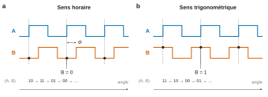
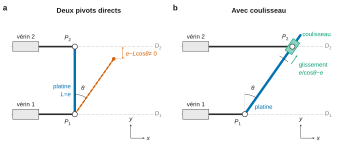
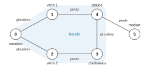
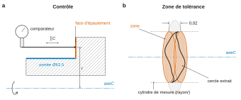
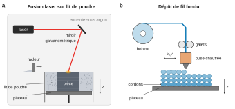
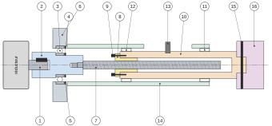

# Banque PT PT — Sciences industrielles C 2026 · Corrigé brut

*Corrigé rédigé par IA, non officiel. Signalez toute erreur.*

Épreuve de 6 h, calculatrice interdite. Sujet : robot d'inspection de canalisations PATHFINDER. Les réponses graphiques (cahier réponse, dessin réponse A3) sont décrites en texte de façon précise.

**Données utilisées.**

| Grandeur | Valeur | Source |
|---|---|---|
| Vitesse du moteur des vérins | $N_m = 1000$ tr/min | énoncé, partie 1 |
| Réducteur 22GPT | $k = 30$ | DR III |
| Codeur IEF3-64 | $N = 64$ impulsions par tour et par voie | DR IV |
| Vis IGUS DST-LS-10X12 | diamètre 10 mm, pas $p = 12$ mm | DR III |
| Course des vérins | $c = 100$ mm | énoncé |
| Épaisseur des patins | $\delta = 27$ mm | énoncé |
| Loi E/S d'un bras | $\rho(7{,}5^\circ) = 114{,}806$ mm, $\rho(42^\circ) = 54{,}1587$ mm | DR VIII |
| Train d'engrenages | $Z_1 = 15$, $Z_2 = Z_6 = 30$, $Z_3 = Z_7 = 75$, $Z_4 = Z_5 = 9$ | DR IX |
| Sortie du motoréducteur de la cassette | $N_e = 2$ tr/min, $r = 196$ | énoncé |

## Partie 1 : Vérification des performances du robot

### Question 1.1

Le DR IV montre que le codeur IEF3-64 délivre deux signaux carrés $A$ et $B$, identiques mais déphasés, plus un signal d'index $I$. Aucun mot binaire ne code la position angulaire : la position s'obtient en **comptant les fronts** à partir d'une origine. Un codeur absolu délivrerait au contraire un code (binaire ou Gray) sur autant de pistes que de bits de résolution, et la position serait connue dès la mise sous tension.

**Les codeurs IEF3-64 sont des codeurs incrémentaux (relatifs).**

Le canal $I$ délivre **une impulsion par tour**, toujours à la même position angulaire du rotor. Il sert :

- à la **prise d'origine** : au démarrage, on recherche le top index pour disposer d'une référence angulaire matérielle ;
- au **contrôle du comptage** : entre deux tops index, on doit compter exactement $4N = 256$ fronts. Un écart révèle des impulsions perdues, et le compteur est recalé.

L'index ne fixe la position qu'à un tour de moteur près, soit $p/k = 12/30 = 0{,}4$ mm sur la tige du vérin. L'origine absolue du vérin exige en plus une butée ou un capteur de fin de course.

### Question 1.2

Les voies $A$ et $B$ ont la même fréquence et sont déphasées d'un quart de période ($\Phi = 90 \pm 45\ ^\circ\text{e}$ pour la version 64). Le signe de ce déphasage dépend du sens de rotation : dans le sens horaire (DR IV), $A$ est en avance sur $B$ ; dans l'autre sens, $A$ est en retard.

On exploite cette propriété en lisant l'état de $B$ **à chaque front montant de $A$** :

$$\boxed{\begin{aligned}
&B = 0 \text{ au front montant de } A \Rightarrow \text{sens horaire} \\
&B = 1 \text{ au front montant de } A \Rightarrow \text{sens trigonométrique}
\end{aligned}}$$

De façon équivalente, le couple $(A,B)$ parcourt les états $00 \to 10 \to 11 \to 01 \to 00$ dans un sens et le cycle inverse dans l'autre. Un compteur-décompteur incrémente ou décrémente selon la transition observée.

Avec une seule voie, on compterait les impulsions sans connaître le sens, ce qui est inacceptable pour un asservissement de position.

### Question 1.3

**Effet Hall.** Une plaquette semi-conductrice d'épaisseur $e$ et de largeur $\ell$ est parcourue par un courant $I$ suivant $\vec x$. Elle est plongée dans un champ $\vec B = B\,\vec z$.

Les porteurs de charge $q$, de densité $n$, se déplacent à la vitesse $\vec v = v\,\vec x$. Ils subissent la force de Lorentz, dirigée suivant $\vec y$ :

$$\vec F = q\,\vec v \wedge \vec B$$

Ils s'accumulent sur une face latérale, et la face opposée se charge en sens contraire. Le champ électrique transverse $E_H$ ainsi créé croît jusqu'à compenser la force magnétique. En régime permanent, avec l'expression du courant :

$$\begin{aligned}
q\,E_H &= q\,v\,B \\
I &= n\,q\,v\,\ell\,e
\end{aligned}$$

Il apparaît entre les deux faces la tension de Hall :

$$\boxed{U_H = \frac{I\,B}{n\,q\,e}}$$

À courant constant, $U_H$ est **proportionnelle au champ magnétique** : le capteur mesure le champ lui-même, sans contact, y compris à vitesse nulle (contrairement à un capteur inductif).

**Détection du passage d'un aimant.** Le rotor porte des aimants (pôles Nord et Sud alternés) qui défilent devant le capteur fixe. Au passage d'un pôle, le champ change de signe, et la tension de Hall aussi. Un comparateur à hystérésis (trigger de Schmitt) intégré transforme cette tension analogique en un signal logique : niveau haut devant un pôle, niveau bas devant l'autre. L'hystérésis évite les basculements parasites. Deux capteurs décalés d'un quart de pas polaire fournissent $A$ et $B$ en quadrature. Un capteur placé en regard d'un repère unique fournit l'index $I$.

### Question 1.4

Chaque voie délivre $N = 64$ impulsions par tour. Les voies étant en quadrature, une période contient quatre fronts exploitables (montant et descendant de $A$ et de $B$), soit $4N = 256$ incréments par tour de moteur.

Le codeur est monté sur l'arbre moteur, en amont du réducteur de rapport $k = 30$. Un tour de vis correspond donc à $30 \times 256 = 7680$ incréments, et fait avancer la tige de $p = 12$ mm :

$$\begin{aligned}
\Delta x &= \frac{p}{4\,N\,k} \\
&= \frac{12}{4\times 64\times 30}\ \text{mm} \\
&= \frac{12}{7680}\ \text{mm}
\end{aligned}$$

$$\boxed{\Delta x \approx 1{,}56\ \mu\text{m}}$$

C'est une **résolution** (pas de quantification de la mesure), pas une précision : les jeux du réducteur et de l'écrou limitent la précision réelle.

### Question 1.5

Vitesse de rotation de la vis, puis vitesse de translation de la tige :

$$\begin{aligned}
N_v &= \frac{N_m}{k} \\
&= \frac{1000}{30} \approx 33{,}3\ \text{tr/min} \\
V &= N_v\,p \\
&= \frac{1000}{30}\times 12\ \text{mm/min} \\
&= 400\ \text{mm/min} \approx 6{,}67\ \text{mm/s}
\end{aligned}$$

En négligeant les phases d'accélération et de freinage :

$$\begin{aligned}
t_v &= \frac{c}{V} \\
&= \frac{100}{400/60}\ \text{s}
\end{aligned}$$

$$\boxed{t_v = 15\ \text{s}}$$

### Question 1.6

Le diagramme d'états du DR V comporte deux fourches : les branches parallèles se cumulent par leur **maximum**, et non par leur somme. Les durées des contrôles d'appui n'étant pas chiffrées, on les suppose plus courtes que les branches qui leur sont parallèles.

| Séquence | Durée |
|---|---|
| Repliement des bras AV | 3 s |
| Déploiement des vérins de vertèbre | 15 s (Q1.5) |
| Déploiement des bras AV | 7 s |
| Fourche 1 : contrôle d'appui AV, en parallèle avec la branche (repliement des bras AR 3 s, repliement des vérins 15 s, déploiement des bras AR 7 s, puis fourche 2 : contrôle d'appui AR en parallèle avec la prise de vues 10 s) | $3 + 15 + 7 + 10 = 35$ s |
| **Durée d'un cycle** | $T = 3 + 15 + 7 + 35 = 60$ s |

Au cours d'un cycle, le module avant avance de $c = 100$ mm (sortie des vérins), puis le module arrière le rejoint (rentrée des vérins) : le robot progresse de 100 mm par cycle.

$$\begin{aligned}
D &= \frac{3600}{60}\times 100\ \text{mm} \\
&= 6\,000\ \text{mm}
\end{aligned}$$

$$\boxed{D = 6\ \text{m en 1 h}}$$

Ce résultat découle du modèle cinématique du cycle (Q1.5 et DR V). Il ne s'obtient pas en reprenant la vitesse de 0,1 m/s du DR I : la question demande de vérifier cette performance, pas de la recopier.

C'est 60 fois moins que les 360 m/h du DR I. Il n'y a pas de contradiction : ces 360 m/h correspondent au mode hybride, porté par le courant (flux à 0,3 m/s), alors que 6 m/h est la performance du mode automoteur seul, par avances successives.

### Question 1.7

Notons $P_1$ et $P_2$ les points d'attache des deux vérins sur la platine. Chaque vérin est en glissière de direction $\vec x$ par rapport à la vertèbre.

Les points $P_1$ et $P_2$ se déplacent donc sur deux droites $D_1$ et $D_2$ parallèles à $\vec x$, distantes de l'entraxe $e$ fixé par la vertèbre.

Supposons les deux vérins reliés à la platine par deux pivots d'axe $\vec z$. La distance $L = P_1P_2$ est alors fixée par la platine, solide indéformable. Dans la configuration de montage, $P_1P_2$ est perpendiculaire à $\vec x$, donc $L = e$.

Quand la platine tourne d'un angle $\theta$ autour de $\vec z$, la projection de $\overrightarrow{P_1P_2}$ sur $\vec y$ vaut $L\cos\theta$. Or cette projection doit rester égale à l'entraxe $e = L$ :

$$\begin{aligned}
L\cos\theta &= L \\
\Longrightarrow\quad \theta &= 0
\end{aligned}$$

**La platine ne peut plus tourner** : la rotation qui oriente le module est supprimée. Les deux vérins ne peuvent plus sortir de longueurs différentes. Si on les commande différemment, le mécanisme se bloque et se met en contrainte.

Il faut donc libérer, côté vérin 2, un déplacement suivant $\vec y$ par rapport à la platine. C'est le rôle du **coulisseau**, en glissière de direction $\vec y$ sur la platine. Le point $P_2$ reste sur $D_2$, et la distance $P_1P_2$ devient $e/\cos\theta$. Le coulisseau glisse donc le long de la platine de :

$$\frac{e}{\cos\theta} - e \approx \frac{e\,\theta^2}{2}$$

Au premier ordre, θ = 0 est une configuration singulière : un calcul en vitesses laisserait croire à une rotation possible, ce que l'étude en déplacements finis dément.

### Question 1.8

Classes d'équivalence : 0 vertèbre, 1 vérin 1, 2 vérin 2, 3 coulisseau, 4 platine, 5 module (bloc de rotation). Liaisons du DR VI : glissières $\vec x$ entre 0 et 1 et entre 0 et 2, pivot $\vec z$ entre 1 et 4, pivot $\vec z$ entre 2 et 3, glissière $\vec y$ entre 3 et 4, pivot $\vec x$ entre 4 et 5. Le graphe comporte une boucle (0-1-4-3-2-0) et une branche (4-5).

Les trois mobilités sont :

- $m_1$ : **translation de la platine (et du module) suivant $\vec x$** par rapport à la vertèbre, obtenue par une sortie identique des deux vérins ;
- $m_2$ : **rotation de la platine autour de $\vec z$**, obtenue par une sortie différentielle des vérins. Elle oriente le module dans le plan de la courbure ;
- $m_3$ : **rotation du module autour de $\vec x$** par rapport à la platine (dispositif de rotation axiale). Elle permet de changer le plan de courbure.

Ces trois mobilités sont utiles, chacune étant pilotée par un actionneur. Le glissement du coulisseau n'est pas une mobilité indépendante : il est imposé par les courses des deux vérins.

### Question 1.9

Le graphe compte 6 liaisons et 6 classes d'équivalence. Les six liaisons ont chacune un degré de liberté :

$$\begin{aligned}
\gamma &= L - N + 1 \\
&= 6 - 6 + 1 = 1 \\
E_c &= 6\,\gamma = 6 \\
I_c &= 6
\end{aligned}$$

La relation $m - h = I_c - E_c$, avec la mobilité $m = 3$ donnée par l'énoncé, donne :

$$\begin{aligned}
h &= m - I_c + E_c \\
&= 3 - 6 + 6
\end{aligned}$$

$$\boxed{h = 3}$$

Vérification par la fermeture cinématique de la boucle. Toutes les rotations sont d'axe $\vec z$, et toutes les translations sont dans le plan $(\vec x,\vec y)$.

Seules trois équations sont donc utiles : la rotation suivant $\vec z$ et les translations suivant $\vec x$ et $\vec y$. Le rang vaut $r_c = 3$, et $h = E_c - r_c = 3$.

Les trois équations inutilisées, identiquement nulles, désignent les inconnues hyperstatiques : **les rotations autour de $\vec x$ et de $\vec y$ et la translation suivant $\vec z$**. Le mécanisme est plan, mais il est réalisé avec des liaisons spatiales. Il faut donc des axes de pivot rigoureusement parallèles et des glissières parallèles au plan.

### Question 1.10

Le DR VI place un **pivot** entre le vérin 2 et le coulisseau et la **glissière** entre le coulisseau et la platine. C'est cette glissière (direction $\vec y$, un degré de liberté $T_y$) que l'on modifie. On signale ici l'imprécision du libellé. Le raisonnement reste le même quelle que soit la liaison retenue : on libère exactement les mobilités associées aux inconnues hyperstatiques de Q1.9.

Pour supprimer les trois inconnues hyperstatiques de Q1.9, il faut lui ajouter les degrés de liberté :

$$\boxed{T_z\ (\text{translation suivant } \vec z),\quad R_x,\quad R_y}$$

La liaison obtenue a pour degrés de liberté $\{T_y, T_z, R_x, R_y\}$ :

**c'est une liaison linéaire rectiligne de normale $\vec x$, dont la ligne de contact est dirigée par $\vec y$.**

- Translations libres dans le plan tangent $(\vec y,\vec z)$, rotation libre autour de la normale $\vec x$ et autour de la ligne de contact $\vec y$.
- Elle transmet une résultante suivant $\vec x$ et un moment suivant $\vec z$.
- Vérification : $I_c = 4 + 4 + 1 = 9$ (quatre liaisons à 1 degré de liberté et la linéaire rectiligne dans la boucle, plus le pivot de la branche). Le rang de la fermeture passe à $r_c = 6$, donc $h = E_c - r_c = 0$ et $m = I_c - r_c = 3$.

### Question 1.11

Le guidage du coulisseau est réalisé par deux rails vissés sur la platine et deux patins vissés sur le coulisseau. Pour ne pas surcontraindre l'ensemble, chaque pièce reçoit une mise en position **restreinte et hiérarchisée**. Les surfaces surlignées en rouge sont les suivantes.

**Coupe A-A** (perpendiculaire aux rails ; on voit les sections des deux rails et des deux patins) :

- **platine** : sous chaque rail, une **portée plane étroite** de normale $\vec x$, de la largeur de la semelle du rail, obtenue par un bossage ou une rainure peu profonde. Toute la matière située entre les deux rails est dégagée de 0,5 à 1 mm. Un **épaulement latéral** de normale $\vec z$ est prévu **sous un seul rail** (rail de référence). Le second rail n'a pas de butée latérale : il est fixé par des vis passant dans des trous avec jeu, ce qui le laisse libre suivant $\vec z$ au montage ;
- **coulisseau** : même principe pour les patins. Deux portées planes étroites de normale $\vec x$ (une par patin) sont usinées dans le même plan, et un seul épaulement latéral, de normale $\vec z$, oriente le patin de référence. Le second patin n'a pas de butée latérale.

**Coupe B-B** (le long du rail de référence) :

- sous le rail, la platine ne porte **qu'au droit des deux vis CHC**, sur deux plages d'appui coplanaires de longueur limitée. Entre les deux plages, la matière est dégagée ;
- le coulisseau porte sur le patin par une plage plane limitée à l'emprise du patin.

Les surfaces à surligner en rouge sont les portées planes (normale $\vec x$) et les deux épaulements de référence (normale $\vec z$). Les portées des têtes de vis (surfaces de serrage) et les dégagements ne le sont pas. Les bossages comportent un raccordement ou un dégagement d'outil pour être réalisables en fraisage.

### Question 1.12

$\rho$ est la distance entre le centre des couronnes et le support du patin ; le patin d'épaisseur $\delta$ s'ajoute radialement, donc $D = 2(\rho + \delta)$. La loi E/S est décroissante : bras repliés pour $\alpha = 42^\circ$, déployés pour $\alpha = 7{,}5^\circ$.

$$\begin{aligned}
D_{\min} &= 2\,(54{,}16 + 27) \\
D_{\max} &= 2\,(114{,}81 + 27)
\end{aligned}$$

$$\boxed{\begin{aligned}
D_{\min} &\approx 162\ \text{mm} \\
D_{\max} &\approx 284\ \text{mm}
\end{aligned}}$$

- **150 mm** : impossible, car $D_{\min} > 150$ mm. Le robot ne peut pas entrer dans la conduite.
- **200 mm** : possible, car $162 \le 200 \le 284$. Il faut $\rho = 100 - 27 = 73$ mm, soit $\alpha \approx 34{,}5^\circ$.
- **250 mm** : possible. Il faut $\rho = 125 - 27 = 98$ mm, soit $\alpha \approx 21^\circ$.

**Cette version convient aux conduites de 200 et 250 mm, pas à celle de 150 mm.** On remarque que $D_{\max} < 300$ mm : les conduites de 300 mm du DR I demandent une autre version de cassette.

### Question 1.13

Sur le DR IX, les arbres intermédiaires (roues 2 et 4 d'une part, roues 5 et 6 d'autre part) sont en pivot avec le bâti. Le train fonctionne donc **à axes fixes**, sans porte-satellites mobile. $Z_3$ et $Z_7$ sont les dentures intérieures des couronnes 1 et 2. Un engrènement extérieur inverse le sens de rotation, un engrènement intérieur le conserve.

Couronne 1 (chaîne $1 \to 2 \to 3$, engrènement extérieur puis intérieur) :

$$\begin{aligned}
\frac{\omega_{c1}}{\omega_e} &= \left(-\frac{Z_1}{Z_2}\right)\left(+\frac{Z_2}{Z_3}\right) \\
&= -\frac{Z_1}{Z_3} \\
&= -\frac{15}{75}
\end{aligned}$$

Couronne 2 (chaîne $1 \to 2$, puis 4 solidaire de 2, $4 \to 5$, 6 solidaire de 5, $6 \to 7$ : deux engrènements extérieurs et un intérieur) :

$$\begin{aligned}
\frac{\omega_{c2}}{\omega_e} &= \left(-\frac{Z_1}{Z_2}\right)\left(-\frac{Z_4}{Z_5}\right)\left(+\frac{Z_6}{Z_7}\right) \\
&= \left(-\frac12\right)(-1)\left(\frac25\right)
\end{aligned}$$

$$\boxed{\begin{aligned}
\frac{\omega_{c1}}{\omega_e} &= -\frac15 \\
\frac{\omega_{c2}}{\omega_e} &= +\frac15
\end{aligned}}$$

Ces rapports sont pris par rapport à l'arbre de sortie du motoréducteur, qui est l'arbre d'entrée du train. Par rapport à l'arbre moteur, ils valent $\mp 1/980$ (car $196 \times 5 = 980$).

Les deux couronnes tournent à la **même vitesse, en sens opposés** : c'est exactement la condition annoncée pour déplacer le patin en translation radiale. **Le déploiement des bras est donc assuré**, et symétrique puisque les modules des deux rapports sont égaux. La roue 5 ($Z_5 = Z_4$) est une roue intermédiaire : elle ne change pas le module du rapport mais inverse le sens, et c'est elle qui produit l'opposition des deux couronnes.

Cohérence géométrique : $Z_3 = Z_1 + 2Z_2 = 75$, et les entraxes des deux arbres intermédiaires valent $m(Z_1+Z_2)/2 = m(Z_7-Z_6)/2 = 22{,}5\,m$, où $m$ est le module de denture.

### Question 1.14

**Angle à parcourir.** Bras repliés : $\alpha_i = 42^\circ$. En appui dans une conduite de 250 mm : $\rho_f = 125 - 27 = 98$ mm. La courbe du DR VIII donne $\alpha_f \approx 21^\circ$ (elle passe par $\rho = 100$ mm pour $\alpha = 20^\circ$). D'où $\Delta\alpha \approx 21^\circ$.

**Rotation de chaque couronne.** $\alpha$ est l'angle sous lequel on voit, depuis le centre, les deux articulations du pantographe, chacune liée à une couronne. Les couronnes tournant de $+\Delta\theta$ et $-\Delta\theta$, on a $\Delta\alpha = 2\,\Delta\theta$, soit $\Delta\theta \approx 10{,}5^\circ$.

**Durée.** Vitesse de chaque couronne : $N_c = N_e/5 = 0{,}4$ tr/min $= 144\ ^\circ$/min $= 2{,}4\ ^\circ$/s.

$$\begin{aligned}
t_d &= \frac{\Delta\alpha}{2\,N_c} \\
&= \frac{21}{2\times 2{,}4}\ \text{s}
\end{aligned}$$

$$\boxed{t_d \approx 4{,}4\ \text{s}}$$

Avec une incertitude de lecture de $\pm 0{,}5^\circ$, on obtient un temps compris entre 4,3 et 4,5 s.

**Contrôle.** Un déploiement complet ($42^\circ \to 7{,}5^\circ$) dure $34{,}5/(2\times 2{,}4) \approx 7{,}2$ s. On retrouve les 7 s du DR V pour une conduite de 300 mm, où les bras arrivent en butée sans toucher la paroi. Cela valide la relation $\Delta\alpha = 2\Delta\theta$ ; avec $\Delta\theta = \Delta\alpha$, on obtiendrait 14,4 s.

## Partie 2 : Industrialisation de la couronne

Lecture du dessin de définition (DR X) :

- **A** est la face plane d'extrémité de la couronne.
- **B** est l'axe du cylindre extérieur Ø62,4 ± 0,01, voisin de cette face. Ce cylindre est tolérancé en perpendicularité Ø0,01 par rapport à A.
- **C** est l'axe du cylindre extérieur Ø63,5, la portée du roulement. Cette portée porte aussi la cylindricité 0,005 et l'état de surface Ra 0,8.
- Le battement 0,02 / C porte sur la face plane de l'épaulement contre lequel le roulement prend appui.

### Question 2.1

**(a) Cylindricité 0,005**

| Rubrique de la fiche | Contenu |
|---|---|
| Type | **Forme** |
| Élément tolérancé | **unique** : la surface cylindrique réelle Ø63,5 (portée du roulement) |
| Élément(s) de référence, référence spécifiée | aucun (une spécification de forme n'a jamais de référence) |
| Zone de tolérance | **simple** : volume compris entre deux cylindres coaxiaux dont les rayons diffèrent de 0,005 mm |
| Contraintes | aucune contrainte d'orientation ni de position : la zone flotte (axe et diamètres libres) |
| Conformité | la surface extraite est entièrement contenue dans la zone |

**(b) Battement simple 0,02 par rapport à C**

| Rubrique de la fiche | Contenu |
|---|---|
| Type | **Battement** (battement simple **axial**) |
| Élément tolérancé | **unique** : la **face plane d'épaulement**, analysée ligne par ligne (chaque ligne circulaire est l'intersection de la face avec un cylindre de mesure coaxial à C) |
| Élément de référence | **unique** : la surface cylindrique Ø63,5 |
| Référence spécifiée | **simple** : l'axe C du cylindre associé (cylindre minimal circonscrit, la surface étant extérieure) |
| Zone de tolérance | **simple**, appliquée indépendamment à chaque cylindre de mesure coaxial à C : portion de ce cylindre comprise entre deux cercles distants de 0,02 mm **suivant l'axe** |
| Contraintes | les cylindres de mesure sont coaxiaux à C, et les cercles limites sont perpendiculaires à C : contrainte de position et d'orientation par rapport à C. La position axiale de la zone est libre. |
| Conformité | la pièce tournant autour de C, le comparateur palpant la face (déplacement parallèle à l'axe) ne varie pas de plus de 0,02 mm, pour chaque rayon de palpage |

Ce battement garantit la perpendicularité, à l'axe de la portée, de l'appui axial du roulement.

**(c) Localisation Ø0,02 A B**

| Rubrique de la fiche | Contenu |
|---|---|
| Type | **Position** |
| Élément tolérancé | **unique** : la ligne médiane extraite (axe réel) du cylindre Ø63,5 |
| Éléments de référence | **multiples** : la face plane A et la surface cylindrique Ø62,4 (B) |
| Référence spécifiée | **système** ordonné : A primaire (plan associé du côté libre de la matière, avec un défaut de forme minimal), puis B secondaire (axe du cylindre associé au Ø62,4, contraint perpendiculaire au plan A) |
| Zone de tolérance | **simple** : cylindre de diamètre 0,02 mm |
| Contraintes | axe de la zone perpendiculaire à A et confondu avec B (distance théorique exacte nulle) : contraintes d'orientation et de position |
| Conformité | l'axe extrait du Ø63,5 est entièrement contenu dans le cylindre Ø0,02 |

### Question 2.2

Pour la cote $\varnothing 63{,}5\ ^{+0{,}012}_{-0{,}007}$ :

$$\begin{aligned}
d_{\max} &= 63{,}512\ \text{mm} \\
d_{\min} &= 63{,}493\ \text{mm} \\
IT &= 0{,}019\ \text{mm}
\end{aligned}$$

L'opérateur de taille par défaut (ISO 14405-1) est la **taille locale entre deux points** : on mesure la distance entre deux points opposés de la surface extraite, dans chaque section droite et dans toutes les directions.

$$\boxed{\text{pour toute paire de points opposés : } 63{,}493 \le d_{2\text{pts}} \le 63{,}512\ \text{mm}}$$

C'est un ensemble de mesures locales. En vertu du principe d'indépendance (ISO 8015), cette cote n'impose **aucune contrainte de forme** : un cylindre ovalisé selon un trilobe, ou cintré, peut être conforme. La forme est limitée séparément par la cylindricité 0,005. Pour lier taille et forme, il aurait fallu l'exigence de l'enveloppe (symbole E cerclé).

### Question 2.3

- Le symbole de base est un triangle **fermé par un trait horizontal** : l'**enlèvement de matière est obligatoire**. La surface doit être usinée, et ne peut pas rester brute de fabrication additive.
- « Ra 0,8 » signifie que l'**écart moyen arithmétique** du profil de rugosité ne doit pas dépasser 0,8 µm.

Sur la longueur de base $l_r$, avec $z(x)$ l'ordonnée du profil de rugosité mesurée par rapport à sa ligne moyenne (profil filtré, de moyenne nulle) :

$$\boxed{Ra = \frac{1}{l_r}\int_0^{l_r} \lvert z(x)\rvert\,\mathrm{d}x}$$

En pratique $Ra \approx \frac1n\sum |z_i|$, moyenné sur 5 longueurs de base. Conditions par défaut : longueur d'onde de coupure $\lambda_c = 0{,}8$ mm pour $0{,}1 < Ra \le 2$ µm, longueur d'évaluation $5\lambda_c = 4$ mm, règle des 16 % pour l'acceptation. Un Ra de 0,8 µm s'obtient en tournage de finition soigné ou en rectification, ce qui est cohérent avec une portée de roulement d'IT 19 µm.

### Question 2.4

Critères de choix du matériau de la couronne :

1. **Conformité au contact avec l'eau potable** (exigence sanitaire, explicitement rappelée) : critère éliminatoire. Le matériau ne doit relarguer aucune substance nocive.
2. **Tenue à la corrosion** en eau chlorée sous 20 bars : la corrosion dégraderait les dentures et les portées de roulement, et polluerait l'eau.
3. **Résistance mécanique** (limite d'élasticité $\sigma_{\max}$) : les oreilles travaillent en flexion sous l'effort des biellettes, les dentures en flexion et en pression de contact.
4. **Faible masse volumique** $\rho$ : le robot doit avoir une flottabilité neutre et son énergie est embarquée. Toute masse économisée diminue le lest et augmente l'autonomie.
5. **Aptitude à la mise en œuvre** : usinabilité pour les surfaces de précision (IT 19 µm, Ra 0,8) et compatibilité avec la fabrication additive envisagée.
6. **Coût** de la matière et de la mise en œuvre, rapporté à une très petite série.

Les critères 1 et 2 servent à **trier** les matériaux, les critères 3 et 4 à les **classer** (indice de performance).

### Question 2.5

L'oreille est modélisée par un cylindre plein de rayon $r$ et de longueur $L$ :

$$\boxed{m = \rho\,\pi\,r^2\,L}$$

$$\begin{aligned}
I_{Gz} &= \iint_S y^2\,\mathrm{d}S \\
&= \frac{\pi\,r^4}{4}
\end{aligned}$$

$$\boxed{I_{Gz} = \frac{\pi\,r^4}{4}}$$

$I_{Gz}$ est le moment quadratique diamétral ; le moment polaire $\pi r^4/2$ en vaut le double.

### Question 2.6

En reportant $I_{Gz}$ dans la condition de résistance :

$$\begin{aligned}
F &= \frac{\sigma_{\max}}{L\,r}\cdot\frac{\pi r^4}{4} \\
&= \frac{\pi\,\sigma_{\max}\,r^3}{4L} \\
\Longrightarrow\quad r &= \left(\frac{4FL}{\pi\,\sigma_{\max}}\right)^{1/3}
\end{aligned}$$

On élimine le paramètre libre $r$ dans la masse :

$$m = \rho\,\pi\,L\left(\frac{4FL}{\pi\,\sigma_{\max}}\right)^{2/3}$$

$$\boxed{m = \underbrace{\frac{\rho}{\sigma_{\max}^{2/3}}}_{f_1\ (\text{matériau})}\cdot\underbrace{\pi^{1/3}\,4^{2/3}\,L^{5/3}}_{f_2\ (\text{géométrie})}\cdot\underbrace{F^{2/3}}_{f_3\ (\text{chargement})}}$$

avec $\pi^{1/3}4^{2/3} \approx 3{,}69$. À $F$ et $L$ imposés, minimiser $m$ revient à maximiser $1/f_1$ :

$$I_p = \frac{\sigma_{\max}^{2/3}}{\rho}$$

soit $n = 2/3$.

### Question 2.7

**Méthode.**

1. À indice constant, $\sigma_{\max}^{2/3}/\rho = C$ s'écrit $\log\sigma_{\max} = \tfrac32\log\rho + \tfrac32\log C$. Dans le diagramme log-log du DR XI, les matériaux de même performance sont donc sur une **droite de pente 3/2**, parallèle à la ligne guide $\sigma_f^{2/3}/\rho$.
2. On translate cette droite **vers le haut et vers la gauche** : les matériaux situés au-dessus de la droite ont un meilleur indice.
3. On applique ensuite les critères éliminatoires de Q2.4 : contact avec l'eau potable, corrosion, aptitude aux procédés envisagés.

**Valeurs indicatives lues sur le diagramme.**

| Matériau | $\sigma_f$ (MPa) | $\rho$ (Mg/m³) | $I_p$ | Décision |
|---|---|---|---|---|
| CFRP | ≈ 700 | 1,6 | ≈ 49 | écarté : anisotrope, inadapté à une denture, non compatible avec les procédés envisagés |
| Céramiques techniques | ≈ 1000 | ≈ 3,2 | ≈ 31 | écartées : fragiles, sensibles aux chocs et aux défauts |
| **Alliages de titane** | ≈ 900 | 4,5 | ≈ 21 | **retenus** (famille des métaux) |
| Alliages de magnésium | ≈ 200 | 1,8 | ≈ 19 | écartés : corrosion en milieu aqueux |
| Alliages d'aluminium | ≈ 300 | 2,7 | ≈ 17 | moins bons que le titane ; tenue à la corrosion moyenne |
| **PEEK** | ≈ 100 | 1,3 | ≈ 17 | **retenu** (famille des polymères) |
| Aciers inoxydables | ≈ 500 | 7,8 | ≈ 8 | indice faible |

**Choix : un alliage de titane (Ti-6Al-4V) pour la famille des métaux, et un polymère technique de type PEEK pour la famille des polymères.**

- Le titane a le meilleur indice parmi les matériaux admissibles. Il résiste remarquablement à la corrosion, il est biocompatible et admis au contact de l'eau potable, et il se met en œuvre par fusion laser sur lit de poudre.
- Le PEEK a un indice proche de celui de l'aluminium pour une masse volumique environ deux fois plus faible. Il existe en qualité contact alimentaire, ne se corrode pas, et se met en œuvre par dépôt de fil fondu.

### Question 2.8

Le coût unitaire s'écrit $C_u = C_{\text{outillage}}/n + c_{\text{matière}} + c_{\text{opératoire}}$. Avec une série de quelques unités par an, le terme d'outillage domine : **tout procédé exigeant un outillage dédié n'est pas viable**.

- **Moulage par injection** (polymère, donc PEEK) : moule complexe pour une denture intérieure, coûtant plusieurs dizaines de milliers d'euros, avec une température de mise en œuvre élevée (environ 380 °C pour le PEEK).
- **Fonderie en moule métallique** (sous pression, en coquille) et **moulage de précision** : moule ou outillage d'empreinte dédié. Le titane, très réactif à chaud, rend en outre la fonderie délicate et coûteuse.
- **Forgeage et matriçage** : matrices dédiées, et aucune possibilité d'obtenir directement la denture.
- **Frittage et moulage par injection de poudres (MIM)** : outillages et mise au point d'un cycle de déliantage et de frittage, rentables seulement en grande série.
- **Découpage, emboutissage, extrusion** : outillages dédiés, et géométrie hors de portée de ces procédés.

Restent viables les procédés sans outillage spécifique : **l'usinage dans la masse** et **la fabrication additive**.

### Question 2.9

**Processus 1 : usinage complet à partir d'un brut débité dans une barre.**

| Avantages | Inconvénients |
|---|---|
| Matériau laminé, sain, isotrope, certifié et traçable (conformité sanitaire) | Grosse perte de matière : les oreilles imposent une barre d'environ Ø100 mm pour un anneau mince, et le rapport entre masse achetée et masse finale est très élevé |
| Précision et état de surface obtenus directement (IT 19 µm, Ra 0,8) | Temps d'usinage long : enlèvement de matière important, denture intérieure, plusieurs prises de pièce |
| Procédé maîtrisé, machines disponibles, pas d'investissement | Usure d'outils et coût élevés sur le titane |
| Pas de post-traitement (ni supports, ni détensionnement) | Bridage délicat d'une pièce mince (déformations) |
| Copeaux recyclables | Impact environnemental : énergie d'élaboration de la matière perdue, fluides de coupe à traiter |

**Processus 2 : fabrication additive, puis usinage des surfaces fonctionnelles.**

| Avantages | Inconvénients |
|---|---|
| Forme proche de la forme finale : peu de matière à enlever, poudre non fondue recyclée | Coût horaire machine élevé et productivité faible |
| Liberté de forme : allègement, oreilles profilées | Contraintes résiduelles et anisotropie : détensionnement nécessaire |
| Aucun outillage ; itérations de conception rapides | Porosités possibles ; qualification du matériau et contrôles nécessaires pour l'usage sanitaire |
| Quatre couronnes sur un même plateau en une seule fabrication | État de surface brut médiocre (Ra de 10 à 20 µm) : reprise obligatoire des dentures et des portées |
| Peu de matière consommée ; pas de fluide de coupe pendant la phase additive | Forte consommation d'énergie par kg, gaz inerte, risques liés à la manipulation des poudres ; supports à retirer |

En résumé, l'additif l'emporte sur la consommation de matière et la liberté de forme, l'usinage sur la précision, la maîtrise du procédé et la qualification du matériau.

### Question 2.10

**1. Fusion laser sur lit de poudre métallique (LPBF, ou SLM).** La fabrication a lieu dans une enceinte sous gaz inerte (argon pour le titane). Pour chaque couche :

1. un racleur ou un rouleau étale sur le plateau une fine couche de poudre (20 à 60 µm) ;
2. un laser de puissance, orienté par des miroirs galvanométriques, balaie la section de la pièce issue du découpage en tranches du modèle CAO. La poudre fond localement, puis se solidifie en se soudant à la couche inférieure ;
3. le plateau descend de l'épaisseur d'une couche, et le cycle recommence.

En fin de fabrication, on dépoudre, on détensionne, on sépare la pièce du plateau (scie ou électroérosion à fil) et on retire les supports. La poudre non fondue est tamisée puis réutilisée.

**2. Dépôt de fil polymère fondu (FDM ou FFF).** Un fil thermoplastique est poussé par des galets dans une buse chauffée au-delà de la température de fusion (ou de ramollissement) du polymère. La matière extrudée est déposée en cordons qui suivent le contour puis le remplissage de chaque couche. La chaleur du cordon le soude aux cordons voisins et à la couche inférieure. Après chaque couche, la buse remonte, ou le plateau descend, d'une épaisseur de couche (0,1 à 0,3 mm). Une seconde buse peut déposer un matériau de support, éventuellement soluble.

Ces deux procédés ne sont pas des procédés d'assemblage : ils construisent une pièce unique, couche par couche, à partir d'une matière première non mise en forme (poudre ou fil). La fusion n'y soude pas deux pièces existantes, elle lie chaque couche à la précédente.

### Question 2.11

Les deux procédés construisent la pièce couche par couche, de bas en haut. Une surface en porte-à-faux, inclinée à moins de 45° environ par rapport au plateau, n'a rien de solide en dessous.

- **FDM** : sans appui, le cordon visqueux s'affaisse et se déforme. Une zone qui commence dans le vide est impossible à fabriquer : des supports sont indispensables.
- **LPBF** : la poudre ne joue pas le rôle d'un support. Sa conductivité thermique est très faible et sa densité apparente est environ moitié de celle du métal. Le bain de fusion s'y enfonce et surchauffe, la surface est dégradée et la couche se gondole, au risque de heurter le racleur. Les supports ont en plus deux rôles propres au LPBF :
  - **l'ancrage** au plateau, contre les contraintes résiduelles dues au refroidissement très rapide, qui déformeraient et décolleraient la pièce ;
  - **l'évacuation de la chaleur** vers le plateau.

### Question 2.12

**1. Hauteur de la pièce sur le plateau.** Le nombre de couches vaut $h/e$, avec $e$ l'épaisseur d'une couche.

- LPBF : chaque couche impose un étalement de poudre sur tout le plateau (quelques secondes), quel que soit le nombre de pièces. La hauteur pilote directement le temps de fabrication, ainsi que la quantité de poudre à engager.
- FDM : le temps dépend surtout de la longueur des trajectoires, donc du volume déposé. La hauteur n'intervient que par les changements de couche, et son effet est plus faible.

**2. Aire des surfaces à supporter.**

- Les deux procédés : les surfaces supportées ont un état de surface dégradé, et le temps de retrait des supports en dépend.
- LPBF : le retrait des supports métalliques est long et coûteux (sciage, meulage, usinage), et les surfaces supportées doivent être reprises.
- FDM : les supports polymères se détachent à la main ou se dissolvent, et le coût est modéré.

**3. Emprise sur le plateau.**

- Elle fixe le nombre de pièces par plateau, donc la répartition des coûts fixes d'une fabrication.
- LPBF : la préparation (mise sous gaz inerte, chauffage, dépoudrage, détensionnement, découpe du plateau) est commune à toutes les pièces, et regrouper les pièces est très rentable.
- FDM : le temps est proportionnel à la matière déposée. Regrouper les pièces fait surtout gagner du temps de préparation.

**4. Volume de support.**

- LPBF : le support est du métal fondu par le laser. Il consomme du temps de balayage et une poudre coûteuse, n'est pas récupérable, et son retrait demande un post-traitement mécanique.
- FDM : le support consomme un fil bon marché et du temps de dépôt, et son retrait est simple. L'enjeu est limité.

### Question 2.13

Le critère le plus spécifique au procédé de fusion laser sur lit de poudre métallique est **le volume de support**. En LPBF métallique, les supports sont indispensables pour des raisons thermiques et d'ancrage, et pas seulement pour soutenir les porte-à-faux. Ils sont faits du même métal, soudés à la pièce et au plateau, ne sont pas recyclables, consomment du temps de laser et exigent un parachèvement coûteux (sciage, électroérosion, usinage). En FDM, ce même critère pèse peu.

Le second critère propre au lit de poudre est la hauteur, puisque l'étalement de la poudre sur tout le plateau à chaque couche rend le temps de fabrication proportionnel au nombre de couches. Ce critère joue cependant aussi, dans une moindre mesure, en FDM.

### Question 2.14

Bilan pour quatre couronnes, d'après le DR XII :

| | Hauteur (mm) | Emprise × 4 (cm²) | Aire supportée × 4 (cm²) | Volume de support × 4 (cm³) |
|---|---|---|---|---|
| Orientation 1 | 87,1 | 80,8 | 64,8 | 97,6 |
| Orientation 2 | **23,7** | 290 | 96,4 | 88,4 |
| Orientation 3 | 88,0 | 159,2 | **1,2** | **3,6** |

Le plateau offre $20 \times 20 = 400$ cm² et 200 mm de hauteur : les trois orientations sont admissibles pour quatre pièces. L'orientation 2 occupe 73 % du plateau et laisse peu de marge entre les pièces.

- L'orientation 1 est **dominée** par la 3 : même hauteur, mais 27 fois plus de support.
- L'orientation 2 minimise la hauteur : environ 790 couches de 30 µm, contre environ 2 930 pour l'orientation 3. Elle demande toutefois 88 cm³ de supports en titane et 96 cm² de surfaces supportées.
- L'orientation 3 est presque autoportante : 0,9 cm³ de support et 0,3 cm² supportés par pièce.

**Orientation retenue : l'orientation 3**, les quatre couronnes étant disposées en carré (2 × 2) sur le plateau. Elle est cohérente avec le critère de Q2.13 : volume de support divisé par environ 25, presque aucun parachèvement, aucune surface dégradée par les supports. La hauteur (88 mm) allonge la fabrication, mais pour une seule fabrication par an ce temps machine est un coût unique et prévisible. Une réserve s'impose : avec 0,3 cm² d'appui, l'ancrage contre les contraintes résiduelles doit être vérifié, et il faudra peut-être ajouter quelques supports d'ancrage. Si l'on privilégie le temps machine, l'orientation 2 est défendable, puisque les surfaces fonctionnelles sont de toute façon reprises en usinage.

### Question 2.15

**Caractéristiques cinématiques** d'un tour CN 3 axes :

- **Z** : translation de l'outil parallèle à l'axe de la broche ;
- **X** : translation radiale de l'outil ;
- **C** : rotation de la broche **asservie en position**, que l'on peut indexer ou interpoler avec X et Z.

En tournage, le mouvement de coupe est la rotation de la pièce. En perçage ou en fraisage, c'est la rotation d'un **outil tournant motorisé**, la broche étant bloquée ou indexée en C.

**Caractéristiques technologiques** :

- mandrin de serrage, à mors doux pour une pièce mince ;
- tourelle porte-outils indexable, dont certains emplacements sont **motorisés** : ils entraînent des outils tournants axiaux (axe parallèle à Z) et radiaux (axe parallèle à X), pour des opérations hors de l'axe de rotation de la pièce ;
- interpolation X/Z (cônes, gorges, congés), cycles de perçage et de taraudage synchronisé, vitesse de coupe constante.

**Justification pour la couronne.**

- Les surfaces internes, les surfaces de guidage des biellettes et les interfaces du roulement sont des **surfaces de révolution** : on les obtient par tournage (X, Z), en **travail d'enveloppe**. La pointe de l'outil décrit le profil de la surface dans le plan (X, Z) pendant que la pièce tourne : la surface est l'enveloppe de ce mouvement, et la forme de l'outil n'est pas recopiée.
- Les **trous axiaux Ø5** et les **trous radiaux taraudés M3** des oreilles sont répartis à 120° : on les obtient avec des outils tournants (axial ou radial), en indexant la broche en C.

Toutes ces entités sont réalisées sur une seule machine et en deux prises de pièce. Les entités liées par une spécification (localisation des trous par rapport à A et B, battement et position par rapport à C) sont usinées dans la même mise en position, ce qui évite les dispersions dues aux reprises. La denture intérieure ne fait pas partie des phases 10 et 20 : elle relève d'une opération distincte, comme le mortaisage par outil-pignon ou le brochage.

### Question 2.16

Sur chacun des deux schémas du cahier réponse, il faut tracer :

- **l'axe du mandrin**, horizontal, confondu avec l'axe de révolution de la couronne ;
- **l'axe Z de la machine**, porté par l'axe du mandrin et orienté positivement en s'éloignant du mandrin (vers l'outil, ISO 841) ;
- **l'axe X de la machine**, perpendiculaire à Z et orienté positivement en s'éloignant radialement de l'axe de la pièce ;
- en **phase 10**, les axes de rotation des outils tournants : un outil axial d'axe **parallèle à Z**, placé au rayon des trous Ø5 (40,4 mm), et un outil radial d'axe **parallèle à X**, dans le plan radial d'une oreille, pour les trous M3 ;
- en **phase 20**, aucun outil tournant : seuls l'axe du mandrin et les axes X et Z sont tracés.

D'une phase à l'autre, la couronne est retournée. Les axes de la machine ne changent pas, mais la face de la couronne tournée vers l'outil n'est plus la même.

### Question 2.17

**Phase 10 : surfaces internes.**

- **Outil** : outil à charioter-dresser intérieur (barre d'alésage à plaquette, angle de direction d'arête d'environ 93°), dessiné à l'intérieur de l'alésage, plaquette orientée vers la surface à usiner.
- **Mouvements** : rotation de la pièce (mouvement de coupe) ; translation de l'outil suivant Z et X (avance).
- **Trajectoire** : approche, chariotage intérieur suivant $-Z$, dressage des épaulements internes suivant X, dégagement radial puis sortie suivant $+Z$.

**Phase 10 : trous axiaux Ø5 des oreilles.**

- **Outil** : foret à centrer puis foret hélicoïdal Ø5, montés sur un outil tournant **axial**.
- **Mouvements** : rotation du foret (coupe), broche bloquée en C ; translation de l'outil suivant $-Z$ (avance).
- **Trajectoire** : positionnement en X au rayon de 40,4 mm, perçage avec débourrage suivant $-Z$, retour suivant $+Z$, indexation de C de 120°, puis deux répétitions.

**Phase 10 : trous radiaux taraudés M3 des oreilles.**

- **Outil** : foret Ø2,5 puis taraud M3, montés sur un outil tournant **radial**.
- **Mouvements** : rotation de l'outil (coupe), broche bloquée ; translation de l'outil suivant $-X$ (avance). Pour le taraudage, l'avance est synchronisée sur le pas de 0,5 mm par tour, et l'outil revient en inversant le sens de rotation.
- **Trajectoire** : approche en Z dans le plan de l'oreille, perçage, taraudage, dégagement suivant $+X$, indexation de C de 120°, puis deux répétitions.

**Phase 20 : interfaces du roulement** (portée Ø63,5 et épaulement d'appui).

- **Outil** : outil à charioter-dresser extérieur de finition (plaquette en losange à 35° ou 55°, petit rayon de bec), dessiné à l'extérieur de la pièce, l'arête orientée vers l'épaulement. L'angle de pointe et l'angle de direction d'arête (supérieur à 90°) permettent de remonter l'épaulement sans que l'arête secondaire talonne : c'est la géométrie de l'outil qui rend la surface usinable.
- **Mouvements** : rotation de la pièce à vitesse de coupe constante ; translation de l'outil suivant Z puis X.
- **Trajectoire** : chariotage de finition de la portée suivant Z, congé, puis dressage de l'épaulement suivant X, en une seule passe continue. La cylindricité, la position par rapport à A et B et le battement de l'épaulement sont ainsi obtenus dans la même mise en position.

## Partie 3 : Conception de la « VERTEBRE »

### Question 3.1

Dans la chaîne de transmission, la sortie du réducteur entraîne le manchon, guidé par un roulement dans la pièce de jonction. Le manchon est encastré sur la vis IGUS. L'écrou est encastré dans la tige, elle-même arrêtée en rotation dans le fourreau, et il se translate de 12 mm par tour de vis. La tige porte la chape de liaison. L'effort axial passe de la chape à la tige, puis à l'écrou, à la vis, au manchon, au roulement et enfin à la pièce de jonction. **Il ne doit pas traverser le réducteur.**

**Nomenclature proposée** : 1 arbre du réducteur Ø6 avec sa clavette parallèle 2 × 2 (fournie) · 2 manchon (inox) · 3 roulement W 6001 (12 × 28 × 8), W 61902 acceptable · 4 anneau élastique pour arbre · 5 anneau élastique pour alésage, ou flasque vissé · 6 pièce de jonction · 7 vis IGUS DST-LS-10X12-R-AL, extrémité reprise · 8 écrou dryspin à collerette · 9 trois vis CHC M3 · 10 tige · 11 palier lisse polymère solidaire du fourreau · 12 palier lisse polymère solidaire de la tige · 13 doigt (vis épaulée) d'arrêt en rotation · 14 fourreau · 15 goupille élastique Ø3 · 16 chape de liaison.

**Fonction 1 : accouplement du manchon avec l'arbre de sortie du réducteur.**

- **Centrage** : alésage Ø6 H7 dans le manchon, sur l'arbre Ø6 g6 (ou h6), avec un **centrage court** (longueur d'environ 0,8 d). La liaison obtenue est une linéaire annulaire. Associée à la rotule du roulement (fonction 2), elle forme un pivot isostatique du manchon, et le réducteur n'est soumis à aucun effort parasite.
- **Transmission par obstacle** : l'arbre du réducteur porte déjà une **clavette parallèle** (visible sur le dessin réponse). Le moyeu du manchon reçoit la **rainure de clavette correspondante, réalisée par mortaisage**, avec un léger jeu radial au fond de la rainure.
- **Pas d'arrêt axial** du manchon sur l'arbre : la clavette laisse coulisser. La position axiale du manchon est fixée par le roulement.
- **Pas de centrage sur le nez du motoréducteur** : le manchon tourne, la face avant et l'épaulement du réducteur sont fixes. Seul l'arbre de sortie centre le manchon.
- **Tracé** : chanfrein d'entrée, dégagement en fond d'alésage. La rainure débouche du côté du réducteur pour permettre le montage par coulissement.

**Fonction 2 : liaison rotule entre le manchon et le bâti (pièce de jonction).**

- **Un seul** roulement rigide à billes en inox (DR XIV) : un roulement seul, arrêté axialement dans les deux sens, se modélise par une rotule. Choix : **W 6001 (12 × 28 × 8)**. Sa portée Ø12 laisse une paroi suffisante autour de l'alésage Ø6 et du taraudage de la vis, et la série 60 offre une meilleure capacité que la série 619 pour reprendre la poussée axiale de la vis. Le W 61902 (15 × 28 × 7) est aussi acceptable.
- **Ajustements** : la bague intérieure est tournante par rapport à la charge, donc **serrée** sur le manchon (portée Ø12 k5). La bague extérieure est fixe, donc **glissante** dans la pièce de jonction (alésage Ø28 H7).
- **Arrêts axiaux** (quatre, car l'effort de la vis change de sens selon que le vérin pousse ou tire ; avec moins d'arrêts, l'effort axial ne serait repris que dans un sens et la liaison ne serait plus une rotule) :
  - bague intérieure : épaulement du manchon d'un côté, anneau élastique pour arbre de l'autre ;
  - bague extérieure : épaulement de l'alésage de la pièce de jonction d'un côté, anneau élastique pour alésage ou flasque vissé de l'autre.
- **Tracé** : hauteurs d'épaulement compatibles avec le démontage, rayons de raccordement inférieurs aux chanfreins des bagues, gorges d'anneaux élastiques. La pièce de jonction est épaissie localement par un bossage, de sorte que l'alésage Ø28 H7 porte la bague extérieure **sur toute sa largeur** (8 mm).

**Fonction 3 : encastrement du manchon et de la vis.**

- La référence « 10X12 » désigne un diamètre nominal de 10 mm (crête du filet roulé) et un pas de 12 mm. On ne peut donc pas usiner de portée lisse Ø10. IGUS autorisant l'usinage des extrémités, on reprend le bout de la vis en tournage : **portée de centrage Ø6 h6** (inférieure au diamètre du noyau), **face d'appui dressée** formant épaulement, puis **filetage M5**.
- **Centrage** : la portée Ø6 h6 s'engage dans un alésage Ø6 H7 du manchon.
- **Mise en position axiale** : la face d'épaulement de la vis vient en appui plan sur la face frontale du manchon.
- **Immobilisation par vissage** : le filetage M5 se visse dans un taraudage du manchon, et le serrage plaque l'épaulement. Le couple moteur s'exerçant dans les deux sens, on freine par un **frein-filet** (ou on ajoute une goupille transversale de sécurité).
- **Tracé** : gorge de dégagement entre la portée et le filetage, chanfreins, fond de taraudage dégagé.
- **Montage** : aucune vis rapportée. La vis se visse directement dans le manchon avant l'engagement sur l'arbre du réducteur, le manchon étant tenu par deux méplats. L'ensemble reste compact et démontable.

**Fonction 4 : encastrement de l'écrou et de la tige.**

- On choisit l'**écrou dryspin à collerette** (DR III), dont la collerette percée est reprise en usinage.
- **Centrage** : le diamètre extérieur du corps de l'écrou (ou de la collerette) s'engage dans un alésage H7 usiné à l'extrémité de la tige (ajustement glissant juste). La face de la collerette vient en **appui plan** sur la face d'extrémité de la tige.
- **Immobilisation** : **trois vis CHC M3** à 120°, passant dans les trous de la collerette et vissées dans des taraudages de la tige. Le couple et l'effort axial sont transmis par l'appui plan, par l'adhérence sous serrage et par les vis.
- L'écrou est une pièce d'usure : l'assemblage doit rester démontable, ce qui exclut le collage et le frettage.
- **Montabilité et usinage** : l'écrou est fixé à la tige avant l'introduction de la vis et avant l'engagement de la tige dans le fourreau. Les têtes de vis restent alors accessibles par l'extrémité de la tige. L'alésage, la face d'appui et les taraudages débouchent tous sur cette extrémité et se réalisent en tournage et perçage, sans rainure ni forme non débouchante. La collerette est reprise au diamètre de la tige, pour une géométrie compacte.

**Fonction 5 : liaison glissière entre la tige et le fourreau.**

- **Guidage principal** par une **paire de paliers lisses** en polymère autolubrifiant (sans graisse, compatible avec l'eau potable) :
  - un palier **solidaire du fourreau**, emmanché dans l'alésage d'extrémité du fourreau, guide le diamètre extérieur de la tige ;
  - un palier **solidaire de la tige**, emmanché à son extrémité intérieure, glisse dans l'alésage du fourreau.
  
  L'entraxe des deux paliers reste grand pendant toute la course, ce qui évite l'arc-boutement (longueur guidée supérieure à 1,5 fois le diamètre). Ajustements : paliers emmanchés serrés dans leur logement ; jeu de glissement H8/f7 sur les surfaces mobiles, rectifiées.
- **Arrêt en rotation par obstacle** : un **doigt** (vis épaulée ou ergot) fixé sur la tige coulisse dans une **lumière longitudinale fraisée** dans le fourreau, sur une longueur égale à la course plus la largeur du doigt. Variante : une rainure intérieure mortaisée et une clavette fixée sur la tige. Cet arrêt reprend le couple transmis par l'écrou, qui est solidaire de la tige.

**Fonction 6 : encastrement de la tige et de la chape de liaison.**

- **Mise en position** : appui plan prépondérant (épaulement de la tige contre la face de la chape) complété par un centrage court Ø H7/g6 de l'extrémité de la tige dans l'alésage de la chape. **Un seul appui axial** : le fond de l'alésage de la chape est dégagé, avec du jeu devant l'extrémité de la tige, pour ne pas créer un second appui en concurrence avec l'épaulement.
- **Immobilisation par goupille** : une **goupille élastique Ø3** traverse la chape et la tige perpendiculairement à leur axe, dans un perçage réalisé au montage. Elle supprime la rotation restante et transmet l'effort de traction en double cisaillement ; en compression, l'effort passe par l'appui plan.
- **Position de la goupille** : la vis pénètre dans la tige sur toute la course. La goupille est donc placée **au-delà de l'extrémité de la vis en position rentrée**, avec une marge de sécurité, pour ne jamais croiser la vis.
- **Tracé** : perçage suffisamment éloigné de l'extrémité de la tige, et chanfreins d'entrée.

Récapitulatif :

| Fonction | Mise en position | Maintien en position |
|---|---|---|
| Arbre du réducteur et manchon | centrage court Ø6 H7/g6 | clavette parallèle fournie, rainure mortaisée dans le manchon |
| Manchon et pièce de jonction | 1 roulement W 6001, Ø12 k5 et Ø28 H7 | 4 arrêts axiaux (épaulements et anneaux élastiques) |
| Manchon et vis | centrage Ø6 H7/h6 et appui plan | filetage M5 et frein-filet |
| Écrou et tige | centrage H7 et appui plan sur la collerette | 3 vis CHC M3 |
| Tige et fourreau | 2 paliers lisses (fourreau, tige) | doigt dans une lumière (obstacle) |
| Tige et chape | appui plan (seul appui axial) et centrage court | goupille élastique Ø3, hors de la course de la vis |
