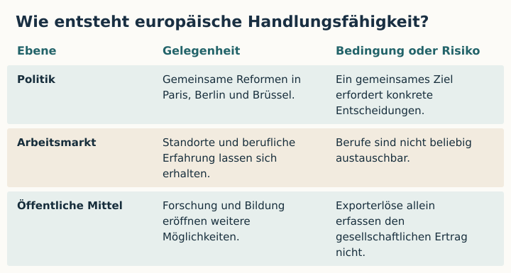

# BCE ECG — Allemand LVA (ELVi) 2026 · Corrigé brut

*Corrigé rédigé par IA, non officiel. Signalez toute erreur.*

**Rédaction** · GPT-6.2 Astra Ultra · vitesse non renseignée

**Lecture du rapport du jury** · GPT-6.2 Astra Ultra · vitesse non renseignée · 26 novembre 2026

**Révision** · GPT-6.2 Astra Ultra · vitesse non renseignée · 26 novembre 2026

[Sujet officiel, option Allemand LVA (ELVi)](https://www.concours-bce.com/sites/default/files/2026-04/75%20GB%20-%20LANGUE_VIVANTE_A_ELVI_ALLEMAND_ANGLAIS_ESPAGNOL.pdf#page=2) · [Rapport du jury 2026](https://www.concours-bce.com/sites/default/files/2026-11/75%20-%20Allemand%20LVA%20ELVi%202026.pdf)

L’allemand LVA occupe les pages 2 à 7. Les deux premières réponses comptent respectivement environ 350 et 500 mots, avec une marge de 10 %. Le thème porte sur le titre du document 3, puis sur le passage entre crochets qui s’arrête à la part des exportations allemandes.

## Résumé analytique comparatif · 344 mots

Beide Autoren beschreiben eine Lage, in der Europa seine wirtschaftliche und politische Handlungsfähigkeit neu bestimmen muss. Alexander Mühlauer fragt, welche Zusammenarbeit den Einfluss der Europäischen Union sichern kann. Thomas Kohlmann untersucht, was höhere staatliche Ausgaben für die Verteilung von Arbeit und Fachwissen bedeuten. Entwicklungen außerhalb Europas verändern damit sowohl die Voraussetzungen politischer Entscheidungen als auch die Aussichten einzelner Betriebe und Beschäftigter.

Mühlauer zufolge beruhte Deutschlands frühere Zurückhaltung gegenüber Frankreichs Forderung nach europäischer Souveränität auf drei günstigen Bedingungen: Energie aus Russland, Sicherheit durch die USA und Zugang zum chinesischen Markt. Diese Kombination trägt nicht mehr. Im Wettbewerb mit autoritär regierten Mächten stehen für den Autor der europäische Wohlstand, der Frieden und eine regelgebundene Handelsordnung auf dem Spiel. Inzwischen teilen Friedrich Merz und Emmanuel Macron die Diagnose. Vor der französischen Präsidentschaftswahl 2027 bleibt ihnen jedoch nur begrenzt Zeit für gemeinsame Entscheidungen. Der Berliner Digitalgipfel liefert Mühlauer ein Beispiel für die politische Annäherung. Dass die Regierungen eine Abhängigkeit benennen können, bedeutet für ihn noch nicht, dass sie sie bereits überwunden haben. Der Autor fordert darüber hinaus einen gemeinsamen Kapitalmarkt, industrielle Kooperation und die Überprüfung von Vorschriften, die Investitionen erschweren.

Kohlmann zeigt anhand der Verteidigungsindustrie, wie weit politische Entscheidungen in den Arbeitsmarkt hineinreichen. Während die Autoindustrie Stellen abbaut, suchen andere Unternehmen Personal und Standorte. In Görlitz bietet die Übernahme eines gefährdeten Zugwerks einem Teil der Belegschaft eine Perspektive. Berechnungen für Europa stellen Hunderttausende neu geschaffene oder gesicherte Stellen in Aussicht. Der mögliche Personalmangel fällt allerdings je nach Höhe der Ausgaben sehr unterschiedlich aus. Nicht jede Qualifikation lässt sich ohne Weiterbildung übertragen, und langwierige Sicherheitsprüfungen begrenzen den Kreis der Bewerber. Kürzungen an amerikanischen Forschungseinrichtungen könnten wiederum Fachleute für europäische Arbeitgeber erreichbar machen.

Der politische Kommentar und die Wirtschaftsreportage beleuchten somit verschiedene Seiten derselben Abhängigkeit. Berlin und Paris können einen europäischen Handlungsspielraum eröffnen. Ob er sich tatsächlich nutzen lässt, hängt auch von Menschen ab, deren Ausbildung und berufliche Entscheidungen sich nicht per Beschluss ändern lassen. Bei Mühlauer fehlt es vor allem an der Umsetzung gemeinsam erkannter Reformen. Kohlmann macht deutlich, welche sozialen und organisatorischen Voraussetzungen diese Umsetzung im Betrieb hat.

## Essai argumenté · 496 mots

Eine Krise eröffnet eine Chance, wenn eine Entscheidung, die jahrelang vertagt wurde, plötzlich möglich wird. Sie ist noch kein guter Grund für jede Ausgabe, die sich als Antwort auf die Krise ausgibt. Für Europa und besonders für Deutschland sehe ich die wichtigste Gelegenheit darin, wirtschaftliche Fähigkeiten neu zu verteilen, ohne bewährte Kenntnisse und demokratische Kontrolle preiszugeben.

In Görlitz lässt sich diese Frage sehr konkret stellen. Für eine Familie ist es ein erheblicher Unterschied, ob der Arbeitsplatz am Ort bleibt oder ob trotz jahrzehntelanger Berufserfahrung ein Umzug nötig wird. Die Übernahme eines Teils der Belegschaft eines Bahnwerks kann Einkommen und Ausbildungsmöglichkeiten sichern. Wer nur die neu geschaffenen Stellen zählt, übersieht jedoch diejenigen, deren Beruf nicht zu den neuen Aufgaben passt. Der demokratische Wert der deutschen Mitbestimmung zeigt sich gerade in solchen Übergängen. Ein Betriebsrat kann auf bezahlte Weiterbildung, verlässliche Zusagen und Möglichkeiten für ältere Beschäftigte drängen. Damit würde industrielle Anpassung etwas sein, worüber die Betroffenen mitentscheiden.

Europa hat Erfahrung damit, politische Gegensätze durch gemeinsame wirtschaftliche Institutionen zu verändern. Die Montanunion machte nach dem Zweiten Weltkrieg aus Kohle und Stahl Gegenstände gemeinsamer Aufsicht. Ihr Erfolg bestand nicht allein darin, dass zwei Länder wieder produzierten. Sie mussten einander Rechenschaft darüber geben, was sie mit Industrien taten, die zuvor nationale Macht symbolisiert hatten. Für heute folgt daraus kein fertiger Bauplan. Wohl aber spricht die Erfahrung dafür, Investitionen gemeinsam und öffentlich zu begründen. Eine enge Verständigung zwischen Frankreich und Deutschland ist dabei wertvoll, sofern kleinere Mitgliedstaaten tatsächlich mitentscheiden können. Europäische Selbstbestimmung verliert ihren Sinn, wenn sie in anderen Hauptstädten als neue Abhängigkeit von Berlin und Paris erscheint.

Ein weiteres Risiko veranschaulicht der Minister in Johann Mayrs Karikatur. Weil sich ein Schulsystem schwer exportieren lasse, hält er Unterstützung für exportierende Industrien für einleuchtender. Der Witz trifft eine Schwäche der deutschen Debatte. Ein im Ausland verkauftes Produkt lässt sich leicht in einer Bilanz verbuchen. Dass eine gute Berufsschullehrerin später vielen Menschen einen Berufswechsel ermöglicht, erscheint dort nicht. Wer heute Geld für Bildung, kommunalen Verkehr oder Forschung zurückhält, kann also genau jene Anpassungsfähigkeit schwächen, von der morgen die Industrie abhängt. Auch bei Ausfuhren genügt der Auftragseingang als Erfolgsmaßstab nicht. Die Karte von Greenpeace verzeichnet erteilte Genehmigungen für ein einzelnes Jahr. Wer darin schon einen Beweis für langfristig gesicherte Beschäftigung sieht, schreibt einer Verwaltungsentscheidung eine Wirkung zu, die sich aus der Karte allein nicht ablesen lässt. Über die politische Verantwortung gegenüber Empfängerländern muss unabhängig vom Interesse an Arbeitsplätzen gesprochen werden.

Für mich ist Souveränität deshalb eine praktische Fähigkeit zur Wahl. Deutschland sollte in Weiterbildung und Forschung investieren und bei europäischen Projekten die Kosten, Begünstigten und möglichen Alternativen offenlegen. Forschende aus anderen Ländern zu gewinnen wäre ein Gewinn, wenn sie hier auch langfristig frei arbeiten können. Entscheidend ist schließlich die Frage, ob Europa nach einer Investition mehr Möglichkeiten besitzt als vorher. Ein Kontinent, der lediglich einen einzigen Absatzmarkt oder Arbeitgeber durch einen anderen ersetzt, mag kurzfristig bessere Zahlen vorlegen. Wirklich gewonnen hat er erst, wenn seine Bürger beim nächsten Umbruch zwischen mehreren tragfähigen Wegen wählen können.

## Thème

Wer profitiert vom Waffenhandel in Europa, und wohin gehen die Exporte?

Der jüngste Bericht des Stockholmer Friedensforschungsinstituts (SIPRI), der diese Woche veröffentlicht wurde, bestätigt das Ausmaß dieser Entwicklung. Verglichen mit den Jahren 2015 bis 2019 lagen die europäischen Einfuhren schwerer Waffen im Zeitraum von 2020 bis 2024 um 155 Prozent höher. […]

Gleichzeitig haben die europäischen Schwergewichte im Export, Frankreich, Deutschland und Italien, ihre Vormachtstellung in der Rüstungsindustrie nach und nach gefestigt. Diese Entwicklung kommt nicht von ungefähr. Das sicherheitspolitische Umfeld in Europa wandelt sich derzeit grundlegend. Der russische Einmarsch in die Ukraine und neue Sorgen um die strategische Autonomie in Brüssel und innerhalb der NATO haben dem Handel mit Rüstungsgütern zusätzlichen Auftrieb gegeben. Der Kontinent liefert mehr Waffen aus und kauft auch mehr ein. In diesem Umfeld besteht ein merkwürdiges Nebeneinander von Friedensbekenntnissen und einer florierenden Industrie, die hinter den Kulissen Verträge in Milliardenhöhe abschließt.

Ein Geschäft im Aufschwung

Die USA sind nach wie vor der weltweit größte Waffenexporteur. Auf sie entfielen im Zeitraum 2020–2024 rund 43 Prozent aller Transfers. An zweiter Stelle steht Frankreich mit etwa 9,6 Prozent der weltweiten Ausfuhren in diesem Zeitraum, gefolgt von Deutschland mit rund 5,6 Prozent.

