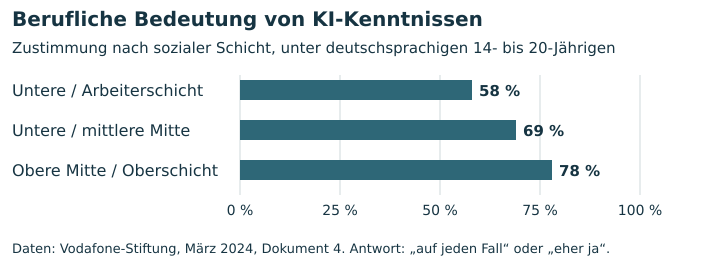
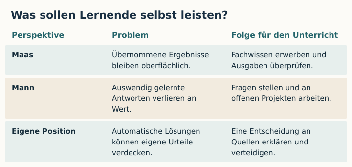

# BCE ECG — Allemand LVB (ELVi) 2026 · Corrigé guidé

*Corrigé rédigé par IA, non officiel. Signalez toute erreur.*

**Rédaction** · GPT-6.2 Astra Ultra · vitesse non renseignée

**Lecture du rapport du jury** · GPT-6.2 Astra Ultra · vitesse non renseignée · 26 novembre 2026

**Révision** · GPT-6.2 Astra Ultra · vitesse non renseignée · 26 novembre 2026

[Sujet officiel, option Allemand LVB (ELVi)](https://www.concours-bce.com/sites/default/files/2026-04/76%20GB%20-%20LANGUE_VIVANTE_B_ELVI_ALLEMAND_ANGLAIS_ESPAGNOL.pdf#page=2) · [Rapport du jury 2026](https://www.concours-bce.com/sites/default/files/2026-11/76%20-%20Allemand%20LVB%20Elvi%202026.pdf)

Le dossier allemand LVB commence page 2 du fascicule B. Le résumé de 250 mots et l’essai de 350 mots admettent une variation de 10 %. Le thème couvre le seul passage entre crochets du témoignage d’Éric Hans.

## Préparer les trois exercices

Comparer les deux diagnostics à partir d’un même exemple scolaire. Chez Maas, l’élève qui fait résumer tout un livre risque de perdre la capacité d’en discuter. Chez Mann, une question à laquelle une machine fournit immédiatement la réponse invite à repenser l’exercice lui-même. Repérer ce sur quoi ils s’accordent, notamment le besoin d’interroger un résultat et d’apprendre à coopérer, puis ce qui motive leurs propositions différentes.

Pour l’essai, choisir une opération intellectuelle observable, par exemple confronter deux interprétations d’une source et expliquer laquelle repose sur une preuve. Le dessin met en scène un robot professeur devant l’inscription *Selbstständiges Lernen*. Le sondage de 2024 concerne la perception de l’utilité professionnelle de l’IA chez les germanophones de 14 à 20 ans. Il ne mesure pas leur capacité réelle à vérifier une réponse. Pour le thème, garder les propos d’Éric Hans au discours direct là où le français les cite, et ne pas traduire les paragraphes après le crochet.

Dans l’enquête, 20 % répondent « oui, absolument » et 49 % « plutôt oui », soit 69 % de réponses favorables au total. Les trois barres reprennent les réponses favorables dans chaque groupe social. Les 69 % du groupe intermédiaire et les 69 % de l’ensemble sont deux statistiques distinctes. Le sondage porte sur une attente professionnelle. Demander ensuite à un élève de justifier sa réponse par une source permettrait d’observer une capacité que le sondage ne teste pas. Le professeur robot du dessin rend cette différence visible.

## Résumé analytique comparatif · 245 mots

Hartwin Maas und Ben Mann gehen beide davon aus, dass junge Menschen den Umgang mit künstlicher Intelligenz lernen müssen. Für den Zukunftsforscher Maas stellt sich zunächst die Frage, was Studierende selbst noch können, wenn sie sich Texte zusammenfassen lassen. Für den Unternehmer Mann stellt sich umgekehrt die Frage, weshalb eine Schule weiterhin vor allem Antworten abfragt, die eine Maschine längst geben kann.

Maas beobachtet, dass viele Studierende Inhalte übernehmen, ohne sie sich gründlich anzueignen oder die Funktionsweise des Programms zu kennen. Beim Berufseinstieg fehle ihnen dann die Fähigkeit, Wissen selbstständig auf ein unbekanntes Problem zu übertragen. Hochschulen sollten deshalb Grundlagen erhalten und zugleich lehren, wie Algorithmen arbeiten und wie ihre Ergebnisse geprüft werden. Kommunikation, Zusammenarbeit, Selbstorganisation und der tatsächliche Umgang mit digitalen Werkzeugen dürften für Arbeitgeber wichtiger werden als der Abschluss allein.

Mann zieht aus der Verfügbarkeit maschineller Antworten weitergehende Konsequenzen für den Unterricht. Lehrkräfte sollten Schülerinnen und Schüler darin unterstützen, geeignete Fragen zu entwickeln, Zusammenhänge zu erkennen und gemeinsam an offenen Problemen zu arbeiten. Während Maas vom späteren Berufsalltag her argumentiert, setzt Mann schon bei der Form einer Schulstunde an. Flexible Projekte könnten Kreativität und Einfühlungsvermögen fördern. Der Einsatz der Technik im Unterricht soll verständlich machen, wozu sie sich eignet.

Beide sehen Lehrende somit in einer aktiven Rolle. Maas warnt besonders davor, das eigene Lernen auszulagern, während Mann die Unterrichtsziele selbst verändern möchte. Bei beiden kommt es darauf an, dass Lernende einen Vorschlag beurteilen, anderen erklären und in einer neuen Lage eigenständig weiterdenken können.

## Essai argumenté · 340 mots

Künstliche Intelligenz gefährdet kritisches Denken dort, wo eine gut formulierte Antwort bereits als Beweis des Verstehens gilt. Das Problem beginnt also vor dem Einschalten des Computers. Wenn ich für eine glatte Zusammenfassung dieselbe Note bekomme wie für eine begründete Auslegung, belohnt die Aufgabe gerade das, was eine Maschine besonders schnell liefern kann. Ändert sich die Aufgabe, kann dasselbe Werkzeug zum Gegenstand einer anspruchsvollen Prüfung werden.

Nehmen wir ein Unterrichtsprojekt zur deutschen Wiedervereinigung. Eine Klasse könnte sich einen kurzen Überblick erzeugen lassen und ihn mit einem Zeitzeugenbericht über eine Betriebsschließung vergleichen. Erklärt der Überblick politische Entscheidungen, die dem Zeitzeugen entgehen? Verallgemeinert er umgekehrt eine Erfahrung, die regional sehr verschieden war? Wer antworten will, muss die Quelle selbst gelesen haben. Die Lehrkraft kann anschließend nach dem Satz fragen, der eine Schülerin zum Umdenken gebracht hat. Diese Frage prüft einen gedanklichen Schritt und lässt mehrere begründete Antworten zu.

Die Karikatur im Dossier zeigt allerdings die Gefahr einer bequemeren Lösung. Vor der Klasse steht ein Roboter, an der Tafel wird selbstständiges Lernen angekündigt. Der Hinweis auf den Lehrermangel macht die Pointe deutlich. Selbstständigkeit braucht gelegentlich jemanden, der merkt, wann eine Rückfrage weiterhilft. Wer schon zu Hause Unterstützung und ein gutes Gerät hat, kann mit einem schlecht begleiteten Projekt leichter zurechtkommen. Die Vodafone-Befragung zeigt unterschiedliche Erwartungen. In der unteren sozialen Gruppe halten 58 Prozent KI-Kenntnisse für beruflich wichtig, in der oberen Gruppe 78 Prozent. Der Abstand von zwanzig Prozentpunkten beschreibt, was Jugendliche erwarten. Daraus folgt noch kein Urteil über ihre tatsächlichen Fähigkeiten. Es ist aber ein Grund, Unterstützung in der Schule für alle verfügbar zu machen.

Ich würde daher zwei Arbeitsformen verbinden. Zuerst entwickelt jeder ohne Hilfsmittel eine eigene Vermutung. Anschließend darf die Klasse alternative Erklärungen prüfen und muss kenntlich machen, welche Behauptung durch welche Quelle gedeckt ist. So bleibt ein Irrtum sichtbar und kann produktiv werden. Die entscheidende Frage ist für mich, wer am Ende für eine Aussage einsteht. Kann ein Schüler sagen, weshalb er einen Vorschlag der Maschine verworfen hat, dann hat er gerade jene Urteilskraft ausgeübt, deren Verlust so oft beklagt wird.

## Thème

In seinem Erfahrungsbericht erinnert er uns daran, dass KI in unserem Leben bereits präsent ist, und wirft grundlegende Fragen zu ihrer Rolle in der Bildung auf. „Die Einsatzbereiche der KI sind vielfältig und scheinen sich nur schwer eingrenzen zu lassen, denn sie erstrecken sich auf zahlreiche Bereiche des Alltags, etwa wenn wir im Internet recherchieren oder einkaufen. […] Wir können nicht mehr sagen, dass wir sie nicht wollen. Sie hat bereits Einzug in unser Leben gehalten.“ […]

Für Eric Hans darf KI niemals die Lehrkraft ersetzen. Der Austausch zwischen Menschen bleibt entscheidend, um dem Lernen einen Sinn zu geben, das Gespür der Lernenden zu schärfen und eine persönliche, emotionale Bindung zu ihnen aufzubauen. „Nachdenken, schöpferisch tätig sein, intuitiv an etwas herangehen, komplexe Situationen verstehen und in ihnen handeln“ und viele andere Fähigkeiten bleiben dem Menschen vorbehalten. Es ist entscheidend, dass KI als ergänzendes Werkzeug verstanden wird, das Zeit für anspruchsvollere Aufgaben wie die Förderung kritischen Denkens schafft.
