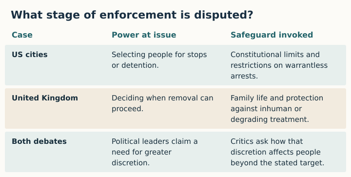

# BCE ECG — Anglais LVA (ELVi) 2026 · Corrigé guidé

*Corrigé rédigé par IA, non officiel. Signalez toute erreur.*

**Rédaction** · GPT-6.2 Astra Ultra · vitesse non renseignée

**Lecture du rapport du jury** · GPT-6.2 Astra Ultra · vitesse non renseignée · 26 novembre 2026

**Révision** · GPT-6.2 Astra Ultra · vitesse non renseignée · 26 novembre 2026

[Sujet officiel, option Anglais LVA (ELVi)](https://www.concours-bce.com/sites/default/files/2026-04/75%20GB%20-%20LANGUE_VIVANTE_A_ELVI_ALLEMAND_ANGLAIS_ESPAGNOL.pdf#page=8) · [Rapport du jury d’anglais 2026](https://www.concours-bce.com/sites/default/files/2026-10/75%20-%20Anglais%20LVA%20ELVi%202026.pdf)

Le dossier d’anglais LVA s’ouvre à la page 8. Le résumé compare les documents 1 et 2 en 350 mots et l’essai demande 500 mots, avec une tolérance de 10 % dans chaque cas. Le thème porte sur la partie entre crochets de l’article de Philippe Bernard. Les réponses se placent aux dates des documents.

## Préparer les trois exercices

Pour le résumé, opposer deux étapes du contrôle de l’immigration. Le texte américain examine qui peut être arrêté ou interrogé dans la rue et sous quelles conditions. Le texte britannique porte sur les droits opposables à un éloignement. Identifier aussi la différence institutionnelle entre une décision d’urgence sans jugement sur le fond et une proposition de réinterpréter une convention internationale. Employer des verbes d’attribution pour les allégations des groupes de défense, les arguments gouvernementaux et les prédictions.

Pour l’essai, construire une réponse au degré demandé par *to what extent*. Le logement, les services et les emplois fournissent des sources réelles d’inquiétude. La comparaison doit ensuite permettre de mesurer ce que le discours politique sélectionne, déplace ou produit lui-même. Les dessins qui mettent en scène la statue de la Liberté et Paddington rendent visible la sélection des étrangers jugés acceptables. Dans le thème, conserver la date de 2014 employée par l’auteur et distinguer cette date de celle du référendum de 2016. Les pourcentages correspondent aux intentions de vote et au jugement exprimé à la date de l’article.

Le dessin britannique de Ben Jennings se déroule devant un spectacle consacré à Paddington. Relier la plaisanterie à l’écart entre l’affection pour un héros venu du Pérou et l’hostilité du slogan donne au document une fonction dans l’argument. Dans le thème, *settle* traduit « s’installer » et *an automatic right* restitue la liberté d’établissement perdue après le Brexit. Le passage traite des nouvelles installations.

## Résumé analytique comparatif · 355 mots

Both reports examine governments claiming that effective immigration control requires greater latitude and opponents asking whose freedoms would pay for it. Their starting points differ. In the United States, the dispute arises when federal agents decide whom to question within the country. In Britain, it concerns the circumstances in which someone already facing removal can invoke human rights protection.

The New York Times describes operations in predominantly Latino communities under President Trump’s deportation programme. A 1975 Supreme Court decision ruled out apparent ethnicity as the sole ground for an immigration stop. An emergency order lifting a temporary restriction on federal action in Los Angeles has nevertheless raised doubts about the protection that precedent affords in practice. The order leaves the underlying constitutional question open. In Chicago, lawyers allege that arrests have also breached a separate 2022 consent decree. The government invokes agents’ constitutional training and their duty to apprehend people without legal status. Civil rights groups counter that appearance, language and occupation can expose people to detention regardless of their status. A dissenting justice warns of consequences for ordinary freedom on American streets.

The Guardian reports a British effort to change how existing protections are interpreted. Keir Starmer and his Danish counterpart argue that elected governments must demonstrate control of borders if mainstream politics is to withstand populist challengers. Starmer favours continued membership of the European Convention on Human Rights, while the Conservatives and Reform UK advocate withdrawal. Where Americans are asking courts to check executive discretion, British ministers propose legislation on family life under Article 8. They are also seeking European agreement on how Article 3 applies to the risk of inhuman or degrading treatment abroad. Campaigners, legal specialists and some Labour politicians fear that London would legitimise hostility towards refugees and encourage other governments to weaken an absolute safeguard.

Thus the American controversy tests enforcement against constitutional limits in court, while the British government seeks domestic and international support for altering the practical reach of convention rights. In both cases, opponents dispute the idea that discretion can be expanded without consequences extending well beyond the individuals whom ministers say they intend to remove.

## Essai argumenté · 547 mots

If voters cannot find a flat they can afford or see a doctor promptly, an argument about numbers at the border can sound more convincing than a promise to reorganise public services. Immigration policy in Britain and the United States does express real pressures on institutions and employment. In my view, however, it reflects those pressures selectively. It often tells us more about whom a government needs to persuade than about what would solve the underlying economic problem.

Britain offers a revealing test. Philippe Bernard reports that only 32 per cent of Britons considered Brexit the right decision at the time of his article, yet Farage’s party led its rivals in voting intentions. Disappointment with one promise of control could coexist with support for another. Brexit allowed the government to change the rules governing migration from Europe. It also left employers seeking workers in social care and other occupations where pay and conditions make recruitment difficult. Ending free movement did not make a care home any easier to staff. A government can reasonably ask how many people a locality can house and who should finance additional provision. Yet its answer must explain what happens to an elderly resident tomorrow when the worker looking after her is the person whom a campaign has described as a burden. National figures obscure the distinction between the place where the benefit is felt, the council paying to provide services and the Treasury receiving taxes.

In the United States the distance between rhetoric and economic practice is particularly stark. The newspaper report locates immigration operations at places where labour is being hired. An agricultural or construction business may depend on immigrant workers while a politician can gain publicity by demanding their removal. This uneasy relationship has a history. Under the Bracero programme, which began during the Second World War, the United States recruited Mexican labour under temporary arrangements. Political decisions helped produce the very pattern of cross-border work that subsequent debates have treated as an external intrusion. An enforcement policy judged only by the number of people detained says little about the conduct of employers or the wages of workers with limited bargaining power.

The cartoons in the dossier expose a further choice. An American emblem of liberty becomes suspect because of her foreign origin. Outside the London show about Paddington, a protester calls for action against the migrant supposedly housed inside. A beloved bear from Peru becomes the target of a slogan that reduces a stranger to an immigration category. The jokes work because immigration holds an honoured place in each country’s story until the newcomer becomes a real person seeking recognition or shelter. Politicians can mobilise that distinction even where a change in immigration rules would have little effect on local wages. Britain’s Windrush scandal showed how a demand for visible toughness could harm long-settled residents entitled to remain.

I would therefore judge immigration policy by outcomes politicians can be asked to deliver: timely decisions, fair treatment at work, predictable funding for receiving communities and a meaningful right to challenge an error. Governments have legitimate choices to make about admissions. Their willingness to distinguish those choices from unrelated failures, and to count the costs imposed on lawful residents, is a better measure of control than the volume of their assurances.

## Thème

The nationalist hotheads who clashed with the police shouting “Send them back!” are now joined by the ranks of voters swelling support for the anti-immigration party Reform UK.

Polling at 31 per cent, the party led by Nigel Farage, a driving force behind Brexit, is now well ahead of the governing Labour Party (20 per cent) and the Tories (16 per cent). Nothing like this has been seen in a century during which those two major parties have taken uninterrupted turns in office.

As early as 2014, xenophobia had been one of the main forces behind the break with the European Union (EU), which was accused of allowing workers from Eastern Europe to enter unchecked. Since Britain left the EU, Polish people no longer have an automatic right to settle in the UK, but their place has been taken by a far larger, record number of people from the former British Empire.

Brexit, which only 32 per cent of Britons now think was the right decision, has failed to deliver on its promise to “take back control” of the borders and has intensified the controversy over immigration, which Donald Trump’s policies have made more bitter still. So much so that Vernon Bogdanor, a leading British constitutional scholar, warned in the Guardian of the “moral panic” that “incendiary rhetoric” about immigration can produce.
