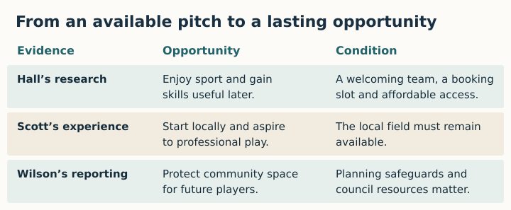
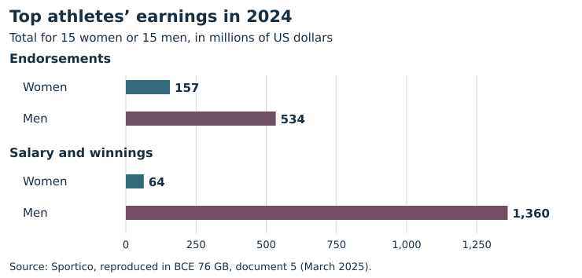

# BCE ECG — Anglais LVB (ELVi) 2026 · Corrigé brut

*Corrigé rédigé par IA, non officiel. Signalez toute erreur.*

**Rédaction** · GPT-6.2 Astra Ultra · vitesse non renseignée

**Lecture du rapport du jury** · GPT-6.2 Astra Ultra · vitesse non renseignée · 26 novembre 2026

**Révision** · GPT-6.2 Astra Ultra · vitesse non renseignée · 26 novembre 2026

[Sujet officiel, option Anglais LVB (ELVi)](https://www.concours-bce.com/sites/default/files/2026-04/76%20GB%20-%20LANGUE_VIVANTE_B_ELVI_ALLEMAND_ANGLAIS_ESPAGNOL.pdf#page=7) · [Rapport du jury d’anglais 2026](https://www.concours-bce.com/sites/default/files/2026-10/76%20-%20Anglais%20LVB%20Elvi%202026.pdf)

Le dossier d’anglais LVB commence à la page 7. Le sujet fixe 250 mots pour le résumé comparatif et 350 mots pour l’essai, avec une marge de 10 %. Le thème commence par le nombre d’étapes du Tour et s’arrête à l’audience télévisée.

## Résumé analytique comparatif · 263 mots

Rachel Hall and Jeremy Wilson both link girls’ chances in sport to facilities close to home. Hall also examines what participation may offer beyond the playing field. The research she reports associates after-school sport with a fifty per cent greater likelihood of later holding a senior job. Confidence, resilience and teamwork are among the possible benefits, while visible professional athletes can encourage girls to play. Wilson offers an individual illustration: England footballer Jill Scott credits a local field with giving her the opportunity to start her career.

The obstacles in Hall’s report concern who gets to use existing facilities. Girls face costs, limited local options, less favourable booking times than boys and sexist or sexual remarks. One in three girls surveyed thought boys could choose from more sports. Many leave team sport early, losing chances to practise leadership. Greater media exposure can challenge prejudice, but it cannot supply a pitch or guarantee a welcome.

Wilson asks whether the pitches themselves will remain available. Sport England warns that removing its statutory role in planning could make it easier for financially pressed councils to sell playing fields. About ten thousand playing fields had already been sold in the 1980s and 1990s before stronger safeguards took effect. The government maintains that planning rules still protect them. Where Hall reports promises of investment and curriculum reform, Wilson therefore identifies a possible conflict between sporting ambitions and planning policy. Taken together, the articles suggest that a girl inspired to take part needs both fair access to a team and a local space where that team can keep playing.

## Essai argumenté · 375 mots

When the Lionesses won the European Championship at Wembley in 2022, a girl in England could watch women occupy the most prestigious stage in the national game. Whether she could play the following Monday depended on a timetable, a pitch and someone willing to coach her. I think equal opportunity is attainable in particular sports, but there is little reason to expect it to follow automatically from a celebrated victory.

Institutions have changed the odds before. For much of the twentieth century the Football Association barred women’s matches from grounds belonging to affiliated clubs. That decision restricted access to spectators and revenue as well as to grass. Reversing the exclusion made growth possible, but the lost decades of investment did not return overnight. In the United States, Title IX made equal educational opportunity a legal question for institutions receiving federal funds. A pupil could demand an explanation of how a school distributed opportunities, even if her team had yet to find a sponsor. The example suggests why enforceable commitments can achieve more than an advertising campaign.

Matt’s cartoon rewrites the opening of Jane Austen’s Pride and Prejudice: football boots give a woman a future she can choose for herself. The earnings chart tests how far that promise reaches. In 2024 the fifteen highest-paid women athletes together earned 64 million dollars in salaries and winnings, against one billion three hundred and sixty million for the fifteen men. The gap was smaller for endorsements. A girl watching a successful professional has a reason to take up the game, but even the richest players cannot tell her whether an ordinary professional career will pay the rent.

In my view, equality is likeliest where schools and councils publish who gets their facilities after class, at what price and at what time. A late slot with no safe journey home may count as an offer on paper while keeping girls away in practice. I would also ask leagues to invest some of their new audiences’ money in coaches and regular competitions for beginners. Success would mean a girl can try a sport, leave it or pursue it on the same practical terms as her brother. A medal makes that freedom imaginable. An ordinary week of reliable opportunities makes it real.

## Thème

The women’s Tour de France consists of nine stages, while the men’s has 21. As a result, far fewer prizes are awarded for sprints and mountain passes.

[…] The two races do not have exactly the same sponsors. The women’s Tour has fewer sponsors and they spend less, because the event is still very new. This was only its fourth edition. Before investing, companies want to know how much exposure their products will get.

[…] The outlook is nevertheless rather encouraging. Women’s cycling is growing rapidly. A minimum salary is now guaranteed. Major sponsors have come on board in recent years. Higher-profile races are developing and giving the sport greater exposure overall.

The Tour de France itself is becoming increasingly popular. More people lined the roads this year and, above all, television audiences were particularly large.

