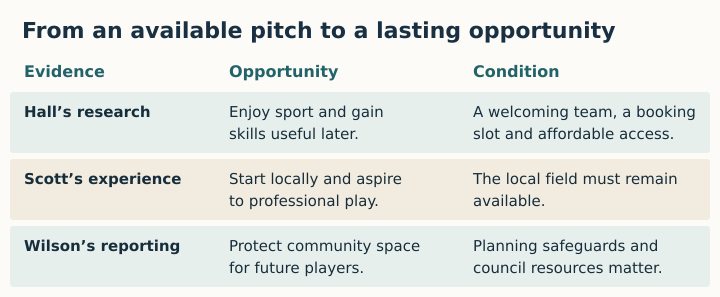

# BCE ECG — Anglais LVB (ELVi) 2026 · Corrigé guidé

*Corrigé rédigé par IA, non officiel. Signalez toute erreur.*

**Rédaction** · GPT-6.2 Astra Ultra · vitesse non renseignée

[Sujet officiel, option Anglais LVB (ELVi)](https://www.concours-bce.com/sites/default/files/2026-04/76%20GB%20-%20LANGUE_VIVANTE_B_ELVI_ALLEMAND_ANGLAIS_ESPAGNOL.pdf#page=7)

Le dossier d’anglais LVB commence à la page 7. Le sujet fixe 250 mots pour le résumé comparatif et 350 mots pour l’essai, avec une marge de 10 %. Le thème commence par le nombre d’étapes du Tour et s’arrête à l’audience télévisée.

## Préparer les trois exercices

Dans le résumé, associer la possibilité de pratiquer à ses deux conditions. Rachel Hall rapporte des résultats sur les parcours professionnels, les créneaux, le coût et l’accueil des jeunes filles. Jeremy Wilson examine ce qui arrive si le terrain lui-même peut être vendu. Le risque de vente est l’alerte d’une organisation, contestée par le gouvernement. Une probabilité relative de 50 % plus élevée n’est ni un gain de cinquante points ni une promesse individuelle.

Pour l’essai, distinguer les opportunités de jouer régulièrement, de devenir professionnelle et de gagner sa vie avec le sport. Le graphique compare les revenus des quinze femmes et des quinze hommes les mieux rémunérés, répartis entre rémunérations sportives et contrats publicitaires. La caricature de Matt réécrit la première phrase de *Pride and Prejudice*. On peut faire de la visibilité ainsi acquise le début de l’argument, puis examiner l’accès quotidien des écolières. Dans le thème, *prime* correspond à *prize money* ou *prize* selon la construction. Distinguer les primes des cols du salaire minimum versé aux coureuses.

## Résumé analytique comparatif · 239 mots

Rachel Hall and Jeremy Wilson both link girls’ chances in sport to facilities close to home. Hall also examines what participation may offer beyond the playing field. The research she reports associates after-school sport with a fifty per cent greater likelihood of later holding a senior job. Confidence, resilience and teamwork are among the possible benefits, while visible professional athletes can encourage girls to play. Wilson offers an individual illustration: England footballer Jill Scott credits a local field with giving her the opportunity to start her career.

The obstacles in Hall’s report concern who gets to use existing facilities. Girls face costs, limited local options, less favourable booking times than boys and sexist or sexual remarks. Many leave team sport early, losing chances to practise leadership. Greater media exposure can challenge prejudice, but it cannot supply a pitch or guarantee a welcome.

Wilson asks whether the pitches themselves will remain available. Sport England warns that removing its statutory role in planning could make it easier for financially pressed councils to sell playing fields. Thousands were lost before protections were introduced. The government maintains that planning rules still protect them. Where Hall reports promises of investment and curriculum reform, Wilson therefore identifies a possible conflict between sporting ambitions and planning policy. Taken together, the articles suggest that a girl inspired to take part needs both fair access to a team and a local space where that team can keep playing.

## Essai argumenté · 358 mots

When the Lionesses won the European Championship at Wembley in 2022, a girl in England could watch women occupy the most prestigious stage in the national game. Whether she could play the following Monday depended on a timetable, a pitch and someone willing to coach her. I think equal opportunity is attainable in particular sports, but there is little reason to expect it to follow automatically from a celebrated victory.

Institutions have changed the odds before. For much of the twentieth century the Football Association barred women’s matches from grounds belonging to affiliated clubs. That decision restricted access to spectators and revenue as well as to grass. Reversing the exclusion made growth possible, but the lost decades of investment did not return overnight. In the United States, Title IX made equal educational opportunity a legal question for institutions receiving federal funds. A pupil could demand an explanation of how a school distributed opportunities, even if her team had yet to find a sponsor. The example suggests why enforceable commitments can achieve more than an advertising campaign.

Commercial visibility still matters. A broadcaster that regularly shows women competing makes it easier for an audience to follow a season and for a sponsor to justify renewing a contract. The earnings chart in the dossier also shows why a few glamorous advertisements are a poor measure of equality. Among the highest earners, the difference in sporting pay is especially striking. Comparing the richest athletes tells us even less about whether a player further down the rankings can afford to continue.

I would start by asking schools and councils to publish who gets their facilities after class, at what price and at what time. A late slot with no safe journey home may count as an offer on paper while keeping girls away in practice. I would also ask leagues to invest some of their new audiences’ money in coaches and regular competitions for beginners. Success would mean a girl can try a sport, leave it or pursue it on the same practical terms as her brother. A medal makes that freedom imaginable. An ordinary week of reliable opportunities makes it real.

## Thème

The women’s Tour de France consists of nine stages, while the men’s has 21. As a result, far fewer prizes are awarded for sprints and mountain passes.

[…] The two races do not have exactly the same sponsors. The women’s Tour has fewer sponsors and they spend less, because the event is still very new. This was only its fourth edition. Before investing, companies want to be sure their product will get exposure.

[…] The outlook is nevertheless rather encouraging. Women’s cycling is growing rapidly. A minimum salary is now guaranteed. Major sponsors have come on board in recent years. Higher-profile races are developing and giving the sport greater exposure overall.

The Tour de France itself is becoming increasingly popular. More people lined the roads this year and, above all, a great many watched on television.
