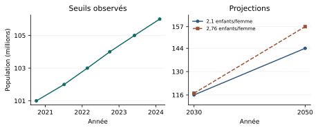

# BCE ECG — Arabe littéral LVA (ELVi) 2026 · Corrigé guidé

*Corrigé rédigé par IA, non officiel. Signalez toute erreur.*

**Rédaction** · GPT-6.2 Astra Ultra · vitesse non renseignée

Le dossier porte sur la croissance démographique en Égypte. Les trois réponses sont rédigées en arabe littéral. Les décomptes du résumé et de l’essai utilisent les mots séparés par des espaces.

## Résumé analytique comparatif · 354 mots

**Comparer les diagnostics.** Le reportage de 2021 mesure le décalage entre objectif démographique et résultat, puis présente une réponse sanitaire et sociale. L’article économique de 2020 suit les choix qu’impose cette croissance lorsque la production, l’école et l’emploi progressent moins vite. On peut réunir les deux textes autour du nombre de nouveaux habitants, puis de la capacité des services à les accueillir. Le passage au foncier et à l’eau relève du deuxième article. Les toits du Caire et le graphique de 2024 sont réservés à l’essai. Les verbes « estime », « prévoit » ou « vise » évitent de présenter une politique annoncée comme un résultat acquis.

يتفق المقالان على أن سرعة تزايد عدد السكان في مصر تجعل الوفاء بحاجات الأسر أصعب، لكنهما يحددان موطن الخطر من زاويتين مختلفتين. فالشرنوبي، في تقريره الصادر سنة ٢٠٢١، يقارن ما بلغته البلاد بما رسمته الدولة لنفسها من أهداف. أما إبراهيم محمد، الذي كتب قبل ذلك بعام، فيسأل عن قدرة الاقتصاد على استيعاب الأجيال الجديدة وعن الثمن الذي يدفعه المجتمع إذا عجز عن ذلك.

يبرز حجم الضغط أولا في المسافة بين التوقع والواقع. كان يفترض أن يبلغ عدد السكان أربعة وتسعين مليونا في سنة ٢٠٢٠، فإذا به يتجاوز الهدف بسبعة ملايين بحسب التقرير الأول. ويضع المقال الثاني هذه الأرقام في مسار أطول، إذ يقدر الزيادة السنوية بنحو مليونين ونصف مليون نسمة. ولا يرى صاحبه في كثرة السكان عائقا حتميا، لأن الشاب المتعلم الذي يجد عملا يساهم بدوره في الإنتاج. غير أن الاقتصاد، وفق التقدير الذي ينقله، يحتاج إلى النمو بثلاثة أمثال وتيرة الزيادة السكانية حتى يوفر الوظائف المطلوبة، وهو بعيد عن ذلك المستوى.

وتنعكس هذه الفجوة على وجهة الإنفاق. فما يلزم لتأمين الغذاء والدواء والخدمات يزاحم الاستثمار في الصناعة والبحث وإصلاح المرافق. ويقرن المقال الثاني ارتفاع بطالة الشباب واتساع الفقر بضعف التعليم العام والفساد، مما يضيق سبيل الانتفاع بهذه الطاقات. ويكشف أيضا بعدا مكانيا للمشكلة، فالامتداد العمراني يأكل من أرض الوادي المحدودة، والاعتماد على شراء الحبوب من الخارج يتزايد، ونصيب الفرد من الماء يتناقص مع اشتداد المنافسة على موارد النيل.

ويظهر الضغط نفسه في التقرير الأول من خلال اتساع المهام الملقاة على مؤسسات الدولة. فزيادة الطلب على الرعاية تستدعي توفير وسائل تنظيم الأسرة وخدمات صحة الأم والطفل، وتوسيع شبكة العيادات والوصول إلى البيوت. ويذكر التقرير أن الوزارة تستهدف ملايين النساء، وأن توسيع عمل العيادات يقترن بزيارات ميدانية. وبذلك تمتد كلفة الاستجابة إلى تدريب العاملات والوصول إلى أحياء وقرى لا تكفيها الخدمات المتاحة، فيما يخشى الكاتب الثاني أن تضيق الموارد اللازمة أصلا لتحديث هذه الخدمات. وربطت الوزارات هذه الخدمات بالتشغيل والتدريب والحضانات كي تتمكن النساء من مواصلة العمل. وعليه، يشرح التقرير كيف انتقلت مواجهة الزيادة من عد المواليد إلى تنمية قدرات الأسرة بالتعاون مع الجمعيات، بينما يبين المقال الاقتصادي لماذا لن تؤتي التنمية ثمارها إذا استمر ضعف الاستثمار المنتج وضاقت الأرض والمياه بمستخدميها. وفي الحالتين تتوقف النتيجة على قدرة الخدمات وفرص العمل على مواكبة التغير العددي.

## Essai argumenté · 499 mots

**Défendre une réponse et la mettre à l’épreuve.** L’essai part d’une question qu’un couple pourrait poser sur la prise en charge des parents âgés. Il lie l’accès aux soins au maintien des filles à l’école et aux conditions de travail des mères. Le reportage sur le logement permet de distinguer les besoins présents des effets différés d’une politique de fécondité. La comparaison avec la Tunisie est un exemple personnel situé dans le monde arabophone. Dans l’infographie, 106 millions est une observation de février 2024, tandis que 144 et 157 millions sont deux projections pour 2050, chacune soumise à une hypothèse de fécondité constante.

حين يقال لأسرة مصرية إن عددا أقل من الأبناء سييسر حياتها، قد تسأل من سيعتني بالوالدين إذا مرضا، أو ماذا ستفعل ابنتها بعد المدرسة إذا لم تجد عملا. لهذا أرى أن سياسة السكان تبدأ بالإجابة عن أسئلة الناس اليومية. فقرار الإنجاب يخص الأسرة، أما الدولة فتستطيع أن تجعل الخيارات المتاحة لها أوسع، وأن تستعد منذ اليوم لحاجات الأطفال الذين ولدوا بالفعل.

الخطوة الأولى في تقديري هي أن يجد الزوجان مشورة موثوقة قريبة من البيت، مع حرية قبولها أو رفضها. وتكتسب الزيارات المنزلية التي يعرضها المقال الأول معناها إذا أصغت المرشدة إلى الأم وسألت عن وسيلة تناسبها وعن إمكان العودة إلى العيادة. أما إذا انحصر تقييم العمل في عدد النساء المستعملات لوسيلة معينة، فقد تصبح المرأة وسيلة لتحقيق رقم. وتفيد هنا المقارنة مع تونس التي اقترنت فيها سياسات تنظيم الأسرة، منذ الستينات، بإصلاحات في وضع المرأة وبتوسع تعليم الفتيات. ولا يلزم لاستلهام هذه التجربة افتراض أن أسرة في صعيد مصر تعيش ظروف أسرة في تونس العاصمة.

والخطوة الثانية أن تتمكن الفتاة من تصور مستقبل آخر غير الزواج المبكر. فمقعد دراسي بعيد لا يكفي إذا كانت كلفة النقل تثقل الأسرة، ووظيفة بلا حضانة قد تضطر الأم إلى تركها. أقترح لذلك أن تربط المحافظة بين خطوط النقل والمدارس ومواقع العمل، وأن تشرك النساء في اختيار مواعيد الخدمة. وإذا أمكن تيسير معاش الشيخوخة والتأمين الصحي للعمال خارج القطاع الرسمي تضاءلت حاجة الوالدين إلى التعويل على دخل الأبناء وحده. عندئذ يصير حديث المسؤولين عن الاختيار ذا مضمون ملموس.

وثمة أزمة قائمة لا يعالجها انخفاض الخصوبة غدا. ففي تحقيق القاهرة صعدت أسرة شكري محمود إلى سطح عمارة قرب ميدان التحرير كي تبقى في قلب المدينة. وقد صور علاء الأسواني في «عمارة يعقوبيان» كيف يمكن لعنوان واحد أن يجمع بين مستويات متباعدة من الأمان والراحة. أستخلص من ذلك أن تحسين مساكن قائمة وإيصال المرافق إليها وإتاحة إيجارات قريبة من العمل قد ينفع أسرًا أكثر مما ينفعها ترحيلها إلى مساكن بعيدة. ومن شأن حماية الأرض الزراعية من البناء، مع إتاحة بديل سكني حقيقي، أن تخدم أيضا أمن الغذاء الذي حذر المقال الثاني من تراجعه.

وتجعل الوثيقة الإحصائية مسؤولية الاختيار السياسي واضحة. فهي تعرض لسنة ٢٠٥٠ تقديرين، أحدهما مئة وأربعة وأربعون مليونا إذا ثبت متوسط الإنجاب عند طفلين وعشر الطفل لكل امرأة، والآخر مئة وسبعة وخمسون مليونا إذا ثبت عند نحو طفلين وثلاثة أرباع الطفل. الفرق مهم في تخطيط الماء والمدارس، لكنه لا يمنح أحدا حق تحديد عدد أطفال غيره. وأيا كان المسار، سيحتاج الملايين إلى معلمين وعمل ومياه مأمونة. لذلك أقيس نجاح السياسة بعدد الفتيات اللاتي أكملن تعليمهن، وبمدة الانتظار في عيادة الحي وبقدرة الخريج على الحصول على أول وظيفة، إلى جانب تغير المؤشرات السكانية. وأضيف إلى ذلك سؤالا يغيب كثيرا عن النقاش، وهو كم تستغرق رحلة الأم بين البيت والعمل والعيادة. فقد يبدو الحي على خريطة القائمين على التخطيط قريبا من مستشفى، ويكون الوصول إليه بعربتين وانتظار طويل أمرا يتعذر على من تتقاضى أجرا عن يوم عملها. ومن المفيد نشر هذه النتائج على مستوى كل محافظة، حتى يعرف أهلها أين أنفقت الأموال ويمكنهم مساءلة من اتخذ القرار. بذلك تصبح الأسرة شريكة في تنمية يعود نفعها عليها الآن، وفي إعداد بلد يستطيع أبناؤها أن يعيشوا فيه غدا.

## Thème du français en arabe

**Délimiter la traduction.** Les quatre paragraphes en gras de la page 6 vont du toit qui domine la place Tahrir jusqu’au nom du centre d’études du Caire. L’appréciation de Stadnicki termine donc le thème avant la phrase sur l’habitat informel. Le « parcours du combattant » évoque une difficulté quotidienne et « d’en haut » prépare la découverte du lieu d’habitation. « Il reçoit » s’entend ici comme l’accueil du visiteur chez lui. Enfin, les « services » amenés au logement désignent les réseaux et équipements domestiques. Le verbe le plus naturel en arabe évoque leur raccordement au foyer.

على سطح مبنى يطل على ميدان التحرير، أحد أبرز معالم القاهرة، نشأت على مر العقود جماعة صغيرة من السكان. ففي أكبر حواضر أفريقيا، التي يزيد عدد سكانها، بحسب الأرقام الرسمية، على ثمانية عشر مليونا، يشق على المرء أيما مشقة أن يجد مسكنا قليل الكلفة. وهكذا جاء الحل لأسرة شكري محمود، كما لكثير من الأسر غيرها، من فوق حين راحت تبحث عن بيت يؤويها.

يستقبلنا في غرفة جلوس واسعة جدرانها خضراء. وتتدلى من السقف مروحة عتيقة، وتضفي على المكان شيئا من البهجة آيات قرآنية معلقة على الجدران وملصق لمكة المكرمة. وفي أحد الجدران الفاصلة نافذة تطل على مطبخ ضيق تنهمك فيه زوجته سيدة في إعداد الغداء لطفليهما المراهقين.

ويستهل رب الأسرة حديثه قائلا «هنا ولدت، وهنا نشأت، وهنا تزوجت». ويستعيد بشيء من الحنين ذكرى أجيال السكان الذين رآهم يتعاقبون على مبناه، من مصريين ويونانيين وبريطانيين أيضا. ومع مرور الوقت أوصل جميع المرافق إلى بيته.

ويرى رومان ستادنيكي، مسؤول قسم المدينة والتنمية المستدامة في مركز الدراسات والوثائق الاقتصادية والقانونية والاجتماعية بالقاهرة، أن هذا «الامتداد الرأسي للسكن» هو «استجابة لأزمة السكن وتراجع الدولة عن الاضطلاع بدورها».

[Sujet officiel, pages 2 à 7](https://www.concours-bce.com/sites/default/files/2026-04/75%20AR%20-%20LANGUE_VIVANTE_A_ELVI_ARABE_ITALIEN_PORTUGAIS_RUSSE.pdf#page=2)
