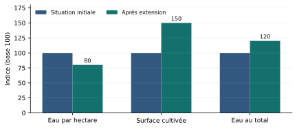

# BCE ECG — Arabe littéral LVB (ELVi) 2026 · Corrigé brut

*Corrigé rédigé par IA, non officiel. Signalez toute erreur.*

**Rédaction** · GPT-6.2 Astra Ultra · vitesse non renseignée

Le dossier réunit quatre documents sur l’agriculture dans le monde arabe, énumérés à la page 2 et reproduits aux pages 3 à 7. Les trois réponses sont en arabe littéral. Le décompte repose sur les mots séparés par des espaces.

## Résumé analytique comparatif · 248 mots

ينظر المقالان إلى التكنولوجيا الزراعية بوصفها وسيلة لحماية الغذاء والدخل، لكن الأول يتناولها من موقع الجزائر الساعية إلى زيادة الإنتاج المحلي، والثاني من موقع المغرب الذي يواجه جفافا متكررا. وفي البلدين يتعلق نجاح الابتكار بمن يستطيع استعماله وبما يوفره من موارد، إلى جانب ما يضيفه من محصول.

في الجزائر تقترن رقمنة القطاع بجرد الأراضي وتحسين توزيعها على صغار المستثمرين، وبتشجيع الشباب على إقامة مشاريع في المناطق البعيدة. ويمكن للطاقة الشمسية في ضخ المياه أن تخفض استهلاك الطاقة، فيما يراد لربط المشاريع بالبحث العلمي، ومنه مشروع فتح مدرستين متخصصتين، أن يساعد المزارعين على تطوير الإنتاج. ويسجل المقال تحفظ ممثل المستهلكين، إذ يرى أن الإجراءات الإدارية وضعف جودة بعض المنتجات واستمرار الاستيراد تحد من أثر هذه الجهود.

وفي المغرب تستجيب التجارب لحاجة ملحة إلى إدارة مياه تقل سنة بعد أخرى. فالري بالتنقيط واختيار أصناف تتحمل الجفاف مثالان على تغيير طرائق الإنتاج. كما تتيح البيانات البيئية وأدوات الاتصال توجيه الخدمات نحو المزارع في الوقت المناسب، فيرفع إنتاجيته بتكلفة أقل. ويعرض المقال معرض مكناس بوصفه فرصة لعقد الشراكات وتبادل الخبرات ضمن استراتيجية الجيل الأخضر. ويهم صون دخل أهل القرى خصوصا، لأن قسما كبيرا منهم يعتمد على الفلاحة.

وهكذا يربط المقال الجزائري بين البحث وإتاحة الأرض والطاقة لتعزيز الأمن الغذائي، بينما يركز نظيره المغربي على مرونة الإنتاج أمام الإجهاد المائي. ويتفقان على وجود مسافة بين الطموح والواقع. ففي الجزائر تعرقل البيروقراطية المشاريع، وفي المغرب تتركز الحلول الرقمية لدى كبار المزارعين، ولا يستعملها سوى نحو ثلاثة في المئة من المنتجين، مع أن الهدف المعلن هو تعميم الخدمات على نحو مليوني مزارع بحلول سنة ٢٠٣٠.

## Essai argumenté · 346 mots

لا أعتقد أن تحديث المزرعة يكفي وحده لجعل الفلاحة مستدامة. فقد تنخفض كمية الماء اللازمة لإنتاج كيلوغرام من الفاكهة ثم يزداد استنزاف الحوض كله إذا توسعت المساحات المزروعة. وفي رأيي تنجح السياسة حين تضمن غذاء الناس ودخل المزارع اليوم وتترك للأجيال المقبلة ماء وتربة صالحين للإنتاج.

يبدأ ذلك بتحديد ما يستطيع الحوض المائي تحمله. يبين التحقيق عن المغرب أن جزءا من الماء الشحيح يغادر البلد في طماطمه وبطيخه وفاكهته المصدرة. ولقد أنهت الحكومة دعما كان ييسر توسيع بعض الزراعات المسقية. لكن المستثمر القادر على تمويل بئره بنفسه قد يواصل الضخ. لذلك أرى أن نشر حساب مائي لكل حوض، تشارك في إعداده جمعيات السقاة، أنفع من الاكتفاء بعد الأجهزة المقتصدة المبيعة. ويفيد تاريخ الأفلاج في عمان هنا، إذ يعتمد توزيع الماء على أدوار زمنية معروفة تسمح للأهالي بمراجعة حقوق الانتفاع. ويمكن الجمع بين خبرة التنظيم هذه وقياس التدفق بوسائل حديثة.

وتأتي بعد ذلك مسألة المستفيد. يضع المقال الجزائري الشباب والبحث العلمي في صلب المشروع، لكنه ينقل أيضا شكوى من عوائق إدارية. وفي المغرب ينتفع كبار المزارعين أكثر من غيرهم بالحلول الرقمية. فلو اشترت تعاونية صغيرة جهاز قياس رطوبة التربة وتقاسمت صيانته، وتلقى أعضاؤها إرشادا بلغتهم، لكان بوسع عدد أكبر منهم اختبار جدواه قبل المخاطرة بمدخراتهم. ولا يظهر نجاح التجربة في صورة الجهاز، بل في مقدار الماء الموفر والدخل المتبقي بعد خصم التكاليف.

وأخيرا تعرض الوثيقة السعودية الزراعة المائية والعمودية والبيوت المحمية المتطورة. قد تفيد هذه النظم في إنتاج الخضر قرب المدن وتقليل الفاقد، لكن تبريد البيت المحمي يستهلك الطاقة، وقد تكون الزراعة المطرية لمحصول محلي متأقلم أصلح في منطقة أخرى. ومن المفيد أيضا أن يلتقي باحثو الجامعات بالمزارعين في الحقول كما يدعو الملف، وأن تقاس النتائج على مدى مواسم جافة وأخرى ممطرة. فإذا كثرت الأعطال في قرية بعيدة، وجب أن يدخل زمن الإصلاح وكلفة القطع في الحساب. وقد يكون تمويل فني محلي يعمل مع عدة مزارع أجدى من شراء معدات إضافية لا يعرف أحد كيف يصلحها. وأقترح أن تختار كل منطقة محاصيلها ودعمها على أساس حاجتها الغذائية وحدود مياهها وفرص التسويق، وأن تعوض المزارع الصغير أثناء الانتقال. عندئذ تصبح التقنية أداة بين يديه، ويصبح معيار التقدم قدرة أرضه على الاستمرار في إطعام الناس ومن يعولهم على السواء.

## Thème du français en arabe

حين يصدر المغرب طماطمه وبطيخه وفراولته وبرتقاله، فإنه يبيع الماء الذي يفتقر إليه. وفي بلد يعاني جفافا شديدا، تتعالى صيحة التحذير هذه بإلحاح متزايد. ويطلقها علماء وناشطون بيئيون وجمعيات يحذرون من عواقب فلاحة تستهلك مقادير كبيرة من المياه وتتجه في جانب كبير منها إلى التصدير أكثر من اتجاهها إلى تحقيق الاكتفاء الذاتي.

وجاء قرار حكومي حديث استجابة لهذا التحذير. فالقرار الذي وقعه وزيرا الفلاحة والميزانية ونشر في الثاني والعشرين من سبتمبر ينهي الدعم المخصص لزراعة الحمضيات والبطيخ والأفوكادو، وهي زراعات تعرضت للانتقاد لما تؤديه من دور في تجفيف بعض المناطق. وعمليا، لن يعود من الممكن الاستفادة من الإعانات التي تتيح الاستثمار في الري الموضعي، من حفر الآبار وضخ المياه إلى تجهيز الحقول بأنظمة الري بالتنقيط...

والغاية هي وقف توسع المساحات المسقية المخصصة لهذه الزراعات التي «بلغت الأهداف المحددة، بل تجاوزتها في بعض الحالات»، وذلك «لإفساح المجال أمام زراعات أخرى».

[Sujet officiel, pages 2 à 7](https://www.concours-bce.com/sites/default/files/2026-04/76%20AR%20-%20LANGUE_VIVANTE_B_ELVI_ARABE_ITALIEN_PORTUGAIS_RUSSE.pdf#page=2)
